# SECTION AC - AIR CONDITIONER

<!-- Page 1 (AC-1) -->
# SERVICE MANUAL
## DATSUN 280Z
### MODEL S30 SERIES

---

# SECTION AC
## AIR CONDITIONING

### CONTENTS

| Section | Page |
|:---|:---|
| **DESCRIPTION** | AC-2 |
| **GENERAL SERVICE** | AC-16 |
| **REMOVAL AND INSTALLATION** | AC-26 |
| **TROUBLE DIAGNOSES AND CORRECTIONS** | AC-40 |
| **COMPRESSOR** | AC-58 |
| **SPECIAL SERVICE TOOLS** | AC-68 |

---

**NISSAN MOTOR CO., LTD.**  
TOKYO, JAPAN

---

<!-- Page 2 (AC-2) -->
*Air Conditioning*

# DESCRIPTION

### CONTENTS

| Topic | Page | Topic | Page |
|:---|:---|:---|:---|
| OUTLINE OF AIR CONDITIONER | AC-2 | AIR FLOW AND VACUUM SYSTEM | AC-6 |
| FEATURES | AC-2 | AIR FLOW | AC-6 |
| REFRIGERATION SYSTEM | AC-4 | VACUUM SYSTEM | AC-13 |
| EVAPORATOR | AC-4 | ELECTRICAL CIRCUIT | AC-15 |
| COMPRESSOR | AC-4 | BLOWER MOTOR OPERATION | AC-15 |
| CONDENSER | AC-4 | COMPRESSOR OPERATION | AC-15 |
| RECEIVER DRIER | AC-5 | MAGNET VALVE (VACUUM SOURCE) OPERATION | AC-15 |
| EXPANSION VALVE | AC-5 | | |

---

## OUTLINE OF AIR CONDITIONER

The air conditioner is a combined unit of an evaporator, heater and blower and provides heating and cooling functions. In addition, it has bi-level and ventilation functions, enabling comfortable air conditioning at all seasons. Its control system consists of a mechanical system using cables and engine vacuum and electric system.

All units are housed in the dash panel, thereby assuring driving comfort.

The functional principle of this system is as shown in Figure AC-1.

> 🖼️ **Fig. AC-1 Principle of air flow** `[AC227]` *(Type: `cutaway_flow`)*
>
> 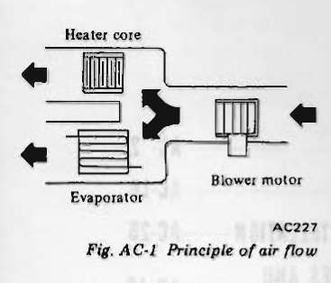
>
> - **Summary:** Functional block diagram showing air driven by blower motor splitting through heater core and evaporator to supply cabin temperature control.
> - **Components:** Heater core, Evaporator, Blower motor
> - **Mechanic Notes:** Illustrates how airflow splits between heating and cooling elements before entering the cabin distribution ducts.
> - **Tags:** `air flow principle`, `heater core`, `evaporator`, `blower motor`

The component units of the air conditioner are installed in the engine room and passenger compartment; the compressor and condenser in the former and the unit comprising the evaporator, heater and blower and its control in the latter. The units in the passenger compartment are summarized as below:

### Air intake housing
This housing is internally provided with an air intake door that takes in outside air.

### Blower housing
The housing contains a blower motor, by which the air is blown to the heater and evaporator.

### Evaporator housing
An evaporator is contained in this housing, which cools air passing through the fins with refrigerant circulating in the system.

### Heater unit
A heater core is housed in this unit, in which hot water from the engine runs to warm the air passing through the fins.

## FEATURES

1. When the AIR lever is set in BI-LEVEL position, the mode door is set halfway between the full open and full close positions. Fresh air is blown out from the outlets in the instrument panel and warm air from underfoot, thus providing ventilation and heating functions at the same time.
2. The mode door to divert air flow and the air intake door are opened and closed by means of the vacuum actuator.
3. The control of hot water flowing to the heater is carried out by the vacuum-operating water cock and the water cock that controls the amount of hot water.
4. When the air conditioner is in A/C, the temperature is adjusted by automatically switching the compressor on or off by means of the thermostat.
5. The air conditioner can be operated with the fast idle control device during idling.

---

<!-- Page 3 (AC-3) -->
*Air Conditioning*

> 🖼️ **Fig. AC-2 Sectional view of air conditioner** `[AC779]` *(Type: `exploded_view`)*
>
> 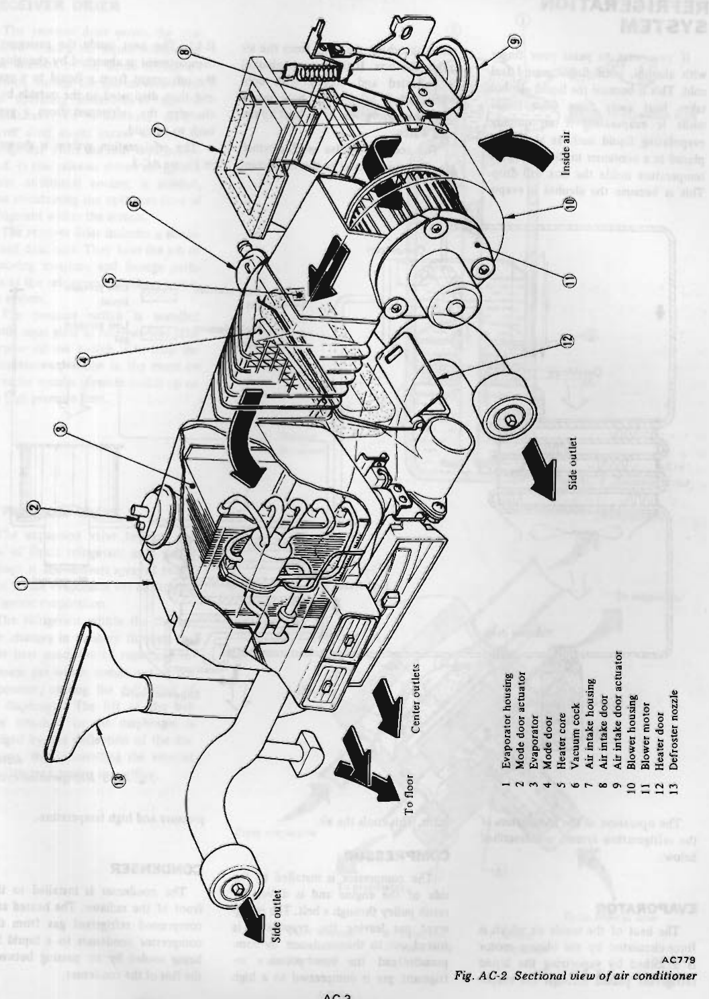
>
> - **Summary:** Cutaway perspective view of the under-dash air conditioning package showing air intake housing, blower assembly, evaporator core, heater core, control doors, actuators, and air delivery ducting.
> - **Components:** Evaporator housing, Mode door actuator, Evaporator, Mode door, Heater core, Vacuum cock, Air intake housing, Air intake door, Air intake door actuator, Blower housing, Blower motor, Heater door, Defroster nozzle, Side outlet ducts, Center outlets duct
> - **Callouts:** **(1)** Evaporator housing; **(2)** Mode door actuator; **(3)** Evaporator; **(4)** Mode door; **(5)** Heater core; **(6)** Vacuum cock; **(7)** Air intake housing; **(8)** Air intake door; **(9)** Air intake door actuator; **(10)** Blower housing; **(11)** Blower motor; **(12)** Heater door; **(13)** Defroster nozzle
> - **Wiring / Connections:** Discharge path to center outlets; Discharge path to floor; Discharge path to side outlets; Defroster nozzle ducting
> - **Mechanic Notes:** Shows structural relationship and mounting positions of under-dash HVAC housings: intake housing on passenger side, blower housing, and evaporator/heater housing.
> - **Tags:** `sectional view`, `air conditioner assembly`, `evaporator`, `blower motor`, `heater core`, `actuator`, `doors`

---

<!-- Page 4 (AC-4) -->
*Air Conditioning*

## REFRIGERATION SYSTEM

If you were to paint your finger with alcohol, your finger would feel cold. This is because the liquid alcohol takes heat away from your finger while it evaporates. If an quickly evaporating liquid such as alcohol is placed in a container inside a box, the temperature inside the box will drop. This is because the alcohol is evaporated absorbing the heat from the air inside the box. If the gaseous alcohol is collected and cooled with cold water, it will be changed back into a liquid by absorption of its heat by the cold water.

The cooler operates on this principle. The liquid used is the refrigerant R-12. The heat inside the passenger compartment is absorbed by changing the refrigerant from a liquid to a gas and then dissipated to the outside by changing the refrigerant from a gas back to a liquid.

The refrigeration system is shown in Figure AC-3.

> 🖼️ **Fig. AC-3 Refrigeration cycle** `[AC780]` *(Type: `cutaway_flow`)*
>
> 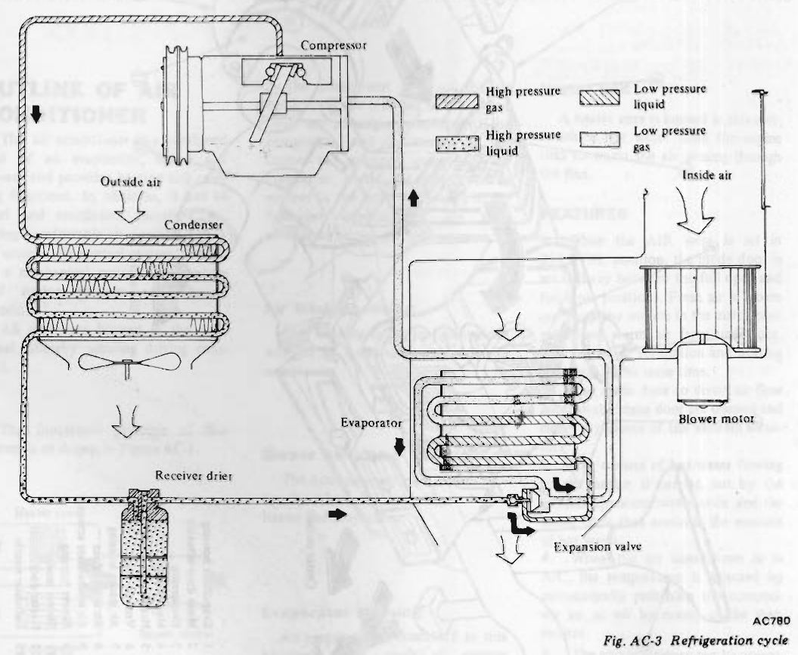
>
> - **Summary:** Schematic layout of the closed-loop R-12 refrigeration cycle showing compressor, condenser, receiver drier, expansion valve, and evaporator with shading indicating pressure and state changes.
> - **Components:** Compressor, Condenser, Receiver drier, Expansion valve, Evaporator, Blower motor
> - **Callouts:** **(High pressure gas)** Refrigerant vapor between compressor discharge and condenser; **(High pressure liquid)** Condensed liquid refrigerant from condenser through receiver drier to expansion valve; **(Low pressure liquid)** Atomized low-pressure liquid spray emerging from expansion valve into evaporator; **(Low pressure gas)** Vaporized refrigerant leaving evaporator core returning to compressor suction port
> - **Specs / Measurements:** Refrigerant: R-12
> - **Wiring / Connections:** High pressure discharge line; Liquid line; Suction return line
> - **Mechanic Notes:** Heat absorbed from cabin air at evaporator is pumped by compressor to condenser where it is transferred to outside airflow.
> - **Tags:** `refrigeration cycle`, `compressor`, `condenser`, `receiver drier`, `expansion valve`, `evaporator`, `R-12`

The operation of the five devices of the refrigeration system are described below.

### EVAPORATOR
The heat of the inside air which is force-circulated by the blower motor is absorbed by vaporizing the liquid refrigerant passed through the evaporator. This cools the air.

### COMPRESSOR
The compressor is installed to the side of the engine and is driven by crank pulley through a belt. The refrigerant gas leaving the evaporator is forced out to the condenser by compressor and the low pressure refrigerant gas is compressed to a high pressure and high temperature.

### CONDENSER
The condenser is installed to the front of the radiator. The heated and compressed refrigerant gas from the compressor condenses to a liquid by being cooled by air passing between the fins of the condenser.

---

<!-- Page 5 (AC-5) -->
*Air Conditioning*

### RECEIVER DRIER

The receiver drier serves the purpose of storing the liquid refrigerant. The amount of the liquid refrigerant flowing through the system varies with the operating condition of the air conditioner. To be accurate, the receiver drier stores excess amount of refrigerant when the heat load is lowered. It also releases stored refrigerant when additional cooling is needed, thus maintaining the optimum flow of refrigerant within the system.

The receiver drier includes a strainer and desiccant. They have the job of removing moisture and foreign particles as the refrigerant circulates within the system.

The pressure switch is installed beside sight glass of receiver drier. The purpose of the switch is to stop the compressor operation in the event an excessive system pressure builds up on the high pressure lines.

> 🖼️ **Fig. AC-4 Receiver drier** `[AC781]` *(Type: `cutaway_flow`)*
>
> 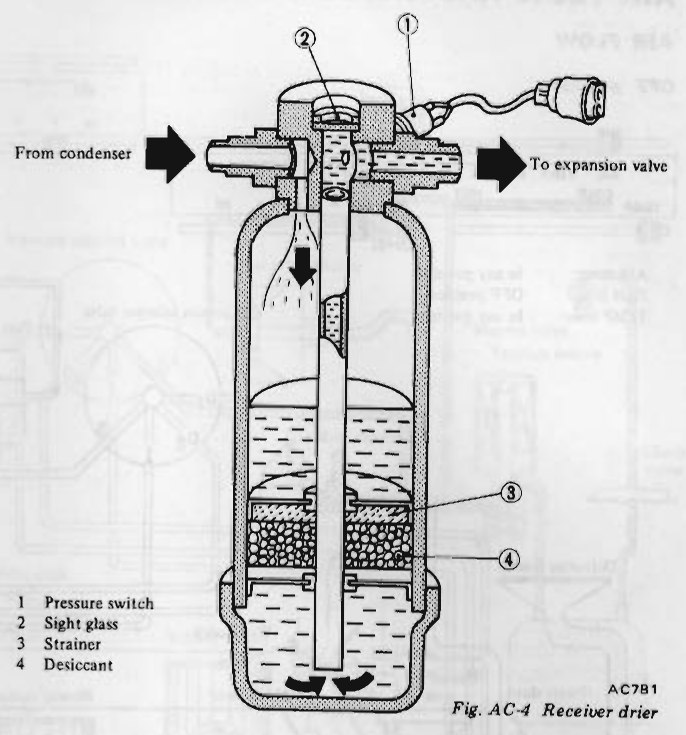
>
> - **Summary:** Cross-sectional cutaway diagram of the receiver drier tank showing liquid pick-up tube, desiccant bed, strainer screens, sight glass, and top-mounted high-pressure safety switch.
> - **Components:** Pressure switch, Sight glass, Strainer, Desiccant, Pick-up tube, Inlet connection, Outlet connection
> - **Callouts:** **(1)** Pressure switch; **(2)** Sight glass; **(3)** Strainer; **(4)** Desiccant
> - **Wiring / Connections:** Electrical harness connector to pressure switch; Inlet from condenser; Outlet to expansion valve
> - **Mechanic Notes:** Excess liquid refrigerant is held in tank while central pick-up tube draws clean, dehydrated liquid from bottom through strainer and desiccant.
> - **Tags:** `receiver drier`, `pressure switch`, `sight glass`, `strainer`, `desiccant`

### EXPANSION VALVE

The expansion valve restricts the flow of liquid refrigerant as it passes through it and delivers sprayed refrigerant to the evaporator for facilitating refrigerant evaporation.

The refrigerant within the thermo bulb changes in pressure through the super heat condition of vaporized refrigerant gas which comes out of the evaporator, causing the deflection of the diaphragm. The lift of the ball valve attached to the diaphragm is changed by the deflection of the diaphragm, thus controlling the amount of refrigerant passing the orifice.

> 🖼️ **Fig. AC-5 Expansion valve** `[AC231]` *(Type: `cutaway_flow`)*
>
> 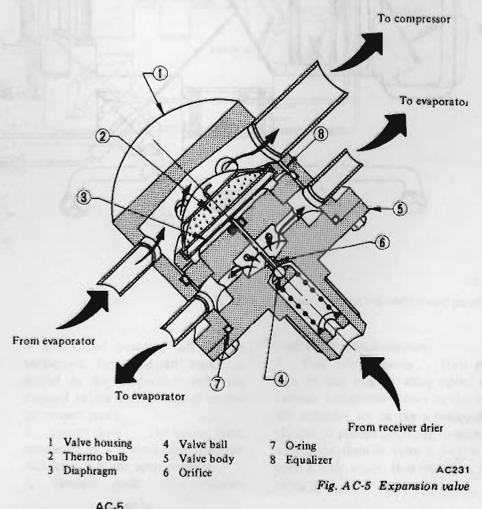
>
> - **Summary:** Cross-sectional cutaway illustration of the thermostatic expansion valve detailing valve housing, thermo bulb, diaphragm, valve ball, orifice, equalizer, and O-ring seal.
> - **Components:** Valve housing, Thermo bulb, Diaphragm, Valve ball, Valve body, Orifice, O-ring, Equalizer
> - **Callouts:** **(1)** Valve housing; **(2)** Thermo bulb; **(3)** Diaphragm; **(4)** Valve ball; **(5)** Valve body; **(6)** Orifice; **(7)** O-ring; **(8)** Equalizer
> - **Wiring / Connections:** Port from receiver drier; Port to evaporator; Return passage from evaporator; Return port to compressor
> - **Mechanic Notes:** Sensing bulb pressure acts against diaphragm to modulate valve ball against calibrated orifice, regulating superheat entering evaporator.
> - **Tags:** `expansion valve`, `thermo bulb`, `diaphragm`, `valve ball`, `orifice`, `equalizer`

---

<!-- Page 6 (AC-6) -->
*Air Conditioning*

# AIR FLOW AND VACUUM SYSTEM

## AIR FLOW

### OFF position

* **AIR lever:** In any position
* **FAN lever:** OFF position
* **TEMP lever:** In any position

> 🖼️ **Fig. AC-6 Air flow - OFF position** `[AC782]` *(Type: `vacuum_routing`)*
>
> 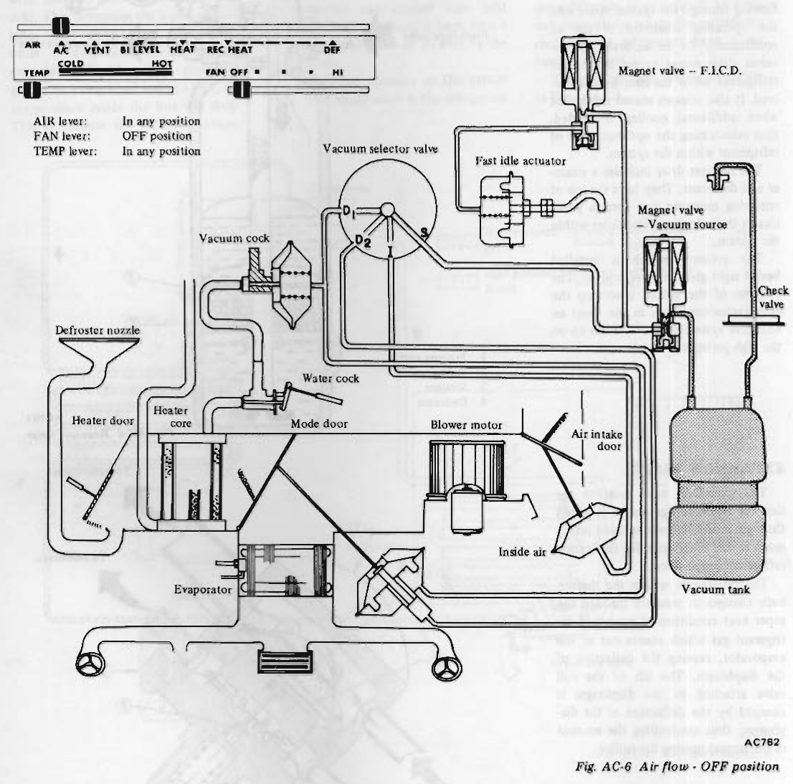
>
> - **Summary:** Schematic of air ducting and vacuum control circuits in OFF position with blower motor unpowered and vacuum source magnet valve de-energized.
> - **Components:** Control lever assembly, Vacuum selector valve, Vacuum cock, Water cock, Fast idle actuator, Magnet valve - F.I.C.D., Magnet valve - Vacuum source, Check valve, Vacuum tank, Defroster nozzle, Heater door, Heater core, Mode door, Blower motor, Air intake door, Evaporator
> - **Callouts:** **(S)** Vacuum supply port on selector valve; **(D1)** Mode door double-action actuator port 1; **(D2)** Mode door double-action actuator port 2; **(I)** Air intake door actuator port
> - **Specs / Measurements:** AIR lever: In any position; FAN lever: OFF position; TEMP lever: In any position
> - **Wiring / Connections:** Vacuum circuit vented through de-energized vacuum source magnet valve
> - **Mechanic Notes:** When FAN lever is OFF, the vacuum source magnet valve vents the entire selector valve network to atmospheric pressure.
> - **Tags:** `air flow`, `vacuum system`, `OFF position`, `vacuum selector valve`, `schematic`

---

<!-- Page 7 (AC-7) -->
*Air Conditioning*

### A/C (Air conditioner) position

* **AIR lever:** In A/C position
* **FAN lever:** In any position other than OFF
* **TEMP lever:** Cold to Hot

> 🖼️ **Fig. AC-7 Air flow - A/C (Air Conditioner) position** `[AC783]` *(Type: `vacuum_routing`)*
>
> 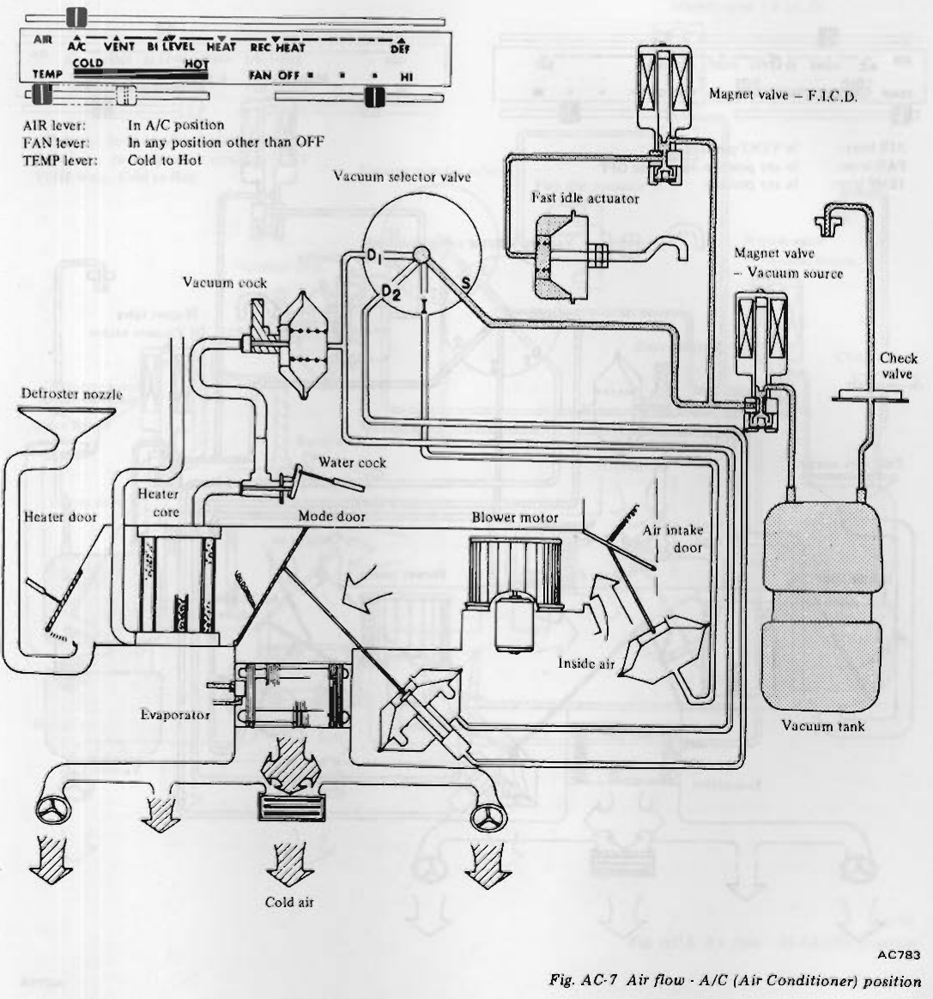
>
> - **Summary:** Schematic routing of air flow and vacuum lines in A/C mode showing recirculated air cooling through evaporator, fast idle actuator energized, and vacuum cock shutting hot water off.
> - **Components:** Control lever assembly, Vacuum selector valve, Vacuum cock, Water cock, Fast idle actuator, Magnet valve - F.I.C.D., Magnet valve - Vacuum source, Check valve, Vacuum tank, Defroster nozzle, Heater door, Heater core, Mode door, Blower motor, Air intake door, Evaporator
> - **Callouts:** **(S)** Vacuum source port; **(D1)** Mode door port 1; **(D2)** Mode door port 2; **(I)** Air intake door port
> - **Specs / Measurements:** AIR lever: In A/C position; FAN lever: In any position other than OFF; TEMP lever: Cold to Hot
> - **Wiring / Connections:** Vacuum applied to vacuum cock and F.I.C.D. actuator; ports D1, D2, and I vented
> - **Mechanic Notes:** Vacuum cock cuts hot coolant flow to heater core. Air intake door closes to outside air to maximize cabin recirculation cooling.
> - **Tags:** `air flow`, `vacuum routing`, `A/C position`, `recirculation`, `fast idle actuator`, `vacuum cock`

When the AIR lever is set to the A/C position, vacuum and air flows are as shown in the schematic layout above.

1. **Air intake door** ... The air intake door is in the closed position, shutting off outside air. Air is circulating inside the passenger compartment.
2. **Mode door** ... The mode door is in the closed position. All the air introduced from the air intake is cooled in the evaporator and then directed to the outlets located on the instrument panel.
3. **Heater door** ... The heater door, connected by a control cable from the AIR lever, is in the open position.
4. **Vacuum cock** ... The vacuum cock is in the shut position.
5. **Fast idle actuator** ... With passage to the magnet valve open, the vacuum introduced down to the fast idle actuator moves the actuator diaphragm to pull its operating lever. As a result, the throttle valve is moved to open a little wider, thus increasing the idling rpm.

---

<!-- Page 8 (AC-8) -->
*Air Conditioning*

### VENT (Ventilation) position

* **AIR lever:** In VENT position
* **FAN lever:** In any position other than OFF
* **TEMP lever:** In any position

> 🖼️ **Fig. AC-8 Air flow - VENT (Ventilation) position** `[AC784]` *(Type: `vacuum_routing`)*
>
> 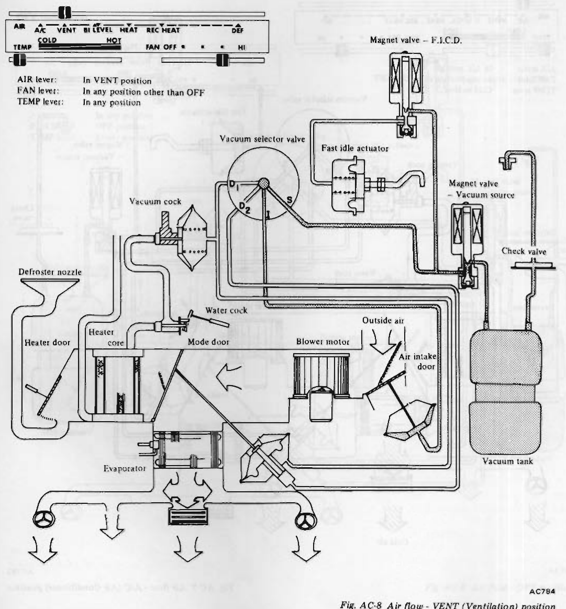
>
> - **Summary:** Schematic routing of airflow and vacuum in VENT mode with fresh air intake door open, compressor unpowered, mode door closed, and air discharged through dashboard vents.
> - **Components:** Control lever assembly, Vacuum selector valve, Vacuum cock, Water cock, Fast idle actuator, Magnet valve - F.I.C.D., Magnet valve - Vacuum source, Check valve, Vacuum tank, Defroster nozzle, Heater door, Heater core, Mode door, Blower motor, Air intake door, Evaporator
> - **Callouts:** **(S)** Vacuum source port; **(D1)** Mode door port 1; **(D2)** Mode door port 2; **(I)** Air intake door port
> - **Specs / Measurements:** AIR lever: In VENT position; FAN lever: In any position other than OFF; TEMP lever: In any position
> - **Wiring / Connections:** Vacuum routed from port S to port I and vacuum cock
> - **Mechanic Notes:** Directs fresh outside air through dashboard vents without heating or refrigeration.
> - **Tags:** `air flow`, `vacuum routing`, `VENT position`, `ventilation`, `outside air`

1. **Air intake door** ... Vacuum is introduced to the actuator of the air intake door and causes an actuator movement to open the door. Thus it admits outside air into the air conditioner unit.
2. **Mode door** ... The mode door is in the closed position. Outside air is directed to the outlets located on the instrument panel.
3. **Heater door** ... The heater door is in the open position.
4. **Vacuum cock** ... The vacuum cock is in the closed position, shutting off the hot water at the cock.
5. **Fast idle actuator** ... The vacuum flowing into the fast idle actuator is interrupted by the magnet valve. The actuator then stops its operation and the operating lever returns to its original position.

---

<!-- Page 9 (AC-9) -->
*Air Conditioning*

### BI-LEVEL position

* **AIR lever:** In BI-LEVEL position
* **FAN lever:** In any position other than OFF
* **TEMP lever:** Cold to Hot

> 🖼️ **Fig. AC-9 Air flow - BI-LEVEL position** `[AC785]` *(Type: `vacuum_routing`)*
>
> 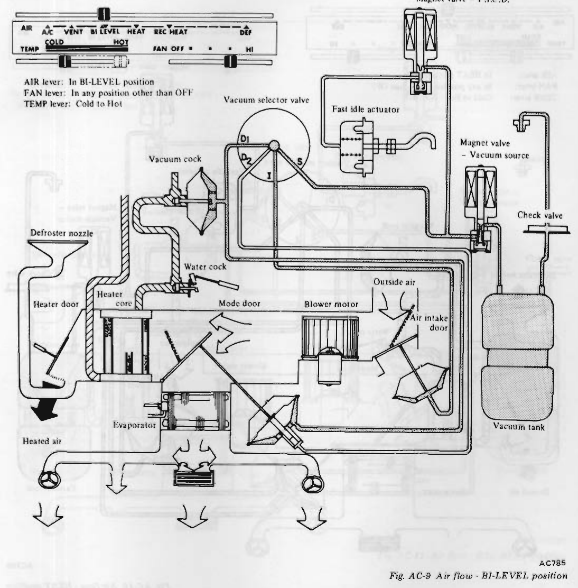
>
> - **Summary:** Schematic of airflow and vacuum in BI-LEVEL position where vacuum energizes stage D1 of mode door actuator, discharging cool fresh air to face vents and heated air to footwell.
> - **Components:** Control lever assembly, Vacuum selector valve, Vacuum cock, Water cock, Fast idle actuator, Magnet valve - F.I.C.D., Magnet valve - Vacuum source, Check valve, Vacuum tank, Defroster nozzle, Heater door, Heater core, Mode door, Blower motor, Air intake door, Evaporator
> - **Callouts:** **(S)** Vacuum source port; **(D1)** Mode door port 1 (first stage); **(D2)** Mode door port 2 (second stage); **(I)** Air intake door port
> - **Specs / Measurements:** AIR lever: In BI-LEVEL position; FAN lever: In any position other than OFF; TEMP lever: Cold to Hot
> - **Wiring / Connections:** Vacuum applied to port I and port D1; port D2 vented
> - **Mechanic Notes:** First stage of double-action actuator holds mode door halfway open to split airflow between dash vents and floor heater core.
> - **Tags:** `air flow`, `vacuum routing`, `BI-LEVEL position`, `bi-level`, `dual action actuator`

1. **Air intake door** ... Vacuum is imposed on the actuator of the air intake door and the door is in the open position.
2. **Mode door** ... Vacuum is introduced only to $\text{D}_1$ of the double-action actuator and the door is allowed to open in its first-stage position. Outside air admitted from the air intake door thus flows both into the heater core and the evaporator.
3. **Heater door** ... The heater door is in the open position. Warm air heated by the core is directed toward occupant's feet in the passenger compartment.
4. **Vacuum cock** ... Vacuum is imposed on the actuator, causing the cock to open. Hot water now circulates in the heater core.
5. **Fast idle actuator** ... The actuator is not in operation.

Under the BI-LEVEL position, fresh outside air is discharged from the instrument air outlets while, from the heater outlets on the floor, warm air is produced.

---

<!-- Page 10 (AC-10) -->
*Air Conditioning*

### HEAT position

* **AIR lever:** In HEAT position
* **FAN lever:** In any position other than OFF
* **TEMP lever:** Cold to Hot

> 🖼️ **Fig. AC-10 Air flow - HEAT position** `[AC786]` *(Type: `vacuum_routing`)*
>
> 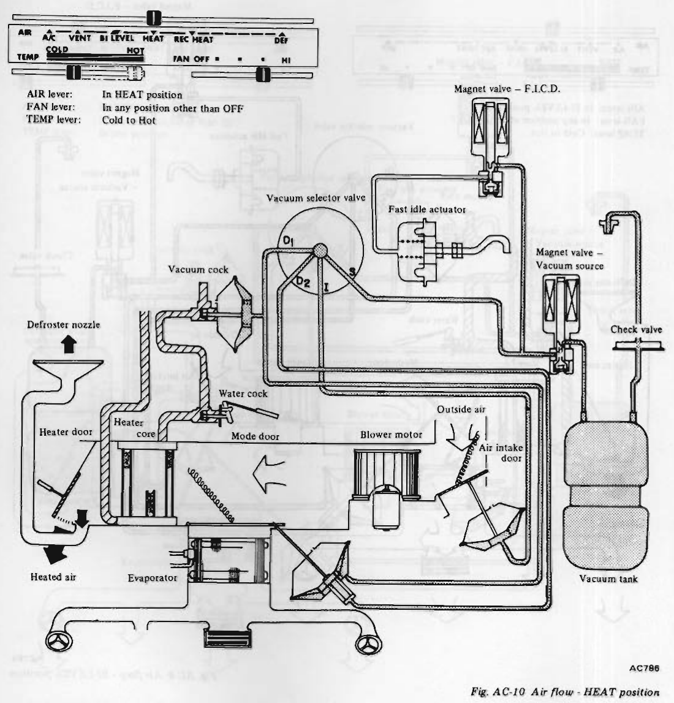
>
> - **Summary:** Schematic of airflow and vacuum in HEAT mode showing vacuum applied to both D1 and D2 ports, opening mode door fully to pass outside air through heater core to floor.
> - **Components:** Control lever assembly, Vacuum selector valve, Vacuum cock, Water cock, Fast idle actuator, Magnet valve - F.I.C.D., Magnet valve - Vacuum source, Check valve, Vacuum tank, Defroster nozzle, Heater door, Heater core, Mode door, Blower motor, Air intake door, Evaporator
> - **Callouts:** **(S)** Vacuum source port; **(D1)** Mode door port 1; **(D2)** Mode door port 2; **(I)** Air intake door port
> - **Specs / Measurements:** AIR lever: In HEAT position; FAN lever: In any position other than OFF; TEMP lever: Cold to Hot
> - **Wiring / Connections:** Vacuum applied to ports I, D1, D2, and vacuum cock
> - **Mechanic Notes:** Both D1 and D2 ports are energized, causing maximum travel of mode door so all incoming fresh air passes through heater core.
> - **Tags:** `air flow`, `vacuum routing`, `HEAT position`, `heating`, `mode door`, `vacuum cock`

1. **Air intake door** ... Vacuum is imposed on the actuator of the air intake door and the door is in the open position.
2. **Mode door** ... Vacuum is introduced both to $\text{D}_1$ and $\text{D}_2$ of the double-action actuator and the mode door is in its fully open position. All the outside air thus flows into the heater core.
3. **Heater door** ... The heater door is in the open position. Warm air heated by the core is discharged from the opening located above occupant's feet. A small portion of it goes to the defroster nozzles.
4. **Vacuum cock** ... Vacuum is imposed on the actuator, causing the vacuum cock to open.
5. **Fast idle actuator** ... The actuator is not in operation.

Temperature of the discharge air varies with the amount of water flowing into the heater core via the water cock. The water cock is controlled by a control cable from the TEMP lever.

---

<!-- Page 11 (AC-11) -->
*Air Conditioning*

### REC HEAT position

* **AIR lever:** In REC HEAT position
* **FAN lever:** In any position other than OFF
* **TEMP lever:** Cold to Hot

> 🖼️ **Fig. AC-11 Air flow - REC HEAT position** `[AC787]` *(Type: `vacuum_routing`)*
>
> 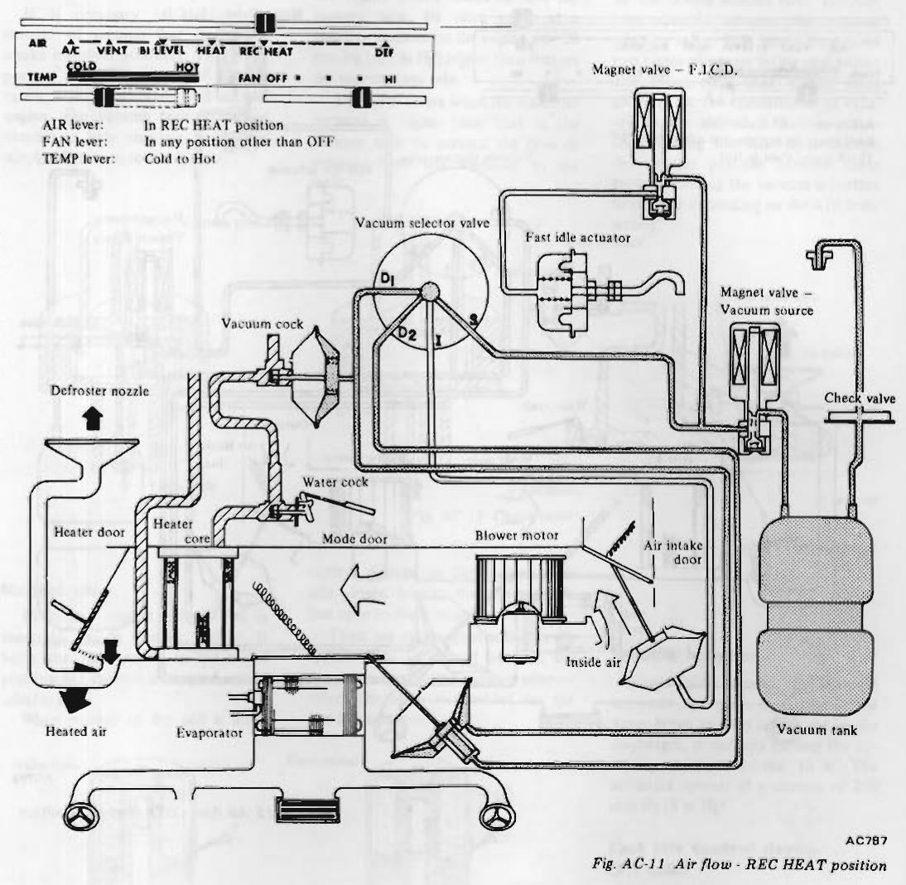
>
> - **Summary:** Schematic routing of airflow and vacuum in REC HEAT mode with intake door closed to outside air, recirculating passenger cabin air through heater core for rapid warmup.
> - **Components:** Control lever assembly, Vacuum selector valve, Vacuum cock, Water cock, Fast idle actuator, Magnet valve - F.I.C.D., Magnet valve - Vacuum source, Check valve, Vacuum tank, Defroster nozzle, Heater door, Heater core, Mode door, Blower motor, Air intake door, Evaporator
> - **Callouts:** **(S)** Vacuum source port; **(D1)** Mode door port 1; **(D2)** Mode door port 2; **(I)** Air intake door port
> - **Specs / Measurements:** AIR lever: In REC HEAT position; FAN lever: In any position other than OFF; TEMP lever: Cold to Hot
> - **Wiring / Connections:** Vacuum applied to D1, D2, and vacuum cock; port I vented
> - **Mechanic Notes:** Port I is vented to close intake door to outside air, recycling passenger compartment air across the heater core.
> - **Tags:** `air flow`, `vacuum routing`, `REC HEAT position`, `recirculating heater`, `rapid warmup`

1. **Air intake door** ... The air intake door is in the closed position, shutting off outside air. Air is circulating inside the passenger compartment.
2. **Mode door** ... Vacuum is introduced both to $\text{D}_1$ and $\text{D}_2$ of the double-action actuator and the mode door is in its fully open position. All the outside air thus flows into the heater core.
3. **Heater door** ... The heater door is in the open position. Warm air heated by the core is discharged from the opening located above occupant's feet. A small portion of it goes to the defroster nozzles.
4. **Vacuum cock** ... Vacuum is imposed on the actuator, causing the vacuum cock to open.
5. **Fast idle actuator** ... The actuator is not in operation.

Temperature of the discharge air varies with the amount of water flowing into the heater core via the water cock. The water cock is controlled by a control cable from the TEMP lever.

---

<!-- Page 12 (AC-12) -->
*Air Conditioning*

### DEF (Defrost) position

* **AIR lever:** In DEF position
* **FAN lever:** In any position other than OFF
* **TEMP lever:** Cold to Hot

> 🖼️ **Fig. AC-12 Air flow - DEF (Defrost) position** `[AC788]` *(Type: `vacuum_routing`)*
>
> 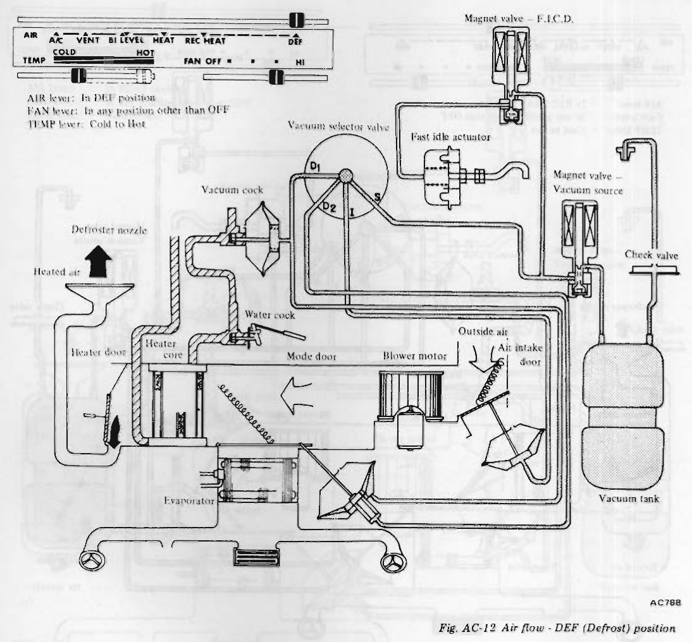
>
> - **Summary:** Schematic of airflow and vacuum in DEF mode with outside air admitted, mode door fully open, and heater door mechanically closed to footwell, directing all warm air to defroster nozzles.
> - **Components:** Control lever assembly, Vacuum selector valve, Vacuum cock, Water cock, Fast idle actuator, Magnet valve - F.I.C.D., Magnet valve - Vacuum source, Check valve, Vacuum tank, Defroster nozzle, Heater door, Heater core, Mode door, Blower motor, Air intake door, Evaporator
> - **Callouts:** **(S)** Vacuum source port; **(D1)** Mode door port 1; **(D2)** Mode door port 2; **(I)** Air intake door port
> - **Specs / Measurements:** AIR lever: In DEF position; FAN lever: In any position other than OFF; TEMP lever: Cold to Hot
> - **Wiring / Connections:** Vacuum applied to I, D1, D2, and vacuum cock
> - **Mechanic Notes:** A mechanical control cable linked directly to the AIR lever forces the heater door shut, blocking floor distribution and directing heated air exclusively to windshield defroster nozzles.
> - **Tags:** `air flow`, `vacuum routing`, `DEF position`, `defrost`, `heater door cable`

1. **Air intake door** ... Vacuum is imposed on the actuator of the air intake door and the door is in the open position.
2. **Mode door** ... Vacuum is introduced both to $\text{D}_1$ and $\text{D}_2$ of the double-action actuator and the mode door is in its fully open position.
3. **Heater door** ... The control cable of the heater door is connected to the AIR lever and holds the door in the closed position. Warm air heated by the core goes to the defroster nozzles.
4. **Vacuum cock** ... Vacuum is imposed on the actuator of the vacuum cock and the cock is in the open position.
5. **Fast idle actuator** ... The actuator is not in operation.

---

<!-- Page 13 (AC-13) -->
*Air Conditioning*

## VACUUM SYSTEM

### Vacuum tank
It is necessary to control the amount of vacuum that the engine intake manifold produces. This is important since the amount of vacuum varies with speed and load of the engine. The vacuum tank stores the vacuum to help maintain a constant supply of vacuum to the system.

### Check valve
The check valve is located between the engine intake manifold and the vacuum tank. Its valve opens at a negative pressure on the engine side 20 mm Hg (4/5 in Hg) higher than that on the vacuum tank side.

The valve closes when the manifold pressure is higher than that in the vacuum tank to prevent the flow of pressure from the manifold to the tank.

> 🖼️ **Fig. AC-13 Check valve** `[AC658]` *(Type: `cutaway_flow`)*
>
> 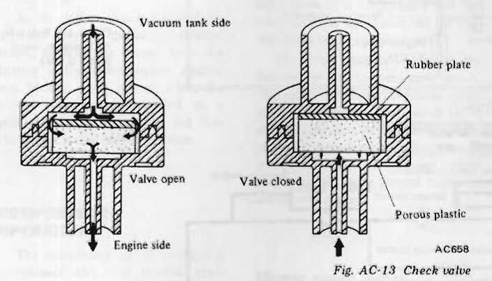
>
> - **Summary:** Cross-sectional cutaway drawing of vacuum check valve in open and closed positions, displaying rubber plate flapper and porous plastic filter.
> - **Components:** Check valve body, Rubber plate, Porous plastic filter, Engine side port, Vacuum tank side port
> - **Callouts:** **(Valve open)** Negative pressure on engine side 20 mm Hg higher than vacuum tank; **(Valve closed)** Manifold pressure higher than vacuum tank, preventing reverse flow
> - **Specs / Measurements:** Opening pressure differential: 20 mm Hg (4/5 in Hg)
> - **Wiring / Connections:** Inlet from intake manifold; Outlet to vacuum tank
> - **Mechanic Notes:** Maintains stored vacuum inside reservoir during acceleration when manifold vacuum drops.
> - **Tags:** `check valve`, `vacuum system`, `rubber plate`, `porous plastic`

### Magnet valve
While the magnet valve's coil is energized by an electric current, it holds the valve needle in the raised position and vacuum is imposed on the selector side.

When current to the coil is interrupted, passage on the vacuum tank side closes, leaving the selector side line open to the atmosphere.

There are two magnet valves in the system. One is located between the vacuum tank and the vacuum selector valve. The other is provided for the fast idle actuator.

> 🖼️ **Fig. AC-14 Magnet valve** `[AC789]` *(Type: `cutaway_flow`)*
>
> 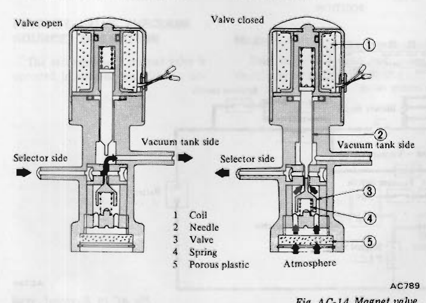
>
> - **Summary:** Cross-sectional cutaway illustration of three-way solenoid magnet valve in energized (valve open to vacuum tank) and de-energized (valve closed, open to atmosphere) conditions.
> - **Components:** Coil, Needle, Valve, Spring, Porous plastic filter
> - **Callouts:** **(1)** Coil; **(2)** Needle; **(3)** Valve; **(4)** Spring; **(5)** Porous plastic
> - **Specs / Measurements:** Actuation vacuum: 200 mm Hg (8 in Hg)
> - **Wiring / Connections:** Selector side port; Vacuum tank side port; Atmosphere vent with filter
> - **Mechanic Notes:** When energized, needle lifts connecting selector side to vacuum tank. When de-energized, spring pushes needle down, isolating tank and venting selector line to atmosphere.
> - **Tags:** `magnet valve`, `solenoid`, `needle valve`, `vacuum source`, `FICD`

### Vacuum selector valve
Vacuum distribution is controlled by the vacuum selector valve. The AIR lever directly actuates the vacuum selector valve. This valve consists of two plates which are facing each other. The plates have their mating faces grooved for the transmission of vacuum to the individual vacuum actuators. Moving the AIR lever changes the relative position between these grooves, causing the vacuum actuators to operate depending on the AIR lever setting.

> 🖼️ **Fig. AC-15 Vacuum selector valve** `[AC548]` *(Type: `alignment_orientation`)*
>
> 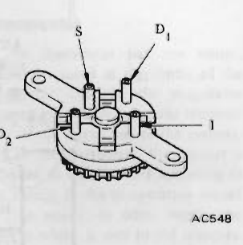
>
> - **Summary:** Top perspective diagram of rotary faceplate vacuum selector valve showing port nipples S, D1, D2, and I.
> - **Components:** Vacuum selector valve body, Port S, Port D1, Port D2, Port I
> - **Callouts:** **(S)** Vacuum source line from magnet valve; **(D1)** Mode door double-action actuator stage 1; **(D2)** Mode door double-action actuator stage 2; **(I)** Air intake door actuator line
> - **Wiring / Connections:** Hose S from vacuum source magnet valve; Hose D1 to mode door actuator stage 1; Hose D2 to mode door actuator stage 2; Hose I to air intake door actuator
> - **Mechanic Notes:** Mechanically actuated by the AIR control lever; channels vacuum across grooved mating faceplates to drive HVAC mode doors.
> - **Tags:** `vacuum selector valve`, `ports`, `AIR lever`, `vacuum distribution`

### Vacuum actuator
Single-action and double-action actuators are used. Operation is the same. When vacuum is imposed on the diaphragm, it deflects moving the operating lever connected to it. The actuators operate at a vacuum of 200 mm Hg (8 in Hg).

### Fast idle control device (F.I.C.D.)
The fast idle control device increases engine idle speed so that the air conditioner continues to cool the passenger compartment even when the car is at a stand still.

### Vacuum water cock
This cock, too, has a vacuum actuator, by which two-stage operations of opening and closing the cock are performed. This cock opens and closes the passage of the cooling water which flows into the heater core.

---

<!-- Page 14 (AC-14) -->
*Air Conditioning*

> 🖼️ **Fig. AC-16 Electrical circuit** `[AC790]` *(Type: `electrical_schematic`)*
>
> 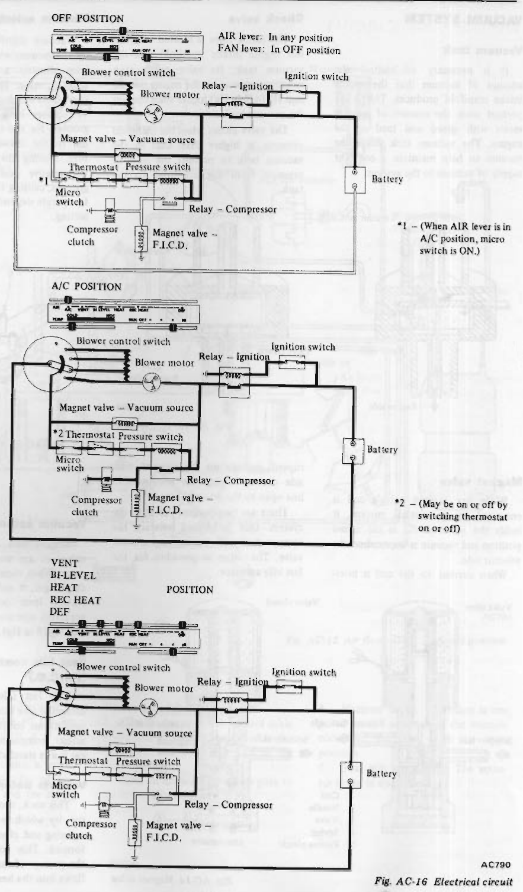
>
> - **Summary:** Full electrical schematic showing circuit routing for OFF position, A/C position, and other HVAC positions (VENT, BI-LEVEL, HEAT, REC HEAT, DEF).
> - **Components:** Blower control switch, Blower motor, Relay - Ignition, Ignition switch, Magnet valve - Vacuum source, Thermostat, Pressure switch, Micro switch, Relay - Compressor, Compressor clutch, Magnet valve - F.I.C.D., Battery
> - **Callouts:** **(*1)** When AIR lever is in A/C position, micro switch is ON.; **(*2)** May be on or off by switching thermostat on or off
> - **Specs / Measurements:** System voltage: 12V; Switching logic: Ground-side control
> - **Wiring / Connections:** Battery positive feed through ignition switch to ignition relay; Ignition relay power feed to blower motor and vacuum source magnet valve; Blower resistor tapped speeds grounded through blower control switch; Compressor relay coil circuit in series with micro switch, thermostat, pressure switch, and blower ground; Compressor relay output to compressor clutch and FICD magnet valve
> - **Mechanic Notes:** Ground-controlled circuit architecture. Compressor clutch and FICD cannot engage unless blower fan is running, micro switch is closed in A/C position, thermostat calls for cooling, and high pressure switch is closed.
> - **Tags:** `electrical circuit`, `schematic`, `compressor relay`, `ignition relay`, `blower switch`, `micro switch`, `pressure switch`, `thermostat`

---

<!-- Page 15 (AC-15) -->
*Air Conditioning*

# ELECTRICAL CIRCUIT

The electrical system of the air conditioner is designed to control the ground circuit. In the following paragraphs are described the operations of the blower motor, compressor and magnet valves.

## BLOWER MOTOR OPERATION

As the ignition switch is turned on, a power relay for the air conditioner closes, allowing the current from the battery to the blower motor, resistor and blower speed switch. When the blower speed switch is turned on, a ground circuit is completed and thus the blower motor begins to rotate.

## COMPRESSOR OPERATION

The compressor circuit contains a compressor relay. The solenoid energizing circuit of the relay includes the blower speed switch, a micro switch, the thermostat and a pressure switch, all connected in series. On-off operations in these devices control current to the compressor clutch. This circuit also controls the magnet valve for the fast idle actuator.

## MAGNET VALVE (VACUUM SOURCE) OPERATION

The vacuum source magnet valve is operated in conjunction with the on-off of the blower speed switch. This valve controls vacuum supply to the vacuum-operated system.

### Relay
Two relays are used. One is in the line between the blower motor and the battery. When the ignition switch is set at ON, the current flows through the solenoid to the ground, that is, the relay solenoid is energized so that the relay contacts are closed and the current flows to the blower motor.

The other relay is located in the line on the way to compressor clutch. The pressure switch, thermostat, micro switch and blower speed switch are in series connection in the line where the solenoid branches off. The current passes through the blower speed switch to the same ground circuit as the blower motor.

### Blower speed switch
The blower speed switch is directly actuated by the FAN lever. The current passes through the resistor to the blower motor; then it passes through the blower speed switch to the ground. The speed of the blower motor is changed to four speeds with the FAN lever's position.

### Magnet valve
This valve is opened and closed electrically by its electric solenoid.

### Pressure switch
Installed in the receiver drier, the pressure switch interrupts current to the compressor clutch and stops the compressor operation whenever system pressure on the high pressure lines builds up abnormally. See Figure AC-4.

### Micro switch
The micro switch is actuated by the AIR lever. This switch is on only when the AIR lever is set at A/C position.

### Thermostat
The thermostat has one sensor, which is located in the center of the evaporator core of the evaporator housing and which senses the temperature of air forced out of the evaporator. In the thermostat, the contact is switched to ON and OFF according to the change in the temperature sensed by the sensor; in other words, the current which is sent to the compressor clutch is cut so as to stop the compressor's operation and to maintain steady the temperature of air forced out. One of the control cables from the TEMP lever changes the temperature setting for operation of the thermostat.

### Compressor clutch
The compressor clutch engages and disengages the clutch disc electrically by the electric solenoid, and transmits the engine speed to the shaft of the compressor.

---

<!-- Page 16 (AC-16) -->
*Air Conditioning*

# GENERAL SERVICE

### CONTENTS

| Topic | Page | Topic | Page |
|:---|:---|:---|:---|
| REFRIGERANT R-12 | AC-16 | EVACUATING SYSTEM | AC-20 |
| COMPRESSOR OIL | AC-16 | CHARGING REFRIGERANT | AC-21 |
| MAINTENANCE | AC-16 | CHECKING FOR LEAKS | AC-23 |
| PERIODIC MAINTENANCE AND SEASON-IN INSPECTION | AC-16 | HALIDE LEAK DETECTOR | AC-23 |
| GENERAL SERVICE INSTRUCTIONS | AC-16 | ELECTRIC LEAK DETECTOR | AC-24 |
| SAFETY PRECAUTIONS | AC-17 | REFRIGERANT LEVEL CHECK | AC-24 |
| EVACUATING AND CHARGING SYSTEM | AC-17 | SIGHT GLASS | AC-24 |
| HANDLING MANIFOLD GAUGE | AC-17 | PERFORMANCE TEST | AC-25 |
| HANDLING SERVICE VALVE | AC-18 | COMPRESSOR OIL LEVEL CHECK | AC-25 |
| HANDLING CAN TAP | AC-19 | PERFORMANCE TEST | AC-25 |
| DISCHARGING SYSTEM | AC-20 | REFRIGERANT LEAKS | AC-25 |

---

## REFRIGERANT R-12

The refrigerant used in the air conditioner is generally called "Refrigerant-12 (R-12)". No other refrigerant than the above refrigerant should be used.

This refrigerant is usually available in a small can or a cylinder. In either case, it is liquefied under high pressure in the container.

Refrigerant evaporates easily (has a low evaporation point) and, moreover, since the latent heat of the refrigerant is large, it can absorb a large amount of heat when evaporating. Extreme care must be exercised when handling the refrigerant.

## COMPRESSOR OIL

The "SUNISO 5GS" refrigeration lubricant should be used to assure the successful compressor operation. Use of oils other than recommended or mixing of the oil with other oils would cause chemical reaction or lead to lowered viscosity or deficient lubrication.

The oil absorbs moisture as it contacts the air. This points out the need for care not to expose it to atmosphere for an extended period of time.

## MAINTENANCE

### PERIODIC MAINTENANCE AND SEASON-IN INSPECTION

Both periodic maintenance and season-in inspection are most essential to enable the air conditioner to give full performance.

Perform the following checks.
1. Start engine and check refrigerant level through sight glass on receiver drier. For details, refer to relative topics under "Refrigerant Level Check".
2. Check the entire system for sign of refrigerant leaks. Refer to relative topics under "Checking for Leaks" and "Refrigerant Leaks".  
   If any trace of oil is noted at and around connection fittings, it is a sure indication that refrigerant is leaking. This condition can be corrected easily by retightening the joints. If any joint on line is suspected of small amount of leakage, use a leak detector to locate leaking points.
3. Check compressor drive belts for proper deflection.

### Season-off
Observe the following maintenance tips to allow the air conditioner to operate normally in the next season.
1. Keep the entire system free from refrigerant leakage by periodically checking for refrigerant gas leak even out of season.
2. Turn the compressor for 10 minutes at least once a month by running the engine at 1,500 rpm.

## GENERAL SERVICE INSTRUCTIONS

The servicing of the air conditioner should be carried out only by well-trained servicemen. This chapter describes essential points of servicing.

* If a large amount of dirt and sand enter the system, they will be carried with refrigerant and may clog the system or scratch rotating parts. This points out the need for care in servicing the system. That is, disconnecting joints should be carried out in a clean place.
* Water should not be allowed to get inside the system. The refrigerant does not readily mix with water. However, the presence of even a minute amount of water will cause a chemical reaction at high temperature which will in turn produce hydrochloric acid (HCl). Since hydrochloric acid is highly corrosive to metals, the aluminum and copper piping, etc. will become corroded and the refrigeration system will become clogged. <!-- Page 17 (AC-17) --> *Air Conditioning*

* Water in the system will ice the orifice when the high pressure refrigerant is changed to low pressure refrigerant by expansion valve, etc., and will obstruct the refrigerant flow.

The following are general instructions to be closely observed in servicing the system.

1. When a system line is disconnected, plug the opening immediately. This is especially necessary to prevent moisture condensation from forming in the line and to keep out dirt and dust. It is also necessary to keep the line at and above surrounding air temperatures at all times. When connecting system lines, do not attempt to remove the plug from the opening until ready for immediate use.
2. Always keep the working place clean and dry and free from dirt and dust. Wipe clean water that comes into contact with the pipe joint before disconnecting.
3. Have all necessary tools in preparation beforehand and have tools clean and dry.
4. The compressor oil will easily absorb moisture when exposed to air. Immediately close the opening of the container after use. It is also necessary to observe the following notes:

> [!CAUTION]
> a. The oil should not be transfused from a container into another, as the failure will possibly cause moisture to mix with the oil.  
> b. The used oil should not be returned into a container.  
> c. The oil should not be used if its state of preservation is not clear enough.

5. When connecting or disconnecting pipes from the refrigeration system, use two wrenches. One wrench is used for holding the fixing nut in place while the other for turning the mating flare nut. Failure to do so may result in a twisted tube or may damage connection.
6. Also use care not to give scratches to the seating surface at connections. A small scratch on the seating surface may be the cause of gas leakage. Before connecting pipes, be sure to give coating of compressor oil to the seating surfaces.

## SAFETY PRECAUTIONS

> [!WARNING]
> 1. **Since direct contact of the liquid refrigerant with your skin will cause frostbite, always be careful when handling the refrigerant.** Wear gloves or wrap a piece of cloth around service valve to protect your fingers against frostbite by refrigerant. If any of the refrigerant should get into your eyes when charging the refrigerant, splash your eyes with cool water to raise the temperature gradually. Apply a protective film to the eye to avoid infection. Do not rub your eyes. Consult an eye specialist. Always wear goggles or glasses to protect your eyes when working around the system. Should refrigerant strikes your body, splash on cool water and apply a protective film.
> 2. **The refrigerant service container has a safe strength. However, if handled incorrectly, it will explode.** Therefore, always follow the instructions on the label. In particular, never store it in a hot location [above 52°C (126°F)] or drop it from a high height.
> 3. **The refrigerant gas is odorless and colorless and breathing may become difficult due to the lack of oxygen.** Since the refrigerant gas is heavier than air and will lay close to the floor, be especially careful when handling it in small, confined spaces.
> 4. **The refrigerant itself is nonflammable. However, a toxic gas (phosgene gas) is produced when it contacts fire** and special care is therefore required when checking for leaks in the system with a halide torch.
> 5. **Do not steam clean on the system, especially condenser** since excessively high pressure will build up in the system, resulting in explosion of the system.

The above precautions are essential in handling of Refrigerant-12, and their strict observation requires sufficient training. Therefore, it is of first importance that any other personnel than a well-trained serviceman should not be allowed to handle the refrigerant.

## EVACUATING AND CHARGING SYSTEM

During servicing, use caution to keep air from getting into refrigerant. When air enters the system, all refrigerant must be evacuated from system prior to charging new refrigerant. Air in refrigerant has the following deleterious effects:
1. Since the condensation temperature of the air is extremely low, the air will not be condensed when refrigerant gas is condensed in the condenser, and the air will thus remain in gaseous form. Consequently, the effective thermal transmission area of condenser for refrigerant gas will be reduced and refrigerant gas to be condensed will be reduced. The pressure rise will become proportional to the volume of the air in system.
2. When air and refrigerant are mixed in system, a chemical reaction will be produced and hydrochloric acid which will adversely affect the aluminum, copper, iron, and other materials in system may be generated.

## HANDLING MANIFOLD GAUGE

The pressure at the high- and low-sides of system should be measured when evacuating and charging refrigerant and when diagnosing trouble in the system. The manifold gauge is used for these purposes. A manifold gauge has two pressure gauges: a low pressure gauge and a high pressure gauge. These gauges are connected to the high- and low-side service valves of system through flexible charging hoses. The construction of manifold gauge is shown in Figure AC-17.

When valve stem is fully screwed, the valve is front-seated and valve path and the center path are blocked. When valve stem is backed off, the paths are opened. <!-- Page 18 (AC-18) --> *Air Conditioning*

> 🖼️ **Fig. AC-17 Manifold gauge** `[AC243]` *(Type: `inspection_measurement`)*
>
> 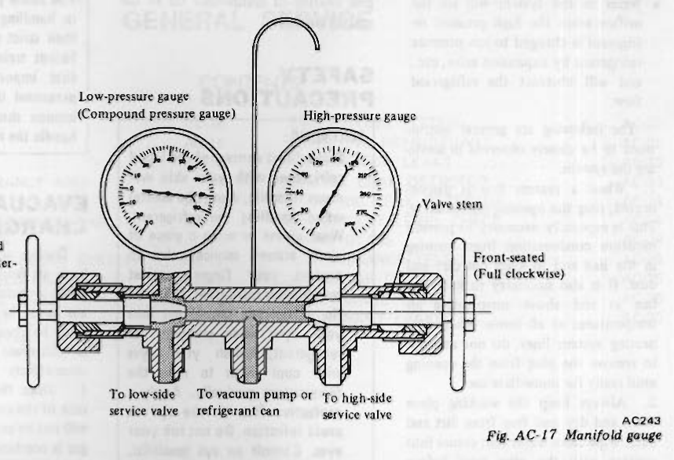
>
> - **Summary:** Cutaway diagram of dual-dial service manifold gauge block showing low-pressure compound gauge, high-pressure gauge, hand valves, back-seated vs front-seated seating, and port fittings.
> - **Components:** Low-pressure gauge (Compound pressure gauge), High-pressure gauge, Valve stem, Manifold block, To low-side service valve fitting, To vacuum pump or refrigerant can fitting, To high-side service valve fitting
> - **Callouts:** **(Back-seated (Full counter-clockwise))** Passage to center fitting open; **(Front-seated (Full clockwise))** Valve seated, blocking passage between service port and center fitting
> - **Wiring / Connections:** Low-side charging hose; Center utility hose; High-side charging hose
> - **Mechanic Notes:** Turning hand valves clockwise (front-seated) isolates gauge ports from center charging line; turning counter-clockwise (back-seated) connects port to center line.
> - **Tags:** `manifold gauge`, `compound gauge`, `front seated`, `back seated`, `valve stem`

### Connection to service valve
1. Fully close both valves of manifold gauge. Connect high- and low-pressure charging hoses to manifold gauge.
2. Remove caps from service valves. Connect high- and low-pressure charging hoses to service valves in system. The refrigerant gas will be discharged since check valve is open when pressing charging hose onto service valve.
3. Next, loosen the connection fitting of charging hose at manifold gauge side for 2 to 3 seconds to purge any air inside charging hose by the pressurized gas in system.

### Disconnection from service valve
1. Fully close both valves of manifold gauge.
2. Disconnect two charging hoses from service valves. At this time, the gas will be discharged until check valve is closed. Therefore, disconnect hose quickly.

> [!WARNING]
> **Work with fingers protected with cloth against frostbite by refrigerant.**

## HANDLING SERVICE VALVE

An automatic check valve is built into service valve. When this valve presses against the connection fitting, that is, when charging hose is connected to service valve, the valve is open. When charging hose is disconnected, the valve is closed automatically. Always observe the following usage precautions:

1. Always install valve cap after using service valve.  
   When high speed operation is performed without valve cap, a negative pressure will gradually build up at the low pressure side of system and air may be sucked in. In addition, dirt and dust will easily enter the valve resulting in foreign matter entering the system.

> [!CAUTION]
> **Do not overtighten valve cap.**

2. Check valve will be half opened during connection and disconnection of charging hoses and refrigerant will be forcefully discharged. Therefore, connect and disconnect charging hoses quickly while pressing flare nut of charging hose against service valve.

> [!WARNING]
> **Work with fingers protected with cloth against frostbite by refrigerant.**

3. Since close contact between the thread of valve cap and the thread of service valve will prevent gas leakage, keep these sections clean and free of scratches and damage.
4. Since packing of charging hose will be lost during long use, always check packing prior to installing charging hose.

> 🖼️ **Fig. AC-18 Service valve** `[AC244]` *(Type: `cutaway_flow`)*
>
> 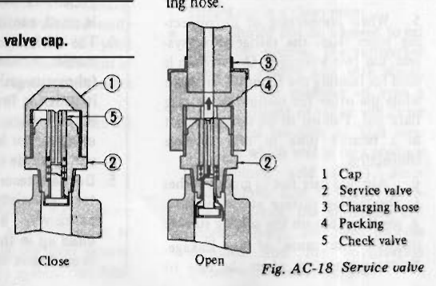
>
> - **Summary:** Sectional cutaway of service Schrader-style check valve displaying cap, internal valve core, rubber packing, and charging hose flare connection in closed and open states.
> - **Components:** Cap, Service valve, Charging hose, Packing, Check valve
> - **Callouts:** **(1)** Cap; **(2)** Service valve; **(3)** Charging hose; **(4)** Packing; **(5)** Check valve
> - **Mechanic Notes:** Check valve opens automatically when charging hose is coupled. The metal cap provides primary leak sealing and prevents vacuum ingestion during high-speed driving; do not overtighten.
> - **Tags:** `service valve`, `check valve`, `Schrader valve`, `cap`, `packing`

---

<!-- Page 19 (AC-19) -->
*Air Conditioning*

## HANDLING CAN TAP

A wide variety of can taps are available. The following procedures apply to conventional can taps.

For the correct usage, refer to the manufacturer's instructions.

> [!CAUTION]
> **Use can tap of good quality.**

1. Connect charging hose to the center fitting of manifold gauge. At this time, confirm that both stems are fully turned in (front-seated).
2. Turn can tap handle fully counterclockwise so that the needle is pulled up.
3. Attach can tap to refrigerant can firmly.
4. Turn can tap handle fully clockwise to make a hole in refrigerant can.
5. Turn the handle fully counterclockwise to raise the needle. Refrigerant gas will flow up to the center fitting of manifold gauge.
6. Loosen the connection at the center fitting of manifold gauge for a few seconds to purge air inside charging hose. See Figure AC-20.

> 🖼️ **Fig. AC-19 Can tap** `[AC246]` *(Type: `cutaway_flow`)*
>
> 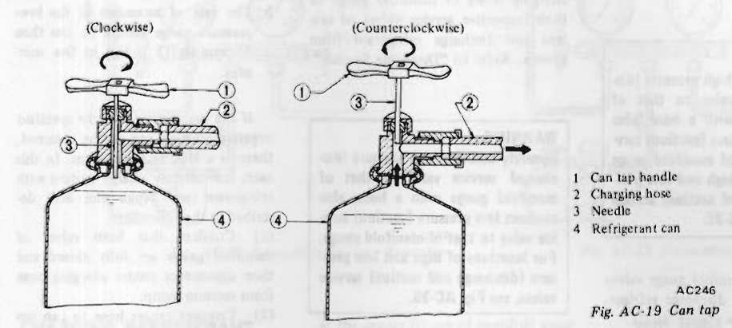
>
> - **Summary:** Cross-sectional cutaway of refrigerant can tap clamp and puncturing needle mechanism showing clockwise piercing position and counterclockwise dispensing position.
> - **Components:** Can tap handle, Charging hose fitting, Needle, Refrigerant can
> - **Callouts:** **(1)** Can tap handle; **(2)** Charging hose; **(3)** Needle; **(4)** Refrigerant can
> - **Wiring / Connections:** Charging hose connection to manifold gauge center fitting
> - **Mechanic Notes:** Turning handle clockwise forces piercing needle through metal can seal; turning counterclockwise retracts needle to release pressurized refrigerant gas into charging hose.
> - **Tags:** `can tap`, `piercing needle`, `refrigerant can`, `R-12 can`

> 🖼️ **Fig. AC-20 Purging air** `[AC247]` *(Type: `procedure_step`)*
>
> 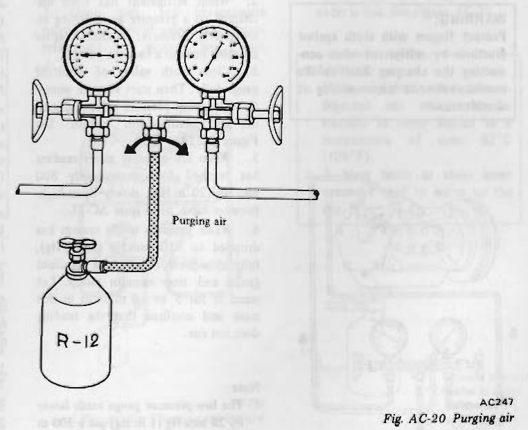
>
> - **Summary:** Procedure diagram demonstrating purging trapped atmospheric air from center charging hose by cracking flare nut at manifold gauge center fitting.
> - **Components:** Manifold gauge set, Center charging hose, R-12 refrigerant can, Can tap valve
> - **Specs / Measurements:** Purge duration: 2 to 3 seconds
> - **Wiring / Connections:** Center hose connected between can tap and manifold gauge block
> - **Mechanic Notes:** Crack center flare nut loose for 2-3 seconds until pure refrigerant vapor escapes, expelling all atmospheric air and moisture from hose before opening manifold valves.
> - **Tags:** `purging air`, `manifold gauge`, `can tap`, `R-12 can`, `charging hose`

---

<!-- Page 20 (AC-20) -->
*Air Conditioning*

## DISCHARGING SYSTEM

The pressurized refrigerant gas inside system must be discharged to a pressure approaching atmospheric pressure prior to evacuating refrigerant inside system. This operation should be made to permit safe removal when replacing system components.

1. Close high- and low-pressure valves of manifold gauge fully.
2. Connect two charging hoses of manifold gauge to their respective service valves.

> [!WARNING]
> **Securely connect high pressure (discharge) service valve to that of manifold gauge with a hose; also connect low pressure (suction) service valve to that of manifold gauge. For locations of high and low pressure (discharge and suction) service valves, see Fig. AC-35.**

3. Open both manifold gauge valves slightly and slowly discharge refrigerant from system. See Figure AC-21.

> [!WARNING]
> **Protect fingers with cloth against frostbite by refrigerant when connecting the charging hose to the service valve or disconnecting it therefrom.**

> [!NOTE]
> Do not allow refrigerant to rush out. Otherwise, compressor oil will be discharged along with refrigerant.

> 🖼️ **Fig. AC-21 Discharging system** `[AC248]` *(Type: `procedure_step`)*
>
> 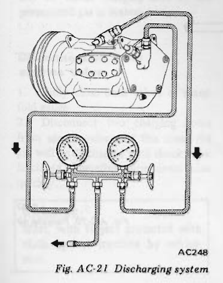
>
> - **Summary:** Service hookup illustration showing manifold gauge set connected to compressor service valves with center hose venting refrigerant vapor slowly into atmosphere.
> - **Components:** Compressor, High-pressure service valve, Low-pressure service valve, Manifold gauge set, Charging hoses
> - **Specs / Measurements:** Discharge rate: Slow controlled bleed to prevent oil loss
> - **Wiring / Connections:** Blue hose to low-pressure suction service valve; Red hose to high-pressure discharge service valve; Yellow center hose directed to waste exhaust
> - **Mechanic Notes:** Open gauge hand wheels only slightly to prevent foaming refrigerant from carrying compressor lubricant out of system.
> - **Tags:** `discharging system`, `compressor`, `manifold gauge`, `controlled release`

## EVACUATING SYSTEM

1. Connect high- and low-pressure charging hoses of manifold gauge to their respective service valves of system and discharge refrigerant from system. Refer to "Discharge System".

> [!WARNING]
> **Securely connect high pressure (discharge) service valve to that of manifold gauge with a hose; also connect low pressure (suction) service valve to that of manifold gauge. For locations of high and low pressure (discharge and suction) service valves, see Fig. AC-35.**

2. When refrigerant has been discharged to a pressure approaching atmospheric pressure, connect center charging hose to a vacuum pump.
3. Close both valves of manifold gauge fully. Then start vacuum pump.
4. Open low-pressure valve and suck old refrigerant from system. See Figure AC-22.
5. When low-pressure gauge reading has reached to approximately 500 mm Hg (20 in Hg), slowly open high-pressure valve. See Figure AC-23.
6. When pressure inside system has dropped to 710 mm Hg (28 in Hg), fully close both of valves of manifold gauge and stop vacuum pump. Let stand it for 5 to 10 minutes in this state and confirm that the reading does not rise.

> [!NOTE]
> a. The low-pressure gauge reads lower by 25 mm Hg (1 in Hg) per a 300 m (1,000 ft) elevation. Perform evacuation according to the following table.

| Elevation m (ft) | Vacuum of system mm Hg (in Hg) |
|:---|:---|
| 0 (0) | 710 (28) |
| 300 (1,000) | 685 (27) |
| 600 (2,000) | 660 (26) |
| 900 (3,000) | 635 (25) |

*Note: Values show readings of the low-pressure gauge.*

b. The rate of ascension of the low-pressure gauge should be less than 25 mm Hg (1 in Hg) in five minutes.

If the pressure rises or the specified negative pressure can not be obtained, there is a leak in the system. In this case, immediately charge system with refrigerant and repair the leak described in the followings.

(1) Confirm that both valves of manifold gauge are fully closed and then disconnect center charging hose from vacuum pump.  
(2) Connect center hose to can tap in place of vacuum pump. Attach refrigerant can to can tap and pass refrigerant to manifold gauge.  
(3) Loosen the connection of center fitting of manifold gauge to purge air from center hose.  
(4) Open low-pressure valve of manifold gauge and charge refrigerant into system. After one can [about 0.4 kg (0.9 lb)] of refrigerant has been charged into system, close low-pressure valve.  
(5) Check for refrigerant leakage with a leak detector. Repair any leakages found. Refer to "Checking for Leaks" and "Refrigerant Leaks".  
(6) Confirm that both valves of manifold gauge are fully closed and then change center charging hose from can tap to vacuum pump.  
(7) Open high- and low-pressure valves and operate vacuum pump to suck refrigerant from system. When the pressure in system has dropped to 710 mm Hg (28 in Hg), fully close both valves of manifold gauge.

7. The above operation completes evacuation of system. Next, charge refrigerant. Refer to "Charging Refrigerant". <!-- Page 21 (AC-21) --> *Air Conditioning*

> 🖼️ **Fig. AC-22 Evacuating system - First step** `[AC249]` *(Type: `procedure_step`)*
>
> 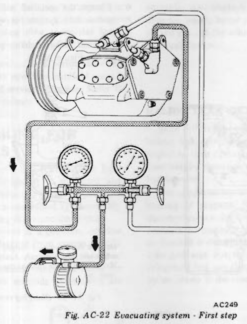
>
> - **Summary:** Initial evacuation step showing vacuum pump operating with only low-pressure valve open until compound gauge reaches 500 mm Hg (20 in Hg).
> - **Components:** Compressor, Manifold gauge set, Vacuum pump, Charging hoses
> - **Specs / Measurements:** Target vacuum: 500 mm Hg (20 in Hg)
> - **Wiring / Connections:** Low-pressure valve open, high-pressure valve closed, center hose to vacuum pump
> - **Mechanic Notes:** Evacuate through low-pressure side first to avoid pulling liquid lubricant out of compressor.
> - **Tags:** `evacuation`, `vacuum pump`, `first step`, `low pressure valve`, `manifold gauge`

> 🖼️ **Fig. AC-23 Evacuating system - Second step** `[AC250]` *(Type: `procedure_step`)*
>
> 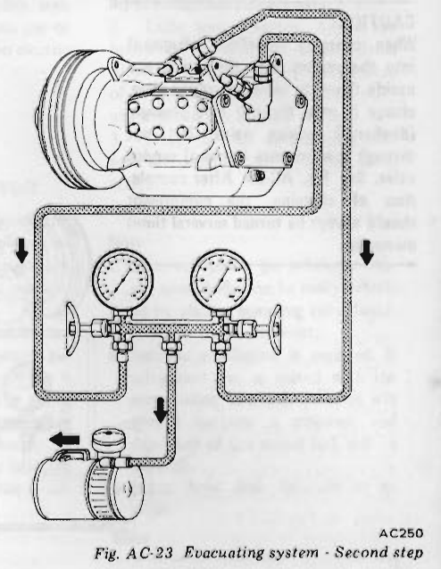
>
> - **Summary:** Second evacuation step showing high-pressure valve opened in addition to low-pressure valve, pulling deep vacuum down to 710 mm Hg (28 in Hg).
> - **Components:** Compressor, Manifold gauge set, Vacuum pump, Charging hoses
> - **Specs / Measurements:** Target vacuum: 710 mm Hg (28 in Hg); Hold time: 5 to 10 minutes
> - **Wiring / Connections:** Both high- and low-pressure valves open to vacuum pump
> - **Mechanic Notes:** Once 500 mm Hg is reached, open high-pressure valve to fully evacuate high side down to 710 mm Hg; hold for 5-10 min to check vacuum retention.
> - **Tags:** `evacuation`, `second step`, `vacuum hold`, `710 mm Hg`, `deep vacuum`

## CHARGING REFRIGERANT

1. Install manifold gauge to system. Refer to "Handling Manifold Gauge".

> [!WARNING]
> **Securely connect high pressure (discharge) service valve to that of manifold gauge with a hose, also connect low pressure (suction) service valve to that of manifold gauge. For locations of high and low pressure (discharge and suction) service valves, see Fig. AC-35.**

> [!CAUTION]
> a. Be sure to purge air from the high- and low-pressure charging hoses.  
> b. If air is mixed with refrigerant gas in system, evacuation of system should be performed. Refer to Evacuating System.

2. Attach center charging hose of manifold gauge to refrigerant can through can tap. Break seal of refrigerant can to allow refrigerant to enter manifold gauge. Loosen charging hose at the center fitting of manifold gauge and purge air from inside charging hose. Refer to "Handling Can Tap".
3. Open high- and low-pressure valves of manifold gauge and charge refrigerant into system. See Figure AC-24.

> 🖼️ **Fig. AC-24 Charging refrigerant** `[AC251]` *(Type: `procedure_step`)*
>
> 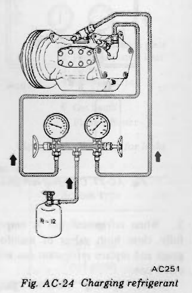
>
> - **Summary:** Initial refrigerant charging procedure showing upright R-12 can connected to manifold gauge, feeding vapor into both high- and low-pressure service ports of evacuated system.
> - **Components:** Compressor, Manifold gauge set, Can tap, R-12 refrigerant can, Charging hoses
> - **Specs / Measurements:** Refrigerant: R-12
> - **Wiring / Connections:** Can tap center hose to manifold; both high and low hand valves open
> - **Mechanic Notes:** Engine remains off. Deep vacuum in system draws refrigerant vapor into both sides.
> - **Tags:** `charging refrigerant`, `vapor charging`, `manifold gauge`, `R-12 can`

> [!NOTE]
> When refrigerant charging speed is slow, immerse refrigerant can in water heated to a temperature of about 40°C (104°F). However, note that this is dangerous when water is hot. See Figure AC-25.

> [!WARNING]
> a. Under any circumstances the refrigerant can must not be warmed in water heated to a temperature of over 52°C (126°F).  
> b. A blow torch or stove must never be used to warm up the can.

> 🖼️ **Fig. AC-25 Charging refrigerant** `[AC252]` *(Type: `procedure_step`)*
>
> 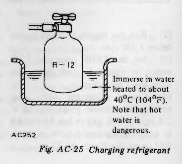
>
> - **Summary:** Illustration of refrigerant can immersed in warm water bath to elevate vapor pressure and maintain charging speed.
> - **Components:** R-12 refrigerant can, Can tap valve, Water vessel, Warm water
> - **Specs / Measurements:** Water temperature: ~40°C (104°F); Absolute maximum temperature: 52°C (126°F)
> - **Wiring / Connections:** Charging hose to manifold center port
> - **Mechanic Notes:** WARNING: Never heat with an open flame, torch, or stove. Never exceed 52°C (126°F) to avoid container explosion.
> - **Tags:** `charging refrigerant`, `water bath`, `vapor pressure`, `safety warning` <!-- Page 22 (AC-22) --> *Air Conditioning*

> [!CAUTION]
> **When charging liquefied refrigerant into the system with the can turned upside down to reduce charging time, charge it only through high pressure (discharge) service valve, but not through low pressure (suction) service valve. See Fig. AC-26. After completion of charging, the compressor should always be turned serveral times manually.**

> 🖼️ **Fig. AC-26 Charging refrigerant** `[AC253]` *(Type: `procedure_step`)*
>
> 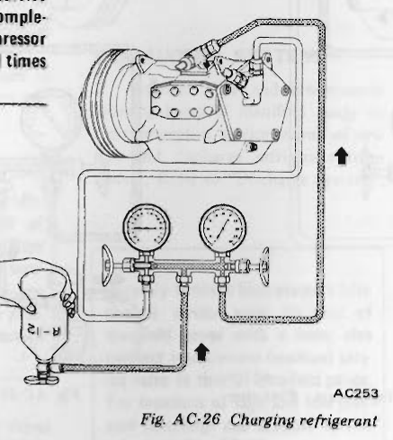
>
> - **Summary:** Liquid charging setup showing inverted R-12 can feeding liquid refrigerant strictly into high-pressure discharge service valve with engine off.
> - **Components:** Compressor, Manifold gauge set, Can tap, Inverted R-12 can, Charging hoses
> - **Specs / Measurements:** Engine: OFF; Compressor rotation: Turn several times manually by hand after charging
> - **Wiring / Connections:** High-pressure manifold valve open, low-pressure manifold valve tightly closed
> - **Mechanic Notes:** CRITICAL: Never charge liquid through low side. Never run engine while liquid charging. Rotate compressor clutch disc by hand several times after charging to expel liquid from cylinders.
> - **Tags:** `liquid charging`, `inverted can`, `high pressure valve`, `hand rotation`, `compressor`

4. If refrigerant charging speed slows down, charge it while running the compressor for ease of charging. After having taken the steps up to (3) above, proceed with charging in the following order.
   (1) Shut off high pressure valve of manifold gauge.

> [!WARNING]
> **Never charge refrigerant through high pressure side of system since this will force refrigerant back into refrigerant can and can may explode.**

   (2) Run the engine at idling speeds below 1,500 rpm.  
   (3) Set the TEMP lever and FAN switch at maximum cool and maximum speed respectively.  
   (4) Charge refrigerant while controlling low-pressure gauge reading at 2.8 kg/cm² (40 psi) or less by turning in or out low-pressure valve of manifold gauge. See Figure AC-27.

> 🖼️ **Fig. AC-27 Charging refrigerant** `[AC254]` *(Type: `procedure_step`)*
>
> 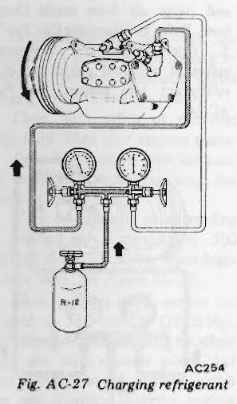
>
> - **Summary:** Gas charging method with engine running below 1,500 rpm, drawing refrigerant gas into compressor suction port while throttling low-pressure valve.
> - **Components:** Compressor, Manifold gauge set, Can tap, Upright R-12 can, Charging hoses
> - **Specs / Measurements:** Engine speed: Idling below 1,500 rpm; Low-pressure gauge limit: 2.8 kg/cm² (40 psi) or less
> - **Wiring / Connections:** Low-pressure valve throttle-controlled, high-pressure valve strictly closed
> - **Mechanic Notes:** DANGER: High-pressure valve MUST be closed. Opening high-pressure valve while compressor runs will pump extreme pressure into the can and cause it to explode.
> - **Tags:** `gas charging`, `suction charge`, `engine running`, `low pressure valve`, `throttling`

5. When refrigerant can is empty, fully close both valves of manifold gauge and replace refrigerant can with a new one.  
   Before opening manifold gauge valve to charge refrigerant from new can, be sure to purge air from inside charging hose.

6. Charge the specified amount of refrigerant into system by weighing charged refrigerant with scale. Overcharging will cause discharge pressure to rise. See Figure AC-28.

> 🖼️ **Fig. AC-28 Charging refrigerant** `[AC255]` *(Type: `procedure_step`)*
>
> 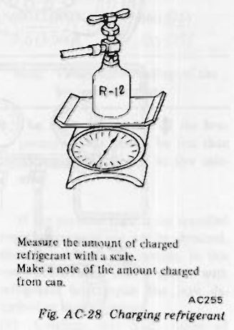
>
> - **Summary:** Weighing refrigerant can and tap on a mechanical scale during charging to meter exact factory charge weight.
> - **Components:** R-12 refrigerant can, Can tap valve, Mechanical dial scale
> - **Specs / Measurements:** Specified total charge: 0.7 to 0.9 kg (1.5 to 2.0 lb)
> - **Wiring / Connections:** Center hose to manifold gauge
> - **Mechanic Notes:** Weigh can before and during charging to determine exact charge. Overcharging elevates discharge pressure and impairs cooling efficiency.
> - **Tags:** `measuring charge`, `scale`, `refrigerant weight`, `capacity`

### Refrigerant capacity

*Unit: kg (lb)*

| Refrigerant | Minimum | Maximum |
|:---|:---|:---|
| R-12 | 0.7 (1.5) | 0.9 (2.0) |

> [!NOTE]
> The presence of bubbles in sight glass of receiver drier is an unsuitable method of checking the amount of refrigerant charged in system. The state of the bubbles in sight glass should only be used for checking whether the amount of charged refrigerant is small or not. The amount of charged refrigerant can be correctly judged by means of discharge pressure. Refer to "Refrigerant Level Check".

7. After the specified amount of refrigerant has been charged into system, close manifold gauge valves. Then detach charging hoses from service valves of system. Be sure to install valve cap to service valve. <!-- Page 23 (AC-23) --> *Air Conditioning*

8. Confirm that there are no leaks in system by checking with a leak detector. Refer to "Checking for Leaks".

> [!NOTE]
> Conducting a performance test prior to removing manifold gauge is a good service operation. Refer to "Performance Test".

## CHECKING FOR LEAKS

Conduct a leak test whenever leakage of refrigerant is suspected and when conducting service operations which are accompanied by disassembly or loosening of connection fittings.

Refrigerant is a colorless, odorless gas and leakage from system is difficult to detect. Accordingly, the use of a leak detector facilitates check for leaks. Two methods of checking are available; one employs a halide leak detector which burns propane gas or butane gas and the other is an electric type leak detector.

## HALIDE LEAK DETECTOR

Since the propane leak detector and butane leak detector are the same in respect to their operation, this section describes the operation of the propane leak detector.

The copper screen is heated by the burning of propane. Refrigerant gas decomposes to color the flame when it contacts the heated screen. The gas to be checked is drawn into the sampling tube and sent out to the burner. A refrigerant leak can clearly be detected by variations in the color of the flame.

> 🖼️ **Fig. AC-29 Checking for leaks** `[AC010]` *(Type: `inspection_measurement`)*
>
> 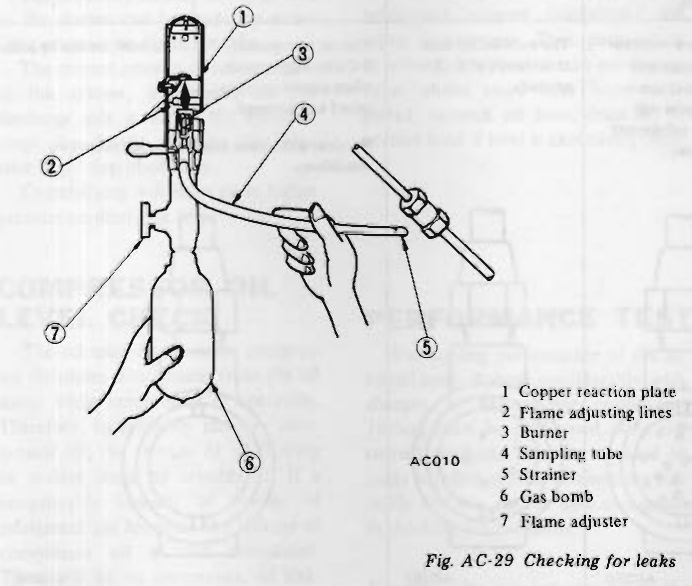
>
> - **Summary:** Halide leak detector torch assembly showing gas cylinder, burner chimney, flame adjuster, copper reaction plate, and flexible sampling wand.
> - **Components:** Copper reaction plate, Flame adjusting lines, Burner, Sampling tube, Strainer, Gas bomb, Flame adjuster
> - **Callouts:** **(1)** Copper reaction plate; **(2)** Flame adjusting lines; **(3)** Burner; **(4)** Sampling tube; **(5)** Strainer; **(6)** Gas bomb; **(7)** Flame adjuster
> - **Specs / Measurements:** Leak testing pre-charge: 0.4 kg (0.9 lb)
> - **Wiring / Connections:** Sampling tube wand
> - **Mechanic Notes:** Refrigerant gas is heavier than air; hold probe directly underneath fittings and joints. Color shift from greenish-blue to yellow/green indicates small leak; brilliant purple/vivid green indicates large leak. WARNING: Phosgene gas produced by burning refrigerant is toxic; ventilate work area well.
> - **Tags:** `halide leak detector`, `leak check`, `propane torch`, `copper plate`, `flame color`, `safety warning`

| Leak condition | Propane type | Butane type |
|:---|:---|:---|
| NO LEAK | Greenish blue | Pale blue |
| SMALL LEAK | Yellow | Bright blue |
| LARGE LEAK | Purple | Vivid green |

1. Discharge refrigerant in one or two seconds to ascertain that system has a sufficient pressure needed for leak detection. Charge with 0.4 kg (0.9 lb) of refrigerant, if necessary.
2. Light leak detector. Adjust the height of the flame between flame adjusting lines at the top and bottom of combustion tube. A reaction plate will immediately become red hot.
3. Place the end of sampling tube near the point of the suspected leak in system.

> [!NOTE]
> a. Since refrigerant gas is heavier than air, small leaks can be easily detected by placing sampling tube directly below the check point.  
> b. Suitable ventilation is required. If refrigerant gas is mixed with the surrounding air, leak detector will always indicate a response and detection of the actual leak will be difficult.  
> c. Never hold leak detector at an angle.

> [!WARNING]
> a. Never inhale the fumes produced by combustion of refrigerant gas since they are toxic.  
> b. Never use halide torch in a place where combustible or explosive gas is present.

4. The flame will be almost colorless when there is no refrigerant gas being burned. When there is a small refrigerant gas leak, the flame will be green or yellowgreen. When refrigerant gas leakage is large, the flame will be brilliant blue or purple. Since the color of the flame will be yellow when dust is being burned or there is aging scale on copper reaction plate, always keep the strainer of sampling tube and reaction plate clean.
5. Major check points:
   (1) **Compressor**
   * Compressor shaft seal (rotate the compressor by hand)
   * Oil filler plug
   * Flexible hose connections
   * Rear cover and side cover gaskets
   * Service valve
   (2) **Condenser**
   * Condenser pipe fitting
   * Condenser inlet and outlet pipe connections <!-- Page 24 (AC-24) --> (3) Piping
* Flared section of high pressure and low pressure flexible hose.
* Pipe connections
* Service valve

(4) Evaporator housing
* Inlet and outlet pipe connections
* Expansion valve

### ELECTRIC LEAK DETECTOR
For the operational procedures, refer to the instructions furnished with each electric leak detector.

---

### REFRIGERANT LEVEL CHECK

#### SIGHT GLASS
Sight glass is provided at the top of receiver drier. One guide for whether there is enough refrigerant in system is given by observing refrigerant flow through sight glass. However, this method is unsuitable for judging the amount of refrigerant. The correct refrigerant level can be judged by measuring the system pressures in accordance with the procedures as described "Performance Test".

1. Start the engine and hold engine speed at 1,500 rpm.
2. Set AIR lever to A/C position.
3. Set blower to maximum speed.
4. Check sight glass after the lapse of about five minutes. Judge according to the following table.

| Check item | Almost no refrigerant | Insufficient | Suitable | Too much refrigerant |
| :--- | :--- | :--- | :--- | :--- |
| **Temperature of high pressure and low pressure pipes.** | Almost no difference between high pressure and low pressure side temperature. | High pressure side is warm and low pressure side is fairly cold. | High pressure side is hot and low pressure side is cold. | High pressure side is abnormally hot. |
| **State in sight glass.** | Bubbles flow continuously. Bubbles will disappear and something like mist will flow when refrigerant is nearly gone. | The bubbles are seen at intervals of 1 - 2 seconds. | Almost transparent. Bubbles may appear when engine speed is raised and lowered.  *No clear difference exists between these two conditions.* | No bubbles can be seen. |
| **Illustration** | 

> 🖼️ **Sight glass: Almost no refrigerant (bubbles flow continuously)** `[AC256]` *(Type: `inspection_measurement`)*
>
> 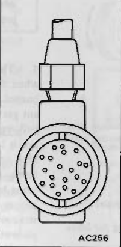
>
> - **Summary:** Sight glass view showing continuous streams of bubbles indicating almost no refrigerant in system.
> - **Components:** Sight glass, Receiver drier fitting, Bubbles
> - **Specs / Measurements:** Engine speed: 1,500 rpm; Air lever: A/C; Blower: maximum speed
> - **Mechanic Notes:** Bubbles disappear and mist flows when refrigerant is nearly empty.
> - **Tags:** `sight glass`, `bubbles`, `refrigerant check`, `receiver drier`

 | 

> 🖼️ **Sight glass: Insufficient refrigerant (bubbles at 1-2 sec intervals)** `[AC257]` *(Type: `inspection_measurement`)*
>
> 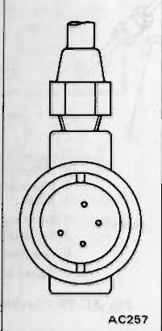
>
> - **Summary:** Sight glass view with bubbles visible at intervals of 1 to 2 seconds, indicating insufficient charge.
> - **Components:** Sight glass, Receiver drier fitting, Bubbles
> - **Specs / Measurements:** Bubble interval: 1 - 2 seconds; Engine speed: 1,500 rpm
> - **Mechanic Notes:** Check for leakage, repair as required, replenish and charge system.
> - **Tags:** `sight glass`, `insufficient refrigerant`, `bubbles`

 | 

> 🖼️ **Sight glass: Suitable / Too much refrigerant (clear/no bubbles)** `[AC258]` *(Type: `inspection_measurement`)*
>
> 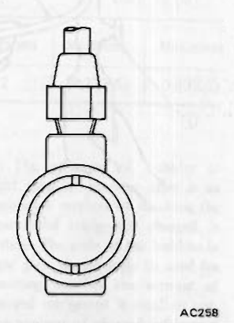
>
> - **Summary:** Sight glass view showing transparent liquid stream with no bubbles, indicating either proper charge or overcharge.
> - **Components:** Sight glass, Receiver drier fitting
> - **Specs / Measurements:** Engine speed: 1,500 rpm
> - **Mechanic Notes:** Visual appearance is identical between suitable charge and overcharge; verify with pressure gauges.
> - **Tags:** `sight glass`, `suitable`, `overcharge`, `clear glass`

 | (Refer to Fig. AC258) |
| **Pressure of system.** | High pressure side is abnormally low. | Both pressures on high and low pressure sides are slightly low. | Both pressures on high and low pressure sides are normal. | Both pressures on high and low pressure sides are abnormally high. |
| **Repair.** | Stop compressor and conduct an overall check. | Check for gas leakage, repair as required, replenish and charge system. | — | Discharge refrigerant from service valve of low pressure side. | <!-- Page 25 (AC-25) --> ### REFRIGERANT LEVEL CHECK (Continued)

**Note:**
a. The bubbles seen through the sight glass are influenced by the ambient temperature. Since the bubbles are hard to show up in comparatively low temperatures below 20°C (68°F), it is possible that a slightly larger amount of refrigerant would be filled, if supplied according to the sight glass. Be sure to recheck the amount when it exceeds 20°C (68°F). In higher temperature the bubbles are easy to show up.
b. When the screen in the receiver drier is clogged, the bubbles will appear even if the amount of refrigerant is normal. In this case, the outlet side pipe of the receiver drier becomes considerably cold.

---

### PERFORMANCE TEST
Check for the amount of refrigerant in the system can be made by measuring pressure on discharge side.
The correct amount of refrigerant is in the system, if pressure on the discharge side is within the specified range. For details, refer to "Performance Test" described later.
Overcharging will show up in higher pressure on discharge side.

---

### COMPRESSOR OIL LEVEL CHECK
The oil used to lubricate compressor circulates into system from the oil sump while compressor is operating. Therefore, to correctly measure compressor oil, the amount of oil flowing to system must be considered. If a considerable amount of leakage of refrigerant gas happens, the leakage of compressor oil is also considered. There will be no compressor oil leakage from a completely sealed system. When system operates under satisfying condition, the compressor oil level check is unnecessary.

When checking the level of compressor oil or when replacing any component part of the system, use the following service procedure. This facilitates to return oil to compressor.

1. Operate compressor at engine idling speed (1,000 rpm or below) with controls set for maximum cooling and high blower speed for 10 to 15 minutes in order to return compressor oil to compressor.
2. Stop the engine and discharge refrigerant of system and then remove compressor from the car.
3. Remove compressor drain plug. Drain compressor oil from compressor oil sump and measure the amount.
4. Compressor oil is satisfactory if the following amount of oil remains in the compressor.
   * **Residual oil:** 85 to 128 gr (3 to 4 ½ oz)
5. Check the cleanliness of the oil. If the oil contains chips or other foreign material, clean oil sump with new oil.
6. Discard the used oil and fill with the same amount of new oil. Add oil if found less than above amount.

If compressor is inoperative due to defective compressor or heavy loss of refrigerant, remove compressor and repair as necessary. Then pour oil up to correct level and install on engine. After above steps have been completed, recheck oil level; drain oil to correct level if level is excessively high.

---

### PERFORMANCE TEST
The cooling performance of the air conditioner changes considerably with changes in surrounding conditions. Testing must be performed using the correct method. This test is used to judge whether system is operating correctly and can also be used as a guide in checking for problems.

1. Park the car indoors or in the shade.
2. Open all the windows of the car fully. However, close the doors.
3. Open the hood.
4. Connect manifold gauge to high- and low-side service valves of the system. Refer to "Handling Manifold Gauge".
5. Set AIR lever to A/C position.
6. Set TEMP lever to max. cool position.
7. Set blower to its highest speed.
8. Start the engine and hold engine speed at 1,500 rpm.
9. After the air conditioner has been operated for about 10 minutes, measure system pressures at high-pressure (discharge) side and low-pressure (suction) side.
10. Measure the temperature of discharge air at outlet grille.
11. Measure the temperature and humidity of the ambient air at a point 1 m (3.3 ft) front of condenser. However, a dry bulb and wet bulb must not be placed in direct sunlight.
12. Check for any abnormalities by comparing the test results with standard pressure in "Performance Chart".

**Note:**
a. The pressure will change in the following manner with changes in conditions:
* When blower speed is low, discharge pressure will drop.
* When the relative humidity of intake air is low, discharge pressure will drop.
b. The temperature will change in the following manner with changes in conditions:
* When the ambient air temperature is low, the outlet air temperature will become low.

If the test reveals that there is any abnormality in system pressure, isolate the cause and repair by reference to the "Trouble Diagnoses and Corrections".

---

### REFRIGERANT LEAKS
If leaks are noticeable, leaky parts should be repaired. Then system should be filled with refrigerant. Do not operate compressor with refrigerant level excessively low.
If this caution is neglected, a burnt compressor will result since heavy loss of refrigerant usually indicates heavy loss of compressor oil. <!-- Page 26 (AC-26) --> If system has been exposed to atmosphere for an extended period of time, receiver drier must be replaced. If leaks are slight and no air is present in system, add refrigerant as necessary.

To detect leaks, refer to relative topics under "Checking for Leaks". Here is how leaks are stopped.

1. Check torque on the connection fitting and, if too loose, tighten to the proper torque. Check for gas leakage with a leak detector.
2. If leakage continues even after the fitting has been retightened, discharge refrigerant from system, disconnect the fittings, and check its seating face for damage. Always replace even if damage is slight.
3. Check compressor oil and add oil if required.
4. Charge refrigerant and recheck for gas leaks. If no leaks are found, evacuate and charge system.

---

## REMOVAL AND INSTALLATION

### CONTENTS

| Section | Page |
| :--- | :--- |
| **COMPRESSOR** | AC-26 |
| REMOVAL | AC-26 |
| INSTALLATION | AC-27 |
| **IDLER PULLEY AND COMPRESSOR DRIVE BELT** | AC-27 |
| ADJUSTMENT OF BELT TENSION | AC-28 |
| **CONDENSER** | AC-28 |
| REMOVAL | AC-28 |
| INSPECTION | AC-28 |
| INSTALLATION | AC-28 |
| **RECEIVER DRIER** | AC-28 |
| REMOVAL AND INSTALLATION | AC-28 |
| **PIPING** | AC-28 |
| **FAST IDLE ACTUATOR** | AC-30 |
| ADJUSTMENT OF IDLE SPEED | AC-30 |
| **BLOWER MOTOR** | AC-30 |
| REMOVAL AND INSTALLATION | AC-30 |
| **AIR INTAKE DOOR ACTUATOR** | AC-30 |
| REMOVAL AND INSTALLATION | AC-30 |
| **BLOWER HOUSING** | AC-30 |
| REMOVAL AND INSTALLATION | AC-30 |
| **VACUUM WATER COCK** | AC-31 |
| REMOVAL AND INSTALLATION | AC-31 |
| **HEATER CORE** | AC-31 |
| REMOVAL AND INSTALLATION | AC-31 |
| **MODE DOOR ACTUATOR** | AC-31 |
| REMOVAL AND INSTALLATION | AC-31 |
| **CONTROL ASSEMBLY** | AC-31 |
| REMOVAL AND INSTALLATION | AC-31 |
| DISASSEMBLY AND ASSEMBLY | AC-32 |
| ADJUSTMENT OF CONTROL CABLE | AC-32 |
| **HEATER COCK** | AC-32 |
| REMOVAL AND INSTALLATION | AC-32 |
| **THERMOSTAT** | AC-32 |
| REMOVAL AND INSTALLATION | AC-32 |
| **EXPANSION VALVE** | AC-33 |
| REMOVAL | AC-33 |
| INSTALLATION | AC-33 |
| **EVAPORATOR HOUSING** | AC-33 |
| REMOVAL | AC-33 |
| DISASSEMBLY AND ASSEMBLY | AC-34 |
| INSPECTION | AC-34 |
| INSTALLATION | AC-34 |
| **HEATER UNIT** | AC-34 |
| REMOVAL | AC-34 |
| INSTALLATION | AC-35 |
| **VACUUM HOSE DIAGRAM** | AC-36 |
| **WIRING HARNESS DIAGRAM** | AC-37 |
| **CIRCUIT DIAGRAM FOR AIR CONDITIONER** | AC-38 |
| **CIRCUIT DIAGRAM FOR ILLUMINATION LAMP** | AC-39 |

---

### COMPRESSOR

#### REMOVAL
1. Disconnect battery ground cable.
2. Remove air flow meter with air ducts.
3. Remove under cover.
4. Remove F.I.C.D. and move body harness downward at left hoodledge.  
   *Note: This is to secure space for removal of compressor.*
5. Loosen tension adjust bolt of idler pulley and remove compressor drive belt.
6. Disconnect compressor clutch wire at connector.
7. Discharge system. Refer to Section of "General Service" for "Discharging System".
8. Remove high and low flexible hoses from compressor.

> [!WARNING]
> Gradually loosen discharge side hose fitting, and remove it after remaining pressure has been released. <!-- Page 27 (AC-27) --> *Note: Use wrench to fix joint nut on compressor side, and then loosen flare nut of flexible hose with another wrench.*

> [!CAUTION]
> Be sure to immediately put plugs in flexible hose opening and in compressor connection.

9. Jack up front of car, and remove bolts mounting compressor's lower side.
10. Lower car, and remove two bolts mounting compressor's top side. While doing this, hold compressor by hand to prevent it from falling down.
11. Holding compressor with both hands, horizontally move it toward rear of car and lift it out with clutch facing down.
12. In the same manner as described in "Compressor Oil Level Check" of "General Service", check amount and quality of oil in compressor.

> [!CAUTION]
> Do not attempt to operate the compressor on its side or upside down for more than 10 minutes, as the compressor oil will enter the low pressure chambers. If, under that condition, compressor should be operated suddenly, internal damages would result. To expel oil from chambers, hand-crank compressor several times in its installed condition.

*Note: When storing a compressor, be sure to fill it with refrigerant through low pressure service valve and purge air from high pressure service valve.*

#### INSTALLATION
Installation of compressor is to be done in reverse sequence of removal, with attention paid to the following points:
1. Oil in compressor to be installed should be equal in amount to what remained in compressor removed. New compressor contains prescribed amount of oil; before its installation, drain the excessive amount of oil.
2. Check tightening torque of bolt holding compressor bracket. Retighten bolt if necessary. See Figure AC-30.

> 🖼️ **Fig. AC-30 Compressor** `[AC791]` *(Type: `exploded_view`)*
>
> 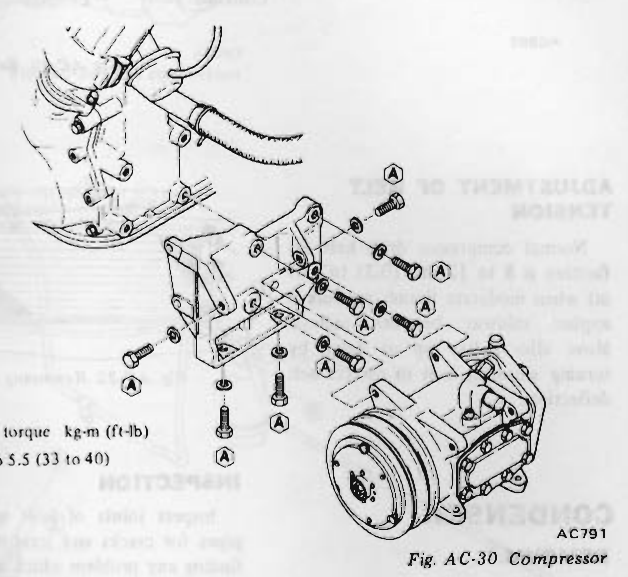
>
> - **Summary:** Exploded view of compressor mounting bracket and bolts attaching compressor assembly to engine block.
> - **Components:** Compressor assembly, Mounting bracket, Mounting bolts, Lock washers, Spacers, Refrigerant connections
> - **Callouts:** **(A)** Tightening torque: 4.5 to 5.5 kg-m (33 to 40 ft-lb)
> - **Specs / Measurements:** Bracket bolt tightening torque: 4.5 to 5.5 kg-m (33 to 40 ft-lb)
> - **Mechanic Notes:** Tighten mounting bolts to 4.5 - 5.5 kg-m (33 - 40 ft-lb). Hand crank compressor before running if tilted.
> - **Tags:** `compressor`, `bracket`, `mounting bolts`, `torque`

3. Compressor plugs and flexible hose plugs should be kept in place until preparation of piping is completed.
4. Upon installation of compressor, turn compressor by hand a few turns.
5. As to tightening torque on piping connection, refer to "Piping".
6. As to compressor drive belt tension, refer to "Idler Pulley and Compressor Drive Belt". Make sure that air pump drive belt and cooling fan belt have the specified deflection.
7. Evacuate and recharge system. Refer to "General Service" for "Evacuating and Charging System".
8. Conduct leak test and make sure that there is no leak from connection.
9. Check air pump for operation. Make sure that hose piping of air pump is correctly connected.
10. Check engine idle speed.
11. Check "CO" percent at idle speed.

---

### IDLER PULLEY AND COMPRESSOR DRIVE BELT

> 🖼️ **Fig. AC-31 Idler pulley** `[AC792]` *(Type: `exploded_view`)*
>
> 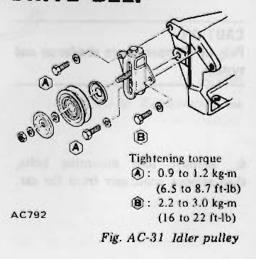
>
> - **Summary:** Exploded view of A/C idler pulley assembly, bracket, tension adjusting screw, and locking nut.
> - **Components:** Idler pulley, Pulley bearing, Adjusting bolt, Mounting bracket, Retaining nut, Washers
> - **Callouts:** **(A)** 0.9 to 1.2 kg-m (6.5 to 8.7 ft-lb); **(B)** 2.2 to 3.0 kg-m (16 to 22 ft-lb)
> - **Specs / Measurements:** Tightening torque A: 0.9 to 1.2 kg-m (6.5 to 8.7 ft-lb); Tightening torque B: 2.2 to 3.0 kg-m (16 to 22 ft-lb)
> - **Mechanic Notes:** Tighten bracket bolt B to 2.2-3.0 kg-m and adjusting lock nut A to 0.9-1.2 kg-m.
> - **Tags:** `idler pulley`, `tensioner`, `adjusting bolt`, `bracket`, `torque`

---

<!-- Page 28 (AC-28) -->

> 🖼️ **Fig. AC-32 Belt tension** `[AC552]` *(Type: `inspection_measurement`)*
>
> 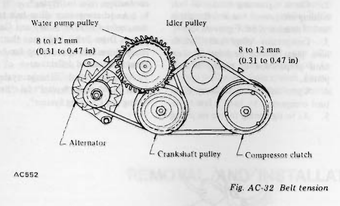
>
> - **Summary:** Belt drive routing diagram showing deflection check points for compressor drive belt and alternator belt.
> - **Components:** Water pump pulley, Idler pulley, Alternator, Crankshaft pulley, Compressor clutch
> - **Callouts:** **(Water pump pulley)** Water pump pulley; **(Idler pulley)** Idler pulley; **(Alternator)** Alternator; **(Crankshaft pulley)** Crankshaft pulley; **(Compressor clutch)** Compressor clutch
> - **Specs / Measurements:** Belt deflection: 8 to 12 mm (0.31 to 0.47 in) under moderate thumb pressure
> - **Mechanic Notes:** Measure belt deflection midway between pulleys. Adjust by turning idler pulley bolt.
> - **Tags:** `belt tension`, `deflection`, `drive belt`, `idler pulley`, `water pump`

### ADJUSTMENT OF BELT TENSION
Normal compressor drive belt deflection is 8 to 12 mm (0.31 to 0.47 in) when moderate thumb pressure is applied midway between pulleys. Move idler pulley up or down by turning adjusting bolt to correct belt deflection.

---

### CONDENSER

#### REMOVAL
1. Disconnect battery ground cable.
2. Remove engine hood.
3. Discharge system.
4. Remove air cleaner assembly and radiator expansion tank, and loosen air flow meter.
5. Disconnect inlet and outlet refrigerant lines from condenser.
   > [!CAUTION]
   > Plug up all openings in condenser and system.
6. Remove four mounting bolts, then remove condenser from the car.

> 🖼️ **Fig. AC-33 Removing condenser** `[AC262]` *(Type: `procedure_step`)*
>
> 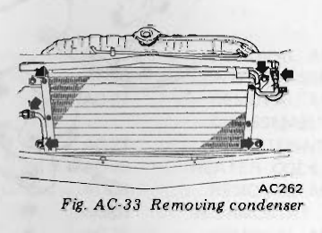
>
> - **Summary:** Front radiator support and condenser mounting bolt locations during removal.
> - **Components:** Condenser core, Radiator core support, Mounting bolts (4)
> - **Specs / Measurements:** 4 mounting bolts
> - **Mechanic Notes:** Add 28 g (1 oz) compressor oil if replacing with new condenser.
> - **Tags:** `condenser`, `removal`, `front core support`

#### INSPECTION
Inspect joints of inlet and outlet pipes for cracks and scratches. Upon finding any problem which may cause gas to leak, repair or replace condenser.
Condenser fins or air passages clogged with dirt, insects or leaves will reduce cooling efficiency of condenser. In such a case, clean fins or air passages with compressed air.

> [!CAUTION]
> Do not clean condenser with steam. Be sure to use cold water or compressed air.

#### INSTALLATION
Installation of condenser is to be done in reverse sequence of removal, with notice paid to the following points:
1. When new condenser is used as replacement, be sure to add 28 g (1 oz) of new oil thereto.
2. Keep piping plug in place until immediately before piping work is started.
3. As to tightening torque on piping connection, refer to "Piping".
4. As to evacuating and charging system, refer to "General Service".
5. Conduct leak test and make sure that there is no leak from connection.

---

### RECEIVER DRIER

#### REMOVAL AND INSTALLATION
1. Disconnect battery ground cable.
2. Discharge system. Refer to Section "General Service for Discharging System".
3. Disconnect pressure switch wires at connector.
4. Disconnect refrigerant lines from receiver drier.
   > [!CAUTION]
   > Plug all pipe openings to prevent entrance of dirt and moisture.
5. Remove receiver drier mounting screws and then remove receiver drier.
6. When replacing receiver drier with a new one, charge system with 28 g (1 oz) of compressor oil.
7. Installation is to be done in reverse order of removal. With plugs taken off immediately before piping work is started, connect piping and receiver drier. As to tightening torque on piping, refer to "Piping".
8. As to evacuating and charging system, refer to "General Service".
9. Conduct leak test, and make sure that there is no leak from connection.

---

### PIPING
Refrigerant system piping is as shown in Figure AC-35. <!-- Page 29 (AC-29) --> In replacing flexible hose and tube, be attentive to following points:
1. Before starting work, be sure to discharge system.
2. In disconnecting tubes, be sure to use two wrenches on both tubes.
3. Upon disconnecting tubes, plug all pipe openings immediately to prevent entrance of dirt and moisture.
4. Compressed air must never be used to clean dirty piping. Clean with refrigerant gas.
5. In connecting tubes, be sure to apply compressor oil to seating surface and then tighten tubes by prescribed tightening torque. See Figure AC-34.

> [!CAUTION]
> Be sure to use two wrenches when tightening a flare nut of tube.

> 🖼️ **Fig. AC-34 Pipe connection** `[AC263]` *(Type: `alignment_orientation`)*
>
> 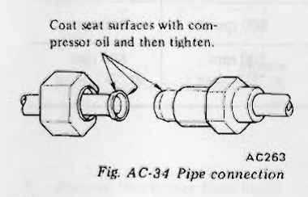
>
> - **Summary:** Flare tube and seat surface connection showing oil coating requirement and two-wrench method.
> - **Components:** Flare tube, Union fitting, Flare nut, Seat surface
> - **Mechanic Notes:** Coat seat surfaces with compressor oil and tighten using two wrenches.
> - **Tags:** `flare nut`, `pipe connection`, `compressor oil`, `refrigeration line`

6. Make sure of proper clamping. Start engine and raise engine speed to inspect if there is vibration or unusual noise.
7. Conduct leak test and make sure that there is no leak from connection.
8. As to evacuating and charging system, refer to "General Service" for "Evacuating and Charging System".

> 🖼️ **Fig. AC-35 Refrigeration line** `[AC246A]` *(Type: `exploded_view`)*
>
> 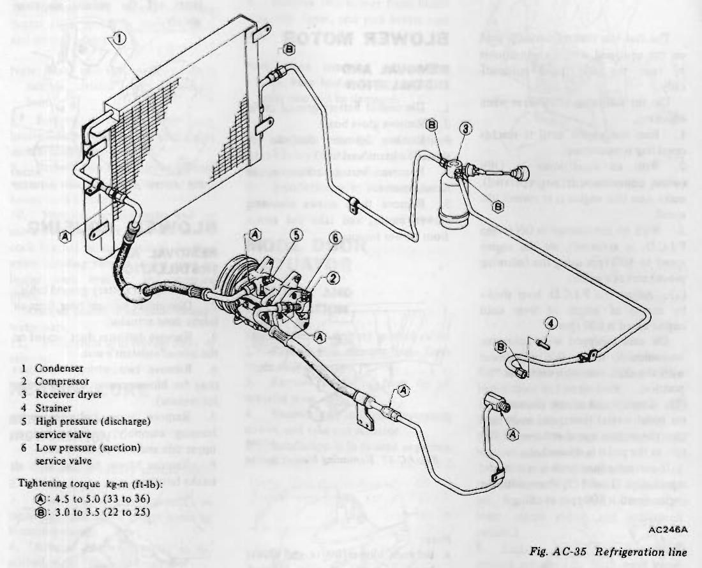
>
> - **Summary:** Complete vehicle refrigeration piping layout showing condenser, compressor, receiver drier, strainer, service valves, and line torques.
> - **Components:** Condenser, Compressor, Receiver dryer, Strainer, High pressure (discharge) service valve, Low pressure (suction) service valve, Flexible high pressure hose, Flexible low pressure hose
> - **Callouts:** **(1)** Condenser; **(2)** Compressor; **(3)** Receiver dryer; **(4)** Strainer; **(5)** High pressure (discharge) service valve; **(6)** Low pressure (suction) service valve; **(A)** Tightening torque: 4.5 to 5.0 kg-m (33 to 36 ft-lb); **(B)** Tightening torque: 3.0 to 3.5 kg-m (22 to 25 ft-lb)
> - **Specs / Measurements:** Torque A (flexible hose / compressor unions): 4.5 to 5.0 kg-m (33 to 36 ft-lb); Torque B (receiver drier / strainer fittings): 3.0 to 3.5 kg-m (22 to 25 ft-lb)
> - **Mechanic Notes:** Coat seating surfaces with compressor oil. Clamp lines securely to avoid vibration.
> - **Tags:** `refrigeration line`, `piping`, `condenser`, `compressor`, `receiver dryer`, `strainer`, `torque`

---

<!-- Page 30 (AC-30) -->
### FAST IDLE ACTUATOR

#### ADJUSTMENT OF IDLE SPEED

| Engine model | Transmission | When A/C is OFF | When F.I.C.D. is actuated |
| :--- | :--- | :--- | :--- |
| L28 | Manual | 800 rpm | 800 rpm |
| L28 | Automatic | 700 rpm at "D" range | 800 rpm at "N" range |

The fast idle control device is used on car equipped with air conditioner to raise the idle speed automatically.  
Use the following procedures when adjusting.
1. Run the engine until it reaches operating temperature.
2. With air conditioner in OFF (when compressor is not operated), make sure that engine is at correct idle speed.
3. With air conditioner in ON (when F.I.C.D. is actuated), set the engine speed to 800 rpm using the following procedures as a guide.
   (1) Adjust the F.I.C.D. lever stroke by means of length of lever until engine speed is 800 rpm.  
   On cars equipped with automatic transmission, make this adjustment with the shift control lever in the "N" position.  
   (2) Depress and release the accelerator pedal several times, and make sure that the engine speed reduces to 800 rpm as the pedal is released.  
   If correct adjustment is not made, repeat steps (1) and (2) above until the engine speed is 800 rpm at idling.

> 🖼️ **Fig. AC-36 Fast idle actuator** `[AC554]` *(Type: `component_location`)*
>
> 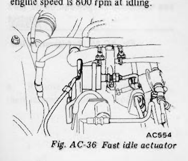
>
> - **Summary:** F.I.C.D. vacuum actuator and adjustable linkage lever mounted on intake manifold throttle linkage.
> - **Components:** Fast idle actuator, Actuator linkage rod, Throttle lever, Adjusting nut
> - **Specs / Measurements:** Engine idle speed with A/C ON: 800 rpm
> - **Wiring / Connections:** Vacuum hose to F.I.C.D. solenoid valve
> - **Mechanic Notes:** Adjust lever stroke length until idle speed stabilizes at 800 rpm with A/C engaged.
> - **Tags:** `F.I.C.D.`, `fast idle actuator`, `idle speed`, `throttle linkage`

---

### AIR INTAKE DOOR ACTUATOR

#### REMOVAL AND INSTALLATION
1. Disconnect battery ground cable.
2. Remove snap ring from top of actuator lever.
3. Remove two mounting screws and actuator from air intake housing.
4. Disconnect vacuum hose from actuator, and remove actuator.
5. Installation is to be done in reverse order of removal.

*Note: Make sure that air intake door shuts off the outside air completely.*

> 🖼️ **Fig. AC-38 Air intake door actuator** `[AC267]` *(Type: `component_location`)*
>
> 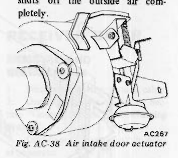
>
> - **Summary:** Air intake door vacuum actuator installed on air intake duct housing with lever and snap ring.
> - **Components:** Air intake door actuator, Air intake duct, Actuator arm, Snap ring, Mounting screws
> - **Wiring / Connections:** Vacuum line
> - **Mechanic Notes:** Ensure air intake door shuts off outside air completely when actuated.
> - **Tags:** `air intake door`, `vacuum actuator`, `snap ring`

---

### BLOWER MOTOR

#### REMOVAL AND INSTALLATION
1. Disconnect battery ground cable.
2. Remove glove box.
3. Remove defroster duct on the side of assistant's seat.
4. Remove wiring connector of blower motor.
5. Remove three screws mounting blower motor, and take out motor from blower housing.

> 🖼️ **Fig. AC-37 Removing blower motor** `[AC266]` *(Type: `procedure_step`)*
>
> 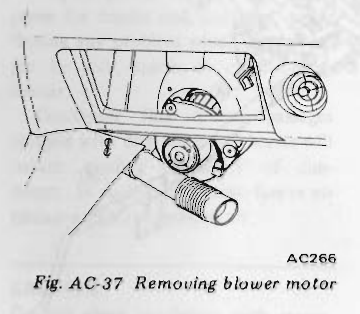
>
> - **Summary:** Blower motor mounting screws and removal from underneath the passenger dashboard blower housing.
> - **Components:** Blower motor, Blower housing, Mounting screws (3), Spacers (3)
> - **Specs / Measurements:** 3 mounting screws; 3 spacers
> - **Wiring / Connections:** Blower motor wiring harness connector
> - **Mechanic Notes:** Three spacers are inserted between motor and housing. Do not lose them.
> - **Tags:** `blower motor`, `removal`, `blower housing`, `spacers`

**Note:**
a. Between blower motor and blower housing are three spacers inserted. Be careful not to lose them.
b. In removing blower motor, remember its direction carefully so that it is reinstalled properly.

6. Installation is to be done in reverse sequence of removal.

---

### BLOWER HOUSING

#### REMOVAL AND INSTALLATION
1. Disconnect battery ground cable.
2. Disconnect vacuum hose from air intake door actuator.
3. Remove defroster duct located on the side of assistant's seat.
4. Remove two wiring connectors (one for blower motor, and the other for resistor).
5. Remove three bolts mounting housing assembly, one installed on upper side and two on lower side.
6. Remove blower housing with air intake housing.

> 🖼️ **Fig. AC-39 Removing blower housing** `[AC268]` *(Type: `procedure_step`)*
>
> 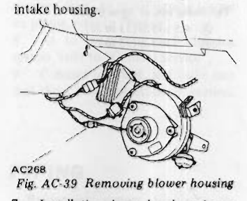
>
> - **Summary:** Blower housing mounting bolt locations under dashboard on passenger side.
> - **Components:** Blower housing, Air intake housing, Mounting bolts (3)
> - **Specs / Measurements:** 1 upper bolt; 2 lower bolts
> - **Wiring / Connections:** Motor connector; Resistor connector; Vacuum hose
> - **Mechanic Notes:** Disconnect vacuum hose from air intake door actuator before dropping housing.
> - **Tags:** `blower housing`, `removal`, `dash panel`

7. Installation is to be done in reverse sequence of removal.

---

<!-- Page 31 (AC-31) -->
### VACUUM WATER COCK

#### REMOVAL AND INSTALLATION
1. Disconnect battery ground cable.
2. Drain engine coolant.
3. From engine compartment, remove inlet and outlet heater hoses by loosening clamps.
4. Remove blower housing as described under "Blower Housing".
5. Move "TEMP" control lever fully to "HOT" position.
6. Remove two hoses from heater cock by loosening clamps.
7. Remove two screws retaining heater cock to heater cock bracket, and remove heater cock.  
   *Note: Make sure that capillary tube is neither twisted nor excessively bent.*
8. Remove, at vacuum water cock, heater hose between heater core outlet and vacuum water cock.
9. Remove two screws from vacuum water cock and two screws from heater cock bracket.
10. Remove vacuum hose, and remove vacuum water cock and heater cock bracket as an assembly. Loosen screw securing vacuum water cock to heater cock bracket, and separate them.  
    Remove heater hose from vacuum water cock.
11. Installation is in reverse order of removal.

---

### HEATER CORE

#### REMOVAL AND INSTALLATION
1. Disconnect battery ground cable.
2. Drain engine coolant.
3. From engine compartment, remove inlet and outlet heater hoses by loosening clamps.
4. Remove blower housing as described under "Blower Housing".
5. Remove vacuum water cock as described under "Vacuum Water Cock".
6. Disengage control cable from heater door and remove heater door rod from heater door. See Figure AC-40.

> 🖼️ **Fig. AC-40 Removing heater door rod** `[BE020B]` *(Type: `procedure_step`)*
>
> 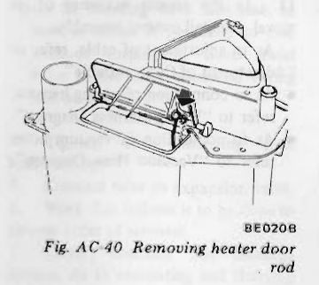
>
> - **Summary:** Disconnection of heater door operating rod from heater core box.
> - **Components:** Heater door, Operating rod, Retaining clip, Heater core casing
> - **Mechanic Notes:** Keep heater door open when removing or installing core to avoid damaging core fins.
> - **Tags:** `heater core`, `heater door rod`, `casing`

7. Remove two screws from heater core side cover, and pull heater core out.  
   *Note: When removing or installing core, keep heater door open; otherwise core will be damaged.*
8. Unfasten clamps and remove heater hoses from heater core. Remove heater core side cover from core.
9. Installation is in reverse order of removal.

---

### MODE DOOR ACTUATOR

#### REMOVAL AND INSTALLATION
1. Disconnect battery ground cable.
2. Remove two vacuum hoses from mode door actuator.
3. Remove snap ring from tip of actuator lever.
4. Remove two actuator mounting screws, and take out actuator.
5. Installation is in reverse sequence of removal.

> 🖼️ **Fig. AC-41 Mode door actuator** `[AC272]` *(Type: `component_location`)*
>
> 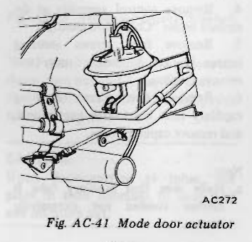
>
> - **Summary:** Mode door vacuum actuator installed on heater housing showing dual vacuum ports and linkage arm.
> - **Components:** Mode door actuator, Operating rod, Mounting bracket, Snap ring, Vacuum fittings
> - **Specs / Measurements:** 2 vacuum hose connections
> - **Wiring / Connections:** Two vacuum lines (D1, D2)
> - **Mechanic Notes:** Remove snap ring from tip of actuator lever before removing mounting screws.
> - **Tags:** `mode door actuator`, `dual diaphragm`, `vacuum actuator`

---

### CONTROL ASSEMBLY

#### REMOVAL AND INSTALLATION
1. Disconnect battery ground cable.
2. Remove console box.
3. Remove four screws retaining finisher, and pull out finisher forward. Disconnect wires at three (California models) or two (Non-California models) connectors, then remove finisher from instrument panel. See Figure AC-42.

> 🖼️ **Fig. AC-42 Removing finisher** `[AC273]` *(Type: `procedure_step`)*
>
> 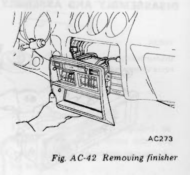
>
> - **Summary:** Removal of center console cluster finisher bezel and disconnect points for wire harness.
> - **Components:** Finisher cluster, Instrument panel, Gauges, Mounting screws (4)
> - **Specs / Measurements:** 4 mounting screws
> - **Wiring / Connections:** 3 connectors (California) / 2 connectors (Non-California)
> - **Mechanic Notes:** Disconnect finisher harness connectors before withdrawing finisher completely.
> - **Tags:** `finisher`, `instrument panel`, `center cluster`, `removal`

4. Remove control cables from heater door and water cock.
5. Remove thermostat control rod from thermostat.
6. Remove four vacuum hoses from vacuum selector valve.
7. Remove three wire connectors of control assembly. (These connectors are for control panel illumination lamp, micro switch and fan speed switch.)
8. Remove two screws that retain control assembly to instrument panel reinforcement.
9. Remove four screws securing instrument panel reinforcement, and remove reinforcement.
10. Remove control assembly by removing two screws (upper side), "E"-ring (lower side). See Figure AC-43. <!-- Page 32 (AC-32) --> > 🖼️ **Fig. AC-43 Removing control assembly** `[AC555]` *(Type: `procedure_step`)*
>
> 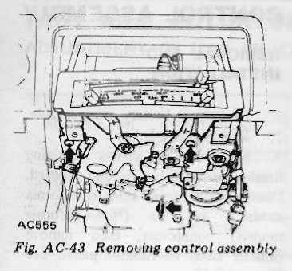
>
> - **Summary:** Control panel assembly mounting points showing upper screws and lower E-ring attachment.
> - **Components:** Control assembly, Upper screws (2), Lower 'E'-ring, Dash reinforcement
> - **Specs / Measurements:** 2 upper screws; 1 lower E-ring
> - **Mechanic Notes:** Remove upper screws and E-ring to pull control assembly out from dash frame.
> - **Tags:** `control assembly`, `removal`, `dash frame`, `E-ring`

11. In the reverse sequence of removal, reinstall control assembly.
    * As to adjustment of cable, refer to "Adjustment of Control Cable".
    * As to connection of wiring harness, refer to "Wiring Harness Diagram".
    * As to connection of vacuum hose, refer to "Vacuum Hose Diagram".

---

### DISASSEMBLY AND ASSEMBLY

> 🖼️ **Fig. AC-44 Exploded view of control assembly** `[AC556]` *(Type: `exploded_view`)*
>
> 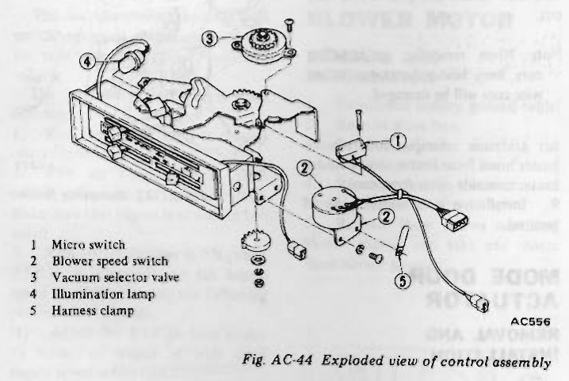
>
> - **Summary:** Exploded view of the A/C control panel assembly detailing internal electrical switches, vacuum valve, and bracket components.
> - **Components:** Control panel housing, Micro switch, Blower speed switch, Vacuum selector valve, Illumination lamp, Harness clamp, Lever mechanisms
> - **Callouts:** **(1)** Micro switch; **(2)** Blower speed switch; **(3)** Vacuum selector valve; **(4)** Illumination lamp; **(5)** Harness clamp
> - **Wiring / Connections:** Micro switch harness; Fan switch wiring; Illumination bulb
> - **Mechanic Notes:** Route wiring carefully through harness clamp (5) upon reassembly.
> - **Tags:** `control assembly`, `exploded view`, `micro switch`, `blower speed switch`, `vacuum selector valve`

---

### ADJUSTMENT OF CONTROL CABLE

#### Heater door
Set AIR lever in DEF position. Hook control cable on heater door and fix cable with clamp so as to close heater door perfectly.

#### Water cock
Set TEMP lever in COLD position. Hook control cable on water cock and fix cable with clamp so as to get water cock closed completely.

#### Thermostat
Set TEMP lever in COLD position. Install thermostat control rod so that thermostat is in full cold position.

---

### HEATER COCK

#### REMOVAL AND INSTALLATION
1. Disconnect battery ground cable.
2. Drain engine coolant.
3. Remove blower housing as described under "Blower Housing".
4. Remove control assembly as described under "Control Assembly".
5. Remove four screws securing heater bracket to heater unit, and remove bracket.
6. Remove two screws securing capillary tube bracket to heater unit, and remove capillary tube.

**Note:**
a. Make sure that capillary tube is neither twisted nor excessively bent.
b. When bending capillary tube, ensure that heater cock is fully open so as to prevent change in heater cock operation.

> 🖼️ **Fig. AC-45 Removing capillary tube** `[AC639]` *(Type: `procedure_step`)*
>
> 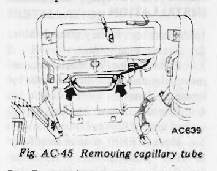
>
> - **Summary:** Capillary tube mounting bracket and routing across heater unit housing.
> - **Components:** Capillary tube, Capillary bracket, Heater housing, Retaining screws (2)
> - **Mechanic Notes:** Ensure heater cock is fully open when bending capillary tube.
> - **Tags:** `capillary tube`, `heater cock`, `bracket`, `heater unit`

7. Remove heater hoses from heater cock by loosening clamps.
8. Remove two screws securing heater cock. Heater cock can then be taken out.
9. Installation is in reverse order of removal.

---

### THERMOSTAT

#### REMOVAL AND INSTALLATION
1. Disconnect battery ground cable.
2. Remove console box.
3. Remove finisher. See Figure AC-42.
4. Remove finisher brackets and 3-way air duct.
5. Remove control rod of thermostat.
6. From evaporator housing, remove thermostat together with bracket by taking off two mounting screws.
7. Remove thermostat wiring at connector.
8. Pull out capillary tube from evaporator core and then take out thermostat.

> [!CAUTION]
> Capillary tube should not be bent too sharp.

> 🖼️ **Fig. AC-46 Thermostat** `[AC276]` *(Type: `component_location`)*
>
> 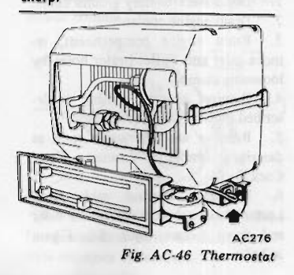
>
> - **Summary:** Thermostat switch body with sensing capillary tube inserted into evaporator case core.
> - **Components:** Thermostat switch, Capillary tube, Evaporator case, Mounting bracket
> - **Specs / Measurements:** Capillary tube insertion depth: 50 to 70 mm (1.97 to 2.76 in)
> - **Wiring / Connections:** Thermostat electrical connector
> - **Mechanic Notes:** Do not bend capillary tube too sharply; insert 50 to 70 mm into evaporator core.
> - **Tags:** `thermostat`, `capillary tube`, `evaporator`, `temperature control` <!-- Page 33 (AC-33) --> 9. Installation is in reverse order of removal.  
Capillary tube should be inserted by prescribed length in original position. Length to be inserted is 50 to 70 mm (1.97 to 2.76 in).

---

### EXPANSION VALVE

#### REMOVAL
1. Disconnect battery ground cable.
2. Discharge system.
3. Remove finisher. See Figure AC-42.
4. Remove finisher brackets and 3-way air duct.
5. Remove tube from expansion valve by removing flare nut.
6. Remove two mounting nuts, and pull out valve from expansion valve case. See Figure AC-47.

> 🖼️ **Fig. AC-47 Removing expansion valve** `[AC277]` *(Type: `procedure_step`)*
>
> 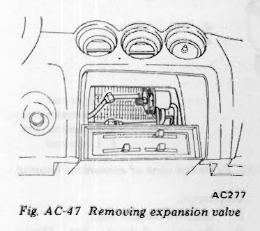
>
> - **Summary:** Expansion valve removal from evaporator case showing flare nut tube connection and mounting nuts.
> - **Components:** Expansion valve, Evaporator housing case, Flare nut fitting, Mounting nuts (2)
> - **Specs / Measurements:** 2 mounting nuts
> - **Mechanic Notes:** Insert valve parallelly without twisting to avoid damaging O-rings.
> - **Tags:** `expansion valve`, `removal`, `evaporator case`, `flare nut`

> 🖼️ **Fig. AC-48 O-ring** `[AC278]` *(Type: `alignment_orientation`)*
>
> 
>
> - **Summary:** Expansion valve mounting flange and replacement O-rings with insertion orientation arrows.
> - **Components:** Expansion valve flange, O-rings (2)
> - **Specs / Measurements:** 2 replacement O-rings
> - **Mechanic Notes:** Always replace O-rings with new ones and lubricate with clean compressor oil.
> - **Tags:** `expansion valve`, `O-ring`, `seals`, `compressor oil`

#### INSTALLATION
1. Replace two O-rings with new ones.
2. Apply adequate compressor oil to new O-rings, and install them on expansion valve.
3. Fit expansion valve to case, and install bolts and nuts thereon.  
   *Note: In inserting valve into case, be sure to insert it parallelly to case without turning it. Never twist valve in the case, otherwise O-ring will be caused to twist.*
4. Tighten two mounting nuts horizontally.
5. Connect tube to expansion valve.
6. Work that follows is to be done in reverse order of removal.
7. Lastly, evacuate and recharge system. As to evacuating and charging system, refer to "Evacuating and Charging System".
8. Conduct leak test and ensure that there is no leak from connection.

---

### EVAPORATOR HOUSING

#### REMOVAL
1. Disconnect battery ground cable.
2. Discharge system.
3. Remove console box.
4. Remove finisher. See Figure AC-42.
5. Remove two retaining screws of 3-way air duct.
6. Remove finisher brackets and instrument panel reinforcement. See Figure AC-49.

> 🖼️ **Fig. AC-49 Removing finisher brackets** `[AC279]` *(Type: `procedure_step`)*
>
> 
>
> - **Summary:** Removal of finisher support brackets and instrument panel reinforcement brace.
> - **Components:** Finisher brackets, Center dash reinforcement, Mounting screws
> - **Mechanic Notes:** Remove brackets and brace to access 3-way air duct and evaporator casing.
> - **Tags:** `finisher brackets`, `reinforcement`, `center dash`

7. From 3-way air duct, remove air ducts, then pull out 3-way air duct.
8. Disconnect both inlet and outlet tubes of evaporator.  
   > [!CAUTION]
   > Upon disconnection of tubes, put plugs in their openings to keep dust and moisture out.
9. Remove retaining screw, grommet cover and grommet from tubes of evaporator.
10. Remove defroster ducts.
11. Remove instrument panel center stays. See Figure AC-50.

> 🖼️ **Fig. AC-50 Removing instrument panel center stays** `[AC557]` *(Type: `procedure_step`)*
>
> 
>
> - **Summary:** Structural center stays of instrument panel supporting evaporator housing and center dash.
> - **Components:** Instrument panel center stays (left and right), Mounting bolts
> - **Mechanic Notes:** Unbolt stays to free evaporator assembly.
> - **Tags:** `instrument panel`, `center stays`, `evaporator housing`

12. Remove drain hose.
13. Remove brackets, installed on heater unit, of evaporator inlet and outlet tubes by removing two attaching screws.
14. Remove control cables from heater door and heater cock.
15. Remove four vacuum hoses from vacuum selector valve.
16. Remove four wiring connectors (for control panel illumination lamp, micro switch, fan speed switch and thermostat respectively).
17. Remove two attaching bolts installed on lower side of evaporator housing, and let evaporator housing fall down. See Figure AC-51.

> 🖼️ **Fig. AC-51 Removing evaporator housing** `[AC281]` *(Type: `procedure_step`)*
>
> 
>
> - **Summary:** Lower mounting bolts holding evaporator housing to the vehicle dashboard framing.
> - **Components:** Evaporator housing, Lower mounting bolts (2), Mounting bracket
> - **Specs / Measurements:** 2 lower mounting bolts
> - **Mechanic Notes:** Remove two lower bolts to allow evaporator housing to drop down.
> - **Tags:** `evaporator housing`, `lower mounting bolts`, `removal`

18. Pull out evaporator housing when it has come off bracket installed on heater unit.
19. Separate control assembly from evaporator housing.

---

<!-- Page 34 (AC-34) -->
### DISASSEMBLY AND ASSEMBLY
1. Remove four fixing clips of upper and lower cases.
2. Pull up upper case and separate it from lower case.
3. Cut off sealing packing with knife at the conjunction of cases.
4. Pull out thermostat capillary tube from evaporator core.
5. Pull out evaporator core from lower case.

> 🖼️ **Fig. AC-52 Exploded view of evaporator housing** `[AC282]` *(Type: `exploded_view`)*
>
> 
>
> - **Summary:** Exploded view of evaporator housing assembly showing casing shells, core, expansion valve, and retaining clips.
> - **Components:** Upper case, Evaporator core, Expansion valve, Lower case, Piping block, Case retaining clips (4), Lower drain bracket
> - **Callouts:** **(1)** Upper case; **(2)** Evaporator core; **(3)** Expansion valve; **(4)** Lower case
> - **Specs / Measurements:** Compressor oil addition: 28 g (1 oz) for new evaporator core
> - **Mechanic Notes:** Cut sealing packing with knife between cases. Clean nicotine and dirt to prevent odors.
> - **Tags:** `evaporator housing`, `exploded view`, `evaporator core`, `expansion valve`, `casing clips`

---

### INSPECTION
In case evaporator core or expansion valve have gas leaking, repair or replace it with a new one as necessary.  
Dirt and nicotine accumulation on evaporator housing will go bad and smell. This means that you have to remove them from time to time to assure healthful fresh air inside car.

---

### INSTALLATION
Installation should be done in reverse order of removal, with attention paid to following points:
1. When replacing evaporator with a new one, add 28 g (1 oz) of new compressor oil to new evaporator.
2. As to adjustment of cable, refer to "Adjustment of Control Cable" in "Control Assembly".
3. As to wiring harness connection, refer to "Wiring Harness Diagram".
4. As to vacuum hose connection, refer to "Vacuum Hose Diagram".
5. As to evacuating and charging system, refer to section concerned in "General Service".
6. Conduct leak test and ensure that there is no gas leak from connection.

---

### HEATER UNIT

#### REMOVAL
1. Disconnect battery ground cable.
2. Drain engine coolant.
3. Discharge system.
4. Remove hose clamp and disconnect heater hose from inlet and outlet tubes of heater unit.
5. Remove screw, grommet cover and grommet from tubes of heater unit.
6. Disconnect evaporator's inlet and outlet tubes.
7. Remove retaining screw, grommet cover, and grommet from tubes of evaporator.
8. Remove console box.
9. Remove finisher. See Figure AC-42.
10. Remove instrument panel reinforcement and finisher brackets.
11. Remove 3-way air duct. See Figure AC-49.
12. Remove glove box.
13. Remove blower housing as described in "Blower Housing".
14. Remove evaporator housing as described in "Evaporator Housing".
15. In engine compartment, remove two mounting nuts of heater unit.
16. In passenger compartment, remove heater unit mounting bolts (two each on upper and lower sides). See Figure AC-53.
17. Remove brackets on upper side of heater unit.  
    Slide heater unit out slightly, and turn it until heater cock faces toward engine. Heater unit will then be removed from instrument panel. <!-- Page 35 (AC-35) --> #### INSTALLATION
1. Slightly insert heater unit into opening in instrument panel with heater cock facing toward engine, and turn it 90° until piping holes align properly. Be sure to remove upper brackets when inserting heater unit.
2. Tilting heater unit, fix upper bracket on side of driver's seat, and then that on side of assistant's seat.
3. Insert two vacuum hoses in mode door actuator.
4. Insert heater unit mounting bolts in dash panel, and temporarily put nuts on them from side of engine compartment.
5. On side of passenger compartment temporarily tighten two upper attaching bolts.
6. Tighten two lower attaching bolts. Then tighten up other bolts and nuts which have been temporarily installed.

> 🖼️ **Fig. AC-53 Removing heater unit** `[AC283]` *(Type: `procedure_step`)*
>
> 
>
> - **Summary:** Heater unit mounting bolts and bracket locations under center instrument panel.
> - **Components:** Heater unit, Upper attaching bolts (2), Lower attaching bolts (2), Instrument panel dash opening
> - **Specs / Measurements:** 2 upper bolts; 2 lower bolts; 2 engine compartment nuts
> - **Mechanic Notes:** Insert heater unit into dashboard opening with cock facing engine, then rotate 90 degrees.
> - **Tags:** `heater unit`, `installation`, `mounting bolts`, `center dash`

7. Install evaporator housing with control assembly.
8. Install blower housing.
9. Remaining work is to be done in reverse sequence of removal.
10. As to adjustment of cable, refer to "Adjustment of Control Cable" in "Control Assembly".
11. As to wiring harness connection, refer to "Wiring Harness Diagram".
12. As to vacuum hose connection, refer to "Vacuum Hose Diagram".
13. As to evacuating and charging system, refer to section concerned in "General Service".
14. Conduct leak test and insure that there is no gas leak from connection.

---

<!-- Page 36 (AC-36) -->
## VACUUM HOSE DIAGRAM

> 🖼️ **Fig. AC-54 Vacuum hose diagram** `[AC794]` *(Type: `vacuum_routing`)*
>
> 
>
> - **Summary:** Comprehensive schematic of the air conditioning vacuum distribution system including vacuum tank, check valve, solenoid valves, selector valve, actuators, and hose stripe color codes.
> - **Components:** Vacuum tank, Magnet valve - vacuum source, Magnet valve - F.I.C.D., Check valve, Air intake door actuator, Vacuum cock, Control assembly, Vacuum selector valve, Mode door actuator (A/T & M/T), Fast idle actuator, Firewall grommet
> - **Callouts:** **(S)** Vacuum source; **(S1)** Source to check valve; **(S2)** Source to vacuum tank; **(D1)** Mode door port 1; **(D2)** Mode door port 2; **(I)** Intake door actuator port; **(W)** Water cock port; **(N)** No stripe; **(Y)** One yellow stripe; **(W_stripe)** One white stripe
> - **Wiring / Connections:** Hose N: No stripe; Hose Y: One yellow stripe; Hose W: One white stripe
> - **Mechanic Notes:** Pay strict attention to hose stripe color markings (N, Y, W) when reconnecting vacuum lines.
> - **Tags:** `vacuum hose diagram`, `vacuum routing`, `vacuum tank`, `mode door actuator`, `fast idle actuator`, `check valve`

### HOSE COLOR CODING AND IDENTIFICATION
* **N**: No stripe (Plain black)
* **Y**: One yellow stripe
* **W**: One white stripe

### VACUUM SELECTOR PORTS
* **S**: Vacuum source (from vacuum tank via check valve)
* **D1**: Mode door actuator port 1
* **D2**: Mode door actuator port 2
* **I**: Air intake door actuator
* **W**: Vacuum water cock

---

<!-- Page 37 (AC-37) -->
## WIRING HARNESS DIAGRAM

> 🖼️ **Fig. AC-55 Wiring harness diagram** `[AC225A]` *(Type: `electrical_schematic`)*
>
> 
>
> - **Summary:** Pictorial layout of A/C wiring harnesses in engine compartment and dashboard showing connectors, switches, relays, and resistor.
> - **Components:** Dash harness, Air cond. sub harness, Engine room harness, Control panel illumination lamp, Micro switch, Blower control switch, Resistor, Relay-Ignition, Blower motor, Fuse block, Thermostat switch, Relay-compressor, Compressor magnetic clutch
> - **Callouts:** **(Blue)** Lead wire to compressor clutch
> - **Wiring / Connections:** Dash harness to sub-harness connectors; Blue single lead wire to compressor magnetic clutch
> - **Mechanic Notes:** Verify connector latching and ground connection at body ground points.
> - **Tags:** `wiring harness diagram`, `air cond sub harness`, `engine room harness`, `dash harness`, `relays`

### HARNESS BRANCHES
* **DASH HARNESS**: Feeds fuse block, ignition relay, and blower motor harness.
* **AIR COND. SUB HARNESS**: Interconnects control panel illumination lamp, micro switch, blower control switch, resistor, and thermostat switch.
* **ENGINE ROOM HARNESS**: Runs to compressor clutch relay, pressure switch, and compressor magnetic clutch (Blue wire).

---

<!-- Page 38 (AC-38) -->
## CIRCUIT DIAGRAM FOR AIR CONDITIONER

> 🖼️ **Fig. AC-56 Circuit diagram for air conditioner** `[AC226A]` *(Type: `electrical_schematic`)*
>
> 
>
> - **Summary:** Complete electrical schematic diagram of the A/C control circuits including compressor clutch, pressure switch, vacuum magnet valves, blower switch, resistor, and relays.
> - **Components:** Compressor magnet clutch, Pressure switch, Magnet valve (vacuum source), Magnet valve (F.I.C.D.), Starter motor, Fusible link, Battery, Air conditioner relay, Ignition switch, Ignition relay, Blower motor, Blower motor resistor, Blower speed switch, Thermostat switch, Micro switch, Fuse block
> - **Callouts:** **(C-2)** Connector (Black); **(C-3)** Connector (Green); **(C-4)** Connector (White); **(C-9)** Connector (White)
> - **Specs / Measurements:** Fuses: 10A, 15A, 20A ratings as shown in fuse block
> - **Wiring / Connections:** B, BG, W, WR, Y, YR, L, LB, LW, LR, LY, LG, LB/W color coding
> - **Mechanic Notes:** Trace power from battery through fusible link to starter motor and ignition relay before diagnosing individual components.
> - **Tags:** `circuit diagram`, `electrical schematic`, `A/C relay`, `pressure switch`, `resistor`, `magnet valve`

### WIRE COLOR CODES
| Code | Wire Color | Code | Wire Color |
| :--- | :--- | :--- | :--- |
| **B** | Black | **L** | Blue |
| **BG** | Black with green stripe | **LB** | Blue with black stripe |
| **W** | White | **LW** | Blue with white stripe |
| **WR** | White with red stripe | **LR** | Blue with red stripe |
| **Y** | Yellow | **LY** | Blue with yellow stripe |
| **YR** | Yellow with red stripe | **LG** | Blue with green stripe |
| **LB/W** | Black with blue stripe and white tube | | |

### CONNECTOR IDENTIFICATION
* **C-2**: Black
* **C-3**: Green
* **C-4**: White
* **C-9**: White

---

<!-- Page 39 (AC-39) -->
## CIRCUIT DIAGRAM FOR ILLUMINATION LAMP

> 🖼️ **Fig. AC-57 Circuit diagram for illumination lamp** `[AC797]` *(Type: `electrical_schematic`)*
>
> 
>
> - **Summary:** Wiring diagram for the air conditioner control panel illumination lamp, dimmer rheostat, lighting switch, and fuse block.
> - **Components:** Starter motor, Fusible link, 15A Fuse, Lighting switch combination switch, Air conditioner control illumination lamp, Illumination rheostat, Fuse block, Earth point
> - **Callouts:** **(C-1)** Connector (Blue); **(C-6)** Connector (Black); **(C-9)** Connector (White); **(C-10)** Connector (White)
> - **Specs / Measurements:** Fuse rating: 15A
> - **Wiring / Connections:** B (Black), W (White), WR (White/Red), RL (Red/Blue), GW (Green/White), GL (Green/Blue)
> - **Mechanic Notes:** Rheostat regulates lamp ground/resistance for dash illumination dimming.
> - **Tags:** `illumination lamp`, `circuit diagram`, `rheostat`, `combination switch`, `lighting switch`

### WIRE COLOR CODES
| Code | Color |
| :--- | :--- |
| **B** | Black |
| **W** | White |
| **WR** | White with red stripe |
| **RL** | Red with blue stripe |
| **GW** | Green with white stripe |
| **GL** | Green with blue stripe |

### CONNECTOR IDENTIFICATION
* **C-1**: Blue
* **C-6**: Black
* **C-9**: White
* **C-10**: White

---

<!-- Page 40 (AC-40) -->
## TROUBLE DIAGNOSES AND CORRECTIONS

### AIR CONDITIONER DIAGNOSES

> 🖼️ **Air Conditioner Diagnoses Chart**  *(Type: `graph_chart`)*
>
> 
>
> - **Summary:** Comprehensive troubleshooting decision tree for air conditioner problems including insufficient cooling, noise, pressure abnormalities, and sight glass bubbles.
> - **Components:** Insufficient cooling branch, Noise branch, Sight glass check branch, Manifold gauge pressure diagnosis branch, Standard pressure reference table
> - **Specs / Measurements:** Outside 70°F: Suction 20-28 psi, Head 138-168 psi, Temp diff 18-24°F; Outside 80°F: Suction 23-33 psi, Head 152-185 psi, Temp diff 19-26°F; Outside 90°F: Suction 28-38 psi, Head 175-209 psi, Temp diff 23-30°F; Outside 100°F: Suction 37-48 psi, Head 201-235 psi, Temp diff 27-35°F
> - **Mechanic Notes:** Always check dash panel grommets and seals if discharge air temp is abnormal but pressures are within normal spec.
> - **Tags:** `trouble diagnoses`, `decision tree`, `flowchart`, `insufficient cooling`, `noise`, `pressure specs`

#### PERFORMANCE TEST STANDARD PRESSURE SPECIFICATIONS (From Chart)
*Test conditions: Engine speed 1,500 rpm; FAN lever: 4; AIR lever: A/C; TEMP lever: Max. cold.*

| Outside Air Temp °F | Suction Pressure psi | Head Pressure psi | Temp Difference (Outside - Discharge) °F |
| :--- | :--- | :--- | :--- |
| 70 | 20 to 28 | 138 to 168 | 18 to 24 |
| 80 | 23 to 33 | 152 to 185 | 19 to 26 |
| 90 | 28 to 38 | 175 to 209 | 23 to 30 |
| 100 | 37 to 48 | 201 to 235 | 27 to 35 |

---

<!-- Page 41 (AC-41) -->
### PERFORMANCE TEST DIAGNOSES

Of various conditions caused to the air conditioning system, the characteristics revealed on manifold gauge reading are shown in the following.  
As to the method of a performance test, refer to the item of "Performance Test".  
Each shaded area on the following tables indicates a reading of the normal system when the temperature of outside air is 32.5°C (90°F).

| Condition | Probable cause | Corrective action |
| :--- | :--- | :--- |
| **INSUFFICIENT REFRIGERANT CHARGE**  

> 🖼️ **Insufficient Refrigerant Charge Gauge Reading** `[AC287]` *(Type: `inspection_measurement`)*
>
> 
>
> - **Summary:** Manifold gauge readings for insufficient refrigerant charge: Low pressure ~ 10 psi (normal 28-38), High pressure ~ 115 psi (normal 175-209).
> - **Components:** Low-pressure gauge, High-pressure gauge, Manifold
> - **Specs / Measurements:** Low pressure: ~10 psi; High pressure: ~115 psi
> - **Mechanic Notes:** Both low and high pressures are lower than normal shaded area; bubbles visible in sight glass.
> - **Tags:** `gauge reading`, `insufficient refrigerant`, `low pressure`, `manifold gauge`

  *Insufficient cooling. Bubbles appear in sight glass.* | Refrigerant is small, or leaking a little. | 1. Leak test. 2. Repair leak. 3. Charge system. *Note: Evacuate, as necessary, and recharge system.* |
| **ALMOST NO REFRIGERANT**  

> 🖼️ **Almost No Refrigerant Gauge Reading** `[AC288]` *(Type: `inspection_measurement`)*
>
> 
>
> - **Summary:** Manifold gauge readings for severe refrigerant loss: Low pressure in deep vacuum (~ -10 psi), High pressure ~ 35 psi.
> - **Components:** Low-pressure gauge, High-pressure gauge, Manifold
> - **Specs / Measurements:** Low pressure: vacuum (-10 psi); High pressure: ~35 psi
> - **Mechanic Notes:** Stop compressor immediately to avoid burning out compressor from oil starvation.
> - **Tags:** `gauge reading`, `almost no refrigerant`, `vacuum`, `leak`

  *No cooling action. In sight glass appear a lot of bubbles or something like mist.* | Serious refrigerant leak. | Stop compressor immediately. 1. Leak test. 2. Discharge system. 3. Repair leak(s). 4. Replace receiver drier if necessary. 5. Check oil level. 6. Evacuate and recharge system. |
| **FAULTY EXPANSION VALVE**  

> 🖼️ **Faulty Expansion Valve Gauge Reading** `[AC289]` *(Type: `inspection_measurement`)*
>
> 
>
> - **Summary:** Manifold gauge readings for restricted/stuck closed expansion valve: Low pressure in vacuum, High pressure low (~ 70 psi).
> - **Components:** Low-pressure gauge, High-pressure gauge, Manifold
> - **Specs / Measurements:** Low pressure: vacuum; High pressure: ~70 psi
> - **Mechanic Notes:** Expansion valve inlet sweats or frosts when restriction occurs.
> - **Tags:** `gauge reading`, `faulty expansion valve`, `vacuum`, `frosting`

  *Slight cooling. Sweating or frosted expansion valve inlet.* | Expansion valve restricts refrigerant flow. • Expansion valve is clogged. • Expansion valve is inoperative. Valve stuck closed. Thermal bulb has lost charge. | *If valve inlet reveals sweat or frost:* 1. Discharge system. 2. Remove valve and clean it. Replace it if necessary. 3. Evacuate system. 4. Charge system.  *If valve does not operate:* 1. Discharge system. 2. Replace valve. 3. Evacuate and charge system. | <!-- Page 42 (AC-42) --> ### PERFORMANCE TEST DIAGNOSES (Continued)

| Condition | Probable cause | Corrective action |
| :--- | :--- | :--- |
| **EXPANSION VALVE OVER-DISCHARGING**  

> 🖼️ **Expansion Valve Over-Discharge Gauge Reading** `[AC290]` *(Type: `inspection_measurement`)*
>
> 
>
> - **Summary:** Manifold gauge readings for over-metering expansion valve: Low pressure abnormally high (~ 45 psi), High pressure normal/high (~ 220 psi).
> - **Components:** Low-pressure gauge, High-pressure gauge, Manifold
> - **Specs / Measurements:** Low pressure: ~45 psi; High pressure: ~220 psi
> - **Mechanic Notes:** Suction line shows heavy sweating when expansion valve allows excess refrigerant.
> - **Tags:** `gauge reading`, `expansion valve`, `sweated line`, `high suction pressure`

  *Insufficient cooling. Sweated suction line.* | Expansion valve allows too much refrigerant through evaporator. | Check valve for operation. If suction side does not show a pressure decrease, replace valve. |
| **FAULTY O-RING IN EXPANSION VALVE**  

> 🖼️ **Faulty Expansion Valve O-Ring Gauge Reading** `[AC291]` *(Type: `inspection_measurement`)*
>
> 
>
> - **Summary:** Manifold gauge readings for leaking expansion valve O-ring: Low pressure high (~ 55 psi), High pressure elevated (~ 250 psi).
> - **Components:** Low-pressure gauge, High-pressure gauge, Manifold
> - **Specs / Measurements:** Low pressure: ~55 psi; High pressure: ~250 psi
> - **Mechanic Notes:** Frosting or sweating suction line indicates refrigerant bypass past O-ring seal.
> - **Tags:** `gauge reading`, `O-ring`, `expansion valve`, `frosted suction line`

  *No cooling. Sweating or frosted suction line.* | Faulty seal of O-ring in expansion valve. | 1. Discharge system. 2. Remove expansion valve and replace O-ring. 3. Evacuate and recharge system. |
| **AIR IN SYSTEM**  

> 🖼️ **Air In System Gauge Reading** `[AC292]` *(Type: `inspection_measurement`)*
>
> 
>
> - **Summary:** Manifold gauge readings for air contamination: Low pressure elevated (~ 40 psi), High pressure very high (~ 260 psi).
> - **Components:** Low-pressure gauge, High-pressure gauge, Manifold
> - **Specs / Measurements:** Low pressure: ~40 psi; High pressure: ~260 psi
> - **Mechanic Notes:** Both pressures are abnormally high, and occasional bubbles appear in sight glass.
> - **Tags:** `gauge reading`, `air in system`, `high head pressure`, `receiver drier`

  *Insufficient cooling. Sight glass shows occasional bubbles.* | Air mixed with refrigerant in system. | 1. Discharge system. 2. Replace receiver drier. 3. Evacuate and charge system. |
| **MOISTURE IN SYSTEM**  

> 🖼️ **Moisture In System Gauge Reading** `[AC293]` *(Type: `inspection_measurement`)*
>
> 
>
> - **Summary:** Manifold gauge readings for moisture freezing in expansion valve: Suction gauge fluctuates with 0.4 kg/cm² (6 psi) needle vibration before pulling into vacuum.
> - **Components:** Low-pressure gauge, High-pressure gauge, Manifold
> - **Specs / Measurements:** Gauge needle vibration: 0.4 kg/cm² (6 psi)
> - **Mechanic Notes:** Perform 30-minute evacuation three consecutive times to boil out moisture after drier replacement.
> - **Tags:** `gauge reading`, `moisture in system`, `freezing`, `expansion valve`, `gauge vibration`

  *After operation for a while, pressure on suction side may show vacuum pressure reading. During this condition, discharge air will be warm. As warning of this, reading shows 0.4 kg/cm² (6 psi) vibration.* | Drier is saturated with moisture. Moisture has frozen at expansion valve. Refrigerant flow is restricted. | 1. Discharge system. 2. Replace receiver drier (twice if necessary). 3. Evacuate system completely. (Repeat 30-minute evacuating three times.) 4. Recharge system. | <!-- Page 43 (AC-43) --> ### PERFORMANCE TEST DIAGNOSES (Continued)

| Condition | Probable cause | Corrective action |
| :--- | :--- | :--- |
| **FAULTY CONDENSER**  

> 🖼️ **Faulty Condenser Gauge Reading** `[AC294]` *(Type: `inspection_measurement`)*
>
> 
>
> - **Summary:** Manifold gauge readings for insufficient condenser airflow/cooling: Both low pressure (~ 45 psi) and head pressure (~ 280 psi) excessively high.
> - **Components:** Low-pressure gauge, High-pressure gauge, Manifold
> - **Specs / Measurements:** Low pressure: ~45 psi; High pressure: ~280 psi
> - **Mechanic Notes:** Suction line is very hot and engine may overheat. Clean condenser fins with water.
> - **Tags:** `gauge reading`, `faulty condenser`, `high head pressure`, `engine overheat`

  *No cooling action: engine may overheat. Bubbles appear in sight glass of drier. Suction line is very hot.* | Condenser is often found not functioning well. | • Check fan belt and fluid coupling. • Check condenser for dirt accumulation. • Check engine cooling system for overheat. • Check for refrigerant overcharge. *Note: If pressure remains high in spite of all above actions taken, remove and inspect the condenser for possible oil clogging.* |
| **HIGH PRESSURE LINE BLOCKED**  

> 🖼️ **High Pressure Line Blocked Gauge Reading** `[AC295]` *(Type: `inspection_measurement`)*
>
> 
>
> - **Summary:** Manifold gauge readings for clogged receiver drier or line restriction: Suction drops into vacuum, Head pressure drops to ~ 70 psi.
> - **Components:** Low-pressure gauge, High-pressure gauge, Manifold
> - **Specs / Measurements:** Low pressure: vacuum; High pressure: ~70 psi
> - **Mechanic Notes:** High pressure liquid line frosts after the point of restriction.
> - **Tags:** `gauge reading`, `blocked line`, `restricted drier`, `frosting`

  *Insufficient cooling. Frosted high pressure liquid line.* | Drier clogged, or restriction in high pressure line. | 1. Discharge system. 2. Remove receiver drier or strainer and replace it. 3. Evacuate and charge system. |
| **FAULTY COMPRESSOR**  

> 🖼️ **Faulty Compressor Gauge Reading** `[AC296]` *(Type: `inspection_measurement`)*
>
> 
>
> - **Summary:** Manifold gauge readings for damaged compressor valves/gaskets: Suction pressure very high (~ 60 psi) while discharge pressure is very low (~ 100 psi).
> - **Components:** Low-pressure gauge, High-pressure gauge, Manifold
> - **Specs / Measurements:** Low pressure: ~60 psi; High pressure: ~100 psi
> - **Mechanic Notes:** Compressor fails to pump; high suction with low discharge indicates failed internal reed valves or gaskets.
> - **Tags:** `gauge reading`, `faulty compressor`, `broken reed valves`, `low discharge pressure`

  *Insufficient cooling.* | Internal problem in compressor, or damaged gasket and valve. | 1. Discharge system. 2. Remove and check compressor. 3. Repair or replace compressor. 4. Check oil level. 5. Replace receiver drier. 6. Evacuate and charge system. |

---

<!-- Page 44 (AC-44) -->
## BLOWER MOTOR DIAGNOSES

> 🖼️ **Blower Motor Diagnoses Flowchart**  *(Type: `graph_chart`)*
>
> 
>
> - **Summary:** Logic flowchart for diagnosing an inoperative blower motor through fuse check, ground wire bypass, resistor check, and test light probing.
> - **Components:** Blower motor, Fuse, Blower speed switch, Resistor, Ignition relay, 12-volt test light
> - **Specs / Measurements:** 12V test light
> - **Wiring / Connections:** Blue/green: 1-speed; Blue/black: 2-speed; Blue/red: 3-speed; Blue: 4-speed; White: Blower motor power; White/red: Ignition relay power
> - **Mechanic Notes:** Ground blower speed switch leads sequentially to isolate open circuits or faulty switch contacts.
> - **Tags:** `blower motor diagnoses`, `flowchart`, `resistor`, `switch`, `test light`

### DIAGNOSTIC FLOW SUMMARY
* **Blower motor inoperative** -> Check fuse.
  * **Fuse blown** -> Locate short-circuited spot, and repair or replace faulty parts.
  * **Fuse OK** -> Ground one of lead wires [blue/green (1-speed), blue/black (2-speed), blue/red (3-speed), blue (4-speed)] leading to blower speed switch.
    * **Blower runs** -> Check ground circuit connection and lead wire connection. When no problem is found, replace blower speed switch.
    * **Blower does not run** -> Ground blue wire leading to resistor.
      * **Blower runs** -> Check connection of resistor. When no problem is found, replace resistor.
      * **Blower does not run** -> Connect 12-volt test light to white wire leading to blower motor. Ground the other end of test light.
        * **Light ON** -> Check lead wire connection. When no problem is found, replace blower motor.
        * **Light OFF** -> Connect 12-volt test light to white/red of ignition relay. Ground the other end of test light.
          * **Light ON** -> Check lead wire connection, and when no problem is found, replace relay.
          * **Light OFF** -> Check wire between relay and fuse; Check fuse holder, too. Repair or replace damaged parts, if any.

---

<!-- Page 45 (AC-45) -->
## COMPRESSOR DIAGNOSES

> 🖼️ **Compressor Diagnoses Flowchart**  *(Type: `graph_chart`)*
>
> 
>
> - **Summary:** Troubleshooting tree for compressor malfunctions covering clutch slipping, low voltage, seizure, oil leaks, high torque, and operating noise.
> - **Components:** Compressor, Compressor clutch, Drive belt, Clutch coil, Mounting bolts
> - **Specs / Measurements:** Clutch coil minimum voltage: 10.5V; Engine test speed: 1,500 rpm
> - **Wiring / Connections:** Compressor clutch lead wire
> - **Mechanic Notes:** If clutch coil voltage is below 10.5V, check coil ground terminal connection before replacing clutch.
> - **Tags:** `compressor diagnoses`, `clutch slipping`, `high torque`, `noise`, `oil leak`

### DIAGNOSTIC FLOW SUMMARY
1. **Compressor clutch is engaged, but compressor does not run:**
   * **Compressor clutch has voltage decreased to less than 10.5V:**
     * Ground terminal of coil is poor at connection -> Repair connection.
     * In case clutch is not engaged yet, replace compressor clutch.
   * **Clutch slipping:**
     * Check and readjust gap of clutch.
     * Clean oil or dust on contact surface of clutch.
     * If slipping continues, replace compressor clutch.
   * **Belt slipping:**
     * Check belt tension and adjust it. If belt is worn out or damaged, replace it.
   * **Seized compressor:**
     * Internal problem in compressor cylinder. Check system. Repair or replace if necessary.
2. **Compressor clutch is not engaged:**
   * Lead wire of compressor clutch is dead -> Refer to "Compressor Clutch Diagnoses".
3. **Compressor oil leaking:**
   * Air-blow on spot where oil leak evidence is found. Then check for refrigerant leaks using leak detector:
     * Refrigerant leaking -> Repair or replace compressor.
     * No refrigerant leaking -> Wipe clean oil with rag.
4. **High torque:**
   * **Overcharge of refrigerant:** Discharge refrigerant gas to an extent that sight glass of receiver drier has only a few bubbles. Engine speed: 1,500 rpm. Check discharge pressure (OK if reduced).
   * **Air in refrigeration system:** Discharge system from service valve on discharge side. Evacuate and recharge the system.
   * When torque is still great, repair or replace compressor.
5. **Compressor is noisy:**
   * **Noisy only when clutch is engaged:**
     * Check for loose compressor mounting bolts. Retighten bolts.
     * Compressor drive belt is loose. Adjust belt tension.
     * If compressor is noisy yet, repair or replace compressor.
   * **Noisy when clutch is not engaged:**
     * Remove compressor belt. Turn pulley of compressor clutch by hand, and check for noise. If noise is heard, repair compressor clutch.

---

<!-- Page 46 (AC-46) -->
## COMPRESSOR CLUTCH DIAGNOSES

> 🖼️ **Compressor Clutch Diagnoses Flowchart**  *(Type: `graph_chart`)*
>
> 
>
> - **Summary:** Systematic electrical troubleshooting procedure for compressor clutch non-engagement using a 12V test light through fuse, switch, and thermostat stages.
> - **Components:** Compressor clutch, Fuse, Blower speed switch, Micro switch, Thermostat, 12-volt test light
> - **Specs / Measurements:** 12V test light
> - **Wiring / Connections:** Blue/white: Blower speed switch terminal; Yellow: Micro switch; Black/green: Thermostat lead
> - **Mechanic Notes:** Ensure AIR lever is set to A/C position when testing blower speed switch terminal.
> - **Tags:** `compressor clutch diagnoses`, `electrical troubleshooting`, `test light`, `micro switch`, `thermostat`

### DIAGNOSTIC FLOW SUMMARY
* **Compressor clutch is not engaged** -> Check fuse.
  * **Fuse blown** -> Locate short-circuited spot, and repair or replace damaged parts.
  * **Fuse OK** -> Connect 12-volt test light to compressor clutch lead wire. Ground the other end of test light.
    * **Light ON** -> Check lead wire and ground wire of compressor clutch for connection. When there is nothing wrong with them, replace compressor clutch.
    * **Light OFF** -> Connect 12-volt test light to terminal of blue/white wire leading to blower speed switch. Ground the other end of test light. Set AIR lever to A/C position.
      * **Light ON** -> Check ground circuit, and make sure of proper connection. Further check lead wire connection, and when no problem is found, replace blower speed switch.
      * **Light OFF** -> Connect 12-volt test light to yellow wire of micro switch. Ground the other end of test light.
        * **Light ON** -> Check lead wire connection. When no problem is found, replace micro switch.
        * **Light OFF** -> Connect 12-volt test light to black/green wire of thermostat. Ground the other end of test light.
          * **Light ON** -> Check lead wire connection, and when nothing wrong is found, replace thermostat.
          * **Light OFF** -> Inspect upstream power from ignition switch / A/C relay. <!-- Page 47 (AC-47) --> # AIR CONDITIONING

> 🖼️ **Pressure switch and compressor relay diagnostic procedure flowchart**  *(Type: `procedure_step`)*
>
> 
>
> - **Summary:** Diagnostic logic tree for testing the pressure switch and compressor relay circuit using a 12-volt test light connected to the yellow wire.
> - **Components:** 12-volt test light, Yellow wire, Pressure switch, Receiver drier, Compressor relay, Fuse, Blower motor
> - **Specs / Measurements:** 12-volt test light
> - **Wiring / Connections:** Yellow wire leading to pressure switch; Compressor relay electric power source wire
> - **Mechanic Notes:** If the test light is OFF, check for open circuit on compressor relay power source wire, and inspect the relay and fuse. Blower motor also will not operate if the relay or fuse is faulty.
> - **Tags:** `troubleshooting`, `pressure switch`, `compressor relay`, `test light`, `electrical diagnosis`

* **Connect 12-volt test light to yellow wire leading to pressure switch. Ground the other end of test light.**
  * **Light ON:** Check lead wire connection, and when nothing wrong is found, replace receiver drier or pressure switch.
  * **Light OFF:** Check wire discontinuity on side of electric power source of compressor relay. When nothing wrong is found, replace relay.
    * Check relay and fuse for any problem. When there is anything wrong with them, blower motor does not operate, either.

---

<!-- Page 48 (AC-48) -->
# AIR CONDITIONING

## AIR CONDITIONER OPERATION CHART

| Control lever: AIR lever | Control lever: FAN lever | Control lever: TEMP lever | Operation: Item | Operation: Correct action |
| :--- | :--- | :--- | :--- | :--- |
| **A/C** Engine at idle | 1 to 4 | Cold | Discharge air | Instrument — 100% |
| | | | Air intake door | Vacuum — OFF (Position of isolating outside air) |
| | | | Mode door | Vacuum — OFF |
| | | | Air temperature | Cold |
| | | | Vacuum cock | Vacuum — OFF |
| | | | FICD | Vacuum — ON *1 |
| | | | Magnet valve | Current — ON *1 |
| | | | Compressor | ON *1 |
| | | | Magnet clutch | Current — ON *1 |
| | | | | *1 — (May be on or off by switching thermostat on or off) |
| **A/C** Engine at idle | OFF | Cold | Blower motor | OFF |
| | | | FICD | Vacuum — OFF |
| | | | Magnet valve | Current — OFF |
| | | | Compressor | OFF |
| | | | Magnet clutch | Current — OFF |
| **VENT** Engine at idle | 1 to 4 | At any position | Discharge air | Instrument — 100% |
| | | | Air intake door | Vacuum — ON (Position of admitting outside air) |
| | | | Mode door | Vacuum — OFF |
| | | | Air temperature | Same as outside air |
| | | | Vacuum cock | Vacuum — OFF |
| | | | Magnet valve | Current — ON |
| **BI-LEVEL** Engine at idle | 1 to 4 | Hot ↓ Cold | Discharge air | Floor & Instrument |
| | | | Air intake door | Vacuum — ON (Position of admitting outside air) |
| | | | Mode door | Vacuum — ON (1 step) |
| | | | Air temperature | Floor — warm → cool Instrument — same as outside air |
| | | | Vacuum cock | Vacuum — ON |
| | | | Water cock | Open → closed |
| | | | Magnet valve | Current — ON | <!-- Page 49 (AC-49) --> # AIR CONDITIONING

## AIR CONDITIONER OPERATION CHART (CONTINUED)

| Control lever: AIR lever | Control lever: FAN lever | Control lever: TEMP lever | Operation: Item | Operation: Correct action |
| :--- | :--- | :--- | :--- | :--- |
| **HEAT** Engine at idle | 1 to 4 | Hot ↓ Cold | Discharge air | Floor & defroster nozzle |
| | | | Air intake door | Vacuum — ON (Position of admitting outside air) |
| | | | Mode door | Vacuum — ON (2 steps) |
| | | | Air temperature | Warm → cool |
| | | | Vacuum cock | Vacuum — ON |
| | | | Water cock | Open → closed |
| | | | Magnet valve | Current — ON |
| **REC HEAT** Engine at idle | 1 to 4 | Hot ↓ Cold | Discharge air | Floor & defroster nozzle |
| | | | Air intake door | Vacuum — OFF (Position of isolating outside air) |
| | | | Mode door | Vacuum — ON (2 steps) |
| | | | Air temperature | Warm → cool |
| | | | Vacuum cock | Vacuum — ON |
| | | | Water cock | Open → closed |
| | | | Magnet valve | Current — ON |
| **DEF** Engine at idle | 1 to 4 | Hot ↓ Cold | Discharge air | Defroster nozzle |
| | | | Air intake door | Vacuum — ON (Position of admitting outside air) |
| | | | Mode door | Vacuum — ON (2 steps) |
| | | | Heater door | Open |
| | | | Air temperature | Warm |
| | | | Vacuum cock | Vacuum — ON |
| | | | Water cock | Open → closed |
| | | | Magnet valve | Current — ON |

---

<!-- Page 50 (AC-50) -->
# AIR CONDITIONING

## VACUUM SYSTEM DIAGNOSES

### VACUUM SYSTEM DIAGNOSES - A/C POSITION

> 🖼️ **Vacuum system diagnoses — A/C position flowchart**  *(Type: `procedure_step`)*
>
> 
>
> - **Summary:** Diagnostic flowchart for troubleshooting vacuum circuits in A/C mode when air comes out of improper outlets or fails to discharge from A/C outlets.
> - **Components:** Vacuum tester, Mode door actuator (D1, D2), Air intake door actuator, Vacuum selector valve, Return spring, Blower motor
> - **Specs / Measurements:** Vacuum tester light keeps OFF unless normal vacuum level exists in each check point.
> - **Wiring / Connections:** Actuator hose D1; Actuator hose D2; Air intake door actuator vacuum hose
> - **Mechanic Notes:** Tester light remains OFF unless specified vacuum level is reached. When removing actuator hose normalizes operation, inspect vacuum selector valve and hose connections. If not normalized, inspect return spring or actuator diaphragm.
> - **Tags:** `vacuum system`, `diagnoses`, `A/C mode`, `mode door actuator`, `air intake door`, `vacuum tester`

*Vacuum tester: Tester light keeps OFF unless normal vacuum level exists in each check point.*

---

<!-- Page 51 (AC-51) -->
# AIR CONDITIONING

## FAST IDLE CONTROL DEVICE DIAGNOSES (FICD)

> 🖼️ **Fast Idle Control Device Diagnoses (FICD) flowchart**  *(Type: `procedure_step`)*
>
> 
>
> - **Summary:** Diagnostic tree for investigating failure of the Fast Idle Control Device (FICD) to operate, isolating actuator, magnet valve electrical circuit, vacuum tank, check valve, and plumbing.
> - **Components:** Fast idle actuator, FICD magnet valve, Vacuum tank, Check valve, 12-volt test light, Vacuum tester
> - **Specs / Measurements:** 12-volt test light; Vacuum tester light keeps OFF unless normal vacuum level exists in each check point.
> - **Wiring / Connections:** Blue wire leading to FICD magnet valve terminal; Vacuum hose at inlet side of FICD magnet valve; Vacuum tank inlet hose; Check valve inlet hose
> - **Mechanic Notes:** Connect 12V test light to blue wire terminal on FICD magnet valve. If light is OFF, refer to Compressor Clutch Diagnoses.
> - **Tags:** `FICD`, `fast idle control device`, `magnet valve`, `vacuum tank`, `check valve`, `diagnoses`

*Vacuum tester: Tester light keeps OFF unless normal vacuum level exists in each check point.*

---

<!-- Page 52 (AC-52) -->
# AIR CONDITIONING

## VACUUM SYSTEM DIAGNOSES-VENT POSITION

> 🖼️ **Vacuum system diagnoses-VENT position flowchart**  *(Type: `procedure_step`)*
>
> 
>
> - **Summary:** Troubleshooting tree for vacuum controls in VENT position, assessing ventilation discharge, mode door actuator D1 and D2, air intake door actuator, vacuum selector valve hose S, magnet valve, and vacuum storage.
> - **Components:** Mode door actuator (D1, D2), Air intake door actuator, Vacuum selector valve, Magnet valve, Vacuum tank, Check valve, Blower motor, Vacuum tester
> - **Specs / Measurements:** Vacuum tester light keeps OFF unless normal vacuum level exists in each check point.
> - **Wiring / Connections:** Hose S; Hose D1; Hose D2; 12-volt electrical lead to magnet valve
> - **Mechanic Notes:** Disconnect hose S from vacuum selector valve and connect to vacuum tester. If light is ON, check hose for twist/leak; replace selector valve if hose is good.
> - **Tags:** `vacuum system`, `diagnoses`, `VENT position`, `mode door actuator`, `air intake door`, `selector valve`

*Vacuum tester: Tester light keeps OFF unless normal vacuum level exists in each check point.*

---

<!-- Page 53 (AC-53) -->
# AIR CONDITIONING

## VACUUM SYSTEM DIAGNOSES - BI-LEVEL POSITION

> 🖼️ **Vacuum system diagnoses - BI-LEVEL position flowchart**  *(Type: `procedure_step`)*
>
> 
>
> - **Summary:** Troubleshooting tree for vacuum controls in BI-LEVEL position, determining whether air discharges only from heater outlets, only from A/C outlets, or fails to bring outside air in.
> - **Components:** Mode door actuator (D1, D2), Air intake door actuator, Vacuum selector valve, Magnet valve, Vacuum tank, Check valve, Blower motor, Vacuum tester
> - **Specs / Measurements:** Vacuum tester light keeps OFF unless normal vacuum level exists in each check point.
> - **Wiring / Connections:** Hose D2; Hose D1; Hose S; 12-volt circuit to magnet valve
> - **Mechanic Notes:** When air discharges from heater outlets alone, disconnect hose D2 of mode door actuator. If normalized, check selector valve piping; if not, check return spring and actuator.
> - **Tags:** `vacuum system`, `diagnoses`, `BI-LEVEL position`, `mode door`, `actuator`, `selector valve`

*Vacuum tester: Tester light keeps OFF unless normal vacuum level exists in each check point.*

---

<!-- Page 54 (AC-54) -->
# AIR CONDITIONING

## VACUUM SYSTEM DIAGNOSES - HEAT POSITION

> 🖼️ **Vacuum system diagnoses - HEAT position flowchart**  *(Type: `procedure_step`)*
>
> 
>
> - **Summary:** Diagnostic flowchart for heating mode failures, including recirculating air door sticking, lack of hot air due to water cock/vacuum cock, and closed heater door or mode door malfunction.
> - **Components:** Air intake door actuator, Water cock, Control wire, Vacuum cock, Heater door, Mode door actuator (D1, D2), Vacuum selector valve, Magnet valve, Vacuum tank, Check valve, Blower motor
> - **Specs / Measurements:** Vacuum tester light keeps OFF unless normal vacuum level exists in each check point.
> - **Wiring / Connections:** Heater door wire; Water cock control wire; Hose S; Hoses D1 and D2
> - **Mechanic Notes:** Inspect water cock mechanical control wire before replacing vacuum cock. If heater door is closed, check and replace heater door wire.
> - **Tags:** `vacuum system`, `diagnoses`, `HEAT position`, `water cock`, `vacuum cock`, `heater door`

*Vacuum tester: Tester light keeps OFF unless normal vacuum level exists in each check point.*

---

<!-- Page 55 (AC-55) -->
# AIR CONDITIONING

## VACUUM SYSTEM DIAGNOSES - REC HEAT POSITION

> 🖼️ **Vacuum system diagnoses - REC HEAT position flowchart**  *(Type: `procedure_step`)*
>
> 
>
> - **Summary:** Diagnostic tree for recirculating heat operation, covering air intake door opening, failure to supply hot air, closed heater door, and mode door actuator malfunctions.
> - **Components:** Air intake door actuator, Water cock, Control wire, Vacuum cock, Heater door, Mode door actuator (D1, D2), Vacuum selector valve, Magnet valve, Vacuum tank, Check valve, Blower motor
> - **Specs / Measurements:** Vacuum tester light keeps OFF unless normal vacuum level exists in each check point.
> - **Wiring / Connections:** Air intake door actuator hose; Vacuum cock hose; Hose S; Hoses D1 and D2
> - **Mechanic Notes:** In REC HEAT, the air intake door should isolate outside air. If outside air is admitted, check actuator return spring and selector valve.
> - **Tags:** `vacuum system`, `diagnoses`, `REC HEAT position`, `air intake door`, `water cock`, `vacuum selector`

*Vacuum tester: Tester light keeps OFF unless normal vacuum level exists in each check point.*

---

<!-- Page 56 (AC-56) -->
# AIR CONDITIONING

## VACUUM SYSTEM DIAGNOSES - DEFROST POSITION

> 🖼️ **Vacuum system diagnoses - DEFROST position flowchart**  *(Type: `procedure_step`)*
>
> 
>
> - **Summary:** Diagnostic flowchart for DEFROST position, testing issues when air does not discharge from defroster nozzles, discharges partially, or fails to warm up.
> - **Components:** Air intake door actuator, Water cock, Control wire, Mode door double actuator (D1, D2), Heater door, Vacuum selector valve, Magnet valve, Vacuum tank, Check valve, Blower motor
> - **Specs / Measurements:** Vacuum tester light keeps OFF unless normal vacuum level exists in each check point.
> - **Wiring / Connections:** Air intake door hose; Vacuum cock hose; Double actuator hose D2; Hose S
> - **Mechanic Notes:** If air comes out only a little, check if mode door is only half operative by connecting vacuum tester to hose D2 of the double actuator.
> - **Tags:** `vacuum system`, `diagnoses`, `DEFROST position`, `defroster`, `double actuator`, `mode door`

*Vacuum tester: Tester light keeps OFF unless normal vacuum level exists in each check point.*

---

<!-- Page 57 (AC-57) -->
# AIR CONDITIONING

## PERFORMANCE CHART

* Engine speed: 1,500 rpm
* FAN lever: 4
* AIR lever: A/C
* TEMP lever: Max. cold

| Relative humidity (%) | Air temperature °C (°F) | Discharge air temperature °C (°F) | Pressure High (Discharge side) kg/cm² (psi) | Pressure Low (Suction side) kg/cm² (psi) |
| :---: | :---: | :---: | :---: | :---: |
| **80** | 21.0 (70) | 11.0 to 14.0 (52.0 to 57.0) | 11.8 to 13.9 (168 to 198) | 2.0 to 2.5 (28 to 36) |
| | 26.5 (80) | 16.0 to 20.0 (61.0 to 68.0) | 13.0 to 15.3 (185 to 218) | 2.3 to 2.8 (33 to 40) |
| | 32.5 (90) | 19.5 to 24.5 (67.0 to 76.0) | 14.6 to 17.3 (208 to 246) | 2.7 to 3.4 (38 to 48) |
| | 38.0 (100) | 23.0 to 27.5 (73.0 to 82.5) | 16.5 to 19.2 (235 to 273) | 3.4 to 3.9 (48 to 55) |
| | 43.5 (110) | 26.0 to 32.0 (79.0 to 90.0) | 18.7 to 21.3 (266 to 303) | 4.3 to 4.8 (61 to 68) |
| **70** | 21.0 (70) | 9.5 to 13.0 (49.0 to 55.0) | 10.8 to 12.8 (154 to 182) | 1.7 to 2.3 (24 to 33) |
| | 26.5 (80) | 14.0 to 18.0 (57.0 to 64.0) | 11.8 to 14.2 (168 to 202) | 2.0 to 2.6 (28 to 37) |
| | 32.5 (90) | 17.5 to 22.0 (63.5 to 71.5) | 13.5 to 16.0 (192 to 228) | 2.4 to 3.0 (34 to 43) |
| | 38.0 (100) | 21.0 to 25.5 (70.0 to 78.0) | 15.4 to 17.9 (219 to 255) | 3.0 to 3.6 (43 to 51) |
| | 43.5 (110) | 24.0 to 29.0 (75.0 to 84.0) | 17.5 to 20.0 (249 to 284) | 3.9 to 4.5 (55 to 64) |
| **60** | 21.0 (70) | 7.5 to 11.0 (46.0 to 52.0) | 9.7 to 11.8 (138 to 168) | 1.4 to 2.0 (20 to 28) |
| | 26.5 (80) | 12.0 to 16.0 (54.0 to 61.0) | 10.7 to 13.0 (152 to 185) | 1.6 to 2.3 (23 to 33) |
| | 32.5 (90) | 15.5 to 19.5 (60.0 to 67.0) | 12.3 to 14.7 (175 to 209) | 2.0 to 2.7 (28 to 38) |
| | 38.0 (100) | 18.5 to 23.0 (65.0 to 73.0) | 14.1 to 16.5 (201 to 235) | 2.6 to 3.4 (37 to 48) |
| | 43.5 (110) | 21.5 to 26.0 (70.5 to 79.0) | 16.2 to 18.8 (230 to 267) | 3.4 to 4.3 (48 to 61) |
| **50** | 21.0 (70) | 6.0 to 9.5 (43.0 to 49.0) | 8.7 to 10.8 (124 to 154) | 1.1 to 1.7 (16 to 24) |
| | 26.5 (80) | 10.0 to 14.0 (50.0 to 57.0) | 9.6 to 11.8 (137 to 168) | 1.3 to 2.0 (18 to 28) |
| | 32.5 (90) | 13.5 to 17.5 (56.0 to 63.5) | 11.0 to 13.5 (156 to 192) | 1.6 to 2.4 (23 to 34) |
| | 38.0 (100) | 16.0 to 21.0 (61.0 to 70.0) | 12.8 to 15.4 (182 to 219) | 2.2 to 3.0 (31 to 43) |
| | 43.5 (110) | 19.0 to 24.0 (66.0 to 75.0) | 15.0 to 17.5 (213 to 249) | 3.1 to 3.9 (44 to 55) |
| **40** | 21.0 (70) | 4.0 to 7.5 (39.0 to 45.5) | 7.6 to 9.7 (108 to 138) | 0.8 to 1.4 (11 to 20) |
| | 26.5 (80) | 8.0 to 12.0 (46.0 to 54.0) | 8.4 to 10.7 (119 to 152) | 1.0 to 1.6 (14 to 23) |
| | 32.5 (90) | 11.5 to 15.5 (53.0 to 60.0) | 9.8 to 12.3 (139 to 175) | 1.3 to 2.0 (18 to 28) |
| | 38.0 (100) | 14.0 to 18.5 (57.0 to 65.0) | 11.4 to 14.1 (162 to 201) | 1.9 to 2.6 (27 to 37) |
| | 43.5 (110) | 16.5 to 21.5 (62.0 to 71.0) | 13.7 to 16.2 (195 to 230) | 2.8 to 3.4 (40 to 48) |
| **30** | 21.0 (70) | 2.5 to 6.0 (36.5 to 43.0) | 6.6 to 8.7 (94 to 124) | 0.5 to 1.1 (7 to 16) |
| | 26.5 (80) | 6.0 to 10.0 (43.0 to 50.0) | 7.2 to 9.6 (102 to 137) | 0.7 to 1.3 (10 to 18) |
| | 32.5 (90) | 9.0 to 13.5 (48.0 to 56.0) | 8.5 to 11.0 (121 to 156) | 1.0 to 1.6 (14 to 23) |
| | 38.0 (100) | 12.0 to 16.0 (54.0 to 61.0) | 10.3 to 12.8 (146 to 182) | 1.6 to 2.2 (23 to 31) |
| | 43.5 (110) | 14.5 to 19.0 (58.0 to 66.0) | 12.4 to 15.0 (176 to 213) | 2.6 to 3.1 (37 to 44) |

*Note: These data are based on the results when air conditioner has been in operation approximately for 10 minutes.*

---

<!-- Page 58 (AC-58) -->
# AIR CONDITIONING

## COMPRESSOR

### CONTENTS

| Section | Page |
| :--- | :--- |
| DESCRIPTION | AC-58 |
| COMPRESSOR CLUTCH | AC-60 |
| &nbsp;&nbsp;REMOVAL | AC-60 |
| &nbsp;&nbsp;INSPECTION | AC-60 |
| &nbsp;&nbsp;INSTALLATION | AC-60 |
| SHAFT SEAL | AC-61 |
| &nbsp;&nbsp;REMOVAL | AC-61 |
| &nbsp;&nbsp;INSPECTION | AC-61 |
| &nbsp;&nbsp;INSTALLATION | AC-61 |
| DISCHARGE VALVE | AC-62 |
| &nbsp;&nbsp;REMOVAL | AC-62 |
| &nbsp;&nbsp;INSPECTION | AC-62 |
| &nbsp;&nbsp;INSTALLATION | AC-62 |
| SIDE COVER | AC-63 |
| &nbsp;&nbsp;REMOVAL | AC-63 |
| &nbsp;&nbsp;INSPECTION | AC-63 |
| &nbsp;&nbsp;INSTALLATION | AC-63 |
| REAR END COVER AND REAR CYLINDER HEAD | AC-63 |
| &nbsp;&nbsp;DISASSEMBLY | AC-63 |
| &nbsp;&nbsp;INSPECTION | AC-64 |
| &nbsp;&nbsp;ASSEMBLY | AC-64 |
| REPLACEMENT OF CYLINDER | AC-64 |
| &nbsp;&nbsp;REMOVAL | AC-64 |
| &nbsp;&nbsp;INSTALLATION | AC-65 |
| SERVICE DATA AND SPECIFICATIONS | AC-66 |
| TROUBLE DIAGNOSES AND CORRECTIONS | AC-67 |

### DESCRIPTION

Model SWP123 is a swash plate type compressor. As with conventional crank type compressors, reciprocating pistons compress incoming gas. The principal difference between these two types of compressors lies in the way in which the piston is driven, by crankshaft rotation on the one hand and by swash plate rotation on the other.

When the swash plate compressor is used in air conditioning system, the following advantages are obtained.
1. The shape is cylindrical, facilitating installation.
2. Torque changes are minimal since a number of cylinders are used.
3. Complete mechanical balance is possible, limiting vibration and noise and allowing high-speed operation.
4. Discharge per unit of compressor volume is quite high, resulting in high cooling capacity and superb cooling characteristics.

> 🖼️ **Fig. AC-58 Sectional view** `[AC802]` *(Type: `cutaway_flow`)*
>
> 
>
> - **Summary:** Cross-sectional engineering view of Model SWP123 swash plate compressor detailing internal cylinder, swash plate, drive balls, shoe discs, oil pump, and electromagnetic clutch.
> - **Components:** Shaft nut, Clutch hub nut, Clutch hub, Key, Shaft seal seat, Shaft seal, Front end cover, Front cylinder head, Suction valve plate, Silencer spring, Silencer piece, Discharge valve, Thrust bearing, Side cover, Rear cylinder head, Compressor shaft, Rear end cover, Oil pump, Rear cylinder, Oil pipe, Swash plate, Shoe disc, Front cylinder, Drive ball, Shell, Needle bearing, Clutch coil, Pulley and bearing assembly, Felt
> - **Callouts:** **(1)** Shaft nut; **(2)** Clutch hub nut; **(3)** Clutch hub; **(4)** Key; **(5)** Shaft seal seat; **(6)** Shaft seal; **(7)** Front end cover; **(8)** Front cylinder head; **(9)** Suction valve plate; **(10)** Silencer spring; **(11)** Silencer piece; **(12)** Discharge valve; **(13)** Thrust bearing; **(14)** Side cover; **(15)** Rear cylinder head; **(16)** Compressor shaft; **(17)** Rear end cover; **(18)** Oil pump; **(19)** Rear cylinder; **(20)** Oil pipe; **(21)** Swash plate; **(22)** Shoe disc; **(23)** Front cylinder; **(24)** Drive ball; **(25)** Shell; **(26)** Needle bearing; **(27)** Clutch coil; **(28)** Pulley and bearing assembly; **(29)** Felt
> - **Mechanic Notes:** Reciprocating pistons driven by swash plate rotation provide high cooling capacity and mechanical balance.
> - **Tags:** `compressor`, `SWP123`, `sectional view`, `cutaway`, `swash plate`, `clutch`

---

<!-- Page 59 (AC-59) -->
# AIR CONDITIONING

> 🖼️ **Fig. AC-59 Exploded view** `[AC803]` *(Type: `exploded_view`)*
>
> 
>
> - **Summary:** Complete exploded diagram of Model SWP123 swash plate compressor and clutch assembly showing component arrangement and fastening order.
> - **Components:** Gasket, Knock pin, Front cylinder head, Suction valve plate, Gasket, Key, Compressor cylinder assembly, Gasket, Rear end cover O-ring, Oil pipe O-ring, Oil pipe, Rear cylinder head, Gear pump assembly, Rear end cover, Rear end cover fixing bolt and washer, Hub nut, Spacer, Clutch hub, Lock nut, Lock washer, Pulley and bearing assembly, Coil assembly, Discharge valve O-ring, Discharge valve assembly, Discharge valve fixing bolt, Gasket, Front end cover, Coil mounting screw, Felt, Retainer ring, Shaft seal seat and O-ring, Shaft seal, Compressor shell, Drain plug and gasket, Silencer piece O-ring, Silencer piece, Silencer spring, Gasket, Side cover, Side cover fixing bolt
> - **Callouts:** **(1)** Gasket; **(2)** Knock pin; **(3)** Front cylinder head; **(4)** Suction valve plate; **(5)** Gasket; **(6)** Key; **(7)** Compressor cylinder assembly; **(8)** Gasket; **(9)** Rear end cover O-ring; **(10)** Oil pipe O-ring; **(11)** Oil pipe; **(12)** Rear cylinder head; **(13)** Gear pump assembly; **(14)** Rear end cover; **(15)** Rear end cover fixing bolt and washer; **(16)** Hub nut; **(17)** Spacer; **(18)** Clutch hub; **(19)** Lock nut; **(20)** Lock washer; **(21)** Pulley and bearing assembly; **(22)** Coil assembly; **(23)** Discharge valve O-ring; **(24)** Discharge valve assembly; **(25)** Discharge valve fixing bolt; **(26)** Gasket; **(27)** Front end cover; **(28)** Coil mounting screw; **(29)** Felt; **(30)** Retainer ring; **(31)** Shaft seal seat and O-ring; **(32)** Shaft seal; **(33)** Compressor shell; **(34)** Drain plug and gasket; **(35)** Silencer piece O-ring; **(36)** Silencer piece; **(37)** Silencer spring; **(38)** Gasket; **(39)** Side cover; **(40)** Side cover fixing bolt
> - **Mechanic Notes:** Discard all old gaskets, O-rings, and shaft seals upon disassembly.
> - **Tags:** `compressor`, `exploded view`, `SWP123`, `overhaul`, `assembly`

---

<!-- Page 60 (AC-60) -->
# AIR CONDITIONING

## COMPRESSOR CLUTCH

The most likely source of problem is clutch slippage. Factors are listed here. Exercise ample care.
1. Clearance between clutch hub and pulley should be 0.5 to 0.8 mm (0.020 to 0.031 in) at all peripheral points.
2. Make sure that there is no oil or dirt on friction surfaces of clutch disc (clutch hub) and pulley. Remove any oil or dirt with a dry rag.
3. Make sure that terminal voltage at magnetic coil is above 10.5V.

### REMOVAL

> [!CAUTION]
> Do not leave compressor on its side or upside down for more than 10 minutes, as compressor oil will enter low pressure chamber.

1. Using Clutch Hub Wrench KV99412302, hold clutch hub. With suitable socket wrench, remove shaft nut from shaft.
2. Then, using Hub Nut Socket KV99412305, remove clutch hub nut. Remove spacers.

> 🖼️ **Fig. AC-60 Removing clutch hub nut** `[AC195]` *(Type: `procedure_step`)*
>
> 
>
> - **Summary:** Holding clutch hub with Clutch Hub Wrench KV99412302 and removing clutch hub nut using Hub Nut Socket KV99412305.
> - **Components:** Clutch hub, Clutch hub nut, Clutch Hub Wrench KV99412302, Hub Nut Socket KV99412305
> - **Specs / Measurements:** Tool: KV99412302; Tool: KV99412305
> - **Mechanic Notes:** Hold clutch hub firmly with tool KV99412302 while loosening nut with socket KV99412305.
> - **Tags:** `compressor clutch`, `clutch hub nut`, `removal`, `SST`, `KV99412302`, `KV99412305`

3. Using Clutch Hub Puller KV99412306, remove clutch hub. Thread tool into the bore of clutch hub, hold tool with wrench, and then thread in center bolt.

> 🖼️ **Fig. AC-61 Removing clutch hub** `[AC196]` *(Type: `procedure_step`)*
>
> 
>
> - **Summary:** Using Clutch Hub Puller KV99412306 threaded into the hub bore to pull clutch hub from compressor shaft.
> - **Components:** Clutch hub, Compressor shaft, Clutch Hub Puller KV99412306
> - **Specs / Measurements:** Tool: KV99412306
> - **Mechanic Notes:** Thread tool into hub bore, hold tool body with a wrench, and thread in center bolt to draw off hub.
> - **Tags:** `compressor clutch`, `clutch hub`, `puller`, `removal`, `KV99412306`

4. With an ordinary screwdriver, flatten lock washer tab.

> 🖼️ **Fig. AC-62 Flattening lock washer tab** `[AC197]` *(Type: `procedure_step`)*
>
> 
>
> - **Summary:** Flattening the lock washer tab using a flat-blade screwdriver to permit removal of the pulley lock nut.
> - **Components:** Lock washer tab, Lock nut, Screwdriver
> - **Mechanic Notes:** Be careful not to damage bearing cage when prying up washer tab.
> - **Tags:** `compressor clutch`, `lock washer`, `pulley`, `disassembly`

5. Using Lock Nut Socket KV99412310, loosen lock nut. Remove lock nut and lock washer.

> 🖼️ **Fig. AC-63 Removing lock nut** `[AC223]` *(Type: `procedure_step`)*
>
> 
>
> - **Summary:** Loosening and removing the bearing lock nut using Lock Nut Socket KV99412310.
> - **Components:** Lock nut, Lock Nut Socket KV99412310
> - **Specs / Measurements:** Tool: KV99412310
> - **Mechanic Notes:** Engage socket prongs fully into lock nut cutouts.
> - **Tags:** `compressor clutch`, `lock nut`, `removal`, `SST`, `KV99412310`

6. Remove pulley and bearing assembly. When the assembly can not be removed by hand, use a puller, Puller Adapter KV99412313 and Puller Pilot KV99412312.

> 🖼️ **Fig. AC-64 Removing pulley** `[AC198]` *(Type: `procedure_step`)*
>
> 
>
> - **Summary:** Removing the clutch pulley and bearing assembly from the compressor neck by hand or with puller.
> - **Components:** Pulley and bearing assembly, Compressor front cover neck
> - **Specs / Measurements:** Puller Adapter KV99412313; Puller Pilot KV99412312
> - **Mechanic Notes:** If pulley cannot be pulled by hand, use puller adapter KV99412313 and pilot KV99412312.
> - **Tags:** `compressor clutch`, `pulley`, `bearing`, `removal`

7. Using an impact tool, loosen six coil mounting screws. Use of the impact tool is advisable as screws have been calked.

> 🖼️ **Fig. AC-65 Loosening coil mounting screw** `[AC199]` *(Type: `procedure_step`)*
>
> 
>
> - **Summary:** Loosening the six calked coil assembly mounting screws using a handheld manual impact screwdriver.
> - **Components:** Coil mounting screw, Coil assembly, Impact tool
> - **Mechanic Notes:** Use of impact screwdriver is recommended as screws are factory calked/staked.
> - **Tags:** `compressor clutch`, `clutch coil`, `impact tool`, `screws`

8. Remove coil mounting screws and separate coil assembly.

### INSPECTION

1. Check the friction surfaces of the clutch for damage due to excessive heat, or excessive grooving due to slippage. If necessary, replace coil, pulley and bearing assembly, and clutch hub as a set.
2. Oil or dirt on the friction surfaces should be cleaned with a suitable solvent and a dry rag.
3. Check coil for shorted or opened binding leads.
4. When replacing compressor clutch assembly, do not forget break-in operation, accomplished by engaging and disengaging the clutch some thirty times. Break-in operation raises the level of transmitted torque.

### INSTALLATION

1. Using a Phillips screwdriver, tighten coil assembly mounting screws in an alternating pattern. After screws have been firmly tightened, punch-lock each at one location to prevent loosening. Correct tightening torque is 0.28 to 0.35 kg-m (2.0 to 2.5 ft-lb).

> 🖼️ **Fig. AC-66 Punch-locking** `[AC029]` *(Type: `procedure_step`)*
>
> 
>
> - **Summary:** Staking/punch-locking each coil mounting screw at one location with a center punch and hammer to prevent loosening.
> - **Components:** Coil mounting screw, Center punch, Hammer
> - **Specs / Measurements:** Tightening torque: 0.28 to 0.35 kg-m (2.0 to 2.5 ft-lb)
> - **Mechanic Notes:** After tightening to 0.28-0.35 kg-m (2.0-2.5 ft-lb), punch-lock each screw at one point.
> - **Tags:** `compressor clutch`, `punch-locking`, `staking`, `installation`, `torque`

2. Using a plastic mallet, drive pulley and bearing assembly onto the neck of the installed coil assembly. Turn the pulley, making sure that there is no noise and that rotation is free. Also make sure that there is no pulley play.
3. Position lock washer and lock nut in place. Using Lock Nut Socket KV99412310, tighten lock nut firmly. With lock washer tab and lock nut cutouts matched, bend the tab with the screwdriver. Proceed carefully to avoid bearing cage damage. Correct <!-- Page 61 (AC-61) --> # AIR CONDITIONING

tightening torque is 2.5 to 2.8 kg-m (18 to 20 ft-lb).
4. Install clutch hub onto shaft with key in place. Select a suitable adjusting spacer to obtain specified clearance between pulley and clutch hub.
Apply a coat of locking agent to hub nut, and tighten nut to 1.8 to 2.1 kg-m (13 to 15 ft-lb).
5. Apply a coat of locking agent to shaft nut, and tighten nut to 1.6 to 1.7 kg-m (11 to 12 ft-lb).
6. Using a thickness gauge, measure the clutch hub-to-pulley gap. If the gap is 0.5 to 0.8 mm (0.020 to 0.031 in), adjustment is correct.

> 🖼️ **Fig. AC-67 Checking clutch hub-to-pulley clearance** `[AC200]` *(Type: `inspection_measurement`)*
>
> 
>
> - **Summary:** Measuring clearance between clutch hub and pulley using a feeler gauge at multiple peripheral locations.
> - **Components:** Clutch hub, Pulley, Thickness / feeler gauge
> - **Specs / Measurements:** Clearance: 0.5 to 0.8 mm (0.020 to 0.031 in)
> - **Mechanic Notes:** If clearance is not within 0.5 to 0.8 mm (0.020 to 0.031 in), replace adjusting spacer shim and re-measure.
> - **Tags:** `compressor clutch`, `clearance`, `feeler gauge`, `air gap`, `spacer`

*Note: If the specified gap is not obtained, replace adjusting spacer and readjust.*

## SHAFT SEAL

To prevent refrigerant leakage at the cylinder shaft exit point, tightness must be maintained at friction surfaces between shaft seal and shaft seal seat and at contact surfaces between shaft seal seat and front end cover. Use extreme care in removing or assembling seals not to damage the sealing surfaces. Discard the old seals. Do not re-use them.

### REMOVAL

The system must be discharged beforehand. When compressor is removed, do not turn it on its side or upside down without first draining the oil. Remove dirt from the exterior. Clean the workbench to be used, tools and your hands.
1. Remove drain plug, thereby draining the oil.
2. Remove clutch hub, pulley and bearing assembly, and coil assembly. Proceed according to information under "Compressor Clutch".
3. Using snap ring pliers, compress and remove retainer ring.

> 🖼️ **Fig. AC-68 Removing retainer ring** `[AC201]` *(Type: `procedure_step`)*
>
> 
>
> - **Summary:** Compressing and removing the shaft seal retainer snap ring from the front end cover using snap ring pliers.
> - **Components:** Retainer ring / snap ring, Snap ring pliers, Front end cover
> - **Mechanic Notes:** Use snap ring pliers to compress and remove retainer ring without scratching shaft or bore.
> - **Tags:** `shaft seal`, `retainer ring`, `snap ring pliers`, `removal`

4. Wrap shaft end with rag. Apply refrigerant pressure of 2 to 5 kg/cm² through low pressure line of compressor until shaft seal seat is received at rag.

> [!CAUTION]
> a. Do not use air to prevent entry of moisture, dust, etc.
> b. If shaft seal seat is not plucked out, install it again and apply refrigerant pressure.

> 🖼️ **Fig. AC-69 Removing shaft seal seat** `[AC804]` *(Type: `procedure_step`)*
>
> 
>
> - **Summary:** Applying refrigerant pressure from a charging cylinder through the low pressure port to pop the shaft seal seat out into a rag wrapped around the shaft.
> - **Components:** Shaft seal seat, Refrigerant can / cylinder, Low pressure service line, Protective rag
> - **Specs / Measurements:** Pressure: 2 to 5 kg/cm²
> - **Mechanic Notes:** Do NOT use compressed air to pop out seal seat, as air introduces moisture and dust into the system.
> - **Tags:** `shaft seal seat`, `removal`, `refrigerant pressure`, `safety`

5. Insert Shaft Seal Remover & Installer KV99412321 through the open end of front end cover. Depress the carbon seal and hook the tool at the case projection of shaft seal. Slowly pull out the tool, thereby removing shaft seal.

> 🖼️ **Fig. AC-70 Inserting special tool** `[AC203]` *(Type: `procedure_step`)*
>
> 
>
> - **Summary:** Inserting Shaft Seal Remover & Installer KV99412321 into the front end cover to engage the case projection of the shaft seal.
> - **Components:** Shaft Seal Remover & Installer KV99412321, Front end cover, Shaft seal
> - **Specs / Measurements:** Tool: KV99412321
> - **Mechanic Notes:** Depress carbon seal and hook tool at the case projection of shaft seal.
> - **Tags:** `shaft seal`, `remover installer`, `SST`, `KV99412321`

> 🖼️ **Fig. AC-71 Removing shaft seal** `[AC034]` *(Type: `procedure_step`)*
>
> 
>
> - **Summary:** Slowly pulling the hooked special tool KV99412321 out of the front end cover to extract the shaft seal assembly.
> - **Components:** Shaft seal, Compressor shaft, Front end cover
> - **Mechanic Notes:** Pull tool straight outward slowly to remove shaft seal without scoring shaft.
> - **Tags:** `shaft seal`, `removal`, `front cover`

### INSPECTION

1. Check the carbon seal surface of shaft seal for damage.

> 🖼️ **Fig. AC-72 Checking shaft seal** `[AC035]` *(Type: `inspection_measurement`)*
>
> 
>
> - **Summary:** Inspection view of shaft seal showing carbon seal face and contact surface.
> - **Components:** Shaft seal, Carbon seal, Contact surface
> - **Callouts:** **(1)** Carbon seal; **(2)** Contact surface
> - **Mechanic Notes:** Check carbon seal surface for damage, cracks, or scoring.
> - **Tags:** `shaft seal`, `inspection`, `carbon seal`

2. Check mating surfaces of O-ring and shaft seal seat for scratches or damage. Make sure that oil seal inside shaft seal seat is properly coated with grease.

> 🖼️ **Fig. AC-73 Checking shaft seal seat** `[AC805]` *(Type: `inspection_measurement`)*
>
> 
>
> - **Summary:** Inspection view of shaft seal seat highlighting O-ring groove, contact surface, and internal oil seal.
> - **Components:** Shaft seal seat, O-ring, Contact surface, Oil seal
> - **Callouts:** **(1)** O-ring; **(2)** Contact surface; **(3)** Oil seal
> - **Mechanic Notes:** Check mating surfaces of O-ring and shaft seal seat for scratches. Ensure oil seal inside seat is lubricated with grease.
> - **Tags:** `shaft seal seat`, `inspection`, `O-ring`, `oil seal`

### INSTALLATION

*Note: Do not reuse shaft seal seat and shaft seal.* <!-- Page 62 (AC-62) --> # AIR CONDITIONING

> [!CAUTION]
> In placing a new seal on the work bench, make sure that the contact surface faces upward. Take necessary steps to avoid damage.

1. Make sure that the shaft seal contact surface is free of dirt and amply lubricated with oil.
2. Cap Shaft Seal Pilot KV99412322 to the top end of compressor shaft.
3. Using Shaft Seal Remover & Installer KV99412321, insert shaft seal with shaft seal case and shaft cutout aligned.
Apply force to turn the seal somewhat to the left and right. Insure that shaft seal seats properly in the shaft cutout.

> 🖼️ **Fig. AC-74 Inserting shaft seal** `[AC037]` *(Type: `procedure_step`)*
>
> 
>
> - **Summary:** Installing the shaft seal over the shaft end using pilot KV99412322 and installer KV99412321, aligning case with shaft cutout.
> - **Components:** Shaft seal, Compressor shaft, Shaft Seal Pilot KV99412322, Shaft Seal Remover & Installer KV99412321
> - **Specs / Measurements:** Tool: KV99412322; Tool: KV99412321
> - **Mechanic Notes:** Rotate seal slightly left and right to ensure it seats completely in shaft cutout.
> - **Tags:** `shaft seal`, `installation`, `SST`, `pilot`, `KV99412322`

4. Fit O-ring to the outside groove of shaft seal seat, making sure that it seats properly.
5. Apply a generous coat of oil to contact surface and shaft seal seat so that seat easily slides on inner side of front end cover.
Also apply a thin coat of grease or oil to shaft. Push shaft seal seat into front end cover until it bottoms up to land.
6. Compress retainer ring with pliers, and fit it into recess on front end cover. Wipe shaft clean of excess grease or oil.
7. Then, check for gas leakage as follows:
(1) Plug high- and low-pressure joints on compressor with blind caps.
(2) Connect charging hoses in the lines between manifold gauge and high- and low-pressure service valves.
Connect refrigerant can to the middle hose of manifold gauge.
(3) Open valve of can tap, and charge refrigerant. Loosen oil plug on compressor to purge air out of compressor.
(4) Install Shaft Handle Socket KV99412329 to the shaft of compressor, and turn the shaft 5 to 6 turns in the clockwise direction. Then, confirm that pressure does not decrease on the low pressure gauge. If the gauge indicates a pressure decrease, there is a leak. Conduct a leak test. Under such a condition, remove and then install parts again.
(5) Install compressor clutch assembly according to information under "Installation" of "Compressor Clutch".
(6) Fill with oil.

> 🖼️ **Fig. AC-75 Checking for gas leaks** `[AC204]` *(Type: `procedure_step`)*
>
> 
>
> - **Summary:** Refrigerant pressure leak test setup connecting manifold gauge set and refrigerant can to compressor service valves while rotating shaft with tool KV99412329.
> - **Components:** Compressor, Manifold gauge set, Refrigerant can / tap valve, Charging hoses, Shaft Handle Socket KV99412329, Oil plug
> - **Specs / Measurements:** Turn shaft 5 to 6 turns clockwise; Tool: KV99412329
> - **Mechanic Notes:** Purge air by loosening oil plug while charging refrigerant. Turn shaft 5-6 turns clockwise and verify pressure does not decrease on low pressure gauge.
> - **Tags:** `gas leak test`, `manifold gauge`, `refrigerant`, `KV99412329`, `pressure test`

## DISCHARGE VALVE

> [!CAUTION]
> Do not leave compressor on its side or upside down for more than 10 minutes, as compressor oil will enter low pressure chamber.

### REMOVAL

1. Using Allen Socket KV99412324, remove two hex. socket head bolts.

> 🖼️ **Fig. AC-76 Removing bolts** `[AC205]` *(Type: `procedure_step`)*
>
> 
>
> - **Summary:** Removing two hex socket head bolts securing the discharge valve assembly to compressor shell using Allen Socket KV99412324.
> - **Components:** Discharge valve, Hex socket head bolts, Compressor shell, Allen Socket KV99412324
> - **Specs / Measurements:** Tool: KV99412324; Tightening torque: 1.8 to 2.0 kg-m (13 to 14 ft-lb)
> - **Mechanic Notes:** Discard old O-ring. Torque bolts to 1.8 to 2.0 kg-m (13 to 14 ft-lb) upon installation.
> - **Tags:** `discharge valve`, `bolts`, `Allen socket`, `removal`, `KV99412324`

2. Remove discharge valve.
3. Discard the old O-ring.

### INSPECTION

1. Check for scratched seating surface of discharge valve and of shell. Do not re-use the old O-ring.
2. Replace discharge valve which is scratched.
3. If a scratch is found on the groove of shell O-ring, replace shell.

### INSTALLATION

1. Apply a coating of compressor oil to the groove of discharge valve and O-ring, and install these parts in their proper positions on shell.
2. Using Allen Socket KV99412324, secure discharge valve to shell with two hex. socket head bolts.

Tightening torque: 1.8 to 2.0 kg-m (13 to 14 ft-lb)

3. Conduct a gas leak test by referring to the topic "Installation" of "Shaft Seal".

---

<!-- Page 63 (AC-63) -->
# AIR CONDITIONING

## SIDE COVER

### REMOVAL

Discharge the system before beginning work. Work may be carried out with compressor mounted. If compressor is to be removed, first drain oil. Unless oil has been drained, do not turn compressor on its side or upside down.
1. Drain oil.
2. Loosen and remove eight side cover mounting bolts in an alternate pattern as shown in Figure AC-77. Note that two silencer springs inside the cover will force up side cover.

> 🖼️ **Fig. AC-77 Loosening cover mounting bolt** `[AC206]` *(Type: `procedure_step`)*
>
> 
>
> - **Summary:** Loosening and tightening pattern (1 through 8) for the eight side cover mounting bolts on compressor shell.
> - **Components:** Side cover, Mounting bolts, Compressor shell
> - **Callouts:** **(1-8)** Bolt loosening and tightening sequence
> - **Specs / Measurements:** Tightening torque: 1.8 to 2.0 kg-m (13 to 14 ft-lb)
> - **Mechanic Notes:** Loosen and tighten bolts in numbered alternating pattern. Two internal silencer springs force the cover upward.
> - **Tags:** `side cover`, `bolt sequence`, `torque pattern`, `compressor`

3. Remove side cover and side cover gasket. Discard the gasket.
4. Remove silencer springs, pieces, and O-rings. Do not damage O-ring surface of silencer piece during this process. Discard used O-rings.

> 🖼️ **Fig. AC-78 Exploded view of silencer spring, pieces and O-ring** `[AC207]` *(Type: `exploded_view`)*
>
> 
>
> - **Summary:** Exploded view showing assembly relationship of silencer O-ring, silencer piece, silencer spring, and side cover.
> - **Components:** O-ring, Piece, Silencer spring, Side cover
> - **Callouts:** **(1)** O-ring; **(2)** Piece; **(3)** Silencer spring
> - **Mechanic Notes:** Do not damage O-ring surface of silencer piece during removal. Discard used O-rings.
> - **Tags:** `silencer spring`, `silencer piece`, `O-ring`, `exploded view`

### INSPECTION

1. Make sure that side cover gasket surface and shell gasket surface are not damaged.
2. Make sure that silencer pieces and shell contact surfaces in contact with O-ring are not damaged.
3. Do not reuse old gasket and O-rings.

### INSTALLATION

1. Place the mounting surface of side cover upward.
2. Make sure that holes of cylinder and shell are aligned and install O-rings.
3. Coat O-ring and the area around shell hole with an ample amount of oil. Using O-ring Installer KV99412328, install O-ring into the shell hole. Then install silencer piece with Silencer Piece Installer KV99412327.
4. Coat the gasket surface of shell with oil and position gasket and side cover.
5. Hold side cover in place by hand and thread in eight mounting bolts. Tighten these bolts evenly in an alternating pattern as shown in Figure AC-77. Tightening torque is 1.8 to 2.0 kg-m (13 to 14 ft-lb).
6. Fill with oil.
7. Upon completion of the above operations, conduct a gas leak test by referring to the item "Installation" under the topic "Shaft Seal".

## REAR END COVER AND REAR CYLINDER HEAD

Before beginning work, remove dirt from the exterior of the detached compressor. Clean the workbench to be used, tools, and your hands.

### DISASSEMBLY

1. Drain oil.
2. Using Allen Socket KV99412330, remove five rear end cover mounting bolts. Starting at the top, loosen all bolts one turn in an alternating pattern. Then remove bolts in turn.

> 🖼️ **Fig. AC-79 Loosening bolts** `[AC208]` *(Type: `procedure_step`)*
>
> 
>
> - **Summary:** Loosening the five rear end cover Allen bolts in criss-cross order 1 through 5 using Allen Socket KV99412330.
> - **Components:** Rear end cover, Allen bolts, Allen Socket KV99412330
> - **Callouts:** **(1-5)** Bolt loosening sequence
> - **Specs / Measurements:** Tool: KV99412330; Tightening torque: 3.0 to 3.5 kg-m (22 to 25 ft-lb)
> - **Mechanic Notes:** Loosen bolts one turn at a time in alternating sequence starting at top.
> - **Tags:** `rear end cover`, `Allen socket`, `KV99412330`, `loosening sequence`

3. Grasp rear end cover and carefully separate it from compressor. Tap the flange lightly and alternately as required with a plastic mallet.

> [!CAUTION]
> Do not tap on the compressor shaft.

> 🖼️ **Fig. AC-80 Removing rear end cover** `[AC209]` *(Type: `procedure_step`)*
>
> 
>
> - **Summary:** Tapping flange of rear end cover lightly with a plastic mallet to separate cover from cylinder assembly.
> - **Components:** Rear end cover, Plastic mallet, Compressor cylinder assembly
> - **Mechanic Notes:** Do not tap on the compressor shaft! Tap only on the cover flange.
> - **Tags:** `rear end cover`, `plastic mallet`, `removal`, `caution`

4. Remove pump gear. Do not allow pump gear to damage the surface.

> 🖼️ **Fig. AC-81 Removing pump gear** `[AC042]` *(Type: `procedure_step`)*
>
> 
>
> - **Summary:** Removing the trochoid oil pump gear assembly from the rear end cover cavity.
> - **Components:** Pump gear, Rear end cover
> - **Mechanic Notes:** Do not allow pump gear to damage the machined end cover cavity surface.
> - **Tags:** `oil pump`, `pump gear`, `rear end cover`, `removal`

5. Remove O-ring, gasket and two pins. Discard the O-ring and gasket.
6. Remove rear cylinder head, suction valve plate and gasket. Discard the gasket. Carefully remove suction valve plate, avoiding deformation.
7. When removal proves difficult, use Cylinder Head Remover KV99412315. Insert this tool into hole in cylinder head as shown in Figure AC-82. With the nut in firm contact with the back side of cylinder head, tighten the bolt slowly to break loose the head.

> 🖼️ **Fig. AC-82 Removing rear cylinder head** `[AC210]` *(Type: `procedure_step`)*
>
> 
>
> - **Summary:** Using Cylinder Head Remover KV99412315 inserted into cylinder head hole to jack rear cylinder head loose.
> - **Components:** Rear cylinder head, Cylinder Head Remover KV99412315
> - **Specs / Measurements:** Tool: KV99412315
> - **Mechanic Notes:** Tighten the puller bolt slowly with the nut in firm contact with the cylinder head backside to pop head free.
> - **Tags:** `rear cylinder head`, `remover`, `SST`, `KV99412315`

---

<!-- Page 64 (AC-64) -->
# AIR CONDITIONING

### INSPECTION

1. Do not reuse old gasket and O-ring.
2. Make sure that the gasket contact surface is free of damage.
3. If replacement of rear end cover connector and check valve is necessary, replace rear end cover with a new one.
4. Check suction valve plate and cylinder head for broken valves.
5. Check pump gear for wear and damage.

### ASSEMBLY

Using clean oil, remove dirt and other matter from end cover, cylinder head and suction valve plate. Clean the workbench.
1. Using suitable blocks, position compressor with the front face downward and the rear upward.
2. Insert two pins in the rear of cylinder.
3. Coat both surfaces of cylinder head gasket with oil and align gasket with cylinder.
4. Install suction valve plate, making sure that the three valves properly align with cylinders and gasket cutouts.

> 🖼️ **Fig. AC-83 Cutouts of cylinder and gasket** `[AC224]` *(Type: `alignment_orientation`)*
>
> 
>
> - **Summary:** Alignment illustration showing match marks and cutouts between the cylinder block face, suction valve plate, and cylinder head gasket.
> - **Components:** Cylinder block face, Suction valve plate, Cylinder head gasket
> - **Mechanic Notes:** Make sure three valve reeds align perfectly with cylinder bores and gasket cutouts.
> - **Tags:** `cylinder head`, `suction valve`, `gasket cutouts`, `alignment`

5. Install cylinder head, gasket, and O-ring in the order listed. Coat gasket and O-ring beforehand with an ample amount of oil.

> 🖼️ **Fig. AC-84 Installing gasket** `[AC045]` *(Type: `procedure_step`)*
>
> 
>
> - **Summary:** Placing the oiled rear cylinder head gasket onto the dowel pins and valve plate on the cylinder assembly.
> - **Components:** Gasket, Rear cylinder head, Cylinder assembly, Locating pins
> - **Mechanic Notes:** Coat gasket and O-ring with clean refrigeration oil before assembly.
> - **Tags:** `rear cylinder head`, `gasket`, `installation`

> 🖼️ **Fig. AC-85 Cylinder head and gasket** `[AC046]` *(Type: `alignment_orientation`)*
>
> 
>
> - **Summary:** Plan view of cylinder head face and gasket matching ports and bolt holes.
> - **Components:** Cylinder head, Gasket, Port cutouts
> - **Mechanic Notes:** Ensure port openings match exactly between head passages and gasket openings.
> - **Tags:** `cylinder head`, `gasket`, `port matching`

6. Fit pump gear to rear end cover.
7. Carefully fit rear end cover to the rear of compressor.

> 🖼️ **Fig. AC-86 Installing rear end cover** `[AC211]` *(Type: `procedure_step`)*
>
> 
>
> - **Summary:** Positioning the rear end cover over the pump gear and rear cylinder assembly.
> - **Components:** Rear end cover, Pump gear, Compressor cylinder assembly
> - **Specs / Measurements:** Tightening torque: 3.0 to 3.5 kg-m (22 to 25 ft-lb)
> - **Mechanic Notes:** Torque five bolts to 3.0-3.5 kg-m (22-25 ft-lb) in alternating criss-cross order with lock washers in place.
> - **Tags:** `rear end cover`, `installation`, `oil pump`, `torque`

8. Using Allen Socket KV99412330, tighten up five bolts in an alternating pattern, starting at the top. Do not forget lock washers. Then, using torque wrench, tighten these bolts to 3.0 to 3.5 kg-m (22 to 25 ft-lb) in the same sequence.
9. Fill with oil.
10. Upon completion of the above operation, conduct a leak test by referring to the topic under "Shaft Seal".

## REPLACEMENT OF CYLINDER

Before proceeding, remove all dirt and other matter from the detached compressor. Clean the workbench, tools, and your hands. Lay out parts in the order in which they were removed, in space set aside for this purpose. This procedure facilitates reassembly.

### REMOVAL

1. Drain oil.
2. Remove compressor clutch assembly. Refer to "Compressor Clutch".
3. Using snap ring pliers, remove shaft seal retainer ring. Then remove shaft seal seat. Refer to "Shaft Seal". Removal of shaft seal is not absolutely necessary. It may be removed when cylinder assembly is removed from front end cover. In fact, this approach facilitates work.
4. Remove side cover. Refer to "Side Cover".
5. Remove rear end cover. Refer to "Rear End Cover and Rear Cylinder Head". Remove O-ring, gasket, two pins, cylinder head, suction valve plate, and gasket in the order listed. This exposes the rear part of cylinder.
6. Using long nose pliers or other suitable tool, pull out oil pipe. Proceed carefully as oil pipe is easily bent.

> [!CAUTION]
> Unless oil pipe has been removed, do not attempt the following steps.

> 🖼️ **Fig. AC-87 Pulling out oil pipe** `[AC212]` *(Type: `procedure_step`)*
>
> 
>
> - **Summary:** Extracting internal oil delivery pipe from cylinder body using long-nose pliers.
> - **Components:** Oil pipe, Long-nose pliers, Cylinder body
> - **Mechanic Notes:** CRITICAL: Oil pipe must be removed before attempting shell removal, or pipe will be bent/damaged.
> - **Tags:** `oil pipe`, `removal`, `pliers`, `cylinder disassembly`

7. With the front facing downward support compressor shell. Using a plastic mallet, tap at the rear end of the shell flange, driving shell straight downward. Discard front end cover gasket.

> 🖼️ **Fig. AC-88 Removing shell** `[AC213]` *(Type: `procedure_step`)*
>
> 
>
> - **Summary:** Driving the outer compressor shell downward off the cylinder assembly by tapping rear shell flange with a plastic mallet.
> - **Components:** Compressor shell, Plastic mallet, Cylinder assembly
> - **Mechanic Notes:** Support cylinder assembly front face down, tap rear shell flange evenly straight downward.
> - **Tags:** `compressor shell`, `cylinder assembly`, `plastic mallet`, `removal`

8. Detach front end cover from cylinder assembly. Using a plastic mallet, drive end cover upward. Refrain from excessive force to avoid cover damage. <!-- Page 65 (AC-65) --> # AIR CONDITIONING

> 🖼️ **Fig. AC-89 Removing front end cover** `[AC050]` *(Type: `procedure_step`)*
>
> 
>
> - **Summary:** Driving the front end cover upward off cylinder assembly using a plastic mallet.
> - **Components:** Front end cover, Cylinder assembly, Plastic mallet
> - **Mechanic Notes:** Tap lightly upward with plastic mallet; avoid excessive force to prevent cover damage.
> - **Tags:** `front end cover`, `plastic mallet`, `removal`

9. Remove shaft seal from the shaft.
10. Remove two pins, gasket, cylinder head, suction valve plate, and gasket. In removing two pins, proceed carefully to avoid cylinder head damage. Discard old gasket.

> [!CAUTION]
> Do not deform suction valve plate when removing it.

### INSTALLATION

1. Using suitable blocks, face cylinder assembly upward. Insert two pins. Position gasket and suction valve plate in the order listed while making sure that three valves of suction valve plate are aligned with the cylinder and gasket cutouts. Coat gasket with oil prior to assembly. Gaskets and suction valve plates are the same for front and rear. The cylinder head with the smaller numbers of holes goes to the front. Do not mix front and rear parts.

> 🖼️ **Fig. AC-90 Installing suction valve plate** `[AC051]` *(Type: `procedure_step`)*
>
> 
>
> - **Summary:** Placing gasket and front suction valve plate onto the cylinder face aligning with pins and cylinder ports.
> - **Components:** Suction valve plate, Gasket, Cylinder assembly, Pins
> - **Mechanic Notes:** Suction valve plates and gaskets are identical front and rear. Lubricate gasket with clean oil.
> - **Tags:** `suction valve plate`, `gasket`, `installation`, `alignment`

> 🖼️ **Fig. AC-91 Installing cylinder head** `[AC052]` *(Type: `procedure_step`)*
>
> 
>
> - **Summary:** Installing the front cylinder head over the locating pins and suction valve plate.
> - **Components:** Front cylinder head, Locating pins, Cylinder assembly
> - **Mechanic Notes:** The cylinder head with fewer holes is the FRONT head; do not interchange with rear head.
> - **Tags:** `cylinder head`, `front head`, `installation`

2. Align shaft seal with the shaft cutaway. Firmly seat shaft seal at the shaft land. Attempt to turn shaft seal to the left and right, confirming that it is seated properly.
3. Place gasket on cylinder head and install front end cover. Coat gasket with oil beforehand. Gasket differs for the front and rear. Make sure that the correct gasket is used. After completing this work, gasket protruding from front end cover and cylinder head should be adjusted by hand.

> 🖼️ **Fig. AC-92 Installing front end cover** `[AC053]` *(Type: `procedure_step`)*
>
> 
>
> - **Summary:** Fitting front end cover over the front cylinder head showing silencer hole alignment.
> - **Components:** Front end cover, Front cylinder head, Silencer hole
> - **Mechanic Notes:** Front and rear head gaskets differ. Adjust protruding gasket edges evenly by hand.
> - **Tags:** `front end cover`, `silencer hole`, `installation`

4. Fit gasket to front end cover. Then bring the shell into place over the cylinder assembly. At this time, make sure that the two holes of side cover and the cylinder holes are matched. Note that later adjustment will no longer be possible, as inside and outside diameters of these are not perfectly round. Note that moving the shell up and down may cause the gasket to slip out of place.

> 🖼️ **Fig. AC-93 Installing shell** `[AC225]` *(Type: `procedure_step`)*
>
> 
>
> - **Summary:** Lowering the compressor shell over the cylinder assembly, carefully aligning side cover holes with cylinder ports.
> - **Components:** Compressor shell, Cylinder assembly, Side cover hole
> - **Mechanic Notes:** Carefully align the two side cover holes with the cylinder holes. Do not move shell up and down excessively to prevent dislodging gasket.
> - **Tags:** `compressor shell`, `installation`, `hole alignment`

5. Turn over the assembled shell and cylinder assembly, that is, face the front downward.
6. Coat oil pipe and O-ring with an ample amount of oil. Insert oil pipe at the rear of the cylinder. After making sure that the hole lines are matched as specified in step (4), continue with step (6) work.

> 🖼️ **Fig. AC-94 Installing oil pipe** `[AC226]` *(Type: `procedure_step`)*
>
> 
>
> - **Summary:** Inserting the oiled oil delivery pipe and O-ring into the rear cylinder face.
> - **Components:** Oil pipe, O-ring, Rear cylinder face
> - **Mechanic Notes:** Generously coat pipe and O-ring with oil before insertion; ensure hole lines match perfectly.
> - **Tags:** `oil pipe`, `O-ring`, `installation`

7. Continue with work up to installation of rear end cover, according to "Installation" under "Rear End Cover and Rear Cylinder Head".
8. Continue with work up to installation of side cover, according to "Installation" under "Side Cover".
9. Install shaft seal seat according to instructions in "Installation" under "Shaft Seal".
10. Install and adjust compressor clutch according to instructions in "Installation" under "Compressor Clutch".
11. Charge compressor oil 270 cc (9.1 US fl oz, 9.5 Imp fl oz), and tighten oil plug with copper gasket in place.

Tightening torque: 1.8 to 2.0 kg-m (13 to 14 ft-lb)

12. Conduct a leak test by referring to the topic under "Shaft Seal".

---

<!-- Page 66 (AC-66) -->
# AIR CONDITIONING

## SERVICE DATA AND SPECIFICATIONS

### Specifications

| Item | Specification |
| :--- | :--- |
| Type | Swash plate |
| Model | SWP123 |
| Displacement cc (cu in) | 123 (7.51) |
| Cylinder bore x stroke mm (in) | 32 x 25.4 (1.26 x 1.00) |
| Direction of rotation | Clockwise (viewed from drive end) |
| Lubricating oil type | SUNISO 5GS |
| Lubricating oil capacity cc (US fl oz, Imp fl oz) | 270 (9.1, 9.5) |
| Refrigerant | R-12 |
| Weight with compressor clutch approx. kg (lb) | 11.6 (25.6) |

### Tightening torque

| Component | kg-m (ft-lb) |
| :--- | :--- |
| Rear end cover bolt | 3.0 to 3.5 (22 to 25) |
| Side cover bolt | 1.8 to 2.0 (13 to 14) |
| Coil screw | 0.28 to 0.35 (2.0 to 2.5) |
| Clutch hub nut | 1.8 to 2.1 (13 to 15) |
| Shaft nut | 1.6 to 1.7 (11 to 12) |
| Oil plug | 1.8 to 2.0 (13 to 14) |
| Discharge valve assembly bolt | 1.8 to 2.0 (13 to 14) |

### Adjustment specifications

| Item | Standard |
| :--- | :--- |
| Clutch hub to pulley clearance mm (in) | 0.5 to 0.8 (0.020 to 0.031) |
| Shaft end play mm (in) | 0 to 0.02 (0 to 0.0008) |

---

<!-- Page 67 (AC-67) -->
# AIR CONDITIONING

## TROUBLE DIAGNOSES AND CORRECTIONS

| Condition | Probable cause | Corrective action |
| :--- | :--- | :--- |
| **Noise from compressor** | Broken delivery valve. | Replace cylinder head. |
| | Broken suction valve. | Replace suction valve plate. |
| | Worn shoe disc. | Replace cylinder assembly. |
| | Oil level high. | Adjust oil level. |
| | Broken radial bearing. | Replace cylinder assembly. |
| | Broken thrust bearing. | Replace cylinder assembly. |
| | Contact between pulley and clutch hub. | Adjust clearance. |
| | Loose bracket bolt, cracked or broken bracket. | Tighten bolt or replace bracket. |
| **Rough rotation. (can be sensed by hand)**  Roughness. Seizure Erratic operation |  Broken radial bearing. Worn shaft, bearing fault. Lack of lubrication. |  Replace cylinder assembly. Replace cylinder assembly. Check and add oil or replace cylinder assembly. |
| **Compressor locked.** | Broken piston. | Replace cylinder assembly. |
| | Burned shoe disc. | Replace cylinder assembly. |
| **Hot compressor.** | Ruptured oil pipe O-ring. | Replace O-ring. |
| | Broken delivery valve. | Replace cylinder head. |
| | Ruptured gasket. | Replace. |
| **Compressor gas leakage.** | Gas leaking from magnetic clutch mounting. | Replace shaft seal and shaft seal seat. |
| | Gas leaking from check valve. | Replace discharge valve or rear end cover. |
| | Gas leaking between end cover (R) and shell. | Replace O-ring. |
| | Gas leaking between end cover (F) and shell. | Replace front end cover gasket. |
| **Compressor clutch does not operate.** | Open coil or leads. | Replace compressor clutch or leads. |
| | Poor terminal contact. | Clean dirt from terminals, etc. |

---

<!-- Page 68 (AC-68) -->
# AIR CONDITIONING

## SPECIAL SERVICE TOOLS

| Tool number & tool name | Kent-Moore No. | Reference page or Fig. No. |
| :--- | :--- | :--- |
| **KV99412302** Clutch hub wrench 

> 🖼️ **Clutch hub wrench (KV99412302 / J 24878-1)**  *(Type: `special_service_tool`)*
>
> 
>
> - **Summary:** Special spanner wrench designed to engage holes in clutch hub to hold it during bolt removal.
> - **Components:** Clutch hub wrench
> - **Specs / Measurements:** Part No.: KV99412302; Kent-Moore: J 24878-1
> - **Mechanic Notes:** Used on Fig. AC-60.
> - **Tags:** `SST`, `clutch hub wrench`, `KV99412302`, `J 24878-1`

 | J 24878-1 | Fig. AC-60 |
| **KV99412312** Puller pilot 

> 🖼️ **Puller pilot (KV99412312 / J 25472)**  *(Type: `special_service_tool`)*
>
> 
>
> - **Summary:** Cylindrical pilot adapter used with puller to remove clutch pulley without damaging shaft.
> - **Components:** Puller pilot
> - **Specs / Measurements:** Part No.: KV99412312; Kent-Moore: J 25472
> - **Mechanic Notes:** Used on Page AC-60.
> - **Tags:** `SST`, `puller pilot`, `KV99412312`, `J 25472`

 | J 25472 | Page AC-60 |
| **KV99412305** Hub nut socket 

> 🖼️ **Hub nut socket (KV99412305 / J 24878-2)**  *(Type: `special_service_tool`)*
>
> 
>
> - **Summary:** Pin-drive socket for removing and torquing the compressor clutch hub nut.
> - **Components:** Hub nut socket
> - **Specs / Measurements:** Part No.: KV99412305; Kent-Moore: J 24878-2
> - **Mechanic Notes:** Used on Fig. AC-60.
> - **Tags:** `SST`, `hub nut socket`, `KV99412305`, `J 24878-2`

 | J 24878-2 | Fig. AC-60 |
| **KV99412321** Shaft seal remover and installer 

> 🖼️ **Shaft seal remover and installer (KV99412321 / J 26067)**  *(Type: `special_service_tool`)*
>
> 
>
> - **Summary:** Sleeve-type tool with hooked engagement lugs for removing and installing the carbon shaft seal.
> - **Components:** Shaft seal remover and installer
> - **Specs / Measurements:** Part No.: KV99412321; Kent-Moore: J 26067
> - **Mechanic Notes:** Used on Fig. AC-70 and Page AC-62.
> - **Tags:** `SST`, `shaft seal installer`, `KV99412321`, `J 26067`

 | J 26067 | Fig. AC-70 Page AC-62 |
| **KV99412306** Clutch hub puller 

> 🖼️ **Clutch hub puller (KV99412306 / J 24878-3)**  *(Type: `special_service_tool`)*
>
> 
>
> - **Summary:** Threaded puller body with center jacking bolt for extracting clutch hub from tapered shaft.
> - **Components:** Clutch hub puller
> - **Specs / Measurements:** Part No.: KV99412306; Kent-Moore: J 24878-3
> - **Mechanic Notes:** Used on Fig. AC-61.
> - **Tags:** `SST`, `clutch hub puller`, `KV99412306`, `J 24878-3`

 | J 24878-3 | Fig. AC-61 |
| **KV99412322** Shaft seal pilot 

> 🖼️ **Shaft seal pilot (KV99412322 / J 25473)**  *(Type: `special_service_tool`)*
>
> 
>
> - **Summary:** Smooth guide sleeve placed over compressor shaft tip to protect shaft seal lips during installation.
> - **Components:** Shaft seal pilot
> - **Specs / Measurements:** Part No.: KV99412322; Kent-Moore: J 25473
> - **Mechanic Notes:** Used on Page AC-62.
> - **Tags:** `SST`, `shaft seal pilot`, `KV99412322`, `J 25473`

 | J 25473 | Page AC-62 |
| **KV99412310** Lock nut socket 

> 🖼️ **Lock nut socket (KV99412310 / J 24878-4)**  *(Type: `special_service_tool`)*
>
> 
>
> - **Summary:** Four-prong socket wrench for the bearing retaining lock nut.
> - **Components:** Lock nut socket
> - **Specs / Measurements:** Part No.: KV99412310; Kent-Moore: J 24878-4
> - **Mechanic Notes:** Used on Fig. AC-63 and Page AC-60.
> - **Tags:** `SST`, `lock nut socket`, `KV99412310`, `J 24878-4`

 | J 24878-4 | Fig. AC-63 Page AC-60 |
| **KV99412329** Shaft handle socket 

> 🖼️ **Shaft handle socket (KV99412329 / J 26072)**  *(Type: `special_service_tool`)*
>
> 
>
> - **Summary:** Drive adapter socket to rotate compressor shaft manually during leak testing.
> - **Components:** Shaft handle socket
> - **Specs / Measurements:** Part No.: KV99412329; Kent-Moore: J 26072
> - **Mechanic Notes:** Used on Page AC-62.
> - **Tags:** `SST`, `shaft handle socket`, `KV99412329`, `J 26072`

 | J 26072 | Page AC-62 |
| **KV99412313** Puller adapter 

> 🖼️ **Puller adapter (KV99412313 / J 26066)**  *(Type: `special_service_tool`)*
>
> 
>
> - **Summary:** Grooved ring collar adapter used behind pulley to facilitate mechanical puller extraction.
> - **Components:** Puller adapter
> - **Specs / Measurements:** Part No.: KV99412313; Kent-Moore: J 26066
> - **Mechanic Notes:** Used on Page AC-60.
> - **Tags:** `SST`, `puller adapter`, `KV99412313`, `J 26066`

 | J 26066 | Page AC-60 |
| **KV99412324** Allen socket 

> 🖼️ **Allen socket (KV99412324)**  *(Type: `special_service_tool`)*
>
> 
>
> - **Summary:** Hexagonal bit Allen socket tool for discharge valve assembly socket head bolts.
> - **Components:** Allen socket
> - **Specs / Measurements:** Part No.: KV99412324
> - **Mechanic Notes:** Used on Fig. AC-76 and Page AC-62.
> - **Tags:** `SST`, `Allen socket`, `discharge valve`, `KV99412324`

 | — | Fig. AC-76 Page AC-62 | <!-- Page 69 (AC-69) --> # AIR CONDITIONING

## SPECIAL SERVICE TOOLS (CONTINUED)

| Tool number & tool name | Kent-Moore No. | Reference page or Fig. No. |
| :--- | :--- | :--- |
| **KV99412327** Silencer piece installer 

> 🖼️ **Silencer piece installer (KV99412327)**  *(Type: `special_service_tool`)*
>
> 
>
> - **Summary:** T-handled driver tool for seating the silencer piece into the compressor side port.
> - **Components:** Silencer piece installer
> - **Specs / Measurements:** Part No.: KV99412327
> - **Mechanic Notes:** Used on Page AC-63.
> - **Tags:** `SST`, `silencer piece installer`, `KV99412327`

 | — | Page AC-63 |
| **KV99412330** Allen socket 

> 🖼️ **Allen socket (KV99412330)**  *(Type: `special_service_tool`)*
>
> 
>
> - **Summary:** Hexagonal socket bit for loosening and torquing the rear end cover Allen mounting bolts.
> - **Components:** Allen socket
> - **Specs / Measurements:** Part No.: KV99412330
> - **Mechanic Notes:** Used on Fig. AC-79 and Page AC-64.
> - **Tags:** `SST`, `Allen socket`, `rear end cover`, `KV99412330`

 | — | Fig. AC-79 Page AC-64 |
| **KV99412328** O-ring installer 

> 🖼️ **O-ring installer (KV99412328)**  *(Type: `special_service_tool`)*
>
> 
>
> - **Summary:** T-handled pilot punch used to seat the silencer O-ring into the shell hole.
> - **Components:** O-ring installer
> - **Specs / Measurements:** Part No.: KV99412328
> - **Mechanic Notes:** Used on Page AC-63.
> - **Tags:** `SST`, `O-ring installer`, `KV99412328`

 | — | Page AC-63 |
| **KV99412315** Cylinder head remover 

> 🖼️ **Cylinder head remover (KV99412315)**  *(Type: `special_service_tool`)*
>
> 
>
> - **Summary:** Screw jacking tool with nut used to separate stubborn cylinder heads from cylinder dowel pins.
> - **Components:** Cylinder head remover
> - **Specs / Measurements:** Part No.: KV99412315
> - **Mechanic Notes:** Used on Fig. AC-82.
> - **Tags:** `SST`, `cylinder head remover`, `KV99412315`

 | — | Fig. AC-82 |

---

## Segmented Diagrams Index

| Figure | Code | Type | Page | Caption | Key Components / Callouts | File |
| :--- | :--- | :--- | :--- | :--- | :--- | :--- |
| **Fig. AC-1** | `AC227` | `cutaway_flow` | AC-2 | Fig. AC-1 Principle of air flow | Heater core, Evaporator, Blower motor | [fig_ac_1_principle_of_air_flow.png](diagrams/AC Air Conditioner/fig_ac_1_principle_of_air_flow.png) |
| **Fig. AC-2** | `AC779` | `exploded_view` | AC-3 | Fig. AC-2 Sectional view of air conditioner | Evaporator housing, Mode door actuator, Evaporator, Mode door, Heater core | [fig_ac_2_sectional_view_of_air_conditioner.png](diagrams/AC Air Conditioner/fig_ac_2_sectional_view_of_air_conditioner.png) |
| **Fig. AC-3** | `AC780` | `cutaway_flow` | AC-4 | Fig. AC-3 Refrigeration cycle | Compressor, Condenser, Receiver drier, Expansion valve, Evaporator | [fig_ac_3_refrigeration_cycle.png](diagrams/AC Air Conditioner/fig_ac_3_refrigeration_cycle.png) |
| **Fig. AC-4** | `AC781` | `cutaway_flow` | AC-5 | Fig. AC-4 Receiver drier | Pressure switch, Sight glass, Strainer, Desiccant, Pick-up tube | [fig_ac_4_receiver_drier.png](diagrams/AC Air Conditioner/fig_ac_4_receiver_drier.png) |
| **Fig. AC-5** | `AC231` | `cutaway_flow` | AC-5 | Fig. AC-5 Expansion valve | Valve housing, Thermo bulb, Diaphragm, Valve ball, Valve body | [fig_ac_5_expansion_valve.png](diagrams/AC Air Conditioner/fig_ac_5_expansion_valve.png) |
| **Fig. AC-6** | `AC782` | `vacuum_routing` | AC-6 | Fig. AC-6 Air flow - OFF position | Control lever assembly, Vacuum selector valve, Vacuum cock, Water cock, Fast idle actuator | [fig_ac_6_air_flow_off_position.png](diagrams/AC Air Conditioner/fig_ac_6_air_flow_off_position.png) |
| **Fig. AC-7** | `AC783` | `vacuum_routing` | AC-7 | Fig. AC-7 Air flow - A/C (Air Conditioner) position | Control lever assembly, Vacuum selector valve, Vacuum cock, Water cock, Fast idle actuator | [fig_ac_7_air_flow_ac_position.png](diagrams/AC Air Conditioner/fig_ac_7_air_flow_ac_position.png) |
| **Fig. AC-8** | `AC784` | `vacuum_routing` | AC-8 | Fig. AC-8 Air flow - VENT (Ventilation) position | Control lever assembly, Vacuum selector valve, Vacuum cock, Water cock, Fast idle actuator | [fig_ac_8_air_flow_vent_position.png](diagrams/AC Air Conditioner/fig_ac_8_air_flow_vent_position.png) |
| **Fig. AC-9** | `AC785` | `vacuum_routing` | AC-9 | Fig. AC-9 Air flow - BI-LEVEL position | Control lever assembly, Vacuum selector valve, Vacuum cock, Water cock, Fast idle actuator | [fig_ac_9_air_flow_bi_level_position.png](diagrams/AC Air Conditioner/fig_ac_9_air_flow_bi_level_position.png) |
| **Fig. AC-10** | `AC786` | `vacuum_routing` | AC-10 | Fig. AC-10 Air flow - HEAT position | Control lever assembly, Vacuum selector valve, Vacuum cock, Water cock, Fast idle actuator | [fig_ac_10_air_flow_heat_position.png](diagrams/AC Air Conditioner/fig_ac_10_air_flow_heat_position.png) |
| **Fig. AC-11** | `AC787` | `vacuum_routing` | AC-11 | Fig. AC-11 Air flow - REC HEAT position | Control lever assembly, Vacuum selector valve, Vacuum cock, Water cock, Fast idle actuator | [fig_ac_11_air_flow_rec_heat_position.png](diagrams/AC Air Conditioner/fig_ac_11_air_flow_rec_heat_position.png) |
| **Fig. AC-12** | `AC788` | `vacuum_routing` | AC-12 | Fig. AC-12 Air flow - DEF (Defrost) position | Control lever assembly, Vacuum selector valve, Vacuum cock, Water cock, Fast idle actuator | [fig_ac_12_air_flow_def_position.png](diagrams/AC Air Conditioner/fig_ac_12_air_flow_def_position.png) |
| **Fig. AC-13** | `AC658` | `cutaway_flow` | AC-13 | Fig. AC-13 Check valve | Check valve body, Rubber plate, Porous plastic filter, Engine side port, Vacuum tank side port | [fig_ac_13_check_valve.png](diagrams/AC Air Conditioner/fig_ac_13_check_valve.png) |
| **Fig. AC-14** | `AC789` | `cutaway_flow` | AC-13 | Fig. AC-14 Magnet valve | Coil, Needle, Valve, Spring, Porous plastic filter | [fig_ac_14_magnet_valve.png](diagrams/AC Air Conditioner/fig_ac_14_magnet_valve.png) |
| **Fig. AC-15** | `AC548` | `alignment_orientation` | AC-13 | Fig. AC-15 Vacuum selector valve | Vacuum selector valve body, Port S, Port D1, Port D2, Port I | [fig_ac_15_vacuum_selector_valve.png](diagrams/AC Air Conditioner/fig_ac_15_vacuum_selector_valve.png) |
| **Fig. AC-16** | `AC790` | `electrical_schematic` | AC-14 | Fig. AC-16 Electrical circuit | Blower control switch, Blower motor, Relay - Ignition, Ignition switch, Magnet valve - Vacuum source | [fig_ac_16_electrical_circuit.png](diagrams/AC Air Conditioner/fig_ac_16_electrical_circuit.png) |
| **Fig. AC-17** | `AC243` | `inspection_measurement` | AC-18 | Fig. AC-17 Manifold gauge | Low-pressure gauge (Compound pressure gauge), High-pressure gauge, Valve stem, Manifold block, To low-side service valve fitting | [fig_ac_17_manifold_gauge.png](diagrams/AC Air Conditioner/fig_ac_17_manifold_gauge.png) |
| **Fig. AC-18** | `AC244` | `cutaway_flow` | AC-18 | Fig. AC-18 Service valve | Cap, Service valve, Charging hose, Packing, Check valve | [fig_ac_18_service_valve.png](diagrams/AC Air Conditioner/fig_ac_18_service_valve.png) |
| **Fig. AC-19** | `AC246` | `cutaway_flow` | AC-19 | Fig. AC-19 Can tap | Can tap handle, Charging hose fitting, Needle, Refrigerant can | [fig_ac_19_can_tap.png](diagrams/AC Air Conditioner/fig_ac_19_can_tap.png) |
| **Fig. AC-20** | `AC247` | `procedure_step` | AC-19 | Fig. AC-20 Purging air | Manifold gauge set, Center charging hose, R-12 refrigerant can, Can tap valve | [fig_ac_20_purging_air.png](diagrams/AC Air Conditioner/fig_ac_20_purging_air.png) |
| **Fig. AC-21** | `AC248` | `procedure_step` | AC-20 | Fig. AC-21 Discharging system | Compressor, High-pressure service valve, Low-pressure service valve, Manifold gauge set, Charging hoses | [fig_ac_21_discharging_system.png](diagrams/AC Air Conditioner/fig_ac_21_discharging_system.png) |
| **Fig. AC-22** | `AC249` | `procedure_step` | AC-21 | Fig. AC-22 Evacuating system - First step | Compressor, Manifold gauge set, Vacuum pump, Charging hoses | [fig_ac_22_evacuating_system_first_step.png](diagrams/AC Air Conditioner/fig_ac_22_evacuating_system_first_step.png) |
| **Fig. AC-23** | `AC250` | `procedure_step` | AC-21 | Fig. AC-23 Evacuating system - Second step | Compressor, Manifold gauge set, Vacuum pump, Charging hoses | [fig_ac_23_evacuating_system_second_step.png](diagrams/AC Air Conditioner/fig_ac_23_evacuating_system_second_step.png) |
| **Fig. AC-24** | `AC251` | `procedure_step` | AC-21 | Fig. AC-24 Charging refrigerant | Compressor, Manifold gauge set, Can tap, R-12 refrigerant can, Charging hoses | [fig_ac_24_charging_refrigerant_vapor.png](diagrams/AC Air Conditioner/fig_ac_24_charging_refrigerant_vapor.png) |
| **Fig. AC-25** | `AC252` | `procedure_step` | AC-21 | Fig. AC-25 Charging refrigerant | R-12 refrigerant can, Can tap valve, Water vessel, Warm water | [fig_ac_25_charging_refrigerant_water_bath.png](diagrams/AC Air Conditioner/fig_ac_25_charging_refrigerant_water_bath.png) |
| **Fig. AC-26** | `AC253` | `procedure_step` | AC-22 | Fig. AC-26 Charging refrigerant | Compressor, Manifold gauge set, Can tap, Inverted R-12 can, Charging hoses | [fig_ac_26_charging_refrigerant_liquid.png](diagrams/AC Air Conditioner/fig_ac_26_charging_refrigerant_liquid.png) |
| **Fig. AC-27** | `AC254` | `procedure_step` | AC-22 | Fig. AC-27 Charging refrigerant | Compressor, Manifold gauge set, Can tap, Upright R-12 can, Charging hoses | [fig_ac_27_charging_refrigerant_gas.png](diagrams/AC Air Conditioner/fig_ac_27_charging_refrigerant_gas.png) |
| **Fig. AC-28** | `AC255` | `procedure_step` | AC-22 | Fig. AC-28 Charging refrigerant | R-12 refrigerant can, Can tap valve, Mechanical dial scale | [fig_ac_28_charging_refrigerant_scale.png](diagrams/AC Air Conditioner/fig_ac_28_charging_refrigerant_scale.png) |
| **Fig. AC-29** | `AC010` | `inspection_measurement` | AC-23 | Fig. AC-29 Checking for leaks | Copper reaction plate, Flame adjusting lines, Burner, Sampling tube, Strainer | [fig_ac_29_checking_for_leaks.png](diagrams/AC Air Conditioner/fig_ac_29_checking_for_leaks.png) |
| **AC256** | `AC256` | `inspection_measurement` | AC-24 | Sight glass: Almost no refrigerant (bubbles flow continuously) | Sight glass, Receiver drier fitting, Bubbles | [fig_ac256_sight_glass_almost_no_refrigerant.png](diagrams/AC Air Conditioner/fig_ac256_sight_glass_almost_no_refrigerant.png) |
| **AC257** | `AC257` | `inspection_measurement` | AC-24 | Sight glass: Insufficient refrigerant (bubbles at 1-2 sec intervals) | Sight glass, Receiver drier fitting, Bubbles | [fig_ac257_sight_glass_insufficient_refrigerant.png](diagrams/AC Air Conditioner/fig_ac257_sight_glass_insufficient_refrigerant.png) |
| **AC258** | `AC258` | `inspection_measurement` | AC-24 | Sight glass: Suitable / Too much refrigerant (clear/no bubbles) | Sight glass, Receiver drier fitting | [fig_ac258_sight_glass_suitable_too_much_refrigerant.png](diagrams/AC Air Conditioner/fig_ac258_sight_glass_suitable_too_much_refrigerant.png) |
| **Fig. AC-30** | `AC791` | `exploded_view` | AC-27 | Fig. AC-30 Compressor | Compressor assembly, Mounting bracket, Mounting bolts, Lock washers, Spacers | [fig_ac_30_compressor.png](diagrams/AC Air Conditioner/fig_ac_30_compressor.png) |
| **Fig. AC-31** | `AC792` | `exploded_view` | AC-27 | Fig. AC-31 Idler pulley | Idler pulley, Pulley bearing, Adjusting bolt, Mounting bracket, Retaining nut | [fig_ac_31_idler_pulley.png](diagrams/AC Air Conditioner/fig_ac_31_idler_pulley.png) |
| **Fig. AC-32** | `AC552` | `inspection_measurement` | AC-28 | Fig. AC-32 Belt tension | Water pump pulley, Idler pulley, Alternator, Crankshaft pulley, Compressor clutch | [fig_ac_32_belt_tension.png](diagrams/AC Air Conditioner/fig_ac_32_belt_tension.png) |
| **Fig. AC-33** | `AC262` | `procedure_step` | AC-28 | Fig. AC-33 Removing condenser | Condenser core, Radiator core support, Mounting bolts (4) | [fig_ac_33_removing_condenser.png](diagrams/AC Air Conditioner/fig_ac_33_removing_condenser.png) |
| **Fig. AC-34** | `AC263` | `alignment_orientation` | AC-29 | Fig. AC-34 Pipe connection | Flare tube, Union fitting, Flare nut, Seat surface | [fig_ac_34_pipe_connection.png](diagrams/AC Air Conditioner/fig_ac_34_pipe_connection.png) |
| **Fig. AC-35** | `AC246A` | `exploded_view` | AC-29 | Fig. AC-35 Refrigeration line | Condenser, Compressor, Receiver dryer, Strainer, High pressure (discharge) service valve | [fig_ac_35_refrigeration_line.png](diagrams/AC Air Conditioner/fig_ac_35_refrigeration_line.png) |
| **Fig. AC-36** | `AC554` | `component_location` | AC-30 | Fig. AC-36 Fast idle actuator | Fast idle actuator, Actuator linkage rod, Throttle lever, Adjusting nut | [fig_ac_36_fast_idle_actuator.png](diagrams/AC Air Conditioner/fig_ac_36_fast_idle_actuator.png) |
| **Fig. AC-37** | `AC266` | `procedure_step` | AC-30 | Fig. AC-37 Removing blower motor | Blower motor, Blower housing, Mounting screws (3), Spacers (3) | [fig_ac_37_removing_blower_motor.png](diagrams/AC Air Conditioner/fig_ac_37_removing_blower_motor.png) |
| **Fig. AC-38** | `AC267` | `component_location` | AC-30 | Fig. AC-38 Air intake door actuator | Air intake door actuator, Air intake duct, Actuator arm, Snap ring, Mounting screws | [fig_ac_38_air_intake_door_actuator.png](diagrams/AC Air Conditioner/fig_ac_38_air_intake_door_actuator.png) |
| **Fig. AC-39** | `AC268` | `procedure_step` | AC-30 | Fig. AC-39 Removing blower housing | Blower housing, Air intake housing, Mounting bolts (3) | [fig_ac_39_removing_blower_housing.png](diagrams/AC Air Conditioner/fig_ac_39_removing_blower_housing.png) |
| **Fig. AC-40** | `BE020B` | `procedure_step` | AC-31 | Fig. AC-40 Removing heater door rod | Heater door, Operating rod, Retaining clip, Heater core casing | [fig_ac_40_removing_heater_door_rod.png](diagrams/AC Air Conditioner/fig_ac_40_removing_heater_door_rod.png) |
| **Fig. AC-41** | `AC272` | `component_location` | AC-31 | Fig. AC-41 Mode door actuator | Mode door actuator, Operating rod, Mounting bracket, Snap ring, Vacuum fittings | [fig_ac_41_mode_door_actuator.png](diagrams/AC Air Conditioner/fig_ac_41_mode_door_actuator.png) |
| **Fig. AC-42** | `AC273` | `procedure_step` | AC-31 | Fig. AC-42 Removing finisher | Finisher cluster, Instrument panel, Gauges, Mounting screws (4) | [fig_ac_42_removing_finisher.png](diagrams/AC Air Conditioner/fig_ac_42_removing_finisher.png) |
| **Fig. AC-43** | `AC555` | `procedure_step` | AC-32 | Fig. AC-43 Removing control assembly | Control assembly, Upper screws (2), Lower 'E'-ring, Dash reinforcement | [fig_ac_43_removing_control_assembly.png](diagrams/AC Air Conditioner/fig_ac_43_removing_control_assembly.png) |
| **Fig. AC-44** | `AC556` | `exploded_view` | AC-32 | Fig. AC-44 Exploded view of control assembly | Control panel housing, Micro switch, Blower speed switch, Vacuum selector valve, Illumination lamp | [fig_ac_44_exploded_view_of_control_assembly.png](diagrams/AC Air Conditioner/fig_ac_44_exploded_view_of_control_assembly.png) |
| **Fig. AC-45** | `AC639` | `procedure_step` | AC-32 | Fig. AC-45 Removing capillary tube | Capillary tube, Capillary bracket, Heater housing, Retaining screws (2) | [fig_ac_45_removing_capillary_tube.png](diagrams/AC Air Conditioner/fig_ac_45_removing_capillary_tube.png) |
| **Fig. AC-46** | `AC276` | `component_location` | AC-32 | Fig. AC-46 Thermostat | Thermostat switch, Capillary tube, Evaporator case, Mounting bracket | [fig_ac_46_thermostat.png](diagrams/AC Air Conditioner/fig_ac_46_thermostat.png) |
| **Fig. AC-47** | `AC277` | `procedure_step` | AC-33 | Fig. AC-47 Removing expansion valve | Expansion valve, Evaporator housing case, Flare nut fitting, Mounting nuts (2) | [fig_ac_47_removing_expansion_valve.png](diagrams/AC Air Conditioner/fig_ac_47_removing_expansion_valve.png) |
| **Fig. AC-48** | `AC278` | `alignment_orientation` | AC-33 | Fig. AC-48 O-ring | Expansion valve flange, O-rings (2) | [fig_ac_48_o_ring.png](diagrams/AC Air Conditioner/fig_ac_48_o_ring.png) |
| **Fig. AC-49** | `AC279` | `procedure_step` | AC-33 | Fig. AC-49 Removing finisher brackets | Finisher brackets, Center dash reinforcement, Mounting screws | [fig_ac_49_removing_finisher_brackets.png](diagrams/AC Air Conditioner/fig_ac_49_removing_finisher_brackets.png) |
| **Fig. AC-50** | `AC557` | `procedure_step` | AC-33 | Fig. AC-50 Removing instrument panel center stays | Instrument panel center stays (left and right), Mounting bolts | [fig_ac_50_removing_instrument_panel_center_stays.png](diagrams/AC Air Conditioner/fig_ac_50_removing_instrument_panel_center_stays.png) |
| **Fig. AC-51** | `AC281` | `procedure_step` | AC-33 | Fig. AC-51 Removing evaporator housing | Evaporator housing, Lower mounting bolts (2), Mounting bracket | [fig_ac_51_removing_evaporator_housing.png](diagrams/AC Air Conditioner/fig_ac_51_removing_evaporator_housing.png) |
| **Fig. AC-52** | `AC282` | `exploded_view` | AC-34 | Fig. AC-52 Exploded view of evaporator housing | Upper case, Evaporator core, Expansion valve, Lower case, Piping block | [fig_ac_52_exploded_view_of_evaporator_housing.png](diagrams/AC Air Conditioner/fig_ac_52_exploded_view_of_evaporator_housing.png) |
| **Fig. AC-53** | `AC283` | `procedure_step` | AC-35 | Fig. AC-53 Removing heater unit | Heater unit, Upper attaching bolts (2), Lower attaching bolts (2), Instrument panel dash opening | [fig_ac_53_removing_heater_unit.png](diagrams/AC Air Conditioner/fig_ac_53_removing_heater_unit.png) |
| **Fig. AC-54** | `AC794` | `vacuum_routing` | AC-36 | Fig. AC-54 Vacuum hose diagram | Vacuum tank, Magnet valve - vacuum source, Magnet valve - F.I.C.D., Check valve, Air intake door actuator | [fig_ac_54_vacuum_hose_diagram.png](diagrams/AC Air Conditioner/fig_ac_54_vacuum_hose_diagram.png) |
| **Fig. AC-55** | `AC225A` | `electrical_schematic` | AC-37 | Fig. AC-55 Wiring harness diagram | Dash harness, Air cond. sub harness, Engine room harness, Control panel illumination lamp, Micro switch | [fig_ac_55_wiring_harness_diagram.png](diagrams/AC Air Conditioner/fig_ac_55_wiring_harness_diagram.png) |
| **Fig. AC-56** | `AC226A` | `electrical_schematic` | AC-38 | Fig. AC-56 Circuit diagram for air conditioner | Compressor magnet clutch, Pressure switch, Magnet valve (vacuum source), Magnet valve (F.I.C.D.), Starter motor | [fig_ac_56_circuit_diagram_for_air_conditioner.png](diagrams/AC Air Conditioner/fig_ac_56_circuit_diagram_for_air_conditioner.png) |
| **Fig. AC-57** | `AC797` | `electrical_schematic` | AC-39 | Fig. AC-57 Circuit diagram for illumination lamp | Starter motor, Fusible link, 15A Fuse, Lighting switch combination switch, Air conditioner control illumination lamp | [fig_ac_57_circuit_diagram_for_illumination_lamp.png](diagrams/AC Air Conditioner/fig_ac_57_circuit_diagram_for_illumination_lamp.png) |
| **Air Conditioner Diagnoses Chart** | `-` | `graph_chart` | AC-40 | Air Conditioner Diagnoses Chart | Insufficient cooling branch, Noise branch, Sight glass check branch, Manifold gauge pressure diagnosis branch, Standard pressure reference table | [fig_ac_air_conditioner_diagnoses_chart.png](diagrams/AC Air Conditioner/fig_ac_air_conditioner_diagnoses_chart.png) |
| **AC287** | `AC287` | `inspection_measurement` | AC-41 | Insufficient Refrigerant Charge Gauge Reading | Low-pressure gauge, High-pressure gauge, Manifold | [fig_ac287_insufficient_refrigerant_charge.png](diagrams/AC Air Conditioner/fig_ac287_insufficient_refrigerant_charge.png) |
| **AC288** | `AC288` | `inspection_measurement` | AC-41 | Almost No Refrigerant Gauge Reading | Low-pressure gauge, High-pressure gauge, Manifold | [fig_ac288_almost_no_refrigerant.png](diagrams/AC Air Conditioner/fig_ac288_almost_no_refrigerant.png) |
| **AC289** | `AC289` | `inspection_measurement` | AC-41 | Faulty Expansion Valve Gauge Reading | Low-pressure gauge, High-pressure gauge, Manifold | [fig_ac289_faulty_expansion_valve.png](diagrams/AC Air Conditioner/fig_ac289_faulty_expansion_valve.png) |
| **AC290** | `AC290` | `inspection_measurement` | AC-42 | Expansion Valve Over-Discharge Gauge Reading | Low-pressure gauge, High-pressure gauge, Manifold | [fig_ac290_sweated_suction_line.png](diagrams/AC Air Conditioner/fig_ac290_sweated_suction_line.png) |
| **AC291** | `AC291` | `inspection_measurement` | AC-42 | Faulty Expansion Valve O-Ring Gauge Reading | Low-pressure gauge, High-pressure gauge, Manifold | [fig_ac291_faulty_o_ring.png](diagrams/AC Air Conditioner/fig_ac291_faulty_o_ring.png) |
| **AC292** | `AC292` | `inspection_measurement` | AC-42 | Air In System Gauge Reading | Low-pressure gauge, High-pressure gauge, Manifold | [fig_ac292_air_in_system.png](diagrams/AC Air Conditioner/fig_ac292_air_in_system.png) |
| **AC293** | `AC293` | `inspection_measurement` | AC-42 | Moisture In System Gauge Reading | Low-pressure gauge, High-pressure gauge, Manifold | [fig_ac293_moisture_in_system.png](diagrams/AC Air Conditioner/fig_ac293_moisture_in_system.png) |
| **AC294** | `AC294` | `inspection_measurement` | AC-43 | Faulty Condenser Gauge Reading | Low-pressure gauge, High-pressure gauge, Manifold | [fig_ac294_faulty_condenser.png](diagrams/AC Air Conditioner/fig_ac294_faulty_condenser.png) |
| **AC295** | `AC295` | `inspection_measurement` | AC-43 | High Pressure Line Blocked Gauge Reading | Low-pressure gauge, High-pressure gauge, Manifold | [fig_ac295_high_pressure_line_blocked.png](diagrams/AC Air Conditioner/fig_ac295_high_pressure_line_blocked.png) |
| **AC296** | `AC296` | `inspection_measurement` | AC-43 | Faulty Compressor Gauge Reading | Low-pressure gauge, High-pressure gauge, Manifold | [fig_ac296_faulty_compressor.png](diagrams/AC Air Conditioner/fig_ac296_faulty_compressor.png) |
| **Blower Motor Diagnoses Chart** | `-` | `graph_chart` | AC-44 | Blower Motor Diagnoses Flowchart | Blower motor, Fuse, Blower speed switch, Resistor, Ignition relay | [fig_ac_blower_motor_diagnoses_flowchart.png](diagrams/AC Air Conditioner/fig_ac_blower_motor_diagnoses_flowchart.png) |
| **Compressor Diagnoses Chart** | `-` | `graph_chart` | AC-45 | Compressor Diagnoses Flowchart | Compressor, Compressor clutch, Drive belt, Clutch coil, Mounting bolts | [fig_ac_compressor_diagnoses_flowchart.png](diagrams/AC Air Conditioner/fig_ac_compressor_diagnoses_flowchart.png) |
| **Compressor Clutch Diagnoses Chart** | `-` | `graph_chart` | AC-46 | Compressor Clutch Diagnoses Flowchart | Compressor clutch, Fuse, Blower speed switch, Micro switch, Thermostat | [fig_ac_compressor_clutch_diagnoses_flowchart.png](diagrams/AC Air Conditioner/fig_ac_compressor_clutch_diagnoses_flowchart.png) |
| **diag_ac_47_pressure_switch_relay_test** | `-` | `procedure_step` | AC-47 | Pressure switch and compressor relay diagnostic procedure flowchart | 12-volt test light, Yellow wire, Pressure switch, Receiver drier, Compressor relay | [diag_ac_47_pressure_switch_relay_test.png](diagrams/AC Air Conditioner/diag_ac_47_pressure_switch_relay_test.png) |
| **diag_ac_50_vacuum_diagnoses_ac_position** | `-` | `procedure_step` | AC-50 | Vacuum system diagnoses — A/C position flowchart | Vacuum tester, Mode door actuator (D1, D2), Air intake door actuator, Vacuum selector valve, Return spring | [diag_ac_50_vacuum_diagnoses_ac_position.png](diagrams/AC Air Conditioner/diag_ac_50_vacuum_diagnoses_ac_position.png) |
| **diag_ac_51_ficd_diagnoses** | `-` | `procedure_step` | AC-51 | Fast Idle Control Device Diagnoses (FICD) flowchart | Fast idle actuator, FICD magnet valve, Vacuum tank, Check valve, 12-volt test light | [diag_ac_51_ficd_diagnoses.png](diagrams/AC Air Conditioner/diag_ac_51_ficd_diagnoses.png) |
| **diag_ac_52_vacuum_diagnoses_vent_position** | `-` | `procedure_step` | AC-52 | Vacuum system diagnoses-VENT position flowchart | Mode door actuator (D1, D2), Air intake door actuator, Vacuum selector valve, Magnet valve, Vacuum tank | [diag_ac_52_vacuum_diagnoses_vent_position.png](diagrams/AC Air Conditioner/diag_ac_52_vacuum_diagnoses_vent_position.png) |
| **diag_ac_53_vacuum_diagnoses_bi_level_position** | `-` | `procedure_step` | AC-53 | Vacuum system diagnoses - BI-LEVEL position flowchart | Mode door actuator (D1, D2), Air intake door actuator, Vacuum selector valve, Magnet valve, Vacuum tank | [diag_ac_53_vacuum_diagnoses_bi_level_position.png](diagrams/AC Air Conditioner/diag_ac_53_vacuum_diagnoses_bi_level_position.png) |
| **diag_ac_54_vacuum_diagnoses_heat_position** | `-` | `procedure_step` | AC-54 | Vacuum system diagnoses - HEAT position flowchart | Air intake door actuator, Water cock, Control wire, Vacuum cock, Heater door | [diag_ac_54_vacuum_diagnoses_heat_position.png](diagrams/AC Air Conditioner/diag_ac_54_vacuum_diagnoses_heat_position.png) |
| **diag_ac_55_vacuum_diagnoses_rec_heat_position** | `-` | `procedure_step` | AC-55 | Vacuum system diagnoses - REC HEAT position flowchart | Air intake door actuator, Water cock, Control wire, Vacuum cock, Heater door | [diag_ac_55_vacuum_diagnoses_rec_heat_position.png](diagrams/AC Air Conditioner/diag_ac_55_vacuum_diagnoses_rec_heat_position.png) |
| **diag_ac_56_vacuum_diagnoses_defrost_position** | `-` | `procedure_step` | AC-56 | Vacuum system diagnoses - DEFROST position flowchart | Air intake door actuator, Water cock, Control wire, Mode door double actuator (D1, D2), Heater door | [diag_ac_56_vacuum_diagnoses_defrost_position.png](diagrams/AC Air Conditioner/diag_ac_56_vacuum_diagnoses_defrost_position.png) |
| **Fig. AC-58** | `AC802` | `cutaway_flow` | AC-58 | Fig. AC-58 Sectional view | Shaft nut, Clutch hub nut, Clutch hub, Key, Shaft seal seat | [fig_ac_58_sectional_view.png](diagrams/AC Air Conditioner/fig_ac_58_sectional_view.png) |
| **Fig. AC-59** | `AC803` | `exploded_view` | AC-59 | Fig. AC-59 Exploded view | Gasket, Knock pin, Front cylinder head, Suction valve plate, Gasket | [fig_ac_59_exploded_view.png](diagrams/AC Air Conditioner/fig_ac_59_exploded_view.png) |
| **Fig. AC-60** | `AC195` | `procedure_step` | AC-60 | Fig. AC-60 Removing clutch hub nut | Clutch hub, Clutch hub nut, Clutch Hub Wrench KV99412302, Hub Nut Socket KV99412305 | [fig_ac_60_removing_clutch_hub_nut.png](diagrams/AC Air Conditioner/fig_ac_60_removing_clutch_hub_nut.png) |
| **Fig. AC-61** | `AC196` | `procedure_step` | AC-60 | Fig. AC-61 Removing clutch hub | Clutch hub, Compressor shaft, Clutch Hub Puller KV99412306 | [fig_ac_61_removing_clutch_hub.png](diagrams/AC Air Conditioner/fig_ac_61_removing_clutch_hub.png) |
| **Fig. AC-62** | `AC197` | `procedure_step` | AC-60 | Fig. AC-62 Flattening lock washer tab | Lock washer tab, Lock nut, Screwdriver | [fig_ac_62_flattening_lock_washer_tab.png](diagrams/AC Air Conditioner/fig_ac_62_flattening_lock_washer_tab.png) |
| **Fig. AC-63** | `AC223` | `procedure_step` | AC-60 | Fig. AC-63 Removing lock nut | Lock nut, Lock Nut Socket KV99412310 | [fig_ac_63_removing_lock_nut.png](diagrams/AC Air Conditioner/fig_ac_63_removing_lock_nut.png) |
| **Fig. AC-64** | `AC198` | `procedure_step` | AC-60 | Fig. AC-64 Removing pulley | Pulley and bearing assembly, Compressor front cover neck | [fig_ac_64_removing_pulley.png](diagrams/AC Air Conditioner/fig_ac_64_removing_pulley.png) |
| **Fig. AC-65** | `AC199` | `procedure_step` | AC-60 | Fig. AC-65 Loosening coil mounting screw | Coil mounting screw, Coil assembly, Impact tool | [fig_ac_65_loosening_coil_mounting_screw.png](diagrams/AC Air Conditioner/fig_ac_65_loosening_coil_mounting_screw.png) |
| **Fig. AC-66** | `AC029` | `procedure_step` | AC-60 | Fig. AC-66 Punch-locking | Coil mounting screw, Center punch, Hammer | [fig_ac_66_punch_locking.png](diagrams/AC Air Conditioner/fig_ac_66_punch_locking.png) |
| **Fig. AC-67** | `AC200` | `inspection_measurement` | AC-61 | Fig. AC-67 Checking clutch hub-to-pulley clearance | Clutch hub, Pulley, Thickness / feeler gauge | [fig_ac_67_checking_clutch_hub_to_pulley_clearance.png](diagrams/AC Air Conditioner/fig_ac_67_checking_clutch_hub_to_pulley_clearance.png) |
| **Fig. AC-68** | `AC201` | `procedure_step` | AC-61 | Fig. AC-68 Removing retainer ring | Retainer ring / snap ring, Snap ring pliers, Front end cover | [fig_ac_68_removing_retainer_ring.png](diagrams/AC Air Conditioner/fig_ac_68_removing_retainer_ring.png) |
| **Fig. AC-69** | `AC804` | `procedure_step` | AC-61 | Fig. AC-69 Removing shaft seal seat | Shaft seal seat, Refrigerant can / cylinder, Low pressure service line, Protective rag | [fig_ac_69_removing_shaft_seal_seat.png](diagrams/AC Air Conditioner/fig_ac_69_removing_shaft_seal_seat.png) |
| **Fig. AC-70** | `AC203` | `procedure_step` | AC-61 | Fig. AC-70 Inserting special tool | Shaft Seal Remover & Installer KV99412321, Front end cover, Shaft seal | [fig_ac_70_inserting_special_tool.png](diagrams/AC Air Conditioner/fig_ac_70_inserting_special_tool.png) |
| **Fig. AC-71** | `AC034` | `procedure_step` | AC-61 | Fig. AC-71 Removing shaft seal | Shaft seal, Compressor shaft, Front end cover | [fig_ac_71_removing_shaft_seal.png](diagrams/AC Air Conditioner/fig_ac_71_removing_shaft_seal.png) |
| **Fig. AC-72** | `AC035` | `inspection_measurement` | AC-61 | Fig. AC-72 Checking shaft seal | Shaft seal, Carbon seal, Contact surface | [fig_ac_72_checking_shaft_seal.png](diagrams/AC Air Conditioner/fig_ac_72_checking_shaft_seal.png) |
| **Fig. AC-73** | `AC805` | `inspection_measurement` | AC-61 | Fig. AC-73 Checking shaft seal seat | Shaft seal seat, O-ring, Contact surface, Oil seal | [fig_ac_73_checking_shaft_seal_seat.png](diagrams/AC Air Conditioner/fig_ac_73_checking_shaft_seal_seat.png) |
| **Fig. AC-74** | `AC037` | `procedure_step` | AC-62 | Fig. AC-74 Inserting shaft seal | Shaft seal, Compressor shaft, Shaft Seal Pilot KV99412322, Shaft Seal Remover & Installer KV99412321 | [fig_ac_74_inserting_shaft_seal.png](diagrams/AC Air Conditioner/fig_ac_74_inserting_shaft_seal.png) |
| **Fig. AC-75** | `AC204` | `procedure_step` | AC-62 | Fig. AC-75 Checking for gas leaks | Compressor, Manifold gauge set, Refrigerant can / tap valve, Charging hoses, Shaft Handle Socket KV99412329 | [fig_ac_75_checking_for_gas_leaks.png](diagrams/AC Air Conditioner/fig_ac_75_checking_for_gas_leaks.png) |
| **Fig. AC-76** | `AC205` | `procedure_step` | AC-62 | Fig. AC-76 Removing bolts | Discharge valve, Hex socket head bolts, Compressor shell, Allen Socket KV99412324 | [fig_ac_76_removing_bolts.png](diagrams/AC Air Conditioner/fig_ac_76_removing_bolts.png) |
| **Fig. AC-77** | `AC206` | `procedure_step` | AC-63 | Fig. AC-77 Loosening cover mounting bolt | Side cover, Mounting bolts, Compressor shell | [fig_ac_77_loosening_cover_mounting_bolt.png](diagrams/AC Air Conditioner/fig_ac_77_loosening_cover_mounting_bolt.png) |
| **Fig. AC-78** | `AC207` | `exploded_view` | AC-63 | Fig. AC-78 Exploded view of silencer spring, pieces and O-ring | O-ring, Piece, Silencer spring, Side cover | [fig_ac_78_exploded_view_of_silencer_spring_pieces_and_o_ring.png](diagrams/AC Air Conditioner/fig_ac_78_exploded_view_of_silencer_spring_pieces_and_o_ring.png) |
| **Fig. AC-79** | `AC208` | `procedure_step` | AC-63 | Fig. AC-79 Loosening bolts | Rear end cover, Allen bolts, Allen Socket KV99412330 | [fig_ac_79_loosening_bolts.png](diagrams/AC Air Conditioner/fig_ac_79_loosening_bolts.png) |
| **Fig. AC-80** | `AC209` | `procedure_step` | AC-63 | Fig. AC-80 Removing rear end cover | Rear end cover, Plastic mallet, Compressor cylinder assembly | [fig_ac_80_removing_rear_end_cover.png](diagrams/AC Air Conditioner/fig_ac_80_removing_rear_end_cover.png) |
| **Fig. AC-81** | `AC042` | `procedure_step` | AC-63 | Fig. AC-81 Removing pump gear | Pump gear, Rear end cover | [fig_ac_81_removing_pump_gear.png](diagrams/AC Air Conditioner/fig_ac_81_removing_pump_gear.png) |
| **Fig. AC-82** | `AC210` | `procedure_step` | AC-63 | Fig. AC-82 Removing rear cylinder head | Rear cylinder head, Cylinder Head Remover KV99412315 | [fig_ac_82_removing_rear_cylinder_head.png](diagrams/AC Air Conditioner/fig_ac_82_removing_rear_cylinder_head.png) |
| **Fig. AC-83** | `AC224` | `alignment_orientation` | AC-64 | Fig. AC-83 Cutouts of cylinder and gasket | Cylinder block face, Suction valve plate, Cylinder head gasket | [fig_ac_83_cutouts_of_cylinder_and_gasket.png](diagrams/AC Air Conditioner/fig_ac_83_cutouts_of_cylinder_and_gasket.png) |
| **Fig. AC-84** | `AC045` | `procedure_step` | AC-64 | Fig. AC-84 Installing gasket | Gasket, Rear cylinder head, Cylinder assembly, Locating pins | [fig_ac_84_installing_gasket.png](diagrams/AC Air Conditioner/fig_ac_84_installing_gasket.png) |
| **Fig. AC-85** | `AC046` | `alignment_orientation` | AC-64 | Fig. AC-85 Cylinder head and gasket | Cylinder head, Gasket, Port cutouts | [fig_ac_85_cylinder_head_and_gasket.png](diagrams/AC Air Conditioner/fig_ac_85_cylinder_head_and_gasket.png) |
| **Fig. AC-86** | `AC211` | `procedure_step` | AC-64 | Fig. AC-86 Installing rear end cover | Rear end cover, Pump gear, Compressor cylinder assembly | [fig_ac_86_installing_rear_end_cover.png](diagrams/AC Air Conditioner/fig_ac_86_installing_rear_end_cover.png) |
| **Fig. AC-87** | `AC212` | `procedure_step` | AC-64 | Fig. AC-87 Pulling out oil pipe | Oil pipe, Long-nose pliers, Cylinder body | [fig_ac_87_pulling_out_oil_pipe.png](diagrams/AC Air Conditioner/fig_ac_87_pulling_out_oil_pipe.png) |
| **Fig. AC-88** | `AC213` | `procedure_step` | AC-64 | Fig. AC-88 Removing shell | Compressor shell, Plastic mallet, Cylinder assembly | [fig_ac_88_removing_shell.png](diagrams/AC Air Conditioner/fig_ac_88_removing_shell.png) |
| **Fig. AC-89** | `AC050` | `procedure_step` | AC-65 | Fig. AC-89 Removing front end cover | Front end cover, Cylinder assembly, Plastic mallet | [fig_ac_89_removing_front_end_cover.png](diagrams/AC Air Conditioner/fig_ac_89_removing_front_end_cover.png) |
| **Fig. AC-90** | `AC051` | `procedure_step` | AC-65 | Fig. AC-90 Installing suction valve plate | Suction valve plate, Gasket, Cylinder assembly, Pins | [fig_ac_90_installing_suction_valve_plate.png](diagrams/AC Air Conditioner/fig_ac_90_installing_suction_valve_plate.png) |
| **Fig. AC-91** | `AC052` | `procedure_step` | AC-65 | Fig. AC-91 Installing cylinder head | Front cylinder head, Locating pins, Cylinder assembly | [fig_ac_91_installing_cylinder_head.png](diagrams/AC Air Conditioner/fig_ac_91_installing_cylinder_head.png) |
| **Fig. AC-92** | `AC053` | `procedure_step` | AC-65 | Fig. AC-92 Installing front end cover | Front end cover, Front cylinder head, Silencer hole | [fig_ac_92_installing_front_end_cover.png](diagrams/AC Air Conditioner/fig_ac_92_installing_front_end_cover.png) |
| **Fig. AC-93** | `AC225` | `procedure_step` | AC-65 | Fig. AC-93 Installing shell | Compressor shell, Cylinder assembly, Side cover hole | [fig_ac_93_installing_shell.png](diagrams/AC Air Conditioner/fig_ac_93_installing_shell.png) |
| **Fig. AC-94** | `AC226` | `procedure_step` | AC-65 | Fig. AC-94 Installing oil pipe | Oil pipe, O-ring, Rear cylinder face | [fig_ac_94_installing_oil_pipe.png](diagrams/AC Air Conditioner/fig_ac_94_installing_oil_pipe.png) |
| **tool_ac_68_kv99412302** | `-` | `special_service_tool` | AC-68 | Clutch hub wrench (KV99412302 / J 24878-1) | Clutch hub wrench | [tool_ac_68_kv99412302.png](diagrams/AC Air Conditioner/tool_ac_68_kv99412302.png) |
| **tool_ac_68_kv99412312** | `-` | `special_service_tool` | AC-68 | Puller pilot (KV99412312 / J 25472) | Puller pilot | [tool_ac_68_kv99412312.png](diagrams/AC Air Conditioner/tool_ac_68_kv99412312.png) |
| **tool_ac_68_kv99412305** | `-` | `special_service_tool` | AC-68 | Hub nut socket (KV99412305 / J 24878-2) | Hub nut socket | [tool_ac_68_kv99412305.png](diagrams/AC Air Conditioner/tool_ac_68_kv99412305.png) |
| **tool_ac_68_kv99412321** | `-` | `special_service_tool` | AC-68 | Shaft seal remover and installer (KV99412321 / J 26067) | Shaft seal remover and installer | [tool_ac_68_kv99412321.png](diagrams/AC Air Conditioner/tool_ac_68_kv99412321.png) |
| **tool_ac_68_kv99412306** | `-` | `special_service_tool` | AC-68 | Clutch hub puller (KV99412306 / J 24878-3) | Clutch hub puller | [tool_ac_68_kv99412306.png](diagrams/AC Air Conditioner/tool_ac_68_kv99412306.png) |
| **tool_ac_68_kv99412322** | `-` | `special_service_tool` | AC-68 | Shaft seal pilot (KV99412322 / J 25473) | Shaft seal pilot | [tool_ac_68_kv99412322.png](diagrams/AC Air Conditioner/tool_ac_68_kv99412322.png) |
| **tool_ac_68_kv99412310** | `-` | `special_service_tool` | AC-68 | Lock nut socket (KV99412310 / J 24878-4) | Lock nut socket | [tool_ac_68_kv99412310.png](diagrams/AC Air Conditioner/tool_ac_68_kv99412310.png) |
| **tool_ac_68_kv99412329** | `-` | `special_service_tool` | AC-68 | Shaft handle socket (KV99412329 / J 26072) | Shaft handle socket | [tool_ac_68_kv99412329.png](diagrams/AC Air Conditioner/tool_ac_68_kv99412329.png) |
| **tool_ac_68_kv99412313** | `-` | `special_service_tool` | AC-68 | Puller adapter (KV99412313 / J 26066) | Puller adapter | [tool_ac_68_kv99412313.png](diagrams/AC Air Conditioner/tool_ac_68_kv99412313.png) |
| **tool_ac_68_kv99412324** | `-` | `special_service_tool` | AC-68 | Allen socket (KV99412324) | Allen socket | [tool_ac_68_kv99412324.png](diagrams/AC Air Conditioner/tool_ac_68_kv99412324.png) |
| **tool_ac_69_kv99412327** | `-` | `special_service_tool` | AC-69 | Silencer piece installer (KV99412327) | Silencer piece installer | [tool_ac_69_kv99412327.png](diagrams/AC Air Conditioner/tool_ac_69_kv99412327.png) |
| **tool_ac_69_kv99412330** | `-` | `special_service_tool` | AC-69 | Allen socket (KV99412330) | Allen socket | [tool_ac_69_kv99412330.png](diagrams/AC Air Conditioner/tool_ac_69_kv99412330.png) |
| **tool_ac_69_kv99412328** | `-` | `special_service_tool` | AC-69 | O-ring installer (KV99412328) | O-ring installer | [tool_ac_69_kv99412328.png](diagrams/AC Air Conditioner/tool_ac_69_kv99412328.png) |
| **tool_ac_69_kv99412315** | `-` | `special_service_tool` | AC-69 | Cylinder head remover (KV99412315) | Cylinder head remover | [tool_ac_69_kv99412315.png](diagrams/AC Air Conditioner/tool_ac_69_kv99412315.png) |
