# SECTION AT - AUTOMATIC TRANSMISSION

<!-- Page 1 (AT-1) -->
# SECTION AT

# AUTOMATIC TRANSMISSION

DATSUN 280Z  
MODEL S30 SERIES

## CONTENTS

| Section | Page |
| :--- | :--- |
| **DESCRIPTION** | [AT-2](#page-at-2) |
| **HYDRAULIC CONTROL SYSTEM** | [AT-4](#page-at-4) |
| **REMOVAL AND INSTALLATION** | [AT-33](#page-at-33) |
| **MAJOR REPAIR OPERATION** | [AT-36](#page-at-36) |
| **TROUBLE DIAGNOSES AND ADJUSTMENT** | [AT-48](#page-at-48) |
| **SERVICE DATA AND SPECIFICATIONS** | [AT-59](#page-at-59) |
| **SPECIAL SERVICE TOOLS** | [AT-61](#page-at-61) |

NISSAN MOTOR CO., LTD.  
TOKYO, JAPAN

---

<!-- Page 2 (AT-2) -->
# DESCRIPTION

The model 3N71B automatic transmission is a fully automatic unit consisting primarily of 3-element hydraulic torque converter and two planetary gear sets. Two multiple-disc clutches, a multiple-disc brake, a band brake and a one way sprag clutch provide the friction elements required to obtain the desired function of the two planetary gear sets.

The two planetary gear sets give three forward ratios and one reverse. Changing of the gear ratios is fully automatic in relation to vehicle speed and engine torque input. Vehicle speed and engine manifold vacuum signals are constantly fed to the transmission to provide the proper gear ratio for maximum efficiency and performance at all throttle openings.

The model 3N71B has six selector positions: P, R, N, D, 2, 1.

* **"P"** — Park position positively locks the output shaft to the transmission case by means of a locking pawl to prevent the vehicle from rolling in either direction.  
  This position should be selected whenever the driver leaves the vehicle.  
  The engine may be started in Park position.
* **"R"** — Reverse range enables the vehicle to be operated in a reverse direction.
* **"N"** — Neutral position enables the engine to be started and run without driving the vehicle.
* **"D"** — Drive range is used for all normal driving conditions.  
  Drive range has three gear ratios, from the starting ratio to direct drive.
* **"2"** — "2" range provides performance for driving on slippery surfaces. "2" range can also be used for engine braking.  
  "2" range can be selected at any vehicle speed, and prevents the transmission from shifting out of second gear.
* **"1"** — "1" range can be selected at any vehicle speed and the transmission will shift to second gear and remain in second until vehicle speed is reduced to approximately 40 to 50 km/h (25 to 31 MPH).  
  "1" range position prevents the transmission from shifting out of low gear. This is particularly beneficial for maintaining maximum engine braking when continuous low gear operation is desirable.

## FLUID RECOMMENDATION

Use automatic transmission fluid having **"DEXRON"** identifications only in the 3N71B automatic transmission.

## IDENTIFICATION NUMBER

### Stamped position:

The plate is attached to the right hand side of transmission case as shown in Figure AT-1.

> 🖼️ **Fig. AT-1 Identification number** `[AT344]` *(Type: `component_location`)*
>
> 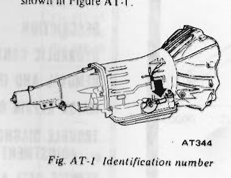
>
> - **Summary:** Location of identification number plate attached to the right-hand side of the 3N71B transmission case.
> - **Components:** Transmission case, Identification plate
> - **Mechanic Notes:** The identification plate is attached to the right-hand side of the transmission case above the oil pan rail.
> - **Tags:** `identification number`, `transmission case`, `serial number`, `stamped location`

### Identification of number arrangements:

> 🖼️ **Identification of number arrangements**  *(Type: `component_location`)*
>
> 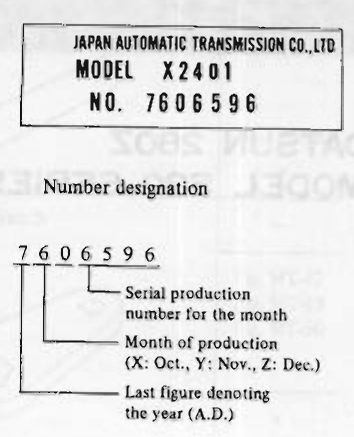
>
> - **Summary:** Illustration of the Jatco identification plate and breakdown of model and serial number designations.
> - **Components:** Identification plate, Model designation, Serial number
> - **Specs / Measurements:** Model: X2401; Serial number breakdown: First digit = Last figure denoting year (A.D.); Second digit = Month of production (1-9, X: Oct., Y: Nov., Z: Dec.); Remaining digits = Serial production number for the month
> - **Mechanic Notes:** Month codes: 1-9 for Jan-Sep, X for October, Y for November, Z for December.
> - **Tags:** `identification plate`, `JATCO`, `serial number breakdown`, `model X2401`

---

<!-- Page 3 (AT-3) -->

> 🖼️ **Fig. AT-2 Cross-sectional view of 3N71B automatic transmission** `[AT312]` *(Type: `cutaway_flow`)*
>
> 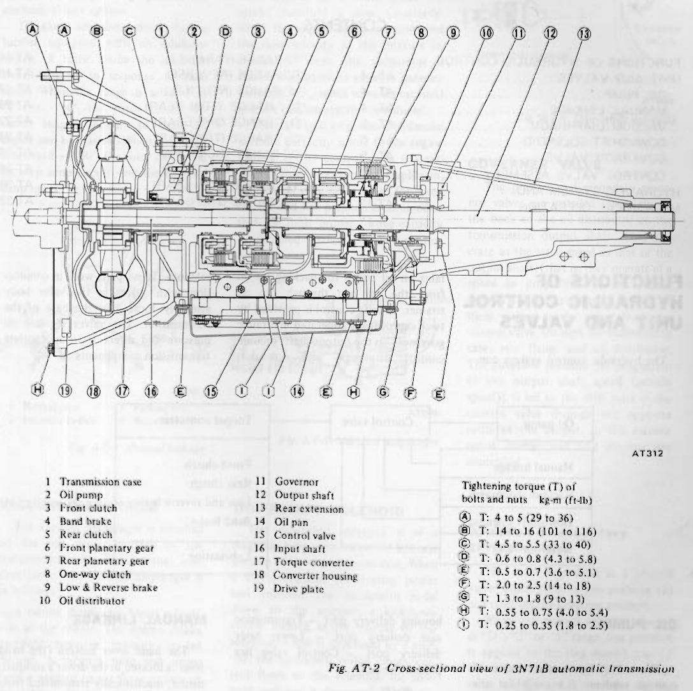
>
> - **Summary:** Comprehensive longitudinal cross-sectional cutaway diagram of the 3N71B automatic transmission showing all major internal components from drive plate to output shaft, with bolt tightening torque letter callouts A through I and component numbered callouts 1 through 19.
> - **Components:** Transmission case, Oil pump, Front clutch, Band brake, Rear clutch, Front planetary gear, Rear planetary gear, One-way clutch, Low & Reverse brake, Oil distributor, Governor, Output shaft, Rear extension, Oil pan, Control valve, Input shaft, Torque converter, Converter housing, Drive plate
> - **Callouts:** **(1)** Transmission case; **(2)** Oil pump; **(3)** Front clutch; **(4)** Band brake; **(5)** Rear clutch; **(6)** Front planetary gear; **(7)** Rear planetary gear; **(8)** One-way clutch; **(9)** Low & Reverse brake; **(10)** Oil distributor; **(11)** Governor; **(12)** Output shaft; **(13)** Rear extension; **(14)** Oil pan; **(15)** Control valve; **(16)** Input shaft; **(17)** Torque converter; **(18)** Converter housing; **(19)** Drive plate; **(A)** Converter housing to engine bolts: 4 to 5 kg-m (29 to 36 ft-lb); **(B)** Drive plate to crankshaft bolts: 14 to 16 kg-m (101 to 116 ft-lb); **(C)** Torque converter to drive plate bolts: 4.5 to 5.5 kg-m (33 to 40 ft-lb); **(D)** Oil pump housing bolts: 0.6 to 0.8 kg-m (4.3 to 5.8 ft-lb); **(E)** Oil pan bolts: 0.5 to 0.7 kg-m (3.6 to 5.1 ft-lb); **(F)** Rear extension housing bolts: 2.0 to 2.5 kg-m (14 to 18 ft-lb); **(G)** Rear mounting crossmember bolts: 1.3 to 1.8 kg-m (9 to 13 ft-lb); **(H)** Oil pump to case bolts: 0.55 to 0.75 kg-m (4.0 to 5.4 ft-lb); **(I)** Control valve assembly bolts: 0.25 to 0.35 kg-m (1.8 to 2.5 ft-lb)
> - **Specs / Measurements:** A: 4 to 5 kg-m (29 to 36 ft-lb); B: 14 to 16 kg-m (101 to 116 ft-lb); C: 4.5 to 5.5 kg-m (33 to 40 ft-lb); D: 0.6 to 0.8 kg-m (4.3 to 5.8 ft-lb); E: 0.5 to 0.7 kg-m (3.6 to 5.1 ft-lb); F: 2.0 to 2.5 kg-m (14 to 18 ft-lb); G: 1.3 to 1.8 kg-m (9 to 13 ft-lb); H: 0.55 to 0.75 kg-m (4.0 to 5.4 ft-lb); I: 0.25 to 0.35 kg-m (1.8 to 2.5 ft-lb)
> - **Mechanic Notes:** Ensure exact torque specifications A through I are observed during reassembly of the transmission casing, oil pump, valve body, and converter housing.
> - **Tags:** `cross-section`, `cutaway`, `3N71B`, `planetary gear`, `clutch`, `band brake`, `torque converter`, `tightening torque`

### Tightening torque (T) of bolts and nuts kg-m (ft-lb)

| Mark | Item / Location | Tightening torque kg-m (ft-lb) |
| :---: | :--- | :--- |
| **A** | Converter housing to engine bolts | 4 to 5 (29 to 36) |
| **B** | Drive plate to crankshaft bolts | 14 to 16 (101 to 116) |
| **C** | Torque converter to drive plate bolts | 4.5 to 5.5 (33 to 40) |
| **D** | Oil pump housing bolts | 0.6 to 0.8 (4.3 to 5.8) |
| **E** | Oil pan securing bolts | 0.5 to 0.7 (3.6 to 5.1) |
| **F** | Rear extension to case bolts | 2.0 to 2.5 (14 to 18) |
| **G** | Crossmember / rear mounting bolts | 1.3 to 1.8 (9 to 13) |
| **H** | Oil pump to transmission case bolts | 0.55 to 0.75 (4.0 to 5.4) |
| **I** | Control valve assembly securing bolts | 0.25 to 0.35 (1.8 to 2.5) |

---

<!-- Page 4 (AT-4) -->
# HYDRAULIC CONTROL SYSTEM

## CONTENTS

| Section | Page |
| :--- | :--- |
| FUNCTIONS OF HYDRAULIC CONTROL UNIT AND VALVES | [AT-4](#page-at-4) |
| OIL PUMP | [AT-4](#page-at-4) |
| MANUAL LINKAGE | [AT-4](#page-at-4) |
| VACUUM DIAPHRAGM | [AT-5](#page-at-5) |
| DOWNSHIFT SOLENOID | [AT-5](#page-at-5) |
| GOVERNOR VALVE | [AT-5](#page-at-5) |
| CONTROL VALVE ASSEMBLY | [AT-6](#page-at-6) |
| HYDRAULIC SYSTEM AND MECHANICAL OPERATION | [AT-13](#page-at-13) |
| "P" RANGE (PARK) | [AT-14](#page-at-14) |
| "R" RANGE (REVERSE) | [AT-16](#page-at-16) |
| "N" RANGE (NEUTRAL) | [AT-18](#page-at-18) |
| "D1" RANGE (LOW GEAR) | [AT-20](#page-at-20) |
| "D2" RANGE (2ND GEAR) | [AT-22](#page-at-22) |
| "D3" RANGE (TOP GEAR) | [AT-24](#page-at-24) |
| "D" RANGE KICKDOWN | [AT-26](#page-at-26) |
| "2" RANGE (2ND GEAR) | [AT-28](#page-at-28) |
| "1₁" RANGE (LOW GEAR) | [AT-30](#page-at-30) |
| "1₂" RANGE (2ND GEAR) | [AT-32](#page-at-32) |

## FUNCTIONS OF HYDRAULIC CONTROL UNIT AND VALVES

The hydraulic control system contains an oil pump for packing up oil from the oil pan through the oil strainer. A shift control is provided by two centrifugally operated hydraulic governors on the output shaft, vacuum control diaphragm and downshift solenoid. These parts work in conjunction with valves in the valve body assembly located in the base of the transmission. The valves regulate oil pressure and direct it to appropriate transmission components.

> 🖼️ **Hydraulic control system block diagram**  *(Type: `cutaway_flow`)*
>
> 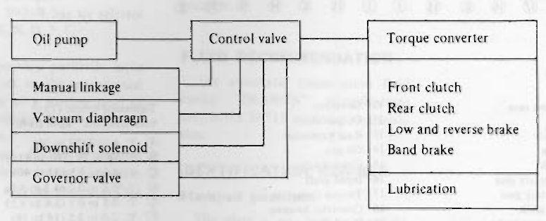
>
> - **Summary:** Block flow diagram illustrating functional relationships between Oil pump, Manual linkage, Vacuum diaphragm, Downshift solenoid, Governor valve, Control valve, Torque converter, Front clutch, Rear clutch, Low and reverse brake, Band brake, and Lubrication circuits.
> - **Components:** Oil pump, Manual linkage, Vacuum diaphragm, Downshift solenoid, Governor valve, Control valve, Torque converter, Front clutch, Rear clutch, Low and reverse brake, Band brake, Lubrication
> - **Mechanic Notes:** Shows inputs (oil pump, manual linkage, vacuum diaphragm, downshift solenoid, governor valve) to control valve, and outputs from control valve to clutches, brakes, converter, and lubrication.
> - **Tags:** `block diagram`, `hydraulic control system`, `control valve inputs and outputs`

## OIL PUMP

The oil pump is the source of control medium (i.e., oil) for the control system.

The oil pump is of an internal, involute gear type. The drive sleeve is a part of the torque converter pump impeller and serves to drive the pump inner gear with the drive sleeve directly coupled with the engine operation.

The oil flows through the following route:

Oil pan $\rightarrow$ Oil strainer (bottom of the control valve) $\rightarrow$ Control valve lower body suction port $\rightarrow$ Transmission case suction port $\rightarrow$ Pump housing suction port $\rightarrow$ Pump gear space $\rightarrow$ Pump housing delivery port $\rightarrow$ Transmission case delivery port $\rightarrow$ Lower body delivery port $\rightarrow$ Control valve line pressure circuit.

> 🖼️ **Fig. AT-3 Oil pump** `[AT071]` *(Type: `exploded_view`)*
>
> 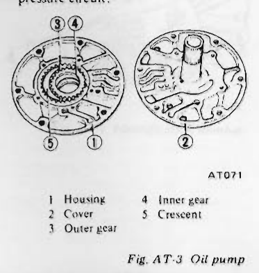
>
> - **Summary:** Exploded view of the internal involute gear oil pump showing the housing with crescent, cover, inner drive gear, and outer driven gear.
> - **Components:** Housing, Cover, Outer gear, Inner gear, Crescent
> - **Callouts:** **(1)** Housing; **(2)** Cover; **(3)** Outer gear; **(4)** Inner gear; **(5)** Crescent
> - **Mechanic Notes:** The inner gear is driven by the torque converter drive sleeve directly coupled with engine rotation.
> - **Tags:** `oil pump`, `involute gear`, `inner gear`, `outer gear`, `crescent`

## MANUAL LINKAGE

The hand lever motion (the hand lever is located in the driver's compartment), mechanically transmitted from the remote control linkage, is further transmitted to the inner manual lever in the transmission case from the range selector lever in the right center portion of the transmission case through the manual shaft. The inner manual lever is thereby turned.

A pin installed on the bottom of the inner manual lever slides the manual valve spool of the control valve thus positioning the spool opposite the appropriate select position.

The parking rod pin is held in the groove on the top of the inner manual <!-- Page 5 (AT-5) --> plate. The parking rod pin operates the rod at "P" range, and operates the mechanical lock system.

The above described manual shaft is further equipped with an inhibitor switch. A rotor inside the inhibitor switch rotates in response to each range. When the range is selected at "P" or "N", the rotor closes the starter magnet circuit so that the engine can be started. When the range is selected at "R", the rotor closes the back-up lamp circuit, and the back-up lamp lights.

> 🖼️ **Fig. AT-4 Manual linkage** `[AT087]` *(Type: `exploded_view`)*
>
> 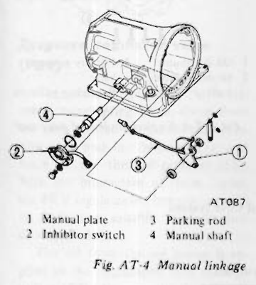
>
> - **Summary:** Assembly drawing of manual linkage on transmission case showing manual plate, inhibitor switch, parking rod, and manual shaft.
> - **Components:** Manual plate, Inhibitor switch, Parking rod, Manual shaft, Transmission case
> - **Callouts:** **(1)** Manual plate; **(2)** Inhibitor switch; **(3)** Parking rod; **(4)** Manual shaft
> - **Wiring / Connections:** Starter magnet circuit closed at P and N; Back-up lamp circuit closed at R
> - **Mechanic Notes:** Inhibitor switch prevents starting in gear (allows start in P and N only) and switches reverse lamps in R.
> - **Tags:** `manual linkage`, `manual shaft`, `inhibitor switch`, `parking rod`, `manual plate`

## VACUUM DIAPHRAGM

The vacuum diaphragm is installed on the left center portion of the transmission case. The internal construction of the vacuum diaphragm is as follows:

A rubber diaphragm forms a partition in the center. The engine intake manifold negative pressure is led through a vacuum tube and spring force is applied to the front surface of the rubber diaphragm while atmospheric pressure is applied to the back surface. The difference between pressures applied to the front and back surfaces causes a vacuum reaction, which activates the throttle valve of the control valve inside the transmission case.

When accelerator pedal is fully depressed and the carburetor is fully opened but the engine speed is not sufficiently increased, the manifold negative pressure lowers (i.e., tends towards atmospheric pressure) and the vacuum reaction increases since the flow velocity of mixture inside the intake manifold is slow. Contrarily, when the engine speed increases and the flow velocity of the mixture increases or when the carburetor is closed, the manifold negative pressure increases (i.e., tends towards vacuum) and the vacuum reaction is reduced.

Thus, a signal to generate hydraulic pressure perfectly suited to the engine loading at the control valve is transmitted from the vacuum diaphragm, and the most suitable timing for speed change and line pressure is obtained so that the most proper torque capacity is obtained against the transmitting torque.

> 🖼️ **Fig. AT-5 Vacuum diaphragm** `[AT088]` *(Type: `cutaway_flow`)*
>
> 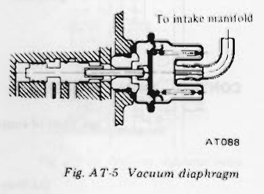
>
> - **Summary:** Cross section of vacuum diaphragm unit connected to intake manifold with central rubber partition, return spring, and throttle valve actuator rod.
> - **Components:** Vacuum diaphragm unit, Rubber diaphragm, Return spring, Actuator rod, Manifold vacuum fitting
> - **Wiring / Connections:** Intake manifold vacuum hose connection
> - **Mechanic Notes:** Vacuum level modulates the throttle valve to adapt shift points and line pressure to engine load.
> - **Tags:** `vacuum diaphragm`, `throttle valve`, `engine load`, `manifold vacuum`

## DOWNSHIFT SOLENOID

The downshift solenoid is of a magnetic type installed on the left rear portion of the transmission case. When a driver requires accelerating power and depresses the accelerator pedal down to the stopper, a kickdown switch located in the middle of the accelerator link is depressed by a push rod, the kickdown switch closes, current flows to the solenoid, the solenoid push rod is depressed, and shift valve of the control valve inside the transmission case is depressed, and the speed is changed forcedly from "3rd" to "2nd" within a certain vehicle speed limit.

> [!NOTE]
> Since the kickdown switch closes when the accelerator pedal is depressed from 7/8 to 15/16 of the whole stroke, the accelerator pedal should be correctly adjusted so as to afford a complete stroke.

> 🖼️ **Fig. AT-6 Downshift solenoid** `[AT089]` *(Type: `cutaway_flow`)*
>
> 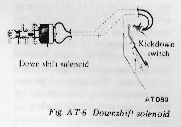
>
> - **Summary:** Downshift solenoid and kickdown switch mechanism operated by accelerator linkage.
> - **Components:** Downshift solenoid, Kickdown switch, Accelerator linkage, Push rod
> - **Specs / Measurements:** Kickdown switch closes between 7/8 and 15/16 full throttle pedal stroke
> - **Wiring / Connections:** 12V electrical lead to downshift solenoid
> - **Mechanic Notes:** Accelerator pedal must be adjusted properly to guarantee kickdown switch contact at 7/8 to 15/16 travel.
> - **Tags:** `downshift solenoid`, `kickdown switch`, `accelerator link`, `forced downshift`

## GOVERNOR VALVE

The primary and secondary governor valves are installed separately on the back of the oil distributor on the transmission output shaft. They operate at the same speed as that of the output shaft, (that is, they operate at a speed in proportion to the vehicle speed.) The line pressure is applied to these valves as the input from the control valve, through the transmission case, rear flange and oil distributor. The governor pressure [in proportion to the output shaft speed (vehicle speed)] is led to the shift valve of the control valve through the opposite route of the output. In this manner speed change and line pressure are controlled.

### Operation of secondary governor valve

The secondary valve is a control valve which receives line pressure (1) and controls the governor pressure.

When the manual valve is selected at "D", "2" or "1" range, line pressure is applied to the ring shaped area of this valve from circuit (1), and this valve is depressed toward the center. Movement of this valve to a certain position closes the circuit from (1) to (15) while simultaneously making a space from (15) to the center drain port, and pressure in the circuit (15) is lowered.

When the vehicle is stopped and the centrifugal force of this valve is zero, the valve is balanced. At this point, a governor pressure which is balanced with the spring force occurs on (15).

When the vehicle is started and the centrifugal force increases, this valve moves slightly to the outside, and as the space from (1) to (15) increases, space from (15) to the drain port simultaneously decreases <!-- Page 6 (AT-6) --> the space from (1) to (15) increases, space from (15) to the drain port simultaneously decreases. As a result, governor pressure of (15) increases, and the governor pressure is balanced with the sum of centrifugal force and spring force. The governor pressure thus changes in response to the vehicle speed change (centrifugal force).

### Operation of primary governor valve

The valve is an ON-OFF valve which closes the governor pressure (15) regulated by the secondary governor valve when the vehicle reaches the minimum speed, and when the vehicle speed exceeds a certain level, the governor opens and forwards the governor pressure (15) to the control valve.

When the vehicle is stopped, the governor pressure is zero. However, when the vehicle is running slowly, this valve is depressed to the center and the groove to (15) is closed since the governor pressure applied to the ring shaped area is higher than the centrifugal force of this valve. When the governor speed exceeds a certain revolution, the governor pressure in the circuit (15) also increases. However, as the centrifugal force increases and exceeds the governor pressure, this valve moves toward the outside, and the governor pressure is transmitted to the circuit (15).

Two different valves are employed in the governor so that it will independently control the speed at high and low speeds. That is, within the low speed range, the governor pressure is not generated because of the primary valve; whereas at the high speed range above the breaking point, governor pressure is regulated by the secondary valve.

\* The breaking point is the point at which the function of one of the governor is transferred to the other as the speed changes from the low-speed to the high-speed range.

> 🖼️ **Fig. AT-7 Cross-sectional view of governor** `[AT090]` *(Type: `cutaway_flow`)*
>
> 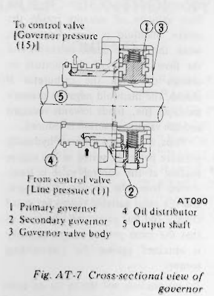
>
> - **Summary:** Cross-sectional drawing of primary and secondary governor valves mounted in the governor body on the output shaft oil distributor.
> - **Components:** Primary governor, Secondary governor, Governor valve body, Oil distributor, Output shaft
> - **Callouts:** **(1)** Primary governor; **(2)** Secondary governor; **(3)** Governor valve body; **(4)** Oil distributor; **(5)** Output shaft
> - **Specs / Measurements:** Input line pressure: Circuit (1); Output governor pressure: Circuit (15)
> - **Mechanic Notes:** Primary valve operates as an ON/OFF threshold valve; secondary valve regulates governor pressure in proportion to vehicle speed.
> - **Tags:** `governor cross section`, `primary governor`, `secondary governor`, `oil distributor`, `circuit 15`, `circuit 1`

> 🖼️ **Fig. AT-8 Output shaft with oil distributor and governor** `[AT091]` *(Type: `component_location`)*
>
> 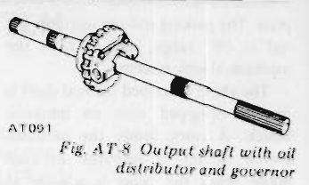
>
> - **Summary:** Perspective view of the output shaft assembly complete with oil distributor and governor valve body.
> - **Components:** Output shaft, Oil distributor, Governor assembly
> - **Mechanic Notes:** Located on the output shaft inside the transmission rear extension housing.
> - **Tags:** `output shaft`, `oil distributor`, `governor location`

> 🖼️ **Fig. AT-9 Exploded view of governor** `[AT092]` *(Type: `exploded_view`)*
>
> 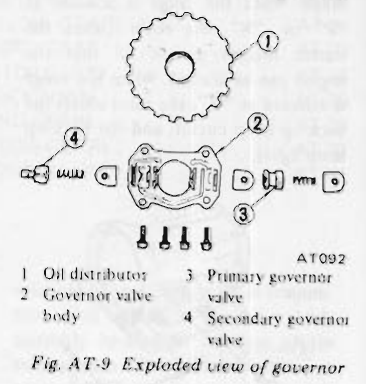
>
> - **Summary:** Exploded view of the governor assembly showing oil distributor, governor valve body, primary governor valve, secondary governor valve, springs, retainers, and mounting bolts.
> - **Components:** Oil distributor, Governor valve body, Primary governor valve, Secondary governor valve, Springs, Plugs, Mounting screws
> - **Callouts:** **(1)** Oil distributor; **(2)** Governor valve body; **(3)** Primary governor valve; **(4)** Secondary governor valve
> - **Mechanic Notes:** Valves and springs must move smoothly in their bores without sticking.
> - **Tags:** `governor exploded view`, `oil distributor`, `primary governor`, `secondary governor`

## CONTROL VALVE ASSEMBLY

### Flow chart of control valve system

> 🖼️ **Flow chart of control valve system**  *(Type: `cutaway_flow`)*
>
> 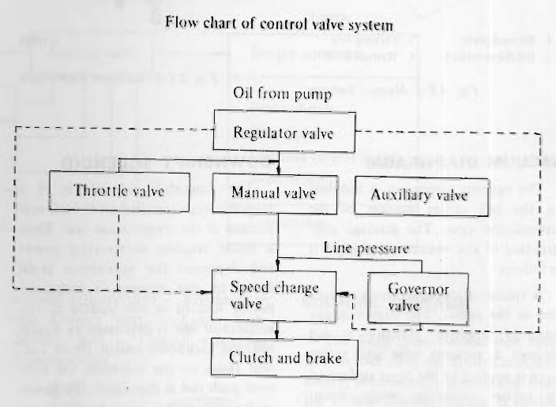
>
> - **Summary:** Flow diagram showing oil flow from pump through regulator valve to throttle valve, manual valve, auxiliary valve, speed change valve, governor valve, and final actuation of clutches and band brake.
> - **Components:** Oil pump, Regulator valve, Throttle valve, Manual valve, Auxiliary valve, Speed change valve, Governor valve, Clutch and brake
> - **Mechanic Notes:** Flow chart defines basic hydraulic logic of line pressure distribution.
> - **Tags:** `control valve flow chart`, `hydraulic schematic flow`, `line pressure`

The control valve assembly receives oil from the pump and individual signals from the vacuum diaphragm, and transmits the individual line pressures to the transmission friction element, torque converter circuit, and lubricating system circuit as outputs. More specifically, the oil from the oil pump is regulated by the regulator valve as line pressure build up. The line pressure is fed out from the control valve assembly through various direction changeover valves (including ON-OFF valve) and regulator valves, are newly reformed to a throttle system oil pressure and operate other valves. Finally, the line pressure is transmitted to the required clutch or brake servo piston unit in response to the individual running conditions after receiving signals from the vacuum diaphragm, downshift solenoid, governor valve, and/or manual linkage.

---

<!-- Page 7 (AT-7) -->
The control valve assembly consists of the following valves (See Figure AT-20):

1. Pressure regulator valve (PRV)
2. Manual valve (MNV)
3. 1st-2nd shift valve (FSV)
4. 2nd-3rd shift valve (SSV)
5. Pressure modifier valve (PMV)
6. Vacuum throttle valve (VTV)
7. Throttle back-up valve (TBV)
8. Solenoid downshift valve (SDV)
9. Second lock valve (SLV)
10. 2nd-3rd timing valve (TMV)

## Pressure regulator valve (PRV)

The pressure regulator valve receives valve spring force, force from the plug created by the throttle pressure (16) and line pressure (7), and force of the throttle pressure (18). With the interaction of those forces, the PRV regulates the line pressure (7) to that most suitable for individual driving conditions.

The oil from the oil pump is applied to the ring-shaped area through orifice (20). As a result, the PRV is depressed downward, and moves from port (7) up to such extent that the space to the next drain port (marked with "X" in Figure AT-10) opens slightly. Thus, the line pressure (7) is balanced with the spring force, thereby balancing the PRV. In this operation, the space from port (7) to the subsequent converter oil pressure (14) circuit has also been opened. As a result, the converter is filled with pressurized oil in circuit (14), and this oil is further used for lubrication of the rear unit. Moreover, part of the oil is branched and used for lubrication of the front unit for the front and rear clutches.

When the accelerator pedal is depressed, the throttle pressure (16) increases as described in the preceding paragraph, oil pressure is applied to the plug through orifice (21), and this pressure is added to the spring force. As a result, the PRV is contrarily forced upward, space to the drain port is reduced, and the line pressure (7) increases.

When the range is selected at "R" (Reverse), the line pressure (6) is applied to the plug in a manner identical to the throttle pressure (16) and is added to the spring force. Consequently, the line pressure (7) further increases.

When vehicle speed increases and the governor pressure rises, the throttle pressure (18) is applied to the port on the top of the PRV, and pressure is applied contrarily against the spring force. As a result, the line pressure (7) decreases. Moreover, at individual conditions, the line pressure (7) is equal to the line pressure (6) and the throttle pressure (16) is equal to (18).

> 🖼️ **Fig. AT-10 Pressure regulator valve** `[AT095]` *(Type: `cutaway_flow`)*
>
> 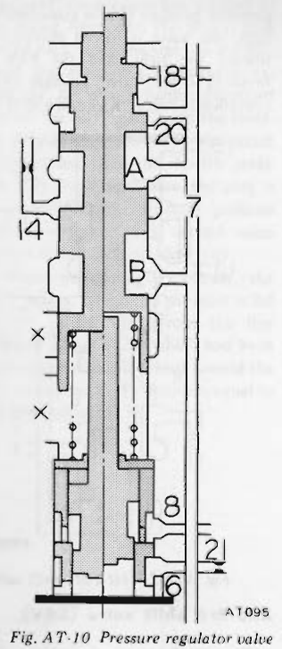
>
> - **Summary:** Cross-sectional diagram of the Pressure Regulator Valve (PRV) showing ports 7 (line pressure), 8, 14 (torque converter), 16 (throttle pressure), 18 (throttle pressure from PMV), orifice 20, orifice 21, spools A and B, and spring.
> - **Components:** Pressure regulator valve, Plug, Spool A, Spool B, Spring, Orifice 20, Orifice 21
> - **Specs / Measurements:** Circuit (7): Line pressure; Circuit (14): Converter pressure; Circuit (16): Throttle pressure; Circuit (18): Throttle pressure from PMV; Circuit (20): Involute pump delivery damping orifice; Circuit (21): Throttle pressure damping orifice
> - **Mechanic Notes:** Balances pump pressure against spring force modulated by throttle pressure (16, 18) and Reverse line pressure (6). Feeds torque converter circuit (14).
> - **Tags:** `PRV`, `pressure regulator valve`, `line pressure`, `converter pressure`

## Manual valve (MNV)

The manual lever turning motion is converted to reciprocating motion of the manual valve through a pin, and the MNV is positioned so that the individual line pressure circuits at each "P", "R", "N", "D", "2" or "1" range as shown below.

### "P" range:
* (7) $\rightarrow$
  * (4) — SDV and TBV
  * (5) — FSV (12) — TBV and Low & reverse brake

### "R" range:
* (7) $\rightarrow$
  * (4) — same as above
  * (5) — same as above
  * (6) — PRV and SSV — (F.C.) and band release

### "N" range:
* (7) $\rightarrow$ None

### "D" range:
* (7) $\rightarrow$
  * (1) — Governor valve, FSV, and rear clutch
  * (2) — SLV
  * (3) — SLV and SSV

### "2" range:
* (7) $\rightarrow$
  * (1) — Same as above
  * (2) — SLV — (9) Band applied
  * (4) — SDV and TBV

### "1" range:
* (7) $\rightarrow$
  * (1) — Same as above
  * (4) — Same as above
  * (5) — FSV

Moreover, (1), (2), (3), (4), (5), and (6) are always drained at a position where the line pressure is not distributed from (7).

> 🖼️ **Fig. AT-11 Manual valve** `[AT096]` *(Type: `cutaway_flow`)*
>
> 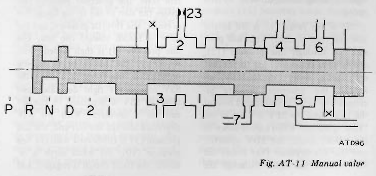
>
> - **Summary:** Cross section of the manual valve spool indicating selector positions P, R, N, D, 2, 1 and connected line pressure output circuits 1, 2, 3, 4, 5, 6, 7, and 23.
> - **Components:** Manual valve spool, Selector pin connection
> - **Specs / Measurements:** Circuit (7): Main line pressure inlet; Circuits (1), (2), (3), (4), (5), (6), (23): Switched output circuits
> - **Mechanic Notes:** Manually shifted spool selects port alignment for P, R, N, D, 2, and 1 ranges. Drains inactive circuits.
> - **Tags:** `manual valve`, `MNV`, `selector positions`, `line pressure distribution`

---

<!-- Page 8 (AT-8) -->
## 1st-2nd shift valve (FSV)

The FSV is a transfer valve which shifts gears from low to second. When the vehicle is stopped, the FSV is depressed to the right side by force of a spring located on the left side, putting the FSV is in the "Low" position.

When vehicle speed increases, the governor pressure (15) is applied to the right side of the FSV, and the FSV is forced toward the left. Contrarily, the line pressure (1) together with the spring force, force the FSV toward the right opposing the governor pressure (15).

When the vehicle speed exceeds a certain level, the governor pressure (15) exceeds the sum of the throttle pressure and the spring force, and the FSV is forced toward the left.

When the FSV is depressed to a certain position, the line pressure (1) is closed, and only the spring depresses the FSV toward the right, and it is depressed to the end for a moment. As a result, the line pressure (1) is forwarded to (8), the band servo is engaged through the SLV, and the speed is shifted to "2nd". With the accelerator pedal depressed, the FSV remains in the "Low" position unless the governor pressure (15) increases to a high level corresponding to the line pressure (1) since the line pressure (1) increase when the accelerator pedal is depressed.

Contrarily, when vehicle speed decreases, the governor pressure (15) decreases. However, the gear is not shifted to "Low" unless the governor pressure (15) becomes zero, since the force depressing the FSV toward the right is being delivered only by the spring.

"Low" in range "1" is led to the low and reverse clutch from line pressure (5) through line pressure (12), and is simultaneously, led to the left end spring unit. Consequently, although the governor pressure increases, the valve is still forced toward the right, and the SFV is fixed in the "Low" position. When kicked down to the "2nd" speed, the SDV operates, and the line pressure (13) forces the FSV toward the right. Although the governor pressure (15) is considerably high, the valve is forced completely toward the right, and the FSV is returned to the "Low" position. (This operation is called "Kickdown shift".)

> 🖼️ **Fig. AT-12 "1st-2nd" shift valve** `[AT097]` *(Type: `cutaway_flow`)*
>
> 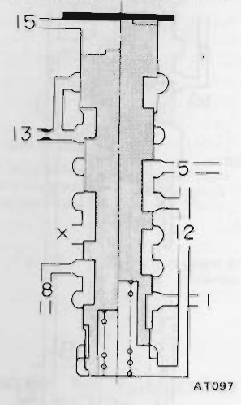
>
> - **Summary:** Cross-sectional schematic of 1st-2nd shift valve (FSV) showing spool, spring, and hydraulic ports 1, 5, 8, 11, 12, 13, 15.
> - **Components:** 1st-2nd shift valve spool, Return spring, Valve bore
> - **Specs / Measurements:** Port 1: Line pressure input; Port 5: Line pressure input (Range 1); Port 8: To SLV / band servo; Port 11: Front clutch pressure circuit; Port 12: Low and reverse brake feed; Port 13: Kickdown pressure from SDV; Port 15: Governor pressure input
> - **Mechanic Notes:** Governor pressure on port 15 acts against line pressure and spring force to shift from 1st to 2nd.
> - **Tags:** `FSV`, `1st-2nd shift valve`, `governor pressure`, `band servo`

## 2nd-3rd shift valve (SSV)

The SSV is a transfer valve which shifts gears from "2nd" to "3rd". When the vehicle is stopped, the SSV is forced toward the right by the spring, and is in the "2nd" position. It is so designed, however, that the FSV can decide to shift either to "Low" or "2nd".

When the vehicle is running, the governor pressure (15) is applied to the right end surface, and the SSV is forced toward the left. Contrarily, the spring force, line pressure (3), and throttle pressure (19) force the SSV toward the right.

When vehicle speed exceeds a certain level, the governor pressure surpasses the sum of the spring force, line pressure, and throttle pressure, and the valve is forced toward the left. The line pressure (3) is then closed. Consequently, the forces being rapidly unbalanced, the force depressing the SSV toward the right decreases, and thus the SSV is depressed to the left end for a moment. With the SSV depressed toward the left end, the line pressure (3) is connected with the line pressure (10), the band servo is released, the front clutch is engaged, and speed is shifted to "3rd".

When the accelerator pedal is depressed, both the line pressure (3) and the throttle pressure (19) are high, and the SSV is thus retained in "2nd" unless the governor pressure (15) exceeds the line pressure (3) and the throttle pressure (19).

In the "3rd" position, force depressing the SSV toward the right is retained only by the throttle pressure (16), and the throttle pressure (16) is slightly lower than that toward the right which is applied while shifting from "2nd" to "3rd".

Consequently, the SSV is returned to the "2nd" position at a slightly lower speed. (Shifting from "3rd" to "2nd" occurs at a speed slightly lower than that for "2nd" to "3rd" shifting.)

When kicked down at "3rd", line pressure (13) is led from the SDV, and the SSV is forced toward the right. Although the governor pressure is considerably high, the valve is forced completely toward the right, and the SSV is thus returned to "2nd" position. (This operation is called "Kick-down shift".)

When the shift lever is shifted to "2" or "1" range at the "3rd" speed, the line pressure (3) is drained at the MNV. Consequently, the front clutch and band servo releasing oils are drained. As a result, the transmission is shifted to "2nd" or "low" speed although the SSV is in the "3rd" position.

When the speed is shifted to the "3rd", a one-way orifice (24) on the top of the SSV relieves oil transmitting velocity from the line pressure (3) to the line pressure (10), and reduces the shock generated from the shifting. Contrarily, when the lever is shifted from "3rd" to "2" or "1" range and the speed is shifted to the "2nd", the orifice checking valve spring (24) is depressed, the throttle becomes ineffective, the line pressure (10) is drained quickly, and delay in shifting speeds is thus eliminated.

The throttle of line pressure (6) transmits the oil transmitting velocity from line pressure (6) to line pressure (10) when the lever is shifted to the "R" range, and transmits drain velocity from line pressure (10) to line <!-- Page 9 (AT-9) --> pressure (6) when shifting from "3rd" to "2nd" at "D" range. Thus, the throttle of line pressure (6) reduces the shock generated from shifting.

A plug in the SSV left end readjust the throttle pressure (16) which varies depending on the engine throttle condition, to a throttle pressure (19) suited to the speed change control. Moreover, the plug is a valve which applies line pressure (13), in lieu of the throttle pressure, to the SSV and the FSV when kickdown is performed.

When the throttle pressure (16) is applied to the left side of this plug, and the plug is depressed toward the right, a slight space is formed from the throttle pressure (16) to (19). A throttle pressure (19) which is lower by the pressure loss equivalent to this space is generated, the pressure loss is added to the spring force, and the plug is thus forced back from the right to the left. When this pressure (19) increases excessively, the plug is further depressed toward the left, space from the throttle pressure (19) to the drain circuit (13) increases, and the throttle pressure (19) decreases. Thus, the plug is balanced, and the throttle pressure (19) is reduced to a certain value against the throttle pressure (16).

When performing kickdown, the SDV moves, a high line pressure is led to the circuit (19) from the line pressure circuit (13) (which had been drained), the plug is forced toward the left, and circuit (19) becomes equal to the line pressure (13).

> 🖼️ **Fig. AT-13 "2nd-3rd" shift valve** `[AT098]` *(Type: `cutaway_flow`)*
>
> 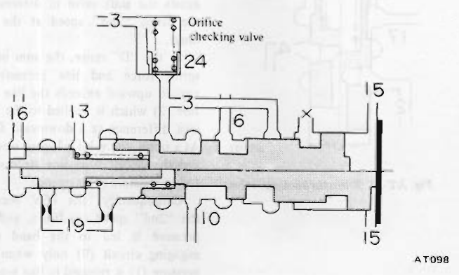
>
> - **Summary:** Cross-sectional view of 2nd-3rd shift valve (SSV) showing spool, readjust plug, orifice checking valve 24, and hydraulic connections 3, 6, 10, 13, 15, 16, 19.
> - **Components:** 2nd-3rd shift valve spool, SSV plug, Return spring, Orifice checking valve 24
> - **Specs / Measurements:** Port 3: Line pressure input; Port 6: Line pressure (Reverse); Port 10: Front clutch / band servo release feed; Port 13: Kickdown line pressure from SDV; Port 15: Governor pressure input; Port 16: Throttle pressure input; Port 19: Regulated throttle pressure to SSV/FSV
> - **Mechanic Notes:** SSV connects port 3 to port 10 to engage front clutch and release band servo for 3rd gear.
> - **Tags:** `SSV`, `2nd-3rd shift valve`, `front clutch`, `band servo release`, `orifice 24`

## Pressure modifier valve (PMV)

Compared to the operating pressure required in starting the vehicle, the power transmitting capacity of the clutch (that is, required operating pressure) may be lower when the vehicle is once started. When the line pressure is retained at a high level up to a high vehicle speed, shock generated from the shifting increases, and the oil pump loss also increases. In order to prevent this, the throttle pressure must be changed over with the operation of the governor pressure (15) to reduce the line pressure. The PMV is used for this purpose.

When the governor pressure (15) which is applied to the right side of the PMV is low, the valve is forced toward the right by the throttle pressure (16) (applied to the area difference of the value) and the spring force, and the circuit from circuit (16) to circuit (18) is closed. However, when vehicle speed increases and the governor pressure (15) exceeds a certain level, the governor pressure toward the left (which is applied to the right side) exceeds the spring force and the throttle pressure (16) toward the right, the valve is depressed toward the left, and the throttle pressure is led from circuit (16) to circuit (18). This throttle pressure (18) is applied to the top of the PRV, and the force of the line pressure source (7) is reduced. Contrarily, when the vehicle speed decreases and the governor pressure (15) decreases, the force toward the right exceeds the governor pressure, the valve is forced back toward the right, and the throttle pressure (18) is drained to the spring unit.

This valve is switched when the throttle pressure and the governor pressure are high or when they are both low.

> 🖼️ **Fig. AT-14 Pressure modifier valve** `[AT099]` *(Type: `cutaway_flow`)*
>
> 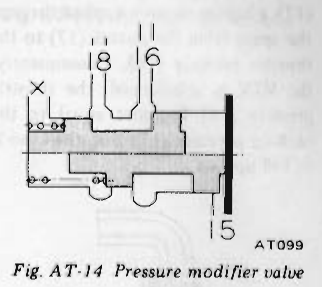
>
> - **Summary:** Cross section of Pressure Modifier Valve (PMV) showing spool, ports 15, 16, 18, and drain ports.
> - **Components:** Pressure modifier valve spool, Spring, Valve bore
> - **Specs / Measurements:** Port 15: Governor pressure input; Port 16: Throttle pressure input; Port 18: Modified throttle pressure to PRV top
> - **Mechanic Notes:** Governor pressure modulates PMV to direct throttle pressure (18) to PRV to reduce line pressure at cruising speeds.
> - **Tags:** `PMV`, `pressure modifier valve`, `governor pressure`, `throttle pressure`, `line pressure reduction`

## Vacuum throttle valve (VTV)

The vacuum throttle valve is a regulator valve which uses the line pressure (7) for the pressure source and regulates the throttle pressure (16) which is proportioned to the force of the vacuum diaphragm. [The vacuum diaphragm varies depending on the engine throttle condition (negative pressure in the intake line)].

When the line pressure (7) is applied to the bottom through the valve hole and the valve is forced upward, space from the line pressure (7) to the throttle pressure (16) is closed, and the space from the throttle pressure (16) to the drain circuit (17) is about to open. In this operation, the throttle pressure (16) becomes lower than the line pressure (7) by the pressure equivalent of the loss of space, and the force depressing the rod of the vacuum diaphragm is balanced with the throttle pressure (16) applied upward to the bottom.

When the engine torque is high, the negative pressure in the intake line rises (tending toward atmospheric pressure), and the force of the rod to depress the valve increases. As a result, the valve is depressed downward, the <!-- Page 10 (AT-10) --> space from the throttle pressure (16) to the drain (17) decreases, and the space from the line pressure (7) to the throttle pressure (16) increases.

Consequently, the throttle pressure (16) increases, and the valve is balanced. Contrarily, when the engine torque lowers and the negative pressure in the intake line lowers (tending toward vacuum), the force of the rod depressing the valve decreases, and the throttle pressure (16) also decreases. When pressure regulated by the throttle back-up valve (described in the subsequent paragraph) is led to circuit (17), a high pressure is applied through the space from the circuit (17) to the throttle pressure (16). Consequently, the VTV is unbalanced, the throttle pressure (16) becomes equal to the back-up pressure (17), and the valve is locked upward.

> 🖼️ **Fig. AT-15 Vacuum throttle valve** `[AT100]` *(Type: `cutaway_flow`)*
>
> 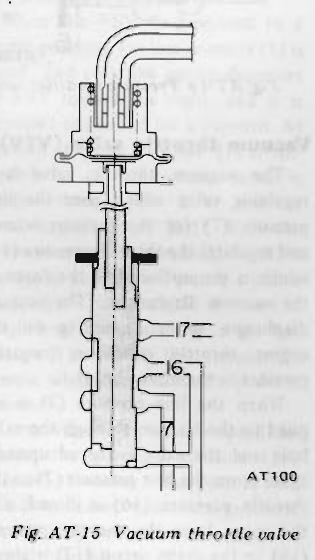
>
> - **Summary:** Cross section of vacuum throttle valve (VTV) connected to vacuum diaphragm actuator, showing ports 7 (line pressure), 16 (throttle pressure), and 17 (drain / back-up pressure).
> - **Components:** Vacuum throttle valve spool, Actuator pin, Diaphragm connection
> - **Specs / Measurements:** Port 7: Main line pressure inlet; Port 16: Regulated throttle pressure output; Port 17: Drain / back-up pressure circuit
> - **Mechanic Notes:** Modulates line pressure to throttle pressure (16) proportional to engine manifold depression.
> - **Tags:** `VTV`, `vacuum throttle valve`, `manifold vacuum`, `throttle pressure`

## Throttle back-up valve (TBV)

Usually, this valve is depressed downward by the spring force.

As soon as the lever is shifted either to "2" or "1" range, line pressure is led from circuit (4), the line pressure is applied to the area difference of the valve, the valve is forced upward, the space from circuit (4) to circuit (17) is closed, and with the space from circuit (17) to the upper drain about to open, the back-up pressure (17) which is lower than the line pressure (4) by the pressure loss due to the space from circuit (4) to circuit (17) is balanced with the spring force.

Further, when gear is shifted from "2nd" to "Low" at the range "1", line pressure is led from circuit (12), and the line pressure is applied upward to the bottom of the valve through the valve hole. Consequently, the valve is forced upward, and locked. As a result, the space from the line pressure (4) to the back-up pressure (17) is closed completely, and the back-up pressure (17) is drained upward.

> 🖼️ **Fig. AT-16 Throttle back-up valve** `[AT101]` *(Type: `cutaway_flow`)*
>
> 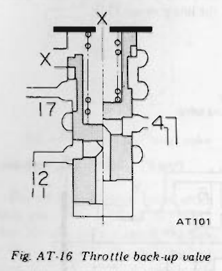
>
> - **Summary:** Cross-sectional view of Throttle Back-Up Valve (TBV) showing ports 4, 12, 17, and drain.
> - **Components:** Throttle back-up valve spool, Spring, Valve bore
> - **Specs / Measurements:** Port 4: Line pressure in ranges 2 and 1; Port 12: Line pressure in range 1 low; Port 17: Back-up pressure output to VTV
> - **Mechanic Notes:** Supplies back-up pressure to VTV in manual ranges 2 and 1 to boost line pressure.
> - **Tags:** `TBV`, `throttle back up valve`, `line pressure boost`, `manual range`

## Solenoid downshift valve (SDV)

This valve is a transfer valve which leads the line pressure (7) to (13) and transmits the same to the FSV and SSV when a kickdown signal is received from the downshift solenoid. Usually, the solenoid push rod and valve are locked upward by the spring in the lower end, and the circuit from line pressure (4) to line pressure (13) is opened.

When kickdown is performed, the push rod operates, the valve is depressed downward, and the circuit from line pressure (7) to line pressure (13) opens. Line pressure (13) opposes the governor pressure (15) at the SSV and FSV, thus accomplishing the downshift operation.

> 🖼️ **Fig. AT-17 Solenoid downshift valve** `[AT102]` *(Type: `cutaway_flow`)*
>
> 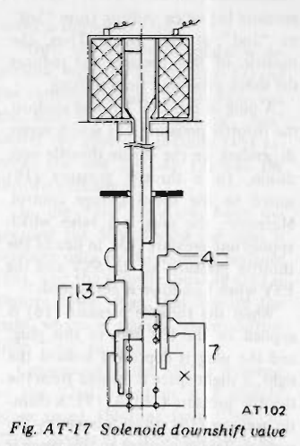
>
> - **Summary:** Cross-sectional schematic of solenoid downshift valve (SDV) showing electromagnetic solenoid, plunger, spring, and ports 4, 7, 13.
> - **Components:** Solenoid downshift valve spool, Solenoid coil and plunger, Return spring
> - **Specs / Measurements:** Port 4: Line pressure (idle / normal); Port 7: Main line pressure inlet; Port 13: Kickdown pressure circuit to FSV and SSV
> - **Wiring / Connections:** Solenoid electric coil terminal
> - **Mechanic Notes:** Electromagnetic plunger forces valve downward when kickdown switch closes, routing line pressure (7) to circuit (13).
> - **Tags:** `SDV`, `solenoid downshift valve`, `kickdown`, `solenoid plunger`

## Second lock valve (SLV)

This valve is a transfer valve which assists the shift valve in determining the fixed "2nd" speed at the "2" range.

In the "D" range, the sum of the spring force and line pressure (3) applied upward exceeds the line pressure (2) which is applied to the valve area difference as a downward force. As a result, the valve is locked upward, and the circuit from line pressure (8) to line pressure (9) is opened.

Consequently, the FSV becomes the "2nd" speed condition, and line pressure is led to the band servo engaging circuit (9) only when line pressure (1) is released to line pressure (8).

In the "2" range, the upward force is retained only on the spring, and the downward line pressure (2) exceeds the upward force.

As a result, the valve is locked downward, line pressure (2) is released to (9) regardless of the operating condition of the FSV, and the band servo is engaged.

> 🖼️ **Fig. AT-18 Second lock valve** `[AT103]` *(Type: `cutaway_flow`)*
>
> 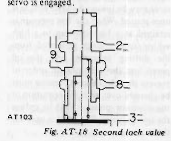
>
> - **Summary:** Cross-sectional diagram of second lock valve (SLV) showing ports 2, 3, 8, 9, and spring.
> - **Components:** Second lock valve spool, Spring, Valve bore
> - **Specs / Measurements:** Port 2: Line pressure in range 2; Port 3: Line pressure in D range; Port 8: Feed from FSV; Port 9: Band servo apply circuit
> - **Mechanic Notes:** In range 2, line pressure (2) locks valve downward to keep band servo engaged regardless of FSV position.
> - **Tags:** `SLV`, `second lock valve`, `range 2`, `band servo apply`

---

<!-- Page 11 (AT-11) -->
## 2nd-3rd timing valve (TMV)

This valve is a transfer valve which switches the by-pass circuit of the orifice (22) in the front clutch pressure circuit (11) in response to vehicle speed and throttle condition. A force created when the governor pressure (15) is applied to the bottom of the TMV constitutes the upward force, and a force created when the spring force and the throttle pressure are applied to the top of the TMV constitutes the downward force.

When the throttle pressure (16) is lower than the governor pressure (15), the upward force exceeds the downward force, the valve is locked upward, and passage from circuit (10) ("2nd" from the "Top") to circuit (11) is closed. Consequently, the line pressure (10) is led to the front clutch circuit (11) through the orifice (22), and the oil pressure is thus transmitted slowly. However, under normal shifting, the throttle pressure (16) has a pressure exceeding a certain level, and the downward force exceeds the upward force. As a result, the valve is locked downward, the passage from circuit (10) to circuit (11) is opened, and the orifice (22) is bypassed.

> 🖼️ **Fig. AT-19 "2nd-3rd" timing valve** `[AT104]` *(Type: `cutaway_flow`)*
>
> 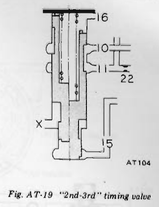
>
> - **Summary:** Cross section of 2nd-3rd timing valve (TMV) showing ports 10, 11, 15, 16, bypass passage, orifice 22, and spring.
> - **Components:** 2nd-3rd timing valve spool, Spring, Orifice 22
> - **Specs / Measurements:** Port 10: 2nd-3rd shift circuit feed; Port 11: Front clutch engagement circuit; Port 15: Governor pressure input (upward force); Port 16: Throttle pressure input (downward force); Orifice 22: Front clutch damping orifice
> - **Mechanic Notes:** Under low throttle / high vehicle speed, TMV routes line pressure through orifice 22 to soften front clutch engagement.
> - **Tags:** `TMV`, `2nd-3rd timing valve`, `orifice 22`, `shift quality`, `front clutch`

---

<!-- Page 12 (AT-12) -->

> 🖼️ **Fig. AT-20 Control valve** `[AT094]` *(Type: `exploded_view`)*
>
> 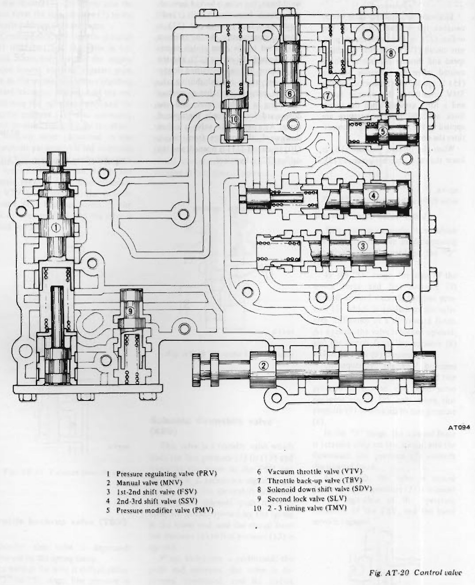
>
> - **Summary:** Plan view layout of the complete control valve body assembly showing relative physical locations and bore orientations of all 10 hydraulic control and shift valves.
> - **Components:** Control valve body, Pressure regulating valve (PRV), Manual valve (MNV), 1st-2nd shift valve (FSV), 2nd-3rd shift valve (SSV), Pressure modifier valve (PMV), Vacuum throttle valve (VTV), Throttle back-up valve (TBV), Solenoid downshift valve (SDV), Second lock valve (SLV), 2-3 timing valve (TMV)
> - **Callouts:** **(1)** Pressure regulating valve (PRV); **(2)** Manual valve (MNV); **(3)** 1st-2nd shift valve (FSV); **(4)** 2nd-3rd shift valve (SSV); **(5)** Pressure modifier valve (PMV); **(6)** Vacuum throttle valve (VTV); **(7)** Throttle back-up valve (TBV); **(8)** Solenoid downshift valve (SDV); **(9)** Second lock valve (SLV); **(10)** 2-3 timing valve (TMV)
> - **Mechanic Notes:** Reference this layout when disassembling and assembling the valve body to verify spool and spring orientation in each bore.
> - **Tags:** `control valve assembly`, `valve body layout`, `PRV`, `MNV`, `FSV`, `SSV`, `PMV`, `VTV`, `TBV`, `SDV`, `SLV`, `TMV`

### Control Valve Component Identification:

1. Pressure regulating valve (PRV)
2. Manual valve (MNV)
3. 1st-2nd shift valve (FSV)
4. 2nd-3rd shift valve (SSV)
5. Pressure modifier valve (PMV)
6. Vacuum throttle valve (VTV)
7. Throttle back-up valve (TBV)
8. Solenoid downshift valve (SDV)
9. Second lock valve (SLV)
10. 2-3 timing valve (TMV)

---

<!-- Page 13 (AT-13) -->
# HYDRAULIC SYSTEM AND MECHANICAL OPERATION

The operating system of oil pressure in each range is described below:

The oil pressure in each circuit shown in the illustration is classified as follows according to the function:  
(The numerals show the circuit numbers.)

* **Pressure source of the line:** 7
* **Operating line pressure for friction elements:** 1, 2, 3, 4, 5, 6, 8, 9, 10, 11, 12.
* **Auxiliary line pressure:** 13
* **Throttle system pressure:** 16, 17, 18, 19.
* **Others:** 14, 15

> 🖼️ **Fig. AT-21 Identification of oil channels in oil pump** `[AT105]` *(Type: `cutaway_flow`)*
>
> 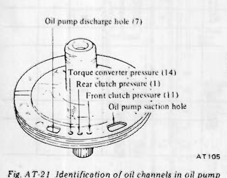
>
> - **Summary:** Port diagram on the rear face of the oil pump housing showing oil pump discharge hole (7), torque converter pressure (14), rear clutch pressure (1), front clutch pressure (11), and oil pump suction hole.
> - **Components:** Oil pump housing, Pump discharge hole, Suction hole, Passage ports
> - **Specs / Measurements:** Oil pump discharge hole (7); Torque converter pressure (14); Rear clutch pressure (1); Front clutch pressure (11); Oil pump suction hole
> - **Mechanic Notes:** Identify matching oil passages between oil pump rear face and transmission case front face during assembly.
> - **Tags:** `oil channels`, `oil pump passages`, `transmission case front`

> 🖼️ **Fig. AT-22 Identification of oil channels in case front face** `[AT106]` *(Type: `cutaway_flow`)*
>
> 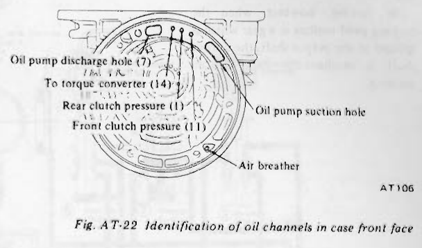
>
> - **Summary:** Oil passage layout on the transmission case front face mating with oil pump housing, showing ports 1, 7, 11, 14, air breather, and suction hole.
> - **Components:** Transmission case front face, Air breather, Hydraulic ports
> - **Specs / Measurements:** Oil pump discharge hole (7); To torque converter (14); Rear clutch pressure (1); Front clutch pressure (11); Air breather; Oil pump suction hole
> - **Mechanic Notes:** Ensure air breather is clear and oil pump gasket correctly aligns with all indicated holes.
> - **Tags:** `oil channels`, `case front face`, `air breather`, `pump mating surface`

> 🖼️ **Fig. AT-23 Identification of oil channels in case face** `[AT107]` *(Type: `cutaway_flow`)*
>
> 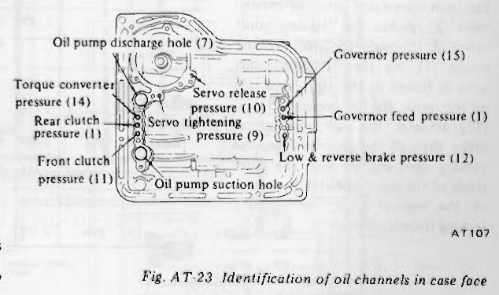
>
> - **Summary:** Oil passage identification on the lower transmission case face mating with the control valve assembly.
> - **Components:** Transmission case valve body mating surface, Hydraulic passage ports
> - **Specs / Measurements:** Oil pump discharge hole (7); Torque converter pressure (14); Rear clutch pressure (1); Front clutch pressure (11); Servo release pressure (10); Servo tightening pressure (9); Oil pump suction hole; Low & reverse brake pressure (12); Governor feed pressure (1); Governor pressure (15)
> - **Mechanic Notes:** Crucial passage reference for diagnosis and valve body gasket positioning.
> - **Tags:** `case face passages`, `valve body mating face`, `oil channels`, `hydraulic circuit identification`

---

<!-- Page 14 (AT-14) -->
# "P" RANGE (PARK)

The operation of clutches and band are functionally the same as in "Neutral".

In parking, however, when the parking pawl meshes in a gear which is splined to the output shaft, the output shaft is mechanically locked from rotating.

> 🖼️ **Fig. AT-24 Parking mechanism** `[AT086]` *(Type: `cutaway_flow`)*
>
> 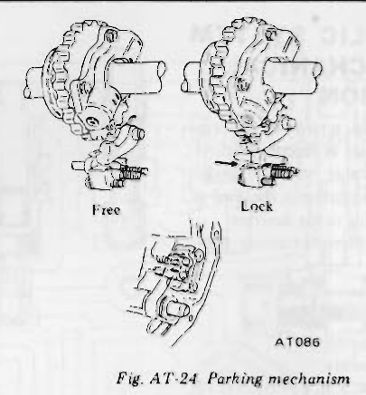
>
> - **Summary:** Mechanical engagement views of the parking pawl with the oil distributor park gear showing 'Free' and 'Lock' states and operating rod cam linkage.
> - **Components:** Parking pawl, Oil distributor outer gear, Parking pawl return spring, Parking rod cam, Manual lever
> - **Mechanic Notes:** In 'Lock', the parking rod cam drives pawl into oil distributor teeth to mechanically lock output shaft.
> - **Tags:** `parking pawl`, `parking mechanism`, `park lock`, `oil distributor`

The oil discharged from the oil pump is fed to each part in a similar manner to that of the "N" range. The oil having the line pressure (7) which has been introduced into the manual valve (2) reaches the "1st-2nd" shift valve (3) through the line pressure circuit (5). As the "1st-2nd" shift valve is forced to the right-hand side by the spring, the line pressure (5) and (12) actuates the low and reverse brake through the groove. Also, the parking pawl engages with the outer teeth of the oil distributor by means of the manual lever, mechanically locking the output shaft.

### Operating Elements by Range and Gear Position

| Range | Gear ratio | Clutch Front | Clutch Rear | Low & reverse brake | Band servo Operation | Band servo Release | One way clutch | Parking pawl |
| :--- | :---: | :---: | :---: | :---: | :---: | :---: | :---: | :---: |
| **Park** | — | — | — | on | — | — | — | on |
| **Reverse** | 2.182 | on | — | on | — | on | — | — |
| **Neutral** | — | — | — | — | — | — | — | — |
| **Drive D₁ Low** | 2.458 | — | on | — | — | — | on | — |
| **Drive D₂ Second** | 1.458 | — | on | — | on | — | — | — |
| **Drive D₃ Top** | 1.000 | on | on | — | (on) | on | — | — |
| **2 Second** | 1.458 | — | on | — | on | — | — | — |
| **1 1₂ Second** | 1.458 | — | on | — | on | — | — | — |
| **1 1₁ Low** | 2.458 | — | on | on | — | — | — | — |

---

<!-- Page 15 (AT-15) -->

> 🖼️ **Fig. AT-25 Oil pressure circuit diagram — "P" range (Park)**  *(Type: `electrical_schematic`)*
>
> 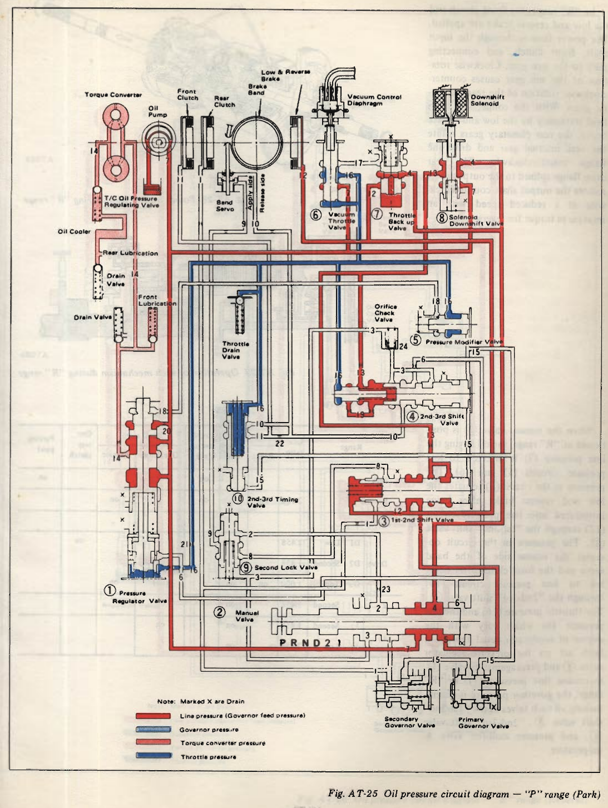
>
> - **Summary:** Full hydraulic circuit diagram in 'P' (Park) range showing line pressure (7) applied to manual valve, routed via line 4 to SDV and TBV, and line 5 to FSV, line 12 to Low & Reverse brake, and torque converter supply (14) while other clutches and band servo are drained.
> - **Components:** Torque Converter, Oil Pump, T/C Oil Pressure Regulating Valve, Oil Cooler, Rear Lubrication, Front Lubrication, Drain Valves, Front Clutch, Rear Clutch, Brake Band, Band Servo, Low & Reverse Brake, Vacuum Control Diaphragm, Downshift Solenoid, Pressure Regulator Valve (1), Manual Valve (2), 1st-2nd Shift Valve (3), 2nd-3rd Shift Valve (4), Pressure Modifier Valve (5), Vacuum Throttle Valve (6), Throttle Back up Valve (7), Solenoid Downshift Valve (8), Second Lock Valve (9), 2nd-3rd Timing Valve (10), Orifice Check Valve (24), Throttle Drain Valve, Secondary Governor Valve, Primary Governor Valve
> - **Callouts:** **(1)** Pressure Regulator Valve; **(2)** Manual Valve; **(3)** 1st-2nd Shift Valve; **(4)** 2nd-3rd Shift Valve; **(5)** Pressure Modifier Valve; **(6)** Vacuum Throttle Valve; **(7)** Throttle Back up Valve; **(8)** Solenoid Downshift Valve; **(9)** Second Lock Valve; **(10)** 2nd-3rd Timing Valve; **(24)** Orifice Check Valve
> - **Specs / Measurements:** Active hydraulic circuits: Line 7 (pump delivery), Line 4 (SDV/TBV), Line 5 & 12 (Low & reverse brake), Line 14 (converter/lube), Line 16 (throttle pressure)
> - **Mechanic Notes:** In Park range, Low & Reverse brake is hydraulically applied along with mechanical locking pawl engagement. Red = Line pressure, Blue = Throttle pressure, Pink = Torque converter pressure, Light blue = Governor pressure, X = Drain.
> - **Tags:** `circuit diagram`, `P range`, `hydraulic schematic`, `Park position`, `Low and reverse brake`

---

<!-- Page 16 (AT-16) -->
# "R" RANGE (REVERSE)

In "R" range, the front clutch and the low and reverse brake are applied. The power flow is through the input shaft, front clutch, and connecting shell to the sun gear. Clockwise rotation of the sun gear causes counter-clockwise rotation of the rear planetary gears. With the connecting drum held stationary by the low and reverse brake, the rear planetary gears rotate the rear internal gear and drive the flange counterclockwise. The rear drive flange splined to the output shaft rotates the output shaft counterclockwise at a reduced speed with an increase in torque for reverse gear.

> 🖼️ **Fig. AT-26 Power transmission during "R" range** `[AT084]` *(Type: `cutaway_flow`)*
>
> 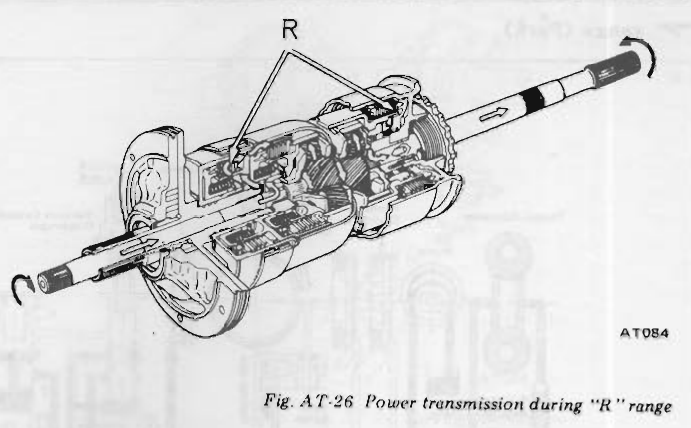
>
> - **Summary:** Cutaway perspective diagram illustrating torque and power flow through input shaft, front clutch, sun gear, rear planetary gears, connecting drum, rear internal gear, and output shaft during Reverse range operation.
> - **Components:** Input shaft, Front clutch, Connecting shell, Sun gear, Rear planetary gears, Connecting drum, Low and reverse brake, Rear internal gear, Output shaft
> - **Specs / Measurements:** Reverse gear ratio: 2.182
> - **Mechanic Notes:** Input shaft rotates clockwise; front clutch and low & reverse brake engaged; output shaft rotates counterclockwise.
> - **Tags:** `power transmission`, `Reverse range`, `power flow`, `front clutch`, `gear ratio 2.182`

> 🖼️ **Fig. AT-27 Operation of each mechanism during "R" range** `[AT085]` *(Type: `alignment_orientation`)*
>
> 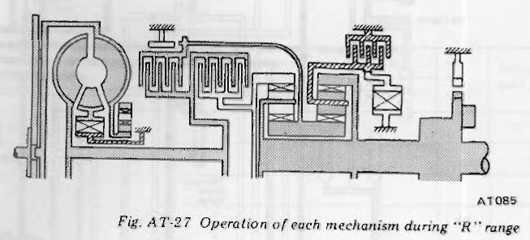
>
> - **Summary:** Schematic representation of engaged friction elements in Reverse range showing front clutch applied, band brake released (release side pressurized), and low & reverse brake applied.
> - **Components:** Torque converter, Front clutch, Rear clutch, Band brake, Low & reverse brake, One-way clutch
> - **Mechanic Notes:** Front clutch: ON; Rear clutch: OFF; Band brake: RELEASE (ON); Low & reverse brake: ON; One-way clutch: INACTIVE.
> - **Tags:** `clutch engagement`, `friction elements`, `Reverse range`, `band release`

When the manual valve (2) is positioned at "R" range, the oil having the line pressure (7) is directed to line pressure circuits (5) and (6). The pressure in the circuit (5) actuates the low and reverse brake after being introduced into line pressure circuit (12) through the "1st-2nd" shift valve (3). The pressure in the circuit operates the release side of the band servo and the front clutch after being led to line pressure circuit (10) through the "2nd-3rd" shift valve (4). The throttle pressure (16) and the line pressure (6) which vary with the degree of accelerator pedal depression both act on the pressure regulator valve (1) and press against its valve (1), increasing line pressure (7). In "R" range, the governor pressure is absent, making all such valves as the "1st-2nd" shift valve (3), "2nd-3rd" shift valve (4), and pressure modifier valve (5) inoperative.

### Operating Elements by Range and Gear Position

| Range | Gear ratio | Clutch Front | Clutch Rear | Low & reverse brake | Band servo Operation | Band servo Release | One way clutch | Parking pawl |
| :--- | :---: | :---: | :---: | :---: | :---: | :---: | :---: | :---: |
| **Park** | — | — | — | on | — | — | — | on |
| **Reverse** | 2.182 | on | — | on | — | on | — | — |
| **Neutral** | — | — | — | — | — | — | — | — |
| **Drive D₁ Low** | 2.458 | — | on | — | — | — | on | — |
| **Drive D₂ Second** | 1.458 | — | on | — | on | — | — | — |
| **Drive D₃ Top** | 1.000 | on | on | — | (on) | on | — | — |
| **2 Second** | 1.458 | — | on | — | on | — | — | — |
| **1 1₂ Second** | 1.458 | — | on | — | on | — | — | — |
| **1 1₁ Low** | 2.458 | — | on | on | — | — | — | — |

---

<!-- Page 17 (AT-17) -->

> 🖼️ **Fig. AT-28 Oil pressure circuit diagram — "R" range (Reverse)**  *(Type: `electrical_schematic`)*
>
> 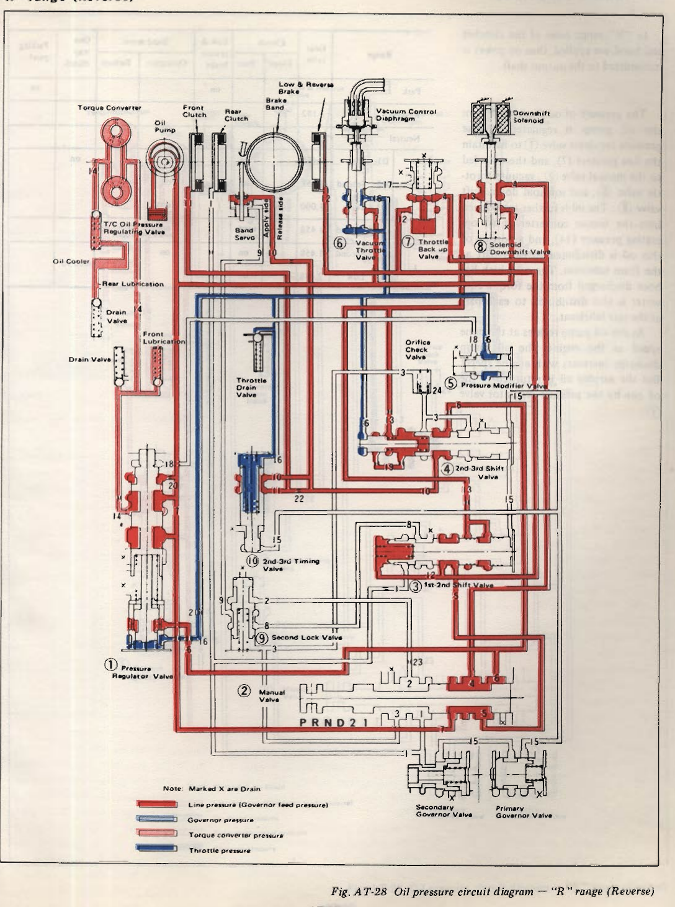
>
> - **Summary:** Full hydraulic schematic in Reverse range showing line pressure (7) directed through manual valve (2) into circuits (5) and (6), pressurizing circuit (12) for Low & Reverse brake and circuit (10) for Front clutch and band servo release side.
> - **Components:** Torque Converter, Oil Pump, T/C Oil Pressure Regulating Valve, Oil Cooler, Rear Lubrication, Front Lubrication, Drain Valves, Front Clutch, Rear Clutch, Brake Band, Band Servo, Low & Reverse Brake, Vacuum Control Diaphragm, Downshift Solenoid, Pressure Regulator Valve (1), Manual Valve (2), 1st-2nd Shift Valve (3), 2nd-3rd Shift Valve (4), Pressure Modifier Valve (5), Vacuum Throttle Valve (6), Throttle Back up Valve (7), Solenoid Downshift Valve (8), Second Lock Valve (9), 2nd-3rd Timing Valve (10), Orifice Check Valve (24), Throttle Drain Valve, Secondary Governor Valve, Primary Governor Valve
> - **Callouts:** **(1)** Pressure Regulator Valve; **(2)** Manual Valve; **(3)** 1st-2nd Shift Valve; **(4)** 2nd-3rd Shift Valve; **(5)** Pressure Modifier Valve; **(6)** Vacuum Throttle Valve; **(7)** Throttle Back up Valve; **(8)** Solenoid Downshift Valve; **(9)** Second Lock Valve; **(10)** 2nd-3rd Timing Valve; **(24)** Orifice Check Valve
> - **Specs / Measurements:** Active hydraulic circuits: Line 7, Line 5, Line 6, Line 10 (Front clutch & band release), Line 12 (Low & reverse brake), Line 14 (torque converter)
> - **Mechanic Notes:** Line pressure (6) assists spring on PRV to boost line pressure to maximum for heavy reverse torque transmission.
> - **Tags:** `circuit diagram`, `R range`, `Reverse range`, `hydraulic schematic`, `front clutch`, `low and reverse brake`

---

<!-- Page 18 (AT-18) -->
# "N" RANGE (NEUTRAL)

In "N" range none of the clutches and band are applied, thus no power is transmitted to the output shaft.

The pressure of oil discharged from the oil pump is regulated by the pressure regulator valve (1) to maintain the line pressure (7), and the oil is led to the manual valve (2), vacuum throttle valve (6), and solenoid down shift valve (8). The oil is further introduced into the torque converter at its operating pressure (14), and a portion of this oil is distributed to each part as the front lubricant. The oil which has been discharged from the torque converter is also distributed to each part as the rear lubricant.

As the oil pump rotates at the same speed as the engine, the oil pump discharge increases with engine speed. But the surplus oil is returned to the oil pan by the pressure regulator valve (1).

### Operating Elements by Range and Gear Position

| Range | Gear ratio | Clutch Front | Clutch Rear | Low & reverse brake | Band servo Operation | Band servo Release | One way clutch | Parking pawl |
| :--- | :---: | :---: | :---: | :---: | :---: | :---: | :---: | :---: |
| **Park** | — | — | — | on | — | — | — | on |
| **Reverse** | 2.182 | on | — | on | — | on | — | — |
| **Neutral** | — | — | — | — | — | — | — | — |
| **Drive D₁ Low** | 2.458 | — | on | — | — | — | on | — |
| **Drive D₂ Second** | 1.458 | — | on | — | on | — | — | — |
| **Drive D₃ Top** | 1.000 | on | on | — | (on) | on | — | — |
| **2 Second** | 1.458 | — | on | — | on | — | — | — |
| **1 1₂ Second** | 1.458 | — | on | — | on | — | — | — |
| **1 1₁ Low** | 2.458 | — | on | on | — | — | — | — |

---

<!-- Page 19 (AT-19) -->

> 🖼️ **Fig. AT-29 Oil pressure circuit diagram — "N" range (Neutral)**  *(Type: `electrical_schematic`)*
>
> 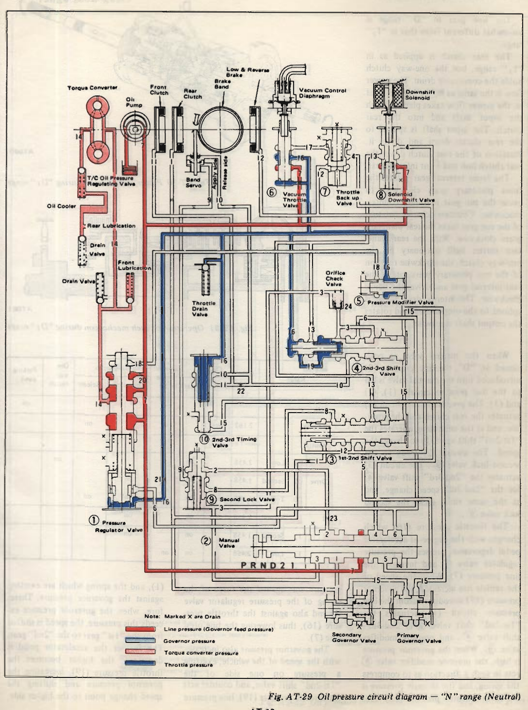
>
> - **Summary:** Full hydraulic schematic in 'N' (Neutral) range showing line pressure (7) regulated by PRV (1), delivered to manual valve (2) with all output circuits (1 through 6) blocked/drained, while circuit (14) supplies torque converter and lubrication.
> - **Components:** Torque Converter, Oil Pump, T/C Oil Pressure Regulating Valve, Oil Cooler, Rear Lubrication, Front Lubrication, Drain Valves, Front Clutch, Rear Clutch, Brake Band, Band Servo, Low & Reverse Brake, Vacuum Control Diaphragm, Downshift Solenoid, Pressure Regulator Valve (1), Manual Valve (2), 1st-2nd Shift Valve (3), 2nd-3rd Shift Valve (4), Pressure Modifier Valve (5), Vacuum Throttle Valve (6), Throttle Back up Valve (7), Solenoid Downshift Valve (8), Second Lock Valve (9), 2nd-3rd Timing Valve (10), Orifice Check Valve (24), Throttle Drain Valve, Secondary Governor Valve, Primary Governor Valve
> - **Callouts:** **(1)** Pressure Regulator Valve; **(2)** Manual Valve; **(3)** 1st-2nd Shift Valve; **(4)** 2nd-3rd Shift Valve; **(5)** Pressure Modifier Valve; **(6)** Vacuum Throttle Valve; **(7)** Throttle Back up Valve; **(8)** Solenoid Downshift Valve; **(9)** Second Lock Valve; **(10)** 2nd-3rd Timing Valve; **(24)** Orifice Check Valve
> - **Specs / Measurements:** Active hydraulic circuits: Line 7 (regulated line pressure), Line 14 (converter feed and lubrication), Line 16 (throttle pressure)
> - **Mechanic Notes:** All friction elements (clutches, band brake, low & reverse brake) are unpressurized and drained in Neutral.
> - **Tags:** `circuit diagram`, `N range`, `Neutral range`, `hydraulic schematic`, `no friction element applied`

---

<!-- Page 20 (AT-20) -->
# "D₁" RANGE (LOW GEAR)

The low gear in "D" range is somewhat different from that in "1₁" range.

The rear clutch is applied as in "1₁" range, but the one-way clutch holds the connecting drum. The power flow is the same as in "1₁" range. That is, the power flow takes place through the input shaft and into the rear clutch. The input shaft is splined to the rear clutch drum and drives it. Rotation of the rear clutch drives the rear clutch hub and front internal gear.

The front internal gear rotates the front planetary gears clockwise to cause the sun gear to rotate counter-clockwise. Counterclockwise rotation of the sun gear turns the rear planetary gears clockwise. With the rear planetary carrier held stationary by the one-way clutch, the clockwise rotation of the rear planetary gears rotates the rear internal gear and drives the flange clockwise. The internal drive flange is splined to the output shaft and rotates the output shaft clockwise.

> 🖼️ **Fig. AT-30 Power transmission during "D₁" range** `[AT080]` *(Type: `cutaway_flow`)*
>
> 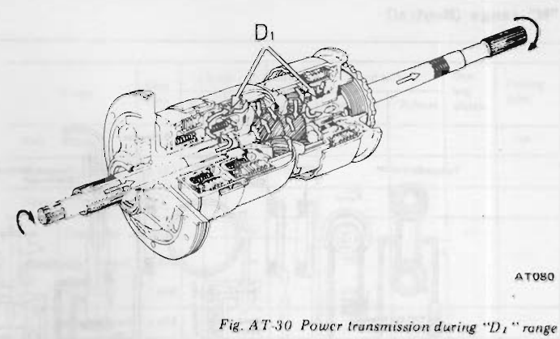
>
> - **Summary:** Cutaway perspective diagram illustrating torque and power transmission through input shaft, rear clutch, front internal gear, front planetary gears, sun gear, rear planetary gears, one-way clutch, rear internal gear, and output shaft during D1 low gear operation.
> - **Components:** Input shaft, Rear clutch drum, Rear clutch, Front internal gear, Front planetary gears, Sun gear, Rear planetary gears, One-way clutch, Rear internal gear, Output shaft
> - **Specs / Measurements:** Drive D1 gear ratio: 2.458
> - **Mechanic Notes:** One-way clutch prevents rear planetary carrier counterclockwise rotation, enabling low gear torque multiplication.
> - **Tags:** `power transmission`, `D1 range`, `low gear`, `one-way clutch`, `rear clutch`, `gear ratio 2.458`

> 🖼️ **Fig. AT-31 Operation of each mechanism during "D₁" range** `[AT081]` *(Type: `alignment_orientation`)*
>
> 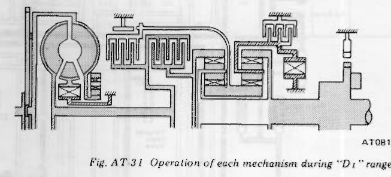
>
> - **Summary:** Schematic representation of engaged friction elements in D1 low gear showing rear clutch applied and one-way clutch holding, with front clutch, band brake, and low & reverse brake released.
> - **Components:** Torque converter, Front clutch, Rear clutch, Band brake, Low & reverse brake, One-way clutch
> - **Mechanic Notes:** Rear clutch: ON; One-way clutch: ON (holding); Front clutch: OFF; Band brake: OFF; Low & reverse brake: OFF.
> - **Tags:** `friction elements`, `D1 range`, `rear clutch`, `one-way clutch`

When the manual valve is positioned at "D", the line pressure (7) introduced into the manual valve is led to the line pressure circuits (1), (2) and (3). The pressure in the circuit (1) actuates the rear clutch and the governor, and at the same time, operates the "1st-2nd" shift valve (3) to change the speed. The circuit (2) leads to the second lock valve (9). The circuit (3) actuates the "2nd-3rd" shift valve (4) for the "2nd-3rd" speed change, and at the same time, locks the second lock valve (9).

The throttle pressure (16) which changes with the degree of accelerator pedal depression, presses the pressure regulator valve (1) and increases the line pressure (7). When the speed of the vehicle has increased, the governor pressure (15) introduced from the line pressure circuit (1) actuates the "1st-2nd" shift valve (3), "2nd-3rd" shift valve (4), and pressure modifier valve (5). When the governor pressure is high, the pressure modifier valve (5) acts in such a direction as to compress the spring, and the throttle pressure is led to the throttle pressure (18). This pressure acts against the force of the spring of the pressure regulator valve (1) and also against the throttle pressure (16), thus lowering the line pressure (7).

The governor pressure also increases with the speed of the vehicle, exerting a pressure on one side of the "1st-2nd" shift valve, and counter acts the throttle pressure (19), line pressure (1), and the spring which are exerting against the governor pressure. Therefore, when the governor pressure exceeds this pressure, the speed is shifted from the "1st" gear to the "2nd" gear. The further the accelerator pedal is depressed, the higher becomes the throttle pressure (19), increasing the governor pressure and shifting the speed change point to the higher side.

### Operating Elements by Range and Gear Position

| Range | Gear ratio | Clutch Front | Clutch Rear | Low & reverse brake | Band servo Operation | Band servo Release | One way clutch | Parking pawl |
| :--- | :---: | :---: | :---: | :---: | :---: | :---: | :---: | :---: |
| **Park** | — | — | — | on | — | — | — | on |
| **Reverse** | 2.182 | on | — | on | — | on | — | — |
| **Neutral** | — | — | — | — | — | — | — | — |
| **Drive D₁ Low** | 2.458 | — | on | — | — | — | on | — |
| **Drive D₂ Second** | 1.458 | — | on | — | on | — | — | — |
| **Drive D₃ Top** | 1.000 | on | on | — | (on) | on | — | — |
| **2 Second** | 1.458 | — | on | — | on | — | — | — |
| **1 1₂ Second** | 1.458 | — | on | — | on | — | — | — |
| **1 1₁ Low** | 2.458 | — | on | on | — | — | — | — |

---

<!-- Page 21 (AT-21) -->

> 🖼️ **Fig. AT-32 Oil pressure circuit diagram — "D₁" range (Low gear)**  *(Type: `electrical_schematic`)*
>
> 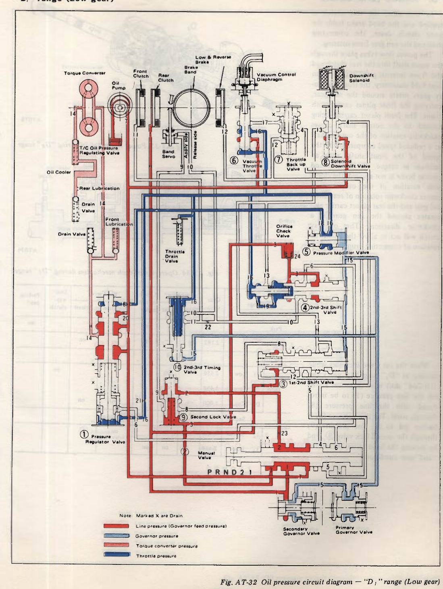
>
> - **Summary:** Full hydraulic schematic in D1 (Low gear) range showing line pressure (7) routed through manual valve (2) into circuits (1), (2), and (3), applying Rear clutch and feeding governor valve, while 1st-2nd shift valve remains in low position.
> - **Components:** Torque Converter, Oil Pump, T/C Oil Pressure Regulating Valve, Oil Cooler, Rear Lubrication, Front Lubrication, Drain Valves, Front Clutch, Rear Clutch, Brake Band, Band Servo, Low & Reverse Brake, Vacuum Control Diaphragm, Downshift Solenoid, Pressure Regulator Valve (1), Manual Valve (2), 1st-2nd Shift Valve (3), 2nd-3rd Shift Valve (4), Pressure Modifier Valve (5), Vacuum Throttle Valve (6), Throttle Back up Valve (7), Solenoid Downshift Valve (8), Second Lock Valve (9), 2nd-3rd Timing Valve (10), Orifice Check Valve (24), Throttle Drain Valve, Secondary Governor Valve, Primary Governor Valve
> - **Callouts:** **(1)** Pressure Regulator Valve; **(2)** Manual Valve; **(3)** 1st-2nd Shift Valve; **(4)** 2nd-3rd Shift Valve; **(5)** Pressure Modifier Valve; **(6)** Vacuum Throttle Valve; **(7)** Throttle Back up Valve; **(8)** Solenoid Downshift Valve; **(9)** Second Lock Valve; **(10)** 2nd-3rd Timing Valve; **(24)** Orifice Check Valve
> - **Specs / Measurements:** Active hydraulic circuits: Line 7, Line 1 (Rear clutch and governor feed), Line 2 (to SLV), Line 3 (to SSV and SLV), Line 14 (converter and lubrication), Line 15 (governor pressure build-up), Line 16 (throttle pressure)
> - **Mechanic Notes:** Rear clutch is engaged by circuit 1; governor valve begins generating speed-dependent pressure in line 15 to oppose FSV return spring.
> - **Tags:** `circuit diagram`, `D1 range`, `low gear`, `hydraulic schematic`, `rear clutch`, `governor feed`

---

<!-- Page 22 (AT-22) -->
# SECTION AT - AUTOMATIC TRANSMISSION

## "D₂" RANGE (2ND GEAR)

In this case, the rear clutch is applied and the band brake holds the front clutch drum, the connecting shell and the sun gear from rotating.

The power flow takes place through the input shaft into the rear clutch and the front internal gear. With the sun gear held stationary, the front planetary gears rotate around the sun gear, carrying the front planet carrier with them. The front planet carrier, being splined to the output shaft, causes clockwise rotation of the output shaft at a reduced speed compared with the speed of the input shaft, with an increase in torque. As the low and reverse brake is not applied, the clockwise rotation of the output shaft causes clockwise rotation of rear internal gear and the rear planet carrier also rotates around the sun gear in a clockwise direction. The one-way clutch will act to allow the clockwise rotation of connecting drum.

> 🖼️ **Fig. AT-33 Power transmission during "D₂" range** `[AT078]` *(Type: `cutaway_flow`)*
>
> 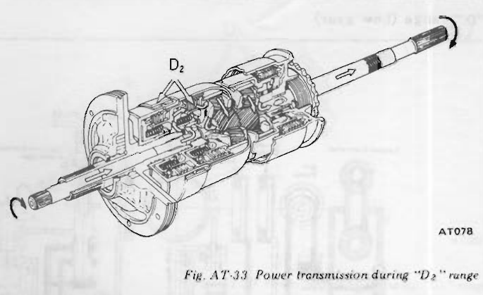
>
> - **Summary:** Cutaway diagram showing the power flow path through the transmission during D2 range (2nd gear).
> - **Components:** Input shaft, Rear clutch, Front internal gear, Sun gear, Front planetary gears, Front planet carrier, Output shaft, Brake band
> - **Callouts:** **(D2)** Applied band brake and power flow path
> - **Specs / Measurements:** Gear ratio: 1.458
> - **Mechanic Notes:** Rear clutch is applied; band brake holds front clutch drum, connecting shell, and sun gear from rotating.
> - **Tags:** `power transmission`, `D2 range`, `2nd gear`, `front planet carrier`, `rear clutch`, `band brake`

> 🖼️ **Fig. AT-34 Operation of each mechanism during "D₂" range** `[AT079]` *(Type: `cutaway_flow`)*
>
> 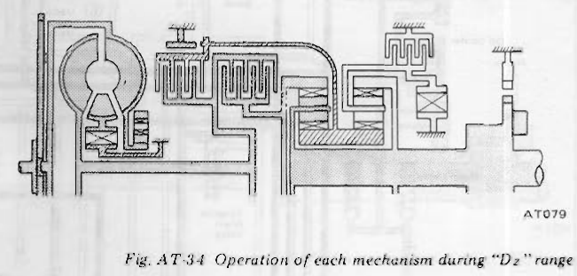
>
> - **Summary:** Cross-sectional schematic illustration of engaged components during D2 range (2nd gear).
> - **Components:** Torque converter, Front clutch, Rear clutch, Band brake, Low and reverse brake, One-way clutch, Output shaft
> - **Mechanic Notes:** Rear clutch and band brake are engaged; one-way clutch freewheels clockwise.
> - **Tags:** `operation schematic`, `D2 range`, `rear clutch`, `band brake`

### Operation of Each Mechanism

| Range | Gear ratio | Clutch Front | Clutch Rear | Low & reverse brake | Band servo Operation | Band servo Release | One-way clutch | Parking pawl |
| :--- | :--- | :--- | :--- | :--- | :--- | :--- | :--- | :--- |
| Park | | | | on | | | | on |
| Reverse | 2.182 | on | | on | | on | | |
| Neutral | | | | | | | | |
| Drive D1 Low | 2.458 | | on | | | | on | |
| Drive D2 Second | 1.458 | | on | | on | | | |
| Drive D3 Top | 1.000 | on | on | | (on) | on | | |
| 2 Second | 1.458 | | on | | on | | | |
| 1 1₂ Second | 1.458 | | on | | on | | | |
| 1 1₁ Low | 2.458 | | on | on | | | | |

When the car speed increases while running at "D₁" range (1st gear), the "1st-2nd" shift valve ③ moves allowing the line pressure (1) to be introduced into the line pressure (8) through itself. The line pressure (8) is further led to the line pressure (9) through the second lock valve ⑨, and by locking the band servo, obtains the "2nd" gear condition.

---

<!-- Page 23 (AT-23) -->
# SECTION AT - AUTOMATIC TRANSMISSION

## "D₂" RANGE (2ND GEAR) HYDRAULIC PRESSURE CIRCUIT

> 🖼️ **Fig. AT-35 Oil pressure circuit diagram — "D₂" range (2nd gear)**  *(Type: `cutaway_flow`)*
>
> 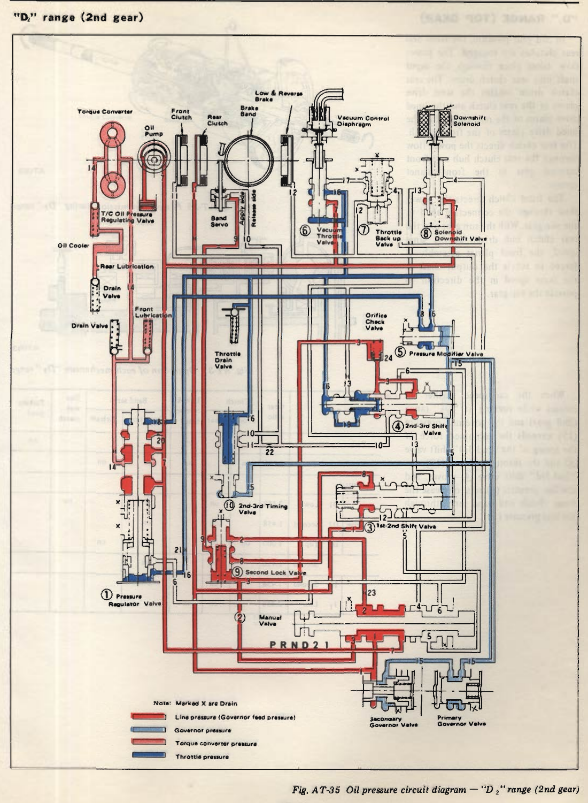
>
> - **Summary:** Complete schematic oil pressure circuit diagram during D2 range (2nd gear). Line pressure is directed through manual valve at D position to rear clutch and through shifted 1st-2nd shift valve and second lock valve to band servo apply side.
> - **Components:** Pressure Regulator Valve, Manual Valve, 1st-2nd Shift Valve, 2nd-3rd Shift Valve, Pressure Modifier Valve, Vacuum Throttle Valve, Throttle Back up Valve, Solenoid Downshift Valve, Second Lock Valve, 2nd-3rd Timing Valve, Torque Converter, Oil Pump, T/C Oil Pressure Regulating Valve, Oil Cooler, Rear Lubrication, Front Lubrication, Band Servo, Front Clutch, Rear Clutch, Brake Band, Low & Reverse Brake, Vacuum Control Diaphragm, Downshift Solenoid, Secondary Governor Valve, Primary Governor Valve
> - **Callouts:** **(1)** Pressure Regulator Valve; **(2)** Manual Valve; **(3)** 1st-2nd Shift Valve; **(4)** 2nd-3rd Shift Valve; **(5)** Pressure Modifier Valve; **(6)** Vacuum Throttle Valve; **(7)** Throttle Back up Valve; **(8)** Solenoid Downshift Valve; **(9)** Second Lock Valve; **(10)** 2nd-3rd Timing Valve
> - **Mechanic Notes:** 1st-2nd shift valve moves to introduce line pressure (1) to line pressure (8), then via second lock valve to line pressure (9) locking the band servo apply side.
> - **Tags:** `hydraulic circuit`, `D2 range`, `2nd gear`, `oil pressure circuit`, `band servo`, `shift valve`

**Legend:**
- Line pressure (Governor feed pressure)
- Governor pressure
- Torque converter pressure
- Throttle pressure
*Note: Marked X are Drain*

---

<!-- Page 24 (AT-24) -->
# SECTION AT - AUTOMATIC TRANSMISSION

## "D₃" RANGE (TOP GEAR)

In 3rd gear position, the front and rear clutches are engaged. The power flow takes place through the input shaft into rear clutch drum. The rear clutch drum rotates the steel drive plates of the rear clutch and the lined drive plates of the front clutch. The rear clutch directs the power flow through the rear clutch hub and front internal gear to the front planet carrier.

The front clutch directs the power flow through the connecting shell to the sun gear. With the sun gear and the rear clutch hub driven at the same speed, the front planet assembly is forced to rotate the output shaft at the same speed in the direction to provide the top gear.

> 🖼️ **Fig. AT-36 Power transmission during "D₃" range** `[AT082]` *(Type: `cutaway_flow`)*
>
> 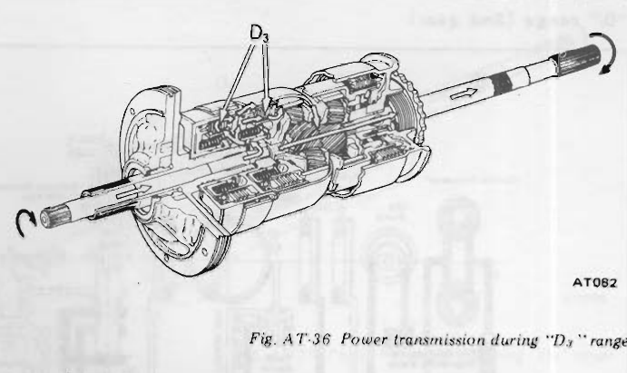
>
> - **Summary:** Cutaway diagram showing power transmission in D3 range (top gear). Both front and rear clutches are engaged, locking the planetary gearset together for 1:1 direct drive.
> - **Components:** Input shaft, Rear clutch, Front clutch, Connecting shell, Sun gear, Front planet carrier, Output shaft
> - **Callouts:** **(D3)** Front and rear clutches engaged
> - **Specs / Measurements:** Gear ratio: 1.000
> - **Mechanic Notes:** Both front and rear clutches engaged; planetary gearing rotates as a solid unit to provide direct 1:1 ratio.
> - **Tags:** `power transmission`, `D3 range`, `top gear`, `direct drive`, `front clutch`, `rear clutch`

> 🖼️ **Fig. AT-37 Operation of each mechanism "D₃" range** `[AT083]` *(Type: `cutaway_flow`)*
>
> 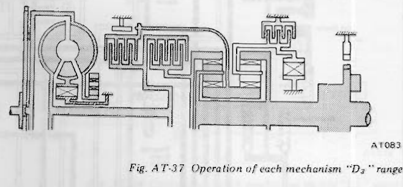
>
> - **Summary:** Cross-sectional schematic illustration of engaged components in D3 range (top gear).
> - **Components:** Torque converter, Front clutch, Rear clutch, Band servo release, Output shaft
> - **Mechanic Notes:** Front clutch and rear clutch engaged; band servo release side pressurized to release the band brake.
> - **Tags:** `operation schematic`, `D3 range`, `top gear`, `front clutch`, `rear clutch`

### Operation of Each Mechanism

| Range | Gear ratio | Clutch Front | Clutch Rear | Low & reverse brake | Band servo Operation | Band servo Release | One-way clutch | Parking pawl |
| :--- | :--- | :--- | :--- | :--- | :--- | :--- | :--- | :--- |
| Park | | | | on | | | | on |
| Reverse | 2.182 | on | | on | | on | | |
| Neutral | | | | | | | | |
| Drive D1 Low | 2.458 | | on | | | | on | |
| Drive D2 Second | 1.458 | | on | | on | | | |
| Drive D3 Top | 1.000 | on | on | | (on) | on | | |
| 2 Second | 1.458 | | on | | on | | | |
| 1 1₂ Second | 1.458 | | on | | on | | | |
| 1 1₁ Low | 2.458 | | on | on | | | | |

When the car speed further increases while running at "D₂" range (2nd gear) and the governor pressure (15) exceeds the combined force of the spring of the "2nd-3rd" shift valve ④ and the throttle pressure (19), the "2nd-3rd" shift valve ④ moves, and the line pressure (8) acts to release the front clutch and band servo through the line pressure (10).

---

<!-- Page 25 (AT-25) -->
# SECTION AT - AUTOMATIC TRANSMISSION

## "D₃" RANGE (TOP GEAR) HYDRAULIC PRESSURE CIRCUIT

> 🖼️ **Fig. AT-38 Oil pressure circuit diagram — "D₃" range (Top gear)**  *(Type: `cutaway_flow`)*
>
> 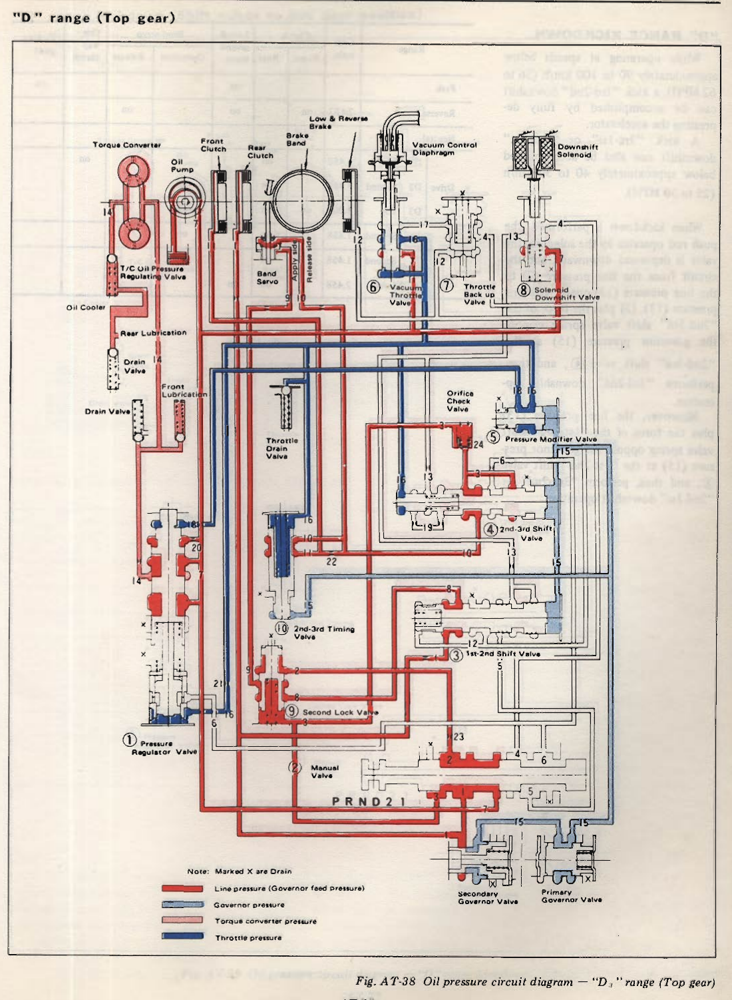
>
> - **Summary:** Complete schematic oil pressure circuit diagram during D3 range (top gear). Governor pressure shifts 2nd-3rd shift valve, directing line pressure (10) to engage front clutch and to the release side of band servo.
> - **Components:** Pressure Regulator Valve, Manual Valve, 1st-2nd Shift Valve, 2nd-3rd Shift Valve, Pressure Modifier Valve, Vacuum Throttle Valve, Throttle Back up Valve, Solenoid Downshift Valve, Second Lock Valve, 2nd-3rd Timing Valve, Front Clutch, Rear Clutch, Band Servo, Torque Converter, Oil Pump, Primary Governor Valve, Secondary Governor Valve
> - **Callouts:** **(1)** Pressure Regulator Valve; **(2)** Manual Valve; **(3)** 1st-2nd Shift Valve; **(4)** 2nd-3rd Shift Valve; **(5)** Pressure Modifier Valve; **(6)** Vacuum Throttle Valve; **(7)** Throttle Back up Valve; **(8)** Solenoid Downshift Valve; **(9)** Second Lock Valve; **(10)** 2nd-3rd Timing Valve
> - **Mechanic Notes:** Line pressure (10) pressurizes front clutch and release side of band servo, overcoming apply pressure and releasing band brake.
> - **Tags:** `hydraulic circuit`, `D3 range`, `top gear`, `front clutch`, `band servo release`, `2nd-3rd shift valve`

**Legend:**
- Line pressure (Governor feed pressure)
- Governor pressure
- Torque converter pressure
- Throttle pressure
*Note: Marked X are Drain*

---

<!-- Page 26 (AT-26) -->
# SECTION AT - AUTOMATIC TRANSMISSION

## "D" RANGE KICKDOWN

While operating at speeds below approximately 90 to 100 km/h (56 to 62 MPH), a kick "3rd-2nd" downshift can be accomplished by fully depressing the accelerator.

A kick "3rd-1st" or "2nd-1st" downshift can also be accomplished below approximately 40 to 50 km/h (25 to 30 MPH).

When kickdown is performed, the push rod operates by the solenoid, the valve is depressed downward, and the circuit from the line pressure (7) to the line pressure (13) opens. The line pressure (13), (3) plus the force of the "2nd-3rd" shift valve spring oppose the governor pressure (15) at the "2nd-3rd" shift valve ④, and thus, performs "3rd-2nd" downshift operation.

Moreover, the line pressure (13) plus the force of the "1st-2nd" shift valve spring oppose the governor pressure (15) at the "1st-2nd" shift valve ③, and thus, perform "3rd-2nd" or "2nd-1st" downshift operation.

### Operation of Each Mechanism

| Range | Gear ratio | Clutch Front | Clutch Rear | Low & reverse brake | Band servo Operation | Band servo Release | One-way clutch | Parking pawl |
| :--- | :--- | :--- | :--- | :--- | :--- | :--- | :--- | :--- |
| Park | | | | on | | | | on |
| Reverse | 2.182 | on | | on | | on | | |
| Neutral | | | | | | | | |
| Drive D1 Low | 2.458 | | on | | | | on | |
| Drive D2 Second | 1.458 | | on | | on | | | |
| Drive D3 Top | 1.000 | on | on | | (on) | on | | |
| 2 Second | 1.458 | | on | | on | | | |
| 1 1₂ Second | 1.458 | | on | | on | | | |
| 1 1₁ Low | 2.458 | | on | on | | | | |

---

<!-- Page 27 (AT-27) -->
# SECTION AT - AUTOMATIC TRANSMISSION

## "D" RANGE KICKDOWN HYDRAULIC PRESSURE CIRCUIT (SHIFT VALVES IN 2ND GEAR POSITION)

> 🖼️ **Fig. AT-39 Oil pressure circuit diagram — "D" range kickdown (shift valves in 2nd gear position)**  *(Type: `cutaway_flow`)*
>
> 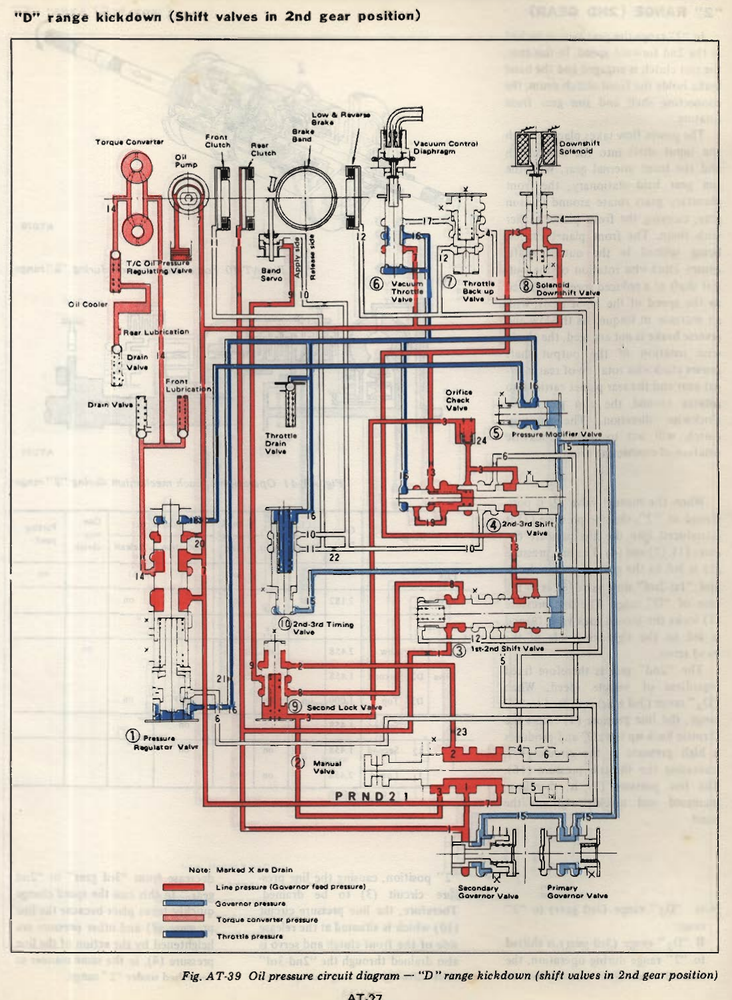
>
> - **Summary:** Oil pressure circuit diagram showing D range kickdown operation with shift valves shifted to the 2nd gear position. Solenoid downshift valve is actuated, delivering kickdown pressure (13) to assist the 2nd-3rd shift valve spring against governor pressure.
> - **Components:** Pressure Regulator Valve, Manual Valve, 1st-2nd Shift Valve, 2nd-3rd Shift Valve, Pressure Modifier Valve, Vacuum Throttle Valve, Throttle Back up Valve, Solenoid Downshift Valve, Second Lock Valve, 2nd-3rd Timing Valve, Downshift Solenoid, Band Servo, Front Clutch, Rear Clutch
> - **Callouts:** **(1)** Pressure Regulator Valve; **(2)** Manual Valve; **(3)** 1st-2nd Shift Valve; **(4)** 2nd-3rd Shift Valve; **(5)** Pressure Modifier Valve; **(6)** Vacuum Throttle Valve; **(7)** Throttle Back up Valve; **(8)** Solenoid Downshift Valve; **(9)** Second Lock Valve; **(10)** 2nd-3rd Timing Valve
> - **Wiring / Connections:** Downshift solenoid electrical circuit
> - **Mechanic Notes:** Downshift solenoid pushes downshift valve downward to open line pressure (7) to circuit (13), overcoming governor pressure (15) to achieve immediate downshift.
> - **Tags:** `hydraulic circuit`, `kickdown`, `downshift solenoid`, `2nd-3rd shift valve`, `oil pressure diagram`

**Legend:**
- Line pressure (Governor feed pressure)
- Governor pressure
- Torque converter pressure
- Throttle pressure
*Note: Marked X are Drain*

---

<!-- Page 28 (AT-28) -->
# SECTION AT - AUTOMATIC TRANSMISSION

## "2" RANGE (2ND GEAR)

In "2" range the gear ratio is locked in the 2nd forward speed. In this case, the rear clutch is engaged and the band brake holds the front clutch drum, the connecting shell and sun gear from rotating.

The power flow takes place through the input shaft into the rear clutch and the front internal gear. With the sun gear held stationary, the front planetary gears rotate around the sun gear, carrying the front planet carrier with them. The front planet carrier, being splined to the output shaft, causes clockwise rotation of the output shaft at a reduced speed compared to the speed of the input shaft, with an increase in torque. As the low and reverse brake is not engaged, the clockwise rotation of the output shaft causes clockwise rotation of rear internal gear and the rear planet carrier also rotates around the sun gear in a clockwise direction. The one-way clutch will act to allow clockwise rotation of connecting drum.

> 🖼️ **Fig. AT-40 Power transmission during "2" range** `[AT078]` *(Type: `cutaway_flow`)*
>
> 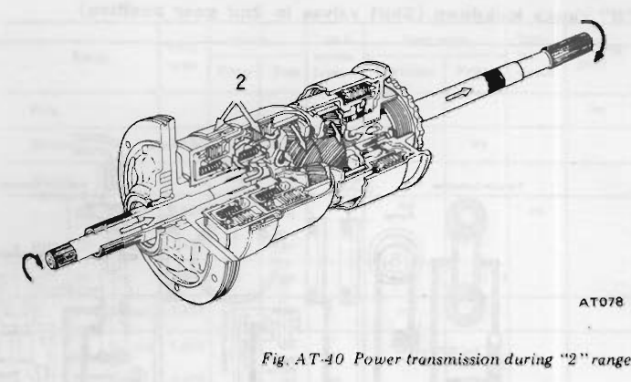
>
> - **Summary:** Cutaway diagram showing power flow in 2 range (locked 2nd gear). Front clutch drum and sun gear held stationary by band brake; rear clutch engaged.
> - **Components:** Input shaft, Rear clutch, Front internal gear, Sun gear, Front planetary gears, Front planet carrier, Output shaft, Brake band
> - **Callouts:** **(2)** Applied band brake and power flow path
> - **Specs / Measurements:** Gear ratio: 1.458
> - **Mechanic Notes:** Gear ratio is locked in 2nd forward speed regardless of vehicle speed.
> - **Tags:** `power transmission`, `2 range`, `2nd gear locked`, `band brake`, `rear clutch`

> 🖼️ **Fig. AT-41 Operation of each mechanism during "2" range** `[AT079]` *(Type: `cutaway_flow`)*
>
> 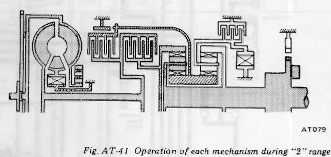
>
> - **Summary:** Cross-sectional schematic illustration of engaged components in 2 range (2nd gear locked).
> - **Components:** Torque converter, Front clutch, Rear clutch, Band brake, Output shaft
> - **Mechanic Notes:** Rear clutch engaged, band brake applied.
> - **Tags:** `operation schematic`, `2 range`, `rear clutch`, `band brake`

### Operation of Each Mechanism

| Range | Gear ratio | Clutch Front | Clutch Rear | Low & reverse brake | Band servo Operation | Band servo Release | One-way clutch | Parking pawl |
| :--- | :--- | :--- | :--- | :--- | :--- | :--- | :--- | :--- |
| Park | | | | on | | | | on |
| Reverse | 2.182 | on | | on | | on | | |
| Neutral | | | | | | | | |
| Drive D1 Low | 2.458 | | on | | | | on | |
| Drive D2 Second | 1.458 | | on | | on | | | |
| Drive D3 Top | 1.000 | on | on | | (on) | on | | |
| 2 Second | 1.458 | | on | | on | | | |
| 1 1₂ Second | 1.458 | | on | | on | | | |
| 1 1₁ Low | 2.458 | | on | on | | | | |

When the manual valve ② is positioned at "2", the line pressure (7) is introduced into the line pressure circuits (1), (2) and (4). The line pressure (1) is led to the governor, rear clutch and "1st-2nd" shift valve ③ as in the case of "D" range. The line pressure (2) locks the second lock valve ⑨ and is led to the tightening side of the band servo.

The "2nd" gear is therefore fixed regardless of vehicle speed. When "D₃" range (3rd gear) is shifted to "2" range, the line pressure (4) enters the throttle back-up valve ⑦ and produces a high pressure in the circuit (17), increasing the throttle pressure (16). The line pressure (7) is, therefore, increased and quickly tightens the band.

**Note: "D₃" range (3rd gear) to "2" range:**
If "D₃" range (3rd gear) is shifted to "2" range during operation, the manual valve ② is also shifted to "2" position, causing the line pressure circuit (3) to be drained. Therefore, the line pressure circuit (10) which is situated at the release side of the front clutch and servo is also drained through the "2nd-3rd" shift valve ④, forcing the speed to decrease from "3rd gear" to "2nd gear." In this case the speed change quickly takes place because the line pressure (7) and other pressure are heightened by the action of the line pressure (4), in the same manner as described under "2" range.

---

<!-- Page 29 (AT-29) -->
# SECTION AT - AUTOMATIC TRANSMISSION

## "2" RANGE (2ND GEAR) HYDRAULIC PRESSURE CIRCUIT

> 🖼️ **Fig. AT-42 Oil pressure circuit diagram — "2" range (2nd gear)**  *(Type: `cutaway_flow`)*
>
> 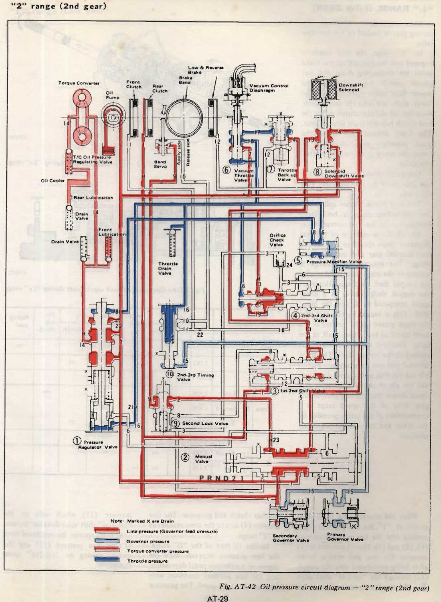
>
> - **Summary:** Oil pressure circuit diagram for 2 range (2nd gear). Manual valve in '2' position directs line pressure (2) to lock the second lock valve and feed the apply side of the band servo, keeping 2nd gear locked regardless of speed.
> - **Components:** Pressure Regulator Valve, Manual Valve, 1st-2nd Shift Valve, 2nd-3rd Shift Valve, Pressure Modifier Valve, Vacuum Throttle Valve, Throttle Back up Valve, Solenoid Downshift Valve, Second Lock Valve, 2nd-3rd Timing Valve, Torque Converter, Oil Pump, Band Servo, Front Clutch, Rear Clutch
> - **Callouts:** **(1)** Pressure Regulator Valve; **(2)** Manual Valve; **(3)** 1st-2nd Shift Valve; **(4)** 2nd-3rd Shift Valve; **(5)** Pressure Modifier Valve; **(6)** Vacuum Throttle Valve; **(7)** Throttle Back up Valve; **(8)** Solenoid Downshift Valve; **(9)** Second Lock Valve; **(10)** 2nd-3rd Timing Valve
> - **Mechanic Notes:** Line pressure (2) hydraulically locks the second lock valve, fixing the transmission in 2nd gear.
> - **Tags:** `hydraulic circuit`, `2 range`, `second lock valve`, `oil pressure diagram`, `band servo`

**Legend:**
- Line pressure (Governor feed pressure)
- Governor pressure
- Torque converter pressure
- Throttle pressure
*Note: Marked X are Drain*

---

<!-- Page 30 (AT-30) -->
# SECTION AT - AUTOMATIC TRANSMISSION

## "1₁" RANGE (LOW GEAR)

When starting in "1" range, the driving gear is locked to the low gear ratio.

In "1" range, the rear clutch is engaged and the low and reverse brake holds the connecting drum and rear planet carrier from rotating. The power flow takes place through the input shaft and into the rear clutch. Rotation of the rear clutch drives the rear clutch hub and front internal gear.

The front internal gear rotates the front planetary gears clockwise to cause the sun gear to rotate counterclockwise. Counterclockwise rotation of the sun gear turns the rear planetary gears clockwise.

The rear planet carrier splined to the connecting drum is held from rotating by the low and reverse brake.

The clockwise rotation of the rear planetary gears therefore rotates the rear internal gear and internal drive flange. The internal drive flange is splined to the output shaft and rotates the output shaft clockwise. However, the output shaft rotates at a lower speed compared to that of the input shaft. This is caused by the fact that the front planet carrier rotates at the same speed as the output shaft in the same direction since the carrier is splined to the output shaft. The front internal gear and planetary gear assembly are rotating in the same direction, but the planet carrier is rotating at a speed slower than the ring gear. So the gear ratio of this speed range is a combination of the ratios provided by the front and rear planetary gear assemblies.

> 🖼️ **Fig. AT-43 Power transmission during "1₁" range** `[AT076]` *(Type: `cutaway_flow`)*
>
> 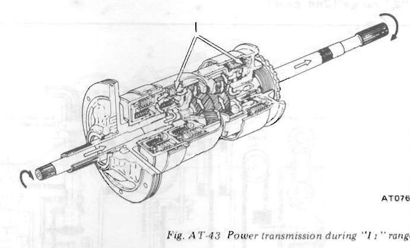
>
> - **Summary:** Cutaway diagram showing power transmission in 1_1 range (low gear). Rear clutch is engaged and low & reverse brake is applied to hold the connecting drum and rear planet carrier stationary.
> - **Components:** Input shaft, Rear clutch, Rear clutch hub, Front internal gear, Sun gear, Rear planetary gears, Rear planet carrier, Connecting drum, Low and reverse brake, Internal drive flange, Output shaft
> - **Callouts:** **(1)** Applied low and reverse brake
> - **Specs / Measurements:** Gear ratio: 2.458
> - **Mechanic Notes:** Rear clutch engaged, low and reverse brake applied to hold rear planet carrier.
> - **Tags:** `power transmission`, `1_1 range`, `low gear`, `rear clutch`, `low and reverse brake`

> 🖼️ **Fig. AT-44 Operation of each mechanism during "1₁" range** `[AT077]` *(Type: `cutaway_flow`)*
>
> 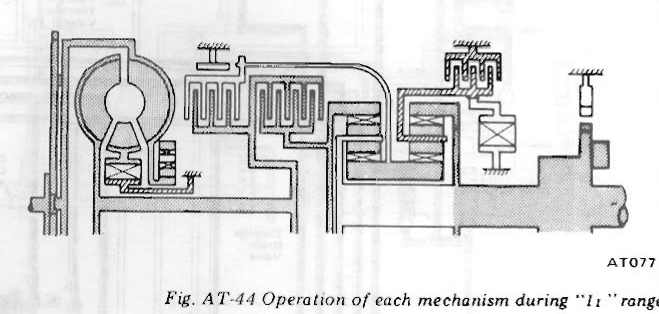
>
> - **Summary:** Cross-sectional schematic illustration of engaged components in 1_1 range (low gear).
> - **Components:** Torque converter, Rear clutch, Low and reverse brake, Output shaft
> - **Mechanic Notes:** Rear clutch engaged, low & reverse brake applied; front clutch and band brake disengaged.
> - **Tags:** `operation schematic`, `1_1 range`, `low gear`, `rear clutch`, `low and reverse brake`

### Operation of Each Mechanism

| Range | Gear ratio | Clutch Front | Clutch Rear | Low & reverse brake | Band servo Operation | Band servo Release | One-way clutch | Parking pawl |
| :--- | :--- | :--- | :--- | :--- | :--- | :--- | :--- | :--- |
| Park | | | | on | | | | on |
| Reverse | 2.182 | on | | on | | on | | |
| Neutral | | | | | | | | |
| Drive D1 Low | 2.458 | | on | | | | on | |
| Drive D2 Second | 1.458 | | on | | on | | | |
| Drive D3 Top | 1.000 | on | on | | (on) | on | | |
| 2 Second | 1.458 | | on | | on | | | |
| 1 1₂ Second | 1.458 | | on | | on | | | |
| 1 1₁ Low | 2.458 | | on | on | | | | |

When the manual valve ② is positioned at "1", the line pressure (7) is applied into the line pressure circuits (1), (4) and (5). The oil pressure in (5) actuates the low and reverse brake after being introduced into the circuit (12) through the "1st-2nd" shift valve ③, and the line pressure (1) acts on the rear clutch and governor. The line pressure (4) acts in the same manner as in "2" range.

Similar to that of the "D" range, the line pressure increases with the degree of accelerator pedal depression, and the line pressure decreases with the increase of car speed. The governor pressure (15) which acts on the "1st-2nd" shift valve does not increase until it overcomes the combined force of the line pressure (12) and the spring, causing no "1st-2nd" speed change.

---

<!-- Page 31 (AT-31) -->
# SECTION AT - AUTOMATIC TRANSMISSION

## "1₁" RANGE (LOW GEAR) HYDRAULIC PRESSURE CIRCUIT

> 🖼️ **Fig. AT-45 Oil pressure circuit diagram — "1₁" range (Low gear)**  *(Type: `cutaway_flow`)*
>
> 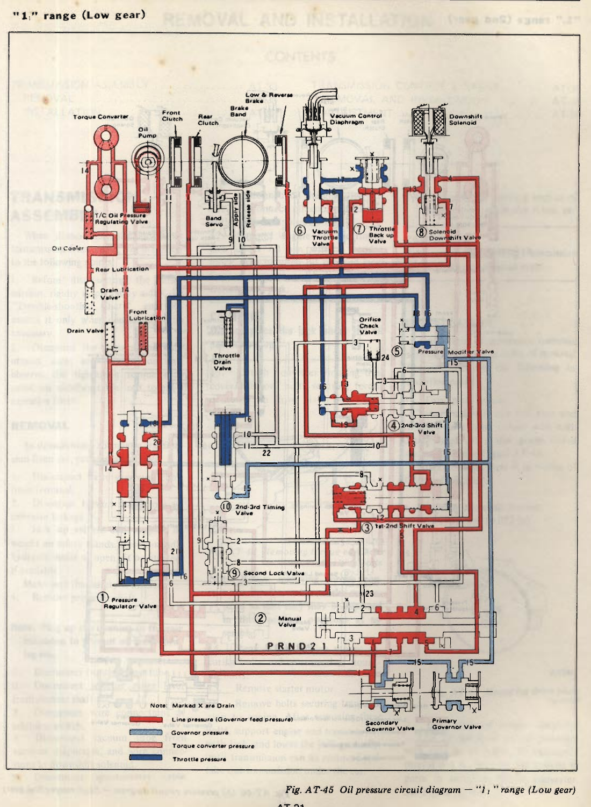
>
> - **Summary:** Oil pressure circuit diagram for 1_1 range (low gear). Manual valve in '1' position directs line pressure (5) through 1st-2nd shift valve into circuit (12) to actuate the low and reverse brake.
> - **Components:** Pressure Regulator Valve, Manual Valve, 1st-2nd Shift Valve, 2nd-3rd Shift Valve, Pressure Modifier Valve, Vacuum Throttle Valve, Throttle Back up Valve, Solenoid Downshift Valve, Second Lock Valve, 2nd-3rd Timing Valve, Torque Converter, Oil Pump, Low & Reverse Brake, Rear Clutch
> - **Callouts:** **(1)** Pressure Regulator Valve; **(2)** Manual Valve; **(3)** 1st-2nd Shift Valve; **(4)** 2nd-3rd Shift Valve; **(5)** Pressure Modifier Valve; **(6)** Vacuum Throttle Valve; **(7)** Throttle Back up Valve; **(8)** Solenoid Downshift Valve; **(9)** Second Lock Valve; **(10)** 2nd-3rd Timing Valve
> - **Mechanic Notes:** Line pressure (12) assists the 1st-2nd shift valve spring to prevent upshift until governor pressure reaches very high speeds.
> - **Tags:** `hydraulic circuit`, `1_1 range`, `low gear`, `low and reverse brake`, `oil pressure diagram`

**Legend:**
- Line pressure (Governor feed pressure)
- Governor pressure
- Torque converter pressure
- Throttle pressure
*Note: Marked X are Drain*

---

<!-- Page 32 (AT-32) -->
# SECTION AT - AUTOMATIC TRANSMISSION

## "1₂" RANGE (2ND GEAR) HYDRAULIC PRESSURE CIRCUIT

> 🖼️ **Fig. AT-46 Oil pressure circuit diagram — "1₂" range (2nd gear)**  *(Type: `cutaway_flow`)*
>
> 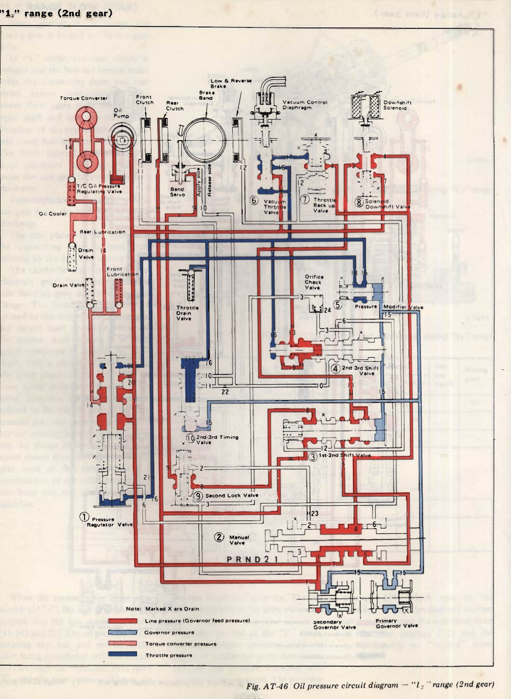
>
> - **Summary:** Oil pressure circuit diagram for 1_2 range (2nd gear overspeed protection). When vehicle speed exceeds safety limit in 1 range, high governor pressure overcomes line pressure (12) and shifts the 1st-2nd shift valve to release low & reverse brake and apply band servo.
> - **Components:** Pressure Regulator Valve, Manual Valve, 1st-2nd Shift Valve, 2nd-3rd Shift Valve, Pressure Modifier Valve, Vacuum Throttle Valve, Throttle Back up Valve, Solenoid Downshift Valve, Second Lock Valve, 2nd-3rd Timing Valve, Band Servo, Low & Reverse Brake, Rear Clutch
> - **Callouts:** **(1)** Pressure Regulator Valve; **(2)** Manual Valve; **(3)** 1st-2nd Shift Valve; **(4)** 2nd-3rd Shift Valve; **(5)** Pressure Modifier Valve; **(6)** Vacuum Throttle Valve; **(7)** Throttle Back up Valve; **(8)** Solenoid Downshift Valve; **(9)** Second Lock Valve; **(10)** 2nd-3rd Timing Valve
> - **Mechanic Notes:** Automatic upshift to 2nd gear occurs at high speed in 1 range to prevent engine over-revolution.
> - **Tags:** `hydraulic circuit`, `1_2 range`, `over-rev protection`, `1st-2nd shift valve`, `band servo`

**Legend:**
- Line pressure (Governor feed pressure)
- Governor pressure
- Torque converter pressure
- Throttle pressure
*Note: Marked X are Drain*

---

<!-- Page 33 (AT-33) -->
# SECTION AT - AUTOMATIC TRANSMISSION

# REMOVAL AND INSTALLATION

### CONTENTS

| Section | Page |
| :--- | :--- |
| TRANSMISSION ASSEMBLY | AT-33 |
| REMOVAL | AT-33 |
| INSTALLATION | AT-33 |
| TRANSMISSION CONTROL LINKAGE | AT-35 |
| REMOVAL AND INSTALLATION | AT-35 |
| ADJUSTMENT | AT-35 |

## TRANSMISSION ASSEMBLY

When dismounting the automatic transmission from a car, pay attention to the following points:
1. Before dismounting the transmission, rigidly inspect it by aid of the "Trouble-shooting Chart", and dismount it only when considered to be necessary.
2. Dismount the transmission with utmost care; and when mounting, observe the tightening torque indicated on another table, not to exert excessive force.

### REMOVAL

In dismounting automatic transmission from car, proceed as follows:
1. Disconnect battery ground cable from terminal.
2. Disengage torsion shaft from accelerator linkage.
3. Jack up vehicle and support its weight on safety stands. Recommend a hydraulic hoist or open pit be utilized, if available.
Make sure that safety is insured.
4. Remove propeller shaft.
*Note: Plug up the opening in the rear extension to prevent oil from flowing out.*
5. Disconnect front exhaust tube.
6. Disconnect selector range lever from manual shaft.
7. Disconnect wire connections at inhibitor switch.
8. Disconnect vacuum tube from vacuum diaphragm, and wire connections at downshift solenoid.
9. Disconnect speedometer cable from rear extension.
10. Disconnect oil charging pipe.
11. Disconnect oil cooler inlet and outlet tubes at transmission case.
12. Support engine by locating a jack under oil pan with a wooden block used between oil pan and jack. Support transmission by means of a transmission jack.

> [!CAUTION]
> Do not place the jack under the oil pan drain plug.

13. Detach converter housing dust cover. Remove bolts securing torque converter to drive plate. See Figure AT-47.

> 🖼️ **Fig. AT-47 Removing torque converter attaching bolts** `[AT261]` *(Type: `procedure_step`)*
>
> 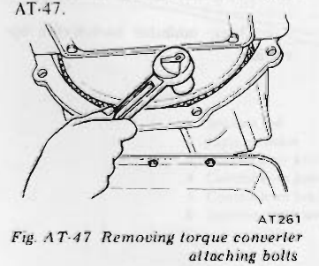
>
> - **Summary:** Technician using a wrench through the lower converter housing access opening to remove the torque converter-to-drive plate attaching bolts.
> - **Components:** Torque converter, Drive plate, Converter housing, Attaching bolts, Wrench
> - **Mechanic Notes:** Scribe match marks on torque converter and drive plate before removal so they can be replaced in original orientation.
> - **Tags:** `torque converter`, `drive plate bolts`, `removal procedure`, `match marks`

*Note: Before removing torque converter, scribe match marks on two parts so that they may be replaced in their original positions at assembly.*

14. Remove rear engine mount securing bolts and crossmember mounting bolts.
15. Remove starter motor.
16. Remove bolts securing transmission to engine. After removing these bolts, support engine and transmission with jack, and lower the jack gradually until transmission can be removed and take out transmission under the car.

*Note: Plug up the opening such as oil charging pipe, oil cooler tubes, etc.*

> [!CAUTION]
> Take care in dismounting transmission not to strike any adjacent parts.

### INSTALLATION

Installation of automatic transmission on car is reverse order of removal. However, observe the following installation notes.

1. Drive plate runout
Turn crankshaft one full turn and measure drive plate runout with indicating finger of a dial gauge rested against plate. See Figure AT-48.
[Replace drive plate if in excess of 0.5 mm (0.020 in).]
- Maximum allowable runout: 0.3 mm (0.012 in)

> 🖼️ **Fig. AT-48 Measuring drive plate runout** `[AT268]` *(Type: `inspection_measurement`)*
>
> 
>
> - **Summary:** Dial gauge setup positioned against drive plate while turning crankshaft one full turn to measure drive plate runout.
> - **Components:** Drive plate, Dial gauge, Crankshaft
> - **Specs / Measurements:** Maximum allowable runout: 0.3 mm (0.012 in); Replace drive plate limit: > 0.5 mm (0.020 in)
> - **Mechanic Notes:** Rotate crankshaft one full turn to measure runout. Replace drive plate if runout exceeds 0.5 mm (0.020 in).
> - **Tags:** `drive plate runout`, `dial indicator`, `inspection`, `crankshaft`

2. Installation of torque converter
Line up notch in torque converter with that in oil pump. Be extremely careful not to cause undue stresses in parts in installing torque converter. See Figure AT-49. <!-- Page 34 (AT-34) --> > 🖼️ **Fig. AT-49 Torque converter aligning cut** `[AT116]` *(Type: `alignment_orientation`)*
>
> 
>
> - **Summary:** Detail view of the torque converter drive hub notch/aligning cut that engages the oil pump drive gear lugs.
> - **Components:** Torque converter hub, Aligning cut / notch
> - **Mechanic Notes:** Notch in torque converter hub must engage drive flats of oil pump drive gear without force.
> - **Tags:** `torque converter`, `aligning cut`, `oil pump drive`, `hub notch`

3. When connecting torque converter to transmission, measure distance "A" to be certain that they are correctly assembled. See Figure AT-50.
- Distance "A": More than 21.5 mm (0.846 in)

> 🖼️ **Fig. AT-50 Installing torque converter** `[AT117]` *(Type: `inspection_measurement`)*
>
> 
>
> - **Summary:** Sectional diagram showing measurement of distance 'A' from converter housing front face to converter mounting bolt boss face.
> - **Components:** Torque converter, Converter housing, Mounting boss
> - **Callouts:** **(A)** Distance from housing front face to converter bolt boss
> - **Specs / Measurements:** Distance 'A': More than 21.5 mm (0.846 in)
> - **Mechanic Notes:** Distance 'A' must exceed 21.5 mm (0.846 in) to confirm the torque converter is fully seated into the oil pump.
> - **Tags:** `torque converter installation`, `distance A`, `clearance check`, `engagement depth`

4. Bolt converter to drive plate.
*Note: Align chalk marks painted across both parts during disassembling processes.*
5. After converter is installed, rotate crankshaft several turns and check to be sure that transmission rotates freely without binding.
6. Pour recommended automatic transmission fluid up to correct level through oil charge pipe.
7. Connect manual lever to shift rod. Operation should be carried out with manual and selector levers in "N".
8. Connect inhibitor switch wires.
*Note:*
*a. Refer to covering topic under "Checking and adjusting inhibitor switch" on page AT-49.*
*b. Inspect and adjust switch as above whenever it has to be removed for service.*
9. Check inhibitor switch for operation:
Starter should be brought into operation only when selector lever is in "P" and "N" positions (it should not be started when lever is in "D", "2", "1" and "R" positions).
Back-up lamp should also light when selector lever is placed in "R" position.
10. Check level of oil in transmission. For detailed procedure, see page AT-48.
11. Move selector lever through all positions to be sure that transmission operates correctly.
With hand brake applied, rotate engine at idling. Without disturbing the above setting, move selector lever through "N" to "D", to "2", to "1" and to "R". A slight shock should be felt by hand gripping selector each time transmission is shifted.
*Note: See page AT-49 for checking engine idling.*
12. Check to be sure that line pressure is correct. To do this, refer to relative topic under "Testing line pressure" on page AT-52.
13. Perform stall test as per the instructions on page AT-50.

---

<!-- Page 35 (AT-35) -->
# SECTION AT - AUTOMATIC TRANSMISSION

## TRANSMISSION CONTROL LINKAGE

> 🖼️ **Fig. AT-51 Control linkage system**  *(Type: `exploded_view`)*
>
> 
>
> - **Summary:** Complete assembly diagram of the automatic transmission control linkage mechanism with shift gate patterns and tightening torque specifications for each connection point.
> - **Components:** Selector rod, Joint trunnion, Control lever knob, Control lever assembly, Control lever bracket, Selector range lever
> - **Callouts:** **(1)** Selector rod; **(2)** Joint trunnion; **(3)** Control lever knob; **(4)** Control lever assembly; **(5)** Control lever bracket; **(6)** Selector range lever; **(A)** Bolt and nut T: 3.0 to 4.0 kg-m (22 to 29 ft-lb); **(B)** Adjust nuts T: 0.8 to 1.1 kg-m (5.8 to 8.0 ft-lb); **(C)** Knob screws T: 0.2 to 0.25 kg-m (1.4 to 1.8 ft-lb); **(D)** Bracket nut T: 0.8 to 1.1 kg-m (5.8 to 8.0 ft-lb)
> - **Specs / Measurements:** Bolt and nut A: 3.0 to 4.0 kg-m (22 to 29 ft-lb); Adjust nuts B: 0.8 to 1.1 kg-m (5.8 to 8.0 ft-lb); Knob screws C: 0.2 to 0.25 kg-m (1.4 to 1.8 ft-lb); Bracket nut D: 0.8 to 1.1 kg-m (5.8 to 8.0 ft-lb)
> - **Mechanic Notes:** Set both control lever and selector range lever at N position when adjusting selector rod trunnion nuts.
> - **Tags:** `control linkage`, `selector rod`, `joint trunnion`, `gearshift linkage`, `torque specifications`, `adjustment`

### Tightening Torque of Bolts and Nuts
- Ⓐ T: 3.0 to 4.0 kg-m (22 to 29 ft-lb)
- Ⓑ T: 0.8 to 1.1 kg-m (5.8 to 8.0 ft-lb)
- Ⓒ T: 0.2 to 0.25 kg-m (1.4 to 1.8 ft-lb)
- Ⓓ T: 0.8 to 1.1 kg-m (5.8 to 8.0 ft-lb)

### REMOVAL AND INSTALLATION
1. Disconnect control knob from control lever by removing two(2) screws.
2. Remove console box.
3. Remove selector rod, selector range lever and control lever assembly with bracket.
To install, reverse the order of removal.

### ADJUSTMENT
The adjustment of linkage is as important as "Inspection of oil level" for the automatic transmission.
Therefore, great care should be exercised because faulty adjustment will result in the breakdown of the transmission.

1. Loosen adjust nuts Ⓑ. See Figure AT-51.
2. Set control lever ④ and selector range lever ⑥ at "N" position. See Figure AT-51.
3. Set selector rod ① to trunnion ② by turning in or out adjust nuts. See Figure AT-51.

After adjusting, make sure that control lever can be set in any position correctly and that selector lever operates properly without any binding.
If levers do not operate satisfactorily, readjust or replace parts as necessary.

---

<!-- Page 36 (AT-36) -->
# SECTION AT - AUTOMATIC TRANSMISSION

# MAJOR REPAIR OPERATION

### CONTENTS

| Section | Page |
| :--- | :--- |
| SERVICE NOTICE FOR DISASSEMBLY AND ASSEMBLY | AT-36 |
| TORQUE CONVERTER INSPECTION | AT-36 |
| TRANSMISSION DISASSEMBLY | AT-36 |
| TRANSMISSION INSPECTION | AT-38 |
| TRANSMISSION ASSEMBLY | AT-38 |
| COMPONENT PARTS | AT-40 |
| FRONT CLUTCH | AT-40 |
| REAR CLUTCH | AT-41 |
| LOW & REVERSE BRAKE | AT-42 |
| SERVO PISTON | AT-42 |
| GOVERNOR | AT-43 |
| OIL PUMP | AT-43 |
| PLANETARY CARRIER | AT-44 |
| CONTROL VALVE | AT-44 |

## SERVICE NOTICE FOR DISASSEMBLY AND ASSEMBLY
1. It is advisable that repair operations be carried out in a dust-proof room.
2. Due to the differences of the engine capacities, the specifications of component parts for each model's transmission may be different. They do, however, have common adjustment and repair procedures as well as cleaning and inspection procedures, outlined hereinafter.
3. During repair operations, refer to "Service Data and Specifications" section for the correct parts for each model.
4. Before removing any of subassemblies, thoroughly clean the outside of the transmission to prevent dirt from entering the mechanical parts.
5. Do not use a waste rag. Use a nylon or paper cloth.
6. After disassembling, wash all disassembled parts, and examine them to see if there are any worn, damaged or defective parts, and how they are affected. Refer to "Service Data" for the extent of damage that justifies replacement.
7. As a rule, packings, seals and similar parts once disassembled should be replaced with new ones.

## TORQUE CONVERTER
The torque converter is a welded construction and can not be disassembled.

### INSPECTION
1. Check torque converter for any sign of damage, bending, oil leak or deformation. If necessary, replace.
2. Remove rust from pilots and bosses completely.

If torque converter oil is fouled or contaminated due to burnt clutch, flush the torque converter as follows:
(1) Drain oil in torque converter.
(2) Pour non-lead gasoline or kerosene into torque converter [approximately 0.5 liter (1 1/8 U.S. pt., 7/8 Imp. pt.)].
(3) Blow air into torque converter and flush and drain out gasoline.
(4) Fill torque converter with torque converter oil [approximately 0.5 liter (1 1/8 U.S. pt., 7/8 Imp. pt.)].
(5) Again blow air into torque converter, and drain torque converter oil.

## TRANSMISSION

### DISASSEMBLY
1. Drain oil from the end of rear extension. Mount transmission on Transmission Case Stand ST07870000 or ST07860000. Remove oil pan. See Figure AT-52.

> 🖼️ **Fig. AT-52 Removing oil pan** `[AT118]` *(Type: `procedure_step`)*
>
> 
>
> - **Summary:** Removing oil pan bolts while transmission is mounted on Transmission Case Stand ST07860000.
> - **Components:** Transmission case stand ST07860000, Oil pan, Transmission case
> - **Callouts:** **(ST07860000)** Transmission case stand
> - **Specs / Measurements:** Special tool: ST07860000 / ST07870000
> - **Mechanic Notes:** Mount transmission on Transmission Case Stand ST07870000 or ST07860000 before removing oil pan.
> - **Tags:** `oil pan removal`, `case stand`, `transmission disassembly`

2. Remove bolts securing converter housing to transmission case. Remove torque converter.
3. Remove speedometer pinion sleeve bolt. Withdraw pinion.
4. Remove downshift solenoid and vacuum diaphragm. Do not leave diaphragm rod at this stage of disassembly. Rod is assembled in top of vacuum diaphragm. See Figure AT-53.

> 🖼️ **Fig. AT-53 Downshift solenoid and vacuum diaphragm** `[AT119]` *(Type: `component_location`)*
>
> 
>
> - **Summary:** External view of transmission case showing location and removal of downshift solenoid and vacuum diaphragm.
> - **Components:** Downshift solenoid, Vacuum diaphragm, Diaphragm rod
> - **Mechanic Notes:** Do not leave diaphragm rod inside transmission case; rod is assembled in top of vacuum diaphragm.
> - **Tags:** `downshift solenoid`, `vacuum diaphragm`, `diaphragm rod`, `disassembly`

5. Remove bolts which hold valve body to transmission case. See Figure AT-54.

> 🖼️ **Fig. AT-54 Removing valve body** `[AT120]` *(Type: `procedure_step`)*
>
> 
>
> - **Summary:** Underside view of transmission case with oil pan removed showing removal of bolts holding control valve body.
> - **Components:** Control valve body, Transmission case, Securing bolts
> - **Mechanic Notes:** Remove bolts holding control valve body to transmission case.
> - **Tags:** `control valve body`, `valve body removal`

6. Loosen lock nut ② on piston stem ① as shown in Figure AT-55. Then tighten piston stem in order to prevent front clutch drum from falling when oil pump is withdrawn.

---

<!-- Page 37 (AT-37) -->
# SECTION AT - AUTOMATIC TRANSMISSION

## TRANSMISSION DISASSEMBLY (CONTINUED)

> 🖼️ **Fig. AT-55 Loosening band servo** `[AT121]` *(Type: `procedure_step`)*
>
> 
>
> - **Summary:** Technician using wrench to loosen lock nut and adjust piston stem on band servo.
> - **Components:** Piston stem, Lock nut, Band servo
> - **Callouts:** **(1)** Piston stem; **(2)** Lock nut
> - **Mechanic Notes:** Tighten piston stem to hold front clutch drum before withdrawing oil pump; then loosen to remove band strut.
> - **Tags:** `band servo`, `piston stem`, `lock nut`, `loosening`

7. Pull out input shaft.
8. Withdraw oil pump using Sliding Hammer ST25850000. Do not allow front clutch to come out of position and drop onto floor. See Figure AT-56.

> 🖼️ **Fig. AT-56 Removing oil pump** `[AT122]` *(Type: `procedure_step`)*
>
> 
>
> - **Summary:** Withdrawing oil pump from front of transmission case using Sliding Hammer ST25850000.
> - **Components:** Oil pump, Transmission case, Sliding hammer ST25850000
> - **Callouts:** **(ST25850000)** Sliding hammer
> - **Specs / Measurements:** Special tool: ST25850000
> - **Mechanic Notes:** Do not allow front clutch to slip out of position and drop onto floor when oil pump is withdrawn.
> - **Tags:** `oil pump removal`, `sliding hammer`, `ST25850000`

9. Remove band strut. This can be done by loosening piston stem further. See Figure AT-57.

> 🖼️ **Fig. AT-57 Removing band strut** `[AT123]` *(Type: `procedure_step`)*
>
> 
>
> - **Summary:** Front view of transmission case interior showing removal of band strut after loosening band servo stem.
> - **Components:** Band strut, Brake band, Band servo stem
> - **Mechanic Notes:** Remove band strut by loosening piston stem further.
> - **Tags:** `band strut`, `brake band`, `removal`

10. Remove brake band, front clutch and rear clutch as an assembled unit.
11. Remove connecting shell, rear clutch hub and front planetary carrier as a unit. See Figure AT-58.

> 🖼️ **Fig. AT-58 Removing connecting shell** `[AT124]` *(Type: `procedure_step`)*
>
> 
>
> - **Summary:** Removing connecting shell, rear clutch hub, and front planetary carrier as an assembled unit.
> - **Components:** Connecting shell, Rear clutch hub, Front planetary carrier
> - **Mechanic Notes:** Remove connecting shell, rear clutch hub, and front planetary carrier as a unit.
> - **Tags:** `connecting shell`, `rear clutch hub`, `planetary carrier`

12. With the aid of Snap Ring Remover HT69860000, pry snap ring off output shaft. See Figure AT-59.

> 🖼️ **Fig. AT-59 Removing snap ring** `[AT125]` *(Type: `procedure_step`)*
>
> 
>
> - **Summary:** Prying snap ring off the output shaft using Snap Ring Remover HT69860000.
> - **Components:** Output shaft, Snap ring, Snap ring remover HT69860000
> - **Callouts:** **(HT69860000)** Snap ring remover
> - **Specs / Measurements:** Special tool: HT69860000
> - **Mechanic Notes:** Use Snap Ring Remover HT69860000 to pry snap ring off output shaft.
> - **Tags:** `snap ring removal`, `output shaft`, `HT69860000`

13. Remove connecting drum and inner gear of rear planetary carrier as an assembly. See Figure AT-60.

> 🖼️ **Fig. AT-60 Removing connecting drum** `[AT126]` *(Type: `procedure_step`)*
>
> 
>
> - **Summary:** Withdrawing connecting drum and internal gear of rear planetary carrier as an assembly.
> - **Components:** Connecting drum, Rear planetary carrier internal gear
> - **Mechanic Notes:** Remove connecting drum and inner gear of rear planetary carrier as an assembly.
> - **Tags:** `connecting drum`, `rear planetary carrier`, `internal gear`

14. Remove snap rings and then remove rear planetary carrier, internal gear, connecting drum, one-way clutch outer race and one-way clutch in that order.
15. Remove rear extension by loosening securing bolts. See Figure AT-61.

> 🖼️ **Fig. AT-61 Removing rear extension** `[AT127]` *(Type: `procedure_step`)*
>
> 
>
> - **Summary:** Removing rear extension housing from transmission case by loosening securing bolts.
> - **Components:** Rear extension, Transmission case, Securing bolts
> - **Mechanic Notes:** Loosen securing bolts and withdraw rear extension housing.
> - **Tags:** `rear extension`, `housing removal`, `securing bolts`

16. Pull out output shaft; remove oil distributor ② together with governor valve ①. See Figure AT-62.

> 🖼️ **Fig. AT-62 Removing governor and oil distributor** `[AT128]` *(Type: `procedure_step`)*
>
> 
>
> - **Summary:** Pulling out output shaft and removing oil distributor together with governor valve assembly.
> - **Components:** Output shaft, Oil distributor, Governor valve
> - **Callouts:** **(1)** Governor valve; **(2)** Oil distributor
> - **Mechanic Notes:** Pull out output shaft; remove oil distributor ② together with governor valve ①.
> - **Tags:** `governor valve`, `oil distributor`, `output shaft removal`

17. Pry off snap ring using a pair of pliers. Remove retaining plate, drive plate, driven plate and dish plate in that order. See Figure AT-63.

> 🖼️ **Fig. AT-63 Removing drive and driven plates** `[AT129]` *(Type: `procedure_step`)*
>
> 
>
> - **Summary:** Removing low and reverse brake retaining plate, drive plate, driven plate, and dish plate from transmission case after prying off snap ring.
> - **Components:** Snap ring, Retaining plate, Drive plate, Driven plate, Dish plate
> - **Mechanic Notes:** Pry off snap ring using pliers. Remove retaining plate, drive plate, driven plate and dish plate in that order.
> - **Tags:** `low and reverse brake`, `clutch plates`, `snap ring`, `drive plate`

18. Reaching through back side of transmission case, remove hex-head slotted bolts as shown in Figure AT-64. To do this, use Hex-head Extension ST25570001 (ST25570000). One-way clutch inner race, thrust washer, piston return spring and thrust spring ring can now be removed.

---

<!-- Page 38 (AT-38) -->
# SECTION AT - AUTOMATIC TRANSMISSION

## TRANSMISSION DISASSEMBLY (CONTINUED)

> 🖼️ **Fig. AT-64 Removing hex-head slotted bolt** `[AT130]` *(Type: `procedure_step`)*
>
> 
>
> - **Summary:** Using Hex-head Extension ST25570001 to reach through back side of transmission case and remove hex-head slotted bolts.
> - **Components:** Hex-head slotted bolt, Hex-head extension ST25570001, Transmission case
> - **Callouts:** **(ST25570001)** Hex-head extension
> - **Specs / Measurements:** Special tool: ST25570001 (ST25570000)
> - **Mechanic Notes:** Reach through back side of transmission case with special extension ST25570001 to remove slotted bolts.
> - **Tags:** `hex-head slotted bolt`, `ST25570001`, `disassembly`

19. Blow out low and reverse brake piston by directing a jet of air into hole in cylinder. See Figure AT-65.

> 🖼️ **Fig. AT-65 Removing piston** `[AT131]` *(Type: `procedure_step`)*
>
> 
>
> - **Summary:** Applying compressed air into hole in cylinder to blow out low and reverse brake piston.
> - **Components:** Low and reverse brake piston, Transmission case cylinder, Air nozzle
> - **Mechanic Notes:** Blow out low and reverse brake piston by directing a jet of air into hole in cylinder.
> - **Tags:** `low and reverse brake`, `piston removal`, `compressed air`

20. Remove band servo loosening attaching bolts.
*Note: If difficulty is encountered in removing retainer, direct a jet of air toward release side as shown in Figure AT-66.*

> 🖼️ **Fig. AT-66 Removing band servo** `[AT132]` *(Type: `procedure_step`)*
>
> 
>
> - **Summary:** Directing a jet of air toward release side of band servo to assist in removing retainer.
> - **Components:** Band servo, Servo retainer, Air nozzle
> - **Mechanic Notes:** Direct a jet of air toward release side if difficulty is encountered in removing band servo retainer.
> - **Tags:** `band servo`, `retainer removal`, `compressed air`

21. Pry snap rings ① from both ends of parking brake lever ② and remove the lever. Back off manual shaft lock nut ③ and remove manual plate ④ and parking rod ⑤. See Figure AT-67.

> 🖼️ **Fig. AT-67 Removing manual plate** `[AT133]` *(Type: `procedure_step`)*
>
> 
>
> - **Summary:** Interior view of linkage components on manual shaft showing parking brake lever, manual plate, and parking rod.
> - **Components:** Parking brake lever, Manual plate, Manual shaft, Parking rod, Lock nut, Snap rings
> - **Callouts:** **(1)** Snap ring; **(2)** Parking brake lever; **(3)** Manual shaft lock nut; **(4)** Manual plate; **(5)** Parking rod
> - **Mechanic Notes:** Pry snap rings from ends of parking lever, back off lock nut, and remove manual plate and parking rod.
> - **Tags:** `manual plate`, `parking brake lever`, `parking rod`, `manual shaft`

22. Remove inhibitor switch and manual shaft by loosening two securing bolts.

## INSPECTION

### Torque converter housing, transmission case and rear extension
1. Check for damage or cracking; if necessary, replace.
2. Check for dents or score marks on mating surfaces. Repair as necessary.
3. If rear extension bushing is worn or cracked, replace it as an assembly of bushing and rear extension housing.

### Gaskets and O-ring
1. Always use new gaskets when the units are to be disassembled.
2. Check O-rings for burrs or cracking. If necessary, replace with new rings.

### Oil distributor
1. Check for signs of wear on seal ring and ring groove, replacing with new ones if found worn beyond use.
2. Check that clearance between seal ring and ring groove is correct. If out of specification, replace whichever is worn beyond limits. Correct clearance is from 0.04 to 0.16 mm (0.0016 to 0.0063 in). See Figure AT-68.

> 🖼️ **Fig. AT-68 Measuring seal ring to ring groove clearance** `[AT134]` *(Type: `inspection_measurement`)*
>
> 
>
> - **Summary:** Cross-sectional inspection diagram showing feeler gauge measurement between seal ring and groove in oil distributor.
> - **Components:** Oil distributor, Seal ring, Ring groove, Feeler gauge
> - **Specs / Measurements:** Clearance: 0.04 to 0.16 mm (0.0016 to 0.0063 in)
> - **Mechanic Notes:** Correct clearance between seal ring and ring groove is 0.04 to 0.16 mm (0.0016 to 0.0063 in). Replace if worn beyond limits.
> - **Tags:** `oil distributor`, `seal ring`, `ring groove clearance`, `inspection`

## ASSEMBLY
Assembly is in reverse order of disassembly. However, observe the following assembly notes.

1. After installing piston of low and reverse brake, assemble thrust spring ring, return spring, thrust washer and one-way clutch inner race. Torque hex-head slotted bolt to 1.3 to 1.8 kg-m (9 to 13 ft-lb), using Hex-head Extension ST25570001 (ST25570000), Torque Wrench GG91060000 and Socket Extension ST25490000 (ST25512001). See Figure AT-69.

> 🖼️ **Fig. AT-69 Installing one-way clutch inner race** `[AT135]` *(Type: `procedure_step`)*
>
> 
>
> - **Summary:** Torquing hex-head slotted bolt for one-way clutch inner race using special hex extension ST25570001 and torque wrench GG91060000.
> - **Components:** One-way clutch inner race, Hex-head slotted bolt, Hex-head extension ST25570001, Socket extension ST25490000, Torque wrench GG91060000
> - **Callouts:** **(ST25570001)** Hex-head extension; **(ST25490000)** Socket extension; **(GG91060000)** Torque wrench
> - **Specs / Measurements:** Tightening torque: 1.3 to 1.8 kg-m (9 to 13 ft-lb)
> - **Mechanic Notes:** Torque hex-head slotted bolt to 1.3 to 1.8 kg-m (9 to 13 ft-lb) using special extension and torque wrench.
> - **Tags:** `one-way clutch inner race`, `slotted bolt`, `tightening torque`, `special tools`

2. After low and reverse brake has been assembled, measure the clearance between snap ring ① and retaining plate ②. Select proper thickness of retaining plate to give correct ring to plate clearance. See Figure AT-70.
- Low and reverse brake clearance: 0.80 to 1.25 mm (0.031 to 0.049 in) <!-- Page 39 (AT-39) --> > 🖼️ **Fig. AT-70 Measuring ring to plate clearance** `[AT136]` *(Type: `inspection_measurement`)*
>
> 
>
> - **Summary:** Feeler gauge measuring clearance between snap ring ① and retaining plate ② in low and reverse brake.
> - **Components:** Snap ring, Retaining plate, Feeler gauge
> - **Callouts:** **(1)** Snap ring; **(2)** Retaining plate
> - **Specs / Measurements:** Low and reverse brake clearance: 0.80 to 1.25 mm (0.031 to 0.049 in)
> - **Mechanic Notes:** Measure clearance between snap ring and retaining plate; select appropriate retaining plate thickness.
> - **Tags:** `retaining plate clearance`, `low and reverse brake`, `feeler gauge`

### Available retaining plate

| No. | Thickness mm (in) |
| :--- | :--- |
| 1 | 7.8 (0.307) |
| 2 | 8.0 (0.315) |
| 3 | 8.2 (0.323) |
| 4 | 8.4 (0.331) |
| 5 | 8.6 (0.339) |
| 6 | 8.8 (0.346) |

For inspection procedure for low and reverse brake, see page AT-42 for Assembly.

3. Install one-way clutch so that the arrow mark "→" is toward front of vehicle. It should be free to rotate only in clockwise direction. See Figure AT-71.

> 🖼️ **Fig. AT-71 One-way clutch** `[AT137]` *(Type: `alignment_orientation`)*
>
> 
>
> - **Summary:** Perspective view of one-way clutch assembly showing orientation arrow mark on outer cage.
> - **Components:** One-way clutch assembly, Rollers, Cage
> - **Mechanic Notes:** Install one-way clutch so arrow mark '→' points toward front of vehicle; must rotate freely clockwise only.
> - **Tags:** `one-way clutch`, `installation orientation`, `arrow mark`, `clockwise rotation`

4. After installing rear extension, torque attaching bolts to 2.0 to 2.5 kg-m (14 to 18 ft-lb). Place manual lever in "P" range and check to be sure that rear output shaft is securely blocked.
5. Tighten servo retainer temporarily at this stage of assembly.
6. Place rear clutch assembly with needle bearing on front assembly.
7. Install rear clutch hub and front planetary carrier as shown in Figure AT-72.

> 🖼️ **Fig. AT-72 Installing planetary carrier** `[AT142]` *(Type: `procedure_step`)*
>
> 
>
> - **Summary:** Technician lowering rear clutch hub and front planetary carrier into position.
> - **Components:** Front planetary carrier, Rear clutch hub
> - **Mechanic Notes:** Install rear clutch hub and front planetary carrier carefully into place.
> - **Tags:** `planetary carrier`, `rear clutch hub`, `installation`

8. Assemble connecting shell and other parts up to front clutch in reverse order of disassembly.

> 🖼️ **Fig. AT-73 Installing connecting shell** `[AT143]` *(Type: `procedure_step`)*
>
> 
>
> - **Summary:** Technician installing connecting shell over planetary gearing components.
> - **Components:** Connecting shell, Sun gear
> - **Mechanic Notes:** Assemble connecting shell and parts up to front clutch in reverse order of disassembly.
> - **Tags:** `connecting shell`, `assembly`, `front clutch`

9. Adjust total end play and front end play as follows:

> 🖼️ **Fig. AT-74 End play** `[AT138]` *(Type: `cutaway_flow`)*
>
> 
>
> - **Summary:** Cross-sectional reference diagram illustrating front end play and total end play measurement locations.
> - **Components:** Front clutch thrust washer, Oil pump cover, Front clutch, Rear clutch, Transmission case, Oil pump gasket, Oil pump cover bearing race
> - **Callouts:** **(1)** Front clutch thrust washer; **(2)** Oil pump cover; **(3)** Front clutch; **(4)** Rear clutch; **(5)** Transmission case; **(6)** Oil pump gasket; **(7)** Oil pump cover bearing race
> - **Specs / Measurements:** Total end play: 0.25 to 0.50 mm (0.010 to 0.020 in); Front end play: 0.5 to 0.8 mm (0.020 to 0.031 in)
> - **Mechanic Notes:** Diagram showing relationships between thrust washer 1, bearing race 7, oil pump gasket 6, and cases for total and front end play adjustments.
> - **Tags:** `end play`, `thrust washer`, `bearing race`, `cross-section`

(1) Measure the distance "A" and "C" by vernier calipers as shown in Figure AT-75.

> 🖼️ **Fig. AT-75 Measuring the distance "A" and "C"** `[AT139]` *(Type: `inspection_measurement`)*
>
> 
>
> - **Summary:** Sectional diagram showing vernier caliper depth measurement of distances A (to bearing race surface) and C (to thrust washer surface) inside transmission case.
> - **Components:** Transmission case, Needle bearing, Bearing race, Rear clutch
> - **Mechanic Notes:** Measure distance A and C using vernier calipers from front face of transmission case.
> - **Tags:** `measurement A and C`, `vernier calipers`, `end play inspection`

(2) Measure the distance "B" and "D" of oil pump cover as shown in Figure AT-76.

> 🖼️ **Fig. AT-76 Measuring the distance "B" and "D"** `[AT140]` *(Type: `inspection_measurement`)*
>
> 
>
> - **Summary:** Sectional diagram showing vernier caliper measurement of distances B and D on oil pump cover.
> - **Components:** Oil pump cover
> - **Mechanic Notes:** Measure distance B and D on oil pump cover from mounting flange face.
> - **Tags:** `measurement B and D`, `oil pump cover`, `end play measurement`

### Adjustment of total end play
Select oil pump cover bearing race by calculating the following formula:

$$T_T = A - B + W$$

where,
- $T_T$: Required thickness of oil pump cover bearing race mm (in)
- $A$: Measured distance A mm (in)
- $B$: Measured distance B mm (in)
- $W$: Thickness of bearing race temporarily inserted mm (in)

### Available oil pump cover bearing race

| Thickness mm (in) |
| :--- |
| 1.2 (0.047) |
| 1.4 (0.055) |
| 1.6 (0.063) |
| 1.8 (0.071) |
| 2.0 (0.079) |
| 2.2 (0.087) |

- Specified total end play: 0.25 to 0.50 mm (0.010 to 0.020 in) <!-- Page 40 (AT-40) --> ### Adjustment of front end play
Select front clutch thrust washer by calculating the following formula:

$$T_F = C - D - 0.2\text{ (mm)}$$

where,
- $T_F$: Required thickness of front clutch thrust washer mm (in)
- $C$: Measured distance C mm (in)
- $D$: Measured distance D mm (in)

### Available front clutch thrust washer

| Thickness mm (in) |
| :--- |
| 1.5 (0.059) |
| 1.7 (0.067) |
| 1.9 (0.075) |
| 2.1 (0.083) |
| 2.3 (0.091) |
| 2.5 (0.098) |
| 2.7 (0.106) |

- Specified front end play: 0.5 to 0.8 mm (0.020 to 0.031 in)

*Note:*
*a. Correct thickness of bearing race and thrust washer is always the one which is nearest the calculated one.*
*b. Installed thickness of oil pump gasket is 0.4 mm (0.016 in).*

10. Check to be sure that brake servo piston moves freely. For detailed procedure, refer to page AT-42 for Servo Piston. Use care to prevent piston from coming out of place during testing since servo retainer is not tightened at this point of assembly.
11. Make sure that brake band strut is correctly installed. Torque piston stem to 1.2 to 1.5 kg-m (9 to 11 ft-lb); Back off two full turns and secure with lock nut. Lock nut tightening torque is 1.5 to 4.0 kg-m (11 to 29 ft-lb).
12. After inhibitor switch is installed, check to be sure that it operates properly in each range. For detailed procedure, refer to page AT-49 for Checking and Adjusting Inhibitor Switch.
13. Check the length "L" between case end to rod end of vacuum throttle valve fully pushed in. Then select adequate diaphragm rod of corresponding measured length. See Figure AT-77.

> 🖼️ **Fig. AT-77 Measuring the distance "L"** `[AT145]` *(Type: `inspection_measurement`)*
>
> 
>
> - **Summary:** Cross-sectional diagram illustrating measurement of distance 'L' from transmission case end to vacuum throttle valve rod end with valve fully depressed.
> - **Components:** Vacuum throttle valve, Transmission case, Diaphragm rod
> - **Callouts:** **(L)** Distance from case end to pushed-in valve rod end
> - **Specs / Measurements:** Measured distance L used to select diaphragm rod length (29.0 to 31.0 mm)
> - **Mechanic Notes:** Push vacuum throttle valve fully in, measure length L, and select diaphragm rod corresponding to table.
> - **Tags:** `vacuum throttle valve`, `distance L`, `diaphragm rod length`, `inspection`

### Available diaphragm rod

| Distance measured "L" mm (in) | Diaphragm rod length mm (in) |
| :--- | :--- |
| Under 25.55 (1.0059) | 29.0 (1.142) |
| 25.65 to 26.05 (1.0098 to 1.0256) | 29.5 (1.161) |
| 26.15 to 26.55 (1.0295 to 1.0453) | 30.0 (1.181) |
| 26.65 to 27.05 (1.0492 to 1.0650) | 30.5 (1.201) |
| Over 27.15 (1.0689) | 31.0 (1.220) |

# COMPONENT PARTS
The transmission consists of many small parts that are quite alike in construction yet machined to very close tolerances. When disassembling parts, be sure to place them in order in part rack so they can be restored in the unit in their proper positions. It is also very important to perform functional test whenever it is designated.

## FRONT CLUTCH

### Disassembly

> 🖼️ **Fig. AT-78 Sectional view of front clutch** `[AT146]` *(Type: `exploded_view`)*
>
> 
>
> - **Summary:** Sectional view of front clutch assembly showing arrangement of piston, return springs, dished plate, driven plates, drive plates, retaining plate, and snap rings.
> - **Components:** Piston, Coil spring, Front clutch drum, Dished plate, Driven plate, Retaining plate, Snap ring, Drive plate, Spring retainer
> - **Callouts:** **(1)** Piston; **(2)** Coil spring; **(3)** Front clutch drum; **(4)** Dished plate; **(5)** Driven plate; **(6)** Retaining plate; **(7)** Snap ring; **(8)** Drive plate; **(9)** Spring retainer
> - **Mechanic Notes:** Pay close attention to stacking sequence of plates: dished plate first, followed by alternating driven and drive plates, then retaining plate and snap ring.
> - **Tags:** `front clutch`, `sectional view`, `clutch drum`, `clutch pack`

1. Pry off snap ring ⑦ with a suitable screwdriver or a pair of pliers. Remove a retaining plate ⑥, drive plate ⑧, driven plate ⑤ and dished plate ④ in the order listed, as shown in Figure AT-78.
2. Compress clutch springs, using Clutch Spring Compressor ST25420001 (or ST25420000). Remove snap ring ⑦ from spring retainer, using Snap Ring Remover ST25320001. See Figure AT-79.

> 🖼️ **Fig. AT-79 Removing snap ring** `[AT147]` *(Type: `procedure_step`)*
>
> 
>
> - **Summary:** Using Clutch Spring Compressor ST25420001 to compress springs and Snap Ring Remover ST25320001 to remove snap ring from front clutch spring retainer.
> - **Components:** Clutch spring compressor ST25420001, Snap ring remover ST25320001, Spring retainer, Snap ring
> - **Callouts:** **(ST25420001)** Clutch spring compressor; **(ST25320001)** Snap ring remover
> - **Specs / Measurements:** Special tools: ST25420001, ST25320001
> - **Mechanic Notes:** Compress return springs evenly with compressor tool before removing snap ring.
> - **Tags:** `clutch spring compressor`, `snap ring remover`, `front clutch`, `ST25420001`

*Note: When Clutch Spring Compressor ST25420000 is to be used, cut the toe-tips of three legs by a grinding wheel. See Figure AT-80.* <!-- Page 41 (AT-41) --> > 🖼️ **Fig. AT-80 Modifying coil spring compressor** `[AT148]` *(Type: `special_service_tool`)*
>
> 
>
> - **Summary:** Dimensional modification diagram showing where to grind off hatched portion (1.5 mm deep by 20 mm wide) on legs of Clutch Spring Compressor ST25420000.
> - **Components:** Clutch spring compressor leg
> - **Specs / Measurements:** Cut off hatched portion: 1.5 mm (0.059 in) by 20 mm (0.079 in)
> - **Mechanic Notes:** When using older compressor ST25420000, grind 1.5 mm x 20 mm off toe-tips of three legs to clear clutch drum.
> - **Tags:** `spring compressor modification`, `ST25420000`, `tool modification`

3. Take out spring retainer ⑨ and spring ②. See Figure AT-78.
4. Blow out piston by directing a jet of air into hole in clutch drum. See Figure AT-81.

> 🖼️ **Fig. AT-81 Blowing out piston** `[AT149]` *(Type: `procedure_step`)*
>
> 
>
> - **Summary:** Technician using compressed air jet directed into front clutch drum oil hole to blow out piston.
> - **Components:** Front clutch drum, Front clutch piston, Air nozzle
> - **Mechanic Notes:** Hold a shop rag over drum opening when blowing air to catch piston safely.
> - **Tags:** `front clutch`, `piston blowout`, `compressed air`

### Inspection
1. Check for signs of wear or damage to clutch drive plate facing. If found worn or damaged excessively, discard.
- Drive plate thickness: Standard 1.5 to 1.65 mm (0.059 to 0.065 in); Allowable limit 1.4 mm (0.055 in)
2. Check for wear on snap ring and for weakened or broken coil spring. If necessary, replace with new ones. Spring retainer should also be inspected for warpage.

### Assembly
1. Assembly is in reverse the order of disassembly. Dip all parts in clean automatic transmission fluid before installing.

> 🖼️ **Fig. AT-82 Inserting clutch plate** `[AT150]` *(Type: `procedure_step`)*
>
> 
>
> - **Summary:** Technician carefully inserting lined drive plates and steel driven plates into front clutch drum.
> - **Components:** Clutch plates, Front clutch drum
> - **Mechanic Notes:** Dip all clutch plates in clean ATF prior to installation in drum.
> - **Tags:** `clutch plate installation`, `front clutch assembly`, `drive plate`

2. After clutch is assembled, make sure that clearance between snap ring ① and retaining plate ② is held within specified limits. If necessary, try with other retaining plate having different thickness until correct clearance is obtained. See Figure AT-83.
- Specified clearance: 1.6 to 2.0 mm (0.063 to 0.079 in)

### Available retaining plate

| Thickness mm (in) |
| :--- |
| 10.6 (0.417) |
| 10.8 (0.425) |
| 11.0 (0.433) |
| 11.2 (0.441) |
| 11.4 (0.449) |
| 11.6 (0.457) |

> 🖼️ **Fig. AT-83 Measuring ring to plate clearance** `[AT151]` *(Type: `inspection_measurement`)*
>
> 
>
> - **Summary:** Feeler gauge measuring clearance between snap ring ① and retaining plate ② in front clutch drum.
> - **Components:** Snap ring, Retaining plate, Feeler gauge, Front clutch drum
> - **Callouts:** **(1)** Snap ring; **(2)** Retaining plate
> - **Specs / Measurements:** Specified clearance: 1.6 to 2.0 mm (0.063 to 0.079 in)
> - **Mechanic Notes:** Measure clearance with feeler gauge; select from 6 available retaining plates to obtain 1.6 to 2.0 mm clearance.
> - **Tags:** `front clutch clearance`, `retaining plate`, `snap ring`, `feeler gauge`

3. Testing front clutch
With front clutch assembled on oil pump cover, direct a jet of air into hole in clutch drum for definite clutch operation. See Figure AT-84.

> 🖼️ **Fig. AT-84 Testing front clutch** `[AT152]` *(Type: `inspection_measurement`)*
>
> 
>
> - **Summary:** Functional air check of front clutch mounted on oil pump cover by applying compressed air into oil hole.
> - **Components:** Front clutch assembly, Oil pump cover, Air nozzle
> - **Mechanic Notes:** With clutch mounted on oil pump cover, direct air jet into clutch oil hole to verify positive piston engagement.
> - **Tags:** `front clutch test`, `air test`, `functional check`

## REAR CLUTCH

### Disassembly

> 🖼️ **Fig. AT-85 Sectional view of rear clutch** `[AT313]` *(Type: `exploded_view`)*
>
> 
>
> - **Summary:** Sectional view of rear clutch assembly showing arrangement of rear clutch drum, piston, dished plate, return springs, retainer, plates, and snap rings.
> - **Components:** Rear clutch drum, Piston, Dished plate, Coil spring, Retaining plate, Snap ring, Spring retainer, Drive plate, Driven plate
> - **Callouts:** **(1)** Rear clutch drum; **(2)** Piston; **(3)** Dished plate; **(4)** Coil spring; **(5)** Retaining plate; **(6)** Snap ring; **(7)** Spring retainer; **(8)** Drive plate; **(9)** Driven plate
> - **Mechanic Notes:** Notice correct orientation of dish plate and stack sequence of drive and driven plates.
> - **Tags:** `rear clutch`, `sectional view`, `clutch drum`, `clutch pack`

1. Take out snap ring ⑥, retaining plate ⑤, drive plate ⑧, driven plate ⑨ and dished plate ③. Same technique can be applied as in disassembling front clutch. See Figure AT-85.
2. Remove snap ring from coil spring retainer. See Figure AT-86.

> 🖼️ **Fig. AT-86 Removing snap ring**  *(Type: `procedure_step`)*
>
> 
>
> - **Summary:** Compressing coil spring retainer with tool ST25420001 and removing snap ring with tool ST25320001 from rear clutch drum.
> - **Components:** Spring compressor ST25420001, Snap ring remover ST25320001, Rear clutch drum, Snap ring
> - **Callouts:** **(ST25420001)** Spring compressor; **(ST25320001)** Snap ring remover
> - **Specs / Measurements:** Special tools: ST25420001, ST25320001
> - **Mechanic Notes:** Compress coil springs evenly to release tension from snap ring before prying out.
> - **Tags:** `rear clutch`, `snap ring removal`, `ST25420001`, `spring compressor` <!-- Page 42 (AT-42) --> 3. Blow out piston by directing a jet of air into hole in clutch drum. See Figure AT-87.

> 🖼️ **Fig. AT-87 Blowing out piston** `[AT155]` *(Type: `procedure_step`)*
>
> 
>
> - **Summary:** Applying compressed air into rear clutch drum oil passage to dislodge and remove piston.
> - **Components:** Rear clutch drum, Rear clutch piston, Air nozzle
> - **Mechanic Notes:** Direct a jet of compressed air into oil hole in clutch drum while holding piston with a cloth.
> - **Tags:** `rear clutch`, `piston removal`, `compressed air`

### Inspection
Refer to page AT-41 for Inspection of Front Clutch.

### Assembly
Assemble in reverse the order of disassembly. Dip all parts in clean automatic transmission fluid before assembling. Note that the number of drive and driven plates varies with type of vehicle. For details, refer to "Service Data & Specifications".

1. After rear clutch is assembled, check to be sure that clearance between snap ring ① and retaining plate ② is held within specified clearance. See Figure AT-88.
- Specified clearance: 0.8 to 1.6 mm (0.031 to 0.063 in)

> 🖼️ **Fig. AT-88 Measuring ring to plate clearance** `[AT156]` *(Type: `inspection_measurement`)*
>
> 
>
> - **Summary:** Feeler gauge measuring clearance between snap ring ① and retaining plate ② in rear clutch.
> - **Components:** Snap ring, Retaining plate, Feeler gauge, Rear clutch drum
> - **Callouts:** **(1)** Snap ring; **(2)** Retaining plate
> - **Specs / Measurements:** Specified clearance: 0.8 to 1.6 mm (0.031 to 0.063 in)
> - **Mechanic Notes:** Specified clearance is 0.8 to 1.6 mm (0.031 to 0.063 in). Adjust using retaining plates if out of spec.
> - **Tags:** `rear clutch clearance`, `snap ring`, `retaining plate`, `feeler gauge`

2. Testing rear clutch
Install rear clutch on oil pump cover.
Blow compressed air into oil hole to test for definite clutch operation as shown in Figure AT-89.

> 🖼️ **Fig. AT-89 Testing rear clutch** `[AT157]` *(Type: `inspection_measurement`)*
>
> 
>
> - **Summary:** Bench testing assembled rear clutch on oil pump cover with compressed air.
> - **Components:** Rear clutch assembly, Oil pump cover, Air nozzle
> - **Mechanic Notes:** Install rear clutch on oil pump cover and apply air pressure to test positive clutch operation.
> - **Tags:** `rear clutch test`, `air test`, `functional check`

## LOW & REVERSE BRAKE

### Disassembly
1. Follow steps as described in page AT-37 for Transmission Disassembly.
2. Blow out piston by directing a jet of air into oil hole in clutch piston.

### Inspection
1. Check drive plate facing for wear or damage; if necessary, replace.
- Drive plate thickness: Standard 1.9 to 2.05 mm (0.075 to 0.081 in); Allowable limit 1.8 mm (0.071 in)
2. Test piston return spring for weakness. Discard if weakened beyond use.
3. Replace defective parts with new ones.

### Assembly
1. After low & reverse piston is installed, assemble thrust spring ring, return spring, thrust washer and one-way clutch inner race. Using Hex-head Extension ST25570001 (ST25570000), torque hex-head slotted bolt 1.3 to 1.8 kg-m (9 to 13 ft-lb).
2. Insert dished plate, driven plate, drive plate and retaining plate into transmission case in that order. Install snap ring to secure the installation.
3. Without disturbing the above setting, check to be sure that clearance between snap ring and retaining plate is within specified limits. If necessary, use other plates of different thickness until correct clearance is obtained.
- Specified clearance: 0.80 to 1.25 mm (0.031 to 0.049 in)
4. Blow compressed air into oil hole in low & reverse brake to test for definite brake operation as shown in Figure AT-90.

> 🖼️ **Fig. AT-90 Testing low & reverse brake** `[AT158]` *(Type: `inspection_measurement`)*
>
> 
>
> - **Summary:** Directing compressed air into oil passage in transmission case to verify positive engagement of low & reverse brake.
> - **Components:** Transmission case, Low & reverse brake, Air nozzle
> - **Mechanic Notes:** Blow compressed air into oil hole in transmission case to verify definite low & reverse brake application.
> - **Tags:** `low & reverse brake`, `air test`, `functional verification`

## SERVO PISTON

### Disassembly
1. Blow out piston by directing a jet of air into hole in release-side of piston.
2. Remove servo piston return spring.

### Inspection
Check piston for wear, damage or other defects which might interfere with proper brake operation.

> 🖼️ **Fig. AT-91 Removing piston** `[AT159]` *(Type: `procedure_step`)*
>
> 
>
> - **Summary:** Technician withdrawing servo piston from brake band servo bore.
> - **Components:** Servo piston, Servo bore, Transmission case
> - **Mechanic Notes:** Blow out servo piston by directing air into release-side hole in piston; inspect piston for score marks.
> - **Tags:** `servo piston`, `band servo`, `piston removal` <!-- Page 43 (AT-43) --> > 🖼️ **Fig. AT-92 Sectional view of servo piston** `[AT290]` *(Type: `cutaway_flow`)*
>
> 
>
> - **Summary:** Cross-sectional engineering view of the transmission case, brake band, and band servo piston mechanism showing apply and release passages and return spring.
> - **Components:** Anchor end pin, Band strut, Apply passage, Release passage, Return spring, Band servo piston stem, Band servo piston, Servo retainer, Brake band assembly, Transmission case
> - **Callouts:** **(1)** Anchor end pin; **(2)** Band strut; **(3)** Apply; **(4)** Release; **(5)** Return spring; **(6)** Band servo piston stem; **(7)** Band servo piston; **(8)** Servo retainer; **(9)** Brake band assembly; **(10)** Transmission case
> - **Mechanic Notes:** Extreme care must be taken to avoid damaging the rubber ring when installing seal lace.
> - **Tags:** `band servo`, `servo piston`, `brake band`, `strut`, `anchor pin`, `sectional view`

### Assembly

1. Prior to assembly, dip all parts in clean automatic transmission fluid.
Reverse disassembly procedure to assemble brake.
2. Use extreme care to avoid damaging rubber ring when installing seal lace.
3. Blow compressed air from apply-side of piston to test for definite piston operation as shown in Figure AT-93.

> 🖼️ **Fig. AT-93 Testing piston (Apply side)** `[AT160]` *(Type: `procedure_step`)*
>
> 
>
> - **Summary:** Testing servo piston operation by applying compressed air nozzle into the apply-side passage in transmission case.
> - **Components:** Transmission case, Air nozzle, Apply port
> - **Mechanic Notes:** Blow compressed air from apply-side of piston to test for definite piston operation.
> - **Tags:** `testing servo piston`, `apply side`, `compressed air test`

4. With apply-side of piston plugged with thumb, blow compressed air into cylinder from release-side as shown in Figure AT-94. If retainer is raised a little, it is an indication that attaching bolts are loose, calling for retightening.

> 🖼️ **Fig. AT-94 Testing piston (Release side)** `[AT161]` *(Type: `procedure_step`)*
>
> 
>
> - **Summary:** Testing band servo retainer tightness using compressed air while plugging apply hole with thumb.
> - **Components:** Transmission case, Servo retainer, Air nozzle
> - **Mechanic Notes:** With apply-side plugged with thumb, blow air into cylinder from release-side. If retainer raises, attaching bolts are loose.
> - **Tags:** `testing servo piston`, `release side`, `compressed air test`, `servo retainer`

### GOVERNOR

#### Disassembly

1. Separate governor from oil distributor by unscrewing attaching bolts.
2. To disassemble secondary governor, remove spring seat, spring and secondary governor valve from valve body in that order as shown in Figure AT-95.

> 🖼️ **Fig. AT-95 Testing secondary governor** `[AT090]` *(Type: `cutaway_flow`)*
>
> 
>
> - **Summary:** Sectional schematic of the governor assembly mounted on output shaft showing primary and secondary governors and air test point A.
> - **Components:** Primary governor, Secondary governor, Governor valve body, Oil distributor, Output shaft
> - **Callouts:** **(1)** Primary governor; **(2)** Secondary governor; **(3)** Governor valve body; **(4)** Oil distributor; **(5)** Output shaft; **(A)** Air test port (Line pressure 1 from control valve)
> - **Specs / Measurements:** Governor pressure (15) to control valve; Line pressure (1) from control valve
> - **Mechanic Notes:** Blow air under light pressure into hole A; listen for buzzing noise like that of a model plane.
> - **Tags:** `governor`, `secondary governor`, `primary governor`, `oil distributor`, `line pressure`

3. If primary governor is to be disassembled for any purpose, remove spring seat, primary governor valve, spring and spring seat.

#### Inspection

1. Check valve for defective condition. Replace spring if found weakened beyond use. Defective piston should also be replaced with a new one.
2. Examine to see if primary governor slides freely without binding.
3. To determine if secondary governor is in good condition, blow air under light pressure into hole at "A" and listen for noise like that of a model plane.

#### Assembly

Reverse disassembly procedure to assemble governor.

**Note:** Do not confuse springs. Secondary governor spring is stronger than primary governor spring. After installation, check that spring is not deflected.

### OIL PUMP

#### Disassembly

1. Free pump cover from pump housing by removing attaching bolts.
2. Take out inner and outer gears from pump housing.

**Note:** Be careful not to confuse respective sides of inner and outer gears.

#### Inspection

1. Inspect for wear or damage to gear teeth. Replace rubber ring if found damaged beyond use.
2. Using a straight edge and feelers, measure pump and gear clearances as follows:
- Clearance between inner (or outer) gear and pump cover. See Figure AT-96.
  - Standard clearance: 0.02 to 0.04 mm (0.001 to 0.002 in)
  - [Replace if over 0.08 mm (0.0031 in).] <!-- Page 44 (AT-44) --> • Clearance between seal ring and ring groove. See Figure AT-97.
  - Standard clearance: 0.04 to 0.16 mm (0.002 to 0.006 in)

> 🖼️ **Fig. AT-96 Measuring clearance** `[AT162]` *(Type: `inspection_measurement`)*
>
> 
>
> - **Summary:** Feeler gauge and straight edge measuring clearance between pump gears and oil pump cover.
> - **Components:** Oil pump housing, Pump gears, Feeler gauge, Straight edge
> - **Specs / Measurements:** Clearance: 0.02 to 0.04 mm (0.001 to 0.002 in); Limit: 0.08 mm (0.0031 in)
> - **Mechanic Notes:** Inspect gear teeth for wear or damage before measuring.
> - **Tags:** `oil pump`, `gear clearance`, `straight edge`, `feeler gauge`

> 🖼️ **Fig. AT-97 Measuring clearance** `[AT165]` *(Type: `inspection_measurement`)*
>
> 
>
> - **Summary:** Cross-sectional detail illustrating clearance measurement between seal ring and ring groove.
> - **Components:** Seal ring, Ring groove, Pump shaft
> - **Specs / Measurements:** Standard clearance: 0.04 to 0.16 mm (0.002 to 0.006 in)
> - **Mechanic Notes:** Use feeler gauge to measure clearance in groove.
> - **Tags:** `seal ring`, `ring groove`, `clearance`

#### Assembly

1. Set up pump housing with inner and outer pump gears on it.
2. Using Oil Pump Assembling Gauge ST25580000, install pump cover to pump housing as shown in Figure AT-98.

> 🖼️ **Fig. AT-98 Centering oil pump** `[AT166]` *(Type: `procedure_step`)*
>
> 
>
> - **Summary:** Centering oil pump cover to pump housing using assembling gauge ST25580000.
> - **Components:** Oil pump housing, Oil pump cover, Oil pump assembling gauge ST25580000
> - **Specs / Measurements:** Tool ST25580000
> - **Mechanic Notes:** Align converter housing securing bolt holes when installing.
> - **Tags:** `oil pump`, `centering`, `assembly gauge`, `ST25580000`

3. Temporarily tighten pump securing bolts.
4. Set the runout of oil pump cover within 0.07 mm (0.0028 in) total indicator reading. See Figure AT-99.

> 🖼️ **Fig. AT-99 Measuring runout** `[AT264]` *(Type: `inspection_measurement`)*
>
> 
>
> - **Summary:** Dial indicator checking total runout of oil pump cover mounted on assembling gauge ST25580000.
> - **Components:** Oil pump assembly, Oil pump assembling gauge ST25580000, Dial indicator
> - **Specs / Measurements:** Total indicator reading: within 0.07 mm (0.0028 in)
> - **Mechanic Notes:** Check runout before and after tightening securing bolts to 0.6 to 0.8 kg-m (4.3 to 5.8 ft-lb).
> - **Tags:** `oil pump`, `runout`, `dial indicator`, `ST25580000`

5. Tighten pump securing bolts to specified torque 0.6 to 0.8 kg-m (4.3 to 5.8 ft-lb).
**Note:** Be sure to align converter housing securing bolt holes.
6. Again, check the runout of oil pump cover.
**Note:** When former Oil Pump Assembling Gauge is to be used, make a screw hole in side of it.

### PLANETARY CARRIER

The planetary carrier cannot be divided into its individual components. If any part of component is defective, replace the carrier as a unit.

#### Inspection

Check clearance between pinion washer and planetary carrier with a feeler. See Figure AT-100.
- Standard clearance: 0.20 to 0.70 mm (0.008 to 0.028 in)
- [Replace if over 0.80 mm (0.031 in).]

> 🖼️ **Fig. AT-100 Measuring pinion washer to carrier clearance** `[AT167]` *(Type: `inspection_measurement`)*
>
> 
>
> - **Summary:** Cross-sectional diagram showing feeler gauge measuring clearance between pinion thrust washer and planetary carrier.
> - **Components:** Planetary carrier, Pinion washer, Feeler gauge
> - **Specs / Measurements:** Standard clearance: 0.20 to 0.70 mm (0.008 to 0.028 in); Limit: over 0.80 mm (0.031 in)
> - **Mechanic Notes:** Planetary carrier cannot be disassembled. If defective, replace as a unit.
> - **Tags:** `planetary carrier`, `pinion washer`, `clearance`

### CONTROL VALVE

The control valve assembly consists of many precision parts and requires extreme care when it has to be removed and serviced. It is good practice to place parts in a part rack so that they can be reassembled in valve body in their proper positions. Added care should also be exercised to prevent springs and other small parts from being scattered and lost.

Before assembly, dip all parts in clean automatic transmission fluid and check to be certain that they are free of lint and other minute particles. If clutch or band is burnt or if oil becomes fouled, the control valve assembly should be disassembled and flushed.

#### Disassembly

1. Remove bolts and nuts which retain oil strainer. Bolts may be removed with a screwdriver, but it is recommended that Hexagon Wrench HT61000800 and Spinner Handle HT62350000 be used. See Figure AT-101.

> 🖼️ **Fig. AT-101 Disassembling valve body** `[AT168]` *(Type: `procedure_step`)*
>
> 
>
> - **Summary:** Removing oil strainer bolts and nuts from control valve using hexagon wrench HT61000800 and spinner handle HT62350000.
> - **Components:** Control valve assembly, Oil strainer, Hexagon wrench HT61000800, Spinner handle HT62350000
> - **Specs / Measurements:** Tools: HT61000800, HT62350000
> - **Mechanic Notes:** Bolts may be removed with screwdriver, but hexagon wrench and spinner handle are recommended.
> - **Tags:** `control valve`, `disassembly`, `HT61000800`, `HT62350000`

2. Remove attaching bolts. With bolts removed, lower valve body, separate plate, and upper valve body are free for removal. See Figure AT-102.

**CAUTION:**
**Do not allow orifice check valve and valve spring in lower valve body to be scattered and lost when removing separate plate.** <!-- Page 45 (AT-45) --> **CAUTION:**
**Do not work it off with screwdrivers. To avoid damaging machine screws do not work it off with screwdriver.**

> 🖼️ **Fig. AT-102 Removing separate plate** `[AT169]` *(Type: `procedure_step`)*
>
> 
>
> - **Summary:** Lifting separate plate away from control valve body halves.
> - **Components:** Separate plate, Valve body
> - **Mechanic Notes:** Do not allow orifice check valve and valve spring in lower valve body to be scattered and lost.
> - **Tags:** `control valve`, `separate plate`, `disassembly`

> 🖼️ **Fig. AT-103 Removing manual valve** `[AT170]` *(Type: `procedure_step`)*
>
> 
>
> - **Summary:** Sliding manual valve spool out of the control valve body.
> - **Components:** Manual valve, Valve body
> - **Mechanic Notes:** Handle valve spool carefully to prevent scratching precision surfaces.
> - **Tags:** `control valve`, `manual valve`, `removal`

3. Pull out manual valve as shown in Figure AT-103.
4. Remove side plate. Take out "1st-2nd" shift valve, "2nd-3rd" shift valve, pressure modifier valve and three valve springs. See Figure AT-104.

> 🖼️ **Fig. AT-104 Removing side plate** `[AT171]` *(Type: `procedure_step`)*
>
> 
>
> - **Summary:** Using hexagon wrench HT61000800 and spinner handle HT62350000 to remove valve body side plate screws.
> - **Components:** Side plate, Control valve body, Hexagon wrench HT61000800, Spinner handle HT62350000
> - **Specs / Measurements:** Tools: HT61000800, HT62350000
> - **Mechanic Notes:** Avoid working screws off with ordinary screwdrivers to prevent damaging machine screw heads.
> - **Tags:** `control valve`, `side plate`, `HT61000800`, `HT62350000`

5. Remove side plate; pull out pressure regulator valve, second lock valve, pressure regulator plug and two valve springs.
6. Remove side plate. With side plate removed, solenoid downshift valve; throttle back-up valve, vacuum throttle valve, "2nd-3rd" timing valve and three valve springs are free for removal.

> 🖼️ **Fig. AT-105 Components parts of control valve**  *(Type: `exploded_view`)*
>
> 
>
> - **Summary:** Exploded layout of all control valve spools, plugs, sleeves, springs, and end plates around the main valve body.
> - **Components:** Pressure regulator sleeve, Pressure regulator plug, Second lock valve, Spring seat, Pressure regulator valve, 2nd-3rd timing valve, Vacuum throttle valve, Solenoid downshift valve, Throttle back up valve, 2nd-3rd shift plug, Pressure modifier valve, 2nd-3rd shift valve, 1st-2nd shift valve, Manual valve, Valve springs, Side plates
> - **Callouts:** **(pressure_regulator_sleeve)** Pressure regulator sleeve; **(pressure_regulator_plug)** Pressure regulator plug; **(second_lock_valve)** Second lock valve; **(spring_seat)** Spring seat; **(pressure_regulator_valve)** Pressure regulator valve; **(2nd_3rd_timing_valve)** 2nd-3rd timing valve; **(vacuum_throttle_valve)** Vacuum throttle valve; **(solenoid_downshift_valve)** Solenoid downshift valve; **(throttle_back_up_valve)** Throttle back up valve; **(2nd_3rd_shift_plug)** 2nd-3rd shift plug; **(pressure_modifier_valve)** Pressure modifier valve; **(2nd_3rd_shift_valve)** 2nd-3rd shift valve; **(1st_2nd_shift_valve)** 1st-2nd shift valve; **(manual_valve)** Manual valve
> - **Mechanic Notes:** Organize parts in a part rack to ensure each valve, plug, and spring returns to its designated bore.
> - **Tags:** `control valve`, `exploded view`, `valves`, `spools`, `springs`

### Inspection

1. Check valves for sign of burning and, if necessary, replace.
2. Check to be certain that oil strainer is in good condition. If found damaged in any manner, discard.
3. Test valve springs for weakened tension; if necessary replace.
4. Examine for any sign of damage or score marks on separate plate. If left unheeded, oil will bypass correct oil passages causing many types of abnormalities in the system.
5. Check oil passages in valve body for sign of damage and other conditions which might interfere with proper valve operation.
6. Check bolts for stripped threads. Replace as required.

---

<!-- Page 46 (AT-46) -->
### Valve spring chart

| Valve spring | Wire dia. mm (in) | Mean coil dia. mm (in) | No. of active coil | Free length mm (in) | Installed Length mm (in) | Installed Load kg (lb) |
| --- | --- | --- | --- | --- | --- | --- |
| Manual detent | 1.3 (0.051) | 6.0 (0.236) | 15.0 | 32.4 (1.276) | 26.5 (1.043) | 5.5 (12.1) |
| Pressure regulator | 1.2 (0.047) | 10.5 (0.413) | 13.0 | 43.0 (1.693) | 23.5 (0.925) | 2.8 (6.2) |
| Pressure modifier | 0.4 (0.016) | 8.0 (0.315) | 5.0 | 18.5 (0.728) | 9.0 (0.354) | 0.1 (0.2) |
| 1st - 2nd shift | 0.6 (0.024) | 6.0 (0.236) | 16.0 | 32.0 (1.260) | 16.0 (0.630) | 0.625 (1.378) |
| 2nd - 3rd shift | 0.7 (0.028) | 6.2 (0.244) | 18.0 | 41.0 (1.614) | 17.0 (0.669) | 1.40 (3.09) |
| 2nd - 3rd timing | 0.7 (0.028) | 5.5 (0.217) | 15.0 | 32.5 (1.280) | 27.0 (1.063) | 0.55 (1.21) |
| Throttle back-up | 0.8 (0.031) | 6.5 (0.256) | 14.0 | 36.0 (1.417) | 18.8 (0.740) | 1.92 (4.23) |
| Solenoid downshift | 0.55 (0.0217) | 5.0 (0.197) | 12.0 | 22.0 (0.866) | 12.5 (0.492) | 0.60 (1.32) |
| Second lock | 0.55 (0.0217) | 5.0 (0.197) | 16.0 | 33.5 (1.319) | 21.0 (0.827) | 0.60 (1.32) |
| Throttle relief | 0.9 (0.035) | 5.6 (0.220) | 14.0 | 26.8 (1.055) | 19.0 (0.748) | 2.19 (4.83) |
| Orifice check | 0.23 (0.0091) | 4.77 (0.1878) | 12.0 | 15.5 (0.610) | 11.5 (0.453) | 0.01 (0.02) |
| Primary governor | 0.45 (0.0177) | 8.3 (0.327) | 5.0 | 21.8 (0.858) | 7.5 (0.295) | 0.215 (0.474) |
| Secondary governor | 0.7 (0.028) | 8.5 (0.335) | 5.5 | 25.2 (0.992) | 10.5 (0.413) | 1.10 (2.43) |

> 🖼️ **Fig. AT-106 Valve spring** `[AT172]` *(Type: `inspection_measurement`)*
>
> 
>
> - **Summary:** Dimensional engineering diagram of a valve spring showing wire diameter, mean coil diameter, free length, as-installed length, and tension measurement points.
> - **Components:** Valve spring
> - **Specs / Measurements:** Wire dia.; Mean coil dia.; Free length; As-installed length; As-installed tension
> - **Mechanic Notes:** Compare spring dimensions with the Valve Spring Chart before installation.
> - **Tags:** `valve spring`, `spring specifications`, `mean coil diameter`, `free length`

### Assembly

Assemble in reverse order of disassembly. However, observe the following assembly notes. Refer to "Valve Spring Chart" and illustration in assembling valve springs. Dip all parts in clean automatic transmission fluid before assembly. Tighten parts to specifications when designated.

1. Slide valve into valve body and be particularly careful that they are not forced in any way.
2. Install side plates using Torque Driver ST25160000 and Hexagon Wrench HT61000800. See Figure AT-107. <!-- Page 47 (AT-47) --> Tightening torque: 0.25 to 0.35 kg-m (1.8 to 2.5 ft-lb)

> 🖼️ **Fig. AT-107 Installing side plate** `[AT173]` *(Type: `procedure_step`)*
>
> 
>
> - **Summary:** Torqueing side plate screws on valve body using Torque Driver ST25160000 and Hexagon Wrench HT61000800.
> - **Components:** Control valve body, Side plate, Torque Driver ST25160000, Hexagon Wrench HT61000800
> - **Specs / Measurements:** Tightening torque: 0.25 to 0.35 kg-m (1.8 to 2.5 ft-lb)
> - **Mechanic Notes:** Tighten side plates evenly to 0.25 to 0.35 kg-m (1.8 to 2.5 ft-lb).
> - **Tags:** `control valve`, `side plate`, `torque driver`, `ST25160000`, `HT61000800`

3. Install orifice check valve, valve spring, throttle relief valve spring and steel ball in valve body.

**CAUTION:**
**Install check valve and relief spring so that they are properly positioned in valve body. See Figure AT-109.**

4. Install upper and lower valves. See Figure AT-108.
- Tightening torque: 0.25 to 0.35 kg-m (1.8 to 2.5 ft-lb)
- Reamer bolt tightening torque: 0.5 to 0.7 kg-m (3.6 to 5.1 ft-lb)

> 🖼️ **Fig. AT-108 Installing valve body** `[AT174]` *(Type: `procedure_step`)*
>
> 
>
> - **Summary:** Securing upper and lower valve bodies together using Torque Driver ST25160000 and Hexagon Wrench HT61000800.
> - **Components:** Upper valve body, Lower valve body, Torque Driver ST25160000, Hexagon Wrench HT61000800
> - **Specs / Measurements:** Tightening torque: 0.25 to 0.35 kg-m (1.8 to 2.5 ft-lb); Reamer bolt torque: 0.5 to 0.7 kg-m (3.6 to 5.1 ft-lb)
> - **Mechanic Notes:** Note difference in tightening torque between standard valve body bolts and reamer bolts.
> - **Tags:** `valve body`, `assembly`, `reamer bolt`, `ST25160000`, `HT61000800`

5. Install oil strainer.
- Tightening torque: 0.25 to 0.35 kg-m (1.8 to 2.5 ft-lb)

> 🖼️ **Fig. AT-109 Position of check valve and spring** `[AT339]` *(Type: `alignment_orientation`)*
>
> 
>
> - **Summary:** Plan view of valve body maze passages showing exact locations of throttle relief valve and two orifice check valves.
> - **Components:** Lower valve body, Throttle relief valve, Orifice check valves
> - **Callouts:** **(top_left)** Throttle relief valve; **(center_right)** Orifice check valve; **(bottom_left)** Orifice check valve
> - **Mechanic Notes:** Ensure orifice check valves and relief springs are correctly positioned before joining valve body sections.
> - **Tags:** `valve body`, `check valve`, `throttle relief valve`, `component location`

---

<!-- Page 48 (AT-48) -->
# TROUBLE DIAGNOSIS AND ADJUSTMENT

### CONTENTS

| Item | Page | Item | Page |
| --- | --- | --- | --- |
| INSPECTION AND ADJUSTMENT BEFORE TROUBLE DIAGNOSIS | AT-48 | CAR SPEED AND LINE PRESSURE WHEN SHIFTING GEARS | AT-51 |
| TESTING INSTRUMENT FOR INSPECTION | AT-48 | CHECKING SPEED CHANGING CONDITION | AT-52 |
| CHECKING OIL LEVEL | AT-48 | CHECKING ITEMS DURING SPEED CHANGE | AT-52 |
| INSPECTION AND REPAIR OF OIL LEAKAGE | AT-49 | SHIFT SCHEDULE | AT-52 |
| CHECKING ENGINE IDLING REVOLUTION | AT-49 | LINE PRESSURE TEST | AT-52 |
| CHECKING AND ADJUSTING KICKDOWN SWITCH AND DOWNSHIFT SOLENOID | AT-49 | LINE PRESSURE (governor feed pressure) | AT-53 |
| INSPECTION AND ADJUSTMENT OF MANUAL LINKAGE | AT-49 | JUDGEMENT IN MEASURING LINE PRESSURE | AT-53 |
| CHECKING AND ADJUSTING INHIBITOR SWITCH | AT-49 | TROUBLE-SHOOTING CHART | AT-53 |
| STALL TEST | AT-50 | INSPECTING ITEMS | AT-53 |
| STALL TEST PROCEDURES | AT-50 | TROUBLE-SHOOTING CHART FOR 3N71B AUTOMATIC TRANSMISSION | AT-54 |
| JUDGEMENT | AT-50 | TROUBLE-SHOOTING GUIDE FOR 3N71B AUTOMATIC TRANSMISSION | AT-57 |
| ROAD TEST | AT-51 | | |

Since most automatic transmission troubles can be repaired by simple adjustment, do not disassemble immediately.

Firstly inspect and adjust the automatic transmission in place utilizing the "Trouble Shooting Chart".

If the trouble can not be solved by this procedure, remove and disassemble the automatic transmission. It is advisable to check, overhaul and repair each part in the order listed in the "Trouble Shooting Chart".

1. In the "Trouble Shooting Chart" the diagnosis items are arranged according to difficulty from easy to difficult, therefore please follow these items. The transmission should not be removed, unless necessary.
2. Tests and adjustments should be made on the basis of standard values and the data should be recorded.

## INSPECTION AND ADJUSTMENT BEFORE TROUBLE DIAGNOSIS

### TESTING INSTRUMENT FOR INSPECTION

1. Engine tachometer
2. Vacuum gauge
3. Oil pressure gauge

It is convenient to install these instruments in a way that allows measurements to be made from the driver's seat.

### CHECKING OIL LEVEL

In checking the automatic transmission the oil level and the condition of oil around the oil level gauge should be examined every 5,000 km (3,000 miles). This is an easy and effective trouble shooting procedure since some changes in oil condition are often linked with developed troubles.

For instance:
- Lack of oil causes defective operation by making the clutches and brakes slip, resulting in severe wear. This is because the oil pump sucks air causing oil foaming, thus rapidly deteriorating the oil quality and producing sludge and varnish.
- Excessive oil is also bad because of oil foaming caused by the gears stirring up the oil. During high speed driving excessive oil in the transmission often blows out from the breather.

#### Measuring oil level

To check the fluid level, start the engine and run it until normal operating temperatures [oil temperature: 50 to 80°C (122 to 176°F). Approximately ten-minute of operation will raise the temperature to this range.] and engine idling conditions are stabilized. Then, apply the brakes and move the transmission shift lever through all drive positions and place it in park "P" position. In this inspection, the car must be placed on a level surface.

The amount of the oil varies with the temperature. As a rule the oil level must be measured after its temperature becomes sufficiently high.

1. Fill the oil to the line "H". The difference of capacities between both "H" and "L" is approximately 0.4 liter (7/8 U.S.pt., 3/4 Imp.pt.) and, therefore, do not to fill beyond the line "H".
2. When topping-up and changing oil, care should be taken to prevent mixing the oil with dust and water.

#### Inspecting oil condition

The condition of oil sticking to the level gauge indicates whether to overhaul and repair the transmission or look for the defective part.

If the oil has deteriorated to a varnish-like quality, it causes the control valve to stick. Blackened oil indicates a burned clutch, brake band, etc. <!-- Page 49 (AT-49) --> In these cases, the transmission must be repaired.

**CAUTION:**
**a. In checking oil level, use special paper cloth to handle the level gauge and be careful not to let the scraps of paper and cloth stick to the gauge.**
**b. Use automatic transmission fluid having "DEXRON" identifications only in the 3N71B automatic transmission.**
**c. Pay attention because the oil to be used differs from that used in the Nissan Full Automatic Transmission 3N71A. Never mix the oils.**

Note: Insert the gauge fully and take it out quickly before splashing oil adheres to the gauge. Then observe the level.

### INSPECTION AND REPAIR OF OIL LEAKAGE

When oil leakage takes place, the portion near the leakage is covered with oil, presenting difficulty in detecting the spot. Therefore, the places where oil seals and gaskets are equipped are enumerated below:

1. Converter housing
- Rubber ring of oil pump housing.
- Oil seal of oil pump housing.
- Oil seal of engine crankshaft.
- Bolts of converter housing to case.

2. Transmission and rear extension
- Junction of transmission and rear extension.
- Oil cooler tube connectors.
- Oil pan.
- Oil-pressure inspection holes (Refer to Figure AT-113.).
- Mounting portion of vacuum diaphragm and downshift solenoid.
- Breather and oil charging pipe.
- Speedometer pinion sleeve.
- Oil seal of rear extension.

To exactly locate the place of oil leakage, proceed as follows:
- Place the vehicle in a pit, and by sampling the leaked oil, determine if it is the torque converter oil. The torque converter oil has a color like red wine, so it is easily distinguished from engine oil or gear oil.
- Wipe off the leaking oil and dust and detect the spot of oil leakage. Use nonflammable organic solvent such as carbon tetrachloride for wiping.
- Raise the oil temperature by operating the engine and shift the lever to "D" to increase the oil pressure. The spot of oil leakage will then be found more easily.

Note: As oil leakage from the breather does not take place except when running at high speed, it is impossible to locate this leakage with vehicle stationary.

### CHECKING ENGINE IDLING REVOLUTION

The engine idling revolution should be properly adjusted. If the engine revolution is too low, the engine does not operate smoothly, and if too high, a strong shock or creep develops when changing over from "N" to "D" or "R".

### CHECKING AND ADJUSTING KICKDOWN SWITCH AND DOWNSHIFT SOLENOID

When the kickdown operation is not made properly or the speed changing point is too high, check the kickdown switch, downshift solenoid, and wiring between them. When the ignition key is positioned at the 1st stage and the accelerator pedal is depressed deeply, the switch contact should be closed and the solenoid should click. If it does not click, it indicates a defect. Then check each part with the testing instruments.

> 🖼️ **Fig. AT-110 Downshift solenoid** `[AT108]` *(Type: `component_location`)*
>
> 
>
> - **Summary:** Location of the electric downshift solenoid threaded into the side of the transmission case above the oil pan rail.
> - **Components:** Downshift solenoid, Transmission case, Wiring harness
> - **Wiring / Connections:** Solenoid harness connector
> - **Mechanic Notes:** Watch for oil leakage around solenoid threads in transmission case.
> - **Tags:** `downshift solenoid`, `kickdown`, `transmission case`, `location`

Note: Watch for oil leakage from transmission case.

### INSPECTION AND ADJUSTMENT OF MANUAL LINKAGE

The adjustment of manual linkage is equally important as "Inspection of Oil Level" for the automatic transmission. Therefore, great care should be exercised because incorrect adjustment will result in the breakdown of the transmission.

#### Inspection

Pull the selector lever toward you and turn it as far as "P" to "1" range, where clicks will be felt by the hand. This is the detent of manual valve in the valve body, and indicates the correct position of the lever. Inspect whether the pointer of selector dial corresponds to this point, and also whether the lever comes in alignment with the stepping of position plate when it is released.

#### Adjustment

This procedure can be accomplished by referring to page AT-34 for Removal and Installation.

### CHECKING AND ADJUSTING INHIBITOR SWITCH

The inhibitor switch lights the reverse lamp in the range "R" of the transmission operation and also rotates the starter motor in the ranges "N" and "P".

> 🖼️ **Fig. AT-111 Construction of inhibitor switch** `[AT109]` *(Type: `exploded_view`)*
>
> 
>
> - **Summary:** Exploded mounting assembly of inhibitor switch, manual shaft, washers, nuts, manual plate, and range select lever.
> - **Components:** Inhibitor switch, Manual shaft, Washer, Nut, Manual plate, Nut, Washer, Inhibitor switch body, Range select lever
> - **Callouts:** **(1)** Inhibitor switch; **(2)** Manual shaft; **(3)** Washer; **(4)** Nut; **(5)** Manual plate; **(6)** Nut; **(7)** Washer; **(8)** Inhibitor switch; **(9)** Range select lever
> - **Wiring / Connections:** Inhibitor switch wire harness (BY, RB wires)
> - **Mechanic Notes:** Align switch body with manual shaft in 'N' range using 1.5 mm (0.059 in) pin.
> - **Tags:** `inhibitor switch`, `manual shaft`, `range select lever`, `exploded view` <!-- Page 50 (AT-50) --> Check whether the reverse lamp and the starter motor operate normally in these ranges. If there is any trouble, first check the linkage. If no defect is found in the linkage, check the inhibitor switch.

Separate the manual lever from the remote control selector rod and turn the range select lever to "N".
**Note: In the position "N" the slot of the manual shaft is vertical.**

Using the tester, check the two black-yellow (BY) wires from the inhibitor switch in the ranges "N" and "P" and the two red-black (RB) wires in the range "R" for continuity. Turn range select lever in both directions from each lever set position and check each continuity range. It is normal if the electricity is on while the lever is within an angle of about 3° on both sides from each lever set line. However, if its continuity range is obviously unequal on both sides, adjustment is required.

If any malfunction is found, unscrew the fastening nut of the range selector lever and two fastening bolts of the switch body and then remove the machine screw under the switch body. Adjust the manual shaft correctly to the position "N" by means of the selector lever. (When the slot of the shaft becomes vertical, the detent works to position the shaft correctly with a clicking sound.)

Move the switch slightly aside so that the screw hole will be aligned with the pin hole of the internal rotor combined with the manual shaft and check their alignment by inserting a 1.5 mm (0.059 in) diameter pin into the holes. If the alignment is correct, fasten the switch body with the bolts, pull out the pin, tighten up the screw in the hole, and fasten the selector lever as before. Check the continuity again with the tester. If the malfunction still remains, replace the inhibitor switch.

## STALL TEST

The purpose of this test is to check the transmission and engine for trouble by measuring the maximum numbers of revolutions of the engine while vehicle is held in a stalled condition. The carburetor is in full throttle operation with the selector lever in ranges "D", "2" and "1" respectively. Compare the measured results with the standard values.

### Components to be tested and test items

1. Clutches, brake and band in transmission for slipping
2. Torque converter for proper functioning
3. Engine for overall properly

### STALL TEST PROCEDURES

Before testing, check the engine oil and torque converter oil; warm up the engine cooling water to suitable temperature by running at 1,200 rpm with the selector lever in the range "P" for several minutes. Warm up the torque converter oil to suitable temperature [60 to 100°C (140 to 212°F)].

1. Mount the engine tachometer at a location that allows good visibility from the driver's seat and put a mark on specified revolutions on the meter.
2. Secure the front and rear wheels with chocks and apply the hand brake. Be sure to depress the brake pedal firmly with the left foot before depressing the accelerator pedal.
3. Throw the selector lever into the range "D".
4. Slowly depress the accelerator pedal until the throttle valve is fully opened. Quickly read and record the engine revolution when the engine begins to rotate steadily and then release the accelerator pedal.
5. Shift the selector lever to "N" and operate the engine at approximately 1,200 rpm for more than one minute to cool down the torque converter oil and coolant.
6. Make similar stall tests in ranges "2", "1" and "R".

**CAUTION:**
**The stall test operation as specified in item (4) should be made within five seconds. If it takes too long, the oil deteriorates and the clutches, brake and band are adversely affected. Sufficient cooling time should be given between each test for the four ranges "D", "2", "1" and "R".**

### JUDGEMENT

#### 1. High stall revolution more than standard revolution

If the engine revolution in stall condition is higher than the standard values, it indicates that one or more clutches in the transmission are slipping and, therefore, no further test is required.
For the following abnormalities, the respective causes are presumed:
- High rpm in all ranges ... Low line pressure
- High rpm in "D", "2" and "1" and normal rpm in "R" ... Rear clutch slipping
- High rpm in "D" and "2" and normal rpm in "1" ... One-way clutch slipping
- High rpm in "R" only ... Front clutch or low and reverse brake slipping

To determine which is slipping, front clutch or low and reverse brake, a road test is needed. If, while coasting, after starting with the lever in "1" range, engine braking does not work properly, the low and reverse brake is slipping. Otherwise, the front clutch is slipping.

Slipping of the band brake is difficult to ascertain. However, if it occurs with the lever in "2" range, engine revolution increases up to the same level as in "1st" range. It is impossible to check it in the stall test.

#### 2. Standard stall revolution

If the engine revolution in stall condition is within the standard values, the control elements are normally operating in the ranges "D", "2", "1" and "R". Also, the engine and one-way clutch of the torque converter are normal in performance and operation. The one-way clutch of the torque converter, however, sometimes sticks. This is determined in the road test.

#### 3. Lower stall revolution than standard revolution

If the engine revolution in stall condition is lower than the standard <!-- Page 51 (AT-51) --> values, it indicates that the engine is in abnormal condition or the torque converter's one-way clutch is slipping.

#### 4. Others

(1) If the accelerating performance is poor until vehicle speed of approximately 50 km/h (30 MPH) is attained and then normal beyond that speed, it can be judged that the torque converter's one-way clutch is slipping.
(2) If the torque converter's one-way clutch sticks, vehicle speed can not exceed approximately 80 km/h (50 MPH) in the road test. In such a case, the torque converter oil temperature rises abnormally and so special care is required.
(3) If the transmission does not operate properly at all vehicle speeds, it indicates poor engine performance.

## ROAD TEST

An accurate knowledge of the automatic transmission is required for an exact diagnosis.

It is recommended that a diagnosis guide chart with the standard vehicle speeds for each stage of the up- and down-shiftings be prepared. Measured vehicle speeds are to be filled in the adjoining column after each testing. Also it is advisable to mount a stopper for positioning the throttle opening.

### CAR SPEED AND LINE PRESSURE WHEN SHIFTING GEARS

| Intake manifold vacuum -mmHg (-inHg) | Gearshift | Car speed ** km/h (MPH) | Propeller shaft rpm | Line pressure kg/cm² (psi) |
| --- | --- | --- | --- | --- |
| 0 [Kickdown] | D₁ → D₂ | 61 to 69 (38 to 43) | 1,870 to 2,120 | 7.3 to 8.9 (104 to 127) |
| 0 [Kickdown] | D₂ → D₃ | 104 to 112 (65 to 70) | 3,210 to 3,460 | 7.3 to 8.9 (104 to 127) |
| 0 [Kickdown] | D₃ → D₂ | 103 to 95 (64 to 59) | 3,170 to 2,920 | 7.3 to 8.9 (104 to 127) |
| 0 [Kickdown] | D₂ → D₁ | 54 to 46 (34 to 29) | 1,670 to 1,420 | 7.3 to 8.9 (104 to 127) |
| 100 (3.94) | D₁ → D₂ | 19 to 28 (12 to 17) | 600 to 850 | 5.8 to 7.4 (82 to 105) |
| 100 (3.94) | D₂ → D₃ | 59 to 67 (37 to 42) | 1,830 to 2,080 | 5.8 to 7.4 (82 to 105) |
| 100 (3.94) | D₃ → D₂ | 42 to 34 (26 to 21) | 1,300 to 1,050 | 5.8 to 7.4 (82 to 105) |
| 100 (3.94) | D₂ → D₁ | 19 to 11 (12 to 7) | 600 to 350 | 5.8 to 7.4 (82 to 105) |
| 0 [Full throttle] | 1₂ → 1₁* | 55 to 47 (34 to 29) | 1,700 to 1,450 | 7.7 to 9.3 (109 to 132) |
| 300 (11.81) | 1₂ → 1₁* | 55 to 47 (34 to 29) | 1,700 to 1,450 | 7.7 to 9.3 (109 to 132) |

\*: Reduce the speed by shifting to "1" range from "D" range (output shaft 2,000 rpm).

Note: Car speed can be calculated by the following formula:
$$V = \frac{2 \times \pi \times r \times N_p \times 60}{R_f \times 1,000}$$
where,
- V = Car speed (km/h)
- N_p = Propeller shaft revolution (rpm)
- R_f = Final gear ratio
- r = Tire effective radius (m)
- π = The ratio of circumference of a circle to its diameter: 3.14

\*\*: R_f = 3.545, r = 0.305 m [195/70HR-14]

---

<!-- Page 52 (AT-52) -->
### CHECKING SPEED CHANGING CONDITION

The driver's feeling during gear changes should also be checked attentively.

1. A sharp shock or unsmoothness is felt during a gear change.
This indicates that the throttle pressure is too high or some valve connected to the throttle is faulty.
2. A gear change is made with a long and dragging feeling.
This indicates that the throttle pressure is too low or some valve connected to the throttle is faulty.

### CHECKING ITEMS DURING SPEED CHANGE

1. In "D" range, gear changes, D₁ → D₂ → D₃ are effected. In "R" range, the speed does not increase.
2. The kickdown operates properly.
3. By moving the lever from "D" to "1", gear changes D₃ → 2(1₂) → 1₁ are effected. In the ranges "1₂" and "1₁", the engine braking works properly.
4. In "1", the speed does not increase.
5. Should be quickly fixed at "2" range.
6. In "P", vehicle can be parked properly.

If any malfunction occurs in second gear during the road test, that is, if vehicle shakes, drags or slings while shifting up from "D₁" directly to "D₃" or in shifting up from "D₁" to "D₂", the brake band should be adjusted. If these troubles remain after the brake band is adjusted, check the servo piston seal for oil leakage.

### SHIFT SCHEDULE

> 🖼️ **Fig. AT-112 Shift Schedule** `[AT433]` *(Type: `graph_chart`)*
>
> 
>
> - **Summary:** Shift schedule graph plotting negative intake manifold vacuum (-mmHg / -inHg) against output shaft speed (rpm) and car speed (km/h and MPH) for upshifts (1->2, 2->3) and downshifts (3->2, 2->1, 1_2->1_1) including kickdown range.
> - **Components:** Shift schedule curves, Kickdown range
> - **Specs / Measurements:** Vacuum: 0 to 500 -mmHg (0 to 19.69 -inHg); Output shaft speed: 0 to 4,000 rpm; Car speed: 0 to 120 km/h (0 to 80 MPH); R_f = 3.545; r = 0.305 m
> - **Mechanic Notes:** Use this graph to verify upshift and downshift vehicle speeds under varying engine vacuum loads.
> - **Tags:** `shift schedule`, `speed change`, `kickdown`, `vacuum`, `rpm`

### LINE PRESSURE TEST

When any slipping occurs in clutch or brake, or the feeling during a speed change is not correct, the line pressure must be checked.

Measuring line pressure is done by a pressure gauge attached to pressure measuring holes after removing blind plugs located at transmission case.

The line pressure measurement is begun at idling and taken step by step by enlarging the throttle opening.

For line pressure data when shifting gears, refer to "Road Test".
1. A sharp shock in up-shifting or too high changing speeds are caused mostly by too high throttle pressure.
2. Slipping or incapability of operation is mostly due to oil pressure leakage within the gear trains or spool valve.

> 🖼️ **Fig. AT-113 Measuring Line Pressure** `[AT113]` *(Type: `inspection_measurement`)*
>
> 
>
> - **Summary:** Transmission case illustration showing the locations of test ports 1 (Line pressure), 2 (Governor pressure), and 3 (Servo release pressure) with gauge connected.
> - **Components:** Transmission case, Pressure gauge set, Line pressure port, Governor pressure port, Servo release pressure port
> - **Callouts:** **(1)** Line pressure; **(2)** Governor pressure; **(3)** Servo release pressure
> - **Mechanic Notes:** Remove blind plugs to connect pressure gauge for test measurements.
> - **Tags:** `line pressure`, `governor pressure`, `servo release pressure`, `pressure gauge port`

---

<!-- Page 53 (AT-53) -->
### LINE PRESSURE (GOVERNOR FEED PRESSURE)

**At Idling**

| Range | Line pressure kg/cm² (psi) |
| --- | --- |
| R | 5.2 to 7.1 (74 to 101) |
| D | 3.2 to 3.8 (46 to 54) |
| 2 | 7.9 to 13.8 (112 to 196) |
| 1 | 3.2 to 3.8 (46 to 54) |

**At stall test**

| Range | Line pressure kg/cm² (psi) |
| --- | --- |
| R | 21.3 to 24.4 (303 to 347) |
| D | 11.5 to 13.0 (164 to 185) |
| 2 | 12.3 to 13.8 (175 to 196) |
| 1 | 11.5 to 13.0 (164 to 185) |

### JUDGEMENT IN MEASURING LINE PRESSURE

1. Low idling line pressure in the ranges "D", "2", "1", "R" and "P".
This can be attributed to trouble in the pressure supply system or too low output of power caused by:
(1) A worn oil pump
(2) An oil pressure leak in the oil pump, valve body or case
(3) A sticking regulator valve

2. Low idling line pressure in certain ranges only
This is presumably caused by an oil leak in the devices or circuits connected to the relevant ranges.
(1) When there is an oil leak in the rear clutch and governor, the line pressure in "D", "2" and "1" are low but the pressure is normal in "R".
(2) When an oil leak occurs in the low and reverse brake circuit, the line pressure in "R" and "P" are low but the pressure is normal in "D", "2" and "1".

3. High idling line pressure
This is presumably caused by an increased vacuum throttle pressure owing to a leak in the vacuum tube or diaphragm or by an increased line pressure due to a sticking regulator valve.
Vacuum leakage is checked by directly measuring the negative pressure after removing the vacuum pipe.
A puncture of the vacuum diaphragm can be easily ascertained because the torque converter oil is absorbed into the engine and the exhaust pipe emits white smoke.

4. Items to be checked when the line pressure is increasing
In this check, the line pressure should be measured with vacuums of 300 mmHg (11.81 inHg) and 0 mmHg (0 inHg) in accordance with the stall test procedure.
(1) If the line pressure do not increase despite the vacuum decrease, check whether the vacuum rod is incorporated.
(2) If the line pressure do not meet the standard, it is caused mostly by a sticking pressure regulating valve, pressure regulating valve plug, or amplifier.

## TROUBLE-SHOOTING CHART

### INSPECTING ITEMS

1. Inspection with automatic transmission on vehicle.
- A: Oil level
- B: Range select linkage
- C: Inhibitor switch and wiring
- D: Vacuum diaphragm and piping
- E: Downshift solenoid, kickdown switch and wiring
- F: Engine idling rpm
- G: Oil pressure (throttle)
- H: Engine stall rpm
- I: Rear lubrication
- J: Control valve (manual)
- K: Governor valve
- L: Band servo
- M: Transmission air check
- N: Oil quantity
- O: Ignition switch and starter motor
- P: Engine adjustment and brake inspection

2. Inspection after inspecting automatic transmission on vehicle.
- m: Rear clutch
- n: Front clutch
- q: Band brake
- r: Low and reverse brake
- s: Oil pump
- t: Leakage of oil passage
- u: One-way clutch of torque converter
- v: One-way clutch of transmission
- w: Front clutch check ball
- x: Parking linkage
- y: Planetary gear

---

<!-- Page 54 (AT-54) -->
# TROUBLE-SHOOTING CHART FOR 3N71B AUTOMATIC TRANSMISSION

(The number shown below indicates the sequence in which the checks should be taken up.)

| Trouble | A | B | C | D | E | F | G | H | I | J | K | L | M | N | O | P | m | n | q | r | s | t | u | v | w | x | y |
| --- | --- | --- | --- | --- | --- | --- | --- | --- | --- | --- | --- | --- | --- | --- | --- | --- | --- | --- | --- | --- | --- | --- | --- | --- | --- | --- | --- |
| Engine does not start in "N", "P" ranges. | . | 2 | 3 | . | . | . | . | . | . | . | . | . | . | . | 1 | . | . | . | . | . | . | . | . | . | . | . | . |
| Engine starts in other range than "N" and "P". | . | 1 | 2 | . | . | . | . | . | . | . | . | . | . | . | . | . | . | . | . | . | . | . | . | . | . | . | . |
| Sharp shock in shifting from "N" to "D" range. | . | . | . | . | . | 2 | . | 1 | 3 | . | 4 | . | . | . | . | . | ⑤ | . | . | . | . | . | . | . | . | . | . |
| Vehicle will not run in "D" range (but runs in "2", "1" and "R" ranges). | . | 1 | . | . | . | . | 2 | . | . | 3 | . | . | . | . | . | . | . | . | . | . | . | . | . | ④ | . | . | . |
| Vehicle will not run in "D", "1", "2" ranges (but runs in "R" range). Clutch slips. Very poor acceleration. | 1 | 2 | . | . | . | 4 | . | . | 5 | . | . | 6 | 3 | . | 7 | . | ⑧ | . | . | . | ⑨ | . | . | . | . | . | . |
| Vehicle will not run in "R" range (but runs in "D", "2" and "1" ranges.) Clutch slips. Very poor acceleration. | 1 | 2 | . | . | . | 3 | . | . | 5 | . | . | 6 | 4 | . | . | . | ⑨ | ⑧ | . | ⑦ | . | ⑩ | . | ⑪ | . | . | . |
| Vehicle will not run in any range. | 1 | 2 | . | . | . | 3 | . | . | 5 | . | . | 6 | 4 | . | . | . | . | . | . | ⑦ | ⑧ | . | . | ⑨ | . | . | . |
| Clutches or brakes slip somewhat in starting. | 1 | 2 | . | 6 | . | 3 | . | . | 5 | . | . | 7 | 4 | . | . | . | . | . | . | ⑧ | ⑨ | . | . | . | . | . | . |
| Vehicle runs in "N" range. | . | 1 | . | . | . | . | . | . | 3 | . | . | . | 2 | . | . | . | ④ | . | . | . | . | . | . | . | . | . | . |
| Maximum speed not attained. Acceleration poor. | 1 | 2 | . | . | . | 4 | 5 | . | 7 | . | 6 | . | 3 | . | 8 | . | ⑪ | ⑫ | ⑨ | ⑩ | ⑬ | . | . | . | . | . | . |
| Vehicle braked by throwing lever into "R" range. | . | . | . | . | . | . | . | . | . | 3 | 2 | 1 | . | . | . | . | ④ | . | ⑤ | . | . | . | . | ⑥ | . | . | . |
| Excessive creep. | . | . | . | . | . | 1 | . | . | . | . | . | . | . | . | . | . | . | . | . | . | . | . | . | . | . | . | . |
| No creep at all. | 1 | 2 | . | . | . | 3 | . | . | 5 | . | . | . | 4 | . | . | . | ⑧ | ⑨ | . | . | ⑥ | ⑦ | . | . | . | . | . |
| Failure to change gear from "2nd" to "3rd". | . | 1 | . | 2 | 3 | . | . | . | 5 | 6 | 8 | 7 | 4 | . | . | . | . | . | ⑨ | . | . | ⑩ | . | . | . | . | . |
| Failure to change gear from "1st" to "2nd". | . | 1 | . | 2 | 3 | . | . | . | 5 | 6 | 8 | 7 | 4 | . | . | . | . | . | ⑨ | . | . | ⑩ | . | . | ⑪ | . | . |
| Too high a gear change point from "1st" to "2nd", from "2nd" to "3rd". | . | . | . | 1 | 2 | . | 3 | . | 5 | 6 | . | . | 4 | . | . | . | . | . | . | . | . | ⑦ | . | . | . | . | . |
| Gear change directly from "1st" to "3rd" occurs. | . | . | . | . | . | . | . | . | 2 | 4 | . | 3 | 1 | . | . | . | . | . | ⑤ | . | . | ⑥ | . | . | . | . | . | <!-- Page 55 (AT-55) --> ### TROUBLE-SHOOTING CHART FOR 3N71B AUTOMATIC TRANSMISSION (Continued)

| Trouble | A | B | C | D | E | F | G | H | I | J | K | L | M | N | O | P | m | n | q | r | s | t | u | v | w | x | y |
| --- | --- | --- | --- | --- | --- | --- | --- | --- | --- | --- | --- | --- | --- | --- | --- | --- | --- | --- | --- | --- | --- | --- | --- | --- | --- | --- | --- |
| Too sharp a shock in change from "1st" to "2nd". | . | . | . | 1 | . | . | 2 | . | 4 | . | 5 | . | 3 | . | . | . | . | . | ⑥ | . | . | . | . | . | . | . | . |
| Too sharp a shock in change from "2nd" to "3rd". | . | . | . | 1 | 2 | . | 3 | . | . | 3 | . | 5 | 4 | . | . | . | ⑥ | . | . | . | . | . | . | . | . | . | . |
| Almost no shock or clutches slipping in change from "1st" to "2nd". | 1 | 2 | . | 3 | . | . | 4 | . | . | 6 | . | 8 | 7 | 5 | . | . | . | . | ⑨ | . | ⑩ | . | . | . | . | . | . |
| Almost no shock or slipping in change from "2nd" to "3rd". Engine races extremely. | 1 | 2 | . | 3 | . | . | 4 | . | . | 6 | . | 8 | 7 | 5 | . | . | ⑨ | . | . | . | ⑩ | . | ⑪ | . | . | . | . |
| Vehicle braked by gear change from "1st" to "2nd". | . | . | . | . | . | . | . | . | 2 | . | . | . | 1 | . | . | . | ④ | . | ③ | . | . | ⑤ | . | . | . | . | . |
| Vehicle braked by gear change from "2nd" to "3rd". | . | . | . | . | . | . | . | . | 3 | . | 2 | . | 1 | . | . | . | . | . | ④ | . | . | . | . | . | . | . | . |
| Failure to change gear from "3rd" to "2nd". | . | . | . | 1 | . | . | . | . | 3 | 4 | 6 | 5 | 2 | . | . | . | ⑦ | ⑧ | . | . | ⑨ | . | . | . | . | . | . |
| Failure to change gear from "2nd" to "1st" or from "3rd" to "1st". | . | . | . | 1 | . | . | . | . | 3 | 4 | 6 | 5 | 2 | . | . | . | ⑦ | . | . | . | . | ⑧ | . | . | . | . | . |
| Gear change shock felt during deceleration by releasing accelerator pedal. | . | 1 | . | 2 | 3 | . | 4 | . | . | 5 | 6 | . | . | . | . | . | . | . | . | ⑦ | . | . | . | . | . | . | . |
| Too high a change point from "3rd" to "2nd", from "2nd" to "1st". | . | 1 | . | 2 | 3 | . | 4 | . | . | 5 | 6 | . | . | . | . | . | . | . | . | ⑦ | . | . | . | . | . | . | . |
| Kickdown does not operate when depressing pedal in "3rd" within kickdown vehicle speed. | . | . | . | 2 | 1 | . | . | . | 4 | 5 | . | . | 3 | . | . | . | ⑥ | . | . | . | ⑦ | . | . | . | . | . | . |
| Kickdown operates or engine over-runs when depressing pedal in "3rd" beyond kickdown vehicle speed limit. | . | 1 | . | 2 | . | . | 3 | . | . | 5 | 6 | . | 7 | 4 | . | . | ⑧ | . | . | . | ⑨ | . | . | . | . | . | . |
| Races extremely or slips in changing from "3rd" to "2nd" when depressing pedal. | . | . | . | 1 | . | . | 2 | . | . | 4 | . | 6 | 5 | 3 | . | . | ⑦ | ⑧ | . | . | ⑨ | . | ⑩ | . | . | . | . |
| Failure to change from "3rd" to "2nd" when changing lever into "2" range. | . | 1 | . | . | . | . | 2 | . | . | 4 | . | 5 | . | 3 | . | . | . | . | ⑥ | . | ⑦ | . | . | . | . | . | . |
| Gear change from "2nd" to "1st" or from "2nd" to "3rd" in "2" range. | . | 1 | . | . | . | . | 2 | . | . | 3 | . | . | . | . | . | . | . | . | . | . | . | . | . | . | . | . | . | <!-- Page 56 (AT-56) --> ### TROUBLE-SHOOTING CHART FOR 3N71B AUTOMATIC TRANSMISSION (Continued)

| Trouble | A | B | C | D | E | F | G | H | I | J | K | L | M | N | O | P | m | n | q | r | s | t | u | v | w | x | y |
| --- | --- | --- | --- | --- | --- | --- | --- | --- | --- | --- | --- | --- | --- | --- | --- | --- | --- | --- | --- | --- | --- | --- | --- | --- | --- | --- | --- |
| No shock at change from "1" to "2" range or engine races extremely. | 1 | 2 | . | 3 | . | 4 | . | 1 | . | 6 | . | . | 7 | 5 | . | . | . | . | ⑨ | . | ⑩ | . | . | . | . | . | . |
| Failure to change from "3rd" to "2nd" when shifting lever into "1" range. | . | 1 | . | . | . | . | 2 | . | . | 4 | 5 | 7 | 6 | 3 | . | . | . | ⑧ | ⑨ | . | ⑩ | . | . | . | . | . | . |
| Engine brake does not operate in "1" range. | . | 1 | . | . | . | . | 2 | . | . | 4 | . | . | 5 | 3 | . | . | . | . | . | ⑥ | . | ⑦ | . | . | . | . | . |
| Gear change from "1st" to "2nd" or from "2nd" to "3rd" in "1" range. | . | 1 | . | . | . | . | . | . | . | 2 | . | . | . | . | . | . | . | . | . | . | ③ | . | . | . | . | . | . |
| Does not change from "2nd" to "1st" in "1" range. | 1 | 2 | . | . | . | . | . | . | . | 4 | 5 | 6 | 7 | 3 | . | . | . | . | . | ⑧ | . | ⑨ | . | . | . | . | . |
| Large shock changing from "2nd" to "1st" in "1" range. | . | . | . | 1 | . | . | . | 2 | . | 4 | . | . | . | 3 | . | . | . | . | . | ⑤ | . | . | . | . | . | . | . |
| Vehicle moves when changing into "P" range or parking gear does not disengage when shifted out of "P" range. | . | 1 | . | . | . | . | . | . | . | . | . | . | . | . | . | . | . | . | . | . | . | . | . | . | . | ② | . |
| Transmission overheats. | 1 | . | . | . | . | . | 3 | 4 | 2 | 6 | . | 8 | 7 | 5 | . | . | ⑨ | ⑩ | ⑪ | ⑫ | ⑬ | ⑭ | . | . | . | . | ⑮ |
| Oil shoots out during operation. White smoke emitted from exhaust pipe during operation. | 1 | . | . | 3 | . | . | 5 | 6 | 2 | 7 | . | . | 8 | 4 | . | . | ⑨ | ⑩ | ⑪ | ⑫ | ⑬ | ⑭ | . | . | . | . | ⑮ |
| Offensive smell at oil charging pipe. | 1 | . | . | . | . | . | . | . | . | . | . | . | 2 | . | . | . | ③ | ④ | ⑤ | ⑥ | ⑦ | ⑧ | ⑨ | . | . | . | ⑩ |
| Transmission noise in "P" and "N" ranges. | 1 | . | . | . | . | 2 | . | . | . | . | . | . | . | . | . | . | . | . | . | . | ③ | . | . | . | . | . | . |
| Transmission noise in "D", "2", "1" and "R" ranges. | 1 | . | . | . | . | 2 | . | . | . | . | . | . | . | . | . | . | ③ | . | . | . | ④ | . | ⑤ | . | ⑥ | . | . |

---

<!-- Page 57 (AT-57) -->
# TROUBLE-SHOOTING GUIDE FOR 3N71B AUTOMATIC TRANSMISSION

| Order | Test item | Procedure |
| --- | --- | --- |
| Checking | 1. Oil level gauge | Check gauge for oil level and leakage before and after each test. |
| Checking | 2. Downshift solenoid | Check for sound of operating solenoid when depressing accelerator pedal fully with ignition key "ON". |
| Checking | 3. Manual linkage | Check by shifting into "P", "R", "N", "D", "2" and "1" ranges with selector lever. |
| Checking | 4. Inhibitor switch | Check whether starter operates in "N" and "P" ranges only and whether reverse lamp operates in "R" range only. |
| Checking | 5. Engine idling rpm. | Check whether idling rpm meet standard. |
| Checking | 6. Vacuum pressure of vacuum pipe. | Check whether vacuum pressure is more than 450 mmHg in idling and whether it decreases with increasing rpm. |
| Checking | 7. Operation in each range. | Check whether transmission engages positively by shifting "N" → "D", "N" → "2", "N" → "1" and "N" → "R" range while idling with brake applied. |
| Checking | 8. Creep of vehicle. | Check whether there is any creep in "D", "2", "1" and "R" ranges. |
| Stall test | 1. Oil pressure before testing. | Measure line pressures in "D", "2", "1" and "R" range while idling. |
| Stall test | 2. Stall test. | Measure engine rpm and line pressure in "D", "2", "1" and "R" ranges during full throttle operation. Note: Temperature of torque converter oil used in test should be from 60° to 100°C (140° to 212°F) i.e., sufficiently warmed up but not overheated. **CAUTION:** **To cool oil between each stall test for "D", "2", "1" and "R" ranges, idle engine, i.e., rpm at about 1,200 rpm for more than 1 minute in "P" range. Measurement time must not be more than 5 seconds.** |
| Stall test | 3. Oil pressure after testing | Same as item 1. |
| Road test | 1. Slow acceleration, 1st → 2nd, 2nd → 3rd | Check vehicle speeds and engine rpm in shifting up 1st → 2nd range and 2nd → 3rd range while running with lever in "D" range and engine vacuum pressure of about 200 mmHg. |
| Road test | 2. Quick acceleration, 1st → 2nd, 2nd → 3rd | Same as item 1 above except with engine vacuum pressure of 0 mmHg (i.e., in position just before kickdown). |
| Road test | 3. Kick-down operation, 3rd → 2nd or 2nd → 1st | Check whether the kickdown operates and measure the time delays while running at 30, 40, 50, 60, 70 km/h (18, 25, 30, 37, 43 MPH) in "D₃" range. | <!-- Page 58 (AT-58) --> ### TROUBLE-SHOOTING GUIDE FOR 3N71B AUTOMATIC TRANSMISSION (Continued)

| Order | Test item | Procedure |
| --- | --- | --- |
| Road test | 4. Shift down, D₃ → D₂ → D₁ | Check vehicle speeds and engine rpm in shifting down from 3rd → 2nd → 1st (sequentially) while coasting with accelerator pedal released in "D₃" range and engine vacuum pressure of about 450 mmHg (17.72 inHg). |
| Road test | 5. Shift down, D₃ → 1₂ → 1₁ | Check for shifting down D₃ → 1₂ and engine braking, and further for shifting down 1₂ → 1₁ and engine braking, after shifting the lever into "1" range with the accelerator pedal released and the engine vacuum pressure of 0 mmHg while driving at about 50 km/h (30 MPH) in "D₃" range. |
| Road test | 6. Shift down, D₃ → 2 | Check for quick shifting down D₃ → 2 and engine braking, after shifting the lever into "2" range while driving at about 50 km/h (30 MPH) in "D₃" range. Further, check for locking of the transmission in 2nd gear ratio regardless of vehicle speed. |
| Road test | 7. Shift up, 1₁ → 1₂ | Check for failure of the transmission to shift up during acceleration, when starting in "1" range. |
| Road test | 8. Shift up or down when starting in "2" range. | Check the transmission for not shifting up or down during acceleration or deceleration, when starting in "2" range. |
| Road test | 9. Parking. | Confirm that vehicle will not move on grade when shifting to "P" range. |
| Others | Abnormal shock, oil leakage. | Enter into record conditions observed during these tests such as gear noise, abnormal clutch noise and acceleration performance. |

---

<!-- Page 59 (AT-59) -->
# SERVICE DATA AND SPECIFICATIONS

### General specifications

- Automatic transmission model: 3N71B
- Stall torque ratio: 2.0 : 1
- Transmission gear ratio:
  - 1st: 2.458
  - 2nd: 1.458
  - Top: 1.000
  - Reverse: 2.182
- Oil: Automatic transmission fluid "Dexron" type
- Oil capacity: 5.5 liters (5 7/8 US qt, 4 7/8 Imp qt)
  - Approximately 2.7 liters (2 7/8 US qt, 2 3/8 Imp qt) in torque converter

### Specifications and adjustment

- Automatic transmission assembly:
  - Model code number: X2701
- Torque converter assembly:
  - Stamped mark on the T/C: 20-D
- Front clutch:
  - Number of drive plates: 3
  - Number of driven plates: 3
  - Clearance: 1.6 to 2.0 mm (0.063 to 0.079 in)
  - Thickness of retaining plate:
    - 10.6 mm (0.417 in)
    - 10.8 mm (0.425 in)
    - 11.0 mm (0.433 in)
    - 11.2 mm (0.441 in)
    - 11.4 mm (0.449 in)
    - 11.6 mm (0.457 in)
- Rear clutch:
  - Number of drive plates: 5
  - Number of driven plates: 5
  - Clearance: 0.8 to 1.6 mm (0.031 to 0.063 in)
  - Thickness of retaining plate: 8.35 mm (0.3287 in) <!-- Page 60 (AT-60) --> ### Specifications and adjustment (Continued)

- Low & reverse brake:
  - Number of drive plates: 5
  - Number of driven plates: 5
  - Clearance: 0.80 to 1.25 mm (0.031 to 0.049 in)
  - Thickness of retaining plate:
    - 7.8 mm (0.307 in)
    - 8.0 mm (0.315 in)
    - 8.2 mm (0.323 in)
    - 8.4 mm (0.331 in)
    - 8.6 mm (0.339 in)
    - 8.8 mm (0.346 in)
- Brake band:
  - Piston size:
    - Big dia.: 72 mm (2.83 in)
    - Small dia.: 44 mm (1.73 in)
- Control valve assembly:
  - Stamped mark on strainer: N5
- Governor assembly:
  - Stamped mark on governor body: M33

### Engine idling and stall revolution

- Idling revolution: 700 rpm at "D" position
- Stall revolution: 2,100 to 2,400 rpm

### Tightening torque

| Component | Tightening torque kg-m (ft-lb) |
| --- | --- |
| Drive plate to crankshaft | 14.0 to 16.0 (101 to 116) |
| Drive plate to torque converter | 4.0 to 5.0 (29 to 36) |
| Converter housing to engine | 4.0 to 5.0 (29 to 36) |
| Transmission case to converter housing | 4.5 to 5.5 (33 to 40) |
| Transmission case to rear extension | 2.0 to 2.5 (14 to 18) |
| Oil pan to transmission case | 0.5 to 0.7 (3.6 to 5.1) |
| Servo piston retainer to transmission case | 0.5 to 0.7 (3.6 to 5.1) |
| Piston stem (when adjusting band brake) | *1.2 to 1.5 (9 to 11) |
| Piston stem lock nut | 1.5 to 4.0 (11 to 29) |
| One-way clutch inner race to transmission case | 1.3 to 1.8 (9 to 13) |
| Control valve body to transmission case | 0.55 to 0.75 (4.0 to 5.4) |
| Lower valve body to upper valve body | 0.25 to 0.35 (1.8 to 2.5) |
| Slide plate to control valve body | 0.25 to 0.35 (1.8 to 2.5) |
| Nut for control valve reamer bolt | 0.5 to 0.7 (3.6 to 5.1) | <!-- Page 61 (AT-61) --> ### Tightening torque (Continued)

| Component | Tightening torque kg-m (ft-lb) |
| --- | --- |
| Oil strainer to lower valve body | 0.25 to 0.35 (1.8 to 2.5) |
| Governor valve body to oil distributor | 0.5 to 0.7 (3.6 to 5.1) |
| Oil pump housing to oil pump cover | 0.6 to 0.8 (4.3 to 5.8) |
| Inhibitor switch to transmission case | 0.5 to 0.7 (3.6 to 5.1) |
| Manual shaft lock nut | 3.0 to 4.0 (22 to 29) |
| Oil cooler pipe to transmission case | 3.0 to 5.0 (22 to 36) |
| Test plug (oil pressure inspection hole) | 1.4 to 2.1 (10 to 15) |
| Support actuator (parking rod inserting position) to rear extension | 0.8 to 1.1 (5.8 to 8.0) |

\* Turn back two turns after tightening.

# SPECIAL SERVICE TOOLS

| Tool number & tool name | Kent-Moore No. | Reference page or Fig. No. |
| --- | --- | --- |
| ST07870000 (ST07860000) Transmission case stand | J 25607 | Fig. AT-52 |
| GG93010000 Torque wrench | J 25703 | Fig. AT-69 |
| ST25850000 Sliding hammer | J 25721 | Fig. AT-56 |
| ST25420001 (ST25420000) Clutch spring compressor | J 26063 | Fig. AT-79, Fig. AT-86 |
| HT69860000 Snap ring remover | — | Fig. AT-59 |
| ST25320001 Snap ring remover | J25710 | Fig. AT-79, Fig. AT-86 |

> 🖼️ **ST07870000 (ST07860000) Transmission case stand**  *(Type: `special_service_tool`)*
>
> 
>
> - **Summary:** Transmission case overhaul support stand.
> - **Components:** Transmission case stand
> - **Specs / Measurements:** Kent-Moore J 25607; Ref: Fig. AT-52
> - **Tags:** `special service tool`, `case stand`, `ST07870000`, `J25607`

> 🖼️ **GG93010000 Torque wrench**  *(Type: `special_service_tool`)*
>
> 
>
> - **Summary:** Precision torque wrench for transmission fastener and band adjustment.
> - **Components:** Torque wrench
> - **Specs / Measurements:** Kent-Moore J 25703; Ref: Fig. AT-69
> - **Tags:** `special service tool`, `torque wrench`, `GG93010000`, `J25703`

> 🖼️ **ST25850000 Sliding hammer**  *(Type: `special_service_tool`)*
>
> 
>
> - **Summary:** Sliding hammer puller tool.
> - **Components:** Sliding hammer
> - **Specs / Measurements:** Kent-Moore J 25721; Ref: Fig. AT-56
> - **Tags:** `special service tool`, `sliding hammer`, `ST25850000`, `J25721`

> 🖼️ **ST25420001 (ST25420000) Clutch spring compressor**  *(Type: `special_service_tool`)*
>
> 
>
> - **Summary:** Multi-arm compressor for transmission clutch return springs.
> - **Components:** Clutch spring compressor
> - **Specs / Measurements:** Kent-Moore J 26063; Ref: Fig. AT-79, Fig. AT-86
> - **Tags:** `special service tool`, `clutch spring compressor`, `ST25420001`, `J26063`

> 🖼️ **HT69860000 Snap ring remover**  *(Type: `special_service_tool`)*
>
> 
>
> - **Summary:** External snap ring remover pliers.
> - **Components:** Snap ring remover
> - **Specs / Measurements:** Ref: Fig. AT-59
> - **Tags:** `special service tool`, `snap ring remover`, `HT69860000`

> 🖼️ **ST25320001 Snap ring remover**  *(Type: `special_service_tool`)*
>
> 
>
> - **Summary:** Heavy-duty locking snap ring remover pliers.
> - **Components:** Snap ring remover
> - **Specs / Measurements:** Kent-Moore J25710; Ref: Fig. AT-79, Fig. AT-86
> - **Tags:** `special service tool`, `snap ring remover`, `ST25320001`, `J25710` <!-- Page 62 (AT-62) --> ### SPECIAL SERVICE TOOLS (Continued)

| Tool number & tool name | Kent-Moore No. | Reference page or Fig. No. |
| --- | --- | --- |
| ST25570001 (ST25570000) Hex-head extension | J 25718 | Fig. AT-64, Fig. AT-69 |
| ST25580000 Oil pump assembling gauge | J 25719 | Fig. AT-98 |
| ST25490000 (ST25512001) Socket extension | J 25713 | Fig. AT-69 |
| HT61000800 Hexagon wrench | — | Fig. AT-101, Fig. AT-104, Fig. AT-107 |
| HT62350000 Spinner handle | — | Fig. AT-101, Fig. AT-104 |
| ST2505S001 Oil pressure gauge set | J 25695 | Fig. AT-113 |
| ST25160000 Torque driver | — | Fig. AT-107, Fig. AT-108 |

> 🖼️ **ST25570001 (ST25570000) Hex-head extension**  *(Type: `special_service_tool`)*
>
> 
>
> - **Summary:** Hex-head drive extension tool.
> - **Components:** Hex-head extension
> - **Specs / Measurements:** Kent-Moore J 25718; Ref: Fig. AT-64, Fig. AT-69
> - **Tags:** `special service tool`, `hex extension`, `ST25570001`, `J25718`

> 🖼️ **ST25580000 Oil pump assembling gauge**  *(Type: `special_service_tool`)*
>
> 
>
> - **Summary:** Centering and alignment gauge for oil pump housing and cover.
> - **Components:** Oil pump assembling gauge
> - **Specs / Measurements:** Kent-Moore J 25719; Ref: Fig. AT-98
> - **Mechanic Notes:** When former gauge is used, make a screw hole in side of it.
> - **Tags:** `special service tool`, `oil pump gauge`, `ST25580000`, `J25719`

> 🖼️ **ST25490000 (ST25512001) Socket extension**  *(Type: `special_service_tool`)*
>
> 
>
> - **Summary:** Socket extension tool.
> - **Components:** Socket extension
> - **Specs / Measurements:** Kent-Moore J 25713; Ref: Fig. AT-69
> - **Tags:** `special service tool`, `socket extension`, `ST25490000`, `J25713`

> 🖼️ **HT61000800 Hexagon wrench**  *(Type: `special_service_tool`)*
>
> 
>
> - **Summary:** Hexagon bit socket for control valve machine screws.
> - **Components:** Hexagon wrench
> - **Specs / Measurements:** Ref: Fig. AT-101, Fig. AT-104, Fig. AT-107
> - **Tags:** `special service tool`, `hexagon wrench`, `HT61000800`

> 🖼️ **HT62350000 Spinner handle**  *(Type: `special_service_tool`)*
>
> 
>
> - **Summary:** Spinner speed handle for valve body servicing.
> - **Components:** Spinner handle
> - **Specs / Measurements:** Ref: Fig. AT-101, Fig. AT-104
> - **Tags:** `special service tool`, `spinner handle`, `HT62350000`

> 🖼️ **ST2505S001 Oil pressure gauge set**  *(Type: `special_service_tool`)*
>
> 
>
> - **Summary:** Hydraulic line pressure test gauge with flexible hose and threaded adapter.
> - **Components:** Oil pressure gauge set, Hose, Adapter
> - **Specs / Measurements:** Kent-Moore J 25695; Ref: Fig. AT-113
> - **Tags:** `special service tool`, `pressure gauge set`, `ST2505S001`, `J25695`

> 🖼️ **ST25160000 Torque driver**  *(Type: `special_service_tool`)*
>
> 
>
> - **Summary:** Calibrated precision torque driver for control valve assembly.
> - **Components:** Torque driver
> - **Specs / Measurements:** Ref: Fig. AT-107, Fig. AT-108
> - **Tags:** `special service tool`, `torque driver`, `ST25160000`

---

## Segmented Diagrams Index

| Figure | Code | Type | Page | Caption | Key Components / Callouts | File |
| :--- | :--- | :--- | :--- | :--- | :--- | :--- |
| **Fig. AT-1** | `AT344` | `component_location` | AT-2 | Fig. AT-1 Identification number | Transmission case, Identification plate | [fig_at_1_identification_number.png](diagrams/AT Automatic Transmission/fig_at_1_identification_number.png) |
| **identification_plate_designation** | `-` | `component_location` | AT-2 | Identification of number arrangements | Identification plate, Model designation, Serial number | [identification_plate_designation.png](diagrams/AT Automatic Transmission/identification_plate_designation.png) |
| **Fig. AT-2** | `AT312` | `cutaway_flow` | AT-3 | Fig. AT-2 Cross-sectional view of 3N71B automatic transmission | Transmission case, Oil pump, Front clutch, Band brake, Rear clutch | [fig_at_2_cross_sectional_view.png](diagrams/AT Automatic Transmission/fig_at_2_cross_sectional_view.png) |
| **hydraulic_control_system_block_diagram** | `-` | `cutaway_flow` | AT-4 | Hydraulic control system block diagram | Oil pump, Manual linkage, Vacuum diaphragm, Downshift solenoid, Governor valve | [hydraulic_control_system_block_diagram.png](diagrams/AT Automatic Transmission/hydraulic_control_system_block_diagram.png) |
| **Fig. AT-3** | `AT071` | `exploded_view` | AT-4 | Fig. AT-3 Oil pump | Housing, Cover, Outer gear, Inner gear, Crescent | [fig_at_3_oil_pump.png](diagrams/AT Automatic Transmission/fig_at_3_oil_pump.png) |
| **Fig. AT-4** | `AT087` | `exploded_view` | AT-5 | Fig. AT-4 Manual linkage | Manual plate, Inhibitor switch, Parking rod, Manual shaft, Transmission case | [fig_at_4_manual_linkage.png](diagrams/AT Automatic Transmission/fig_at_4_manual_linkage.png) |
| **Fig. AT-5** | `AT088` | `cutaway_flow` | AT-5 | Fig. AT-5 Vacuum diaphragm | Vacuum diaphragm unit, Rubber diaphragm, Return spring, Actuator rod, Manifold vacuum fitting | [fig_at_5_vacuum_diaphragm.png](diagrams/AT Automatic Transmission/fig_at_5_vacuum_diaphragm.png) |
| **Fig. AT-6** | `AT089` | `cutaway_flow` | AT-5 | Fig. AT-6 Downshift solenoid | Downshift solenoid, Kickdown switch, Accelerator linkage, Push rod | [fig_at_6_downshift_solenoid.png](diagrams/AT Automatic Transmission/fig_at_6_downshift_solenoid.png) |
| **Fig. AT-7** | `AT090` | `cutaway_flow` | AT-6 | Fig. AT-7 Cross-sectional view of governor | Primary governor, Secondary governor, Governor valve body, Oil distributor, Output shaft | [fig_at_7_cross_sectional_view_of_governor.png](diagrams/AT Automatic Transmission/fig_at_7_cross_sectional_view_of_governor.png) |
| **Fig. AT-8** | `AT091` | `component_location` | AT-6 | Fig. AT-8 Output shaft with oil distributor and governor | Output shaft, Oil distributor, Governor assembly | [fig_at_8_output_shaft_with_oil_distributor_and_governor.png](diagrams/AT Automatic Transmission/fig_at_8_output_shaft_with_oil_distributor_and_governor.png) |
| **Fig. AT-9** | `AT092` | `exploded_view` | AT-6 | Fig. AT-9 Exploded view of governor | Oil distributor, Governor valve body, Primary governor valve, Secondary governor valve, Springs | [fig_at_9_exploded_view_of_governor.png](diagrams/AT Automatic Transmission/fig_at_9_exploded_view_of_governor.png) |
| **flow_chart_of_control_valve_system** | `-` | `cutaway_flow` | AT-6 | Flow chart of control valve system | Oil pump, Regulator valve, Throttle valve, Manual valve, Auxiliary valve | [flow_chart_of_control_valve_system.png](diagrams/AT Automatic Transmission/flow_chart_of_control_valve_system.png) |
| **Fig. AT-10** | `AT095` | `cutaway_flow` | AT-7 | Fig. AT-10 Pressure regulator valve | Pressure regulator valve, Plug, Spool A, Spool B, Spring | [fig_at_10_pressure_regulator_valve.png](diagrams/AT Automatic Transmission/fig_at_10_pressure_regulator_valve.png) |
| **Fig. AT-11** | `AT096` | `cutaway_flow` | AT-7 | Fig. AT-11 Manual valve | Manual valve spool, Selector pin connection | [fig_at_11_manual_valve.png](diagrams/AT Automatic Transmission/fig_at_11_manual_valve.png) |
| **Fig. AT-12** | `AT097` | `cutaway_flow` | AT-8 | Fig. AT-12 "1st-2nd" shift valve | 1st-2nd shift valve spool, Return spring, Valve bore | [fig_at_12_1st_2nd_shift_valve.png](diagrams/AT Automatic Transmission/fig_at_12_1st_2nd_shift_valve.png) |
| **Fig. AT-13** | `AT098` | `cutaway_flow` | AT-9 | Fig. AT-13 "2nd-3rd" shift valve | 2nd-3rd shift valve spool, SSV plug, Return spring, Orifice checking valve 24 | [fig_at_13_2nd_3rd_shift_valve.png](diagrams/AT Automatic Transmission/fig_at_13_2nd_3rd_shift_valve.png) |
| **Fig. AT-14** | `AT099` | `cutaway_flow` | AT-9 | Fig. AT-14 Pressure modifier valve | Pressure modifier valve spool, Spring, Valve bore | [fig_at_14_pressure_modifier_valve.png](diagrams/AT Automatic Transmission/fig_at_14_pressure_modifier_valve.png) |
| **Fig. AT-15** | `AT100` | `cutaway_flow` | AT-10 | Fig. AT-15 Vacuum throttle valve | Vacuum throttle valve spool, Actuator pin, Diaphragm connection | [fig_at_15_vacuum_throttle_valve.png](diagrams/AT Automatic Transmission/fig_at_15_vacuum_throttle_valve.png) |
| **Fig. AT-16** | `AT101` | `cutaway_flow` | AT-10 | Fig. AT-16 Throttle back-up valve | Throttle back-up valve spool, Spring, Valve bore | [fig_at_16_throttle_back_up_valve.png](diagrams/AT Automatic Transmission/fig_at_16_throttle_back_up_valve.png) |
| **Fig. AT-17** | `AT102` | `cutaway_flow` | AT-10 | Fig. AT-17 Solenoid downshift valve | Solenoid downshift valve spool, Solenoid coil and plunger, Return spring | [fig_at_17_solenoid_downshift_valve.png](diagrams/AT Automatic Transmission/fig_at_17_solenoid_downshift_valve.png) |
| **Fig. AT-18** | `AT103` | `cutaway_flow` | AT-10 | Fig. AT-18 Second lock valve | Second lock valve spool, Spring, Valve bore | [fig_at_18_second_lock_valve.png](diagrams/AT Automatic Transmission/fig_at_18_second_lock_valve.png) |
| **Fig. AT-19** | `AT104` | `cutaway_flow` | AT-11 | Fig. AT-19 "2nd-3rd" timing valve | 2nd-3rd timing valve spool, Spring, Orifice 22 | [fig_at_19_2nd_3rd_timing_valve.png](diagrams/AT Automatic Transmission/fig_at_19_2nd_3rd_timing_valve.png) |
| **Fig. AT-20** | `AT094` | `exploded_view` | AT-12 | Fig. AT-20 Control valve | Control valve body, Pressure regulating valve (PRV), Manual valve (MNV), 1st-2nd shift valve (FSV), 2nd-3rd shift valve (SSV) | [fig_at_20_control_valve.png](diagrams/AT Automatic Transmission/fig_at_20_control_valve.png) |
| **Fig. AT-21** | `AT105` | `cutaway_flow` | AT-13 | Fig. AT-21 Identification of oil channels in oil pump | Oil pump housing, Pump discharge hole, Suction hole, Passage ports | [fig_at_21_oil_channels_in_oil_pump.png](diagrams/AT Automatic Transmission/fig_at_21_oil_channels_in_oil_pump.png) |
| **Fig. AT-22** | `AT106` | `cutaway_flow` | AT-13 | Fig. AT-22 Identification of oil channels in case front face | Transmission case front face, Air breather, Hydraulic ports | [fig_at_22_oil_channels_in_case_front_face.png](diagrams/AT Automatic Transmission/fig_at_22_oil_channels_in_case_front_face.png) |
| **Fig. AT-23** | `AT107` | `cutaway_flow` | AT-13 | Fig. AT-23 Identification of oil channels in case face | Transmission case valve body mating surface, Hydraulic passage ports | [fig_at_23_oil_channels_in_case_face.png](diagrams/AT Automatic Transmission/fig_at_23_oil_channels_in_case_face.png) |
| **Fig. AT-24** | `AT086` | `cutaway_flow` | AT-14 | Fig. AT-24 Parking mechanism | Parking pawl, Oil distributor outer gear, Parking pawl return spring, Parking rod cam, Manual lever | [fig_at_24_parking_mechanism.png](diagrams/AT Automatic Transmission/fig_at_24_parking_mechanism.png) |
| **Fig. AT-25** | `-` | `electrical_schematic` | AT-15 | Fig. AT-25 Oil pressure circuit diagram — "P" range (Park) | Torque Converter, Oil Pump, T/C Oil Pressure Regulating Valve, Oil Cooler, Rear Lubrication | [fig_at_25_oil_pressure_circuit_diagram_p_range.png](diagrams/AT Automatic Transmission/fig_at_25_oil_pressure_circuit_diagram_p_range.png) |
| **Fig. AT-26** | `AT084` | `cutaway_flow` | AT-16 | Fig. AT-26 Power transmission during "R" range | Input shaft, Front clutch, Connecting shell, Sun gear, Rear planetary gears | [fig_at_26_power_transmission_during_r_range.png](diagrams/AT Automatic Transmission/fig_at_26_power_transmission_during_r_range.png) |
| **Fig. AT-27** | `AT085` | `alignment_orientation` | AT-16 | Fig. AT-27 Operation of each mechanism during "R" range | Torque converter, Front clutch, Rear clutch, Band brake, Low & reverse brake | [fig_at_27_operation_of_each_mechanism_during_r_range.png](diagrams/AT Automatic Transmission/fig_at_27_operation_of_each_mechanism_during_r_range.png) |
| **Fig. AT-28** | `-` | `electrical_schematic` | AT-17 | Fig. AT-28 Oil pressure circuit diagram — "R" range (Reverse) | Torque Converter, Oil Pump, T/C Oil Pressure Regulating Valve, Oil Cooler, Rear Lubrication | [fig_at_28_oil_pressure_circuit_diagram_r_range.png](diagrams/AT Automatic Transmission/fig_at_28_oil_pressure_circuit_diagram_r_range.png) |
| **Fig. AT-29** | `-` | `electrical_schematic` | AT-19 | Fig. AT-29 Oil pressure circuit diagram — "N" range (Neutral) | Torque Converter, Oil Pump, T/C Oil Pressure Regulating Valve, Oil Cooler, Rear Lubrication | [fig_at_29_oil_pressure_circuit_diagram_n_range.png](diagrams/AT Automatic Transmission/fig_at_29_oil_pressure_circuit_diagram_n_range.png) |
| **Fig. AT-30** | `AT080` | `cutaway_flow` | AT-20 | Fig. AT-30 Power transmission during "D₁" range | Input shaft, Rear clutch drum, Rear clutch, Front internal gear, Front planetary gears | [fig_at_30_power_transmission_during_d1_range.png](diagrams/AT Automatic Transmission/fig_at_30_power_transmission_during_d1_range.png) |
| **Fig. AT-31** | `AT081` | `alignment_orientation` | AT-20 | Fig. AT-31 Operation of each mechanism during "D₁" range | Torque converter, Front clutch, Rear clutch, Band brake, Low & reverse brake | [fig_at_31_operation_of_each_mechanism_during_d1_range.png](diagrams/AT Automatic Transmission/fig_at_31_operation_of_each_mechanism_during_d1_range.png) |
| **Fig. AT-32** | `-` | `electrical_schematic` | AT-21 | Fig. AT-32 Oil pressure circuit diagram — "D₁" range (Low gear) | Torque Converter, Oil Pump, T/C Oil Pressure Regulating Valve, Oil Cooler, Rear Lubrication | [fig_at_32_oil_pressure_circuit_diagram_d1_range.png](diagrams/AT Automatic Transmission/fig_at_32_oil_pressure_circuit_diagram_d1_range.png) |
| **Fig. AT-33** | `AT078` | `cutaway_flow` | AT-22 | Fig. AT-33 Power transmission during "D₂" range | Input shaft, Rear clutch, Front internal gear, Sun gear, Front planetary gears | [fig_at_33_power_transmission_d2.png](diagrams/AT Automatic Transmission/fig_at_33_power_transmission_d2.png) |
| **Fig. AT-34** | `AT079` | `cutaway_flow` | AT-22 | Fig. AT-34 Operation of each mechanism during "D₂" range | Torque converter, Front clutch, Rear clutch, Band brake, Low and reverse brake | [fig_at_34_operation_each_mechanism_d2.png](diagrams/AT Automatic Transmission/fig_at_34_operation_each_mechanism_d2.png) |
| **Fig. AT-35** | `-` | `cutaway_flow` | AT-23 | Fig. AT-35 Oil pressure circuit diagram — "D₂" range (2nd gear) | Pressure Regulator Valve, Manual Valve, 1st-2nd Shift Valve, 2nd-3rd Shift Valve, Pressure Modifier Valve | [fig_at_35_oil_pressure_circuit_d2.png](diagrams/AT Automatic Transmission/fig_at_35_oil_pressure_circuit_d2.png) |
| **Fig. AT-36** | `AT082` | `cutaway_flow` | AT-24 | Fig. AT-36 Power transmission during "D₃" range | Input shaft, Rear clutch, Front clutch, Connecting shell, Sun gear | [fig_at_36_power_transmission_d3.png](diagrams/AT Automatic Transmission/fig_at_36_power_transmission_d3.png) |
| **Fig. AT-37** | `AT083` | `cutaway_flow` | AT-24 | Fig. AT-37 Operation of each mechanism "D₃" range | Torque converter, Front clutch, Rear clutch, Band servo release, Output shaft | [fig_at_37_operation_each_mechanism_d3.png](diagrams/AT Automatic Transmission/fig_at_37_operation_each_mechanism_d3.png) |
| **Fig. AT-38** | `-` | `cutaway_flow` | AT-25 | Fig. AT-38 Oil pressure circuit diagram — "D₃" range (Top gear) | Pressure Regulator Valve, Manual Valve, 1st-2nd Shift Valve, 2nd-3rd Shift Valve, Pressure Modifier Valve | [fig_at_38_oil_pressure_circuit_top_gear.png](diagrams/AT Automatic Transmission/fig_at_38_oil_pressure_circuit_top_gear.png) |
| **Fig. AT-39** | `-` | `cutaway_flow` | AT-27 | Fig. AT-39 Oil pressure circuit diagram — "D" range kickdown (shift valves in 2nd gear position) | Pressure Regulator Valve, Manual Valve, 1st-2nd Shift Valve, 2nd-3rd Shift Valve, Pressure Modifier Valve | [fig_at_39_oil_pressure_circuit_kickdown_2nd.png](diagrams/AT Automatic Transmission/fig_at_39_oil_pressure_circuit_kickdown_2nd.png) |
| **Fig. AT-40** | `AT078` | `cutaway_flow` | AT-28 | Fig. AT-40 Power transmission during "2" range | Input shaft, Rear clutch, Front internal gear, Sun gear, Front planetary gears | [fig_at_40_power_transmission_2_range.png](diagrams/AT Automatic Transmission/fig_at_40_power_transmission_2_range.png) |
| **Fig. AT-41** | `AT079` | `cutaway_flow` | AT-28 | Fig. AT-41 Operation of each mechanism during "2" range | Torque converter, Front clutch, Rear clutch, Band brake, Output shaft | [fig_at_41_operation_each_mechanism_2_range.png](diagrams/AT Automatic Transmission/fig_at_41_operation_each_mechanism_2_range.png) |
| **Fig. AT-42** | `-` | `cutaway_flow` | AT-29 | Fig. AT-42 Oil pressure circuit diagram — "2" range (2nd gear) | Pressure Regulator Valve, Manual Valve, 1st-2nd Shift Valve, 2nd-3rd Shift Valve, Pressure Modifier Valve | [fig_at_42_oil_pressure_circuit_2_range.png](diagrams/AT Automatic Transmission/fig_at_42_oil_pressure_circuit_2_range.png) |
| **Fig. AT-43** | `AT076` | `cutaway_flow` | AT-30 | Fig. AT-43 Power transmission during "1₁" range | Input shaft, Rear clutch, Rear clutch hub, Front internal gear, Sun gear | [fig_at_43_power_transmission_1_1_range.png](diagrams/AT Automatic Transmission/fig_at_43_power_transmission_1_1_range.png) |
| **Fig. AT-44** | `AT077` | `cutaway_flow` | AT-30 | Fig. AT-44 Operation of each mechanism during "1₁" range | Torque converter, Rear clutch, Low and reverse brake, Output shaft | [fig_at_44_operation_each_mechanism_1_1_range.png](diagrams/AT Automatic Transmission/fig_at_44_operation_each_mechanism_1_1_range.png) |
| **Fig. AT-45** | `-` | `cutaway_flow` | AT-31 | Fig. AT-45 Oil pressure circuit diagram — "1₁" range (Low gear) | Pressure Regulator Valve, Manual Valve, 1st-2nd Shift Valve, 2nd-3rd Shift Valve, Pressure Modifier Valve | [fig_at_45_oil_pressure_circuit_1_1_range.png](diagrams/AT Automatic Transmission/fig_at_45_oil_pressure_circuit_1_1_range.png) |
| **Fig. AT-46** | `-` | `cutaway_flow` | AT-32 | Fig. AT-46 Oil pressure circuit diagram — "1₂" range (2nd gear) | Pressure Regulator Valve, Manual Valve, 1st-2nd Shift Valve, 2nd-3rd Shift Valve, Pressure Modifier Valve | [fig_at_46_oil_pressure_circuit_1_2_range.png](diagrams/AT Automatic Transmission/fig_at_46_oil_pressure_circuit_1_2_range.png) |
| **Fig. AT-47** | `AT261` | `procedure_step` | AT-33 | Fig. AT-47 Removing torque converter attaching bolts | Torque converter, Drive plate, Converter housing, Attaching bolts, Wrench | [fig_at_47_removing_torque_converter_bolts.png](diagrams/AT Automatic Transmission/fig_at_47_removing_torque_converter_bolts.png) |
| **Fig. AT-48** | `AT268` | `inspection_measurement` | AT-33 | Fig. AT-48 Measuring drive plate runout | Drive plate, Dial gauge, Crankshaft | [fig_at_48_measuring_drive_plate_runout.png](diagrams/AT Automatic Transmission/fig_at_48_measuring_drive_plate_runout.png) |
| **Fig. AT-49** | `AT116` | `alignment_orientation` | AT-34 | Fig. AT-49 Torque converter aligning cut | Torque converter hub, Aligning cut / notch | [fig_at_49_torque_converter_aligning_cut.png](diagrams/AT Automatic Transmission/fig_at_49_torque_converter_aligning_cut.png) |
| **Fig. AT-50** | `AT117` | `inspection_measurement` | AT-34 | Fig. AT-50 Installing torque converter | Torque converter, Converter housing, Mounting boss | [fig_at_50_installing_torque_converter.png](diagrams/AT Automatic Transmission/fig_at_50_installing_torque_converter.png) |
| **Fig. AT-51** | `-` | `exploded_view` | AT-35 | Fig. AT-51 Control linkage system | Selector rod, Joint trunnion, Control lever knob, Control lever assembly, Control lever bracket | [fig_at_51_control_linkage_system.png](diagrams/AT Automatic Transmission/fig_at_51_control_linkage_system.png) |
| **Fig. AT-52** | `AT118` | `procedure_step` | AT-36 | Fig. AT-52 Removing oil pan | Transmission case stand ST07860000, Oil pan, Transmission case | [fig_at_52_removing_oil_pan.png](diagrams/AT Automatic Transmission/fig_at_52_removing_oil_pan.png) |
| **Fig. AT-53** | `AT119` | `component_location` | AT-36 | Fig. AT-53 Downshift solenoid and vacuum diaphragm | Downshift solenoid, Vacuum diaphragm, Diaphragm rod | [fig_at_53_downshift_solenoid_and_vacuum_diaphragm.png](diagrams/AT Automatic Transmission/fig_at_53_downshift_solenoid_and_vacuum_diaphragm.png) |
| **Fig. AT-54** | `AT120` | `procedure_step` | AT-36 | Fig. AT-54 Removing valve body | Control valve body, Transmission case, Securing bolts | [fig_at_54_removing_valve_body.png](diagrams/AT Automatic Transmission/fig_at_54_removing_valve_body.png) |
| **Fig. AT-55** | `AT121` | `procedure_step` | AT-37 | Fig. AT-55 Loosening band servo | Piston stem, Lock nut, Band servo | [fig_at_55_loosening_band_servo.png](diagrams/AT Automatic Transmission/fig_at_55_loosening_band_servo.png) |
| **Fig. AT-56** | `AT122` | `procedure_step` | AT-37 | Fig. AT-56 Removing oil pump | Oil pump, Transmission case, Sliding hammer ST25850000 | [fig_at_56_removing_oil_pump.png](diagrams/AT Automatic Transmission/fig_at_56_removing_oil_pump.png) |
| **Fig. AT-57** | `AT123` | `procedure_step` | AT-37 | Fig. AT-57 Removing band strut | Band strut, Brake band, Band servo stem | [fig_at_57_removing_band_strut.png](diagrams/AT Automatic Transmission/fig_at_57_removing_band_strut.png) |
| **Fig. AT-58** | `AT124` | `procedure_step` | AT-37 | Fig. AT-58 Removing connecting shell | Connecting shell, Rear clutch hub, Front planetary carrier | [fig_at_58_removing_connecting_shell.png](diagrams/AT Automatic Transmission/fig_at_58_removing_connecting_shell.png) |
| **Fig. AT-59** | `AT125` | `procedure_step` | AT-37 | Fig. AT-59 Removing snap ring | Output shaft, Snap ring, Snap ring remover HT69860000 | [fig_at_59_removing_snap_ring.png](diagrams/AT Automatic Transmission/fig_at_59_removing_snap_ring.png) |
| **Fig. AT-60** | `AT126` | `procedure_step` | AT-37 | Fig. AT-60 Removing connecting drum | Connecting drum, Rear planetary carrier internal gear | [fig_at_60_removing_connecting_drum.png](diagrams/AT Automatic Transmission/fig_at_60_removing_connecting_drum.png) |
| **Fig. AT-61** | `AT127` | `procedure_step` | AT-37 | Fig. AT-61 Removing rear extension | Rear extension, Transmission case, Securing bolts | [fig_at_61_removing_rear_extension.png](diagrams/AT Automatic Transmission/fig_at_61_removing_rear_extension.png) |
| **Fig. AT-62** | `AT128` | `procedure_step` | AT-37 | Fig. AT-62 Removing governor and oil distributor | Output shaft, Oil distributor, Governor valve | [fig_at_62_removing_governor_and_oil_distributor.png](diagrams/AT Automatic Transmission/fig_at_62_removing_governor_and_oil_distributor.png) |
| **Fig. AT-63** | `AT129` | `procedure_step` | AT-37 | Fig. AT-63 Removing drive and driven plates | Snap ring, Retaining plate, Drive plate, Driven plate, Dish plate | [fig_at_63_removing_drive_and_driven_plates.png](diagrams/AT Automatic Transmission/fig_at_63_removing_drive_and_driven_plates.png) |
| **Fig. AT-64** | `AT130` | `procedure_step` | AT-38 | Fig. AT-64 Removing hex-head slotted bolt | Hex-head slotted bolt, Hex-head extension ST25570001, Transmission case | [fig_at_64_removing_hex_head_slotted_bolt.png](diagrams/AT Automatic Transmission/fig_at_64_removing_hex_head_slotted_bolt.png) |
| **Fig. AT-65** | `AT131` | `procedure_step` | AT-38 | Fig. AT-65 Removing piston | Low and reverse brake piston, Transmission case cylinder, Air nozzle | [fig_at_65_removing_piston.png](diagrams/AT Automatic Transmission/fig_at_65_removing_piston.png) |
| **Fig. AT-66** | `AT132` | `procedure_step` | AT-38 | Fig. AT-66 Removing band servo | Band servo, Servo retainer, Air nozzle | [fig_at_66_removing_band_servo.png](diagrams/AT Automatic Transmission/fig_at_66_removing_band_servo.png) |
| **Fig. AT-67** | `AT133` | `procedure_step` | AT-38 | Fig. AT-67 Removing manual plate | Parking brake lever, Manual plate, Manual shaft, Parking rod, Lock nut | [fig_at_67_removing_manual_plate.png](diagrams/AT Automatic Transmission/fig_at_67_removing_manual_plate.png) |
| **Fig. AT-68** | `AT134` | `inspection_measurement` | AT-38 | Fig. AT-68 Measuring seal ring to ring groove clearance | Oil distributor, Seal ring, Ring groove, Feeler gauge | [fig_at_68_measuring_seal_ring_to_ring_groove_clearance.png](diagrams/AT Automatic Transmission/fig_at_68_measuring_seal_ring_to_ring_groove_clearance.png) |
| **Fig. AT-69** | `AT135` | `procedure_step` | AT-38 | Fig. AT-69 Installing one-way clutch inner race | One-way clutch inner race, Hex-head slotted bolt, Hex-head extension ST25570001, Socket extension ST25490000, Torque wrench GG91060000 | [fig_at_69_installing_one_way_clutch_inner_race.png](diagrams/AT Automatic Transmission/fig_at_69_installing_one_way_clutch_inner_race.png) |
| **Fig. AT-70** | `AT136` | `inspection_measurement` | AT-39 | Fig. AT-70 Measuring ring to plate clearance | Snap ring, Retaining plate, Feeler gauge | [fig_at_70_measuring_ring_to_plate_clearance.png](diagrams/AT Automatic Transmission/fig_at_70_measuring_ring_to_plate_clearance.png) |
| **Fig. AT-71** | `AT137` | `alignment_orientation` | AT-39 | Fig. AT-71 One-way clutch | One-way clutch assembly, Rollers, Cage | [fig_at_71_one_way_clutch.png](diagrams/AT Automatic Transmission/fig_at_71_one_way_clutch.png) |
| **Fig. AT-72** | `AT142` | `procedure_step` | AT-39 | Fig. AT-72 Installing planetary carrier | Front planetary carrier, Rear clutch hub | [fig_at_72_installing_planetary_carrier.png](diagrams/AT Automatic Transmission/fig_at_72_installing_planetary_carrier.png) |
| **Fig. AT-73** | `AT143` | `procedure_step` | AT-39 | Fig. AT-73 Installing connecting shell | Connecting shell, Sun gear | [fig_at_73_installing_connecting_shell.png](diagrams/AT Automatic Transmission/fig_at_73_installing_connecting_shell.png) |
| **Fig. AT-74** | `AT138` | `cutaway_flow` | AT-39 | Fig. AT-74 End play | Front clutch thrust washer, Oil pump cover, Front clutch, Rear clutch, Transmission case | [fig_at_74_end_play.png](diagrams/AT Automatic Transmission/fig_at_74_end_play.png) |
| **Fig. AT-75** | `AT139` | `inspection_measurement` | AT-39 | Fig. AT-75 Measuring the distance "A" and "C" | Transmission case, Needle bearing, Bearing race, Rear clutch | [fig_at_75_measuring_distance_a_and_c.png](diagrams/AT Automatic Transmission/fig_at_75_measuring_distance_a_and_c.png) |
| **Fig. AT-76** | `AT140` | `inspection_measurement` | AT-39 | Fig. AT-76 Measuring the distance "B" and "D" | Oil pump cover | [fig_at_76_measuring_distance_b_and_d.png](diagrams/AT Automatic Transmission/fig_at_76_measuring_distance_b_and_d.png) |
| **Fig. AT-77** | `AT145` | `inspection_measurement` | AT-40 | Fig. AT-77 Measuring the distance "L" | Vacuum throttle valve, Transmission case, Diaphragm rod | [fig_at_77_measuring_distance_l.png](diagrams/AT Automatic Transmission/fig_at_77_measuring_distance_l.png) |
| **Fig. AT-78** | `AT146` | `exploded_view` | AT-40 | Fig. AT-78 Sectional view of front clutch | Piston, Coil spring, Front clutch drum, Dished plate, Driven plate | [fig_at_78_sectional_view_front_clutch.png](diagrams/AT Automatic Transmission/fig_at_78_sectional_view_front_clutch.png) |
| **Fig. AT-79** | `AT147` | `procedure_step` | AT-40 | Fig. AT-79 Removing snap ring | Clutch spring compressor ST25420001, Snap ring remover ST25320001, Spring retainer, Snap ring | [fig_at_79_removing_snap_ring_front_clutch.png](diagrams/AT Automatic Transmission/fig_at_79_removing_snap_ring_front_clutch.png) |
| **Fig. AT-80** | `AT148` | `special_service_tool` | AT-41 | Fig. AT-80 Modifying coil spring compressor | Clutch spring compressor leg | [fig_at_80_modifying_coil_spring_compressor.png](diagrams/AT Automatic Transmission/fig_at_80_modifying_coil_spring_compressor.png) |
| **Fig. AT-81** | `AT149` | `procedure_step` | AT-41 | Fig. AT-81 Blowing out piston | Front clutch drum, Front clutch piston, Air nozzle | [fig_at_81_blowing_out_piston_front_clutch.png](diagrams/AT Automatic Transmission/fig_at_81_blowing_out_piston_front_clutch.png) |
| **Fig. AT-82** | `AT150` | `procedure_step` | AT-41 | Fig. AT-82 Inserting clutch plate | Clutch plates, Front clutch drum | [fig_at_82_inserting_clutch_plate.png](diagrams/AT Automatic Transmission/fig_at_82_inserting_clutch_plate.png) |
| **Fig. AT-83** | `AT151` | `inspection_measurement` | AT-41 | Fig. AT-83 Measuring ring to plate clearance | Snap ring, Retaining plate, Feeler gauge, Front clutch drum | [fig_at_83_measuring_ring_to_plate_clearance_front_clutch.png](diagrams/AT Automatic Transmission/fig_at_83_measuring_ring_to_plate_clearance_front_clutch.png) |
| **Fig. AT-84** | `AT152` | `inspection_measurement` | AT-41 | Fig. AT-84 Testing front clutch | Front clutch assembly, Oil pump cover, Air nozzle | [fig_at_84_testing_front_clutch.png](diagrams/AT Automatic Transmission/fig_at_84_testing_front_clutch.png) |
| **Fig. AT-85** | `AT313` | `exploded_view` | AT-41 | Fig. AT-85 Sectional view of rear clutch | Rear clutch drum, Piston, Dished plate, Coil spring, Retaining plate | [fig_at_85_sectional_view_rear_clutch.png](diagrams/AT Automatic Transmission/fig_at_85_sectional_view_rear_clutch.png) |
| **Fig. AT-86** | `-` | `procedure_step` | AT-41 | Fig. AT-86 Removing snap ring | Spring compressor ST25420001, Snap ring remover ST25320001, Rear clutch drum, Snap ring | [fig_at_86_removing_snap_ring_rear_clutch.png](diagrams/AT Automatic Transmission/fig_at_86_removing_snap_ring_rear_clutch.png) |
| **Fig. AT-87** | `AT155` | `procedure_step` | AT-42 | Fig. AT-87 Blowing out piston | Rear clutch drum, Rear clutch piston, Air nozzle | [fig_at_87_blowing_out_piston_rear_clutch.png](diagrams/AT Automatic Transmission/fig_at_87_blowing_out_piston_rear_clutch.png) |
| **Fig. AT-88** | `AT156` | `inspection_measurement` | AT-42 | Fig. AT-88 Measuring ring to plate clearance | Snap ring, Retaining plate, Feeler gauge, Rear clutch drum | [fig_at_88_measuring_ring_to_plate_clearance_rear_clutch.png](diagrams/AT Automatic Transmission/fig_at_88_measuring_ring_to_plate_clearance_rear_clutch.png) |
| **Fig. AT-89** | `AT157` | `inspection_measurement` | AT-42 | Fig. AT-89 Testing rear clutch | Rear clutch assembly, Oil pump cover, Air nozzle | [fig_at_89_testing_rear_clutch.png](diagrams/AT Automatic Transmission/fig_at_89_testing_rear_clutch.png) |
| **Fig. AT-90** | `AT158` | `inspection_measurement` | AT-42 | Fig. AT-90 Testing low & reverse brake | Transmission case, Low & reverse brake, Air nozzle | [fig_at_90_testing_low_and_reverse_brake.png](diagrams/AT Automatic Transmission/fig_at_90_testing_low_and_reverse_brake.png) |
| **Fig. AT-91** | `AT159` | `procedure_step` | AT-42 | Fig. AT-91 Removing piston | Servo piston, Servo bore, Transmission case | [fig_at_91_removing_piston_servo.png](diagrams/AT Automatic Transmission/fig_at_91_removing_piston_servo.png) |
| **Fig. AT-92** | `AT290` | `cutaway_flow` | AT-43 | Fig. AT-92 Sectional view of servo piston | Anchor end pin, Band strut, Apply passage, Release passage, Return spring | [fig_at_92_sectional_view_of_servo_piston.png](diagrams/AT Automatic Transmission/fig_at_92_sectional_view_of_servo_piston.png) |
| **Fig. AT-93** | `AT160` | `procedure_step` | AT-43 | Fig. AT-93 Testing piston (Apply side) | Transmission case, Air nozzle, Apply port | [fig_at_93_testing_piston_apply_side.png](diagrams/AT Automatic Transmission/fig_at_93_testing_piston_apply_side.png) |
| **Fig. AT-94** | `AT161` | `procedure_step` | AT-43 | Fig. AT-94 Testing piston (Release side) | Transmission case, Servo retainer, Air nozzle | [fig_at_94_testing_piston_release_side.png](diagrams/AT Automatic Transmission/fig_at_94_testing_piston_release_side.png) |
| **Fig. AT-95** | `AT090` | `cutaway_flow` | AT-43 | Fig. AT-95 Testing secondary governor | Primary governor, Secondary governor, Governor valve body, Oil distributor, Output shaft | [fig_at_95_testing_secondary_governor.png](diagrams/AT Automatic Transmission/fig_at_95_testing_secondary_governor.png) |
| **Fig. AT-96** | `AT162` | `inspection_measurement` | AT-44 | Fig. AT-96 Measuring clearance | Oil pump housing, Pump gears, Feeler gauge, Straight edge | [fig_at_96_measuring_clearance.png](diagrams/AT Automatic Transmission/fig_at_96_measuring_clearance.png) |
| **Fig. AT-99** | `AT264` | `inspection_measurement` | AT-44 | Fig. AT-99 Measuring runout | Oil pump assembly, Oil pump assembling gauge ST25580000, Dial indicator | [fig_at_99_measuring_runout.png](diagrams/AT Automatic Transmission/fig_at_99_measuring_runout.png) |
| **Fig. AT-97** | `AT165` | `inspection_measurement` | AT-44 | Fig. AT-97 Measuring clearance | Seal ring, Ring groove, Pump shaft | [fig_at_97_measuring_clearance.png](diagrams/AT Automatic Transmission/fig_at_97_measuring_clearance.png) |
| **Fig. AT-98** | `AT166` | `procedure_step` | AT-44 | Fig. AT-98 Centering oil pump | Oil pump housing, Oil pump cover, Oil pump assembling gauge ST25580000 | [fig_at_98_centering_oil_pump.png](diagrams/AT Automatic Transmission/fig_at_98_centering_oil_pump.png) |
| **Fig. AT-100** | `AT167` | `inspection_measurement` | AT-44 | Fig. AT-100 Measuring pinion washer to carrier clearance | Planetary carrier, Pinion washer, Feeler gauge | [fig_at_100_measuring_pinion_washer_to_carrier_clearance.png](diagrams/AT Automatic Transmission/fig_at_100_measuring_pinion_washer_to_carrier_clearance.png) |
| **Fig. AT-101** | `AT168` | `procedure_step` | AT-44 | Fig. AT-101 Disassembling valve body | Control valve assembly, Oil strainer, Hexagon wrench HT61000800, Spinner handle HT62350000 | [fig_at_101_disassembling_valve_body.png](diagrams/AT Automatic Transmission/fig_at_101_disassembling_valve_body.png) |
| **Fig. AT-102** | `AT169` | `procedure_step` | AT-45 | Fig. AT-102 Removing separate plate | Separate plate, Valve body | [fig_at_102_removing_separate_plate.png](diagrams/AT Automatic Transmission/fig_at_102_removing_separate_plate.png) |
| **Fig. AT-103** | `AT170` | `procedure_step` | AT-45 | Fig. AT-103 Removing manual valve | Manual valve, Valve body | [fig_at_103_removing_manual_valve.png](diagrams/AT Automatic Transmission/fig_at_103_removing_manual_valve.png) |
| **Fig. AT-104** | `AT171` | `procedure_step` | AT-45 | Fig. AT-104 Removing side plate | Side plate, Control valve body, Hexagon wrench HT61000800, Spinner handle HT62350000 | [fig_at_104_removing_side_plate.png](diagrams/AT Automatic Transmission/fig_at_104_removing_side_plate.png) |
| **Fig. AT-105** | `-` | `exploded_view` | AT-45 | Fig. AT-105 Components parts of control valve | Pressure regulator sleeve, Pressure regulator plug, Second lock valve, Spring seat, Pressure regulator valve | [fig_at_105_components_parts_of_control_valve.png](diagrams/AT Automatic Transmission/fig_at_105_components_parts_of_control_valve.png) |
| **Fig. AT-106** | `AT172` | `inspection_measurement` | AT-46 | Fig. AT-106 Valve spring | Valve spring | [fig_at_106_valve_spring.png](diagrams/AT Automatic Transmission/fig_at_106_valve_spring.png) |
| **Fig. AT-107** | `AT173` | `procedure_step` | AT-47 | Fig. AT-107 Installing side plate | Control valve body, Side plate, Torque Driver ST25160000, Hexagon Wrench HT61000800 | [fig_at_107_installing_side_plate.png](diagrams/AT Automatic Transmission/fig_at_107_installing_side_plate.png) |
| **Fig. AT-108** | `AT174` | `procedure_step` | AT-47 | Fig. AT-108 Installing valve body | Upper valve body, Lower valve body, Torque Driver ST25160000, Hexagon Wrench HT61000800 | [fig_at_108_installing_valve_body.png](diagrams/AT Automatic Transmission/fig_at_108_installing_valve_body.png) |
| **Fig. AT-109** | `AT339` | `alignment_orientation` | AT-47 | Fig. AT-109 Position of check valve and spring | Lower valve body, Throttle relief valve, Orifice check valves | [fig_at_109_position_of_check_valve_and_spring.png](diagrams/AT Automatic Transmission/fig_at_109_position_of_check_valve_and_spring.png) |
| **Fig. AT-110** | `AT108` | `component_location` | AT-49 | Fig. AT-110 Downshift solenoid | Downshift solenoid, Transmission case, Wiring harness | [fig_at_110_downshift_solenoid.png](diagrams/AT Automatic Transmission/fig_at_110_downshift_solenoid.png) |
| **Fig. AT-111** | `AT109` | `exploded_view` | AT-49 | Fig. AT-111 Construction of inhibitor switch | Inhibitor switch, Manual shaft, Washer, Nut, Manual plate | [fig_at_111_construction_of_inhibitor_switch.png](diagrams/AT Automatic Transmission/fig_at_111_construction_of_inhibitor_switch.png) |
| **Fig. AT-112** | `AT433` | `graph_chart` | AT-52 | Fig. AT-112 Shift Schedule | Shift schedule curves, Kickdown range | [fig_at_112_shift_schedule.png](diagrams/AT Automatic Transmission/fig_at_112_shift_schedule.png) |
| **Fig. AT-113** | `AT113` | `inspection_measurement` | AT-52 | Fig. AT-113 Measuring Line Pressure | Transmission case, Pressure gauge set, Line pressure port, Governor pressure port, Servo release pressure port | [fig_at_113_measuring_line_pressure.png](diagrams/AT Automatic Transmission/fig_at_113_measuring_line_pressure.png) |
| **ST07870000** | `-` | `special_service_tool` | AT-61 | ST07870000 (ST07860000) Transmission case stand | Transmission case stand | [sst_st07870000_transmission_case_stand.png](diagrams/AT Automatic Transmission/sst_st07870000_transmission_case_stand.png) |
| **GG93010000** | `-` | `special_service_tool` | AT-61 | GG93010000 Torque wrench | Torque wrench | [sst_gg93010000_torque_wrench.png](diagrams/AT Automatic Transmission/sst_gg93010000_torque_wrench.png) |
| **ST25850000** | `-` | `special_service_tool` | AT-61 | ST25850000 Sliding hammer | Sliding hammer | [sst_st25850000_sliding_hammer.png](diagrams/AT Automatic Transmission/sst_st25850000_sliding_hammer.png) |
| **ST25420001** | `-` | `special_service_tool` | AT-61 | ST25420001 (ST25420000) Clutch spring compressor | Clutch spring compressor | [sst_st25420001_clutch_spring_compressor.png](diagrams/AT Automatic Transmission/sst_st25420001_clutch_spring_compressor.png) |
| **HT69860000** | `-` | `special_service_tool` | AT-61 | HT69860000 Snap ring remover | Snap ring remover | [sst_ht69860000_snap_ring_remover.png](diagrams/AT Automatic Transmission/sst_ht69860000_snap_ring_remover.png) |
| **ST25320001** | `-` | `special_service_tool` | AT-61 | ST25320001 Snap ring remover | Snap ring remover | [sst_st25320001_snap_ring_remover.png](diagrams/AT Automatic Transmission/sst_st25320001_snap_ring_remover.png) |
| **ST25570001** | `-` | `special_service_tool` | AT-62 | ST25570001 (ST25570000) Hex-head extension | Hex-head extension | [sst_st25570001_hex_head_extension.png](diagrams/AT Automatic Transmission/sst_st25570001_hex_head_extension.png) |
| **ST25580000** | `-` | `special_service_tool` | AT-62 | ST25580000 Oil pump assembling gauge | Oil pump assembling gauge | [sst_st25580000_oil_pump_assembling_gauge.png](diagrams/AT Automatic Transmission/sst_st25580000_oil_pump_assembling_gauge.png) |
| **ST25490000** | `-` | `special_service_tool` | AT-62 | ST25490000 (ST25512001) Socket extension | Socket extension | [sst_st25490000_socket_extension.png](diagrams/AT Automatic Transmission/sst_st25490000_socket_extension.png) |
| **HT61000800** | `-` | `special_service_tool` | AT-62 | HT61000800 Hexagon wrench | Hexagon wrench | [sst_ht61000800_hexagon_wrench.png](diagrams/AT Automatic Transmission/sst_ht61000800_hexagon_wrench.png) |
| **HT62350000** | `-` | `special_service_tool` | AT-62 | HT62350000 Spinner handle | Spinner handle | [sst_ht62350000_spinner_handle.png](diagrams/AT Automatic Transmission/sst_ht62350000_spinner_handle.png) |
| **ST2505S001** | `-` | `special_service_tool` | AT-62 | ST2505S001 Oil pressure gauge set | Oil pressure gauge set, Hose, Adapter | [sst_st2505s001_oil_pressure_gauge_set.png](diagrams/AT Automatic Transmission/sst_st2505s001_oil_pressure_gauge_set.png) |
| **ST25160000** | `-` | `special_service_tool` | AT-62 | ST25160000 Torque driver | Torque driver | [sst_st25160000_torque_driver.png](diagrams/AT Automatic Transmission/sst_st25160000_torque_driver.png) |
