# SECTION BE - BODY ELECTRICAL SYSTEM

<!-- Page 1 (Cover) -->
# SERVICE MANUAL
## DATSUN 280Z
### MODEL S30 SERIES

---

# SECTION BE
# BODY ELECTRICAL SYSTEM

| System Section | Page |
| :--- | :--- |
| BODY ELECTRICAL WIRING | BE-2 |
| LIGHTING AND SIGNAL LAMP SYSTEM | BE-7 |
| METERS AND GAUGES | BE-29 |
| ELECTRICAL ACCESSORY | BE-45 |
| EMISSION WARNING SYSTEM | BE-94 |

**NISSAN MOTOR CO., LTD. TOKYO, JAPAN**

---

<!-- Page 2 (BE-2) -->
# BODY ELECTRICAL WIRING

## CONTENTS

| Section | Page |
| :--- | :--- |
| DESCRIPTION | BE-2 |
| WIRING HARNESS | BE-2 |
| COLORS OF CABLES | BE-2 |
| WIRING | BE-3 |
| INSPECTION | BE-5 |
| MAINTENANCE | BE-5 |
| FUSE BLOCK AND FUSIBLE LINK | BE-5 |
| DESCRIPTION | BE-5 |
| MAINTENANCE INSTRUCTIONS | BE-5 |
| RELAY BRACKET | BE-6 |

---

## DESCRIPTION

Cables used for body electrical wiring are low tension cables. They are covered with color-coded vinyl for easy identification. Each system (e.g. ignition, lighting, or signal system) has its own distinctive color. This facilitates trouble-shooting. In the wiring diagram, the colors are indicated by one or two alphabetical letters. Basic colors include standard and supplementary ones.

The entire wiring system consists of several harnesses connected one to another by means of connectors.

These include the engine room harness, engine room sub-harness, instrument harness, dash harness, console harness, electronic fuel injection harness, electronic fuel injection sub-harness, and battery cable.

It is recommended that the battery be disconnected before performing any electrical service other than bulb, or fuse replacement. To protect the electrical devices, fuses are installed in the middle of circuit.

In addition to fuses, some fusible links are installed to protect wiring. Fusible links function almost the same as fuses, though they are slightly different in their characteristics.

Refer to Section EE for engine harness and Section EF for electronic fuel injection harness.

> 🖼️ **Fig. BE-1 Wiring harness (2 seater)** `[BE419C]` *(Type: `component_location`)*
>
> 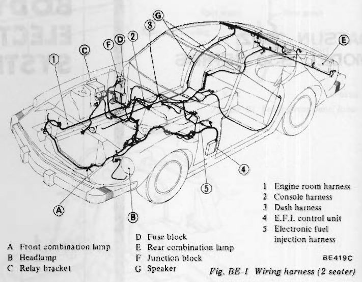
>
> - **Summary:** Chassis layout illustration showing the routing and placement of body wiring harnesses throughout the 2-seater vehicle body.
> - **Components:** Engine room harness, Console harness, Dash harness, E.F.I. control unit, Electronic fuel injection harness, Front combination lamp, Headlamp, Relay bracket, Fuse block, Rear combination lamp, Junction block, Speaker
> - **Callouts:** **(1)** Engine room harness; **(2)** Console harness; **(3)** Dash harness; **(4)** E.F.I. control unit; **(5)** Electronic fuel injection harness; **(A)** Front combination lamp; **(B)** Headlamp; **(C)** Relay bracket; **(D)** Fuse block; **(E)** Rear combination lamp; **(F)** Junction block; **(G)** Speaker
> - **Mechanic Notes:** Identifies primary connection locations between engine room, dash, console, and EFI sub-harnesses.
> - **Tags:** `wiring harness`, `layout`, `routing`, `2-seater`, `junction block`, `fuse block`, `relay bracket`

## WIRING HARNESS

### COLORS OF CABLES

The system of colors used in the covering of cable conductors are as shown in the following table:

| Circuit system | Standard color | Supplementary color | Supplementary color / Standard color |
| :--- | :--- | :--- | :--- |
| Starting and ignition system | B (Black) | W, Y, R | |
| Charging system | W (White) | B, R, L | Y |
| Lighting system | R (Red) | W, B, G, Y, L | |
| Signal system | G (Green) | W, B, R, Y, L | W, Br (Brown) |
| Instrument system | Y (Yellow) | W, B, G, R, L | |
| Others | L (Blue) Lg (Light green) | W, R, Y | Y Br Lg (Light green) |
| Grounding system | B (Black) | | | <!-- Page 3 (BE-3) --> The main cable of each system is generally coded with a standard or supplementary color. These colors are represented by such letters as G, W, and B. Minor items of each circuit's terminal are coded with a two-tone color composed of both standard and supplementary colors. These colors are represented by a combination of two letters like RW or GY. The first letter of each combination stands for standard color, and the second for supplementary color.

## WIRING

### Engine room harness

Engine room harness is connected to instrument harness with one connector and dash harness with four connectors at junction block under right side of instrument panel.

It has three branches. One branch runs along right side of engine room, servicing starting motor, fuel pump relay, fuel pump control relay, inhibitor realy, fusible link, alternator, headlamp, combination lamp, horn, etc., and transverses engine room under radiator, servicing headlamp, horn, combination lamp, etc. and is connected to distributor, ignition coil, B.C.D.D. solenoid, thermal transmitter, etc. on left side of engine room.

Another branch runs along rear end of engine room to inspection lamp, servicing wiper motor, washer motor, brake fluid level switch., etc.

> 🖼️ **Fig. BE-2 Engine room harness** `[BE429B]` *(Type: `component_location`)*
>
> 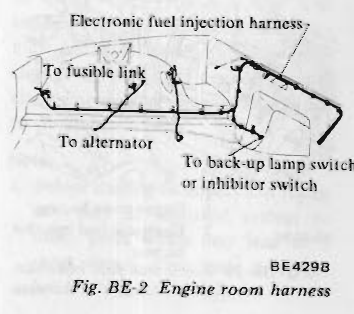
>
> - **Summary:** Diagram of engine room harness routing showing branch connections to fusible link, alternator, and transmission switches.
> - **Components:** Electronic fuel injection harness, Fusible link lead, Alternator lead, Back-up lamp switch lead, Inhibitor switch lead
> - **Callouts:** **(Electronic fuel injection harness)** Lead branch to EFI harness; **(To fusible link)** Lead to fusible link; **(To alternator)** Lead to alternator; **(To back-up lamp switch or inhibitor switch)** Transmission branch connector
> - **Mechanic Notes:** Routing along engine bay skirt and front radiator core support.
> - **Tags:** `engine room harness`, `fusible link`, `alternator`, `inhibitor switch`, `back-up lamp switch`

The other branch runs along transmission housing to back-up lamp switch (Manual transmission models) and inhibitor switch (Automatic transmission models).

On automatic transmission models, this also services downshift solenoid via engine sub-harness.

> 🖼️ **Fig. BE-3 Engine room harness** `[BE430B]` *(Type: `component_location`)*
>
> 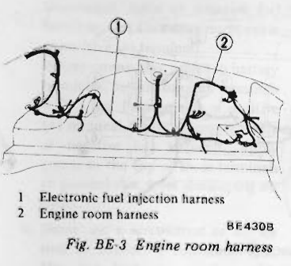
>
> - **Summary:** Physical harness layout showing junction connection between Electronic Fuel Injection harness and Engine Room harness.
> - **Components:** Electronic fuel injection harness, Engine room harness
> - **Callouts:** **(1)** Electronic fuel injection harness; **(2)** Engine room harness
> - **Mechanic Notes:** Harness connection along inner fender apron.
> - **Tags:** `engine room harness`, `EFI harness`, `harness routing`

> 🖼️ **Fig. BE-4 Engine sub-harness (A/T models)** `[BE431B]` *(Type: `component_location`)*
>
> 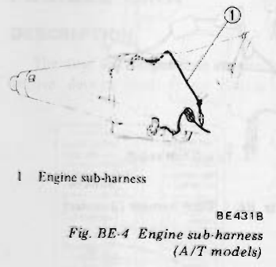
>
> - **Summary:** Engine sub-harness routing for automatic transmission models servicing downshift solenoid and inhibitor switch.
> - **Components:** Engine sub-harness
> - **Callouts:** **(1)** Engine sub-harness
> - **Mechanic Notes:** Used exclusively on automatic transmission vehicles.
> - **Tags:** `engine sub-harness`, `automatic transmission`, `downshift solenoid`, `inhibitor switch`

### Instrument harness

Instrument harness is connected to engine room harness and dash harness with three connectors at junction block under right side of instrument panel.

Two connectors for dash harness are white and black. Connector for engine room harness is blue.

This harness traverses to left side of passenger compartment behind instrument panel and services glove box lamp, map lamp, fuel level warning lamp, clock, volt and fuel gauge, water temperature and oil pressure gauge, floor temperature warning lamp (California models), cigarette lighter, tachometer, speedometer, warning buzzer, and illumination control rheostat.

> 🖼️ **Fig. BE-5 Instrument harness** `[BE432B]` *(Type: `component_location`)*
>
> 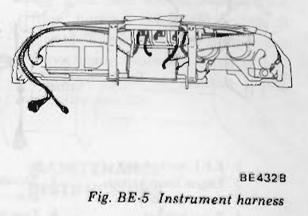
>
> - **Summary:** Instrument panel harness assembly and routing behind the dashboard.
> - **Components:** Instrument harness
> - **Wiring / Connections:** Connects with 3 connectors at junction block under RH dash (white, black, blue).
> - **Mechanic Notes:** Feeds gauges, clock, tachometer, speedometer, glove box, and warning lamps.
> - **Tags:** `instrument harness`, `dashboard`, `cluster`, `gauges`

### Dash harness

Dash harness is connected to engine room harness and instrument harness with six connectors at junction block under right side of instrument panel. Two connectors (white and black) for instrument harness and four (white, green and black) for engine room harness.

This harness has four main branches. One goes to relay bracket and seat belt warning timer unit, horn relay, intermittent wiper amplifier, defogger relay and ignition relay, and goes to right-hand side door switch.

One goes to left side of car along dash panel and services console harness, air conditioner harness, turn signal flasher unit, kickdown switch, stop lamp switch, steering lock switch, combination switch, ignition switch, electronic fuel injection harness, hazard flasher unit, and left-hand side door switch.

The other goes along right side of car backward and has four branches. One services driver's seat belt switch, floor sensor relay, brake warning lamp check relay, parking brake switch.

One services radio speaker, rear window defogger, room lamp and tail-gate switch.

One services fuel pump.

The other services fuel tank gauge unit.

Main line goes around rear right side corner and goes along rear panel servicing side marker lamp, combination lamp, floor temperature sensor (California models) and license lamp, and goes around the other rear corner of car and services auto antenna.

---

<!-- Page 4 (BE-4) -->

> 🖼️ **Fig. BE-6 Dash harness** `[BE420C]` *(Type: `component_location`)*
>
> 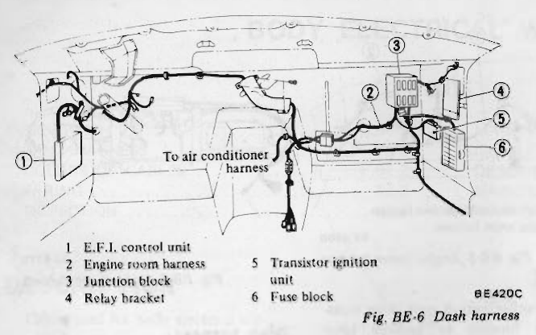
>
> - **Summary:** Under-dash harness installation showing junction block, relay bracket, transistor ignition unit, fuse block, and EFI ECU.
> - **Components:** E.F.I. control unit, Engine room harness, Junction block, Relay bracket, Transistor ignition unit, Fuse block, Air conditioner harness connector
> - **Callouts:** **(1)** E.F.I. control unit; **(2)** Engine room harness; **(3)** Junction block; **(4)** Relay bracket; **(5)** Transistor ignition unit; **(6)** Fuse block
> - **Wiring / Connections:** To air conditioner harness branch connector shown at center lower dash.
> - **Mechanic Notes:** Junction block and fuse block are mounted under the right side of the instrument panel.
> - **Tags:** `dash harness`, `fuse block`, `junction block`, `transistor ignition unit`, `EFI ECU`

> 🖼️ **Fig. BE-7 Dash harness (2 seater)** `[BE421C]` *(Type: `component_location`)*
>
> 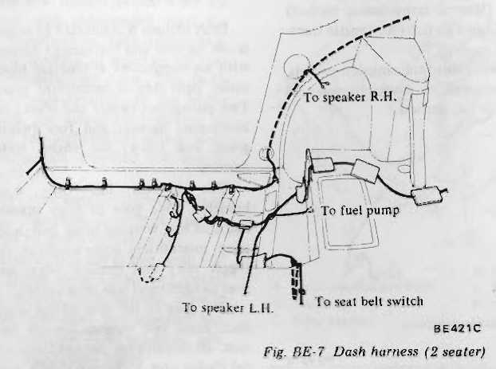
>
> - **Summary:** Floor and rear body dash harness routing in 2-seater body shell.
> - **Components:** Speaker R.H. lead, Fuel pump lead, Seat belt switch lead, Speaker L.H. lead
> - **Callouts:** **(To speaker R.H.)** Right rear speaker lead; **(To fuel pump)** Fuel pump feed lead; **(To seat belt switch)** Driver seat belt buckle switch lead; **(To speaker L.H.)** Left rear speaker lead
> - **Mechanic Notes:** Specific branch routing along floor pan and wheel arches for 2-seater models.
> - **Tags:** `dash harness`, `2-seater`, `floor routing`, `fuel pump wiring`, `speaker`

> 🖼️ **Fig. BE-8 Dash harness (2 + 2 seater)** `[BE422C]` *(Type: `component_location`)*
>
> 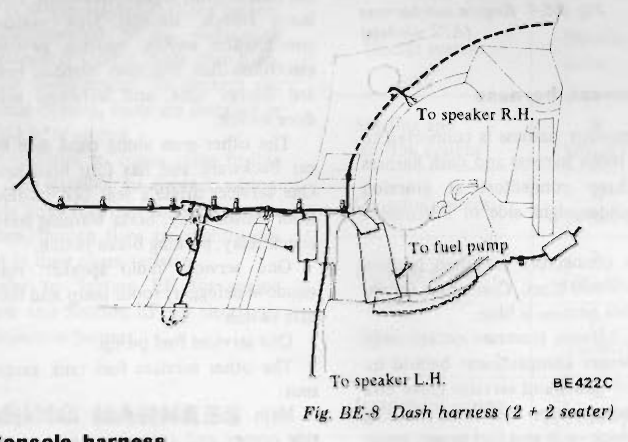
>
> - **Summary:** Floor and rear body dash harness routing in 2+2 seater body shell.
> - **Components:** Speaker R.H. lead, Fuel pump lead, Speaker L.H. lead
> - **Callouts:** **(To speaker R.H.)** Right rear speaker lead; **(To fuel pump)** Fuel pump feed lead; **(To speaker L.H.)** Left rear speaker lead
> - **Mechanic Notes:** Extended harness length accommodates 2+2 rear passenger compartment.
> - **Tags:** `dash harness`, `2+2 seater`, `floor routing`, `fuel pump`

> 🖼️ **Fig. BE-9 Console harness** `[BE436B]` *(Type: `component_location`)*
>
> 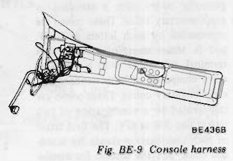
>
> - **Summary:** Center console harness assembly and switch connector pigtails.
> - **Components:** Console harness
> - **Wiring / Connections:** Connects to dash harness with a pair of multi-pin connectors.
> - **Mechanic Notes:** Services A/T shift indicator, hazard switch, rear defogger switch, radio, seat belt warning lamp, and ashtray illumination.
> - **Tags:** `console harness`, `center console`, `switches`

### Console harness

Console harness is connected to dash harness with a pair of connectors. It services automatic transmission indicator lamp, ashtray lamp, antenna switch, radio, rear defogger switch and lamp, seat belt warning lamp and hazard switch.

### Electronic fuel injection harness and electronic fuel injection sub-harness

The electronic fuel injection harness is connected to electronic fuel injection system components. It is connected to the positive battery terminal through a fusible link at the right side of the engine compartment.

It is connected to the E.F.I. main relay in the relay bracket of the engine compartment.

It is connected to the dash harness under the left side of the passenger compartment instrument panel.

It is connected to the control unit, altitude switch in the passenger compartment, and to the dropping resistor, throttle valve switch, air flow meter, cold start vlave, air regulator, engine earth point and injectors of each cylinder on the left side of the engine compartment. The electronic fuel injection sub-harness is connected to the electronic fuel injection harness on the left front side of the engine and also to the thermotime switch and water temperature sensor. See Section EF for details.

> 🖼️ **Fig. BE-10 Electronic fuel injection harness** `[BE423C]` *(Type: `component_location`)*
>
> 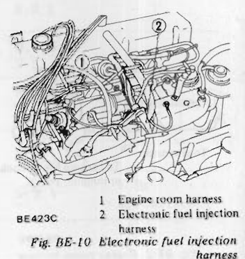
>
> - **Summary:** Engine room harness and electronic fuel injection harness layout along the engine bay apron.
> - **Components:** Engine room harness, Electronic fuel injection harness
> - **Callouts:** **(1)** Engine room harness; **(2)** Electronic fuel injection harness
> - **Mechanic Notes:** Connects to injectors, dropping resistor, throttle switch, air flow meter, cold start valve, and thermotime switch.
> - **Tags:** `EFI harness`, `engine room harness`, `fuel injection`, `injectors`

---

<!-- Page 5 (BE-5) -->
# INSPECTION

Inspect all electrical circuits, referring to wiring or circuit diagrams.

Circuits should be tested for continuous or short circuit with a conventional test lamp or low reading voltmeter. Before inspection of circuit, insure the following items.

1. Each electrical component part or cable is securely fastened to its connector or terminal.
2. Each connection is tight in place and free from rust and dirt.
3. Each cable covering shows no evidence of cracks, deterioration or other damage.
4. Each terminal is kept away from any adjacent metal parts.
5. Each cable is fastened to its proper connector or terminal.
6. Each grounding bolt is planted tight.
7. Wiring is kept away from any adjacent sharp edges of parts or parts having high temperature (such as exhaust pipe).
8. Wiring is kept away from any rotating or working parts such as fan pulley, fan belt, etc.
9. Cables between fixed portions and moving equipment are long enough to withstand shocks and vibratory forces.

## MAINTENANCE

Wire harness must be replaced if insulation becomes burned, cracked, or deteriorated. Whenever it is necessary to splice or repair a wire, be sure to use resin flux solder or electrical connections. And use insulating tape to cover all splices or bare wire. In replacing wire, correct size wire must be used. Never replace a wire with smaller one. Each harness and wire must be held securely in place with clips or other holding devices to avoid chafing or wearing away insulation due to vibration.

**Note:**
- **a. Before starting to inspect and repair any part of electrical system or other parts which may lead to a short circuit, disconnect cables at battery terminals as follows:**
  - Disconnect cable at negative (-) terminal, and then disconnect cable at positive (+) terminal.
  - Before connecting cables to battery terminals, be sure to clean terminals with a rag. Fasten cable at positive (+) terminal, and then ground cable at negative (-) terminal. Apply grease to the top of these terminals to prevent rust from developing on them.
- **b. Never use a screwdriver or service tool to conduct a continuity test. Use test leads to conduct this check.**
- **c. Never ground an open circuit or circuits under no load. Use a test lamp (12V-3W) or circuit tester as a load.**

---

# FUSE BLOCK AND FUSIBLE LINK

## DESCRIPTION

The fuse and fusible link are protective devices used in an electric circuit. When current increases beyond rated amperage, fusible metal melts and the circuit is broken, thus protecting cable and electrical equipment from burning. Whenever a fuse is melted for one reason or another, use a systematic procedure to check and eliminate cause of problem before installing new fuse.

## MAINTENANCE INSTRUCTIONS

### Fuse

In nearly all cases, visual inspection can reveal a faulty fuse. If condition of fuse is questionable, conduct a continuity test with a circuit tester or test lamp.

**Note:**
- **a. If fuse is blown, be sure to eliminate the cause before installing new fuse in position.**
- **b. Use fuse of specified rating. Do not use fuse of more than specified rating. See the following figure.**
- **c. Check fuse holders for condition. If rust or dirt is found thereon, clean metal parts with fine-grained sandpaper until proper metal-to-metal contact is made.**

Poor contact of any fuse holder will often lead to voltage drop or heating in the circuit and could result in improper operation of circuit.

> 🖼️ **Fig. BE-11 Fuse block** `[BE424C / BE438B]` *(Type: `component_location`)*
>
> 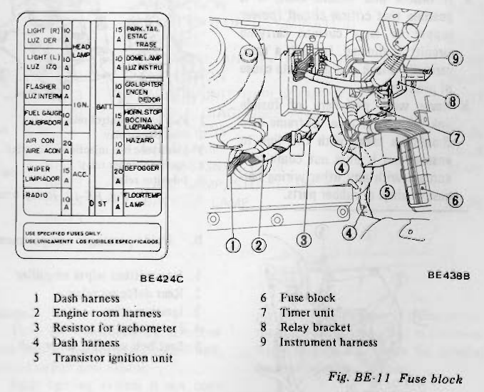
>
> - **Summary:** Fuse box cavity layout, circuit labeling, amperage ratings, and under-dash installation relative to the relay bracket, timer unit, and transistor ignition unit.
> - **Components:** Dash harness, Engine room harness, Resistor for tachometer, Transistor ignition unit, Fuse block, Timer unit, Relay bracket, Instrument harness
> - **Callouts:** **(1)** Dash harness; **(2)** Engine room harness; **(3)** Resistor for tachometer; **(4)** Dash harness; **(5)** Transistor ignition unit; **(6)** Fuse block; **(7)** Timer unit; **(8)** Relay bracket; **(9)** Instrument harness
> - **Specs / Measurements:** LIGHT (R): 10A; LIGHT (L): 10A; FLASHER: 10A; FUEL GAUGE: 10A; AIR CON: 20A; WIPER: 15A; RADIO: 10A; PARK. TAIL: 15A; DOME LAMP: 10A; CIG. LIGHTER: 10A; HORN, STOP: 15A; HAZARD: 10A; DEFOGGER: 20A; FLOOR TEMP LAMP: 10A
> - **Mechanic Notes:** Use specified fuses only. Never use a fuse of higher rating.
> - **Tags:** `fuse block`, `fuse ratings`, `amperage`, `relay bracket`, `dash panel` <!-- Page 6 (BE-6) --> ### Fusible link

| Color | Size $\text{mm}^2$ (sq in) |
| :--- | :--- |
| Black | 1.25 (0.0019) |
| Green | 0.5 (0.0008) |
| Brown | 0.3 (0.0005) |

The fusible link holder is mounted on the relay bracket in the engine compartment, a fusible link for electronic fuel injection system is connected between battery cable (+) and fuel injection harness.

A melted fusible link can be detected by either visual or finger-tip inspection. If its condition is questionable, use circuit tester or test lamp, as required, to conduct continuity test. This continuity test can be performed in the same manner as for any conventional fuse.

> [!CAUTION]
> a. If fusible link should melt, it is possible that critical circuit (power supply or large current carrying circuit) is shorted. In such a case, carefully check and eliminate cause of problem.
> b. Never wrap periphery of fusible link with vinyl tape. Extreme care should be taken with this link to ensure that it does not come into contact with any other wiring harness or vinyl or rubber parts.

> 🖼️ **Fig. BE-12 Fusible link** `[BE425C]` *(Type: `component_location`)*
>
> 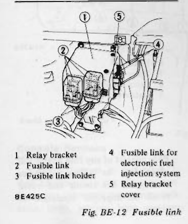
>
> - **Summary:** Mounting of the fusible link block and cover on the engine compartment relay bracket.
> - **Components:** Relay bracket, Fusible link, Fusible link holder, Fusible link for electronic fuel injection system, Relay bracket cover
> - **Callouts:** **(1)** Relay bracket; **(2)** Fusible link; **(3)** Fusible link holder; **(4)** Fusible link for electronic fuel injection system; **(5)** Relay bracket cover
> - **Wiring / Connections:** Connected between battery (+) cable and main harnesses.
> - **Mechanic Notes:** Never wrap fusible links in vinyl tape. Ensure clear separation from rubber/vinyl hoses.
> - **Tags:** `fusible link`, `relay bracket`, `engine compartment`, `battery feed`

---

# RELAY BRACKET

The realy bracket is so installed that a number of relays can be located in the same place for easy maintenance.

There are two relay brackets. One is installed on the hoodledge on the right side of the engine compartment, and the other on the dash side panel.

The following parts are attached to the relay brackets:

### A. Engine compartment
1. Fuel pump control relay
2. Fuel pump relay
3. Electronic Fuel Injection main relay
4. Air conditioner relay
5. Inhibitor relay

> 🖼️ **Fig. BE-13 Relay bracket** `[BE339C]` *(Type: `component_location`)*
>
> 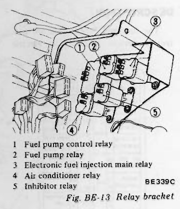
>
> - **Summary:** Engine compartment hoodledge relay bracket showing layout of the 5 relays.
> - **Components:** Fuel pump control relay, Fuel pump relay, Electronic fuel injection main relay, Air conditioner relay, Inhibitor relay
> - **Callouts:** **(1)** Fuel pump control relay; **(2)** Fuel pump relay; **(3)** Electronic fuel injection main relay; **(4)** Air conditioner relay; **(5)** Inhibitor relay
> - **Mechanic Notes:** Located on the right-hand hoodledge in the engine compartment.
> - **Tags:** `relay bracket`, `engine compartment`, `fuel pump relay`, `EFI relay`, `inhibitor relay`

> 🖼️ **Fig. BE-14 Relay bracket** `[BE438B]` *(Type: `component_location`)*
>
> 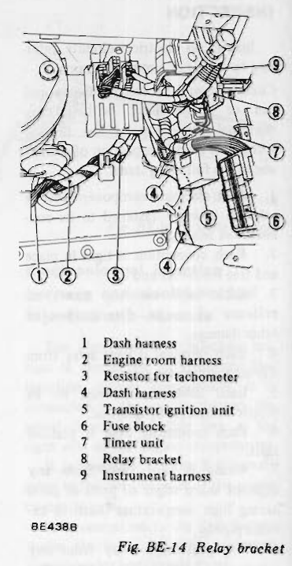
>
> - **Summary:** Passenger compartment dash side panel relay bracket and components installation.
> - **Components:** Dash harness, Engine room harness, Resistor for tachometer, Dash harness, Transistor ignition unit, Fuse block, Timer unit, Relay bracket, Instrument harness
> - **Callouts:** **(1)** Dash harness; **(2)** Engine room harness; **(3)** Resistor for tachometer; **(4)** Dash harness; **(5)** Transistor ignition unit; **(6)** Fuse block; **(7)** Timer unit; **(8)** Relay bracket; **(9)** Instrument harness
> - **Mechanic Notes:** Mounted on dash side panel inside the cabin.
> - **Tags:** `relay bracket`, `dash side panel`, `transistor ignition unit`, `fuse block`, `timer unit`

### B. Inside passenger compartment
1. Intermittent wiper amplifier
2. Rear defogger relay
3. Ignition relay
4. Horn relay
5. Seat belt warning timer unit

> 🖼️ **Fig. BE-15 Relay bracket** `[BE439B]` *(Type: `component_location`)*
>
> 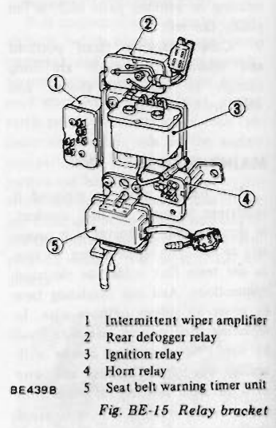
>
> - **Summary:** Interior relay bracket component arrangement showing 4 relays and seat belt warning timer unit.
> - **Components:** Intermittent wiper amplifier, Rear defogger relay, Ignition relay, Horn relay, Seat belt warning timer unit
> - **Callouts:** **(1)** Intermittent wiper amplifier; **(2)** Rear defogger relay; **(3)** Ignition relay; **(4)** Horn relay; **(5)** Seat belt warning timer unit
> - **Mechanic Notes:** Interior passenger compartment relay cluster.
> - **Tags:** `relay bracket`, `intermittent wiper amplifier`, `rear defogger relay`, `horn relay`, `seat belt timer`

---

<!-- Page 7 (BE-7) -->
# LIGHTING AND SIGNAL LAMP SYSTEM

## CONTENTS

| Topic | Page | Topic | Page |
| :--- | :--- | :--- | :--- |
| DESCRIPTION | BE-7 | INSPECTION LAMP | BE-23 |
| BULB SPECIFICATIONS | BE-8 | REMOVAL AND INSTALLATION | BE-23 |
| CIRCUIT DIAGRAM OF LIGHTING SYSTEM | BE-9 | BULB REPLACEMENT | BE-24 |
| HEADLAMP | BE-19 | INSPECTION | BE-24 |
| AIMING ADJUSTMENT | BE-19 | COMBINATION SWITCH | BE-24 |
| HEADLAMP BEAM REPLACEMENT | BE-19 | REMOVAL AND INSTALLATION | BE-24 |
| FRONT COMBINATION LAMP | BE-20 | INSPECTION | BE-24 |
| BULB REPLACEMENT | BE-20 | DOOR SWITCH | BE-25 |
| LAMP BODY REPLACEMENT | BE-20 | REMOVAL AND INSTALLATION | BE-25 |
| SIDE MARKER LAMP | BE-20 | INSPECTION | BE-25 |
| BULB REPLACEMENT | BE-20 | STOP LAMP SWITCH | BE-25 |
| LAMP BODY REPLACEMENT | BE-20 | REMOVAL AND INSTALLATION | BE-25 |
| INTERIOR LAMP | BE-21 | INSPECTION | BE-25 |
| BULB REPLACEMENT | BE-21 | BACK-UP LAMP SWITCH | BE-25 |
| LAMP BODY REPLACEMENT | BE-21 | REPLACEMENT | BE-25 |
| REAR COMBINATION LAMP | BE-21 | INSPECTION | BE-25 |
| BULB REPLACEMENT | BE-21 | HAZARD SWITCH | BE-26 |
| LAMP BODY REPLACEMENT | BE-21 | REMOVAL AND INSTALLATION | BE-26 |
| LICENSE LAMP | BE-21 | BULB REPLACEMENT | BE-26 |
| BULB REPLACEMENT | BE-21 | INSPECTION | BE-26 |
| LAMP BODY REPLACEMENT | BE-22 | IGNITION AND STARTING SWITCH | BE-26 |
| MAP LAMP | BE-22 | REPLACEMENT | BE-26 |
| BULB REPLACEMENT | BE-22 | INSPECTION | BE-26 |
| LAMP BODY REPLACEMENT | BE-22 | RHEOSTAT (FOR ILLUMINATION CONTROL) | BE-27 |
| GLOVE BOX LAMP | BE-23 | REMOVAL AND INSTALLATION | BE-27 |
| BULB REPLACEMENT | BE-23 | INSPECTION | BE-27 |
| LAMP BODY REPLACEMENT | BE-23 | FLASHER UNIT REPLACEMENT | BE-27 |
| INSPECTION | BE-23 | TROUBLE DIAGNOSES AND CORRECTIONS | BE-28 |
| AUTOMATIC TRANSMISSION INDICATOR ILLUMINATION LAMP | BE-23 | HEADLAMP | BE-28 |
| BULB REPLACEMENT | BE-23 | TURN SIGNAL LAMP | BE-28 |
| ASHTRAY ILLUMINATION LAMP | BE-23 | TAIL LAMP, STOP LAMP AND BACK-UP LAMP | BE-29 |
| REMOVAL AND INSTALLATION | BE-23 | | |
| INDICATOR LAMPS | BE-23 | | |

---

## DESCRIPTION

Lighting and signal lamp system includes headlamps, front combination lamps, side marker lamps, rear combination lamps, license lamps, interior lamp, map lamp and some illumination lamps.

They are controlled by combination switch, flasher unit, hazard unit, hazard switch and resistor.

Each lighting system is not completely independent; Consequently, there are some wires used in common. Refer to Circuit Diagram for detailed description of each system.

---

<!-- Page 8 (BE-8) -->
# BULB SPECIFICATIONS

| Lamp | Wattage (W) | SAE trade number |
| :--- | :---: | :---: |
| Headlamp unit | 50/40 | 6012 |
| Side clearance and turn signal lamp | 8/23 | 1034 |
| Side marker lamp | 8 | 67 |
| License plate lamp | 7.5 | 89 |
| **Rear combination lamp** | | |
| Tail light | 8 | 67 |
| Tail/Stop (Brake) lamp | 8/23 | 1034 |
| Turn signal lamp | 23 | 1073 |
| Back-up lamp | 23 | 1073 |
| Meter illumination lamp | 3.4 | 57X |
| Brake warning lamp | 3.4 | 57X |
| Turn signal indicator lamp | 3.4 | 57X |
| Headlamp beam indicator lamp | 3.4 | 57X |
| Engine compartment inspection lamp | 8 | 67 |
| Interior lamp | 10 | — |
| Glove box lamp | 3.4 | 57X |
| Clock illumination lamp | 3.4 | 57X |
| Cigarette lighter illumination lamp | 1.7 | — |
| Hazard illumination lamp | 1.4 | — |
| Heater control illumination lamp | 3.4 | 57X |
| Seat belt warning lamp | 1.4 | — |
| Rear defogger indicator lamp | 1.4 | — |
| Floor temperature warning lamp | 1.4 | — |
| Fuel level warning lamp | 3.4 | 57X |
| Charge warning lamp | 3.4 | 57X |
| Ash tray illumination lamp | 3.4 | 57X |

---

<!-- Page 9 (BE-9) -->
# CIRCUIT DIAGRAM OF LIGHTING SYSTEM

## Headlamp system

> 🖼️ **Fig. BE-16 Circuit diagram for headlamp** `[BE440B]` *(Type: `electrical_schematic`)*
>
> 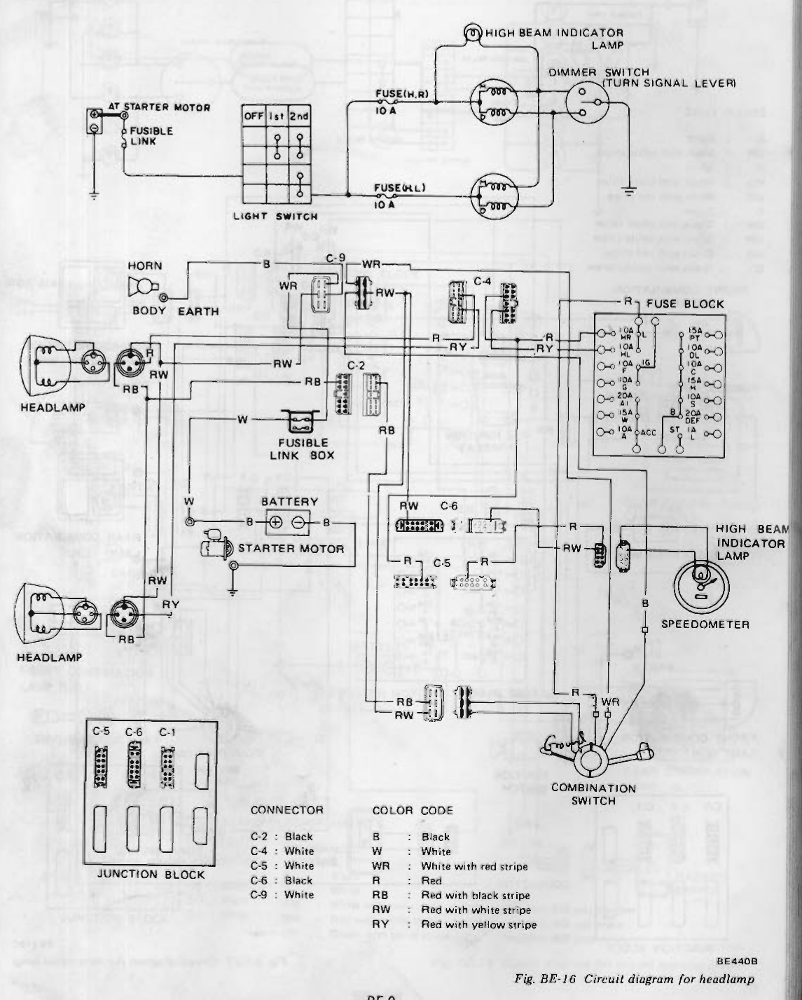
>
> - **Summary:** Complete electrical circuit diagram for the headlamp system, showing battery feed through fusible links, light switch, dimmer switch, left and right 10A headlamp fuses, sealed beams, and high beam indicator lamp.
> - **Components:** Starter motor, Fusible link, Fusible link box, Light switch, Dimmer switch (Turn signal lever), Fuse (H.R) 10A, Fuse (H.L) 10A, Headlamp (RH), Headlamp (LH), High beam indicator lamp, Horn, Battery, Fuse block, Junction block, Speedometer, Combination switch
> - **Callouts:** **(C-2)** Connector C-2 (Black); **(C-4)** Connector C-4 (White); **(C-5)** Connector C-5 (White); **(C-6)** Connector C-6 (Black); **(C-9)** Connector C-9 (White)
> - **Specs / Measurements:** Fuse (H.R): 10A; Fuse (H.L): 10A
> - **Wiring / Connections:** B: Black; W: White; WR: White with red stripe; R: Red; RB: Red with black stripe; RW: Red with white stripe; RY: Red with yellow stripe
> - **Mechanic Notes:** Ground connection for headlamps is routed through the body earth near the horn. Dimmer switch selects between high and low filaments.
> - **Tags:** `circuit diagram`, `headlamp`, `dimmer switch`, `fuse block`, `wiring schematic`

---

<!-- Page 10 (BE-10) -->
## Turn signal lamp system

> 🖼️ **Fig. BE-17 Circuit diagram for turn signal lamp** `[BE446C]` *(Type: `electrical_schematic`)*
>
> 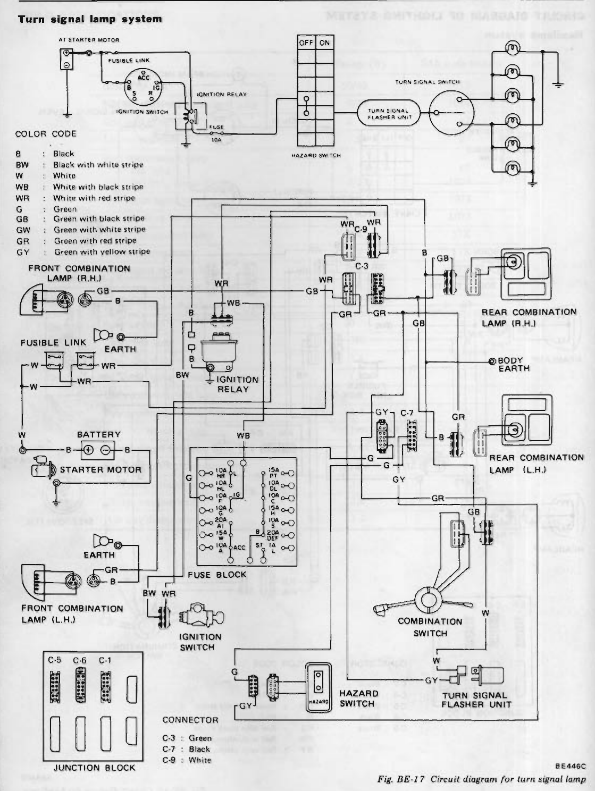
>
> - **Summary:** Wiring schematic of the turn signal lamp system showing power from ignition switch through ignition relay, 10A flasher fuse, hazard switch, flasher unit, combination switch lever, and front/rear combination lamps.
> - **Components:** Starter motor, Fusible link, Ignition switch, Ignition relay, Fuse (10A), Hazard switch, Turn signal flasher unit, Turn signal switch, Front combination lamp (R.H.), Front combination lamp (L.H.), Rear combination lamp (R.H.), Rear combination lamp (L.H.), Fuse block, Junction block, Combination switch
> - **Callouts:** **(C-3)** Connector C-3 (Green); **(C-7)** Connector C-7 (Black); **(C-9)** Connector C-9 (White)
> - **Specs / Measurements:** Flasher fuse: 10A
> - **Wiring / Connections:** B: Black; BW: Black with white stripe; W: White; WB: White with black stripe; WR: White with red stripe; G: Green; GB: Green with black stripe; GW: Green with white stripe; GR: Green with red stripe; GY: Green with yellow stripe
> - **Mechanic Notes:** Turn signals are powered only with ignition ON via the ignition relay. Power routes through hazard switch normally-closed contacts.
> - **Tags:** `circuit diagram`, `turn signal`, `flasher unit`, `hazard switch`, `schematic`

---

<!-- Page 11 (BE-11) -->
## Hazard warning system

> 🖼️ **Fig. BE-18 Circuit diagram for hazard warning system** `[BE426C]` *(Type: `electrical_schematic`)*
>
> 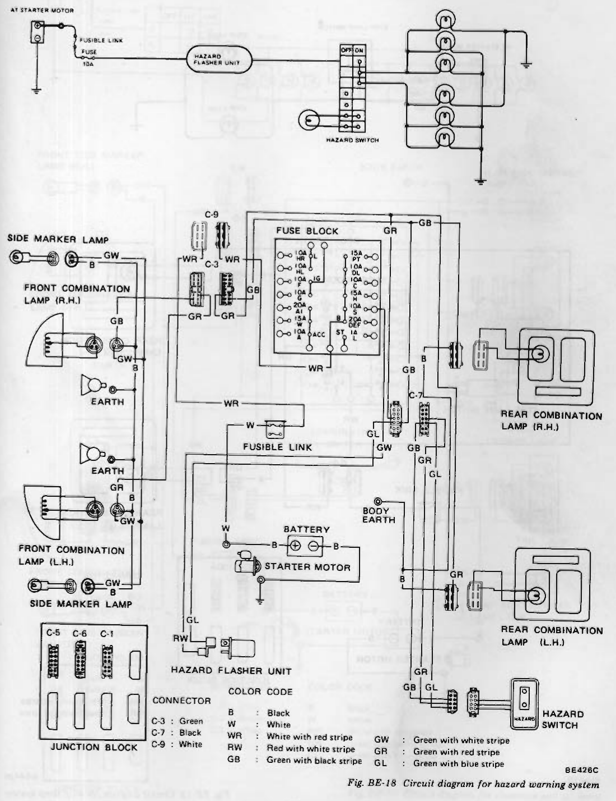
>
> - **Summary:** Wiring schematic of hazard warning flashers showing continuous battery feed via fusible link and 10A hazard fuse to hazard flasher unit, pulsing all four turn signal filaments simultaneously.
> - **Components:** Starter motor, Fusible link, Fuse (10A), Hazard flasher unit, Hazard switch, Side marker lamp, Front combination lamp (R.H.), Front combination lamp (L.H.), Rear combination lamp (R.H.), Rear combination lamp (L.H.), Fuse block, Junction block
> - **Callouts:** **(C-3)** Connector C-3 (Green); **(C-7)** Connector C-7 (Black); **(C-9)** Connector C-9 (White)
> - **Specs / Measurements:** Hazard fuse: 10A
> - **Wiring / Connections:** B: Black; W: White; WR: White with red stripe; RW: Red with white stripe; GB: Green with black stripe; GW: Green with white stripe; GR: Green with red stripe; GL: Green with blue stripe
> - **Mechanic Notes:** Operates independently of ignition switch position via constant battery BATT rail.
> - **Tags:** `circuit diagram`, `hazard flasher`, `hazard switch`, `emergency flashers`, `schematic`

---

<!-- Page 12 (BE-12) -->
## Stop lamp system

> 🖼️ **Fig. BE-19 Circuit diagram for stop lamp system** `[BE443B]` *(Type: `electrical_schematic`)*
>
> 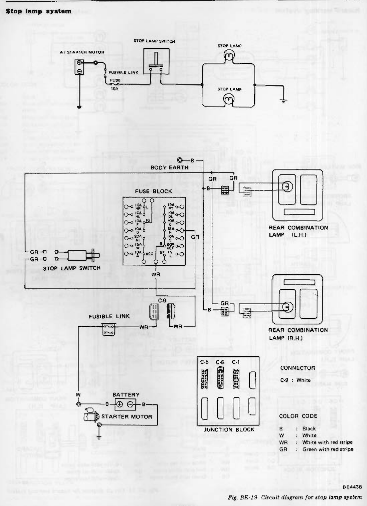
>
> - **Summary:** Wiring schematic for brake/stop lamps showing circuit from battery through fusible link, 15A horn/stop fuse, brake pedal stop lamp switch, and rear combination lamp stop filaments.
> - **Components:** Starter motor, Fusible link, Fuse (15A Horn/Stop), Stop lamp switch, Rear combination lamp (L.H.), Rear combination lamp (R.H.), Fuse block, Junction block, Battery
> - **Callouts:** **(C-9)** Connector C-9 (White)
> - **Specs / Measurements:** Fuse (Horn, Stop): 15A
> - **Wiring / Connections:** B: Black; W: White; WR: White with red stripe; GR: Green with red stripe
> - **Mechanic Notes:** Stop lamp switch is normally open, closing when brake pedal is depressed. Powered from BATT rail at all times.
> - **Tags:** `circuit diagram`, `stop lamp`, `brake light`, `stop lamp switch`, `schematic`

---

<!-- Page 13 (BE-13) -->
## Clearance and tail lamp system

> 🖼️ **Fig. BE-20 Circuit diagram for clearance and tail lamp** `[BE444B]` *(Type: `electrical_schematic`)*
>
> 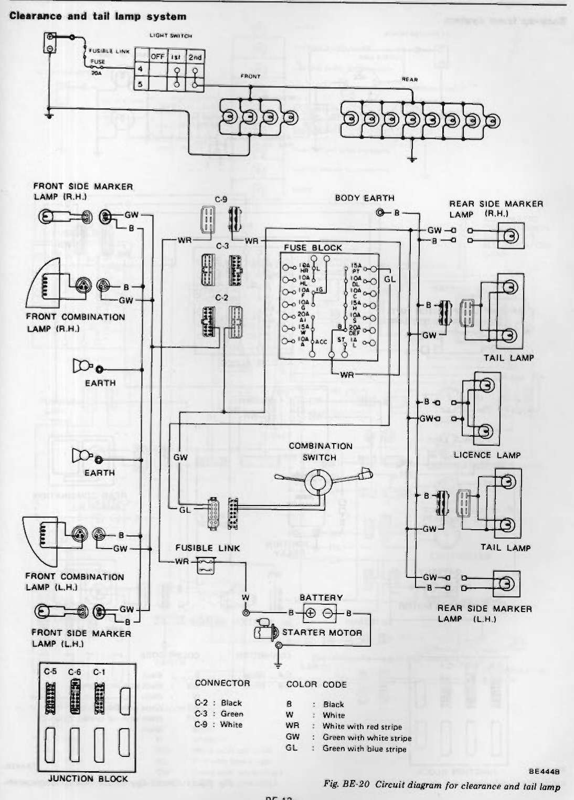
>
> - **Summary:** Electrical circuit schematic for parking clearance, side marker, tail, and license plate lamps operated by the 1st position of the light switch.
> - **Components:** Starter motor, Fusible link, Fuse (20A), Light switch, Front side marker lamp (R.H.), Front side marker lamp (L.H.), Front combination lamp (R.H.), Front combination lamp (L.H.), Rear side marker lamp (R.H.), Rear side marker lamp (L.H.), Tail lamp (R.H.), Tail lamp (L.H.), License lamp, Fuse block, Junction block, Combination switch, Battery
> - **Callouts:** **(C-2)** Connector C-2 (Black); **(C-3)** Connector C-3 (Green); **(C-9)** Connector C-9 (White)
> - **Specs / Measurements:** Fuse: 20A
> - **Wiring / Connections:** B: Black; W: White; WR: White with red stripe; GW: Green with white stripe; GL: Green with blue stripe
> - **Mechanic Notes:** Light switch contacts 4 and 5 connect to separate front and rear circuits on 1st and 2nd switch positions.
> - **Tags:** `circuit diagram`, `clearance lamp`, `tail lamp`, `side marker`, `license lamp`, `schematic`

---

<!-- Page 14 (BE-14) -->
## Back-up lamp system

> 🖼️ **Fig. BE-21 Circuit diagram for back-up lamp system** `[BE445B]` *(Type: `electrical_schematic`)*
>
> 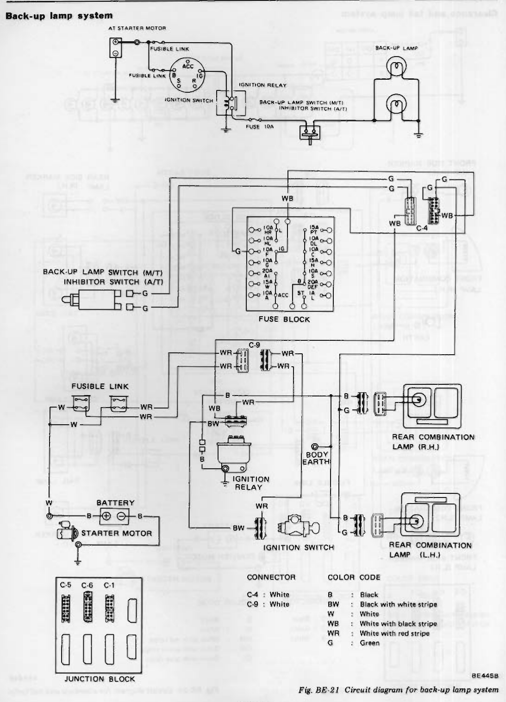
>
> - **Summary:** Wiring schematic for reverse/back-up lamps, showing power feed from ignition switch through ignition relay, 10A fuse, transmission reverse switch (M/T) or inhibitor switch (A/T), and rear combination back-up bulbs.
> - **Components:** Starter motor, Fusible link, Ignition switch, Ignition relay, Fuse (10A), Back-up lamp switch (M/T) / Inhibitor switch (A/T), Rear combination lamp (R.H.), Rear combination lamp (L.H.), Fuse block, Junction block, Battery
> - **Callouts:** **(C-4)** Connector C-4 (White); **(C-9)** Connector C-9 (White)
> - **Specs / Measurements:** Fuse: 10A
> - **Wiring / Connections:** B: Black; BW: Black with white stripe; W: White; WB: White with black stripe; WR: White with red stripe; G: Green
> - **Mechanic Notes:** Switch contacts close only when transmission is in reverse gear.
> - **Tags:** `circuit diagram`, `back-up lamp`, `reverse light`, `inhibitor switch`, `schematic`

---

<!-- Page 15 (BE-15) -->
## Meter illumination system

> 🖼️ **Fig. BE-22 Circuit diagram for meter illumination lamp** `[BE446B]` *(Type: `electrical_schematic`)*
>
> 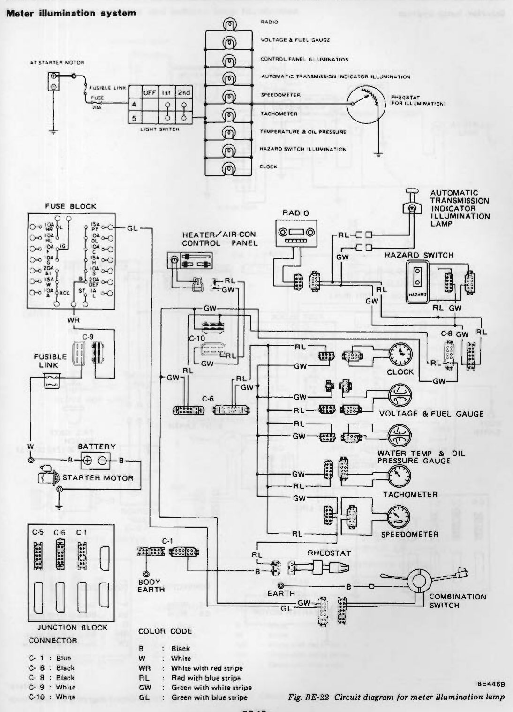
>
> - **Summary:** Wiring diagram for instrument panel, gauge, and control panel backlighting controlled by the illumination rheostat dimmer.
> - **Components:** Starter motor, Fusible link, Fuse (20A), Light switch, Rheostat (for illumination), Radio, Voltage & fuel gauge, Control panel illumination, Automatic transmission indicator illumination, Speedometer, Tachometer, Temperature & oil pressure gauge, Hazard switch illumination, Clock, Heater/air-con control panel, Fuse block, Junction block, Combination switch, Battery
> - **Callouts:** **(C-1)** Connector C-1 (Blue); **(C-6)** Connector C-6 (Black); **(C-8)** Connector C-8 (Black); **(C-9)** Connector C-9 (White); **(C-10)** Connector C-10 (White)
> - **Specs / Measurements:** Fuse: 20A
> - **Wiring / Connections:** B: Black; W: White; WR: White with red stripe; RL: Red with blue stripe; GW: Green with white stripe; GL: Green with blue stripe
> - **Mechanic Notes:** Rheostat modulates the ground return circuit (RL wire) of all instrument backlights to control illumination brightness.
> - **Tags:** `circuit diagram`, `meter illumination`, `rheostat`, `instrument cluster`, `gauges`, `dimmer`

---

<!-- Page 16 (BE-16) -->
## Interior lamp system

> 🖼️ **Fig. BE-23 Circuit diagram for interior lamp** `[BE447B]` *(Type: `electrical_schematic`)*
>
> 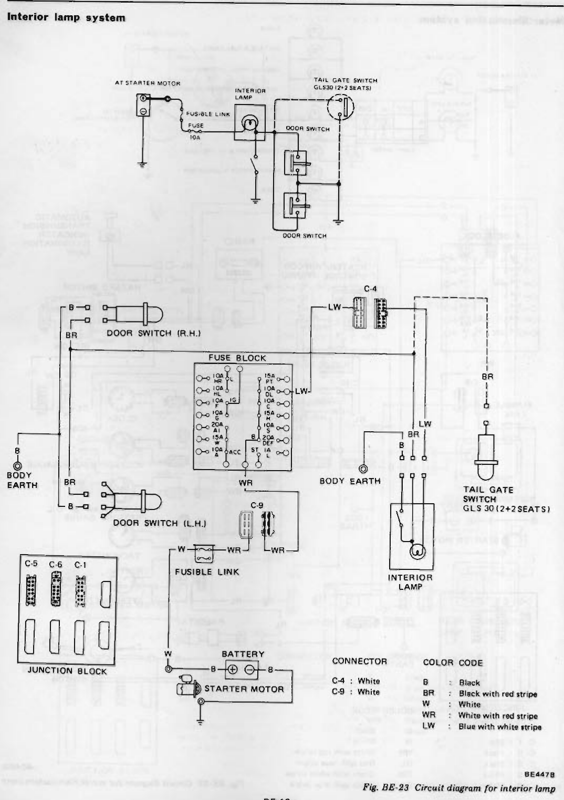
>
> - **Summary:** Wiring schematic for interior dome/courtesy lamp, operated by door jamb plunger switches and tailgate switch (2+2 models) or manual dome switch.
> - **Components:** Starter motor, Fusible link, Fuse (10A Dome Lamp), Door switch (R.H.), Door switch (L.H.), Tail gate switch (GLS30 2+2 seats), Interior lamp, Fuse block, Junction block, Battery
> - **Callouts:** **(C-4)** Connector C-4 (White); **(C-9)** Connector C-9 (White)
> - **Specs / Measurements:** Fuse (Dome Lamp): 10A
> - **Wiring / Connections:** B: Black; BR: Black with red stripe; W: White; WR: White with red stripe; LW: Blue with white stripe
> - **Mechanic Notes:** Interior lamp receives unswitched 12V (LW wire). Door switches ground the BR circuit when doors or tailgate open.
> - **Tags:** `circuit diagram`, `interior lamp`, `dome light`, `door switch`, `tailgate switch`, `courtesy lamp`

---

<!-- Page 17 (BE-17) -->
## Glove box, cigarette lighter and ashtray lamp illumination

> 🖼️ **Fig. BE-24 Circuit diagram for glove box and cigarette lighter illumination** `[BE512C]` *(Type: `electrical_schematic`)*
>
> 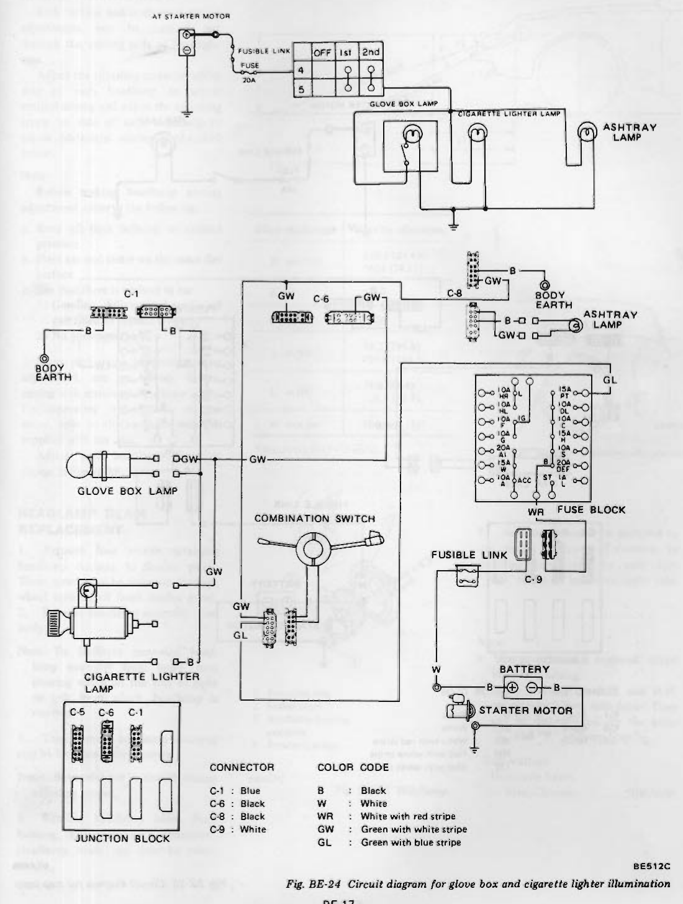
>
> - **Summary:** Wiring diagram for glove box, cigarette lighter, and ashtray illumination circuits tied to tail lamp/clearance feed.
> - **Components:** Starter motor, Fusible link, Fuse (20A), Light switch, Glove box lamp, Cigarette lighter lamp, Ashtray lamp, Fuse block, Junction block, Combination switch, Battery
> - **Callouts:** **(C-1)** Connector C-1 (Blue); **(C-6)** Connector C-6 (Black); **(C-8)** Connector C-8 (Black); **(C-9)** Connector C-9 (White)
> - **Specs / Measurements:** Fuse: 20A
> - **Wiring / Connections:** B: Black; W: White; WR: White with red stripe; GW: Green with white stripe; GL: Green with blue stripe
> - **Mechanic Notes:** Powered whenever light switch is turned to 1st or 2nd position. Glove box incorporates a plunger switch in series.
> - **Tags:** `circuit diagram`, `glove box`, `cigarette lighter`, `ashtray illumination`, `schematic`

---

<!-- Page 18 (BE-18) -->
## Map lamp system

> 🖼️ **Fig. BE-25 Circuit diagram for map lamp** `[BE449B]` *(Type: `electrical_schematic`)*
>
> 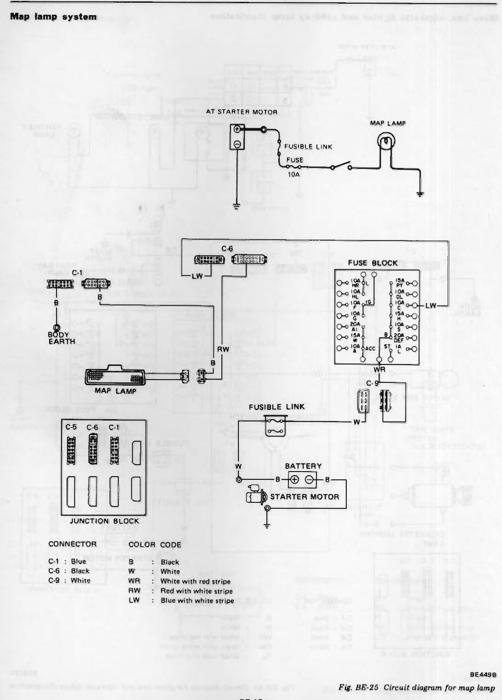
>
> - **Summary:** Wiring schematic of map reading lamp circuit powered from 10A fuse with integral switch and body grounding.
> - **Components:** Starter motor, Fusible link, Fuse (10A), Map lamp, Fuse block, Junction block, Battery
> - **Callouts:** **(C-1)** Connector C-1 (Blue); **(C-6)** Connector C-6 (Black); **(C-9)** Connector C-9 (White)
> - **Specs / Measurements:** Fuse: 10A
> - **Wiring / Connections:** B: Black; W: White; WR: White with red stripe; RW: Red with white stripe; LW: Blue with white stripe
> - **Mechanic Notes:** Mounted on central instrument finisher above radio.
> - **Tags:** `circuit diagram`, `map lamp`, `schematic`, `interior lighting`

---

<!-- Page 19 (BE-19) -->
# HEADLAMP

## AIMING ADJUSTMENT

Both vertical and horizontal aiming adjustments can be carried out through the cutting hole of headlight case.

Adjust the adjusting screw on upper side of each headlamp to adjust vertical aiming and adjust the adjusting screw on side of each headlamp to adjust horizontal aiming as sketched below.

**Note:**
Before making headlamp aiming adjustment, observe the following:
- **a.** Keep all tires inflated to correct pressure.
- **b.** Place car and tester on the same flat surface.
- **c.** See that there is no load in car.
  - 1) Gasoline, radiator and engine oil pan filled to correct levels.
  - 2) No passenger.

When performing headlamp aiming adjustment, use an aiming device, aiming wall screen or headlamp tester. For operating instructions of any aimer, refer to the operation manuals supplied with the unit.

Adjust each headlamp beam as shown in Figure BE-26.

> 🖼️ **Fig. BE-26 Headlamp aiming adjustment** `[BE983]` *(Type: `alignment_orientation`)*
>
> 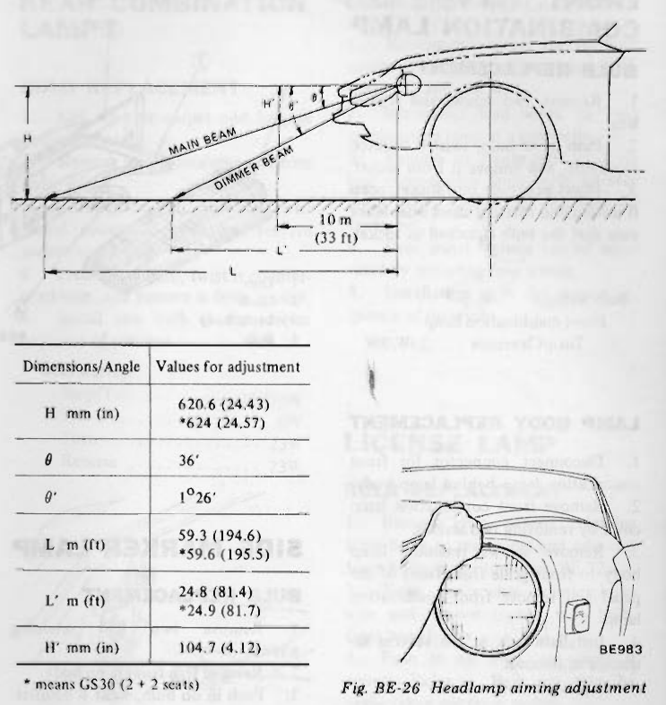
>
> - **Summary:** Headlamp beam cut-off and aiming projection diagram showing main beam and dimmer beam angles, cut-off height H and H', distance L and L', and target screen setup.
> - **Components:** Headlamp, Adjusting screw (vertical), Adjusting screw (horizontal), Aiming screen / tester
> - **Specs / Measurements:** H: 620.6 mm (24.43 in) [GS30: 624 mm (24.57 in)]; theta: 36'; theta': 1 deg 26'; L: 59.3 m (194.6 ft) [GS30: 59.6 m (195.5 ft)]; L': 24.8 m (81.4 ft) [GS30: 24.9 m (81.7 ft)]; H': 104.7 mm (4.12 in); Screen distance: 10 m (33 ft)
> - **Mechanic Notes:** Turn adjusting screw on top of headlamp for vertical aiming and side screw for horizontal aiming.
> - **Tags:** `headlamp aiming`, `beam adjustment`, `headlight alignment`, `screen`

| Dimensions/Angle | Values for adjustment |
| :--- | :--- |
| H mm (in) | 620.6 (24.43) *624 (24.57) |
| $\theta$ | $36'$ |
| $\theta'$ | $1^\circ 26'$ |
| L m (ft) | 59.3 (194.6) *59.6 (195.5) |
| L' m (ft) | 24.8 (81.4) *24.9 (81.7) |
| H' mm (in) | 104.7 (4.12) |

*\* means GS30 (2 + 2 seats)*

---

## HEADLAMP BEAM REPLACEMENT

1. Remove four screws retaining headlamp housing to fender panel. These screws can be removed through wheel opening of front fender panel.
2. Remove headlamp assembly from body.

**Note: To facilitate removing headlamp assembly from body, turn steering wheel all the way to right or left from which headlamp is removed.**

3. Then, remove headlamp retaining ring by loosening three screws.

**Note: Be careful not to disturb aiming adjusting screws.**

4. Remove headlamp beam from housing, and disconnect connector. Headlamp beam can then be taken out.
5. New unit should be installed in the reverse sequence of removal. In installing new unit, be sure that "TOP" raised on lens is on upper side.

**Note:**
- **a.** Whenever beam is replaced, adjust headlamp aiming.
- **b.** Lamp housing for L.H. and R.H. are different from each other. They can be distinguished by the letter "L" and "R" on lamp housing.

Bulb wattage: Headlamp beam: Main/Dimmer ...... 50W/40W

> 🖼️ **Fig. BE-27 Headlamp** `[BE427C]` *(Type: `exploded_view`)*
>
> 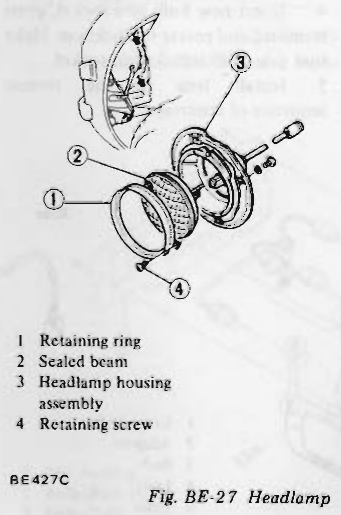
>
> - **Summary:** Exploded assembly view of sealed beam headlamp, retaining ring, mounting screws, and bucket housing.
> - **Components:** Retaining ring, Sealed beam, Headlamp housing assembly, Retaining screw
> - **Callouts:** **(1)** Retaining ring; **(2)** Sealed beam; **(3)** Headlamp housing assembly; **(4)** Retaining screw
> - **Specs / Measurements:** Wattage: Main/Dimmer 50W/40W
> - **Wiring / Connections:** 3-prong rear sealed beam connector
> - **Mechanic Notes:** 'TOP' mark embossed on lens must face upward. Loosen three retaining screws without turning aiming screws.
> - **Tags:** `headlamp`, `sealed beam`, `retaining ring`, `exploded view`

---

<!-- Page 20 (BE-20) -->
# FRONT COMBINATION LAMP

## BULB REPLACEMENT

1. Remove two screws and remove lens.
2. Push in on bulb, twist it counter-clockwise, and remove it from socket.
3. Insert new bulb into socket, press it inward and rotate it clockwise. Make sure that the bulb is locked in socket.

Bulb wattage: Front combination lamp Turn/Clearance .... 23W/8W

## LAMP BODY REPLACEMENT

1. Disconnect connector for front combination lamp behind lamp body.
2. Remove front combination lamp cover by removing two screws.
3. Remove screws retaining lamp body to front grille from front of the panel and remove front combination lamp.
4. Installation is in the reverse sequence of removal.

> 🖼️ **Fig. BE-28 Front combination lamp** `[BE614A / BE615A]` *(Type: `exploded_view`)*
>
> 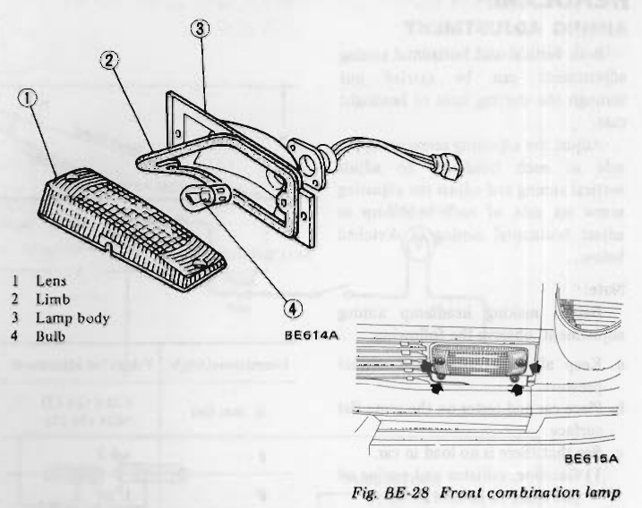
>
> - **Summary:** Exploded view of front combination turn/clearance lamp assembly and grille installation.
> - **Components:** Lens, Limb, Lamp body, Bulb
> - **Callouts:** **(1)** Lens; **(2)** Limb; **(3)** Lamp body; **(4)** Bulb
> - **Specs / Measurements:** Wattage: Turn/Clearance 23W/8W (SAE 1034)
> - **Wiring / Connections:** Pigtail wiring harness with snap connector
> - **Mechanic Notes:** Bayonet style dual-filament bulb.
> - **Tags:** `front combination lamp`, `turn signal`, `parking light`, `exploded view`

---

# SIDE MARKER LAMP

## BULB REPLACEMENT

1. Remove two lens retaining screws.
2. Remove lens from lamp body.
3. Push in on bulb, twist it counter-clockwise and remove from socket.
4. Insert new bulb into socket, press it inward and rotate it clockwise. Make sure that bulb is locked in socket.
5. Install lens in the reverse sequence of removal.

Bulb wattage: Side marker lamp ........ 8W

## LAMP BODY REPLACEMENT

1. Disconnect lead wire at a connector (front) or at two connectors (rear).
2. Remove two lens retaining screws and take out lamp body assembly.
3. Install new lamp body assembly in the reverse sequence of removal.

> 🖼️ **Fig. BE-29 Side marker lamp** `[BE616A / BE986]` *(Type: `exploded_view`)*
>
> 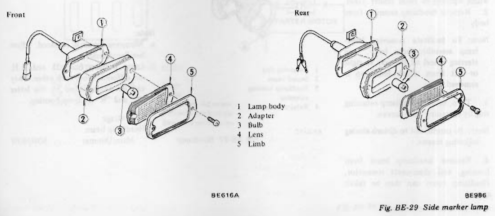
>
> - **Summary:** Exploded views of front and rear side marker lamp assemblies.
> - **Components:** Lamp body, Adapter, Bulb, Lens, Limb
> - **Callouts:** **(1)** Lamp body; **(2)** Adapter; **(3)** Bulb; **(4)** Lens; **(5)** Limb
> - **Specs / Measurements:** Wattage: 8W (SAE 67)
> - **Wiring / Connections:** Single connector (front) or dual connectors (rear)
> - **Mechanic Notes:** Amber lenses at front, red lenses at rear.
> - **Tags:** `side marker lamp`, `marker light`, `exploded view`

---

<!-- Page 21 (BE-21) -->
# INTERIOR LAMP

## BULB REPLACEMENT

1. Remove interior lamp assembly from roof. Interior lamp is retained by its spring back.
2. Pulling lamp body out a little, disconnect three connectors on its back.
3. Remove bulb from lamp body through the hole in its back.
4. Install new bulb in the reverse sequence of removal.

Bulb wattage: Interior lamp .......... 10W

## LAMP BODY REPLACEMENT

1. Remove lamp body from roof. Lamp body is attached by its spring back.
2. Pulling body out from roof, disconnect three connectors. Lamp body can then be taken out easily.
3. Install new lamp body in the reverse sequence of removal.

> 🖼️ **Fig. BE-30 Interior lamp** `[BE987]` *(Type: `exploded_view`)*
>
> 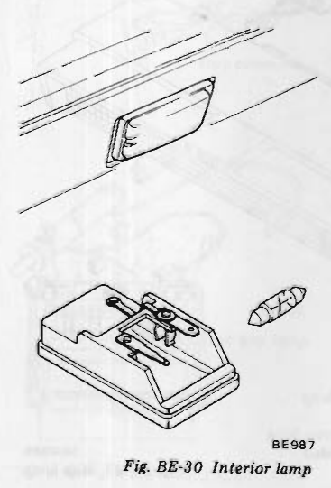
>
> - **Summary:** Roof-mounted dome lamp assembly showing spring clip mount and connector terminal tabs.
> - **Components:** Interior lamp housing, Lens, Spring back clip, Terminals
> - **Specs / Measurements:** Wattage: 10W
> - **Wiring / Connections:** 3 slide terminals on rear of housing
> - **Mechanic Notes:** Retained in headliner opening by spring back tension.
> - **Tags:** `interior lamp`, `dome lamp`, `roof lamp`

---

# REAR COMBINATION LAMP

## BULB REPLACEMENT

1. Lift up rear carpet and luggage floor center trim.
2. Remove screws retaining rear trim cover lid.
3. Through hole in rear trim, twist socket counterclockwise and remove socket with bulb.
4. Press in on bulb, twist it counterclockwise, and remove it from socket.
5. Install new bulb in the reverse sequence of removal.

Bulb wattage:
- Stop/Tail ......... 23W/8W
- Tail .............. 8W
- Turn .............. 23W
- Reverse ........... 23W

> 🖼️ **Fig. BE-31 Replacing bulbs** `[BE428C]` *(Type: `procedure_step`)*
>
> 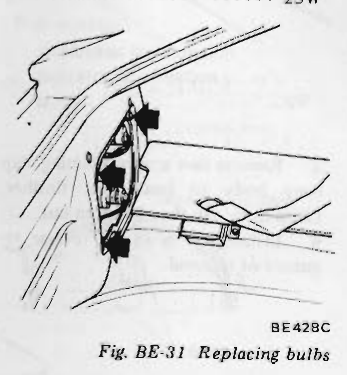
>
> - **Summary:** Illustration of technician accessing rear tail and turn lamp bulb sockets from inside the rear hatch luggage area.
> - **Components:** Rear trim panel, Bulb sockets, Rear combination lamp
> - **Mechanic Notes:** Access sockets through the hatch trim panel access flap.
> - **Tags:** `rear combination lamp`, `bulb replacement`, `luggage compartment`

## LAMP BODY REPLACEMENT

1. Remove rear carpet, luggage floor center trim, luggage floor trim (R.H. and L.H.) and rear trim.
2. Disconnect lead wires for rear combination lamp at a connector.
3. Remove six flange nuts retaining rear combination lamp body to rear body panel. Lamp body can then be taken out.
4. Rear panel finisher can be separated by removing four screws.
5. Installation is in the reverse sequence of removal.

> 🖼️ **Fig. BE-32 Rear combination lamp** `[BE451B]` *(Type: `exploded_view`)*
>
> 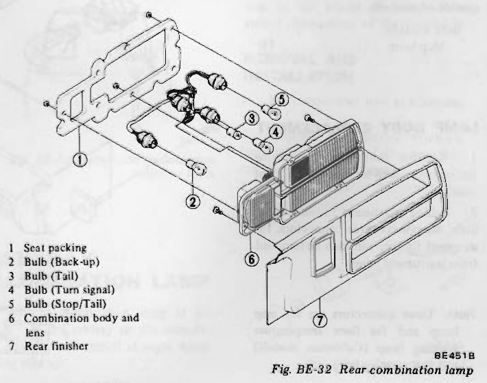
>
> - **Summary:** Exploded view of the entire rear taillight housing, lens, bulb sockets, seat packing, and exterior rear finisher.
> - **Components:** Seat packing, Bulb (Back-up), Bulb (Tail), Bulb (Turn signal), Bulb (Stop/Tail), Combination body and lens, Rear finisher
> - **Callouts:** **(1)** Seat packing; **(2)** Bulb (Back-up); **(3)** Bulb (Tail); **(4)** Bulb (Turn signal); **(5)** Bulb (Stop/Tail); **(6)** Combination body and lens; **(7)** Rear finisher
> - **Specs / Measurements:** Stop/Tail: 23W/8W (SAE 1034); Tail: 8W (SAE 67); Turn signal: 23W (SAE 1073); Back-up: 23W (SAE 1073)
> - **Wiring / Connections:** Multi-pin connector harness to chassis dash harness
> - **Mechanic Notes:** Ensure seat packing gasket is properly seated to prevent water intrusion into luggage compartment.
> - **Tags:** `rear combination lamp`, `taillight`, `exploded view`, `rear finisher`

---

# LICENSE LAMP

## BULB REPLACEMENT

1. Remove two screws retaining lamp body to rear panel and take out lamp body. Refer to Figure BE-32.
2. Twist the socket counterclockwise and remove socket, with bulb, from lamp body.
3. Push in on bulb and twist it counterclockwise. Bulb can then be easily taken out from socket.
4. Install new bulb in the reverse sequence of removal.

Bulb wattage: License lamp ....... 7.5W x 2 <!-- Page 22 (BE-22) --> ## LAMP BODY REPLACEMENT (License lamp cont.)

1. Remove two screws retaining lamp body to rear finisher and take out lamp body.
2. Disconnect pair of lead wires at connectors.
3. Install new lamp body in the reverse sequence of removal.

> 🖼️ **Fig. BE-33 License lamp** `[BE990]` *(Type: `exploded_view`)*
>
> 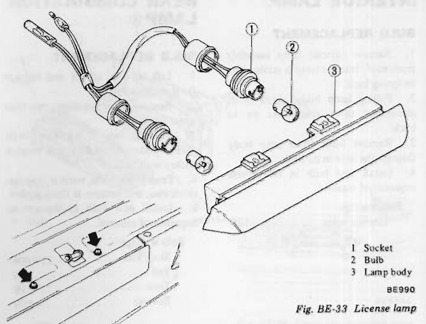
>
> - **Summary:** Exploded view of the license plate illumination lamp socket, bulb, and housing body.
> - **Components:** Socket, Bulb, Lamp body
> - **Callouts:** **(1)** Socket; **(2)** Bulb; **(3)** Lamp body
> - **Specs / Measurements:** Wattage: 7.5W x 2 (SAE 89)
> - **Wiring / Connections:** Individual bullet/spade leads
> - **Mechanic Notes:** Mounted on underside of rear finisher above license plate.
> - **Tags:** `license lamp`, `license plate light`, `exploded view`

---

# MAP LAMP

## BULB REPLACEMENT

1. Remove four screws retaining instrument finisher to instrument panel.
2. Pulling instrument finisher out a little, disconnect lead wires at three connectors. Instrument finisher can then be removed from instrument panel.

**Note: Three connectors are for map lamp, floor temperature warning lamp (California models) and fuel warning lamp.**

3. Twist socket behind map lamp and remove socket with bulb.
4. Extract bulb from socket.
5. Installation is in the reverse sequence of removal.

Bulb wattage: Map lamp ............ 5W

> 🖼️ **Fig. BE-34 Removing instrument finisher** `[BE989A]` *(Type: `procedure_step`)*
>
> 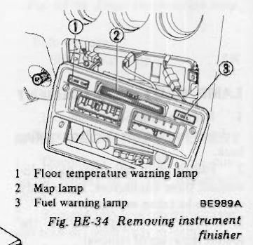
>
> - **Summary:** Center instrument finisher removal showing location of map lamp, floor temp warning lamp, and fuel warning lamp connectors.
> - **Components:** Floor temperature warning lamp, Map lamp, Fuel warning lamp, Instrument finisher
> - **Callouts:** **(1)** Floor temperature warning lamp; **(2)** Map lamp; **(3)** Fuel warning lamp
> - **Wiring / Connections:** 3 multi-pin harness connectors
> - **Mechanic Notes:** Carefully pull finisher outward to avoid snagging harness leads.
> - **Tags:** `instrument finisher`, `map lamp`, `fuel warning lamp`, `center dash`

## LAMP BODY REPLACEMENT

1. Remove four screws retaining instrument finisher to instrument panel.
2. Pulling instrument finisher out a little, disconnect three connectors. Instrument finisher can then be removed from instrument panel.

**Note: Three connectors are for map lamp and for floor temperature warning lamp (California models) and fuel warning lamp.**

3. Remove two screws retaining map lamp body to instrument finisher. Lamp body can then be taken out.
4. Installation is in the reverse sequence of removal.

> 🖼️ **Fig. BE-35 Map lamp** `[BE990A]` *(Type: `exploded_view`)*
>
> 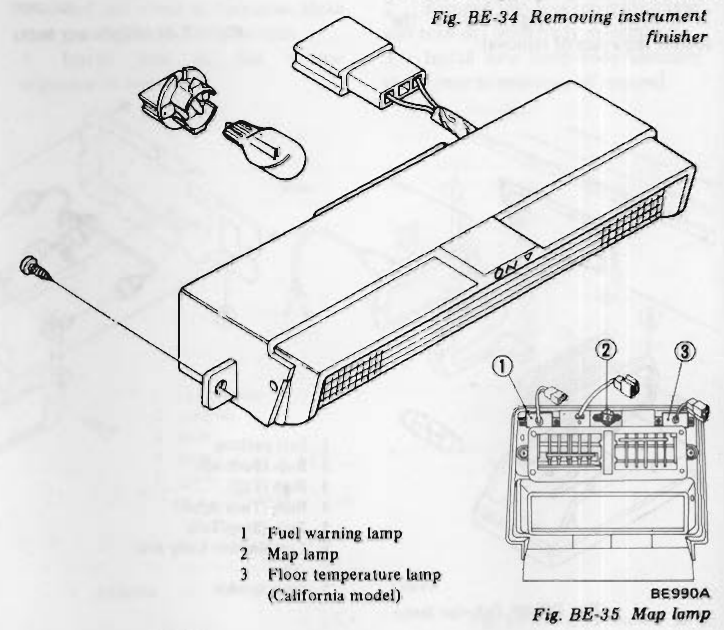
>
> - **Summary:** Exploded view of map lamp socket, lens, housing, and integration into the central dashboard finisher.
> - **Components:** Fuel warning lamp, Map lamp, Floor temperature lamp (California model), Map lamp socket, Lens, Finisher
> - **Callouts:** **(1)** Fuel warning lamp; **(2)** Map lamp; **(3)** Floor temperature lamp (California model)
> - **Specs / Measurements:** Wattage: 5W
> - **Wiring / Connections:** Connector plug at rear of lamp socket
> - **Mechanic Notes:** Map lamp switch rocker is built into the bezel.
> - **Tags:** `map lamp`, `exploded view`, `reading light`, `dash finisher`

---

<!-- Page 23 (BE-23) -->
# GLOVE BOX LAMP

## BULB REPLACEMENT

Bulb is installed at the bottom of lamp body. Pushing the bulb into switch body, twist it counterclockwise. Bulb can then be taken out. Install new bulb in reverse sequence of removal.

Bulb wattage: Glove box lamp ........ 3.4W

## LAMP BODY REPLACEMENT

1. Disconnect battery ground cable.
2. Disconnect pair of lead wires at connectors in glove box.
3. Pull the lamp body with bulb out from bracket.
4. Installation is in the reverse sequence of removal.

## INSPECTION

Test continuity between two lead wires. When plunger is pressed into lamp body, continuity must not exist. Conversely, continuity must exist when the plunger is projecting.

> 🖼️ **Fig. BE-36 Glove box lamp** `[BE992]` *(Type: `component_location`)*
>
> 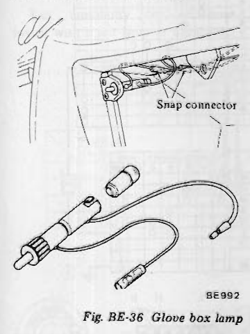
>
> - **Summary:** Glove box lamp assembly with plunger switch and snap connector mounting details.
> - **Components:** Glove box lamp assembly, Plunger switch, Snap connector, Lead wires
> - **Callouts:** **(Snap connector)** Mounting snap connector
> - **Specs / Measurements:** Wattage: 3.4W (SAE 57X)
> - **Wiring / Connections:** 2-wire bullet snap connector
> - **Mechanic Notes:** Plunger switch opens circuit when glove box door is shut.
> - **Tags:** `glove box lamp`, `switch`, `interior illumination`

---

# AUTOMATIC TRANSMISSION INDICATOR ILLUMINATION LAMP

The illumination lamp is located in the indicator finisher and illuminates the indicator of select lever. Removal and installation is described in Section BF.

## BULB REPLACEMENT

1. Remove console box.
2. Remove automatic transmission indicator finisher.
3. Remove socket with bulb from beneath indicator finisher.
4. Remove bulb from socket.
5. Install new bulb in the reverse sequence of removal.

Bulb wattage: Automatic transmission indicator illumination lamp ....... 3.4W

> 🖼️ **Fig. BE-37 Automatic transmission indicator lamp** `[BE513]` *(Type: `cutaway_flow`)*
>
> 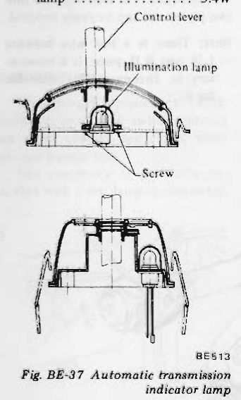
>
> - **Summary:** Sectional cutaway of automatic transmission shift quadrant showing illumination bulb placement under select lever bezel.
> - **Components:** Control lever, Illumination lamp, Screw, Indicator finisher
> - **Callouts:** **(Control lever)** Shift select lever; **(Illumination lamp)** Quadrant backlight bulb; **(Screw)** Finisher retaining screw
> - **Specs / Measurements:** Wattage: 3.4W
> - **Wiring / Connections:** Harness leads under center console
> - **Mechanic Notes:** Access bulb socket from beneath indicator finisher after console box removal.
> - **Tags:** `automatic transmission`, `shifter lamp`, `quadrant illumination`

---

# ASHTRAY ILLUMINATION LAMP

Ashtray illumination lamp is installed in the ashtray on the console. This lamp is useful at night when using ashtray.

## REMOVAL AND INSTALLATION

1. Pull up the ashtray pan and remove it.
2. Push in bulb with socket backward and take it out.
3. Remove bulb from socket (Push and turn counterclockwise).
4. Installation is in the reverse sequence of removal.

> 🖼️ **Fig. BE-38 Ashtray illumination lamp** `[BE452B]` *(Type: `component_location`)*
>
> 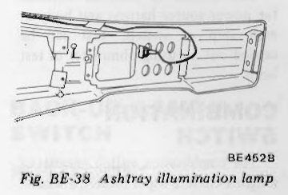
>
> - **Summary:** Mounting of the small illumination lamp in console ashtray cavity.
> - **Components:** Ashtray housing, Bulb socket, Console frame
> - **Specs / Measurements:** Wattage: 3.4W (SAE 57X)
> - **Wiring / Connections:** Console illumination sub-harness
> - **Mechanic Notes:** Remove ashtray pan first, then push socket rearward.
> - **Tags:** `ashtray illumination`, `center console`

---

# INDICATOR LAMPS

Turn signal indicator lamps and high beam indicator lamp are installed on tachometer and speedometer.

They can be replaced easily by pulling socket, with bulb, from back of meter. Refer to Meters and Gauges.

---

# INSPECTION LAMP

Inspection lamp is located on left side of engine room. Should some mechanical difficulty occur at night, this lamp is extremely useful for detection of the source of the problem and/or illumination of the repair job.

## REMOVAL AND INSTALLATION

1. Disconnect lead wire at a connector.
2. Remove two screws retaining lamp to engine room. Lamp assembly can then be taken out easily.
3. Installation is in the reverse sequence of removal.

> 🖼️ **Fig. BE-39 Inspection lamp** `[BE993]` *(Type: `exploded_view`)*
>
> 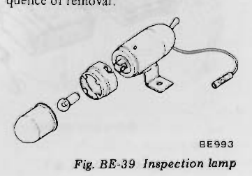
>
> - **Summary:** Exploded view of under-hood trouble inspection lamp, lens, bulb, and swivel mounting bracket.
> - **Components:** Lens, Bulb, Housing body, Swivel bracket, Switch
> - **Specs / Measurements:** Wattage: 8W (SAE 67)
> - **Wiring / Connections:** Engine room harness branch lead
> - **Mechanic Notes:** Mounted on LH inner skirt of engine compartment.
> - **Tags:** `inspection lamp`, `engine room`, `work light` <!-- Page 24 (BE-24) --> ## BULB REPLACEMENT (Inspection lamp cont.)

1. Twist socket and lens and take them out from lamp housing.
2. Push on lens and twist counter-clockwise. Lens can then be taken out from socket.
3. Push in on bulb and twist bulb counterclockwise. Bulb can then be taken out from socket.

## INSPECTION (Inspection lamp)

Test continuity between terminal for power source harness and body at each step of switch. Test can be carried out by using ohmmeter or test lamp.

---

# COMBINATION SWITCH

The combination switch consists of a light switch, a wiper switch, a washer switch, a turn signal and lane changer switch, and a dimmer switch. The two levers on the switch are for turn signal and lane changer switch and for light and wiper switch. They can be separated into two pieces. Position the turn signal switch lever at the first stop position, for left or right direction, when changing lanes. Turn signal lamps operate until the lever is released. Move the lever up and down to change headlamp between high and low beams.

Lighting switch is operated by a dial with a small knob. Wiper switch is operated by outer dial; washer switch is at the top of the switch lever.

## REMOVAL AND INSTALLATION

1. Disconnect battery ground cable.
2. Remove all screws retaining shell covers to each other and remove shell covers from steering column jacket.
3. Disconnect lead wires from combination switch at five connectors. They consist of two large connectors. One with nine terminals and the other with six terminals.
4. Remove two screws retaining combination switch to steering column jacket.

The switch will then separate into two pieces and can be easily removed.

**Note: There is a lead wire between L.H. and R.H. piece. It is unnecessary to disconnect the connector for it.**

5. Installation is in the reverse sequence of removal.

**Note: Make sure that location tab of combination switch lines up with hole in steering column jacket. Location tab is inside of turn signal switch.**

> 🖼️ **Fig. BE-40 Removing combination switch** `[BE994]` *(Type: `procedure_step`)*
>
> 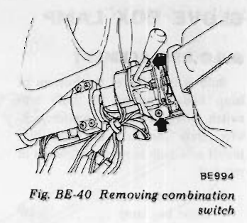
>
> - **Summary:** Removal procedure illustration showing separation of clamshell steering column covers to access the combination switch mounting screws.
> - **Components:** Steering column jacket, Upper shell cover, Lower shell cover, Combination switch screws
> - **Mechanic Notes:** Disconnect 5 connectors under column before unscrewing base.
> - **Tags:** `combination switch`, `steering column`, `shell covers`, `removal`

## INSPECTION

Test continuity through turn signal switch at each step and position with a test lamp or ohmmeter. Consult continuity diagram described in Figure BE-41.

> 🖼️ **Fig. BE-41 Combination switch** `[BE453B]` *(Type: `electrical_schematic`)*
>
> 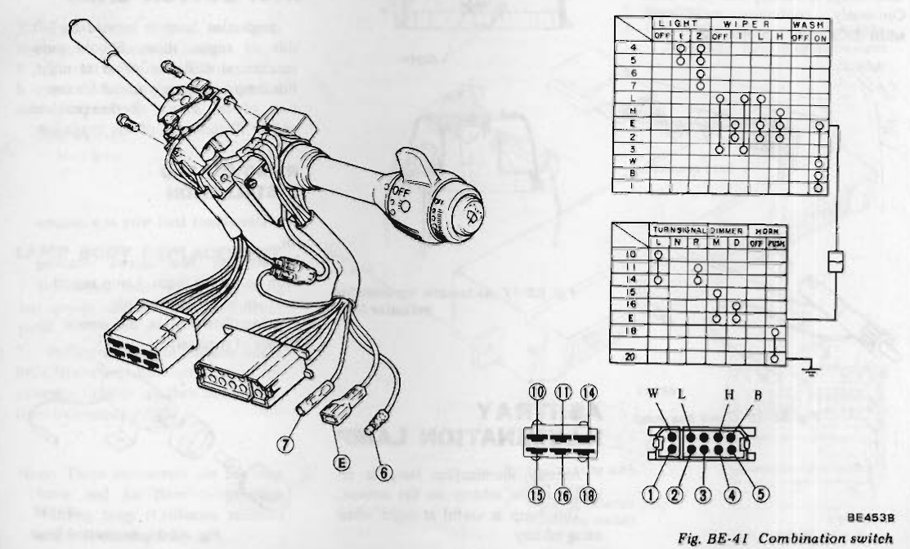
>
> - **Summary:** Combination switch assembly drawing showing LH and RH stalk assemblies, harness connectors, pin assignments, and complete switch continuity matrix tables for light, wiper, washer, turn signal, dimmer, and horn.
> - **Components:** Lighting switch dial, Wiper switch dial, Washer push button, Turn signal / lane change lever, Dimmer switch lever, 9-pin connector, 6-pin connector
> - **Callouts:** **(4)** Lighting circuit terminal 4; **(5)** Lighting circuit terminal 5; **(6)** Lighting circuit terminal 6; **(7)** Lighting circuit terminal 7; **(L)** Wiper Low speed terminal; **(H)** Wiper High speed terminal; **(E)** Earth ground terminal; **(2)** Wiper terminal 2; **(3)** Wiper terminal 3; **(W)** Washer pump terminal; **(B)** Washer terminal B; **(1)** Washer terminal 1; **(10)** Turn signal terminal 10; **(11)** Turn signal terminal 11; **(14)** Turn signal terminal 14; **(15)** Dimmer terminal 15; **(16)** Dimmer terminal 16; **(18)** Horn terminal 18; **(20)** Horn / Dimmer earth terminal 20
> - **Specs / Measurements:** LIGHT OFF: none; LIGHT 1st: 4-5 connected; LIGHT 2nd: 4-5-6-7 connected; WIPER OFF: E-2 connected; WIPER 1: L-E connected; WIPER 2: H-E connected; WASH ON: E-2-3-W-B-1 connected; TURN L: 10-14 connected; TURN R: 14-11 connected; DIMMER H: 15-E connected; DIMMER M: 15-16 connected; DIMMER D: 16-E connected; HORN PUSH: 18-20 connected
> - **Wiring / Connections:** Connector pins 10, 11, 14, 15, 16, 18, 20 (6-pin block); Connector pins W, L, H, B, 1, 2, 3, 4, 5 (9-pin block)
> - **Mechanic Notes:** Make sure that the location tab of the combination switch lines up with the hole in the steering column jacket.
> - **Tags:** `combination switch`, `switch matrix`, `continuity test`, `wiper switch`, `lighting switch`, `turn signal switch`

---

<!-- Page 25 (BE-25) -->
## DOOR SWITCH

The switch for L.H. door is different than that for R.H. door.

The switch for L.H. door has four lead wires. Two of them are for the theft protection system and the other two for the interior lamp.

The switch for R.H. door has two lead wires for the interior lamp.

### REMOVAL AND INSTALLATION

Door switch is located at L.H. and R.H. front door pillar.

1. Withdraw switch and wire assembly from front pillar.

**Note: If it proves difficult to remove by hand, it can be removed easily with aid of screwdriver.**

**In using screwdriver, however, take care not to damage painted surface.**

2. Disconnect lead wires at connectors. Switch can then be taken out.
3. Installation is in the reverse sequence of removal.

### INSPECTION

Test continuity through door switch with a test lamp or ohmmeter.

When plunger is pressed into switch assembly, door switch contacts are open. Conversely, contacts are closed when plunger is projected.

> 🖼️ **Fig. BE-42 Door switch** `[BE991A, BE996, BE992A]` *(Type: `exploded_view`)*
>
> 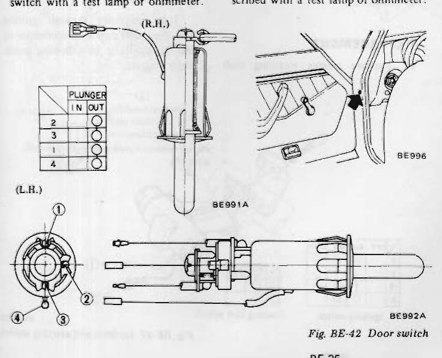
>
> - **Summary:** Illustrations showing front pillar removal location, R.H. door switch connector and plunger continuity table, and L.H. 4-wire door switch front/side views with numbered terminals.
> - **Components:** Front pillar, Door switch (R.H.), Door switch (L.H.), Switch plunger, Lead wires and connectors
> - **Callouts:** **(1)** Terminal 1; **(2)** Terminal 2; **(3)** Terminal 3; **(4)** Terminal 4
> - **Specs / Measurements:** Plunger IN: open circuit (no continuity); Plunger OUT: closed circuit (continuity across terminals 2-3 and 1-4 on L.H. switch)
> - **Wiring / Connections:** L.H. switch: 4 lead wires (two for interior lamp, two for theft protection system); R.H. switch: 2 lead wires (interior lamp)
> - **Mechanic Notes:** Use screwdriver carefully to avoid damaging painted pillar surface when prying out switch.
> - **Tags:** `door switch`, `theft protection`, `interior lamp`, `continuity`, `pillar`

## STOP LAMP SWITCH

### REMOVAL AND INSTALLATION

Stop lamp switch is integral part of brake pedal height.

Whenever stop lamp switch is removed, some adjustment is required.

1. Disconnect lead wires at connectors.
2. Loosen lock nut. Switch assembly can then be taken out by rotating switch.
3. Install in reverse sequence of removal.

### INSPECTION

When plunger is pressed into switch assembly, stop lamp switch contacts are open; contacts are closed when plunger is projected.

Test continuity as previously described with a test lamp or ohmmeter.

> 🖼️ **Fig. BE-43 Stop lamp switch** `[BE997]` *(Type: `component_location`)*
>
> 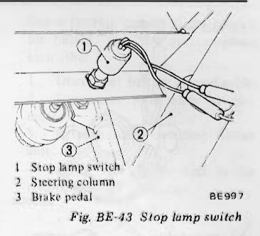
>
> - **Summary:** Component location of stop lamp switch mounted on steering column / brake pedal bracket.
> - **Components:** Stop lamp switch, Steering column, Brake pedal, Lock nut
> - **Callouts:** **(1)** Stop lamp switch; **(2)** Steering column; **(3)** Brake pedal
> - **Specs / Measurements:** Stop lamp switch contacts open when plunger is pressed in; contacts closed when plunger is projected.
> - **Wiring / Connections:** Two-prong harness connector at switch pigtail
> - **Mechanic Notes:** Switch is integral part of brake pedal height. Whenever switch is removed, brake pedal adjustment is required.
> - **Tags:** `stop lamp switch`, `brake pedal`, `lock nut`, `brake pedal height`

## BACK-UP LAMP SWITCH

### REPLACEMENT

Back-up lamp switch is installed on transmission. In manual transmission, this switch is installed on its case. In automatic transmission, the switch is an integral part of inhibitor switch. Removal and installation are described in Sections MT and AT.

### INSPECTION

When the transmission lever is in R position, continuity between these harnesses for back-up lamp switch must exist.

> 🖼️ **Fig. BE-44 Back-up lamp switch** `[BE813, BE454B]` *(Type: `component_location`)*
>
> 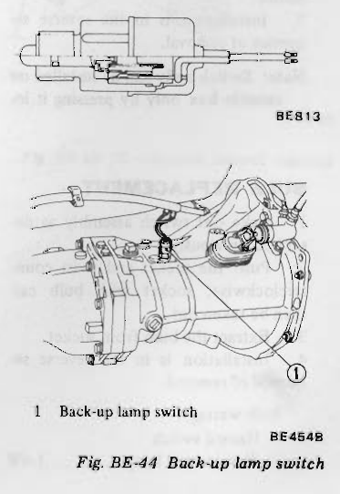
>
> - **Summary:** Cutaway view of back-up lamp plunger switch and its installation location on manual transmission rear extension housing.
> - **Components:** Back-up lamp switch, Transmission case, Plunger assembly, Wiring harness
> - **Callouts:** **(1)** Back-up lamp switch
> - **Specs / Measurements:** Continuity exists when transmission lever is in R (reverse) position.
> - **Wiring / Connections:** Two-lead wire pigtail with bullet connectors
> - **Mechanic Notes:** Installed on manual transmission case. On automatic transmission models, back-up switch function is integral to inhibitor switch.
> - **Tags:** `back-up lamp switch`, `manual transmission`, `reverse`, `continuity`

---

<!-- Page 26 (BE-26) -->

> 🖼️ **Fig. BE-45 Inhibitor switch** `[BE063B, AT087]` *(Type: `component_location`)*
>
> 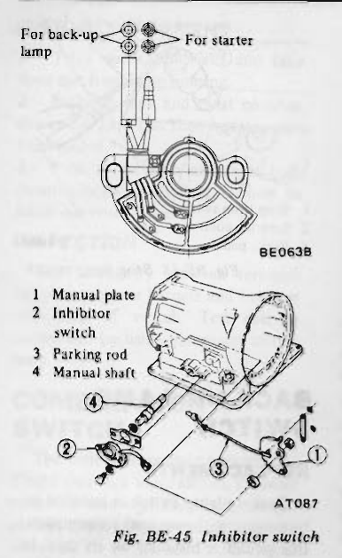
>
> - **Summary:** Inhibitor switch terminal connections (for back-up lamp and starter) and mounting location on automatic transmission manual shaft.
> - **Components:** Inhibitor switch, Manual plate, Parking rod, Manual shaft, Automatic transmission case
> - **Callouts:** **(1)** Manual plate; **(2)** Inhibitor switch; **(3)** Parking rod; **(4)** Manual shaft
> - **Wiring / Connections:** Harness branch for back-up lamp; Harness branch for starter
> - **Mechanic Notes:** Refer to Section AT and MT for removal and adjustment.
> - **Tags:** `inhibitor switch`, `automatic transmission`, `starter`, `back-up lamp`, `manual shaft`

> 🖼️ **Fig. BE-46 Hazard switch** `[BE455B]` *(Type: `exploded_view`)*
>
> 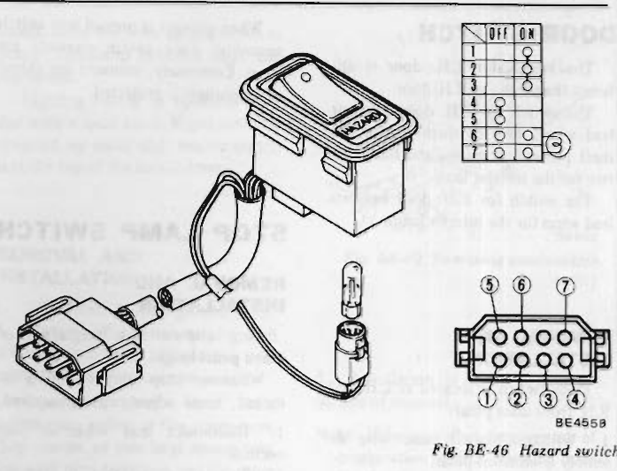
>
> - **Summary:** Exploded view of hazard warning switch assembly, illumination bulb and socket, 7-pin connector layout, and terminal continuity chart.
> - **Components:** Hazard switch body, Illumination bulb and socket, 7-pin harness connector
> - **Callouts:** **(1)** Terminal 1; **(2)** Terminal 2; **(3)** Terminal 3; **(4)** Terminal 4; **(5)** Terminal 5; **(6)** Terminal 6; **(7)** Terminal 7
> - **Specs / Measurements:** Bulb wattage: 1.4W; Continuity in OFF: Terminals 4-5 connected; Continuity in ON: Terminals 1-2-3 connected, Terminals 6-7 connected
> - **Wiring / Connections:** 7-pin connector: top row 5, 6, 7; bottom row 1, 2, 3, 4
> - **Mechanic Notes:** Push switch body out from behind console box by releasing retainers; press in to lock in console box.
> - **Tags:** `hazard switch`, `continuity`, `bulb replacement`, `pinout`

## HAZARD SWITCH

### REMOVAL AND INSTALLATION

1. Disconnect battery ground cable.
2. Remove console box, referring to Section BF.
3. From behind console box, grasp nail of switch body and push it out of console box.
4. Disconnect lead wires at a connector.
5. Installation is in the reverse sequence of removal.

**Note: Switch body can be installed on console box only by pressing it in.**

### BULB REPLACEMENT

1. Take out switch assembly as described previously.
2. Push the socket and twist counterclockwise; socket with bulb can then be taken out.
3. Extract the bulb from socket.
4. Installation is in the reverse sequence of removal.

Bulb wattage:
* Hazard switch illumination lamp: 1.4W

### INSPECTION

Test continuity through the switch at each step with an ohmmeter or test lamp.

The continuity diagram is indicated in the following figure.

## IGNITION AND STARTING SWITCH

The ignition switch is installed at bottom of steering lock. For information on engine electrical system, refer to Section EE.

### REPLACEMENT

1. Remove screws retaining shell covers to each other.
2. Remove shell covers and disconnect lead wires at a connector.

**Note: Connector is at the bottom of steering lock.**

3. Remove screw retaining switch to steering lock.

Switch assembly can be taken out easily.

4. Installation is in the reverse sequence of removal.

### INSPECTION

Test continuity through ignition switch at each step with ohmmeter or test lamp. Refer to following continuity diagram.

> 🖼️ **Fig. BE-47 Ignition and starting switch** `[BE429C]` *(Type: `exploded_view`)*
>
> 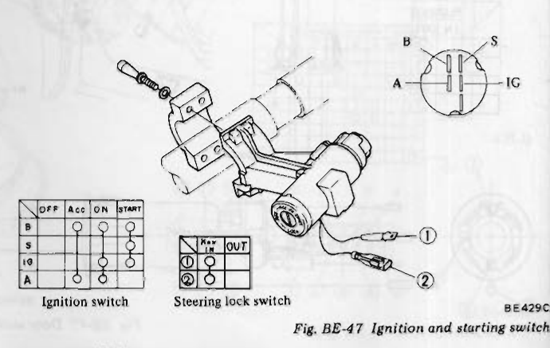
>
> - **Summary:** Ignition and starting switch mounted to steering lock housing, key cylinder switch, terminal diagram (B, S, IG, A), and continuity tables.
> - **Components:** Ignition switch, Steering lock housing, Steering lock switch, Key warning switch contact
> - **Callouts:** **(1)** Ignition switch; **(2)** Steering lock switch
> - **Specs / Measurements:** Ignition Switch Continuity: OFF (none); ACC (B to A); ON (B to IG to A); START (B to S to IG); Steering Lock Switch: Key IN (terminals 1-2 connected); Key OUT (open)
> - **Wiring / Connections:** Terminals: B (Battery), S (Starter), IG (Ignition), A (Accessory); Steering lock key switch terminals 1 and 2
> - **Mechanic Notes:** Switch retained by single screw to bottom of steering lock body.
> - **Tags:** `ignition switch`, `starting switch`, `steering lock`, `key warning`, `continuity`

---

<!-- Page 27 (BE-27) -->
## RHEOSTAT (For illumination control)

This rheostat controls the brightness of illumination for each meter, clock, radio and heater control; it is a rheostat (variable resistor) and its value can be controlled by a knob.

### REMOVAL AND INSTALLATION

1. Pull off illumination control knob and tripmeter reset knob. They should come off easily.
2. Remove tachometer. Refer to METER AND GAUGE REPLACEMENT section.
3. Loosen small screw retaining tripmeter cable to speedometer and detach cable from the hole of tachometer.
4. Disconnect leading wire to rheostat at the connector from behind instrument panel.
5. Disconnect left-hand air duct from behind instrument panel.
6. Remove screws securing tripmeter reset cable to a bracket and detach trip reset cable.
7. Loosen nut securing rheostat to the bracket and then rheostat can be taken out from behind instrument panel.
8. Installation is in the reverse sequence of removal.

> 🖼️ **Fig. BE-48 Disconnect connector for rheostat** `[BE100A]` *(Type: `procedure_step`)*
>
> 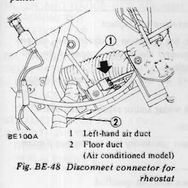
>
> - **Summary:** Location under dash showing rheostat electrical connector, left-hand air duct, and floor duct on air conditioned models.
> - **Components:** Rheostat connector, Left-hand air duct, Floor duct (Air conditioned model), Instrument harness
> - **Callouts:** **(1)** Left-hand air duct; **(2)** Floor duct (Air conditioned model)
> - **Wiring / Connections:** Two-wire connector behind instrument panel
> - **Mechanic Notes:** Disconnect ducting for clear access to rheostat connector and mounting bracket.
> - **Tags:** `rheostat`, `air duct`, `floor duct`, `air conditioning`, `connector`

### INSPECTION

Test continuity and resistance between two lead wires with ohmmeter.

When switch is in OFF position, continuity must not exist. In ON position the resistance varies from about 10 Ω to 0Ω depending on the setting of the knob.

> 🖼️ **Fig. BE-49 Illumination control rheostat** `[BE456B]` *(Type: `exploded_view`)*
>
> 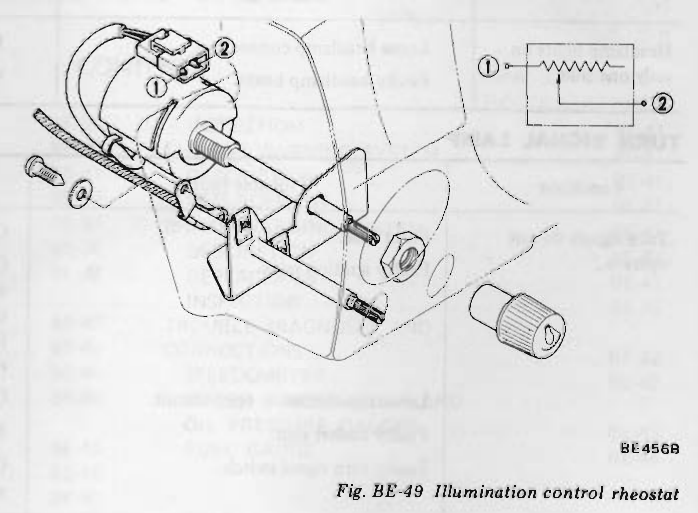
>
> - **Summary:** Exploded view of illumination control rheostat, mounting bracket, retaining nut, control knob, and variable resistor circuit schematic.
> - **Components:** Rheostat body, Mounting bracket, Retaining nut and washer, Control knob, Variable resistor winding, Wiper contact
> - **Callouts:** **(1)** Rheostat terminal 1; **(2)** Rheostat terminal 2
> - **Specs / Measurements:** OFF position: no continuity (open circuit); ON position: variable resistance from approx. 10 Ω to 0 Ω
> - **Wiring / Connections:** Two lead terminals / connector
> - **Mechanic Notes:** Knobs pull straight off. Rheostat is secured to bracket with hex nut.
> - **Tags:** `rheostat`, `dimmer`, `illumination control`, `variable resistor`, `exploded view`

## FLASHER UNIT REPLACEMENT

Two flasher units are installed at L.H. side trim under instrument panel. One is for turn signal and the other is for hazard. They are different from each other.

1. Disconnect battery ground cable.
2. Disconnect lead wires at connector.
3. Remove screw retaining flasher unit.
4. Install new flasher unit in the reverse sequence of removal.

> 🖼️ **Fig. BE-50 Flasher units** `[BE570A]` *(Type: `component_location`)*
>
> 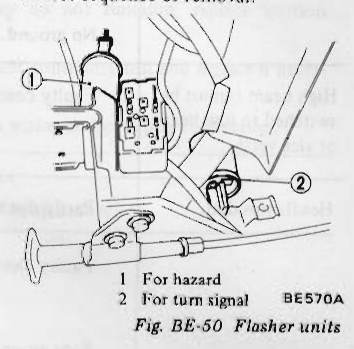
>
> - **Summary:** Location of hazard flasher and turn signal flasher units mounted under L.H. side of instrument panel.
> - **Components:** Hazard flasher unit, Turn signal flasher unit, Steering column brace, Mounting brackets
> - **Callouts:** **(1)** For hazard; **(2)** For turn signal
> - **Wiring / Connections:** Separate modular plug connectors for each flasher unit
> - **Mechanic Notes:** Hazard and turn signal flasher units are different and cannot be interchanged.
> - **Tags:** `flasher unit`, `hazard flasher`, `turn signal flasher`, `under dash`, `relay`

---

<!-- Page 28 (BE-28) -->
## TROUBLE DIAGNOSES AND CORRECTIONS

### HEADLAMP

| Condition | Probable cause | Corrective action |
| :--- | :--- | :--- |
| Headlamps do not light for either high or low beams. | Burnt fusible link. | Correct cause and replace fuse. |
| | Loose connection or open circuit. | Check wiring and/or repair connection. |
| | Faulty combination switch. | Conduct continuity test and replace if necessary. |
| | No ground. | Clean and tighten ground terminal. |
| High beam cannot be switched to low beam or vice versa. | Faulty combination switch. | Conduct continuity test and replace if necessary. |
| Headlamps dim. | Partly discharged or faulty battery. | Measure specific gravity of electrolyte and recharge or replace battery if necessary. |
| | Faulty charging system. | Measure voltage at headlamp terminals. If it is less than 12.8V, check charging system for proper operation. |
| | Poor ground or loose connection. | Clean and/or tighten. |
| | Burnt fusible link. | Replace. |
| Headlamp lights on only one side. | Loose headlamp connection. | Repair. |
| | Faulty headlamp beam. | Replace. |

### TURN SIGNAL LAMP

| Condition | Probable cause | Corrective action |
| :--- | :--- | :--- |
| Turn signals do not operate. | Burnt fuse. | Correct cause and replace. |
| | Faulty ignition relay. | Check for operation of circuits (i.e., meters and gauges) electrically connected to ignition relay. If they do not function, replace ignition relay. |
| | Loose connection or open circuit. | Check wiring and/or repair connection. |
| | Faulty flasher unit. | Replace. |
| | Faulty turn signal switch. | Conduct continuity test and replace if necessary. |
| Flashing cycle is too slow, (Pilot lamp does not go out.) or too fast. | Bulbs of other than specified wattage are being used. | Replace with one specified. |
| | Burnt bulbs. | Replace. |
| | Loose connection. | Repair. |
| | Faulty flasher unit. | Replace. |
| Flashing cycle is irregular. | Burnt bulb. | Replace. |
| | Loose connection. | Repair. |
| | Bulb of other than specified wattage is being used. | Replace with one specified. |

---

<!-- Page 29 (BE-29) -->
### TAIL LAMP, STOP LAMP AND BACK-UP LAMP

| Condition | Probable cause | Corrective action |
| :--- | :--- | :--- |
| Both right and left lamps do not light. | Burnt fuse. | Correct cause and replace. |
| | Faulty ignition relay (Back-up lamp only). | Check for operation of circuits (i.e., meters, gauges and turn signal lamp) electrically connected to ignition relay. If they do not function, replace ignition relay. |
| | Faulty back-up lamp switch. | Conduct continuity test and replace if necessary. |
| | Faulty inhibitor switch. | Conduct continuity test and replace if necessary. |
| | Loose connection or open circuit. | Check wiring and/or repair connection. |
| Lamp on only one side lights. | Burnt bulb. | Replace. |
| | Loose bulb. | Repair lamp socket. |

# METERS AND GAUGES

### CONTENTS

| Section | Page |
| :--- | :--- |
| DESCRIPTION | BE-29 |
| BULB SPECIFICATIONS | BE-30 |
| CIRCUIT DIAGRAM | BE-31 |
| METER AND GAUGE REPLACEMENT | BE-37 |
| TACHOMETER | BE-37 |
| SPEEDOMETER | BE-38 |
| TEMP-OIL AND VOLT-FUEL GAUGES | BE-39 |
| OIL PRESSURE AND WATER TEMPERATURE INDICATING SYSTEM | BE-40 |
| DESCRIPTION | BE-40 |
| REPLACEMENT | BE-40 |
| INSPECTION | BE-40 |
| VOLTMETER AND FUEL LEVEL INDICATING SYSTEM | BE-40 |
| DESCRIPTION | BE-40 |
| REPLACEMENT | BE-40 |
| INSPECTION | BE-41 |
| CHARGE WARNING SYSTEM | BE-41 |
| DESCRIPTION | BE-41 |
| REPLACEMENT | BE-41 |
| BRAKE WARNING SYSTEM | BE-41 |
| DESCRIPTION | BE-41 |
| REPLACEMENT | BE-41 |
| INSPECTION | BE-42 |
| TROUBLE DIAGNOSES AND CORRECTIONS | BE-42 |
| SPEEDOMETER | BE-42 |
| WATER TEMPERATURE AND OIL PRESSURE GAUGES | BE-43 |
| FUEL GAUGE | BE-44 |

## DESCRIPTION

This section includes information on all meters and gauges. Bulbs for indicator or for illumination can be easily replaced by twisting bulb socket.

All meters and gauges can be easily replaced without removing instrument panel.

---

<!-- Page 30 (BE-30) -->

> 🖼️ **Fig. BE-51 Meters and gauges** `[BE457B]` *(Type: `exploded_view`)*
>
> 
>
> - **Summary:** Exploded view of the instrument finisher dashboard showing speedometer, tachometer, center auxiliary gauges, clock, cigarette lighter, rheostat, and reset knob assemblies.
> - **Components:** Trip meter reset knob, Rheostat (Illumination control resistor), Bracket, Cigarette lighter retaining nut, Cigarette lighter housing, OIL-TEMP gauge, VOLT-FUEL gauge, Clock, Knob (Trip meter reset), Knob (Rheostat), Speedometer, Cigarette lighter, Escutcheon, Tachometer, Instrument finisher
> - **Callouts:** **(1)** Trip meter reset knob; **(2)** Rheostat (Illumination control resistor); **(3)** Bracket; **(4)** Cigarette lighter retaining nut; **(5)** Cigarette lighter housing; **(6)** OIL-TEMP gauge; **(7)** VOLT-FUEL gauge; **(8)** Clock; **(9)** Knob (Trip meter reset); **(10)** Knob (Rheostat); **(11)** Speedometer; **(12)** Cigarette lighter; **(13)** Escutcheon; **(14)** Tachometer; **(15)** Instrument finisher
> - **Wiring / Connections:** Main instrument cluster wiring harnesses and connectors for speedometer, tachometer, auxiliary gauges, and clock
> - **Mechanic Notes:** All meters and auxiliary gauges can be serviced from behind or front without removing the entire instrument panel assembly.
> - **Tags:** `dashboard`, `instrument panel`, `speedometer`, `tachometer`, `clock`, `meters and gauges`, `exploded view`

## BULB SPECIFICATIONS

| Item | Wattage | Q'ty | SAE trade number | Remarks |
| :--- | :---: | :---: | :---: | :--- |
| Speedometer Illumination lamp | 3.4W | 2 | 57X | |
| Tachometer Illumination lamp | 3.4W | 2 | 57X | |
| Brake warning lamp | 3.4W | 1 | 57X | |
| OIL-TEMP gauge illumination | 3.4W | 1 | 57X | |
| VOLT-FUEL gauge illumination | 3.4W | 1 | 57X | |
| CLOCK illumination lamp | 3.4W | 1 | 57X | |
| Charge warning lamp | 3.4W | 1 | 57X | |

---

<!-- Page 31 (BE-31) -->
## CIRCUIT DIAGRAM

### Tachometer operating system

> 🖼️ **Fig. BE-52 Circuit diagram for tachometer** `[BE458B]` *(Type: `electrical_schematic`)*
>
> 
>
> - **Summary:** Full electrical circuit and wiring diagram of tachometer operating system showing battery, starter motor, fusible link, ignition switch, ignition relay, fuse block, ignition coil, ballast resistor, tachometer, junction block, and connector pinouts.
> - **Components:** Starter motor, Battery, Fusible link, Ignition switch, Ignition relay, Fuse block (10A fuse), Resistor, Ignition coil, Tachometer, Junction block, Connectors C-1, C-5, C-9, Body earth
> - **Specs / Measurements:** Fuse rating: 10A (Meter/Gauge circuit)
> - **Wiring / Connections:** Color Code: B = Black, BW = Black with white stripe, W = White, WB = White with black stripe, WR = White with red stripe, L = Blue, LW = Blue with white stripe; Connector C-1: Blue; Connector C-5: White; Connector C-9: White
> - **Mechanic Notes:** Tachometer operates from voltage trigger pulse taken from ignition coil negative circuit through resistor.
> - **Tags:** `tachometer`, `circuit diagram`, `schematic`, `ignition relay`, `ignition coil`, `resistor`, `wiring`

---

<!-- Page 32 (BE-32) -->
### Water temperature and oil pressure indicating system

> 🖼️ **Fig. BE-53 Circuit diagram for water temperature and oil pressure** `[BE430C]` *(Type: `electrical_schematic`)*
>
> 
>
> - **Summary:** Schematic and harness wiring diagram of water temperature and oil pressure indicating circuits including thermal transmitter, oil pressure sending unit, bimetal gauges, voltage regulator, fuse block, ignition relay, and junction block.
> - **Components:** Battery, Starter motor, Fusible link, Ignition switch, Ignition relay, Fuse block (10A fuse), Water temperature gauge, Oil pressure gauge, Internal voltage regulator, Oil pressure sending unit, Thermal transmitter, Junction block, Connectors C-1, C-5, C-9
> - **Specs / Measurements:** Fuse: 10A
> - **Wiring / Connections:** Color Code: B = Black, BW = Black with white stripe, W = White, WB = White with black stripe, WR = White with red stripe, Y = Yellow, YB = Yellow with black stripe, L = Blue; Connector C-1: Blue; Connector C-5: White; Connector C-9: White
> - **Mechanic Notes:** Common internal voltage regulator supplies regulated power to both water temp and oil pressure bimetal gauges.
> - **Tags:** `oil pressure gauge`, `water temperature gauge`, `thermal transmitter`, `sending unit`, `schematic`, `wiring diagram`

---

<!-- Page 33 (BE-33) -->
### Voltmeter and fuel level indicating and fuel level warning system

> 🖼️ **Fig. BE-54 Circuit diagram for voltmeter and fuel level indicating and fuel level warning system** `[BE460B]` *(Type: `electrical_schematic`)*
>
> 
>
> - **Summary:** Circuit schematic and harness wiring diagram for voltmeter, fuel level gauge, fuel tank sending unit, low fuel warning lamp (floor console), ignition switch, ignition relay, and fuse block.
> - **Components:** Battery, Starter motor, Fusible link, Ignition switch, Ignition relay, Fuse block (10A fuses), Voltmeter, Fuel level gauge, Fuel tank gauge unit, Fuel warning lamp (Floor console), Junction block, Connectors C-1, C-5, C-6, C-9
> - **Specs / Measurements:** Fuses: 10A
> - **Wiring / Connections:** Color Code: B = Black, BW = Black with white stripe, W = White, WB = White with black stripe, WR = White with red stripe, RW = Red with white stripe, Y = Yellow, YL = Yellow with blue stripe, G = Green, L = Blue; Connector C-1: Blue; Connector C-5: White; Connector C-6: Black; Connector C-9: White
> - **Mechanic Notes:** Low fuel warning lamp thermistor sensor in fuel tank triggers floor console warning lamp when fuel drops below threshold.
> - **Tags:** `voltmeter`, `fuel gauge`, `fuel warning lamp`, `fuel tank unit`, `schematic`, `wiring diagram`

---

<!-- Page 34 (BE-34) -->
### Brake warning system

> 🖼️ **Fig. BE-55 Circuit diagram for brake warning system** `[BE431C]` *(Type: `electrical_schematic`)*
>
> 
>
> - **Summary:** Schematic diagram of brake warning system showing alternator IC regulator charging feedback, brake warning lamp check relay, parking brake switch, brake fluid level switch, brake warning lamp, ignition switch, and ignition relay.
> - **Components:** Battery, Fusible link, Ignition switch, Ignition relay, Fuse (10A), Brake warning lamp, Brake warning lamp check relay, Brake fluid level switch, Parking brake switch, Alternator with built-in IC regulator
> - **Specs / Measurements:** Fuse rating: 10A; Ignition switch continuity matrix: OFF, ACC, ON, ST across B, IG, ST, ACC
> - **Wiring / Connections:** Alternator terminals: A (Battery sense/output), S (Stator), L (Lamp/IC regulator), E (Ground)
> - **Mechanic Notes:** Warning lamp illuminates during bulb-check in START, or when fluid is low, or when parking brake is set, or if alternator charging output fails via the check relay.
> - **Tags:** `brake warning system`, `schematic`, `check relay`, `brake fluid level switch`, `parking brake switch`, `alternator`

---

<!-- Page 35 (BE-35) -->

> 🖼️ **Fig. BE-56 Wiring diagram for brake warning system** `[BE432C]` *(Type: `electrical_schematic`)*
>
> 
>
> - **Summary:** Full-page harness wiring diagram of brake warning system showing physical connector routing between alternator, master cylinder switch, check relay, parking brake switch, cluster lamp, fuse block, and ignition switch.
> - **Components:** Battery, Starter motor, Fusible link, Alternator, Brake master cylinder (Brake fluid level sw.), Parking brake sw., Brake warning lamp, Brake warning lamp check relay, Ignition switch, Ignition relay, Fuse block, Junction block, Connectors C-1, C-4, C-5, C-6, C-9, Body earth, Engine earth
> - **Wiring / Connections:** Color Code: B = Black, BW = Black with white stripe, W = White, WB = White with black stripe, WR = White with red stripe, GY = Green with yellow stripe, L = Blue, G = Green, Y = Yellow; Connector C-1: Blue; Connector C-4: White; Connector C-5: White; Connector C-6: Black; Connector C-9: White
> - **Mechanic Notes:** Traces harness paths through C-1, C-4, C-5, C-6, and C-9 junction blocks across firewall and interior floor.
> - **Tags:** `brake warning`, `wiring diagram`, `harness routing`, `alternator`, `master cylinder`, `parking brake`

---

<!-- Page 36 (BE-36) -->
### Charge warning lamp system

> 🖼️ **Fig. BE-57 Circuit diagram for charge warning lamp** `[BE433C]` *(Type: `electrical_schematic`)*
>
> 
>
> - **Summary:** Circuit schematic and harness wiring diagram for alternator charge warning lamp system showing connections between alternator 'L' terminal, charge warning lamp (in voltage & fuel gauge), fuse block, ignition relay, and ignition switch.
> - **Components:** Battery, Starter motor, Fusible link, Ignition switch, Ignition relay, Fuse block (10A fuse), Charge warning lamp (Voltage & fuel gauge), Alternator ('L' terminal), Junction block, Connectors C-1, C-6, C-9, Engine earth
> - **Specs / Measurements:** Fuse rating: 10A
> - **Wiring / Connections:** Color Code: B = Black, BW = Black with white stripe, W = White, WB = White with black stripe, WR = White with red stripe, G = Green, L = Blue; Connector C-1: Blue; Connector C-6: Black; Connector C-9: White
> - **Mechanic Notes:** Charge warning lamp is powered from ignition relay and grounded through alternator 'L' terminal when alternator is not charging.
> - **Tags:** `charge warning lamp`, `alternator`, `schematic`, `wiring diagram`, `voltmeter`, `ignition relay`

---

<!-- Page 37 (BE-37) -->
# METER AND GAUGE REPLACEMENT

## TACHOMETER

> 🖼️ **Fig. BE-58 Tachometer** `[BE464B]` *(Type: `component_location`)*
>
> 
>
> - **Summary:** Rear view of tachometer showing bulb sockets, harness pigtail, 8-pin connector pinout, and dial face (0-8000 RPM).
> - **Components:** Tachometer housing, Dial face (0-8 x 1000 rpm), Turn signal pilot lamps (2), Illumination lamps (2), Wiring harness pigtail, Harness connector
> - **Callouts:** **(RL)** Red with blue stripe; **(GR)** Green with red stripe; **(B)** Black; **(L)** Blue; **(GW)** Green with white stripe; **(GB)** Green with black stripe; **(LB)** Blue with black stripe
> - **Specs / Measurements:** Trigger type: Voltage trigger type
> - **Wiring / Connections:** Connector wire colors: RL, GR, B, L, GW, GB, LB
> - **Mechanic Notes:** Sockets are removed by twisting counterclockwise from the rear casing.
> - **Tags:** `tachometer`, `gauge face`, `bulb socket`, `turn signal indicator`, `connector pinout`

The tachometer is retained by two screws, and can be taken out easily. A pair of turn signal indicator lamps and a pair of illumination lamps are also installed. Their bulbs can be removed easily by twisting socket at back of tachometer.

This tachometer is a voltage trigger type.

### Removal and installation

1. Remove screw ① retaining tachometer at upper side of instrument panel. See following figure.

> 🖼️ **Fig. BE-59 Removing screws** `[BE465B]` *(Type: `procedure_step`)*
>
> 
>
> - **Summary:** Sectional profile illustration showing locations of upper retaining screw ① and lower retaining screw ② for cluster meters.
> - **Components:** Upper retaining screw 1, Lower retaining screw 2, Instrument finisher, Support bracket
> - **Callouts:** **(1)** Upper retaining screw; **(2)** Lower retaining screw
> - **Mechanic Notes:** Upper screw accessed from front; lower screw reached from underneath instrument panel.
> - **Tags:** `tachometer removal`, `screws`, `dashboard bracket`, `procedure`

> 🖼️ **Fig. BE-60 Removing screw - ①** `[BE663A]` *(Type: `procedure_step`)*
>
> 
>
> - **Summary:** Front dashboard view showing screwdriver loosening upper tachometer retaining screw ①.
> - **Components:** Tachometer dial, Upper retaining screw 1, Instrument hood
> - **Callouts:** **(1)** Upper retaining screw
> - **Mechanic Notes:** Use care with screwdriver tip near dial and lens.
> - **Tags:** `tachometer`, `upper screw`, `dashboard`, `removal`

2. Working from beneath instrument panel, remove the other screw ② retaining tachometer to bracket of instrument panel.

> 🖼️ **Fig. BE-61 Removing screw - ②** `[BE110A]` *(Type: `procedure_step`)*
>
> 
>
> - **Summary:** Under-dash view showing screwdriver loosening lower tachometer retaining screw ② at steering shaft bracket.
> - **Components:** Steering shaft, Tachometer retaining screw 2, Tachometer casing
> - **Callouts:** **(1)** Steering shaft; **(2)** Tachometer retaining screw; **(3)** Tachometer
> - **Mechanic Notes:** Work from beneath instrument panel near steering column.
> - **Tags:** `tachometer`, `lower screw`, `steering column`, `removal`

3. Pulling tachometer assembly out from instrument panel, disconnect connector to instrument harness. Tachometer assembly can then be taken out easily.

> 🖼️ **Fig. BE-62 Disconnecting connector** `[BE669B]` *(Type: `procedure_step`)*
>
> 
>
> - **Summary:** Pulling tachometer forward out of instrument panel and disconnecting modular wire harness connector.
> - **Components:** Tachometer body, Instrument harness connector, Instrument panel opening
> - **Wiring / Connections:** Modular multipin connector to main dash harness
> - **Mechanic Notes:** Release locking tab on connector before pulling.
> - **Tags:** `tachometer`, `disconnect connector`, `harness`, `removal`

---

<!-- Page 38 (BE-38) -->
### Bulb replacement

Pull out socket, with bulb, from back of tachometer and extract bulb from socket.

Install new bulb in reverse sequence of removal.

Bulb wattage:
* Turn signal indicator lamp: 3.4W
* Illumination lamp: 3.4W

## SPEEDOMETER

Speedometer is attached by two screws.

High beam indicator lamp, brake warning lamp, an odometer and a tripmeter are integral parts of speedometer. On manual transmission models, a speed switch with amplifier is added.

Consequently, speedometer on manual transmission models is different from that on automatic transmission models. All bulbs on speedometer can be replaced easily.

### Removal and installation

1. Remove tachometer as described previously.
2. Disconnect speedometer cable at junction screw on back of meter.
3. Through hole in which tachometer is installed, disconnect trip meter reset cable.

**Note: Reset cable can be removed from speedometer by loosening a small screw.**

> 🖼️ **Fig. BE-64 Removing reset cable** `[BE113A]` *(Type: `procedure_step`)*
>
> 
>
> - **Summary:** Loosening small set screw to disconnect trip meter reset cable through the tachometer opening in the dash.
> - **Components:** Tripmeter reset cable, Retaining small screw, Speedometer casing
> - **Callouts:** **(1)** Tripmeter reset cable; **(2)** Retaining small screw
> - **Mechanic Notes:** Access the reset cable through the vacant tachometer hole after tachometer has been removed.
> - **Tags:** `speedometer`, `trip meter`, `reset cable`, `small screw`

4. Remove screw ① retaining speedometer. See following figure.

> 🖼️ **Fig. BE-65 Removing screws** `[BE671B]` *(Type: `procedure_step`)*
>
> 
>
> - **Summary:** Side sectional diagram illustrating positions of upper screw ① and lower screw ② holding speedometer in instrument panel.
> - **Components:** Upper screw 1, Lower screw 2, Instrument cluster hood, Mounting bracket
> - **Callouts:** **(1)** Upper retaining screw; **(2)** Lower retaining screw
> - **Mechanic Notes:** Identical mounting configuration to the tachometer.
> - **Tags:** `speedometer`, `screws`, `removal`, `instrument panel`

> 🖼️ **Fig. BE-66 Removing screw - ①** `[BE114A]` *(Type: `procedure_step`)*
>
> 
>
> - **Summary:** Front view showing screwdriver loosening upper speedometer retaining screw ①.
> - **Components:** Speedometer dial, Upper retaining screw 1
> - **Callouts:** **(1)** Upper retaining screw
> - **Mechanic Notes:** Remove through front bezel opening.
> - **Tags:** `speedometer`, `upper screw`, `removal`

5. Working from beneath instrument panel, remove other screw ② retaining speedometer to bracket of instrument panel.

> 🖼️ **Fig. BE-67 Removing screw - ②** `[BE100A]` *(Type: `procedure_step`)*
>
> 
>
> - **Summary:** View beneath instrument panel showing screwdriver loosening lower speedometer retaining screw ② near speedometer cable and harness connector.
> - **Components:** Speedometer cable, Connector, Lower retaining screw 2, Bracket
> - **Callouts:** **(2)** Lower retaining screw
> - **Mechanic Notes:** Reach up from underneath dash behind the steering column.
> - **Tags:** `speedometer`, `lower screw`, `speedometer cable`, `under dash`

> 🖼️ **Fig. BE-63 Speedometer** `[BE434C]` *(Type: `component_location`)*
>
> 
>
> - **Summary:** Rear view of speedometer with bulb socket callouts, connector pinout (L, RL, GW, R, WB, B, GY, RW), and front dials for U.S.A. (160 mph) and Canada (240 km/h).
> - **Components:** Speedometer casing, High beam warning lamp socket, Illumination lamp sockets (2), Trip counter reset cable attachment, Brake warning lamp socket, Speedometer dial (U.S.A. 160 mph), Speedometer dial (Canada 240 km/h), Wiring harness connector
> - **Callouts:** **(1)** High beam warning lamp; **(2)** Illumination lamp; **(3)** Trip counter reset cable; **(4)** Illumination lamp; **(5)** Brake warning lamp
> - **Specs / Measurements:** Speedometer dial U.S.A.: 160 mph; Speedometer dial Canada: 240 km/h
> - **Wiring / Connections:** Connector wire colors: L, RL, GW, R, WB, B, GY, RW
> - **Mechanic Notes:** Manual transmission speedometer includes speed switch for emissions EFI circuit.
> - **Tags:** `speedometer`, `dial`, `high beam indicator`, `brake warning lamp`, `connector`, `pinout` <!-- Page 39 (BE-39) --> 6. Pulling speedometer out from instrument harness, disconnect a connector for instrument harness.

Speedometer can then be taken out.

> 🖼️ **Fig. BE-68 Disconnecting connector** `[BE672B]` *(Type: `procedure_step`)*
>
> 
>
> - **Summary:** Disconnecting wiring harness connector from back of speedometer after pulling speedometer forward.
> - **Components:** Speedometer casing, Harness connector, Instrument panel opening
> - **Wiring / Connections:** Multipin speedometer harness plug
> - **Mechanic Notes:** Support the meter body with one hand while depressing the connector release lock.
> - **Tags:** `speedometer`, `disconnect connector`, `removal`

### Bulb replacement

Pull out socket, with bulb, from back of speedometer and extract bulb from socket.

Install new bulb in reverse sequence of removal.

Bulb wattage:
* High beam indicator: 3.4W
* Brake warning lamp: 3.4W

## TEMP-OIL AND VOLT-FUEL GAUGES

These gauges are attached to instrument panel with spring bracket. The spring bracket is retained by a screw. Consequently, each gauge can be easily taken out by removing retaining screw.

### Removal and installation

1. Remove four screws retaining instrument finisher to instrument panel. Pulling instrument finisher out a little, disconnect two connectors.

Instrument finisher can then be taken out.

> 🖼️ **Fig. BE-70 Removing instrument finisher** `[BE989A]` *(Type: `procedure_step`)*
>
> 
>
> - **Summary:** Removing center console/finisher panel containing floor temperature, map lamp, and fuel warning lamp.
> - **Components:** Instrument finisher, Floor temperature warning lamp (California models), Map lamp, Fuel warning lamp
> - **Callouts:** **(1)** Floor temperature warning lamp (California models); **(2)** Map lamp; **(3)** Fuel warning lamp
> - **Wiring / Connections:** Two electrical connectors (three for California models with floor temp lamp)
> - **Mechanic Notes:** Pull finisher outward gently to avoid snapping retaining tabs before disconnecting wire plugs.
> - **Tags:** `instrument finisher`, `map lamp`, `fuel warning lamp`, `removal`

2. Remove two screws retaining three-way venti-duct to instrument panel and four screw for bracket.

> 🖼️ **Fig. BE-71 Removing three-way duct retaining screws**  *(Type: `procedure_step`)*
>
> 
>
> - **Summary:** Removing retaining screws securing three-way ventilation duct behind center dashboard finisher.
> - **Components:** Three-way venti-duct, Retaining screws, Instrument panel frame
> - **Specs / Measurements:** Two screws for three-way venti-duct; four screws for bracket
> - **Mechanic Notes:** Remove ventilation duct to expose auxiliary gauge retaining screws.
> - **Tags:** `three-way duct`, `venti-duct`, `ventilation`, `screws`, `removal`

3. Disconnect duct hoses from three-way duct and take out three-way duct.
4. Remove screw retaining each gauge to instrument panel.

> 🖼️ **Fig. BE-72 Removing gauge retaining screws** `[BE117A]` *(Type: `procedure_step`)*
>
> 
>
> - **Summary:** Unscrewing spring bracket retaining screw holding auxiliary gauge pod into instrument panel.
> - **Components:** Gauge retaining screw, Spring bracket, Center gauge pod
> - **Mechanic Notes:** Loosen bracket screw and release spring tension to push gauge out from rear.
> - **Tags:** `auxiliary gauges`, `spring bracket`, `retaining screw`, `removal`

> 🖼️ **Fig. BE-69 TEMP-OIL and VOLT-FUEL gauges** `[BF673B]` *(Type: `exploded_view`)*
>
> 
>
> - **Summary:** Front faces, spring clamp profile, and rear wiring socket configurations for VOLTS-FUEL and TEMP-OIL dual auxiliary gauges.
> - **Components:** VOLTS & FUEL gauge, TEMP & OIL gauge, Spring bracket, Charge warning lamp socket, Illumination lamp sockets, Harness connectors
> - **Callouts:** **(1)** Charge warning lamp; **(2)** Illumination lamp
> - **Wiring / Connections:** VOLT-FUEL gauge: Two connectors (2-pin with RW, B / GW; 6-pin with RL, Y, L / L, G, B); TEMP-OIL gauge: One 6-pin connector (YB, Y, L / RL, B, GW)
> - **Mechanic Notes:** VOLT-FUEL has two separate connectors; TEMP-OIL has one six-terminal connector.
> - **Tags:** `voltmeter`, `fuel gauge`, `oil pressure gauge`, `water temp gauge`, `pinout`, `exploded view` <!-- Page 40 (BE-40) --> 5. Pulling gauge out backward, disconnect each connector. Gauge can then be taken out.

**Note: TEMP-OIL gauge has a connector with six terminals. VOLT-FUEL gauge has two connectors: a larger one and a smaller one.**

### Bulb replacement

Illumination bulb can be taken out easily by pulling socket with bulb at back of each gauge.

Extract bulb from socket and install new bulb in reverse sequence of removal.

Bulb wattage:
* Illumination bulb: 3.4W

## OIL PRESSURE AND WATER TEMPERATURE INDICATING SYSTEM

### DESCRIPTION

The oil pressure sending unit consists of an oil pressure switch and an oil pressure gauge. The oil pressure switch is used as a control unit of the fuel pump.

The oil pressure gauge consists of a bimetal meter unit, a variable resistance sensing unit (incorporating a diaphragm) and a voltage regulator.

As oil pressure varies, the diaphragm moves accordingly, causing the sliding contact to move along the resistance. This changes the amount of current that can flow in the circuit and actuates the bimetal.

The water temperature gauge consists of a meter and thermal transmitter located in the engine block. The thermal transmitter is equipped with a thermistor element which converts cooling water temperature variation to a resistance, thereby controlling current flowing to the gauge.

The oil pressure gauge and water temperature gauge are equipped with a bimetal arm and heater coil.

When the ignition switch is set to "ON", current flows to the heater coil, and the heater coil is heated. With this heat, the bimetal arm is bent, thus causing the pointer connected to the bimetal arm to move. The characteristics of both gauges are the same.

If both the oil pressure and water temperature gauges become faulty at the same time, the fault may lie in the voltage regulator.

### REPLACEMENT

#### OIL-TEMP gauge

Refer to previous section "Meter and Gauge Replacement".

#### Oil pressure sending unit

The oil pressure sending unit is located on cylinder block beside oil filter element. The unit can be removed by unscrewing it. Be sure to apply conductive sealer to threads prior to installing new unit.

> 🖼️ **Fig. BE-73 Oil pressure sending unit** `[ER431]` *(Type: `component_location`)*
>
> 
>
> - **Summary:** Location of oil pressure sending unit mounted on engine block beside oil filter mount.
> - **Components:** Oil pressure sending unit, Oil filter, Cylinder block, Wiring connector
> - **Wiring / Connections:** Dual-terminal sender connection (pressure gauge signal and fuel pump safety switch)
> - **Mechanic Notes:** Apply conductive sealer to threads before screwing in new sender; do not overtighten.
> - **Tags:** `oil pressure sending unit`, `oil filter`, `engine block`, `location`, `conductive sealer`

#### Thermal transmitter

To replace thermal transmitter, disconnect lead wire from its terminal and unscrew thermal transmitter from oil filter bracket.

Be sure to apply conductive sealer to threads prior to installing new thermal transmitter.

> 🖼️ **Fig. BE-74 Thermal transmitter** `[BE065B]` *(Type: `component_location`)*
>
> 
>
> - **Summary:** Thermostat housing sensor arrangement showing thermal transmitter, EFI water temperature sensor, and thermotime switch.
> - **Components:** Thermal transmitter, Water temperature sensor (For Electronic Fuel Injection System), Thermotime switch (For Electronic Fuel Injection System), Thermostat housing
> - **Callouts:** **(1)** Thermal transmitter; **(2)** Water temperature sensor (For Electronic Fuel Injection System); **(3)** Thermotime switch (For Electronic Fuel Injection System)
> - **Wiring / Connections:** Single-wire push-on spade connector for gauge thermal transmitter
> - **Mechanic Notes:** Apply conductive sealer to threads upon installation. Do not confuse gauge sender (1) with EFI sensors (2 and 3).
> - **Tags:** `thermal transmitter`, `water temperature sensor`, `thermotime switch`, `thermostat housing`, `EFI`

### INSPECTION

Check each unit for proper operation.

Test continuity of oil pressure gauge and water temperature indicating system with test lamp or ohmmeter. See Figure BE-53.

Test continuity of oil pressure switch, referring to Fuel Pump Control System (Section EF).

## VOLTMETER AND FUEL LEVEL INDICATING SYSTEM

### DESCRIPTION

The fuel level indicating system consists of a tank unit and a fuel level gauge. The tank unit consists of a float which moves up and down in the fuel tank with changes in fuel level, and a sliding contact that slides back and forth on a resistance when the float moves. This changes the amount of electric resistance offered by the tank unit and controls the current flowing to the fuel level gauge. The gauge moves with the changes in current flow.

The fuel gauge is equipped with a bimetal arm and heat coil. When the ignition switch is turned "ON", current flows to the heater coil, and the heater coil is heated. With this heat, the bimetal arm is bent, thus causing the pointer connected to the bimetal arm to move.

The voltmeter monitors the condition of electrical system and battery. It is in good order if it registers more than 11 volts before and during engine starting, and 6 to 8 volts during engine cranking. If it registers more than 15.5 volts during engine running, voltage regulator is out of order.

### REPLACEMENT

#### VOLT-FUEL gauge

Refer to previous section Meter and Gauge Replacement.

---

<!-- Page 41 (BE-41) -->
#### Fuel tank gauge unit

Refer to Section FE (Fuel and Exhaust system) for Replacement.

> 🖼️ **Fig. BE-75 Fuel tank gauge unit** `[BE005B]` *(Type: `component_location`)*
>
> 
>
> - **Summary:** Fuel tank sender unit assembly with float arm, level rheostat, low-fuel thermistor, and terminal plug.
> - **Components:** Fuel tank gauge unit, Float arm, Level rheostat, Low fuel thermistor sensor, Connector plug
> - **Callouts:** **(1)** Black (B) Ground; **(2)** Yellow (Y) Fuel Gauge; **(3)** Yellow with blue stripe (YL) Warning Lamp
> - **Wiring / Connections:** Terminals: 1 (B), 2 (Y), 3 (YL)
> - **Mechanic Notes:** Refer to Section FE for fuel tank drop and replacement details.
> - **Tags:** `fuel tank unit`, `fuel gauge sender`, `float`, `low fuel warning`, `terminals`

#### Fuel warning lamp bulb

1. Remove four screws retaining instrument finisher to instrument panel.
2. Pull instrument finisher forward slightly, and disconnect lead wires at three connectors. Instrument finisher can then be removed from instrument panel.

**Note: Three connectors are for map lamp, floor temperature warning lamp (California models) and fuel warning lamp.**

3. Pull out socket and bulb from back of lamp body and extract bulb from socket.
4. Install new bulb. Installation is in the reverse sequence of removal.

Bulb wattage:
* Fuel warning lamp: 3.4W

> 🖼️ **Fig. BE-76 Fuel warning lamp** `[BE989A, BE006B]` *(Type: `component_location`)*
>
> 
>
> - **Summary:** Instrument finisher panel underside and individual fuel warning lamp body with socket and bulb.
> - **Components:** Floor temperature warning lamp (California models), Map lamp, Fuel warning lamp body, Lamp socket, Bulb
> - **Callouts:** **(1)** Floor temperature warning lamp (California models); **(2)** Map lamp; **(3)** Fuel warning lamp
> - **Specs / Measurements:** Bulb wattage: 3.4W
> - **Wiring / Connections:** Two-wire plug connector to console harness
> - **Mechanic Notes:** Bulb socket twists out from the rear of the individual warning lamp housing.
> - **Tags:** `fuel warning lamp`, `map lamp`, `finisher`, `bulb replacement`

#### Lamp body

1. Remove four screws retaining instrument finisher to instrument panel.
2. Pull instrument finisher forward slightly, and disconnect lead wires at connectors. Instrument finisher can then be removed from instrument panel.

**Note: Three connectors are for map lamp, floor temperature warning lamp (California models) and fuel warning lamp.**

3. Remove two screws retaining warning lamp body to instrument finisher. Lamp body can then be taken out.
4. Installation is in the reverse sequence of removal.

### INSPECTION

Test continuity of voltmeter and fuel level indicating system with test lamp or ohmmeter. See Figure BE-54.

## CHARGE WARNING SYSTEM

### DESCRIPTION

Refer to Charging Circuit (Section EE).

### REPLACEMENT

#### Charge warning lamp bulb

The charge warning lamp is built into the voltmeter.

1. Remove four screws retaining instrument finisher to instrument panel.
2. Pull instrument finisher forward slightly and disconnect lead wires at three connectors. Instrument finisher can then be removed from instrument panel.

**Note: Three connectors are for map lamp, floor temperature warning lamp (California models) and fuel warning lamp.**

3. Pull out socket and bulb from back of voltmeter and extract bulb from socket.
4. Install new bulb. Installation is in the reverse sequence of removal.

Bulb wattage:
* Charge warning lamp: 3.4W

## BRAKE WARNING SYSTEM

### DESCRIPTION

The brake warning system consists of a warning lamp, a parking brake switch and a brake fluid level switch.

The brake warning lamp checking system consists of a warning lamp, a check relay and an IC regulator (alternator).

This warning light functions for both the parking brake and foot brake systems. The warning light glows when the ignition switch is turned to the "ON" position and the engine is not running. If the light does not glow, check the electrical system for a burned-out bulb or an open circuit.

The warning light will continue to glow when the parking brake is applied with the engine running.

The warning light glows when the fluid level is lower than the prescribed level, the ignition switch is "ON", the engine is running, and the parking brake is free.

### REPLACEMENT

#### Parking brake switch

The parking brake switch is mounted on lever support bracket.

To replace parking brake switch, disconnect lead wire at connector plug and pull switch assembly out of bracket.

When plunger is pressed into switch assembly, parking brake switch contacts are open. Contacts are closed when plunger is projected.

---

<!-- Page 42 (BE-42) -->

> 🖼️ **Fig. BE-77 Parking brake switch** `[BE122A]` *(Type: `component_location`)*
>
> 
>
> - **Summary:** Parking brake hand lever mechanism showing switch mounted to lever support bracket.
> - **Components:** Parking brake hand lever, Lever support bracket, Parking brake switch, Lead wire connector
> - **Specs / Measurements:** Plunger in: contacts open; Plunger projected: contacts closed
> - **Wiring / Connections:** Single bullet connector lead wire
> - **Mechanic Notes:** Switch grounds through lever bracket mounting.
> - **Tags:** `parking brake switch`, `hand brake`, `lever bracket`, `location`

#### Brake fluid level switch

Brake fluid level switch is built into brake master cylinder cap. The cap can be easily removed by twisting it after disconnecting lead wire terminals. Then replace cap.

#### Brake warning lamp check relay

The relay is attached to the floor under the front passenger seat.

1. Disconnect battery ground cable.
2. Remove four bolts securing front passenger seat in place, and remove seat.
3. Disconnect connector from relay.
4. Remove two screws retaining relay. Relay can then be taken out.
5. Installation is in the reverse sequence of removal.

> 🖼️ **Fig. BE-78 Brake warning lamp check relay** `[EC252A]` *(Type: `component_location`)*
>
> 
>
> - **Summary:** Floor pan layout under front passenger seat showing location of brake warning lamp check relay and floor sensor relay.
> - **Components:** Brake warning lamp check relay, Floor sensor relay, Passenger seat floor pan, Harness connector
> - **Callouts:** **(Front)** Vehicle forward direction; **(Brake warning lamp check relay)** Forward relay; **(Floor seansor relay)** Rear relay
> - **Wiring / Connections:** Modular multipin relay plug connector
> - **Mechanic Notes:** Remove four passenger seat mounting bolts to lift out seat for access to floor-mounted relays.
> - **Tags:** `brake warning check relay`, `floor sensor relay`, `passenger seat`, `floor pan`

### INSPECTION

Check each switch for proper operation and test continuity of wiring system with ohmmeter or test lamp. Take care that each connection is correctly secured.

## TROUBLE DIAGNOSES AND CORRECTIONS

### SPEEDOMETER

| Condition | Probable cause | Corrective action |
| :--- | :--- | :--- |
| Speedometer pointer and odometer do not operate. | Loose speedometer cable union nut. | Retighten. |
| | Broken speedometer cable. | Replace. |
| | Damaged speedometer drive pinion gear (Transmission side). | Replace. |
| | Faulty speedometer. | Replace. |
| Unstable speedometer pointer. | Improperly tightened or loose speedometer cable union nut. | Retighten. |
| | Faulty speedometer cable. | Replace. |
| | Faulty speedometer. | Replace. |
| Unusual sound occurs in when driving speed is increased. | Excessively bent or twisted speedometer cable inner wire or lack of lubrication. | Replace or lubricate. |
| | Faulty speedometer. | Replace. | <!-- Page 43 (BE-43) --> ### SPEEDOMETER (Continued)

| Condition | Probable cause | Corrective action |
| :--- | :--- | :--- |
| Inaccurate speedometer indication. | Faulty speedometer. | Replace. |
| Inaccurate odometer operation. | Improperly meshed second and third gear or worn gears. | Replace speedometer. |
| | Faulty feeding due to deformed odometer and pinion carrier. | Replace speedometer. |

### WATER TEMPERATURE AND OIL PRESSURE GAUGES

| Condition | Probable cause | Corrective action |
| :--- | :--- | :--- |
| Both water temperature and oil pressure gauges do not operate. | Burnt fuse. | Correct cause and replace fuse. |
| | Faulty ignition relay. | Check for operation of circuits (i.e., fuel gauge and turn signal lamp) electrically connected to ignition relay. If they do not function, replace ignition relay. |
| | Faulty gauge voltage regulator. | Replace water temperature gauge. |
| Both water temperature and oil pressure gauges indicate inaccurately. | Faulty gauge voltage regulator (Gauge pointer fluctuates excessively). | Replace water temperature gauge. |
| | Loose or poor connection (Gauge pointer fluctuates slightly) | Correct connector contact. |
| **Water temperature gauge** Water temperature gauge does not operate. | Faulty thermal transmitter or loose terminal connection. (When thermal transmitter yellow/white wire is grounded, gauge pointer fluctuates.) | Replace thermal transmitter or correct terminal connection. |
| | Faulty water temperature gauge. | Replace water temperature gauge. |
| | Open circuit. | Repair. |
| Gauge indicates only maximum temperature. | Faulty thermal transmitter. (Gauge pointer returns to original position when ignition switch is turned off.) | Replace thermal transmitter. |
| | Faulty water temperature gauge. (Gauge pointer indicates maximum temperature even after ignition switch is turned off.) | Replace water temperature gauge. |
| Water temperature gauge does not operate accurately. | Faulty water temperature gauge. | [Connect a 116Ω resistance between thermal transmitter yellow/white wire and ground. When gauge indicates approximately 50°C (122°F), gauge is serviceable]. |
| | Loose or poor connection. | Correct connector terminal contact. |
| **Oil pressure gauge** Oil pressure gauge does not operate. | Faulty oil pressure sending unit or loose terminal connection. | Replace oil pressure sending unit or correct terminal connection. |
| | Open circuit. | Repair or replace. | <!-- Page 44 (BE-44) --> ### WATER TEMPERATURE AND OIL PRESSURE GAUGES (Continued)

| Condition | Probable cause | Corrective action |
| :--- | :--- | :--- |
| Gauge indicates only maximum pressure. | Faulty oil pressure gauge unit. (Gauge pointer returns to original position when ignition switch is turned off.) | Replace. |
| | Faulty oil pressure gauge. (Gauge pointer indicates maximum pressure even after ignition switch is turned off.) | Replace. |

### FUEL GAUGE

| Condition | Probable cause | Corrective action |
| :--- | :--- | :--- |
| Fuel gauge does not operate. | Burnt fuse. | Correct cause and replace fuse. |
| | Faulty ignition relay. | Check for operation of circuits (i.e., water temperature, oil pressure gauge and turn signal lamp) electrically connected to ignition relay. If they do not function, replace ignition relay. |
| | Faulty tank unit or loose unit terminal connection. (Pointer deflects when tank unit yellow wire is grounded.) | Replace tank unit or correct terminal connection. |
| | Faulty fuel gauge. | Replace fuel gauge. |
| | Open circuit. | Repair. |
| Pointer indicates only "F" position. | Faulty tank unit. (Pointer drops below "E" mark when ignition switch is turned off.) | Replace tank unit. |
| | Faulty fuel gauge. (Pointer still indicates "F" position when ignition switch is turned off.) | Replace fuel gauge. |
| Fuel gauge does not operate accurately. | Faulty tank unit. (Pointer indicates a half level when a 32Ω resistor is connected between tank unit yellow wire and ground.) | Replace tank unit. |
| | Faulty fuel gauge. | Replace fuel gauge. |
| | Poor or loose connection. | Correct connector terminal contact. |

---

<!-- Page 45 (BE-45) -->
# ELECTRICAL ACCESSORY

### CONTENTS

| Section | Page |
| :--- | :--- |
| HEATER | BE-45 |
| DESCRIPTION | BE-45 |
| AIR FLOW | BE-46 |
| REMOVAL AND INSTALLATION | BE-48 |
| DISASSEMBLY AND ASSEMBLY | BE-50 |
| HEATER ILLUMINATION BULB REPLACEMENT | BE-51 |
| ADJUSTMENT | BE-51 |
| INSPECTION | BE-52 |
| TROUBLE DIAGNOSES AND CORRECTIONS | BE-55 |
| HORN | BE-56 |
| DESCRIPTION | BE-56 |
| REMOVAL AND INSTALLATION | BE-56 |
| INSPECTION | BE-56 |
| TROUBLE DIAGNOSES AND CORRECTIONS | BE-57 |
| WINDSHIELD WIPER AND WASHER | BE-59 |
| DESCRIPTION | BE-59 |
| ADJUSTMENT | BE-60 |
| REMOVAL AND INSTALLATION | BE-60 |
| INSPECTION | BE-61 |
| TROUBLE DIAGNOSES AND CORRECTIONS | BE-62 |
| CIGARETTE LIGHTER | BE-68 |
| DESCRIPTION | BE-68 |
| ILLUMINATION BULB REPLACEMENT | BE-68 |
| REMOVAL AND INSTALLATION | BE-68 |
| INSPECTION | BE-68 |
| CLOCK | BE-69 |
| DESCRIPTION | BE-69 |
| REPLACEMENT | BE-69 |
| INSPECTION | BE-69 |
| ELECTRIC REAR WINDOW DEFOGGER | BE-70 |
| DESCRIPTION | BE-70 |
| REMOVAL AND INSTALLATION | BE-70 |
| WARNING LAMP BULB REPLACEMENT | BE-71 |
| INSPECTION | BE-71 |
| FILAMENT MAINTENANCE | BE-72 |
| RADIO | BE-74 |
| DESCRIPTION | BE-74 |
| REMOVAL AND INSTALLATION | BE-74 |
| ANTENNA TRIMMER ADJUSTMENT | BE-75 |
| INSPECTION | BE-75 |
| TROUBLE DIAGNOSES AND CORRECTIONS | BE-76 |
| THEFT PROTECTION SYSTEM | BE-78 |
| DESCRIPTION | BE-78 |
| REMOVAL AND INSTALLATION | BE-78 |
| INSPECTION | BE-79 |
| SEAT BELT WARNING SYSTEM | BE-81 |
| DESCRIPTION | BE-81 |
| REMOVAL AND INSTALLATION | BE-81 |
| WARNING LAMP BULB REPLACEMENT | BE-82 |
| INSPECTION | BE-82 |
| KICKDOWN SYSTEM (For automatic transmission models only) | BE-84 |
| DESCRIPTION | BE-84 |
| REPLACEMENT | BE-84 |
| INSPECTION | BE-84 |
| STARTING SYSTEM (For automatic transmission models only) | BE-86 |
| DESCRIPTION | BE-86 |
| REPLACEMENT | BE-86 |
| INSPECTION | BE-86 |

## HEATER

### DESCRIPTION

The heater unit combines heating and ventilating functions. It is located in the lower part of the instrument panel, to the front of the center console.

Outside air enters the cowl top grille by the blower through the air intake case. As air is passed through the heater core, heat is picked up from the core. When the air is not passed through the core, the heater unit serves as a ventilating unit.

The heater electrical system consists of fan motor, ignition relay, control illumination lamp, resistor and fan switch.

The fan switch controls the three speed fan motor through a resistor located in the fan unit.

A heater control illumination lamp is located behind the control finisher; its brightness is controlled by an illumination control resistor. Ventilation air duct hoses are installed behind the instrument panel.

---

<!-- Page 46 (BE-46) -->
## AIR FLOW

> 🖼️ **Fig. BE-79 Sectional view of heater** `[BE009B]` *(Type: `cutaway_flow`)*
>
> 
>
> - **Summary:** Cross-sectional flow diagram of heater core housing, blower fan, air intake door, mode door, floor door, and water cock.
> - **Components:** Air intake door, Mode door, Floor door, Water cock, Blower fan, Heater core
> - **Callouts:** **(1)** Air intake door; **(2)** Mode door; **(3)** Floor door; **(4)** Water cock; **(5)** Fan; **(6)** Heater core
> - **Mechanic Notes:** Mechanical doors regulate proportion of bypassed ambient air versus air heated through core.
> - **Tags:** `heater`, `sectional view`, `air flow`, `mode door`, `floor door`, `water cock`, `heater core`

### Air intake door

The air intake door controls the flow of outside air into the heater unit. Outside air is drawn from the cowl top grille. This door is controlled by AIR lever on heater control.

### Mode door

The mode door controls air flowing through heater core and directs fresh cool air flowing from center ventilator and instrument side ventilator. This door is controlled by AIR lever.

### Floor door

The floor door controls air flow discharged from heater unit. When the door is open, air is discharged to floor area with a small amount going to the defroster nozzle. When the door is closed, all air is discharged through the defroster nozzle.

### AIR lever

The AIR lever controls air flow with the aid of air intake door, mode door and floor door. These three doors can be controlled with a lever. When the AIR lever is set in the VENT position, all air from the blower is discharged through the center and side vents. When the AIR lever is in the HEAT position, all air passes through the heater core and flows to the DEF nozzle and floor area.

### TEMP lever

The TEMP lever controls the water cock. The water cock controls the water flowing into heater core and temperature of discharged air.

This heater cock, a flow control type, adequately controls the temperature of the discharged air according to the position of the TEMP lever.

### FAN lever

The FAN lever controls fan motor with aid of a resistor located in fan unit. The fan motor controls amount of discharged air.

### Ventilating

AIR lever is in VENT position.
TEMP lever is in any position. Amount of discharged air is controlled by FAN lever. During high speed driving, FAN lever may be useless.

> 🖼️ **Ventilating air flow and heater control setting**  *(Type: `cutaway_flow`)*
>
> 
>
> - **Summary:** Ventilating mode control lever positions (AIR in VENT) and resulting airflow path from outside air intake through side vents and center vent.
> - **Components:** Heater control panel, Blower intake, Center vent duct, Side vent duct, Defroster nozzle
> - **Mechanic Notes:** In VENT position, air completely bypasses heater core and routes directly to dash face outlets.
> - **Tags:** `ventilating`, `air flow`, `vent position`, `dash vents`, `heater control`

---

<!-- Page 47 (BE-47) -->
## BI-LEVEL

AIR lever is in BI-LEVEL position. TEMP lever controls the temperature of heat air discharged to floor or defroster nozzle. FAN lever controls amount of air discharged.

## Heating

AIR lever is in HEAT position. TEMP lever controls temperature of discharged air.

FAN lever controls amount of air discharged.

## Defrosting

AIR lever is in DEF position. TEMP lever controls the temperature of discharged air.

FAN lever controls amount of air discharged.

## Not in use

AIR lever is in OFF position. TEMP lever is in COLD position. FAN lever is in OFF position.

> 🖼️ **Fig. BE-80 Air flow** `[BE676B]` *(Type: `cutaway_flow`)*
>
> 
>
> - **Summary:** Schematic diagrams showing heater control lever settings and airflow patterns for BI-LEVEL, Heating, Defrosting, and Not in use (OFF) modes.
> - **Components:** Control lever assembly (AIR, TEMP, FAN), Heater core, Air intake door, Mode door, Floor door, Center vent, Instrument side vent, Floor outlet, Defroster nozzle
> - **Mechanic Notes:** In OFF mode, intake door is completely closed to shut off outside air ingress.
> - **Tags:** `air flow`, `bi-level`, `heating`, `defrosting`, `off`, `heater mode doors`

---

<!-- Page 48 (BE-48) -->
## REMOVAL AND INSTALLATION

> 🖼️ **Fig. BE-81 Exploded view of heater** `[BE010B]` *(Type: `exploded_view`)*
>
> 
>
> - **Summary:** Exploded assembly view of heater unit, fan blower unit, air intake duct, ducting hoses, and coolant inlet/outlet plumbing.
> - **Components:** Control finisher, L.H. air duct, Three-way duct, Defroster hose (L.H.), Heater unit, Inlet hose, Outlet hose, Air intake duct, Fan unit, Defroster hose (R.H.), R.H. air duct
> - **Callouts:** **(1)** Control finisher; **(2)** L.H. air duct; **(3)** Three-way duct; **(4)** Defroster hose (L.H.); **(5)** Heater unit; **(6)** Inlet hose; **(7)** Outlet hose; **(8)** Air intake duct; **(9)** Fan unit; **(10)** Defroster hose (R.H.); **(11)** R.H. air duct
> - **Mechanic Notes:** Drain engine coolant before disconnecting heater core inlet and outlet hoses.
> - **Tags:** `heater`, `exploded view`, `fan unit`, `duct hoses`, `heater core`, `water hoses`

### Heater control

1. Disconnect battery ground cable and drain engine coolant.
2. Remove console box, referring to Section BF.
3. Remove four screws retaining finisher and take out by moving forward. Disconnect lead wires at two (three for California models) connectors and finisher can then be taken out easily.

> 🖼️ **Fig. BE-82 Removing finisher** `[BE989A]` *(Type: `procedure_step`)*
>
> 
>
> - **Summary:** Removing center control finisher panel over heater control levers showing warning lamp and map lamp housing.
> - **Components:** Control finisher, Floor temperature warning lamp (California models), Map lamp, Fuel warning lamp
> - **Callouts:** **(1)** Floor temperature warning lamp (California models); **(2)** Map lamp; **(3)** Fuel warning lamp
> - **Wiring / Connections:** Two (non-California) or three (California) harness connectors
> - **Mechanic Notes:** Disconnect map lamp and warning lamp connectors to free finisher from center console area.
> - **Tags:** `finisher`, `heater control`, `map lamp`, `fuel warning lamp`, `removal`

4. Remove control cables at air intake duct, water cock, and floor door and disconnect mode door control rod.

> 🖼️ **Fig. BE-83 Removing clips** `[BE565]` *(Type: `procedure_step`)*
>
> 
>
> - **Summary:** Demonstration of releasing spring metal casing retaining clip from control cable outer sheath.
> - **Components:** Spring metal retaining clip, Bowden control cable outer sheath, Cable bracket
> - **Mechanic Notes:** Pry spring clip upward to disengage cable sheath without crimping inner wire.
> - **Tags:** `cable clips`, `retaining clip`, `control cable`, `removal`

> 🖼️ **Fig. BE-84 Disconnecting intake door control cable** `[BE011B]` *(Type: `procedure_step`)*
>
> 
>
> - **Summary:** Disconnecting control cable eyelet from intake door actuating lever and releasing sheath clamp.
> - **Components:** Actuating lever, Outer sheath clamp, Control cable, Air intake case
> - **Callouts:** **(1)** Lever; **(2)** Clamp; **(3)** Cable
> - **Mechanic Notes:** Unhook cable eyelet from lever pin after releasing casing clamp screw/clip.
> - **Tags:** `intake door`, `control cable`, `lever`, `clamp`, `disconnect`

> 🖼️ **Fig. BE-85 Disconnecting heater cock control cable** `[BE012B]` *(Type: `procedure_step`)*
>
> 
>
> - **Summary:** Disconnecting water cock control cable from water valve arm and casing clamp.
> - **Components:** Water cock lever, Cable clamp, Control cable, Water valve body
> - **Callouts:** **(1)** Lever; **(2)** Clamp; **(3)** Cable
> - **Mechanic Notes:** Ensure water cock valve moves freely across full travel prior to cable reconnection.
> - **Tags:** `water cock`, `heater cock`, `control cable`, `clamp`, `lever` <!-- Page 49 (BE-49) --> # Body Electrical System

> 🖼️ **Fig. BE-86 Disconnecting mode door control rod** `[BE013B]` *(Type: `procedure_step`)*
>
> 
>
> - **Summary:** Illustration of disconnecting the mode door control rod from the heater control lever.
> - **Components:** Lever, Rod
> - **Callouts:** **(1)** Lever; **(2)** Rod
> - **Mechanic Notes:** Disconnect control rod from operating lever.
> - **Tags:** `heater control`, `mode door`, `control rod`, `lever`

> 🖼️ **Fig. BE-87 Disconnecting floor door control cable** `[BE014B]` *(Type: `procedure_step`)*
>
> 
>
> - **Summary:** Illustration showing detachment of floor door control cable from lever and clamp.
> - **Components:** Lever, Clamp, Cable
> - **Callouts:** **(1)** Lever; **(2)** Clamp; **(3)** Cable
> - **Mechanic Notes:** Loosen clamp to free the floor door outer cable and disconnect inner wire from lever.
> - **Tags:** `heater control`, `floor door`, `control cable`, `clamp`

5. Disconnect lead wires from heater control to heater sub-harness at two connectors.
6. Remove two screws retaining control assembly to instrument panel reinforcement.

> 🖼️ **Fig. BE-88 Removing retaining screws** `[BE015B]` *(Type: `procedure_step`)*
>
> 
>
> - **Summary:** Under-dash view showing locations of retaining screws securing the heater control assembly to instrument panel reinforcement.
> - **Components:** Heater control assembly, Instrument panel reinforcement, Retaining screws
> - **Mechanic Notes:** Remove two screws securing control assembly to instrument panel reinforcement.
> - **Tags:** `heater control`, `retaining screws`, `instrument panel reinforcement`

7. Remove screw retaining reinforcement to instrument panel and remove reinforcement.
8. Remove two screws retaining heater control to heater unit. Heater control and bracket can then be removed.

> 🖼️ **Fig. BE-89 Removing retaining screws**  *(Type: `procedure_step`)*
>
> 
>
> - **Summary:** Illustration of removing the two screws securing the heater control bracket to the heater unit.
> - **Components:** Heater control bracket, Heater unit, Retaining screws
> - **Mechanic Notes:** Remove two screws retaining heater control to heater unit.
> - **Tags:** `heater control`, `heater unit`, `retaining screws`

9. Installation is in the reverse sequence of removal. Refer to Adjustment.

> **Note:** When installing control assembly, be careful not to twist or bend control cables.

### Heater unit

1. Disconnect battery ground cable and drain engine coolant.
2. Remove console box, referring to Section BF.
3. Remove four screws retaining finisher and take out by moving forward. Disconnect lead wires at three (California models) or two (Non-California models) connectors. Finisher can then be taken out easily. See Figure BE-82.
4. Remove two screws retaining three-way venti-duct to instrument finisher bracket and four screws retaining brackets. Then remove instrument finisher brackets. Disconnect ventilator duct hose from three-way venti-duct and take out three-way venti-duct. See Figure BE-71.
5. Remove heater control as previously described.
6. Disconnect defroster ducts from heater unit and disconnect two heater hoses from inlet and outlet tubes of heater unit by removing clamps.
7. Remove two screws retaining venti-duct adapter to heater unit.
8. Remove two nuts and two screws retaining heater unit to body panel.
Two nuts and two screws can be removed from engine compartment side. Other two screws are located under the heater control location.

> 🖼️ **Fig. BE-90 Removing heater unit** `[BE127A]` *(Type: `procedure_step`)*
>
> 
>
> - **Summary:** Procedure for withdrawing the heater unit from the vehicle dash, showing mounting locations and rotating unit 90 degrees left for clearance.
> - **Components:** Heater unit, Mounting nuts, Mounting screws, Dash panel
> - **Specs / Measurements:** Turn heater unit 90° to left to remove
> - **Mechanic Notes:** Two nuts and two screws are removed from engine compartment side, two other screws under heater control. Pull unit out slightly and turn 90° to the left to extract.
> - **Tags:** `heater unit removal`, `engine compartment`, `body panel`

9. Pull heater unit out slightly and turn to left 90°. Heater unit can then be removed from center of instrument panel.
10. Installation is in the reverse sequence of removal. Refer to Adjustment.

### Fan unit

1. Disconnect battery ground cable.
2. Disconnect control cable for air intake box by removing clamp at air intake duct. See Figure BE-84.
3. Disconnect lead wires for fan and resistor at connectors. Fan unit can then be taken out easily by removing retaining screws.

> 🖼️ **Fig. BE-91 Removing fan unit** `[BE017B]` *(Type: `procedure_step`)*
>
> 
>
> - **Summary:** Blower fan unit mounting screw locations under the passenger side dashboard.
> - **Components:** Fan unit, Blower housing, Retaining screws
> - **Mechanic Notes:** Disconnect air intake box control cable and harness connectors before removing screws.
> - **Tags:** `fan unit`, `blower motor`, `removal` <!-- Page 50 (BE-50) --> # Body Electrical System

4. Installation is in the reverse sequence of removal.

## DISASSEMBLY AND ASSEMBLY

### Fan switch

1. Remove heater control. For removal procedure, refer to the previous section.
2. Remove nut securing gear to fan switch and take out gear.
3. Remove two screws retaining fan switch to heater control. Fan switch can then be taken out easily.
4. Assembly is in the reverse sequence of disassembly.

> 🖼️ **Fig. BE-92 Disassembling fan switch** `[BE018B]` *(Type: `exploded_view`)*
>
> 
>
> - **Summary:** Exploded view of the heater control assembly showing removal of fan switch, drive gear, and illumination lamp.
> - **Components:** Fan switch, Illumination lamp, Control panel bezel, Gear, Lever assembly
> - **Callouts:** **(1)** Fan switch; **(2)** Illumination lamp
> - **Mechanic Notes:** Nut secures gear to fan switch shaft.
> - **Tags:** `fan switch`, `heater control`, `illumination lamp`, `gear`

### Heater cock and core

1. Remove heater unit. For removal procedure, refer to the previous section.
2. Loosen hose clamps on heater cock side and disconnect hoses from heater cock.
3. Remove two screws retaining heater cock to heater cock bracket.
4. Remove four screws retaining heater bracket to heater unit and remove heater bracket.
5. Remove two screws retaining capillary tube bracket to heater unit and then take out capillary tube from heater unit. Heater cock can then be taken out.

> **Note:**
> a. Make sure that capillary tube is neither twisted nor excessively bent.
> b. When bending capillary tube, ensure that heater cock is fully open so as to prevent change in heater cock operation.

6. Remove screws retaining heater cock bracket to heater unit and hose connector to heater unit.
7. Loosen hose clamps on heater core side and disconnect hoses from heater core. Heater cock bracket and hose connector can then be taken out.
8. Disconnect floor door operating rod from floor door.

> 🖼️ **Fig. BE-94 Disconnecting floor door rod** `[BE020B]` *(Type: `procedure_step`)*
>
> 
>
> - **Summary:** Detail view showing detachment of the floor door operating rod from the floor door crank arm.
> - **Components:** Floor door operating rod, Floor door lever, Heater unit casing
> - **Mechanic Notes:** Detach floor door operating rod before removing heater unit side cover.
> - **Tags:** `floor door rod`, `operating rod`, `heater unit`

9. Remove screws retaining side cover to heater unit and detach side cover.
10. Pull heater core out.

> **Note:** Be sure to detach heater core with floor door opened. Failure to do so may scratch heater core.

11. Assembly is in the reverse sequence of disassembly.

> 🖼️ **Fig. BE-93 Removing heater cock and core** `[BE019B]` *(Type: `exploded_view`)*
>
> 
>
> - **Summary:** Exploded assembly view of the heater unit showing heater core, side cover, heater cock, capillary tube bracket, and connecting hoses.
> - **Components:** Heater core, Heater unit housing, Side cover, Heater cock, Capillary tube, Water hoses, Mounting brackets
> - **Mechanic Notes:** Ensure capillary tube is not kinked or twisted. Heater cock must be fully open when bending capillary tube.
> - **Tags:** `heater core`, `heater cock`, `water valve`, `capillary tube`, `side cover`

---

<!-- Page 51 (BE-51) -->
# Body Electrical System

### Fan unit

> 🖼️ **Fig. BE-95 Disassembling fan unit** `[BE064B]` *(Type: `exploded_view`)*
>
> 
>
> - **Summary:** Exploded view of the blower fan unit assembly showing motor, squirrel cage fan, resistor, housing, air intake door, and control linkage.
> - **Components:** Blower motor, Spacer, Resistance, Blower housing, Air intake housing, Spring, Lever-air intake door, Clamp-control cable
> - **Callouts:** **(1)** Blower motor; **(2)** Spacer; **(3)** Resistance; **(4)** Blower housing; **(5)** Air intake housing; **(6)** Spring; **(7)** Lever-air intake door; **(8)** Clamp-control cable
> - **Mechanic Notes:** Resistor with harness can be taken out through the blower motor opening.
> - **Tags:** `fan unit`, `blower motor`, `blower housing`, `resistor`, `air intake housing`

1. Remove fan unit, referring to previous section.
2. Remove screw retaining air intake duct hose to blower housing and take out duct hose.
3. Remove three screws retaining fan motor to blower housing. Fan motor can then be taken out.
4. Remove two screws retaining resistor to blower housing. Resistor with harness can then be taken out through the hole in which fan motor is installed.
5. Remove four screws retaining intake duct to blower housing. Intake duct can then be taken out.
6. Assembly is in the reverse sequence of disassembly.

## HEATER ILLUMINATION BULB REPLACEMENT

1. Remove heater control. For removal procedure, refer to the previous section.
2. Take out socket with bulb from behind heater control and remove bulb from socket.
3. Install new bulb and then assemble in the reverse sequence of removal. See Figure BE-92.

**Bulb wattage:**
* Heater control illumination bulb: 3.4W

## ADJUSTMENT

When a new or reconditioned heater unit is installed, observe the following.

> **Note:**
> a. Make sure that cables are neither twisted nor excessively bent.
> b. Be careful not to bend wires when inserting into pin.
> c. Be sure to secure cable outer after it is pushed toward heater control.
> d. Tighten clamps and clips securely and make sure that control lever functions properly.

> 🖼️ **Fig. BE-96 Inserting wire into pin** `[BE021B]` *(Type: `alignment_orientation`)*
>
> 
>
> - **Summary:** Correct and incorrect insertion orientation of solid control cable wire into linkage pin eyelet.
> - **Components:** Control cable wire, Linkage pin, Lever
> - **Mechanic Notes:** Be careful not to bend solid core wire when inserting into pin (straight insertion is OK; bent is NG).
> - **Tags:** `control cable`, `wire insertion`, `pin alignment`

### Air intake door

1. Set AIR lever in OFF position.
2. Close air intake door and fasten cable outer with clamp.

> **Note:** Make sure that the tip end of cable outer is not exposed beyond 10 mm (0.39 in) at clamp location.

> 🖼️ **Fig. BE-97 Adjusting air intake door** `[BE022B]` *(Type: `procedure_step`)*
>
> 
>
> - **Summary:** Adjustment setup of the air intake door cable clamp and lever.
> - **Components:** Air intake door lever, Clamp, Cable
> - **Callouts:** **(1)** Air intake door lever; **(2)** Clamp; **(3)** Cable
> - **Specs / Measurements:** Tip end of cable outer exposed: not beyond 10 mm (0.39 in) at clamp location
> - **Mechanic Notes:** Set AIR lever to OFF, close air intake door, and fasten cable outer with clamp ensuring exposed tip is <= 10 mm (0.39 in).
> - **Tags:** `air intake door`, `cable adjustment`, `clamp`

### Mode door

1. Place AIR lever in HEAT position.
2. With mode door lever moved toward the dash panel side, fasten control rod with screw.

> **Note:** Make sure that AIR lever and mode door lever are in HEAT position.

> 🖼️ **Fig. BE-98 Adjusting mode door** `[BE023B]` *(Type: `procedure_step`)*
>
> 
>
> - **Summary:** Adjustment procedure for the mode door operating lever and control rod.
> - **Components:** Mode door lever, Mode door rod, Fastening screw
> - **Callouts:** **(1)** Mode door lever; **(2)** Mode door rod
> - **Mechanic Notes:** Place AIR lever in HEAT position, move mode door lever toward dash panel side, and tighten screw.
> - **Tags:** `mode door`, `rod adjustment`, `lever`

---

<!-- Page 52 (BE-52) -->
# Body Electrical System

### Floor door

1. Place AIR lever in DEF position.
2. Move floor door lever to DEF position, and set lead wire at door lever.
3. Fasten cable outer with clamp with the tip end of the cable outer exposed 2 mm (0.8 in) beyond clamp.

> **Note:**
> a. Make sure that AIR lever and floor door lever are moved to DEF position.
> b. Make sure that doors are closed when connecting cables.

> 🖼️ **Fig. BE-99 Adjusting floor door** `[BE024B]` *(Type: `procedure_step`)*
>
> 
>
> - **Summary:** Floor door cable outer clamping and lever connection adjustment view.
> - **Components:** Floor door lever, Clamp, Cable
> - **Callouts:** **(1)** Floor door lever; **(2)** Clamp; **(3)** Cable
> - **Specs / Measurements:** Tip end of cable outer exposed: 2 mm (0.08 in) beyond clamp [printed as 2 mm (0.8 in)]
> - **Mechanic Notes:** Set AIR lever and floor door lever to DEF position and verify doors are closed when connecting cables.
> - **Tags:** `floor door`, `cable adjustment`, `defroster`

### Heater cock

1. Place TEMP lever in HOT position.
2. Pull heater cock lever toward you (HOT), and set cable wire at cock lever.
3. Fasten cable outer with clip.

> **Note:**
> a. Make sure that TEMP lever and heater cock lever are in HOT position.
> b. If heater cock is not set properly, warm air may flow into the compartment when not desired.

> 🖼️ **Fig. BE-100 Adjusting heater cock** `[BE025B]` *(Type: `procedure_step`)*
>
> 
>
> - **Summary:** Heater water cock control cable attachment and adjustment at the heater valve lever.
> - **Components:** Cable, Clamp, Heater cock lever
> - **Callouts:** **(1)** Cable; **(2)** Calmp; **(3)** Heter cock lever
> - **Mechanic Notes:** TEMP lever and heater cock lever must both be in HOT position during adjustment to avoid unintended warm air leakage.
> - **Tags:** `heater cock`, `water valve`, `temperature control`

## INSPECTION

Inspect all parts of heater box for damage. Refer to Trouble Diagnoses and Corrections. For electrical system, check wiring, fan switch resistor and fan motor for continuity.
If fan motor fails to rotate check following items.
1. Fuse and fusible link.
2. To check for burned out fuse, follow same procedure as for ordinary fuses using a circuit tester or test lamp.
3. Loose wire connection.

### Fan motor power supply

1. Disconnect lead wires at connector.
2. Move ignition switch to ON position.
3. Connect test lamp lead wire to "LY" color wire terminal in connector plug on dash harness side and other to ground.
4. Make sure test lamp comes on.

### Fan motor

1. Disconnect lead wires at connector.
2. Move ignition switch to ON position.
3. Connect test lead to positive side of fuse block power supply and other to terminal in connector plug on fan motor side. Another terminal for fan motor, must be connected to earth (body earth).
4. Make sure fan motor operates at each fan lever position.

### Fan switch

Test continuity through the switch at each step with test lamp or ohmmeter.
Refer to following continuity diagram for fan switch.

### Wiring system

Test system continuity with ohmmeter or test lamp. Refer to following wiring diagram for heater and illumination lamp.

> 🖼️ **Fig. BE-101 Fan switch** `[BE026B]` *(Type: `electrical_schematic`)*
>
> 
>
> - **Summary:** Fan switch terminal layout and continuity chart for OFF, LOW, Med, and Hi switch positions.
> - **Components:** Fan switch connector, Switch contacts
> - **Specs / Measurements:** Continuity: Low = 3-4, Med = 2-4, Hi = 1-4, OFF = no continuity
> - **Wiring / Connections:** 1 (LW); 2 (LB); 3 (LR); 4 (B)
> - **Mechanic Notes:** Terminal 4 (Black) is the common input connected to 3 at LOW, 2 at Med, and 1 at Hi.
> - **Tags:** `fan switch`, `continuity table`, `wire color codes`

---

<!-- Page 53 (BE-53) -->
# Body Electrical System

## Heater

> 🖼️ **Fig. BE-102 Circuit diagram for heater** `[BE677B]` *(Type: `electrical_schematic`)*
>
> 
>
> - **Summary:** Complete electrical circuit and chassis wiring schematic for the heater blower motor, resistor, fan switch, ignition relay, and fuse block.
> - **Components:** Battery, Starter motor, Fusible link, Ignition switch, Ignition relay, Fuse block (20A fuse), Resistor, Fan motor, Fan switch, Junction block (C-1, C-5, C-6), Body earth
> - **Specs / Measurements:** Heater fuse: 20A
> - **Wiring / Connections:** B: Black; W: White; WR: White with red stripe; L: Blue; LB: Blue with black stripe; LW: Blue with white stripe; LR: Blue with red stripe; LY: Blue with yellow stripe
> - **Mechanic Notes:** Power is fed through 20A heater fuse and ignition relay to fan motor; blower speed is selected by resistor dropping taps via fan switch to ground.
> - **Tags:** `heater schematic`, `wiring diagram`, `blower motor`, `resistor`, `ignition relay`

### Color Code
* B: Black
* W: White
* WR: White with red stripe
* L: Blue
* LB: Blue with black stripe
* LW: Blue with white stripe
* LR: Blue with red stripe
* LY: Blue with yellow stripe

---

<!-- Page 54 (BE-54) -->
# Body Electrical System

## Heater illumination

> 🖼️ **Fig. BE-103 Circuit diagram for heater illumination** `[BE678B]` *(Type: `electrical_schematic`)*
>
> 
>
> - **Summary:** Schematic and harness routing diagram for the heater control illumination lamp and dimmer rheostat resistor.
> - **Components:** Starter motor, Fusible link, Lighting switch (combination switch), Heater control illumination lamp, Resistor (for illumination), Fuse block, Junction block (C-1, C-5, C-6), Connectors C-1, C-6, C-9, C-10, Body earth
> - **Specs / Measurements:** Heater control illumination bulb: 3.4W; Fuse: 20A
> - **Wiring / Connections:** B: Black; W: White; WR: White with red stripe; RL: Red with blue stripe; GW: Green with white stripe; GL: Green with blue stripe
> - **Mechanic Notes:** Illumination is triggered when lighting switch is in 1st or 2nd position, circuit grounded through instrument rheostat resistor.
> - **Tags:** `heater illumination`, `wiring diagram`, `combination switch`, `dimmer`, `rheostat`

### Connector
* C-1: Blue
* C-6: Black
* C-9: White
* C-10: White

### Color Code
* B: Black
* W: White
* WR: White with red stripe
* RL: Red with blue stripe
* GW: Green with white stripe
* GL: Green with blue stripe

---

<!-- Page 55 (BE-55) -->
# Body Electrical System

## TROUBLE DIAGNOSES AND CORRECTIONS

| Condition | Probable cause | Corrective action |
|---|---|---|
| **Insufficient heating performance.** • No heated air discharged. | Cooling water temperature too low. | Check thermostat. Replace as necessary. |
| | Heater core plugged. | Clean. |
| | Insufficient cooling water level. | Refill. |
| | Water cock not operating properly. | Adjust control cable. |
| | Mode door not operating properly. | Adjust control cable. |
| • Insufficient air flow to floor. | Fan motor speed too low. | Check motor terminal voltage. Repair poor connection and discontinuity. Replace motor if necessary. |
| | Floor door and mode door not operating properly. | Adjust control cable. |
| **Insufficient defrosting performance.** • Cold air discharged. | Refer to "No heated air discharged". | |
| • Insufficient air flow to defroster. | Floor door and mode door not operating properly (or seal damaged). | Adjust control cable. |
| | Defroster nozzle plugged. | Clean. |
| | Leak at defroster duct-to-nozzle connection. | Correct. |
| **Heated air discharged with lever in VENT.** | Water cock not operating properly. | Adjust control cable. |
| | Mode door not operating properly (or seal damaged). | Adjust control cable. |
| **Failure of fan to run.** | Fuse melted. | Replace. |
| | Motor wire connector disconnected. | Correct. |
| | Switch damaged. | Replace. |
| | Motor damaged. | Check and correct. |
| **Control lever drags.** | Inner wire rubbing against outer case end. | Adjust control cable. |
| | Control cable bent excessively. | Correct. |
| | Doors, door levers, etc. not operating properly. | Check and correct. |
| **Outside air comes in with fan in OFF.** | Air intake door not operating properly. | Repair or replace. |
| | Control cable out of adjustment. | Adjust control cable. |
| **Noise from fan motor.** | Unusual noise from fan motor. | Check and tighten loose bolts. |

---

<!-- Page 56 (BE-56) -->
# Body Electrical System

## HORN

### DESCRIPTION

The horn electrical system consists of a horn switch, a horn relay, two horns and lead wires connecting these parts to each other. Horn is dual type; one is for low tone and the other for high tone. They can be distinguished by the letter L or R printed on their body. Horn relay is installed on relay bracket.

### REMOVAL AND INSTALLATION

#### Horn

A pair of horns are installed in front of radiator.
1. Disconnect horn lead wire at connector.
2. Loosen a screw retaining horn to bracket.
3. Installation is in the reverse sequence of removal.

> 🖼️ **Fig. BE-104 Removing horn** `[BE595A]` *(Type: `procedure_step`)*
>
> 
>
> - **Summary:** Location and removal of horn mounted in front of radiator.
> - **Components:** Engine room harness, Horn, Mounting bracket
> - **Callouts:** **(1)** Engine room harness; **(2)** Horn
> - **Mechanic Notes:** Dual horns (L for low tone, R for high tone) are installed in front of radiator.
> - **Tags:** `horn removal`, `radiator`, `engine room harness`

#### Horn switch

The horn switch is an integral part of steering column.
The combination switch has a lead wire for horn, so refer to Figure BE-41 for combination switch.

#### Horn relay

The horn relay is installed on relay bracket.
1. Disconnect battery ground cable.
2. Disconnect three lead wires for horn relay at connectors.
3. Remove screw retaining horn relay to relay bracket. Horn relay can then be taken out.
4. Installation is in the reverse sequence of removal.

> 🖼️ **Relay bracket and component location** `[BE438B]` *(Type: `component_location`)*
>
> 
>
> - **Summary:** Component layout on the main relay bracket under dash, showing horn relay, timer, fuse block, transistor ignition unit, and wiring harnesses.
> - **Components:** Dash harness, Engine room harness, Resistor for tachometer, Dash harness, Transistor ignition unit, Fuse block, Timer unit, Relay bracket, Instrument harness
> - **Callouts:** **(1)** Dash harness; **(2)** Engine room harness; **(3)** Resistor for tachometer; **(4)** Dash harness; **(5)** Transistor ignition unit; **(6)** Fuse block; **(7)** Timer unit; **(8)** Relay bracket; **(9)** Instrument harness
> - **Mechanic Notes:** Main electrical bracket supporting horn relay, ignition transistor unit, tachometer resistor, and timer unit.
> - **Tags:** `relay bracket`, `component location`, `fuse block`, `transistor ignition`

### INSPECTION

Test system continuity and each unit with test lamp or ohmmeter. Refer to Figure BE-105 for horn relay and BE-106 for horn system. In testing horn relay, there must be continuity between ① - ②. When 12V direct current is given to ① - ②, there must be continuity between ① - ③.

> 🖼️ **Fig. BE-105 Horn relay** `[BE569A]` *(Type: `electrical_schematic`)*
>
> 
>
> - **Summary:** Horn relay terminal identification (S, B, H) and internal circuit coil and switch contact schematic.
> - **Components:** Horn relay, Relay coil, Relay switch contacts
> - **Callouts:** **(1)** S; **(2)** B; **(3)** H
> - **Specs / Measurements:** Continuity between 1 and 2 (coil); When 12V DC applied to 1-2, continuity between 1 and 3
> - **Wiring / Connections:** 1: S (Switch/Control); 2: B (Battery/Power); 3: H (Horn)
> - **Mechanic Notes:** Terminal 1 (S) connects to horn button; grounding terminal 1 pulls relay contact to close power to terminal 3 (H).
> - **Tags:** `horn relay`, `relay test`, `schematic`

---

<!-- Page 57 (BE-57) -->
# Body Electrical System

## TROUBLE DIAGNOSES AND CORRECTIONS

| Condition | Probable cause | Corrective action |
|---|---|---|
| **Horn does not operate.** | Discharged battery. (Measure specific gravity of electrolyte.) | Recharge or replace battery. |
| | Burnt fuse. | Correct cause and replace fuse. |
| | Faulty horn button contact. [Horn sounds when horn relay terminal ① is grounded.] | Repair horn button. |
| | Faulty horn relay. [Horn sounds when ② and ③ horn relay terminals are connected with a test lead.] | Replace horn relay. |
| | Faulty horn or loose horn terminal connection. | Correct horn terminal connection or replace horn. |
| **Horn sounds continuously.** | Short-circuited horn button and/or horn button lead wire. [When black lead wire is disconnected from horn relay terminal ①, horn stops sounding.] | Repair horn button or its wiring. |
| | Faulty horn relay. | Replace horn relay. |
| **Reduced volume and/or tone quality.** | Loose or poor connector contact. (Fuse, relay, horn and/or horn button.) | Repair. |
| | Faulty horn. | Replace. |

---

<!-- Page 58 (BE-58) -->
# Body Electrical System

## Horn

> 🖼️ **Fig. BE-106 Circuit diagram for horn** `[BE679B]` *(Type: `electrical_schematic`)*
>
> 
>
> - **Summary:** Horn electrical schematic and chassis wiring harness layout showing battery, starter motor, fusible link, fuse block (10A fuse), horn relay, dual horns, and combination switch horn button.
> - **Components:** Battery, Starter motor, Fusible link, Fuse block (10A fuse), Horn switch (combination switch), Horn relay, Horn (R.H.), Horn (L.H.), Connectors C-4, C-9, Junction block (C-1, C-5, C-6)
> - **Specs / Measurements:** Horn fuse: 10A
> - **Wiring / Connections:** B: Black; W: White; WR: White with red stripe; GB: Green with black stripe; GW: Green with white stripe; GR: Green with red stripe
> - **Mechanic Notes:** Constant battery feed supplied to horn relay via 10A fuse (GR wire). Horn button grounds GB wire to energize relay coil, connecting power to dual horns via GW wire.
> - **Tags:** `horn schematic`, `horn relay`, `wiring diagram`, `dual horn`

### Connector
* C-4: White
* C-9: White

### Color Code
* B: Black
* W: White
* WR: White with red stripe
* GB: Green with black stripe
* GW: Green with white stripe
* GR: Green with red stripe

---

<!-- Page 59 (BE-59) -->
# Body Electrical System

## WINDSHIELD WIPER AND WASHER

### DESCRIPTION

The windshield wiper and washer system consists of a wiper motor, wiper links and arms, washer nozzles, a washer tank, a washer motor, an intermittent amplifier and a wiper switch. The wiper switch is an integral part of combination switch. Washer motor operates when the knob at the top end of combination switch lever is pressured into the lever. The wiper system also has an intermittent amplifier.

This wiper system is equipped with a rise-up mechanism. Wiper motor revolves reversely for one turn at the end of use with the aid of relay. Then, wiper linkage varies in length and stops wiper blades at lower position than normal wiping area.

Both the wiper motor and the intermittent amplifier have contacts. Refer to Figures BE-118 through BE-120. The motor contacts are controlled by the wiper switch, while amplifier contacts are controlled by an integrated circuit in the amplifier, that is, electric current flowing through the coil (RL) is not powerful enough to switch the contacts in the amplifier.

When the condenser ($C_2$) is charged with electric current flowing through the coil (RL), however, the transistors ($Tr_1$ and $Tr_2$) switch on and electric current increases. The contacts are then changed.

Amplifier contacts are for bypassing the auto-stop mechanism in the wiper motor. Consequently, when the amplifier contacts change, the motor begins to rotate. The condenser ($C_2$) discharges electric current as the wiper link rotates one turn and the contacts revert to their original position. Wiper motor then stops with the aid of the auto-stop mechanism.

When the condenser is re-charged, the motor starts again. Wiper motor contacts are for changing rotating direction; normal rotation or reverse rotation. When the wiper switch is turned off, the motor contacts change. Consequently as soon as the switch is turned off, the motor begins to rotate reversely and stops. If a washer is in use, condensers ($C_1$ and $C_2$) are charged with electric current through washer motor circuit and change contacts in amplifier; wiper motor thus rotates without auto-stop mechanism.

If washer motor is stopped, condensers ($C_1$ and $C_2$) begin to discharge electric current. The amplifier contacts revert back to their original positions and the wiper motor stops with the aid of auto-stop mechanism.

> 🖼️ **Fig. BE-107 Windshield wiper and washer system** `[BE680B]` *(Type: `exploded_view`)*
>
> 
>
> - **Summary:** Overall assembly layout of windshield wiper linkage, motor, auto-stop mechanism, wiper arms/blades, and electrical terminal pinout and contacts.
> - **Components:** Windshield wiper motor assembly, Auto-stop mechanism, Windshield wiper blade, Windshield wiper arm, Wiper motor connector plug
> - **Callouts:** **(1)** Windshield wiper motor assembly; **(2)** Auto-stop mechanism; **(3)** Windshield wiper blade; **(4)** Windshield wiper arm
> - **Wiring / Connections:** YG; LR; B; Y; LY; YB
> - **Mechanic Notes:** Motor revolves in reverse for one cycle upon shutdown to operate rise-up mechanism, parking wipers below normal wiping zone.
> - **Tags:** `windshield wiper`, `wiper linkage`, `auto-stop mechanism`, `rise-up mechanism`

---

<!-- Page 60 (BE-60) -->
# Body Electrical System

## ADJUSTMENT

### Wiping area

> 🖼️ **Fig. BE-108 Wiping area** `[BE637B]` *(Type: `inspection_measurement`)*
>
> 
>
> - **Summary:** Windshield wiping pattern, sweep angles, and parking clearance dimensions for driver and passenger wiper blades.
> - **Components:** Windshield wiper blade, Windshield wiper arm, Windshield wiper motor, Windshield glass
> - **Callouts:** **(1)** Windshield wiper blade; **(2)** Windshield wiper arm; **(3)** Windshield wiper motor
> - **Specs / Measurements:** Driver side actual operating angle: 96° (Rise-up angle 5°30'); Passenger side actual operating angle: 86° (Rise-up angle 4°30'); Driver blade top edge clearance: 15 mm (0.59 in); Driver blade park position above cowl: 8 mm (0.31 in); Passenger blade top clearance: 35 mm (1.38 in); Passenger blade park clearance to edge: Min. 15 mm (0.59 in), Max. 48 mm (1.89 in)
> - **Mechanic Notes:** Adjust wiper arm installation angle on splined pivot to achieve specified clearance distances and sweeping angles.
> - **Tags:** `wiper adjustment`, `wiping area`, `sweep angles`, `clearance specs`

To adjust wiping area, loosen arm set nut and adjust blade to correct installation angle to obtain correct sweeping zone as sketched in figure above.
Then, secure nut at specified tightening torque.

**Tightening torque:**
* Wiper blade arm lock nut: 0.8 to 1.0 kg-m (5.8 to 7.2 ft-lb)

### Nozzle direction

Adjust nozzle direction so that fluid is sprayed in proper range by bending nozzle with screwdriver. This adjustment can be carried out through cowl top grille.

> 🖼️ **Fig. BE-109 Nozzle direction** `[BE573A]` *(Type: `inspection_measurement`)*
>
> 
>
> - **Summary:** Washer nozzle spray pattern targeting dimensions on windshield glass.
> - **Components:** Washer nozzle, Windshield glass, Spray impact targets
> - **Specs / Measurements:** Spray adjusting target range: 100 mm (3.9 in) dia.; Driver side target: 163 mm (6.4 in) from center, 250 mm (9.8 in) height; Assistant side target: 306 mm (12.0 in) from center, 220 mm (8.7 in) height
> - **Mechanic Notes:** Bend nozzle carefully with a screwdriver through cowl top grille slots to aim spray at specified targets.
> - **Tags:** `washer nozzle`, `spray pattern`, `aiming adjustment`

## REMOVAL AND INSTALLATION

### Wiper arm and wiper blade

Remove arm and blade assembly from pivot in this sequence.
1. Raise wiper blade from windshield glass.
2. Unscrew arm set nut. Arm can then be pulled off pivot.
3. Install in reverse sequence of removal.

> **Note:** Be sure to install arm and blade assembly in correct peak position. Position of blade can be adjusted when pushing it onto pivot.

**Tightening torque:**
* Arm set nut: 0.8 to 1.0 kg-m (5.8 to 7.2 ft-lb)

To remove blade, raise tab to unlatch blade lock and pull blade off top end of arm.

> 🖼️ **Fig. BE-110 Removing wiper blade** `[BE642B]` *(Type: `procedure_step`)*
>
> 
>
> - **Summary:** Procedure for releasing tab lock to remove wiper blade from arm hook end.
> - **Components:** Wiper blade, Blade lock tab, Wiper arm tip
> - **Mechanic Notes:** Raise tab to unlatch blade lock and pull blade off the arm end.
> - **Tags:** `wiper blade`, `lock tab`, `blade replacement`

### Wiper motor and linkage

1. Remove wiper arm, referring to previous section.
2. Open hood, and disconnect wiper motor connector.

> 🖼️ **Fig. BE-111 Connector for wiper mortor** `[BE626A]` *(Type: `procedure_step`)*
>
> 
>
> - **Summary:** Location of the wiper motor multi-pin wiring harness connector under the cowl area.
> - **Components:** Wiper motor connector, Engine room harness
> - **Mechanic Notes:** Disconnect wiper motor connector before unbolting bracket.
> - **Tags:** `wiper motor`, `connector`, `electrical harness`

3. Remove cowl top grille by removing cowl top retaining screws.

> 🖼️ **Fig. BE-112 Wiper motor** `[BE144A]` *(Type: `procedure_step`)*
>
> 
>
> - **Summary:** Mounting bolt locations for wiper motor bracket inside cowl plenum chamber.
> - **Components:** Wiper motor, Wiper motor bracket, Mounting screws
> - **Mechanic Notes:** Remove four screws retaining wiper motor bracket to extract motor.
> - **Tags:** `wiper motor`, `bracket`, `cowl removal`

4. Remove four screws retaining wiper motor bracket.
The bracket with wiper motor can then be taken out. Refer to Figure BE-112.
5. Remove three screws retaining pivot.
6. The linkage can then be taken out easily. Refer to Figure BE-113.

> 🖼️ **Fig. BE-113 Removing link assembly** `[BE145A]` *(Type: `procedure_step`)*
>
> 
>
> - **Summary:** Removal of wiper drive linkage rods and pivot mechanisms from cowl opening.
> - **Components:** Wiper linkage rods, Pivot assembly, Pivot screws
> - **Mechanic Notes:** Remove three screws retaining pivot to withdraw linkage assembly.
> - **Tags:** `wiper linkage`, `pivot`, `removal`

---

<!-- Page 61 (BE-61) -->
# Body Electrical System

### Washer nozzle

1. Remove washer nozzle fixing screws from cowl top panel.
2. Take out washer nozzle with tube.
3. Install in reverse sequence of removal.

> 🖼️ **Fig. BE-114 Washer nozzle** `[BE200A]` *(Type: `procedure_step`)*
>
> 
>
> - **Summary:** Washer nozzle mounting and fluid supply hose connection on cowl top panel.
> - **Components:** Nozzle, Windshield washer motor, Windshield washer tank, Fluid tube
> - **Callouts:** **(1)** Nozzle; **(2)** Windshield washer motor; **(3)** Windshield washer tank
> - **Mechanic Notes:** Remove fixing screws from cowl top panel to remove nozzle and hose.
> - **Tags:** `washer nozzle`, `washer tank`, `fluid hose`

### Washer pump and tank

The washer pump is installed at bottom of washer tank.
1. Remove washer tank with washer motor from tank bracket in engine room.
2. Disconnect two washer pump lead wires at connectors.
3. Remove hoses from washer pump and drain washer fluid.
4. Separate washer pump from washer tank.
5. Install washer tank and motor assembly in reverse sequence of removal.

> **Note:** In assembling washer motor and washer tank, it is recommended that soapy water be used to facilitate the operation.

> [!CAUTION]
> a. Be sure to use only windshield washing solution. Never mix soap powder or detergent with solution.
> b. To avoid improper windshield washer operation, do not operate windshield washer continuously for more than 30 seconds or without washer fluid. Normally, windshield washer should be operated for 10 seconds or less at one time.

> 🖼️ **Fig. BE-115 Washer pump and tank** `[BE556]` *(Type: `procedure_step`)*
>
> 
>
> - **Summary:** Windshield washer fluid reservoir and bottom-mounted electric pump motor assembly.
> - **Components:** Washer tank, Washer pump
> - **Callouts:** **(1)** Washer tank; **(2)** Washer pump
> - **Specs / Measurements:** Operating time: 10 seconds or less at one time; do not exceed 30 seconds
> - **Mechanic Notes:** Use soapy water on pump grommet/seal when installing pump into tank.
> - **Tags:** `washer pump`, `washer reservoir`, `tank`

### Wiper switch

Wiper switch and washer switch are integral parts of combination switch, so, refer to page BE-24 for Removal of Combination Switch.

### Intermittent wiper amplifier

The intermittent wiper amplifier is installed on relay bracket.
1. Disconnect connectors for intermittent wiper amplifier.
2. Remove intermittent wiper amplifier retaining screws.
Then, intermittent wiper amplifier can be taken out of bracket.
3. Installation is in the reverse sequence of removal.

> 🖼️ **Intermittent wiper amplifier relay bracket location** `[BE439B]` *(Type: `component_location`)*
>
> 
>
> - **Summary:** Relay bracket layout highlighting the intermittent wiper amplifier, defogger relay, ignition relay, horn relay, and timer unit.
> - **Components:** Intermittent wiper amplifier, Rear defogger relay, Ignition relay, Horn relay, Timer unit
> - **Callouts:** **(1)** Intermittent wiper amplifier; **(2)** Rear defogger relay; **(3)** Ignition relay; **(4)** Horn relay; **(5)** Timer unit
> - **Mechanic Notes:** Intermittent wiper amplifier is mounted on relay bracket.
> - **Tags:** `intermittent wiper amplifier`, `relay bracket`, `component location`

## INSPECTION

Check operation of each part of wiper system and test continuity of system with ohmmeter or test lamp.
For electrical wiring, refer to Figures BE-117 through BE-120 for windshield wiper circuit diagram.

> 🖼️ **Fig. BE-116 Intermittent wiper amplifier** `[BE146A]` *(Type: `electrical_schematic`)*
>
> 
>
> - **Summary:** Internal circuit diagram and terminal plug pinout for the solid-state intermittent wiper amplifier.
> - **Components:** Amplifier unit, Connector plug, Relay coil (RL), Transistors (Tr1, Tr2), Diodes (D1, D2), Condensers (C1, C2), Resistors (R1-R6)
> - **Wiring / Connections:** Terminals: B, 2, 3, E, W, M, P, 1
> - **Mechanic Notes:** Amplifier bypasses motor auto-stop circuit to initiate wiper cycles during intermittent and washer operations.
> - **Tags:** `intermittent wiper amplifier`, `electronic schematic`, `connector terminals`

---

<!-- Page 62 (BE-62) -->
# Body Electrical System

## TROUBLE DIAGNOSES AND CORRECTIONS

| Condition | Probable cause | Corrective action |
|---|---|---|
| **Windshield wiper does not operate.** *(Motor)* | No current flows to motor due to: • Broken armature. • Worn motor brush. | Replace motor. Replace motor. |
| | Motor is overheated due to seized motor shaft. | Replace motor. |
| | Windshield wiper fuse (20A) is easily fused due to short-circuit, rate short-circuit, or inside motor component burnt. | Replace motor or repair short-circuited part. |
| *(Power supply and cable)* | Blown fuse due to problem in other part of windshield wiper circuit. | Check other part for operation and correct problem. |
| | Loose, open or broken wiring. | Check wiring near motor and connector for proper connection. Correct if necessary. |
| | Erroneous wiring. | Check each wire for color code, and correct if necessary. |
| | Improper grounding. | Correct. |
| *(Switch)* | Improper switch contact. | Correct. |
| *(Link)* | Foreign materials interrupt movement of windshield wiper circuit. | Correct. |
| | Disconnected link rod. | Correct. |
| | Seized or rusted arm shaft. | Lubricate or replace arm shaft. |
| *(Windshield wiper blade)* | Windshield wiper blade sticks on windshield glass. | Raise arm and operate windshield wiper without applying load. Clean windshield glass and/or replace wiper blade. |
| **Windshield wiper speed cannot be adjusted correctly.** *(Motor)* | Low or high speed motor brush is worn. | Replace motor. |
| **Windshield wiper does not stop correctly.** • *Stops anywhere.* *(Motor)* | Contaminated auto-stop relay contacts or improper contact due to foreign matter. | Remove auto-stop device cover, and clean contacts carefully so as not to deform relay plate. |
| *(Cable and switch)* | Improper connection between 1st and 2nd switch steps. | Remove switch, and make sure that 1st and 2nd steps are not connected at "OFF" position. If connected, replace switch. |
| • *Does not stop.* *(Motor)* | Incomplete auto-stop operation (Contact is not interrupted.). | Remove auto-stop device cover, and correct relay plate bending. | <!-- Page 63 (BE-63) --> # Body Electrical System

## TROUBLE DIAGNOSES AND CORRECTIONS (Continued)

| Condition | Probable cause | Corrective action |
|---|---|---|
| **Windshield wiper operating speed is too slow.** *(Motor)* | With arm raised, excessive current still flows due to layer short-circuit of motor armature. | Replace motor. |
| | Windshield wiper stops when lightly held with hand due to worn motor brush. | Replace motor. |
| | With arm raised, excessive current still flows (3 to 5A) due to seized motor shaft. | Replace motor or lubricate bearing with engine oil. |
| *(Power supply and cable)* | Low source voltage. | Measure voltage, check other electrical parts for operation, and take corrective action for power supply if necessary. |
| *(Link)* | Humming occurs on motor in arm operating cycle due to seized arm shaft. | Lubricate or replace. |
| *(Switch)* | Improper switch contact. | Conduct continuity test, and replace if necessary. |

---

<!-- Page 64 (BE-64) -->
# Body Electrical System

## Windshield washer

> 🖼️ **Fig. BE-117 Circuit diagram for windshield washer** `[BE643B]` *(Type: `electrical_schematic`)*
>
> 
>
> - **Summary:** Wiring diagram and circuit schematic for windshield washer pump motor, washer switch, fuse block (15A fuse), ignition relay, and battery connections.
> - **Components:** Battery, Starter motor, Fusible link, Ignition switch, Ignition relay, Fuse block (15A fuse), Washer motor, Washer switch (combination switch), Connectors C-3, C-4, C-9, Junction block (C-1, C-5, C-6), Body earth
> - **Specs / Measurements:** Washer fuse: 15A
> - **Wiring / Connections:** B: Black; W: White; WR: White with red stripe; LW: Blue with white stripe; LR: Blue with red stripe
> - **Mechanic Notes:** Washer motor powered via ignition relay and 15A fuse; pushing knob completes ground path to operate pump.
> - **Tags:** `windshield washer`, `washer motor`, `electrical schematic`, `wiring harness`

### Connector
* C-3: Green
* C-4: White
* C-9: White

### Color Code
* B: Black
* W: White
* WR: White with red stripe
* LW: Blue with white stripe
* LR: Blue with red stripe

---

<!-- Page 65 (BE-65) -->
# Body Electrical System

## Wiper

> 🖼️ **Fig. BE-118 Circuit diagram for windshield wiper** `[BE148A]` *(Type: `electrical_schematic`)*
>
> 
>
> - **Summary:** Windshield wiper electrical circuit schematic showing internal motor, intermittent amplifier, washer switch, and wiper switch routing in 'OFF' and 'Int' positions.
> - **Components:** Wiper motor, Intermittent amplifier, Washer switch, Wiper switch, Washer motor, Auto-stop contacts
> - **Wiring / Connections:** Terminals: B, P, S, M, 2, E, H, L, 1, 3, W
> - **Mechanic Notes:** Top half shows OFF position with rise-up reversing circuit; bottom half shows intermittent INT position with electronic timing circuit active.
> - **Tags:** `wiper circuit`, `off position`, `int position`, `intermittent wiper`, `schematic`

---

<!-- Page 66 (BE-66) -->
# Body Electrical System

> 🖼️ **Fig. BE-119 Circuit diagram for windshield wiper** `[BE148A]` *(Type: `electrical_schematic`)*
>
> 
>
> - **Summary:** Windshield wiper electrical circuit schematic showing internal motor, intermittent amplifier, washer switch, and wiper switch routing in 'High' and 'Low' positions.
> - **Components:** Wiper motor, Intermittent amplifier, Washer switch, Wiper switch, Washer motor, Auto-stop contacts
> - **Wiring / Connections:** Terminals: B, P, S, M, 2, E, H, L, 1, 3, W
> - **Mechanic Notes:** Top half shows High speed circuit routing to H brush; bottom half shows Low speed circuit routing to L brush.
> - **Tags:** `wiper circuit`, `high position`, `low position`, `brush circuits`, `schematic`

---

<!-- Page 67 (BE-67) -->
# Body Electrical System

## Wiper

> 🖼️ **Fig. BE-120 Circuit diagram for windshield wiper** `[BE644B]` *(Type: `electrical_schematic`)*
>
> 
>
> - **Summary:** Overall wiring schematic and chassis harness routing for the complete windshield wiper and washer system.
> - **Components:** Battery, Starter motor, Fusible link, Ignition switch, Ignition relay, Fuse block (20A fuse), Wiper intermittent amplifier, Wiper motor, Combination switch (wiper switch), Connectors C-2, C-3, C-4, C-9, Junction block (C-1, C-5, C-6), Body earth
> - **Specs / Measurements:** Wiper fuse: 20A
> - **Wiring / Connections:** B: Black; W: White; WR: White with red stripe; Y: Yellow; YB: Yellow with black stripe; YG: Yellow with green stripe; L: Blue; LW: Blue with white stripe; LR: Blue with red stripe; LY: Blue with yellow stripe
> - **Mechanic Notes:** Main wiper harness links fuse block, ignition relay, intermittent amplifier on relay bracket, combination switch, and wiper motor.
> - **Tags:** `wiper system`, `chassis wiring`, `schematic`, `intermittent amplifier`

### Connector
* C-2: Black
* C-3: Green
* C-4: White
* C-9: White

### Color Code
* B: Black
* W: White
* WR: White with red stripe
* Y: Yellow
* YB: Yellow with black stripe
* YG: Yellow with green stripe
* L: Blue
* LW: Blue with white stripe
* LR: Blue with red stripe
* LY: Blue with yellow stripe

---

<!-- Page 68 (BE-68) -->
# Body Electrical System

## CIGARETTE LIGHTER

### DESCRIPTION

The cigarette lighter consists of a lighter, a housing, a housing cover, and an illumination lamp.
The housing is secured on instrument panel by housing cover. A fuse is added at the bottom of housing. When pushed into housing, lighter is retained by nails in housing and gets continuity through heater coil at end of lighter.
When heater is warmed enough, the bi-metal nail frees lighter. Lighter then pops out by spring back, and breaks its continuity.

### ILLUMINATION BULB REPLACEMENT

1. Remove tachometer, referring to page BE-37 for Removal.
2. Disconnect illumination lamp lead wire at connector.
3. Straighten nails of cover and pull bulb out of socket.
4. Install new bulb in the reverse sequence of removal.

**Bulb wattage:**
* Cigarette lighter illumination bulb: 1.7W

### REMOVAL AND INSTALLATION

1. Remove battery ground cable.
2. Remove lighter from housing.
3. Remove tachometer. Refer to page BE-37 for Removal.
4. Disconnect three cigarette lighter lead wires at connectors through hole in which tachometer is installed.
5. Remove retaining nut at bottom of cigarette lighter.
Housing and housing cover can then be taken out from instrument panel.
6. Installation is in the reverse sequence of removal.

> 🖼️ **Fig. BE-121 Exploded view of cigarette lighter** `[BE032B]` *(Type: `exploded_view`)*
>
> 
>
> - **Summary:** Exploded view of the cigarette lighter assembly showing element, housing, thermal fuse, washer, housing cover, and retaining nut.
> - **Components:** Lighter, Housing, Fuse, Washer, Housing cover, Retaining nut
> - **Callouts:** **(1)** Lighter; **(2)** Housing; **(3)** Fuse; **(4)** Washer; **(5)** Housing cover; **(6)** Retaining nut
> - **Mechanic Notes:** A thermal fuse is integrated into the bottom of the lighter housing.
> - **Tags:** `cigarette lighter`, `exploded view`, `thermal fuse`, `housing`

### INSPECTION

Test continuity of the entire system with test lamp or ohmmeter. Refer to cigarette lighter circuit diagram as a guide.

> 🖼️ **Fig. BE-122 Circuit diagram for cigarette lighter** `[BE645B]` *(Type: `electrical_schematic`)*
>
> 
>
> - **Summary:** Wiring schematic and harness connections for the cigarette lighter element and illumination bulb.
> - **Components:** Battery, Starter motor, Fusible link, Fuse block (10A fuse), Cigarette lighter element, Illumination bulb, Connectors C-1, C-6, C-9, Junction block (C-1, C-5, C-6), Body earth
> - **Specs / Measurements:** Cigarette lighter fuse: 10A; Illumination bulb: 1.7W
> - **Wiring / Connections:** B: Black; W: White; WR: White with red stripe; LW: Blue with white stripe
> - **Mechanic Notes:** Lighter is supplied 12V via 10A fuse; lighter body grounds to chassis.
> - **Tags:** `cigarette lighter`, `wiring schematic`, `fuse block`, `illumination`

### Connector
* C-1: Blue
* C-6: Black
* C-9: White

### Color Code
* B: Black
* W: White
* WR: White with red stripe
* LW: Blue with white stripe

---

<!-- Page 69 (BE-69) -->
# Body Electrical System

## CLOCK

### DESCRIPTION

The clock is installed on instrument panel; removal procedure is the same as for the other two gauges. It has a connector with four terminals. The illumination bulb can be easily taken out by pulling socket from back of clock.

> 🖼️ **Fig. BE-123 Clock** `[BE534C]` *(Type: `exploded_view`)*
>
> 
>
> - **Summary:** Clock gauge assembly showing face dial, rear case, illumination bulb socket, wiring leads, and 4-terminal connector.
> - **Components:** Clock, Illumination bulb socket, Gauge harness, Connector plug
> - **Specs / Measurements:** Bulb wattage: 3.4W
> - **Wiring / Connections:** B: Black (Ground); RL: Red with blue stripe (Illumination); RL: Red with blue stripe; GW: Green with white stripe (Constant 12V Power)
> - **Mechanic Notes:** Bulb socket pulls straight out from rear of clock housing.
> - **Tags:** `clock`, `illumination bulb`, `connector`, `gauge`

### REPLACEMENT

#### Clock

1. Remove four screws retaining instrument finisher to instrument panel. Take out instrument finisher a little and disconnect two connectors. Instrument finisher can then be taken out. See Figure BE-82.
2. Remove six screws retaining three-way venti-duct to instrument panel.
3. Disconnect duct hoses from three-way duct and take out three-way duct.
4. Remove screw retaining clock to instrument panel.

> 🖼️ **Fig. BE-124 Removing clock retaining screw** `[BE117A]` *(Type: `procedure_step`)*
>
> 
>
> - **Summary:** Location of clock retaining screw behind the instrument finisher opening.
> - **Components:** Clock gauge, Instrument panel finisher, Retaining screw
> - **Mechanic Notes:** Remove retaining screw and withdraw clock backward from panel.
> - **Tags:** `clock removal`, `instrument panel`, `retaining screw`

5. Take out clock backward and disconnect lead wires at connector. Clock can then be taken out.

### Bulb replacement

The illumination bulb can be easily taken out by pulling socket with bulb at back of clock.
Remove bulb from socket and install new bulb.
Assemble in reverse sequence of removal.

**Bulb wattage:**
* Clock illumination bulb: 3.4W

### INSPECTION

Test continuity and operation of each unit with ohmmeter or test lamp. Refer to Figure BE-125 for circuit diagram of clock.

---

<!-- Page 70 (BE-70) -->
# Body Electrical System

> 🖼️ **Fig. BE-125 Circuit diagram for clock** `[BE647B]` *(Type: `electrical_schematic`)*
>
> 
>
> - **Summary:** Clock power and ground wiring circuit diagram including battery, fusible link, fuse block (10A fuse), and connectors.
> - **Components:** Battery, Starter motor, Fusible link, Fuse block (10A fuse), Clock, Connectors C-1, C-6, C-9, Junction block (C-1, C-5, C-6), Body earth
> - **Specs / Measurements:** Clock fuse: 10A
> - **Wiring / Connections:** B: Black; W: White; WR: White with red stripe; LW: Blue with white stripe
> - **Mechanic Notes:** Clock is continuously powered from the battery through the 10A clock fuse.
> - **Tags:** `clock schematic`, `wiring diagram`, `fuse block`

### Connector
* C-1: Blue
* C-6: Black
* C-9: White

### Color Code
* B: Black
* W: White
* WR: White with red stripe
* LW: Blue with white stripe

## ELECTRIC REAR WINDOW DEFOGGER

### DESCRIPTION

The electric rear window defogger system consists of a defogger switch, a defogger relay, a defogger warning lamp and a filament in the rear window glass.
The filament is attached inside rear window. Heat from filament keeps rear window free of fog and frost.
Defogger relay is located on relay bracket.
Defogger switch and warning lamp are installed on console box.

### REMOVAL AND INSTALLATION

#### Defogger switch, warning lamp

Defogger switch is held against console box by spring pressure.
1. Disconnect battery ground cable.
2. Remove console box, referring to Section BF.
3. From behind console box, grasp nail of switch body and push it out of console box.
4. Disconnect lead wires at connector.
5. Installation is in the reverse sequence of removal.

> **Note:** In installing, switch body can be installed on console box only by pressing it in.

#### Defogger relay

Defogger relay is located on relay bracket.
1. Remove battery ground cable.
2. Disconnect lead wires for defogger relay at a connector.
3. Remove two screws retaining relay to relay bracket.
Relay can then be taken out easily.
4. Installation is in the reverse sequence of removal.

---

<!-- Page 71 (BE-71) -->
# Body Electrical System

> 🖼️ **Fig. BE-126 Defogger switch and warning lamp** `[BE648B]` *(Type: `exploded_view`)*
>
> 
>
> - **Summary:** Exploded view of console-mounted defogger switch and warning lamp body, bulb socket, connector plug, and switch continuity truth table.
> - **Components:** Lamp body, Bulb, Socket, Defogger switch body, Connector plug
> - **Callouts:** **(1)** Lamp body; **(2)** Bulb; **(3)** Socket
> - **Specs / Measurements:** Warning lamp bulb wattage: 1.4W; Switch continuity: ON = continuity between 1 and 2; OFF = no continuity
> - **Wiring / Connections:** Terminals: 1, 2
> - **Mechanic Notes:** Switch body snaps into console box by spring tension. Bulb socket twists counterclockwise to remove.
> - **Tags:** `defogger switch`, `warning lamp`, `bulb replacement`, `console`

> 🖼️ **Fig. BE-127 Defogger relay** `[BE649B]` *(Type: `electrical_schematic`)*
>
> 
>
> - **Summary:** Defogger relay internal circuit diagram, terminal configuration (1, 2, 3, 4), and relay bracket mounting position.
> - **Components:** Defogger relay, Relay coil, Relay contacts, Relay bracket, Mounting screws
> - **Callouts:** **(1)** Intermittent wiper amplifier; **(2)** Rear defogger relay; **(3)** Ignition relay; **(4)** Horn relay; **(5)** Timer unit
> - **Specs / Measurements:** Relay coil continuity between terminals 3 and 4; Continuity between terminals 1 and 2 when 12V applied across 3 and 4
> - **Wiring / Connections:** Terminals 1, 2: Load contacts; Terminals 3, 4: Control coil
> - **Mechanic Notes:** Rear defogger relay is mounted on the relay bracket at position 2.
> - **Tags:** `defogger relay`, `relay test`, `relay bracket`

### WARNING LAMP BULB REPLACEMENT

1. Remove console box, referring to Section BF.
2. Push socket with bulb behind warning lamp body and twist it counterclockwise.
Socket with bulb can then be taken out.
3. Remove bulb from socket.
4. Install new bulb. Assembly is in the reverse sequence of removal.

**Bulb wattage:**
* Rear window defogger warning lamp: 1.4W

### INSPECTION

#### Defogger switch

Test continuity of switch by using test lamp or ohmmeter. Test must be carried out with switch at both ON and OFF. Refer to Figure BE-126 for continuity diagram of defogger switch.

> 🖼️ **Fig. BE-128 Broken filament** `[BE537]` *(Type: `inspection_measurement`)*
>
> 
>
> - **Summary:** Pattern of fogging on rear window glass revealing location of broken defogger heating filament wire.
> - **Components:** Rear window glass, Defogged area, Broken heat wire, Fogged area
> - **Callouts:** **(1)** Defogged area; **(2)** Broken heat wire; **(3)** Fogged area
> - **Mechanic Notes:** When defogger operates, broken heat wire leaves an untreated fogged band across glass.
> - **Tags:** `defogger filament`, `broken wire`, `rear window glass` <!-- Page 72 (BE-72) --> # Body Electrical System

#### Defogger relay

Test continuity of relay with ohmmeter or test lamp. Refer to Figure BE-127 for defogger relay. In testing relay, there must be continuity between ③ - ④. When 12V direct current is applied to ③ - ④, there must be continuity between ① - ②.

#### Rear window filaments

Rear window defogger filament can be inspected for circuit breaks by one of three methods.

**Method 1:**
Start engine and turn on window defroster system. If area around a specific filament is not defogged, that line is broken.

**Method 2:**
Start engine and turn on window defroster system. With a direct-current voltmeter setup shown in Figure BE-129, check each heat wire for discontinuity. If meter indicates 12 volts or 0 on a specific wire, that line is broken. (Normal indication: 6 volts)
Break in that line can then be detected by moving positive lead of meter along line until an abrupt variation in meter indication is encountered.

> 🖼️ **Fig. BE-129 Checking for broken filament with d-c voltmeter** `[BE538]` *(Type: `procedure_step`)*
>
> 
>
> - **Summary:** Testing defogger grid lines using a DC voltmeter across rear window glass.
> - **Components:** DC voltmeter, Test leads, Rear window defogger grid
> - **Specs / Measurements:** Normal midpoint voltage: 6 volts; Broken filament indication: 0 or 12 volts
> - **Mechanic Notes:** Slide positive probe along wire until abrupt voltage step occurs to locate break.
> - **Tags:** `defogger test`, `voltmeter`, `broken filament`

**Method 3:**
With an ohmmeter setup shown in Figure BE-130, place one lead at one end of a heat wire and other in middle section of that wire. If meter registers, on a specific grind line, a value twice as much as on any other line, that line is broken.
Break in that line can then be located by an abrupt variation in meter indication as test lead moves along broken heat wire.

> 🖼️ **Fig. BE-130 Checking for broken filament with ohmmeter** `[BE539]` *(Type: `procedure_step`)*
>
> 
>
> - **Summary:** Testing defogger grid line continuity with an ohmmeter connected between end bus bar and wire center.
> - **Components:** Ohmmeter, Test leads, Rear window defogger grid
> - **Specs / Measurements:** Broken line registers twice the resistance of an unbroken line
> - **Mechanic Notes:** Abrupt change in resistance as probe slides along wire pinpoints exact break.
> - **Tags:** `defogger test`, `ohmmeter`, `resistance check`

### FILAMENT MAINTENANCE

#### Repair equipment

1. Conductive silver composition (Dupont No. 4817)
2. Ruler, 30 cm (12 in) long
3. Drawing pen
4. Heat gun
5. Alcohol
6. Cloth

> 🖼️ **Fig. BE-131 Locating ruler in position** `[BE540]` *(Type: `procedure_step`)*
>
> 
>
> - **Summary:** Aligning a straightedge ruler along broken heat wire to guide application of conductive silver paint.
> - **Components:** Heat wire, Ruler, Drawing pen, Break point
> - **Specs / Measurements:** Ruler width / overlap guide: 5 mm (0.20 in)
> - **Mechanic Notes:** Position ruler edge along heat wire as guide for ruling pen.
> - **Tags:** `filament repair`, `conductive silver`, `ruler alignment`

#### Repair procedure

1. Wipe broken heat wire and its surrounding area clean with a cloth dampened in alcohol.
2. Apply a small amount of conductive silver composition to tip of drawing pen.

> **Note:** Shake silver composition container before use.

3. Place ruler on glass along broken line to be repaired as shown in Figure BE-131. Deposit conductive silver composition on break with drawing pen. Slightly overlap existing heat wire on both sides [5 mm (0.20 in) preferably] of the break.
4. Wipe clean silver composition from tip of drawing pen.
5. After repair has been completed, check repaired wire for continuity. This check should be conducted 10 minutes after silver composition is deposited.

> **Note:** Do not touch repaired area while test is being conducted.

> 🖼️ **Fig. BE-132 Depositing silver composition in place** `[BE541]` *(Type: `procedure_step`)*
>
> 
>
> - **Summary:** Detail view of drawing pen transferring conductive silver composition onto glass over broken wire.
> - **Components:** Heat wire, Silver composition, Ruler, Drawing pen
> - **Callouts:** **(1)** Heat wire; **(2)** Silver composition; **(3)** Ruler
> - **Specs / Measurements:** Overlap existing heat wire on both sides: 5 mm (0.20 in) preferably
> - **Mechanic Notes:** Deposit silver composition with drawing pen, overlapping existing trace 5 mm (0.20 in) on each side.
> - **Tags:** `conductive silver paint`, `drawing pen`, `wire repair`

> 🖼️ **Fig. BE-133 Incorrect and correct deposition of silver composition** `[BE542]` *(Type: `procedure_step`)*
>
> 
>
> - **Summary:** Comparison of incorrect versus correct application profiles and overlap of silver composition repair trace.
> - **Components:** Heat wire, Silver composition deposit, Break point
> - **Specs / Measurements:** Slightly overlap existing heat wire on both sides [5 mm (0.20 in) preferably]
> - **Mechanic Notes:** Avoid insufficient overlap or displaced bridge; must completely overlap both broken ends smoothly.
> - **Tags:** `filament repair`, `correct deposition`, `overlap`

6. Apply a constant stream of hot air directly to the repaired area for approximately 20 minutes with a heat gun. A minimum distance of 3 cm (1.18 in) should be kept between repaired area and hot air outlet. If a heat gun is not available, leave the repaired area unattended for 24 hours.

### Instruction after repair

Wipe repaired area clean with a soft, clean cloth.

> **Note:** Do not use a cleaning solvent containing much soapy water.

---

<!-- Page 73 (BE-73) -->
# Body Electrical System

## Rear window defogger

> 🖼️ **Fig. BE-134 Circuit diagram for rear window defogger** `[BE6508]` *(Type: `electrical_schematic`)*
>
> 
>
> - **Summary:** Schematic and wiring circuit diagram for rear window defogger system showing power distribution from starter motor via fusible links, ignition switch (B, ACC, IG, S, R), ignition relay, 10A fuse, 20A fuse, defogger relay, defogger switch, defogger warning lamp, and rear window filament. Includes fuse block terminal mapping, harness connectors C-8 (Black), C-9 (White), body earth points, and wire color codes.
> - **Components:** Starter motor, Battery, Fusible link, Ignition switch, Ignition relay, Fuse (10A), Fuse (20A), Fuse block, Defogger relay, Defogger switch, Defogger warning lamp, Rear window defogger (filament), Connector C-8, Connector C-9, Junction block (C-5, C-6, C-1), Body earth
> - **Callouts:** **(C-8)** Connector: Black; **(C-9)** Connector: White
> - **Specs / Measurements:** Defogger circuit fuse rating: 20A; Ignition relay circuit fuse rating: 10A
> - **Wiring / Connections:** B: Black; W: White; WR: White with red stripe; R: Red; L: Blue; LW: Blue with white stripe; LR: Blue with red stripe
> - **Mechanic Notes:** Ensure proper body earth ground connections for rear window defogger filament and defogger relay.
> - **Tags:** `rear window defogger`, `defogger relay`, `defogger switch`, `defogger warning lamp`, `wiring diagram`, `fuse block`, `circuit diagram`

### Connector
| Connector | Color |
| :--- | :--- |
| C-8 | Black |
| C-9 | White |

### Color Code
| Code | Color |
| :--- | :--- |
| B | Black |
| W | White |
| WR | White with red stripe |
| R | Red |
| L | Blue |
| LW | Blue with white stripe |
| LR | Blue with red stripe |

---

<!-- Page 74 (BE-74) -->
# Body Electrical System

# RADIO

## DESCRIPTION

The radio system consists of an antenna, speakers, a radio receiver and an antenna switch.

Antenna is connected to radio receiver with feeder cable. Speaker is connected to radio receiver with pair of speaker harnesses. Radio receiver is installed on console box.

Speaker is installed on body side.

Antenna trimmer adjustment is required for best radio performance.

A fuse is added on harness midway from ignition switch.

Antenna switch is installed on radio receiver.

## REMOVAL AND INSTALLATION

### Radio receiver

1. Remove console box, referring to Section BF.
2. Disconnect lead wires for radio and antenna switch at two connectors. Feeder cable is also removed.
3. Pull out dials on radio receiver and remove two nuts retaining escutcheon to radio receiver.
4. Remove two screws retaining radio receiver to console box. Radio receiver can then be taken out.
5. Installation is in the reverse sequence of removal.

> 🖼️ **Fig. BE-135 Removing radio receiver** `[BE435C]` *(Type: `exploded_view`)*
>
> 
>
> - **Summary:** Exploded view of the radio receiver mounting assembly showing knobs, escutcheon, radio receiver chassis, antenna feeder cable, and auto antenna switch.
> - **Components:** Knob, Escutcheon, Radio receiver, Antenna feeder cable, Auto antenna switch
> - **Callouts:** **(1)** Knob; **(2)** Escutcheon; **(3)** Radio receiver; **(4)** Antenna feeder cable; **(5)** Auto antenna switch
> - **Mechanic Notes:** Pull off dials before removing retaining nuts on escutcheon.
> - **Tags:** `radio receiver`, `removal`, `escutcheon`, `knob`, `antenna switch`, `exploded view`

### Antenna switch

1. Remove console box and escutcheon as previously described.
2. Remove antenna switch retaining screw and switch can then be taken out from radio receiver.
3. Installation is in the reverse sequence of removal.

> 🖼️ **Fig. BE-136 Antenna switch** `[BE436C]` *(Type: `inspection_measurement`)*
>
> 
>
> - **Summary:** Illustration of antenna rocker switch with connector terminal callouts (1, 2, 3) and switch position continuity truth table for Down and UP positions.
> - **Components:** Antenna switch, Switch harness and connector
> - **Callouts:** **(1)** Terminal 1; **(2)** Terminal 2; **(3)** Terminal 3
> - **Specs / Measurements:** Switch continuity Down: Terminals 2-3 connected; Switch continuity UP: Terminals 1-2 connected
> - **Wiring / Connections:** Connector terminal 1; Connector terminal 2; Connector terminal 3
> - **Mechanic Notes:** Verify continuity across switch terminals in UP and DOWN positions using ohmmeter or test lamp.
> - **Tags:** `antenna switch`, `power antenna`, `continuity table`, `rocker switch`, `connector terminals`

### Antenna

1. Remove body side rear trim and disconnect lead wires at connectors.
2. Remove antenna upper retaining nut and remove retainer from outside of rear fender.

> 🖼️ **Fig. BE-137 Auto antenna** `[BE652B]` *(Type: `component_location`)*
>
> 
>
> - **Summary:** Illustration showing auto antenna motor assembly and its mounting location inside the rear fender quarter panel.
> - **Components:** Auto antenna assembly, Antenna mast, Antenna motor, Retainer and upper retaining nut, Bracket and mounting bolt, Drain tube, Lead wire connector
> - **Mechanic Notes:** Remove upper retaining nut and retainer from outside rear fender, then remove bolt retaining antenna bracket to body panel.
> - **Tags:** `auto antenna`, `power antenna`, `antenna motor`, `rear fender`, `mounting` <!-- Page 75 (BE-75) --> 3. Remove bolt retaining antenna bracket to body panel. Antenna can then be taken out.
4. Installation is in the reverse order of removal.

### Speaker

1. Remove body side trim and disconnect lead wires at connectors.
2. Remove four mounting screws retaining speaker.
3. Take out speaker.
4. Installation is in the reverse sequence of removal.

> 🖼️ **Fig. BE-138 Removing speaker** `[BE437C]` *(Type: `component_location`)*
>
> 
>
> - **Summary:** Vehicle interior phantom view showing the location and routing of speaker cables and speakers on R.H. and L.H. body sides, quarter panel garnish, and antenna feeder cable.
> - **Components:** Speaker cable (R.H.), Speaker (R.H.), Body side trim, Quarter panel garnish, Speaker cable (L.H.), Speaker (L.H.), Antenna feeder cable
> - **Callouts:** **(1)** Speaker cable (R.H.); **(2)** Speaker (R.H.); **(3)** Body side trim; **(4)** Quarter panel garnish; **(5)** Speaker cable (L.H.); **(6)** Speaker (L.H.); **(7)** Antenna feeder cable
> - **Mechanic Notes:** Remove body side trim to access speaker mounting screws and lead wire connectors.
> - **Tags:** `speaker`, `speaker cable`, `quarter panel garnish`, `antenna feeder cable`, `body side trim`

## ANTENNA TRIMMER ADJUSTMENT

When a new radio receiver, antenna or antenna feeder cable is installed, antenna trimmer should be adjusted.
1. Extend antenna completely.
2. Tune in weakest station between 12 and 16 (1,200 to 1,600 Hz) on dial.
> [!NOTE]
> Noise may be generated but disregard it.
3. Turn antenna trimmer to right and left slowly with screwdriver and set it where receiving sensitivity is best.

> 🖼️ **Fig. BE-139 Trimmer adjust screw** `[BE530B]` *(Type: `procedure_step`)*
>
> 
>
> - **Summary:** Illustration showing the location of the antenna trimmer adjustment screw on both Hitachi make radio and Clarion make radio receivers.
> - **Components:** HITACHI make radio, CLARION make radio, Antenna trimmer
> - **Callouts:** **(Antenna trimmer)** Location of trimmer adjustment screw on receiver housing
> - **Specs / Measurements:** Tuning dial frequency for adjustment: 1,200 to 1,600 kHz (dial 12 to 16); Separation between antenna cable and EFI ECU / transistor ignition unit: > 2 in (50.8 mm)
> - **Mechanic Notes:** Tune in weakest station between 12 and 16 on dial, turn antenna trimmer slowly with screwdriver until sensitivity is maximized.
> - **Tags:** `antenna trimmer`, `hitachi`, `clarion`, `radio receiver`, `adjustment screw`, `radio sensitivity`

## INSPECTION

If radio does not work, test continuity through the system with ohmmeter or test lamp. When testing, refer to Figure BE-136 for continuity diagram of antenna switch and Figure BE-140 for wiring diagram of radio system.

If noise is generated, refer to Noise Prevention Chart.

> [!NOTE]
> When installing wireless telegraph, pay attention to the following items.
> a. Be sure to separate antenna cable more than 2 inches (50.8 mm) from electronic fuel injection control unit and transistor ignition unit.
> b. Make sure that radio interference does not cause engine malfunction.

---

<!-- Page 76 (BE-76) -->
# Body Electrical System

# TROUBLE DIAGNOSES AND CORRECTIONS

## Noise prevention chart

Position car in an open area away from steel buildings, run engine, extend antenna to its maximum length, set volume control to maximum and set dial at a medium point without catching broadcasting wave.

| Condition | Probable cause | Corrective action |
| :--- | :--- | :--- |
| **Ignition system** Noise occurs when engine is operated. | High tension cable Ignition coil. | Install new high tension cable. Replace a 0.5µF radio condenser of primary side + terminal of ignition coil. **Note:** Be careful not to install capacitor to secondary or primary breaker side, otherwise engine operation becomes improper. |
| **Charging system.** Sound of alternating current present. When accelerator pedal is depressed or released, noise occurs. | Alternator. | Replace a 0.5µF capacitor to charging terminal B or charge warning terminal L. **Note:** Do not use a larger capacitor. |
| **Fuel system** When ignition switch is set to "ON", noise occurs. | Electric fuel pump. | Install a 0.5µF capacitor to power lead connector plug of electric fuel pump. |

> [!NOTE]
> a. Be sure to locate capacitor as close to noise source as possible and connect in parallel.
> b. Cut lead wire as short as possible.
> c. Ground wire should be attached securely to body.
> d. Make installation and connections securely.
> e. Carefully identify "+", "-", "IN" or "OUT" marks.

---

<!-- Page 77 (BE-77) -->
# Body Electrical System

## Radio system

> 🖼️ **Fig. BE-140 Circuit diagram for radio and antenna** `[BE438C]` *(Type: `electrical_schematic`)*
>
> 
>
> - **Summary:** Schematic and wiring diagram for the radio, speaker, and auto antenna system. Shows power distribution from starter motor through fusible links, ignition switch (ACC), ignition relay, 10A fuse, fuse block, radio receiver, antenna switch, power antenna motor with internal limit contacts, R.H. and L.H. speakers, connectors C-7 (Black), C-8 (Black), C-9 (White), and wire color codes.
> - **Components:** Starter motor, Battery, Fusible link, Ignition switch, Ignition relay, Fuse (10A), Fuse block, Radio receiver, Antenna switch, Antenna (motor), Speaker (R.H.), Speaker (L.H.), Connector C-7, Connector C-8, Connector C-9, Junction block (C-5, C-6, C-1), Body earth
> - **Callouts:** **(C-7)** Connector: Black; **(C-8)** Connector: Black; **(C-9)** Connector: White
> - **Specs / Measurements:** Radio circuit fuse rating: 10A
> - **Wiring / Connections:** B: Black; BR: Black with red stripe; W: White; WR: White with red stripe; L: Blue; LW: Blue with white stripe; LR: Blue with red stripe
> - **Mechanic Notes:** Antenna switch connects fused power (L) to antenna motor winding via BR (up) or B (down); speakers are grounded to body earth.
> - **Tags:** `radio`, `auto antenna`, `speakers`, `wiring diagram`, `schematic`, `fuse block`, `circuit diagram`

### Connector
| Connector | Color |
| :--- | :--- |
| C-7 | Black |
| C-8 | Black |
| C-9 | White |

### Color Code
| Code | Color |
| :--- | :--- |
| B | Black |
| BR | Black with red stripe |
| W | White |
| WR | White with red stripe |
| L | Blue |
| LW | Blue with white stripe |
| LR | Blue with red stripe |

---

<!-- Page 78 (BE-78) -->
# Body Electrical System

# THEFT PROTECTION SYSTEM

## DESCRIPTION

This system consists of an ignition switch, a door switch and a buzzer and is designed to prevent driver from leaving car without taking key. When L.H. door is opened with ignition key still in ignition switch, buzzer sounds.

## REMOVAL AND INSTALLATION

### Door switch

Door switch is located on L.H. front door pillar.
1. Withdraw switch and wire assembly from front pillar.
2. Disconnect lead wire at connectors, switch can then be taken out.
3. Installation is in the reverse sequence of removal.

> 🖼️ **Fig. BE-141 Door switch** `[BE996, BE992A]` *(Type: `inspection_measurement`)*
>
> 
>
> - **Summary:** Illustration of door switch mounted on L.H. front pillar, connector terminal layout (terminals 1, 2, 3, 4), and plunger switch continuity truth table for IN and OUT positions.
> - **Components:** Door switch, L.H. front door pillar, Plunger, Terminals 1, 2, 3, 4
> - **Callouts:** **(1)** Terminal 1; **(2)** Terminal 2; **(3)** Terminal 3; **(4)** Terminal 4
> - **Specs / Measurements:** Door switch plunger IN continuity: Terminals 2-3; Door switch plunger OUT continuity: Terminals 1-4
> - **Wiring / Connections:** Terminal 1; Terminal 2; Terminal 3; Terminal 4
> - **Mechanic Notes:** Contacts are open when plunger is pressed in (door closed), and closed when plunger is projected (door open).
> - **Tags:** `door switch`, `theft protection`, `front pillar`, `continuity`, `plunger switch`

### Ignition switch

To make switch tamper-proof, self-shear type screws are used. Their heads are sheared off when installed so that the steering lock system cannot be easily removed.

When required, replace the steering lock in accordance with the following instructions.

Break self-shear type screws with a drill or other proper tool, then remove the steering lock from the steering lock clamp.

When installing a new steering lock, be sure to tighten new self-shear type screws until their heads shear off.

> 🖼️ **Fig. BE-142 Ignition switch** `[BE429C]` *(Type: `exploded_view`)*
>
> 
>
> - **Summary:** Steering lock and ignition switch assembly with self-shear screws, key-in sensing switch leads (1, 2), key IN/OUT switch continuity table, and ignition switch position continuity truth table (OFF, ACC, ON, START across terminals B, S, IG, A).
> - **Components:** Steering lock assembly, Ignition switch, Self-shear screws, Key switch harness leads
> - **Callouts:** **(1)** Key switch harness lead 1; **(2)** Key switch harness lead 2
> - **Specs / Measurements:** Key switch continuity: Key IN = continuity between 1 and 2; Key OUT = broken; Ignition switch OFF: None; Ignition switch ACC: Terminals B - A connected; Ignition switch ON: Terminals B - IG - A connected; Ignition switch START: Terminals B - S - IG connected
> - **Wiring / Connections:** B: Battery terminal; S: Starter terminal; IG: Ignition terminal; A: Accessory terminal
> - **Mechanic Notes:** Self-shear screws shear off upon reaching correct tightening torque to prevent tampering. Replace by drilling out old screws and tightening new screws until heads shear off.
> - **Tags:** `ignition switch`, `steering lock`, `self-shear screws`, `key switch`, `continuity table`

### Warning buzzer

The warning buzzer is installed behind speedometer on bracket from instrument panel.
1. Disconnect battery ground cable.
2. Remove speedometer as described in page BE-37 for Meter and Gauge Replacement.
3. Disconnect buzzer lead wires at a connector.
4. Remove screw retaining buzzer assembly to bracket through the hole in which speedometer is installed.
5. Buzzer assembly can then be taken out.
6. Installation is in the reverse sequence of removal.

> 🖼️ **Fig. BE-143 Removing buzzer** `[BE163A]` *(Type: `procedure_step`)*
>
> 
>
> - **Summary:** Illustration showing warning buzzer mounted behind speedometer on instrument panel bracket, accessed through speedometer opening.
> - **Components:** Instrument harness, Warning buzzer, Bracket, Retaining screw
> - **Callouts:** **(1)** Instrument harness; **(2)** Warning buzzer
> - **Mechanic Notes:** Access buzzer retaining screw through the opening after removing the speedometer.
> - **Tags:** `warning buzzer`, `instrument panel`, `speedometer`, `theft warning`, `removal`

---

<!-- Page 79 (BE-79) -->
# Body Electrical System

> 🖼️ **Fig. BE-144 Buzzer** `[BE6558]` *(Type: `inspection_measurement`)*
>
> 
>
> - **Summary:** Drawing and internal schematic of the warning buzzer showing terminal arrangement (1 positive, 2 positive, 3 negative), internal timer block, buzzer element, diodes, and coil.
> - **Components:** Warning buzzer unit, Connector (terminals 1, 2, 3), Internal timer circuit, Buzzer coil and contacts, Diodes
> - **Callouts:** **(1)** Positive terminal (+); **(2)** Positive terminal (+); **(3)** Negative terminal (-)
> - **Specs / Measurements:** Operating voltage: 12V D.C.; Test terminals: Sound must occur when 12V applied across 1(+) and 3(-), or 2(+) and 3(-)
> - **Wiring / Connections:** Terminal 1: (+); Terminal 2: (+); Terminal 3: (-)
> - **Mechanic Notes:** Make sure that negative terminal of power circuit is always connected to terminal 3; connecting reverse polarity can damage internal diodes/timer.
> - **Tags:** `buzzer`, `warning buzzer`, `terminal test`, `timer`, `theft warning`, `internal schematic`

## INSPECTION

### Door switch

There are three lead wires from door switch. Two are for warning buzzer and other is for room lamp.

Inspect continuity through door switch with test lamp or ohmmeter. When plunger is pressed into switch assembly, door switch contacts are opened. Contacts are closed when plunger is projected. See Figure BE-141 for door switch.

### Warning buzzer

Apply 12V direct current between ① - ③ or ② - ③ and check whether buzzer sounds or not. The buzzer must sound when ① - ③ and ② - ③ are connected to power circuit. See Figure BE-144 for warning buzzer.

> [!NOTE]
> Make sure that negative terminal of power circuit is always connected to ③ terminal.

### Ignition switch

Test continuity between two harnesses ① - ② indicated in Figure BE-142. There must be continuity when key is inserted into switch. On the other hand, continuity must be broken, when key is removed from ignition switch.

### Circuit

Test continuity through the circuit with ohmmeter or test lamp. The whole circuit is described below in detail.

---

<!-- Page 80 (BE-80) -->
# Body Electrical System

## Theft protection system

> 🖼️ **Fig. BE-145 Circuit diagram for theft protection system** `[BE656B]` *(Type: `electrical_schematic`)*
>
> 
>
> - **Summary:** Schematic and physical wiring diagram for the theft protection system. Shows circuit path from starter motor fusible link, 10A fuse, steering switch (key-in switch), warning buzzer, L.H. door switch, and ground. Shows connectors C-1 (Blue), C-5 (White), C-9 (White), fuse block, and wire color codes.
> - **Components:** Starter motor, Battery, Fusible link, Fuse (10A), Fuse block, Steering switch / steering lock, Warning buzzer, Door switch (L.H.), Connector C-1, Connector C-5, Connector C-9, Junction block, Body earth
> - **Callouts:** **(C-1)** Connector: Blue; **(C-5)** Connector: White; **(C-9)** Connector: White
> - **Specs / Measurements:** Fuse rating: 10A
> - **Wiring / Connections:** B: Black; BY: Black with yellow stripe; W: White; WR: White with red stripe; RW: Red with white stripe
> - **Mechanic Notes:** Buzzer grounds through L.H. door switch when door is open and key is inserted in steering lock switch.
> - **Tags:** `theft protection`, `warning buzzer`, `door switch`, `steering switch`, `fuse block`, `wiring diagram`, `schematic`

### Connector
| Connector | Color |
| :--- | :--- |
| C-1 | Blue |
| C-5 | White |
| C-9 | White |

### Color Code
| Code | Color |
| :--- | :--- |
| B | Black |
| BY | Black with yellow stripe |
| W | White |
| WR | White with red stripe |
| RW | Red with white stripe |

---

<!-- Page 81 (BE-81) -->
# Body Electrical System

# SEAT BELT WARNING SYSTEM

## DESCRIPTION

This system consists of an ignition switch, a timer unit, a warning light, a driver's seat belt switch and a warning buzzer, and is designed to remind the driver to buckle his seat belt.

When the ignition switch is turned to the "ON" position, the warning light comes on and remains on for 4 to 8 seconds. At the same time, the warning buzzer sounds for 4 to 8 seconds intermittently if the driver's seat belt is not fastened properly. The buzzer is also used as a theft warning buzzer.

## REMOVAL AND INSTALLATION

### Ignition switch and warning buzzer

Refer to pages BE-26 and BE-78 for Removal and Installation.

### Timer unit

1. Disconnect all connectors from junction block and remove junction block from bracket. Disconnect lead wires for timer unit at a connector.
2. Remove two screws retaining timer unit. Timer unit can then be taken out easily.
3. Installation is in the reverse sequence of removal.

> 🖼️ **Fig. BE-146 Timer unit** `[BE439B, BE659B]` *(Type: `component_location`)*
>
> 
>
> - **Summary:** Junction block bracket showing the relative mounting locations of relays and timer unit.
> - **Components:** Intermittent wiper amplifier, Rear defogger relay, Ignition relay, Horn relay, Timer unit
> - **Callouts:** **(1)** Intermittent wiper amplifier; **(2)** Rear defogger relay; **(3)** Ignition relay; **(4)** Horn relay; **(5)** Timer unit
> - **Mechanic Notes:** Disconnect all junction block connectors and remove junction block from bracket before removing the two timer unit retaining screws.
> - **Tags:** `timer unit`, `junction block`, `horn relay`, `ignition relay`, `rear defogger relay`, `intermittent wiper amplifier`

### Driver's seat belt switch

The belt switch is an integral part of the inner lap belt so the switch and seat belt must be replaced as an assembly.
1. Slide seat all the way forward.
2. Remove seat belt securing bolt.
3. Disconnect lead wires at connector.
4. Seat belt can then be taken out.
5. Installation is in the reverse sequence of removal.

> 🖼️ **Fig. BE-147 Seat belt switch** `[BE657B]` *(Type: `component_location`)*
>
> 
>
> - **Summary:** Illustration of inner lap seat belt buckle assembly showing integrated seat belt switch and lead wire harness.
> - **Components:** Seat belt buckle, Seat belt switch, Mounting bracket and bolt, Harness connector
> - **Mechanic Notes:** Seat belt switch is integral to the inner lap belt; replace as a complete assembly.
> - **Tags:** `seat belt switch`, `lap belt`, `buckle`, `seat belt warning`

### Warning lamp body

1. Remove console box. Refer to Section BF.
2. From behind console box, grasp nail of lamp body and push it out of console box.
3. Disconnect lead wires at connector.
4. Installation is in the reverse sequence of removal.

> 🖼️ **Fig. BE-148 Seat belt warning lamp** `[BE439C]` *(Type: `exploded_view`)*
>
> 
>
> - **Summary:** Console box warning lamp cluster and exploded view of seat belt warning lamp assembly showing lamp body, bulb, socket, and wiring.
> - **Components:** Console box bezel, Rear defogger warning lamp, Seat belt warning lamp, Lamp body ("FASTEN SEAT BELTS"), Bulb, Socket, Connector
> - **Callouts:** **(1)** Rear defogger warning lamp (on console) / Lamp body (exploded view); **(2)** Seat belt warning lamp (on console) / Bulb (exploded view); **(3)** Socket (exploded view)
> - **Specs / Measurements:** Seat belt warning duration: 4 to 8 seconds
> - **Mechanic Notes:** Grasp nail of lamp body from behind console box and push out forward.
> - **Tags:** `seat belt warning lamp`, `fasten seat belts`, `console box`, `bulb`, `socket`

---

<!-- Page 82 (BE-82) -->
# Body Electrical System

## WARNING LAMP BULB REPLACEMENT

1. Remove console box. Refer to Section BF.
2. Push socket and bulb behind warning lamp body and twist it counterclockwise. Socket and bulb can then be taken out as an assembly.
3. Remove bulb from socket.
4. Install new bulb in the reverse sequence of removal.

### Bulb wattage:
- Seat belt warning lamp ...... 1.4W

## INSPECTION

### Warning buzzer

Refer to page BE-79 for Warning Buzzer Inspection.

### Timer unit

Test timer unit with a power source of 12V D.C. and test lamp, following the procedures below.
1. Connect terminal ③ to negative terminal of power source, terminal ② to test lamp terminal and the other test lamp terminal to negative terminal of the power source.
2. Contact terminal ① to positive terminal of power source, and test lamp will glow.
3. Test lamp should remain on for 4 to 8 seconds and then go out.

> 🖼️ **Fig. BE-149 Inspecting timer unit** `[BE440C]` *(Type: `inspection_measurement`)*
>
> 
>
> - **Summary:** Test connection setup for the seat belt warning timer unit with test lamp and 12V DC power source.
> - **Components:** Timer unit, Timer unit connector, Terminals 1, 2, 3
> - **Callouts:** **(1)** Terminal 1 (positive power supply); **(2)** Terminal 2 (to test lamp); **(3)** Terminal 3 (negative ground)
> - **Specs / Measurements:** Timer duration: 4 to 8 seconds; Supply voltage: 12V D.C.; Bulb wattage: Seat belt warning lamp 1.4W
> - **Wiring / Connections:** Terminal 1: +12V DC source; Terminal 2: Test lamp (+) feed; Terminal 3: Ground / Power source negative
> - **Mechanic Notes:** Test lamp should illuminate immediately when terminal 1 is energized and extinguish after 4 to 8 seconds.
> - **Tags:** `timer unit`, `bench test`, `inspection`, `seat belt warning`, `test lamp`, `duration`

### Belt switch

Test continuity between two lead wires from seat belt switch with ohmmeter or test lamp.

---

<!-- Page 83 (BE-83) -->
# Body Electrical System

## Seat belt warning system

> 🖼️ **Fig. BE-150 Circuit diagram for seat belt warning system** `[BE660B]` *(Type: `electrical_schematic`)*
>
> 
>
> - **Summary:** Circuit diagram and wiring harness schematic for seat belt warning system. Shows starter motor, battery, fusible links, ignition switch, ignition relay, 10A fuse, fuse block, belt warning timer, warning buzzer, driver's seat belt switch, seat belt warning lamp, connectors C-1 (Blue), C-5 (White), C-7 (Black), C-8 (Black), C-9 (White), and wire color codes.
> - **Components:** Starter motor, Battery, Fusible link, Ignition switch, Ignition relay, Fuse (10A), Fuse block, Belt warning timer, Seat belt warning lamp, Warning buzzer, Driver's seat belt switch, Connector C-1, Connector C-5, Connector C-7, Connector C-8, Connector C-9, Junction block, Body earth
> - **Callouts:** **(C-1)** Connector: Blue; **(C-5)** Connector: White; **(C-7)** Connector: Black; **(C-8)** Connector: Black; **(C-9)** Connector: White
> - **Specs / Measurements:** Fuse rating: 10A
> - **Wiring / Connections:** B: Black; BW: Black with white stripe; W: White; WB: White with black stripe; WR: White with red stripe; YR: Yellow with red stripe; G: Green
> - **Mechanic Notes:** Timer controls ground path for seat belt warning lamp and buzzer; unbuckled seat belt switch closes buzzer ground circuit.
> - **Tags:** `seat belt warning`, `circuit diagram`, `schematic`, `timer unit`, `warning buzzer`, `seat belt switch`

### Connector
| Connector | Color |
| :--- | :--- |
| C-1 | Blue |
| C-5 | White |
| C-7 | Black |
| C-8 | Black |
| C-9 | White |

### Color Code
| Code | Color |
| :--- | :--- |
| B | Black |
| BW | Black with white stripe |
| W | White |
| WB | White with black stripe |
| WR | White with red stripe |
| YR | Yellow with red stripe |
| G | Green |

---

<!-- Page 84 (BE-84) -->
# Body Electrical System

# KICKDOWN SYSTEM (For automatic transmission models only)

## DESCRIPTION

The kickdown system consists of a kickdown switch and a kickdown solenoid. Kickdown switch is located on the accelerator pedal. Kickdown solenoid is located on left side of automatic transmission. They are connected to each other. For details on automatic transmission, refer to section Automatic Transmission.

## REPLACEMENT

### Kickdown switch

1. Disconnect pair of lead wires.
2. Loosen lock nut on switch body.
3. Remove kickdown switch by rotating switch body.
4. Install in reverse sequence of removal.

> 🖼️ **Fig. BE-151 Kickdown switch** `[BE776, BE116A]` *(Type: `component_location`)*
>
> 
>
> - **Summary:** Kickdown switch unit detail showing threaded body and plunger (BE776) and installed position relative to steering column and accelerator pedal rod (BE116A).
> - **Components:** Kickdown switch, Plunger, Lock nut, Steering column, Accelerator pedal rod
> - **Callouts:** **(1)** Steering column; **(2)** Accelerator pedal rod
> - **Specs / Measurements:** Switch continuity: Plunger pressed in = Closed (continuity); Plunger released = Open (no continuity)
> - **Mechanic Notes:** Plunger is depressed by the accelerator pedal rod at wide open throttle; adjust switch body position using lock nut.
> - **Tags:** `kickdown switch`, `accelerator pedal`, `automatic transmission`, `switch adjustment`, `continuity`

### Kickdown solenoid

Refer to Section AT for Removal of Kickdown Solenoid.

> 🖼️ **Fig. BE-152 Kickdown solenoid** `[BE777]` *(Type: `component_location`)*
>
> 
>
> - **Summary:** Illustration of kickdown downshift solenoid located on the left side of the automatic transmission casing.
> - **Components:** Kickdown solenoid, Automatic transmission case, Solenoid wiring harness
> - **Mechanic Notes:** Refer to Section AT for removal and inspection procedures.
> - **Tags:** `kickdown solenoid`, `automatic transmission`, `solenoid location`, `downshift solenoid`

## INSPECTION

### Kickdown switch

The switch plunger is controlled by accelerator pedal. When plunger is pressed into switch assembly, contacts are closed.

Therefore there must be continuity only when plunger is pressed into switch body.

### Kickdown solenoid

Refer to Section AT for Inspection of Kickdown Solenoid.

### Wiring

Referring to following circuit diagram, test continuity with ohmmeter or test lamp.

---

<!-- Page 85 (BE-85) -->
# Body Electrical System

## Kickdown system

> 🖼️ **Fig. BE-153 Circuit diagram for kickdown system** `[BE662B]` *(Type: `electrical_schematic`)*
>
> 
>
> - **Summary:** Schematic and wiring diagram for automatic transmission kickdown system. Shows starter motor, battery, fusible link, ignition switch, ignition relay, 10A fuse, fuse block, kickdown switch, kickdown solenoid, connectors C-2 (Black) and C-9 (White), and wire color codes.
> - **Components:** Starter motor, Battery, Fusible link, Ignition switch, Ignition relay, Fuse (10A), Fuse block, Kickdown switch, Kickdown solenoid, Connector C-2, Connector C-9, Junction block, Body earth
> - **Callouts:** **(C-2)** Connector: Black; **(C-9)** Connector: White
> - **Specs / Measurements:** Fuse rating: 10A
> - **Wiring / Connections:** B: Black; BW: Black with white stripe; BR: Black with red stripe; W: White; WB: White with black stripe; WR: White with red stripe; R: Red; L: Blue
> - **Mechanic Notes:** Kickdown switch contacts complete circuit from fuse block to kickdown solenoid when accelerator is floored.
> - **Tags:** `kickdown system`, `circuit diagram`, `schematic`, `automatic transmission`, `kickdown switch`, `kickdown solenoid`

### Connector
| Connector | Color |
| :--- | :--- |
| C-2 | Black |
| C-9 | White |

### Color Code
| Code | Color |
| :--- | :--- |
| B | Black |
| BW | Black with white stripe |
| BR | Black with red stripe |
| W | White |
| WB | White with black stripe |
| WR | White with red stripe |
| R | Red |
| L | Blue |

---

<!-- Page 86 (BE-86) -->
# Body Electrical System

# STARTING SYSTEM (For automatic transmission models only)

## DESCRIPTION

The starting system consists of an ignition relay, an inhibitor switch and an inhibitor relay.

The inhibitor switch is located on right side of automatic transmission case. The inhibitor relay is located on the engine compartment relay bracket.

## REPLACEMENT

### Inhibitor switch

Refer to Section AT.

### Inhibitor relay

1. Disconnect battery ground cable.
2. Remove relay bracket and relay bracket cover.
3. Remove harness connector.
4. Remove relay attaching screws.
5. Install relay in the reverse order of removal.

> 🖼️ **Fig. BE-154 Inhibitor relay** `[BE513C, BE339C]` *(Type: `component_location`)*
>
> 
>
> - **Summary:** Inhibitor relay terminal layout (terminals 1, 2, 3, 4) and internal schematic (BE513C), along with engine compartment relay bracket mounting location (BE339C).
> - **Components:** Inhibitor relay, Relay bracket (engine compartment), Fuel pump control relay, Fuel pump relay, Electronic fuel injection main relay, Air conditioner relay
> - **Callouts:** **(1)** Fuel pump control relay (bracket) / Relay coil terminal 1; **(2)** Fuel pump relay (bracket) / Switch contact terminal 2; **(3)** Electronic fuel injection main relay (bracket) / Switch contact terminal 3; **(4)** Air conditioner relay (bracket) / Relay coil terminal 4; **(5)** Inhibitor relay (bracket)
> - **Specs / Measurements:** Relay coil continuity: Continuity across terminals 1 and 4 in normal condition; Relay contact continuity: Terminals 2 and 3 open normally, closed (continuity) when 12V applied across 1 and 4
> - **Wiring / Connections:** Terminal 1: Relay coil feed; Terminal 4: Relay coil ground; Terminal 2: Starter relay contact; Terminal 3: Starter relay contact
> - **Mechanic Notes:** Relay is located on the engine compartment relay bracket along with EFI main relay and fuel pump relays.
> - **Tags:** `inhibitor relay`, `relay bracket`, `starting system`, `automatic transmission`, `continuity test`, `internal circuit`

## INSPECTION

### Inhibitor switch

Refer to Section AT.

### Inhibitor relay

Test continuity through relay with an ohmmeter in accordance with the following chart.

| Check terminal | Normal Condition | 12V direct current is applied between terminals ① and ④ |
| :---: | :---: | :---: |
| | **Test results : Continuity** | |
| ① - ④ | Yes | — |
| ② - ③ | No | Yes |

---

<!-- Page 87 (BE-87) -->
# Body Electrical System

## Starting system

> 🖼️ **Fig. BE-155 Circuit diagram for starting system** `[BE441C]` *(Type: `electrical_schematic`)*
>
> 
>
> - **Summary:** Circuit diagram and wiring schematic for the automatic transmission starting system. Shows starter motor, battery, fusible links, ignition switch, ignition relay, inhibitor relay, inhibitor switch on transmission case, connectors C-2 (Black), C-4 (White), C-9 (White), and wire color codes.
> - **Components:** Starter motor, Battery, Fusible link, Ignition switch, Ignition relay, Inhibitor relay, Inhibitor switch, Connector C-2, Connector C-4, Connector C-9, Junction block, Body earth
> - **Callouts:** **(C-2)** Connector: Black; **(C-4)** Connector: White; **(C-9)** Connector: White
> - **Wiring / Connections:** B: Black; BW: Black with white stripe; BY: Black with yellow stripe; W: White; WB: White with black stripe; WR: White with red stripe
> - **Mechanic Notes:** Inhibitor switch only allows starter motor cranking when transmission is in Park or Neutral by energizing the inhibitor relay.
> - **Tags:** `starting system`, `inhibitor switch`, `inhibitor relay`, `starter motor`, `circuit diagram`, `schematic`, `automatic transmission`

### Connector
| Connector | Color |
| :--- | :--- |
| C-2 | Black |
| C-4 | White |
| C-9 | White |

### Color Code
| Code | Color |
| :--- | :--- |
| B | Black |
| BW | Black with white stripe |
| BY | Black with yellow stripe |
| W | White |
| WB | White with black stripe |
| WR | White with red stripe |

---

<!-- Page 88 (BE-88) -->
# Body Electrical System

## Engine room harness

> 🖼️ **Fig. BE-156 Engine room harness routing and Detail "A"** `[BE442C]` *(Type: `electrical_schematic`)*
>
> 
>
> - **Summary:** Vehicle perspective illustration of engine room harness routing with branch points A, B, C, and Detail "A" showing bulkhead connectors C-1, C-4, C-3, C-2, C-9 with pin wire color codes and harness branch destinations 1 through 10.
> - **Components:** Engine room harness, Bulkhead connectors (C-1, C-2, C-3, C-4, C-9), Transistor ignition unit branch, Wiper motor branch, Washer motor branch, Brake fluid level switch branch, Engine room inspection lamp branch, Back-up lamp switch branch (M/T), Inhibitor switch branch (A/T), Downshift solenoid branch (A/T), Resistor branch
> - **Callouts:** **(1)** To transistor ignition unit; **(2)** To wiper motor; **(3)** To washer motor; **(4)** To brake fluid level switch; **(5)** To engine room inspection lamp; **(6)** To body earth; **(7)** To back-up lamp switch (M/T only); **(8)** To inhibitor switch (A/T only); **(9)** To downshift solenoid (A/T only); **(10)** To resistor
> - **Wiring / Connections:** Connector C-1: GY (M/T), WB, G, LW, Y, B, LW, YB, R; Connector C-4: G, LR, YR, RY, L, (A/T) WB, Y, GW; Connector C-3: LW, BW, GR, RB, L, BY, LY, GB; Connector C-2: GL, BR (A/T), BW, GW, YG, LW; Connector C-9: WR, B, RW, WR
> - **Mechanic Notes:** Detail "A" represents the main dash-to-engine-room disconnect connectors and engine compartment component branch harnesses.
> - **Tags:** `engine room harness`, `wiring harness`, `detail a`, `connectors`, `color codes`

### Detail "A" Legend
1. To transistor ignition unit
2. To wiper motor
3. To washer motor
4. To brake fluid level switch
5. To engine room inspection lamp
6. To body earth
7. To back-up lamp switch (M/T only)
8. To inhibitor switch (A/T only)
9. To downshift solenoid (A/T only)
10. To resistor <!-- Page 89 (BE-89) --> # Body Electrical System

> 🖼️ **Fig. BE-156 Wiring harness-Engine room** `[BE442C]` *(Type: `electrical_schematic`)*
>
> 
>
> - **Summary:** Detailed harness connection layouts for Detail "B" (L.H. engine compartment / front) and Detail "C" (R.H. engine compartment / front / relays) with all terminal pinout wire colors and destination callouts.
> - **Components:** Engine room harness, Detail "B" branch connectors, Detail "C" branch connectors, Fusible link box connector, Relay bracket connectors
> - **Callouts:** **(Detail B - 1)** To horn; **(Detail B - 2)** To terminal block; **(Detail B - 3)** To condenser; **(Detail B - 4)** To check connector; **(Detail B - 5)** To thermal transmission; **(Detail B - 6)** To engine earth; **(Detail B - 7)** To body earth; **(Detail B - 8)** To magnet clutch (For air conditioner); **(Detail B - 9)** To ignition coil and resistor; **(Detail B - 10)** To B.C.D.D. cut solenoid; **(Detail B - 11)** To side marker lamp (L.H.); **(Detail B - 12)** To head lamp (L.H.); **(Detail B - 13)** To clearance and turn signal lamp (L.H.); **(Detail C - 1)** To clearance and turn signal lamp (R.H.); **(Detail C - 2)** To horn; **(Detail C - 3)** To headlamp (R.H.); **(Detail C - 4)** To side marker lamp (R.H.); **(Detail C - 5)** To magnet valve F.I.C.D. and magnet valve vacuum source (For air conditioner); **(Detail C - 6)** To pressure switch (For air conditioner); **(Detail C - 7)** To fusible link box; **(Detail C - 8)** To inhibitor relay (A/T only); **(Detail C - 9)** To compressor relay (For air conditioner); **(Detail C - 10)** To fuel pump relay; **(Detail C - 11)** To fuel pump control relay; **(Detail C - 12)** To starter motor; **(Detail C - 13)** To engine earth; **(Detail C - 14)** To oil pressure sending unit; **(Detail C - 15)** To alternator; **(Detail C - 16)** To condenser
> - **Wiring / Connections:** Detail B wire colors: GW, B, R, G, BL, LW, Y, WB, BW, L, WR, RB, RY; Detail C wire colors: GW, GB, B, RB, RW, R, YR, LW, LY, WB, BY, LY, GL, L, YB, WR, Y
> - **Mechanic Notes:** Detail B covers L.H. front lighting and engine sensors; Detail C covers R.H. lighting, fusible link, and engine relay bracket connections.
> - **Tags:** `engine room harness`, `wiring harness`, `detail b`, `detail c`, `wire colors`, `pinout`

### Detail "B" Legend
1. To horn
2. To terminal block
3. To condenser
4. To check connector
5. To thermal transmission
6. To engine earth
7. To body earth
8. To magnet clutch (For air conditioner)
9. To ignition coil and resistor
10. To B.C.D.D. cut solenoid
11. To side marker lamp (L.H.)
12. To head lamp (L.H.)
13. To clearance and turn signal lamp (L.H.)

### Detail "C" Legend
1. To clearance and turn signal lamp (R.H.)
2. To horn
3. To headlamp (R.H.)
4. To side marker lamp (R.H.)
5. To magnet valve F.I.C.D. and magnet valve vacuum source (For air conditioner)
6. To pressure switch (For air conditioner)
7. To fusible link box
8. To inhibitor relay (A/T only)
9. To compressor relay (For air conditioner)
10. To fuel pump relay
11. To fuel pump control relay
12. To starter motor
13. To engine earth
14. To oil pressure sending unit
15. To alternator
16. To condenser

---

<!-- Page 90 (BE-90) -->
# Body Electrical System

## Instrument harness

> 🖼️ **Instrument panel harness installation and routing** `[BE-90]` *(Type: `component_location`)*
>
> 
>
> - **Summary:** Vehicle perspective illustration showing instrument panel harness routing along the dashboard reinforcement, branching to meters, gauges, switches, steering column, and fuse block.
> - **Components:** Instrument panel harness, Dashboard frame, Speedometer opening, Tachometer opening, Auxiliary gauge openings, Steering column, Fuse block mounting
> - **Mechanic Notes:** Shows physical path of the harness behind instrument cluster and through dashboard structure.
> - **Tags:** `instrument harness`, `dashboard`, `wiring routing`, `instrument panel` <!-- Page 91 (BE-91) --> # Body Electrical System

> 🖼️ **Fig. BE-157 Wiring harness-Instrument** `[BE445C]` *(Type: `electrical_schematic`)*
>
> 
>
> - **Summary:** Detail drawing of instrument panel wiring harness bracket assembly showing junction block connectors C-1, C-6, C-5, connector pinouts with wire color codes, and harness leads 1 through 13 connecting to instruments and controls.
> - **Components:** Instrument harness bracket, Connector C-1, Connector C-6, Connector C-5, Rheostat connector, Warning buzzer connector, Speedometer connector, Tachometer connector, Cigarette lighter connector, Water temperature / oil pressure gauge connector, Floor temp warning lamp connector, Volt / fuel gauge connectors, Fuel level warning lamp connector, Clock connector, Map lamp connector, Glove box lamp connector
> - **Callouts:** **(1)** To rheostat; **(2)** To warning buzzer; **(3)** To speedometer; **(4)** To tachometer; **(5)** To cigarette lighter; **(6)** To water temperature and oil pressure gauge; **(7)** To floor temperature warning lamp (California models); **(8)** To volt and fuel gauge (Charge warning lamp); **(9)** To volt and fuel gauge; **(10)** To fuel level warning lamp; **(11)** To clock; **(12)** To map lamp; **(13)** To glove box lamp
> - **Wiring / Connections:** Connector C-1: GY, WB, LW, Y, L, B, YB; Connector C-6: LW, Y, RL, G, RW, GW, GY, R, GR, RW; Connector C-5: RB, R, G, GB, L, BY, YL; Wire colors on branch plugs: RL, B, GW, Y, L, G, B, YB, RW, YL, RB
> - **Mechanic Notes:** Main instrument cluster wiring branches connect to back of each gauge cluster and center console switches.
> - **Tags:** `instrument harness`, `wiring diagram`, `gauges`, `connectors C-1 C-6 C-5`, `speedometer`, `tachometer`, `rheostat`

### Instrument Harness Legend
1. To rheostat
2. To warning buzzer
3. To speedometer
4. To tachometer
5. To cigarette lighter
6. To water temperature and oil pressure gauge
7. To floor temperature warning lamp (California models)
8. To volt and fuel gauge (Charge warning lamp)
9. To volt and fuel gauge
10. To fuel level warning lamp
11. To clock
12. To map lamp
13. To glove box lamp

---

<!-- Page 92 (BE-92) -->
# Body Electrical System

## Dash harness and console harness

> 🖼️ **Dash harness and console harness routing and Details "A", "B", "C", "D"** `[BE-92]` *(Type: `component_location`)*
>
> 
>
> - **Summary:** Vehicle perspective illustration of body/dash harness routing to rear of vehicle with branch points A, B, C, D, E, and detail insets for Detail "A" (under seat/console), Detail "B" (fuel tank/R.H. rear), Detail "C" (L.H. rear lighting/antenna), and Detail "D" (tailgate/roof/defogger). Includes wire colors and terminal destinations 1 through 21.
> - **Components:** Body / Dash harness, Console harness, Rear combination lamps, Rear side marker lamps, License lamp, Auto antenna, Tail gate switch, Rear window defogger, Room lamp, Seat belt switch, Floor sensor & relay, Brake check relay, Parking brake switch, Speakers, Fuel pump, Fuel tank gauge unit
> - **Callouts:** **(1)** To rear combination lamp (L.H.); **(2)** To license lamp; **(3)** To rear side marker lamp (L.H.); **(4)** To radio auto antenna; **(5)** To tail gate switch (2 + 2 seater); **(6)** To rear window defogger; **(7)** To room lamp; **(8)** To body earth; **(9)** To driver's seat belt switch; **(10)** To floor sensor relay (California models); **(11)** To brake warning lamp check relay; **(12)** To parking brake switch; **(13)** To speaker (R.H.); **(14)** To speaker (L.H.) (2 + 2 seater); **(15)** To speaker (L.H.) (2 seater); **(16)** To fuel pump; **(17)** To rear side marker lamp (R.H.); **(18)** To floor sensor (California models); **(19)** To rear combination lamp (R.H.); **(20)** To body earth; **(21)** To fuel tank gauge unit
> - **Wiring / Connections:** Wire colors in details A, B, C, D: LW, BR, B, GY, L, G, WB, RB, BY, GL, GW, YL, Y
> - **Mechanic Notes:** Harness routes down transmission tunnel and floor sills to rear luggage area and fuel tank.
> - **Tags:** `dash harness`, `console harness`, `rear harness`, `fuel pump wiring`, `lighting harness`, `speakers`

### Harness Branch Legend
1. To rear combination lamp (L.H.)
2. To license lamp
3. To rear side marker lamp (L.H.)
4. To radio auto antenna
5. To tail gate switch (2 + 2 seater)
6. To rear window defogger
7. To room lamp
8. To body earth
9. To driver's seat belt switch
10. To floor sensor relay (California models)
11. To brake warning lamp check relay
12. To parking brake switch
13. To speaker (R.H.)
14. To speaker (L.H.) (2 + 2 seater)
15. To speaker (L.H.) (2 seater)
16. To fuel pump
17. To rear side marker lamp (R.H.)
18. To floor sensor (California models)
19. To rear combination lamp (R.H.)
20. To body earth
21. To fuel tank gauge unit <!-- Page 93 (BE-93) --> # Body Electrical System

> 🖼️ **Fig. BE-158 Wiring harness-Dash** `[BE443C]` *(Type: `electrical_schematic`)*
>
> 
>
> - **Summary:** Comprehensive layout of dash wiring harness (Detail "E") under instrument panel, showing steering column switches, fuse block, relay connections, junction connectors C-2, C-3, C-4, C-6, C-7, C-8, C-10, and all terminal pinouts with wire color codes for callouts 1 through 30.
> - **Components:** Dash wiring harness, Fuse block, Connector C-2, Connector C-3, Connector C-4, Connector C-6, Connector C-7, Connector C-8, Connector C-10, Door switch (L.H.), Hazard flasher unit, EFI harness disconnect, Stop lamp switch, Combination switch, Steering lock switch, Ignition switch, Kickdown switch, Turn signal flasher unit, Console harness disconnect, Air conditioner harness disconnect, Engine room harness disconnects, Instrument harness disconnect, Cooling fan sub-harness, Timer unit, Horn relay, Intermittent wiper amp, Door switch (R.H.), Defogger relay, Ignition relay, Console switches & warning lamps, Radio connector
> - **Callouts:** **(1)** To door switch (L.H.); **(2)** To hazard flasher unit; **(3)** To electronic fuel injection harness; **(4)** To stop lamp switch; **(5)** To combination switch; **(6)** To steering lock switch; **(7)** To ignition switch; **(8)** To kickdown switch (A/T); **(9)** To turn signal flasher unit; **(10)** To console harness; **(11)** To air conditioner harness; **(12)** To engine room harness; **(13)** Fuse block; **(14)** To engine room harness; **(15)** To instrument harness; **(16)** To cooling fan motor sub-harness; **(17)** To timer unit; **(18)** To horn relay; **(19)** To intermittent wiper amp.; **(20)** To door switch (R.H.); **(21)** To defogger relay; **(22)** To ignition relay; **(23)** To earth; **(24)** To indicator lamp and ashtray lamp; **(25)** To rear defogger switch; **(26)** To hazard switch; **(27)** To antenna switch; **(28)** To rear defogger pilot lamp; **(29)** To seat belt warning lamp; **(30)** To radio
> - **Wiring / Connections:** Pinout wire colors for C-2, C-3, C-4, C-6, C-7, C-8, C-10: W, GB, GR, RW, GL, WB, LR, LY, YB, LW, GW, GL, LY, YG, B, BY, BR, Y, R, RL
> - **Mechanic Notes:** Detail "E" serves as master interconnection between dash harness, engine room harness, instrument harness, console harness, and steering column switchgear.
> - **Tags:** `dash harness`, `wiring diagram`, `fuse block`, `combination switch`, `relays`, `connectors`, `color codes`

### Dash Harness (Detail "E") Legend
1. To door switch (L.H.)
2. To hazard flasher unit
3. To electronic fuel injection harness
4. To stop lamp switch
5. To combination switch
6. To steering lock switch
7. To ignition switch
8. To kickdown switch (A/T)
9. To turn signal flasher unit
10. To console harness
11. To air conditioner harness
12. To engine room harness
13. Fuse block
14. To engine room harness
15. To instrument harness
16. To cooling fan motor sub-harness
17. To timer unit
18. To horn relay
19. To intermittent wiper amp.
20. To door switch (R.H.)
21. To defogger relay
22. To ignition relay
23. To earth
24. To indicator lamp and ashtray lamp
25. To rear defogger switch
26. To hazard switch
27. To antenna switch
28. To rear defogger pilot lamp
29. To seat belt warning lamp
30. To radio

---

<!-- Page 94 (BE-94) -->
# Body Electrical System

# EMISSION WARNING SYSTEM (For California)

## CONTENTS

| Section | Page |
| :--- | :--- |
| FLOOR TEMPERATURE WARNING SYSTEM (For California) | BE-94 |
| WARNING LAMP | BE-94 |
| TROUBLE SHOOTING GUIDE | BE-95 |

## FLOOR TEMPERATURE WARNING SYSTEM (For California)

The floor temperature warning system consists of a floor temperature sensing switch installed on the car's floor, a floor temperature relay, a floor temperature warning lamp and harnesses.

When the floor temperature rises to an abnormal level, the warning lamp will come on to call the attention of the driver.

The warning lamp also comes on during operation of the starter motor, permitting inspection of the lamp's condition. The lamp goes out after the engine starts.

Refer to Section EC for details.

## WARNING LAMP

### Bulb replacement

1. Pull heater control knobs off.
2. Remove four screws retaining instrument finisher to instrument panel.
3. Pull instrument finisher forward slightly, and disconnect lead wires at three connectors. Instrument finisher can then be removed from instrument panel.

> [!NOTE]
> Three connectors are for map lamp, fuel warning lamp and floor temperature warning lamp (California models).

4. Twist socket behind warning lamp and take out socket with bulb.
5. Installation is in the reverse sequence of removal.

#### Bulb wattage:
- Floor temperature warning lamp: 1.4W

### Lamp body replacement

1. Pull heater control knobs off.
2. Remove four screws retaining instrument finisher to instrument panel.
3. Pull instrument finisher forward slightly, and disconnect lead wires at three connectors. Instrument finisher can then be removed from instrument panel.

> [!NOTE]
> Three connectors are for map lamp, fuel warning lamp and floor temperature warning lamp (California models).

4. Remove two screws retaining warning lamp body to instrument finisher. Lamp body can then be taken out.
5. Installation is in the reverse sequence of removal.

> 🖼️ **Fig. BE-159 Floor temperature warning lamp** `[BE656A, BE989A]` *(Type: `exploded_view`)*
>
> 
>
> - **Summary:** Exploded view of the floor temperature warning lamp ("FLOOR TEMP") assembly showing lamp body, bulb, socket, bracket screws, and location in the instrument finisher bezel alongside map lamp and fuel warning lamp.
> - **Components:** Floor temperature warning lamp body, Bulb, Socket, Retaining screws, Instrument finisher, Map lamp, Fuel warning lamp
> - **Callouts:** **(1)** Floor temperature warning lamp; **(2)** Map lamp; **(3)** Fuel warning lamp
> - **Specs / Measurements:** Floor temperature warning lamp bulb wattage: 1.4W
> - **Mechanic Notes:** Remove heater control knobs and four finisher screws to remove finisher and access lamp body and bulb socket.
> - **Tags:** `floor temperature warning lamp`, `california`, `emission warning`, `instrument finisher`, `bulb replacement`, `exploded view`

---

<!-- Page 95 (BE-95) -->
# Body Electrical System

# TROUBLE DIAGNOSES AND CORRECTIONS

| Condition | Probable cause | Corrective action |
| :--- | :--- | :--- |
| Warning lamp does not light in "START" position of ignition switch. | Burnt or loose bulb. | Replace bulb or correct bulb socket. |
| | Faulty floor temperature relay. | Conduct continuity test and repair or replace. Refer to "EC" section. |
| | Loose connection or open circuit. | Check wiring and/or repair if necessary. |

## Floor temperature warning system

> 🖼️ **Fig. BE-160 Circuit diagram for floor temperature warning system** `[BE444C]` *(Type: `electrical_schematic`)*
>
> 
>
> - **Summary:** Schematic and physical circuit diagram for California emission floor temperature warning system. Shows power distribution from starter motor via fusible links, ignition switch (OFF, ACC, ON, STA), ignition relay, 1A fuse, floor temperature relay, floor temperature sensor, floor temperature warning lamp, fuse box, body and engine earth points, and wire color codes.
> - **Components:** Starter motor, Battery, Fusible link, Ignition switch, Ignition relay, Fuse (1A), Fuse box, Floor temperature relay / floor sensor relay, Floor temperature sensor, Floor temperature warning lamp, Engine earth, Body earth
> - **Callouts:** **(Floor temperature sensor)** Sensor element on vehicle floor; **(Floor temperature relay)** Relay controlling warning lamp circuit
> - **Specs / Measurements:** Floor temperature sensor circuit fuse rating: 1A
> - **Wiring / Connections:** WR: White with red stripe; WB: White with black stripe; BW: Black with white stripe; RB: Red with black stripe; BY: Black with yellow stripe; B: Black; W: White
> - **Mechanic Notes:** Lamp illuminates during cranking (START) via starter terminal circuit for bulb check, and illuminates if floor sensor triggers relay on overheat.
> - **Tags:** `floor temperature warning system`, `california`, `floor sensor`, `circuit diagram`, `schematic`, `emission warning`

---

## Segmented Diagrams Index

| Figure | Code | Type | Page | Caption | Key Components / Callouts | File |
| :--- | :--- | :--- | :--- | :--- | :--- | :--- |
| **Fig. BE-1** | `BE419C` | `component_location` | BE-2 | Fig. BE-1 Wiring harness (2 seater) | Engine room harness, Console harness, Dash harness, E.F.I. control unit, Electronic fuel injection harness | [fig_be_1_wiring_harness_2_seater.png](diagrams/BE Body Electrical/fig_be_1_wiring_harness_2_seater.png) |
| **Fig. BE-2** | `BE429B` | `component_location` | BE-3 | Fig. BE-2 Engine room harness | Electronic fuel injection harness, Fusible link lead, Alternator lead, Back-up lamp switch lead, Inhibitor switch lead | [fig_be_2_engine_room_harness.png](diagrams/BE Body Electrical/fig_be_2_engine_room_harness.png) |
| **Fig. BE-3** | `BE430B` | `component_location` | BE-3 | Fig. BE-3 Engine room harness | Electronic fuel injection harness, Engine room harness | [fig_be_3_engine_room_harness.png](diagrams/BE Body Electrical/fig_be_3_engine_room_harness.png) |
| **Fig. BE-4** | `BE431B` | `component_location` | BE-3 | Fig. BE-4 Engine sub-harness (A/T models) | Engine sub-harness | [fig_be_4_engine_sub_harness_at_models.png](diagrams/BE Body Electrical/fig_be_4_engine_sub_harness_at_models.png) |
| **Fig. BE-5** | `BE432B` | `component_location` | BE-3 | Fig. BE-5 Instrument harness | Instrument harness | [fig_be_5_instrument_harness.png](diagrams/BE Body Electrical/fig_be_5_instrument_harness.png) |
| **Fig. BE-6** | `BE420C` | `component_location` | BE-4 | Fig. BE-6 Dash harness | E.F.I. control unit, Engine room harness, Junction block, Relay bracket, Transistor ignition unit | [fig_be_6_dash_harness.png](diagrams/BE Body Electrical/fig_be_6_dash_harness.png) |
| **Fig. BE-7** | `BE421C` | `component_location` | BE-4 | Fig. BE-7 Dash harness (2 seater) | Speaker R.H. lead, Fuel pump lead, Seat belt switch lead, Speaker L.H. lead | [fig_be_7_dash_harness_2_seater.png](diagrams/BE Body Electrical/fig_be_7_dash_harness_2_seater.png) |
| **Fig. BE-8** | `BE422C` | `component_location` | BE-4 | Fig. BE-8 Dash harness (2 + 2 seater) | Speaker R.H. lead, Fuel pump lead, Speaker L.H. lead | [fig_be_8_dash_harness_2_plus_2_seater.png](diagrams/BE Body Electrical/fig_be_8_dash_harness_2_plus_2_seater.png) |
| **Fig. BE-9** | `BE436B` | `component_location` | BE-4 | Fig. BE-9 Console harness | Console harness | [fig_be_9_console_harness.png](diagrams/BE Body Electrical/fig_be_9_console_harness.png) |
| **Fig. BE-10** | `BE423C` | `component_location` | BE-4 | Fig. BE-10 Electronic fuel injection harness | Engine room harness, Electronic fuel injection harness | [fig_be_10_electronic_fuel_injection_harness.png](diagrams/BE Body Electrical/fig_be_10_electronic_fuel_injection_harness.png) |
| **Fig. BE-11** | `BE424C / BE438B` | `component_location` | BE-5 | Fig. BE-11 Fuse block | Dash harness, Engine room harness, Resistor for tachometer, Transistor ignition unit, Fuse block | [fig_be_11_fuse_block.png](diagrams/BE Body Electrical/fig_be_11_fuse_block.png) |
| **Fig. BE-12** | `BE425C` | `component_location` | BE-6 | Fig. BE-12 Fusible link | Relay bracket, Fusible link, Fusible link holder, Fusible link for electronic fuel injection system, Relay bracket cover | [fig_be_12_fusible_link.png](diagrams/BE Body Electrical/fig_be_12_fusible_link.png) |
| **Fig. BE-13** | `BE339C` | `component_location` | BE-6 | Fig. BE-13 Relay bracket | Fuel pump control relay, Fuel pump relay, Electronic fuel injection main relay, Air conditioner relay, Inhibitor relay | [fig_be_13_relay_bracket.png](diagrams/BE Body Electrical/fig_be_13_relay_bracket.png) |
| **Fig. BE-14** | `BE438B` | `component_location` | BE-6 | Fig. BE-14 Relay bracket | Dash harness, Engine room harness, Resistor for tachometer, Dash harness, Transistor ignition unit | [fig_be_14_relay_bracket.png](diagrams/BE Body Electrical/fig_be_14_relay_bracket.png) |
| **Fig. BE-15** | `BE439B` | `component_location` | BE-6 | Fig. BE-15 Relay bracket | Intermittent wiper amplifier, Rear defogger relay, Ignition relay, Horn relay, Seat belt warning timer unit | [fig_be_15_relay_bracket.png](diagrams/BE Body Electrical/fig_be_15_relay_bracket.png) |
| **Fig. BE-16** | `BE440B` | `electrical_schematic` | BE-9 | Fig. BE-16 Circuit diagram for headlamp | Starter motor, Fusible link, Fusible link box, Light switch, Dimmer switch (Turn signal lever) | [fig_be_16_circuit_diagram_for_headlamp.png](diagrams/BE Body Electrical/fig_be_16_circuit_diagram_for_headlamp.png) |
| **Fig. BE-17** | `BE446C` | `electrical_schematic` | BE-10 | Fig. BE-17 Circuit diagram for turn signal lamp | Starter motor, Fusible link, Ignition switch, Ignition relay, Fuse (10A) | [fig_be_17_circuit_diagram_for_turn_signal_lamp.png](diagrams/BE Body Electrical/fig_be_17_circuit_diagram_for_turn_signal_lamp.png) |
| **Fig. BE-18** | `BE426C` | `electrical_schematic` | BE-11 | Fig. BE-18 Circuit diagram for hazard warning system | Starter motor, Fusible link, Fuse (10A), Hazard flasher unit, Hazard switch | [fig_be_18_circuit_diagram_for_hazard_warning_system.png](diagrams/BE Body Electrical/fig_be_18_circuit_diagram_for_hazard_warning_system.png) |
| **Fig. BE-19** | `BE443B` | `electrical_schematic` | BE-12 | Fig. BE-19 Circuit diagram for stop lamp system | Starter motor, Fusible link, Fuse (15A Horn/Stop), Stop lamp switch, Rear combination lamp (L.H.) | [fig_be_19_circuit_diagram_for_stop_lamp_system.png](diagrams/BE Body Electrical/fig_be_19_circuit_diagram_for_stop_lamp_system.png) |
| **Fig. BE-20** | `BE444B` | `electrical_schematic` | BE-13 | Fig. BE-20 Circuit diagram for clearance and tail lamp | Starter motor, Fusible link, Fuse (20A), Light switch, Front side marker lamp (R.H.) | [fig_be_20_circuit_diagram_for_clearance_and_tail_lamp.png](diagrams/BE Body Electrical/fig_be_20_circuit_diagram_for_clearance_and_tail_lamp.png) |
| **Fig. BE-21** | `BE445B` | `electrical_schematic` | BE-14 | Fig. BE-21 Circuit diagram for back-up lamp system | Starter motor, Fusible link, Ignition switch, Ignition relay, Fuse (10A) | [fig_be_21_circuit_diagram_for_back_up_lamp_system.png](diagrams/BE Body Electrical/fig_be_21_circuit_diagram_for_back_up_lamp_system.png) |
| **Fig. BE-22** | `BE446B` | `electrical_schematic` | BE-15 | Fig. BE-22 Circuit diagram for meter illumination lamp | Starter motor, Fusible link, Fuse (20A), Light switch, Rheostat (for illumination) | [fig_be_22_circuit_diagram_for_meter_illumination_lamp.png](diagrams/BE Body Electrical/fig_be_22_circuit_diagram_for_meter_illumination_lamp.png) |
| **Fig. BE-23** | `BE447B` | `electrical_schematic` | BE-16 | Fig. BE-23 Circuit diagram for interior lamp | Starter motor, Fusible link, Fuse (10A Dome Lamp), Door switch (R.H.), Door switch (L.H.) | [fig_be_23_circuit_diagram_for_interior_lamp.png](diagrams/BE Body Electrical/fig_be_23_circuit_diagram_for_interior_lamp.png) |
| **Fig. BE-24** | `BE512C` | `electrical_schematic` | BE-17 | Fig. BE-24 Circuit diagram for glove box and cigarette lighter illumination | Starter motor, Fusible link, Fuse (20A), Light switch, Glove box lamp | [fig_be_24_circuit_diagram_for_glove_box_and_cigarette_lighter_illumination.png](diagrams/BE Body Electrical/fig_be_24_circuit_diagram_for_glove_box_and_cigarette_lighter_illumination.png) |
| **Fig. BE-25** | `BE449B` | `electrical_schematic` | BE-18 | Fig. BE-25 Circuit diagram for map lamp | Starter motor, Fusible link, Fuse (10A), Map lamp, Fuse block | [fig_be_25_circuit_diagram_for_map_lamp.png](diagrams/BE Body Electrical/fig_be_25_circuit_diagram_for_map_lamp.png) |
| **Fig. BE-26** | `BE983` | `alignment_orientation` | BE-19 | Fig. BE-26 Headlamp aiming adjustment | Headlamp, Adjusting screw (vertical), Adjusting screw (horizontal), Aiming screen / tester | [fig_be_26_headlamp_aiming_adjustment.png](diagrams/BE Body Electrical/fig_be_26_headlamp_aiming_adjustment.png) |
| **Fig. BE-27** | `BE427C` | `exploded_view` | BE-19 | Fig. BE-27 Headlamp | Retaining ring, Sealed beam, Headlamp housing assembly, Retaining screw | [fig_be_27_headlamp.png](diagrams/BE Body Electrical/fig_be_27_headlamp.png) |
| **Fig. BE-28** | `BE614A / BE615A` | `exploded_view` | BE-20 | Fig. BE-28 Front combination lamp | Lens, Limb, Lamp body, Bulb | [fig_be_28_front_combination_lamp.png](diagrams/BE Body Electrical/fig_be_28_front_combination_lamp.png) |
| **Fig. BE-29** | `BE616A / BE986` | `exploded_view` | BE-20 | Fig. BE-29 Side marker lamp | Lamp body, Adapter, Bulb, Lens, Limb | [fig_be_29_side_marker_lamp.png](diagrams/BE Body Electrical/fig_be_29_side_marker_lamp.png) |
| **Fig. BE-30** | `BE987` | `exploded_view` | BE-21 | Fig. BE-30 Interior lamp | Interior lamp housing, Lens, Spring back clip, Terminals | [fig_be_30_interior_lamp.png](diagrams/BE Body Electrical/fig_be_30_interior_lamp.png) |
| **Fig. BE-31** | `BE428C` | `procedure_step` | BE-21 | Fig. BE-31 Replacing bulbs | Rear trim panel, Bulb sockets, Rear combination lamp | [fig_be_31_replacing_bulbs.png](diagrams/BE Body Electrical/fig_be_31_replacing_bulbs.png) |
| **Fig. BE-32** | `BE451B` | `exploded_view` | BE-21 | Fig. BE-32 Rear combination lamp | Seat packing, Bulb (Back-up), Bulb (Tail), Bulb (Turn signal), Bulb (Stop/Tail) | [fig_be_32_rear_combination_lamp.png](diagrams/BE Body Electrical/fig_be_32_rear_combination_lamp.png) |
| **Fig. BE-33** | `BE990` | `exploded_view` | BE-22 | Fig. BE-33 License lamp | Socket, Bulb, Lamp body | [fig_be_33_license_lamp.png](diagrams/BE Body Electrical/fig_be_33_license_lamp.png) |
| **Fig. BE-34** | `BE989A` | `procedure_step` | BE-22 | Fig. BE-34 Removing instrument finisher | Floor temperature warning lamp, Map lamp, Fuel warning lamp, Instrument finisher | [fig_be_34_removing_instrument_finisher.png](diagrams/BE Body Electrical/fig_be_34_removing_instrument_finisher.png) |
| **Fig. BE-35** | `BE990A` | `exploded_view` | BE-22 | Fig. BE-35 Map lamp | Fuel warning lamp, Map lamp, Floor temperature lamp (California model), Map lamp socket, Lens | [fig_be_35_map_lamp.png](diagrams/BE Body Electrical/fig_be_35_map_lamp.png) |
| **Fig. BE-36** | `BE992` | `component_location` | BE-23 | Fig. BE-36 Glove box lamp | Glove box lamp assembly, Plunger switch, Snap connector, Lead wires | [fig_be_36_glove_box_lamp.png](diagrams/BE Body Electrical/fig_be_36_glove_box_lamp.png) |
| **Fig. BE-37** | `BE513` | `cutaway_flow` | BE-23 | Fig. BE-37 Automatic transmission indicator lamp | Control lever, Illumination lamp, Screw, Indicator finisher | [fig_be_37_automatic_transmission_indicator_lamp.png](diagrams/BE Body Electrical/fig_be_37_automatic_transmission_indicator_lamp.png) |
| **Fig. BE-38** | `BE452B` | `component_location` | BE-23 | Fig. BE-38 Ashtray illumination lamp | Ashtray housing, Bulb socket, Console frame | [fig_be_38_ashtray_illumination_lamp.png](diagrams/BE Body Electrical/fig_be_38_ashtray_illumination_lamp.png) |
| **Fig. BE-39** | `BE993` | `exploded_view` | BE-23 | Fig. BE-39 Inspection lamp | Lens, Bulb, Housing body, Swivel bracket, Switch | [fig_be_39_inspection_lamp.png](diagrams/BE Body Electrical/fig_be_39_inspection_lamp.png) |
| **Fig. BE-40** | `BE994` | `procedure_step` | BE-24 | Fig. BE-40 Removing combination switch | Steering column jacket, Upper shell cover, Lower shell cover, Combination switch screws | [fig_be_40_removing_combination_switch.png](diagrams/BE Body Electrical/fig_be_40_removing_combination_switch.png) |
| **Fig. BE-41** | `BE453B` | `electrical_schematic` | BE-24 | Fig. BE-41 Combination switch | Lighting switch dial, Wiper switch dial, Washer push button, Turn signal / lane change lever, Dimmer switch lever | [fig_be_41_combination_switch.png](diagrams/BE Body Electrical/fig_be_41_combination_switch.png) |
| **Fig. BE-42** | `BE991A, BE996, BE992A` | `exploded_view` | BE-25 | Fig. BE-42 Door switch | Front pillar, Door switch (R.H.), Door switch (L.H.), Switch plunger, Lead wires and connectors | [fig_be_42_door_switch.png](diagrams/BE Body Electrical/fig_be_42_door_switch.png) |
| **Fig. BE-43** | `BE997` | `component_location` | BE-25 | Fig. BE-43 Stop lamp switch | Stop lamp switch, Steering column, Brake pedal, Lock nut | [fig_be_43_stop_lamp_switch.png](diagrams/BE Body Electrical/fig_be_43_stop_lamp_switch.png) |
| **Fig. BE-44** | `BE813, BE454B` | `component_location` | BE-25 | Fig. BE-44 Back-up lamp switch | Back-up lamp switch, Transmission case, Plunger assembly, Wiring harness | [fig_be_44_back_up_lamp_switch.png](diagrams/BE Body Electrical/fig_be_44_back_up_lamp_switch.png) |
| **Fig. BE-45** | `BE063B, AT087` | `component_location` | BE-26 | Fig. BE-45 Inhibitor switch | Inhibitor switch, Manual plate, Parking rod, Manual shaft, Automatic transmission case | [fig_be_45_inhibitor_switch.png](diagrams/BE Body Electrical/fig_be_45_inhibitor_switch.png) |
| **Fig. BE-46** | `BE455B` | `exploded_view` | BE-26 | Fig. BE-46 Hazard switch | Hazard switch body, Illumination bulb and socket, 7-pin harness connector | [fig_be_46_hazard_switch.png](diagrams/BE Body Electrical/fig_be_46_hazard_switch.png) |
| **Fig. BE-47** | `BE429C` | `exploded_view` | BE-26 | Fig. BE-47 Ignition and starting switch | Ignition switch, Steering lock housing, Steering lock switch, Key warning switch contact | [fig_be_47_ignition_and_starting_switch.png](diagrams/BE Body Electrical/fig_be_47_ignition_and_starting_switch.png) |
| **Fig. BE-48** | `BE100A` | `procedure_step` | BE-27 | Fig. BE-48 Disconnect connector for rheostat | Rheostat connector, Left-hand air duct, Floor duct (Air conditioned model), Instrument harness | [fig_be_48_disconnect_connector_for_rheostat.png](diagrams/BE Body Electrical/fig_be_48_disconnect_connector_for_rheostat.png) |
| **Fig. BE-49** | `BE456B` | `exploded_view` | BE-27 | Fig. BE-49 Illumination control rheostat | Rheostat body, Mounting bracket, Retaining nut and washer, Control knob, Variable resistor winding | [fig_be_49_illumination_control_rheostat.png](diagrams/BE Body Electrical/fig_be_49_illumination_control_rheostat.png) |
| **Fig. BE-50** | `BE570A` | `component_location` | BE-27 | Fig. BE-50 Flasher units | Hazard flasher unit, Turn signal flasher unit, Steering column brace, Mounting brackets | [fig_be_50_flasher_units.png](diagrams/BE Body Electrical/fig_be_50_flasher_units.png) |
| **Fig. BE-51** | `BE457B` | `exploded_view` | BE-30 | Fig. BE-51 Meters and gauges | Trip meter reset knob, Rheostat (Illumination control resistor), Bracket, Cigarette lighter retaining nut, Cigarette lighter housing | [fig_be_51_meters_and_gauges.png](diagrams/BE Body Electrical/fig_be_51_meters_and_gauges.png) |
| **Fig. BE-52** | `BE458B` | `electrical_schematic` | BE-31 | Fig. BE-52 Circuit diagram for tachometer | Starter motor, Battery, Fusible link, Ignition switch, Ignition relay | [fig_be_52_circuit_diagram_for_tachometer.png](diagrams/BE Body Electrical/fig_be_52_circuit_diagram_for_tachometer.png) |
| **Fig. BE-53** | `BE430C` | `electrical_schematic` | BE-32 | Fig. BE-53 Circuit diagram for water temperature and oil pressure | Battery, Starter motor, Fusible link, Ignition switch, Ignition relay | [fig_be_53_circuit_diagram_for_water_temperature_and_oil_pressure.png](diagrams/BE Body Electrical/fig_be_53_circuit_diagram_for_water_temperature_and_oil_pressure.png) |
| **Fig. BE-54** | `BE460B` | `electrical_schematic` | BE-33 | Fig. BE-54 Circuit diagram for voltmeter and fuel level indicating and fuel level warning system | Battery, Starter motor, Fusible link, Ignition switch, Ignition relay | [fig_be_54_circuit_diagram_for_voltmeter_and_fuel_level_indicating_and_fuel_level_warning_system.png](diagrams/BE Body Electrical/fig_be_54_circuit_diagram_for_voltmeter_and_fuel_level_indicating_and_fuel_level_warning_system.png) |
| **Fig. BE-55** | `BE431C` | `electrical_schematic` | BE-34 | Fig. BE-55 Circuit diagram for brake warning system | Battery, Fusible link, Ignition switch, Ignition relay, Fuse (10A) | [fig_be_55_circuit_diagram_for_brake_warning_system.png](diagrams/BE Body Electrical/fig_be_55_circuit_diagram_for_brake_warning_system.png) |
| **Fig. BE-56** | `BE432C` | `electrical_schematic` | BE-35 | Fig. BE-56 Wiring diagram for brake warning system | Battery, Starter motor, Fusible link, Alternator, Brake master cylinder (Brake fluid level sw.) | [fig_be_56_wiring_diagram_for_brake_warning_system.png](diagrams/BE Body Electrical/fig_be_56_wiring_diagram_for_brake_warning_system.png) |
| **Fig. BE-57** | `BE433C` | `electrical_schematic` | BE-36 | Fig. BE-57 Circuit diagram for charge warning lamp | Battery, Starter motor, Fusible link, Ignition switch, Ignition relay | [fig_be_57_circuit_diagram_for_charge_warning_lamp.png](diagrams/BE Body Electrical/fig_be_57_circuit_diagram_for_charge_warning_lamp.png) |
| **Fig. BE-58** | `BE464B` | `component_location` | BE-37 | Fig. BE-58 Tachometer | Tachometer housing, Dial face (0-8 x 1000 rpm), Turn signal pilot lamps (2), Illumination lamps (2), Wiring harness pigtail | [fig_be_58_tachometer.png](diagrams/BE Body Electrical/fig_be_58_tachometer.png) |
| **Fig. BE-59** | `BE465B` | `procedure_step` | BE-37 | Fig. BE-59 Removing screws | Upper retaining screw 1, Lower retaining screw 2, Instrument finisher, Support bracket | [fig_be_59_removing_screws.png](diagrams/BE Body Electrical/fig_be_59_removing_screws.png) |
| **Fig. BE-60** | `BE663A` | `procedure_step` | BE-37 | Fig. BE-60 Removing screw - ① | Tachometer dial, Upper retaining screw 1, Instrument hood | [fig_be_60_removing_screw_1.png](diagrams/BE Body Electrical/fig_be_60_removing_screw_1.png) |
| **Fig. BE-61** | `BE110A` | `procedure_step` | BE-37 | Fig. BE-61 Removing screw - ② | Steering shaft, Tachometer retaining screw 2, Tachometer casing | [fig_be_61_removing_screw_2.png](diagrams/BE Body Electrical/fig_be_61_removing_screw_2.png) |
| **Fig. BE-62** | `BE669B` | `procedure_step` | BE-37 | Fig. BE-62 Disconnecting connector | Tachometer body, Instrument harness connector, Instrument panel opening | [fig_be_62_disconnecting_connector.png](diagrams/BE Body Electrical/fig_be_62_disconnecting_connector.png) |
| **Fig. BE-64** | `BE113A` | `procedure_step` | BE-38 | Fig. BE-64 Removing reset cable | Tripmeter reset cable, Retaining small screw, Speedometer casing | [fig_be_64_removing_reset_cable.png](diagrams/BE Body Electrical/fig_be_64_removing_reset_cable.png) |
| **Fig. BE-65** | `BE671B` | `procedure_step` | BE-38 | Fig. BE-65 Removing screws | Upper screw 1, Lower screw 2, Instrument cluster hood, Mounting bracket | [fig_be_65_removing_screws.png](diagrams/BE Body Electrical/fig_be_65_removing_screws.png) |
| **Fig. BE-66** | `BE114A` | `procedure_step` | BE-38 | Fig. BE-66 Removing screw - ① | Speedometer dial, Upper retaining screw 1 | [fig_be_66_removing_screw_1.png](diagrams/BE Body Electrical/fig_be_66_removing_screw_1.png) |
| **Fig. BE-67** | `BE100A` | `procedure_step` | BE-38 | Fig. BE-67 Removing screw - ② | Speedometer cable, Connector, Lower retaining screw 2, Bracket | [fig_be_67_removing_screw_2.png](diagrams/BE Body Electrical/fig_be_67_removing_screw_2.png) |
| **Fig. BE-63** | `BE434C` | `component_location` | BE-38 | Fig. BE-63 Speedometer | Speedometer casing, High beam warning lamp socket, Illumination lamp sockets (2), Trip counter reset cable attachment, Brake warning lamp socket | [fig_be_63_speedometer.png](diagrams/BE Body Electrical/fig_be_63_speedometer.png) |
| **Fig. BE-68** | `BE672B` | `procedure_step` | BE-39 | Fig. BE-68 Disconnecting connector | Speedometer casing, Harness connector, Instrument panel opening | [fig_be_68_disconnecting_connector.png](diagrams/BE Body Electrical/fig_be_68_disconnecting_connector.png) |
| **Fig. BE-70** | `BE989A` | `procedure_step` | BE-39 | Fig. BE-70 Removing instrument finisher | Instrument finisher, Floor temperature warning lamp (California models), Map lamp, Fuel warning lamp | [fig_be_70_removing_instrument_finisher.png](diagrams/BE Body Electrical/fig_be_70_removing_instrument_finisher.png) |
| **Fig. BE-71** | `-` | `procedure_step` | BE-39 | Fig. BE-71 Removing three-way duct retaining screws | Three-way venti-duct, Retaining screws, Instrument panel frame | [fig_be_71_removing_three_way_duct_retaining_screws.png](diagrams/BE Body Electrical/fig_be_71_removing_three_way_duct_retaining_screws.png) |
| **Fig. BE-72** | `BE117A` | `procedure_step` | BE-39 | Fig. BE-72 Removing gauge retaining screws | Gauge retaining screw, Spring bracket, Center gauge pod | [fig_be_72_removing_gauge_retaining_screws.png](diagrams/BE Body Electrical/fig_be_72_removing_gauge_retaining_screws.png) |
| **Fig. BE-69** | `BF673B` | `exploded_view` | BE-39 | Fig. BE-69 TEMP-OIL and VOLT-FUEL gauges | VOLTS & FUEL gauge, TEMP & OIL gauge, Spring bracket, Charge warning lamp socket, Illumination lamp sockets | [fig_be_69_temp_oil_and_volt_fuel_gauges.png](diagrams/BE Body Electrical/fig_be_69_temp_oil_and_volt_fuel_gauges.png) |
| **Fig. BE-73** | `ER431` | `component_location` | BE-40 | Fig. BE-73 Oil pressure sending unit | Oil pressure sending unit, Oil filter, Cylinder block, Wiring connector | [fig_be_73_oil_pressure_sending_unit.png](diagrams/BE Body Electrical/fig_be_73_oil_pressure_sending_unit.png) |
| **Fig. BE-74** | `BE065B` | `component_location` | BE-40 | Fig. BE-74 Thermal transmitter | Thermal transmitter, Water temperature sensor (For Electronic Fuel Injection System), Thermotime switch (For Electronic Fuel Injection System), Thermostat housing | [fig_be_74_thermal_transmitter.png](diagrams/BE Body Electrical/fig_be_74_thermal_transmitter.png) |
| **Fig. BE-75** | `BE005B` | `component_location` | BE-41 | Fig. BE-75 Fuel tank gauge unit | Fuel tank gauge unit, Float arm, Level rheostat, Low fuel thermistor sensor, Connector plug | [fig_be_75_fuel_tank_gauge_unit.png](diagrams/BE Body Electrical/fig_be_75_fuel_tank_gauge_unit.png) |
| **Fig. BE-76** | `BE989A, BE006B` | `component_location` | BE-41 | Fig. BE-76 Fuel warning lamp | Floor temperature warning lamp (California models), Map lamp, Fuel warning lamp body, Lamp socket, Bulb | [fig_be_76_fuel_warning_lamp.png](diagrams/BE Body Electrical/fig_be_76_fuel_warning_lamp.png) |
| **Fig. BE-77** | `BE122A` | `component_location` | BE-42 | Fig. BE-77 Parking brake switch | Parking brake hand lever, Lever support bracket, Parking brake switch, Lead wire connector | [fig_be_77_parking_brake_switch.png](diagrams/BE Body Electrical/fig_be_77_parking_brake_switch.png) |
| **Fig. BE-78** | `EC252A` | `component_location` | BE-42 | Fig. BE-78 Brake warning lamp check relay | Brake warning lamp check relay, Floor sensor relay, Passenger seat floor pan, Harness connector | [fig_be_78_brake_warning_lamp_check_relay.png](diagrams/BE Body Electrical/fig_be_78_brake_warning_lamp_check_relay.png) |
| **Fig. BE-79** | `BE009B` | `cutaway_flow` | BE-46 | Fig. BE-79 Sectional view of heater | Air intake door, Mode door, Floor door, Water cock, Blower fan | [fig_be_79_sectional_view_of_heater.png](diagrams/BE Body Electrical/fig_be_79_sectional_view_of_heater.png) |
| **fig_be_80_ventilating_air_flow** | `-` | `cutaway_flow` | BE-46 | Ventilating air flow and heater control setting | Heater control panel, Blower intake, Center vent duct, Side vent duct, Defroster nozzle | [fig_be_80_ventilating_air_flow.png](diagrams/BE Body Electrical/fig_be_80_ventilating_air_flow.png) |
| **Fig. BE-80** | `BE676B` | `cutaway_flow` | BE-47 | Fig. BE-80 Air flow | Control lever assembly (AIR, TEMP, FAN), Heater core, Air intake door, Mode door, Floor door | [fig_be_80_air_flow.png](diagrams/BE Body Electrical/fig_be_80_air_flow.png) |
| **Fig. BE-81** | `BE010B` | `exploded_view` | BE-48 | Fig. BE-81 Exploded view of heater | Control finisher, L.H. air duct, Three-way duct, Defroster hose (L.H.), Heater unit | [fig_be_81_exploded_view_of_heater.png](diagrams/BE Body Electrical/fig_be_81_exploded_view_of_heater.png) |
| **Fig. BE-82** | `BE989A` | `procedure_step` | BE-48 | Fig. BE-82 Removing finisher | Control finisher, Floor temperature warning lamp (California models), Map lamp, Fuel warning lamp | [fig_be_82_removing_finisher.png](diagrams/BE Body Electrical/fig_be_82_removing_finisher.png) |
| **Fig. BE-83** | `BE565` | `procedure_step` | BE-48 | Fig. BE-83 Removing clips | Spring metal retaining clip, Bowden control cable outer sheath, Cable bracket | [fig_be_83_removing_clips.png](diagrams/BE Body Electrical/fig_be_83_removing_clips.png) |
| **Fig. BE-84** | `BE011B` | `procedure_step` | BE-48 | Fig. BE-84 Disconnecting intake door control cable | Actuating lever, Outer sheath clamp, Control cable, Air intake case | [fig_be_84_disconnecting_intake_door_control_cable.png](diagrams/BE Body Electrical/fig_be_84_disconnecting_intake_door_control_cable.png) |
| **Fig. BE-85** | `BE012B` | `procedure_step` | BE-48 | Fig. BE-85 Disconnecting heater cock control cable | Water cock lever, Cable clamp, Control cable, Water valve body | [fig_be_85_disconnecting_heater_cock_control_cable.png](diagrams/BE Body Electrical/fig_be_85_disconnecting_heater_cock_control_cable.png) |
| **Fig. BE-86** | `BE013B` | `procedure_step` | BE-49 | Fig. BE-86 Disconnecting mode door control rod | Lever, Rod | [fig_be_86_disconnecting_mode_door_control_rod.png](diagrams/BE Body Electrical/fig_be_86_disconnecting_mode_door_control_rod.png) |
| **Fig. BE-87** | `BE014B` | `procedure_step` | BE-49 | Fig. BE-87 Disconnecting floor door control cable | Lever, Clamp, Cable | [fig_be_87_disconnecting_floor_door_control_cable.png](diagrams/BE Body Electrical/fig_be_87_disconnecting_floor_door_control_cable.png) |
| **Fig. BE-88** | `BE015B` | `procedure_step` | BE-49 | Fig. BE-88 Removing retaining screws | Heater control assembly, Instrument panel reinforcement, Retaining screws | [fig_be_88_removing_retaining_screws.png](diagrams/BE Body Electrical/fig_be_88_removing_retaining_screws.png) |
| **Fig. BE-89** | `-` | `procedure_step` | BE-49 | Fig. BE-89 Removing retaining screws | Heater control bracket, Heater unit, Retaining screws | [fig_be_89_removing_retaining_screws.png](diagrams/BE Body Electrical/fig_be_89_removing_retaining_screws.png) |
| **Fig. BE-90** | `BE127A` | `procedure_step` | BE-49 | Fig. BE-90 Removing heater unit | Heater unit, Mounting nuts, Mounting screws, Dash panel | [fig_be_90_removing_heater_unit.png](diagrams/BE Body Electrical/fig_be_90_removing_heater_unit.png) |
| **Fig. BE-91** | `BE017B` | `procedure_step` | BE-49 | Fig. BE-91 Removing fan unit | Fan unit, Blower housing, Retaining screws | [fig_be_91_removing_fan_unit.png](diagrams/BE Body Electrical/fig_be_91_removing_fan_unit.png) |
| **Fig. BE-92** | `BE018B` | `exploded_view` | BE-50 | Fig. BE-92 Disassembling fan switch | Fan switch, Illumination lamp, Control panel bezel, Gear, Lever assembly | [fig_be_92_disassembling_fan_switch.png](diagrams/BE Body Electrical/fig_be_92_disassembling_fan_switch.png) |
| **Fig. BE-93** | `BE019B` | `exploded_view` | BE-50 | Fig. BE-93 Removing heater cock and core | Heater core, Heater unit housing, Side cover, Heater cock, Capillary tube | [fig_be_93_removing_heater_cock_and_core.png](diagrams/BE Body Electrical/fig_be_93_removing_heater_cock_and_core.png) |
| **Fig. BE-94** | `BE020B` | `procedure_step` | BE-50 | Fig. BE-94 Disconnecting floor door rod | Floor door operating rod, Floor door lever, Heater unit casing | [fig_be_94_disconnecting_floor_door_rod.png](diagrams/BE Body Electrical/fig_be_94_disconnecting_floor_door_rod.png) |
| **Fig. BE-95** | `BE064B` | `exploded_view` | BE-51 | Fig. BE-95 Disassembling fan unit | Blower motor, Spacer, Resistance, Blower housing, Air intake housing | [fig_be_95_disassembling_fan_unit.png](diagrams/BE Body Electrical/fig_be_95_disassembling_fan_unit.png) |
| **Fig. BE-96** | `BE021B` | `alignment_orientation` | BE-51 | Fig. BE-96 Inserting wire into pin | Control cable wire, Linkage pin, Lever | [fig_be_96_inserting_wire_into_pin.png](diagrams/BE Body Electrical/fig_be_96_inserting_wire_into_pin.png) |
| **Fig. BE-97** | `BE022B` | `procedure_step` | BE-51 | Fig. BE-97 Adjusting air intake door | Air intake door lever, Clamp, Cable | [fig_be_97_adjusting_air_intake_door.png](diagrams/BE Body Electrical/fig_be_97_adjusting_air_intake_door.png) |
| **Fig. BE-98** | `BE023B` | `procedure_step` | BE-51 | Fig. BE-98 Adjusting mode door | Mode door lever, Mode door rod, Fastening screw | [fig_be_98_adjusting_mode_door.png](diagrams/BE Body Electrical/fig_be_98_adjusting_mode_door.png) |
| **Fig. BE-99** | `BE024B` | `procedure_step` | BE-52 | Fig. BE-99 Adjusting floor door | Floor door lever, Clamp, Cable | [fig_be_99_adjusting_floor_door.png](diagrams/BE Body Electrical/fig_be_99_adjusting_floor_door.png) |
| **Fig. BE-100** | `BE025B` | `procedure_step` | BE-52 | Fig. BE-100 Adjusting heater cock | Cable, Clamp, Heater cock lever | [fig_be_100_adjusting_heater_cock.png](diagrams/BE Body Electrical/fig_be_100_adjusting_heater_cock.png) |
| **Fig. BE-101** | `BE026B` | `electrical_schematic` | BE-52 | Fig. BE-101 Fan switch | Fan switch connector, Switch contacts | [fig_be_101_fan_switch.png](diagrams/BE Body Electrical/fig_be_101_fan_switch.png) |
| **Fig. BE-102** | `BE677B` | `electrical_schematic` | BE-53 | Fig. BE-102 Circuit diagram for heater | Battery, Starter motor, Fusible link, Ignition switch, Ignition relay | [fig_be_102_circuit_diagram_for_heater.png](diagrams/BE Body Electrical/fig_be_102_circuit_diagram_for_heater.png) |
| **Fig. BE-103** | `BE678B` | `electrical_schematic` | BE-54 | Fig. BE-103 Circuit diagram for heater illumination | Starter motor, Fusible link, Lighting switch (combination switch), Heater control illumination lamp, Resistor (for illumination) | [fig_be_103_circuit_diagram_for_heater_illumination.png](diagrams/BE Body Electrical/fig_be_103_circuit_diagram_for_heater_illumination.png) |
| **Fig. BE-104** | `BE595A` | `procedure_step` | BE-56 | Fig. BE-104 Removing horn | Engine room harness, Horn, Mounting bracket | [fig_be_104_removing_horn.png](diagrams/BE Body Electrical/fig_be_104_removing_horn.png) |
| **BE438B** | `BE438B` | `component_location` | BE-56 | Relay bracket and component location | Dash harness, Engine room harness, Resistor for tachometer, Dash harness, Transistor ignition unit | [fig_relay_bracket_component_location.png](diagrams/BE Body Electrical/fig_relay_bracket_component_location.png) |
| **Fig. BE-105** | `BE569A` | `electrical_schematic` | BE-56 | Fig. BE-105 Horn relay | Horn relay, Relay coil, Relay switch contacts | [fig_be_105_horn_relay.png](diagrams/BE Body Electrical/fig_be_105_horn_relay.png) |
| **Fig. BE-106** | `BE679B` | `electrical_schematic` | BE-58 | Fig. BE-106 Circuit diagram for horn | Battery, Starter motor, Fusible link, Fuse block (10A fuse), Horn switch (combination switch) | [fig_be_106_circuit_diagram_for_horn.png](diagrams/BE Body Electrical/fig_be_106_circuit_diagram_for_horn.png) |
| **Fig. BE-107** | `BE680B` | `exploded_view` | BE-59 | Fig. BE-107 Windshield wiper and washer system | Windshield wiper motor assembly, Auto-stop mechanism, Windshield wiper blade, Windshield wiper arm, Wiper motor connector plug | [fig_be_107_windshield_wiper_and_washer_system.png](diagrams/BE Body Electrical/fig_be_107_windshield_wiper_and_washer_system.png) |
| **Fig. BE-108** | `BE637B` | `inspection_measurement` | BE-60 | Fig. BE-108 Wiping area | Windshield wiper blade, Windshield wiper arm, Windshield wiper motor, Windshield glass | [fig_be_108_wiping_area.png](diagrams/BE Body Electrical/fig_be_108_wiping_area.png) |
| **Fig. BE-109** | `BE573A` | `inspection_measurement` | BE-60 | Fig. BE-109 Nozzle direction | Washer nozzle, Windshield glass, Spray impact targets | [fig_be_109_nozzle_direction.png](diagrams/BE Body Electrical/fig_be_109_nozzle_direction.png) |
| **Fig. BE-110** | `BE642B` | `procedure_step` | BE-60 | Fig. BE-110 Removing wiper blade | Wiper blade, Blade lock tab, Wiper arm tip | [fig_be_110_removing_wiper_blade.png](diagrams/BE Body Electrical/fig_be_110_removing_wiper_blade.png) |
| **Fig. BE-111** | `BE626A` | `procedure_step` | BE-60 | Fig. BE-111 Connector for wiper mortor | Wiper motor connector, Engine room harness | [fig_be_111_connector_for_wiper_motor.png](diagrams/BE Body Electrical/fig_be_111_connector_for_wiper_motor.png) |
| **Fig. BE-112** | `BE144A` | `procedure_step` | BE-60 | Fig. BE-112 Wiper motor | Wiper motor, Wiper motor bracket, Mounting screws | [fig_be_112_wiper_motor.png](diagrams/BE Body Electrical/fig_be_112_wiper_motor.png) |
| **Fig. BE-113** | `BE145A` | `procedure_step` | BE-60 | Fig. BE-113 Removing link assembly | Wiper linkage rods, Pivot assembly, Pivot screws | [fig_be_113_removing_link_assembly.png](diagrams/BE Body Electrical/fig_be_113_removing_link_assembly.png) |
| **Fig. BE-114** | `BE200A` | `procedure_step` | BE-61 | Fig. BE-114 Washer nozzle | Nozzle, Windshield washer motor, Windshield washer tank, Fluid tube | [fig_be_114_washer_nozzle.png](diagrams/BE Body Electrical/fig_be_114_washer_nozzle.png) |
| **Fig. BE-115** | `BE556` | `procedure_step` | BE-61 | Fig. BE-115 Washer pump and tank | Washer tank, Washer pump | [fig_be_115_washer_pump_and_tank.png](diagrams/BE Body Electrical/fig_be_115_washer_pump_and_tank.png) |
| **BE439B** | `BE439B` | `component_location` | BE-61 | Intermittent wiper amplifier relay bracket location | Intermittent wiper amplifier, Rear defogger relay, Ignition relay, Horn relay, Timer unit | [fig_relay_bracket_intermittent_wiper_amplifier_location.png](diagrams/BE Body Electrical/fig_relay_bracket_intermittent_wiper_amplifier_location.png) |
| **Fig. BE-116** | `BE146A` | `electrical_schematic` | BE-61 | Fig. BE-116 Intermittent wiper amplifier | Amplifier unit, Connector plug, Relay coil (RL), Transistors (Tr1, Tr2), Diodes (D1, D2) | [fig_be_116_intermittent_wiper_amplifier.png](diagrams/BE Body Electrical/fig_be_116_intermittent_wiper_amplifier.png) |
| **Fig. BE-117** | `BE643B` | `electrical_schematic` | BE-64 | Fig. BE-117 Circuit diagram for windshield washer | Battery, Starter motor, Fusible link, Ignition switch, Ignition relay | [fig_be_117_circuit_diagram_for_windshield_washer.png](diagrams/BE Body Electrical/fig_be_117_circuit_diagram_for_windshield_washer.png) |
| **Fig. BE-118** | `BE148A` | `electrical_schematic` | BE-65 | Fig. BE-118 Circuit diagram for windshield wiper | Wiper motor, Intermittent amplifier, Washer switch, Wiper switch, Washer motor | [fig_be_118_circuit_diagram_for_windshield_wiper.png](diagrams/BE Body Electrical/fig_be_118_circuit_diagram_for_windshield_wiper.png) |
| **Fig. BE-119** | `BE148A` | `electrical_schematic` | BE-66 | Fig. BE-119 Circuit diagram for windshield wiper | Wiper motor, Intermittent amplifier, Washer switch, Wiper switch, Washer motor | [fig_be_119_circuit_diagram_for_windshield_wiper.png](diagrams/BE Body Electrical/fig_be_119_circuit_diagram_for_windshield_wiper.png) |
| **Fig. BE-120** | `BE644B` | `electrical_schematic` | BE-67 | Fig. BE-120 Circuit diagram for windshield wiper | Battery, Starter motor, Fusible link, Ignition switch, Ignition relay | [fig_be_120_circuit_diagram_for_windshield_wiper.png](diagrams/BE Body Electrical/fig_be_120_circuit_diagram_for_windshield_wiper.png) |
| **Fig. BE-121** | `BE032B` | `exploded_view` | BE-68 | Fig. BE-121 Exploded view of cigarette lighter | Lighter, Housing, Fuse, Washer, Housing cover | [fig_be_121_exploded_view_of_cigarette_lighter.png](diagrams/BE Body Electrical/fig_be_121_exploded_view_of_cigarette_lighter.png) |
| **Fig. BE-122** | `BE645B` | `electrical_schematic` | BE-68 | Fig. BE-122 Circuit diagram for cigarette lighter | Battery, Starter motor, Fusible link, Fuse block (10A fuse), Cigarette lighter element | [fig_be_122_circuit_diagram_for_cigarette_lighter.png](diagrams/BE Body Electrical/fig_be_122_circuit_diagram_for_cigarette_lighter.png) |
| **Fig. BE-123** | `BE534C` | `exploded_view` | BE-69 | Fig. BE-123 Clock | Clock, Illumination bulb socket, Gauge harness, Connector plug | [fig_be_123_clock.png](diagrams/BE Body Electrical/fig_be_123_clock.png) |
| **Fig. BE-124** | `BE117A` | `procedure_step` | BE-69 | Fig. BE-124 Removing clock retaining screw | Clock gauge, Instrument panel finisher, Retaining screw | [fig_be_124_removing_clock_retaining_screw.png](diagrams/BE Body Electrical/fig_be_124_removing_clock_retaining_screw.png) |
| **Fig. BE-125** | `BE647B` | `electrical_schematic` | BE-70 | Fig. BE-125 Circuit diagram for clock | Battery, Starter motor, Fusible link, Fuse block (10A fuse), Clock | [fig_be_125_circuit_diagram_for_clock.png](diagrams/BE Body Electrical/fig_be_125_circuit_diagram_for_clock.png) |
| **Fig. BE-126** | `BE648B` | `exploded_view` | BE-71 | Fig. BE-126 Defogger switch and warning lamp | Lamp body, Bulb, Socket, Defogger switch body, Connector plug | [fig_be_126_defogger_switch_and_warning_lamp.png](diagrams/BE Body Electrical/fig_be_126_defogger_switch_and_warning_lamp.png) |
| **Fig. BE-127** | `BE649B` | `electrical_schematic` | BE-71 | Fig. BE-127 Defogger relay | Defogger relay, Relay coil, Relay contacts, Relay bracket, Mounting screws | [fig_be_127_defogger_relay.png](diagrams/BE Body Electrical/fig_be_127_defogger_relay.png) |
| **Fig. BE-128** | `BE537` | `inspection_measurement` | BE-71 | Fig. BE-128 Broken filament | Rear window glass, Defogged area, Broken heat wire, Fogged area | [fig_be_128_broken_filament.png](diagrams/BE Body Electrical/fig_be_128_broken_filament.png) |
| **Fig. BE-129** | `BE538` | `procedure_step` | BE-72 | Fig. BE-129 Checking for broken filament with d-c voltmeter | DC voltmeter, Test leads, Rear window defogger grid | [fig_be_129_checking_for_broken_filament_with_dc_voltmeter.png](diagrams/BE Body Electrical/fig_be_129_checking_for_broken_filament_with_dc_voltmeter.png) |
| **Fig. BE-130** | `BE539` | `procedure_step` | BE-72 | Fig. BE-130 Checking for broken filament with ohmmeter | Ohmmeter, Test leads, Rear window defogger grid | [fig_be_130_checking_for_broken_filament_with_ohmmeter.png](diagrams/BE Body Electrical/fig_be_130_checking_for_broken_filament_with_ohmmeter.png) |
| **Fig. BE-131** | `BE540` | `procedure_step` | BE-72 | Fig. BE-131 Locating ruler in position | Heat wire, Ruler, Drawing pen, Break point | [fig_be_131_locating_ruler_in_position.png](diagrams/BE Body Electrical/fig_be_131_locating_ruler_in_position.png) |
| **Fig. BE-132** | `BE541` | `procedure_step` | BE-72 | Fig. BE-132 Depositing silver composition in place | Heat wire, Silver composition, Ruler, Drawing pen | [fig_be_132_depositing_silver_composition_in_place.png](diagrams/BE Body Electrical/fig_be_132_depositing_silver_composition_in_place.png) |
| **Fig. BE-133** | `BE542` | `procedure_step` | BE-72 | Fig. BE-133 Incorrect and correct deposition of silver composition | Heat wire, Silver composition deposit, Break point | [fig_be_133_incorrect_and_correct_deposition_of_silver_composition.png](diagrams/BE Body Electrical/fig_be_133_incorrect_and_correct_deposition_of_silver_composition.png) |
| **Fig. BE-134** | `BE6508` | `electrical_schematic` | BE-73 | Fig. BE-134 Circuit diagram for rear window defogger | Starter motor, Battery, Fusible link, Ignition switch, Ignition relay | [fig_be_134_rear_window_defogger_circuit.png](diagrams/BE Body Electrical/fig_be_134_rear_window_defogger_circuit.png) |
| **Fig. BE-135** | `BE435C` | `exploded_view` | BE-74 | Fig. BE-135 Removing radio receiver | Knob, Escutcheon, Radio receiver, Antenna feeder cable, Auto antenna switch | [fig_be_135_removing_radio_receiver.png](diagrams/BE Body Electrical/fig_be_135_removing_radio_receiver.png) |
| **Fig. BE-136** | `BE436C` | `inspection_measurement` | BE-74 | Fig. BE-136 Antenna switch | Antenna switch, Switch harness and connector | [fig_be_136_antenna_switch.png](diagrams/BE Body Electrical/fig_be_136_antenna_switch.png) |
| **Fig. BE-137** | `BE652B` | `component_location` | BE-74 | Fig. BE-137 Auto antenna | Auto antenna assembly, Antenna mast, Antenna motor, Retainer and upper retaining nut, Bracket and mounting bolt | [fig_be_137_auto_antenna.png](diagrams/BE Body Electrical/fig_be_137_auto_antenna.png) |
| **Fig. BE-138** | `BE437C` | `component_location` | BE-75 | Fig. BE-138 Removing speaker | Speaker cable (R.H.), Speaker (R.H.), Body side trim, Quarter panel garnish, Speaker cable (L.H.) | [fig_be_138_removing_speaker.png](diagrams/BE Body Electrical/fig_be_138_removing_speaker.png) |
| **Fig. BE-139** | `BE530B` | `procedure_step` | BE-75 | Fig. BE-139 Trimmer adjust screw | HITACHI make radio, CLARION make radio, Antenna trimmer | [fig_be_139_trimmer_adjust_screw.png](diagrams/BE Body Electrical/fig_be_139_trimmer_adjust_screw.png) |
| **Fig. BE-140** | `BE438C` | `electrical_schematic` | BE-77 | Fig. BE-140 Circuit diagram for radio and antenna | Starter motor, Battery, Fusible link, Ignition switch, Ignition relay | [fig_be_140_circuit_diagram_radio_antenna.png](diagrams/BE Body Electrical/fig_be_140_circuit_diagram_radio_antenna.png) |
| **Fig. BE-141** | `BE996, BE992A` | `inspection_measurement` | BE-78 | Fig. BE-141 Door switch | Door switch, L.H. front door pillar, Plunger, Terminals 1, 2, 3, 4 | [fig_be_141_door_switch.png](diagrams/BE Body Electrical/fig_be_141_door_switch.png) |
| **Fig. BE-142** | `BE429C` | `exploded_view` | BE-78 | Fig. BE-142 Ignition switch | Steering lock assembly, Ignition switch, Self-shear screws, Key switch harness leads | [fig_be_142_ignition_switch.png](diagrams/BE Body Electrical/fig_be_142_ignition_switch.png) |
| **Fig. BE-143** | `BE163A` | `procedure_step` | BE-78 | Fig. BE-143 Removing buzzer | Instrument harness, Warning buzzer, Bracket, Retaining screw | [fig_be_143_removing_buzzer.png](diagrams/BE Body Electrical/fig_be_143_removing_buzzer.png) |
| **Fig. BE-144** | `BE6558` | `inspection_measurement` | BE-79 | Fig. BE-144 Buzzer | Warning buzzer unit, Connector (terminals 1, 2, 3), Internal timer circuit, Buzzer coil and contacts, Diodes | [fig_be_144_buzzer.png](diagrams/BE Body Electrical/fig_be_144_buzzer.png) |
| **Fig. BE-145** | `BE656B` | `electrical_schematic` | BE-80 | Fig. BE-145 Circuit diagram for theft protection system | Starter motor, Battery, Fusible link, Fuse (10A), Fuse block | [fig_be_145_circuit_diagram_theft_protection_system.png](diagrams/BE Body Electrical/fig_be_145_circuit_diagram_theft_protection_system.png) |
| **Fig. BE-146** | `BE439B, BE659B` | `component_location` | BE-81 | Fig. BE-146 Timer unit | Intermittent wiper amplifier, Rear defogger relay, Ignition relay, Horn relay, Timer unit | [fig_be_146_timer_unit.png](diagrams/BE Body Electrical/fig_be_146_timer_unit.png) |
| **Fig. BE-147** | `BE657B` | `component_location` | BE-81 | Fig. BE-147 Seat belt switch | Seat belt buckle, Seat belt switch, Mounting bracket and bolt, Harness connector | [fig_be_147_seat_belt_switch.png](diagrams/BE Body Electrical/fig_be_147_seat_belt_switch.png) |
| **Fig. BE-148** | `BE439C` | `exploded_view` | BE-81 | Fig. BE-148 Seat belt warning lamp | Console box bezel, Rear defogger warning lamp, Seat belt warning lamp, Lamp body ("FASTEN SEAT BELTS"), Bulb | [fig_be_148_seat_belt_warning_lamp.png](diagrams/BE Body Electrical/fig_be_148_seat_belt_warning_lamp.png) |
| **Fig. BE-149** | `BE440C` | `inspection_measurement` | BE-82 | Fig. BE-149 Inspecting timer unit | Timer unit, Timer unit connector, Terminals 1, 2, 3 | [fig_be_149_inspecting_timer_unit.png](diagrams/BE Body Electrical/fig_be_149_inspecting_timer_unit.png) |
| **Fig. BE-150** | `BE660B` | `electrical_schematic` | BE-83 | Fig. BE-150 Circuit diagram for seat belt warning system | Starter motor, Battery, Fusible link, Ignition switch, Ignition relay | [fig_be_150_circuit_diagram_seat_belt_warning_system.png](diagrams/BE Body Electrical/fig_be_150_circuit_diagram_seat_belt_warning_system.png) |
| **Fig. BE-151** | `BE776, BE116A` | `component_location` | BE-84 | Fig. BE-151 Kickdown switch | Kickdown switch, Plunger, Lock nut, Steering column, Accelerator pedal rod | [fig_be_151_kickdown_switch.png](diagrams/BE Body Electrical/fig_be_151_kickdown_switch.png) |
| **Fig. BE-152** | `BE777` | `component_location` | BE-84 | Fig. BE-152 Kickdown solenoid | Kickdown solenoid, Automatic transmission case, Solenoid wiring harness | [fig_be_152_kickdown_solenoid.png](diagrams/BE Body Electrical/fig_be_152_kickdown_solenoid.png) |
| **Fig. BE-153** | `BE662B` | `electrical_schematic` | BE-85 | Fig. BE-153 Circuit diagram for kickdown system | Starter motor, Battery, Fusible link, Ignition switch, Ignition relay | [fig_be_153_circuit_diagram_kickdown_system.png](diagrams/BE Body Electrical/fig_be_153_circuit_diagram_kickdown_system.png) |
| **Fig. BE-154** | `BE513C, BE339C` | `component_location` | BE-86 | Fig. BE-154 Inhibitor relay | Inhibitor relay, Relay bracket (engine compartment), Fuel pump control relay, Fuel pump relay, Electronic fuel injection main relay | [fig_be_154_inhibitor_relay.png](diagrams/BE Body Electrical/fig_be_154_inhibitor_relay.png) |
| **Fig. BE-155** | `BE441C` | `electrical_schematic` | BE-87 | Fig. BE-155 Circuit diagram for starting system | Starter motor, Battery, Fusible link, Ignition switch, Ignition relay | [fig_be_155_circuit_diagram_starting_system.png](diagrams/BE Body Electrical/fig_be_155_circuit_diagram_starting_system.png) |
| **Fig. BE-156 (Part 1)** | `BE442C` | `electrical_schematic` | BE-88 | Fig. BE-156 Engine room harness routing and Detail "A" | Engine room harness, Bulkhead connectors (C-1, C-2, C-3, C-4, C-9), Transistor ignition unit branch, Wiper motor branch, Washer motor branch | [fig_be_156_engine_room_harness_routing_detail_a.png](diagrams/BE Body Electrical/fig_be_156_engine_room_harness_routing_detail_a.png) |
| **Fig. BE-156 (Part 2)** | `BE442C` | `electrical_schematic` | BE-89 | Fig. BE-156 Wiring harness-Engine room | Engine room harness, Detail "B" branch connectors, Detail "C" branch connectors, Fusible link box connector, Relay bracket connectors | [fig_be_156_engine_room_harness_detail_b_c.png](diagrams/BE Body Electrical/fig_be_156_engine_room_harness_detail_b_c.png) |
| **Fig. BE-157 (Part 1)** | `BE-90` | `component_location` | BE-90 | Instrument panel harness installation and routing | Instrument panel harness, Dashboard frame, Speedometer opening, Tachometer opening, Auxiliary gauge openings | [fig_be_157_instrument_harness_routing.png](diagrams/BE Body Electrical/fig_be_157_instrument_harness_routing.png) |
| **Fig. BE-157** | `BE445C` | `electrical_schematic` | BE-91 | Fig. BE-157 Wiring harness-Instrument | Instrument harness bracket, Connector C-1, Connector C-6, Connector C-5, Rheostat connector | [fig_be_157_wiring_harness_instrument.png](diagrams/BE Body Electrical/fig_be_157_wiring_harness_instrument.png) |
| **Fig. BE-158 (Part 1)** | `BE-92` | `component_location` | BE-92 | Dash harness and console harness routing and Details "A", "B", "C", "D" | Body / Dash harness, Console harness, Rear combination lamps, Rear side marker lamps, License lamp | [fig_be_158_dash_console_harness_routing_detail_a_d.png](diagrams/BE Body Electrical/fig_be_158_dash_console_harness_routing_detail_a_d.png) |
| **Fig. BE-158** | `BE443C` | `electrical_schematic` | BE-93 | Fig. BE-158 Wiring harness-Dash | Dash wiring harness, Fuse block, Connector C-2, Connector C-3, Connector C-4 | [fig_be_158_wiring_harness_dash_detail_e.png](diagrams/BE Body Electrical/fig_be_158_wiring_harness_dash_detail_e.png) |
| **Fig. BE-159** | `BE656A, BE989A` | `exploded_view` | BE-94 | Fig. BE-159 Floor temperature warning lamp | Floor temperature warning lamp body, Bulb, Socket, Retaining screws, Instrument finisher | [fig_be_159_floor_temperature_warning_lamp.png](diagrams/BE Body Electrical/fig_be_159_floor_temperature_warning_lamp.png) |
| **Fig. BE-160** | `BE444C` | `electrical_schematic` | BE-95 | Fig. BE-160 Circuit diagram for floor temperature warning system | Starter motor, Battery, Fusible link, Ignition switch, Ignition relay | [fig_be_160_circuit_diagram_floor_temperature_warning_system.png](diagrams/BE Body Electrical/fig_be_160_circuit_diagram_floor_temperature_warning_system.png) |
