# BODY

<!-- Page 1 (BF-1) -->
# SERVICE MANUAL
## DATSUN 280Z
## MODEL S30 SERIES

# SECTION BF
# BODY

### CONTENTS
| Section | Page |
| :--- | :--- |
| GENERAL DESCRIPTIONS | BF-2 |
| UNDERBODY ALIGNMENT | BF-4 |
| BUMPER AND RADIATOR GRILLE | BF-7 |
| ENGINE HOOD AND HOOD LOCK | BF-10 |
| COWL TOP GRILLE AND FRONT FENDER | BF-13 |
| TAIL GATE AND REAR PANEL FINISHER | BF-14 |
| DOOR | BF-16 |
| WINDSHIELD GLASS | BF-23 |
| SEAT | BF-25 |
| SEAT BELT | BF-26 |
| INTERIOR TRIM | BF-28 |
| INSTRUMENT PANEL | BF-30 |
| BODY SEALING | BF-31 |
| SPECIAL SERVICE TOOL | BF-32 |

NISSAN MOTOR CO., LTD.
TOKYO, JAPAN

---

<!-- Page 2 (BF-2) -->
# GENERAL DESCRIPTIONS

There are two different types of body construction, the two-passenger type (S30) and the four-passenger type (GS30 2 + 2 seater). The basic body utilizes a unit construction system for reduced car weight as well as increased rigidity and safety. The fuel tank is located beneath the floor and the spare tire is stored in the spare tire housing flush with floor level. In addition, the rear of the body is provided with a large tail gate.

The four-passenger type model differs from the two-passenger type in the following points:
The wheelbase is 300 mm (11.81 in) longer and an extension is placed between the front and rear floors. The door and tail gate panels are of a different design.

> 🖼️ **Fig. BF-1 Body construction** `[BF974A]` *(Type: `exploded_view`)*
>
> 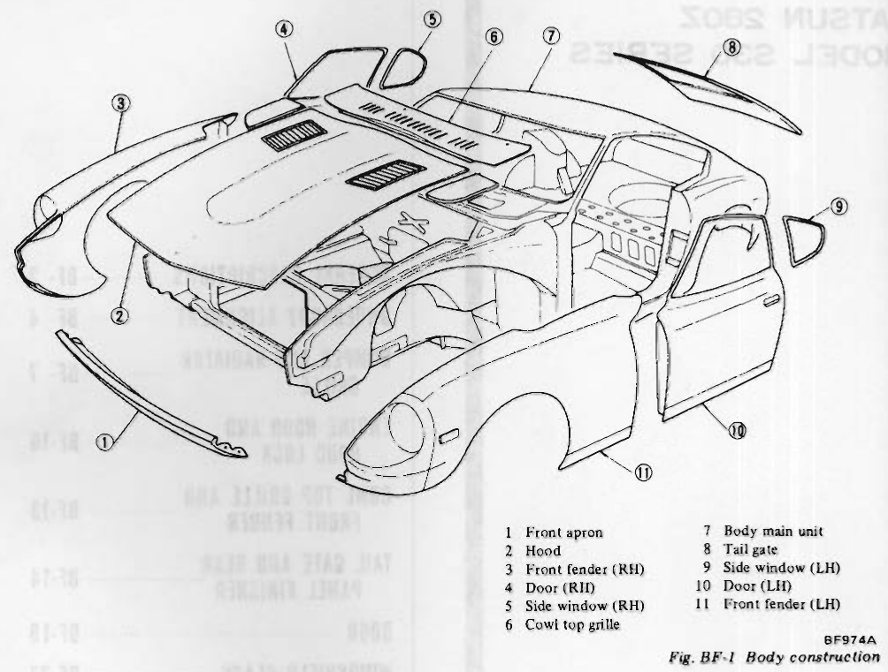
>
> - **Summary:** Exploded view of the main outer body panels and subassemblies showing front apron, hood, front fenders, doors, side windows, cowl top grille, body main unit, and tail gate.
> - **Components:** Front apron, Hood, Front fender (RH), Door (RH), Side window (RH), Cowl top grille, Body main unit, Tail gate, Side window (LH), Door (LH), Front fender (LH)
> - **Callouts:** **(1)** Front apron; **(2)** Hood; **(3)** Front fender (RH); **(4)** Door (RH); **(5)** Side window (RH); **(6)** Cowl top grille; **(7)** Body main unit; **(8)** Tail gate; **(9)** Side window (LH); **(10)** Door (LH); **(11)** Front fender (LH)
> - **Specs / Measurements:** Wheelbase difference: GS30 is 300 mm (11.81 in) longer than S30
> - **Mechanic Notes:** GS30 2+2 model has an extended wheelbase and floor pan extension between front and rear floors; door and tail gate panels differ from S30 2-seater.
> - **Tags:** `body construction`, `body panels`, `exploded view`, `unibody`, `S30`, `GS30`

---

<!-- Page 3 (BF-3) -->

> 🖼️ **Fig. BF-2 Structure of body main unit** `[BF380B]` *(Type: `exploded_view`)*
>
> 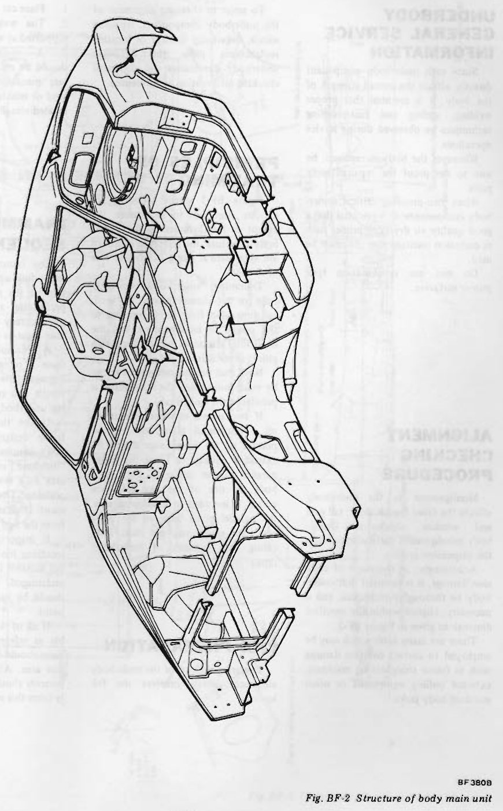
>
> - **Summary:** Perspective isometric cutaway of the welded unibody shell assembly (body main unit) showing structural members, cowl, floor pan, tunnel, rear wheelhouses, and roof pillars.
> - **Components:** Body main unit, Front side members, Strut towers, Dash panel, Floor tunnel, Floor pan, Rear wheelhouses, Rear quarter frame
> - **Mechanic Notes:** Shows the unitized body shell construction. Provides primary reference structure for underbody tramming and collision repair.
> - **Tags:** `body main unit`, `unibody`, `shell`, `frame structure`, `chassis`

---

<!-- Page 4 (BF-4) -->
# UNDERBODY ALIGNMENT

## UNDERBODY GENERAL SERVICE INFORMATION

Since each underbody component directly affects the overall strength of the body, it is essential that proper welding, sealing and rust-proofing techniques be observed during service operations.
Whenever the body is repaired, be sure to rust-proof the repaired body parts.
When rust-proofing critical underbody components, it is essential that a good quality air dry type primer such as corrosion resistant zinc chromate be used.
Do not use combination type primer surfacers.

## ALIGNMENT CHECKING PROCEDURE

Misalignment in the underbody affects the front fender, door, tail gate and window alignments. Underbody misalignment particularly affects the suspension system.
Accordingly, in the event of collision damage, it is essential that underbody be thoroughly rechecked, and if necessary, aligned within the specified dimensions given in Figure BF-3.
There are many tools which may be employed to correct collision damage such as frame straightening machines, external pulling equipment or other standard body jacks.
To assist in checking alignment of the underbody components, repairing minor underbody damage or locating replacement parts, the following underbody dimensions and alignment checking information are presented.

## PRINCIPLES OF TRAMMING

Figure BF-3 shows reference locations required to determine the extent of misalignment in the underbody structure; the reference locations are symmetrical along the center line of the car.
Tramming underbody correctly calls for two measurements: the vertical dimension from the datum line to the points to be measured, and the horizontal distance between any two points of measurement.
Note that precise measurement can be made only when the tram gauge is parallel to the underbody.
If two points of measurement are on a horizontal plane, the vertical pointer of the tram gauge should be extended equally to bring the gauge parallel to the center of the underbody. If one of the two reference points is included in misaligned area, the parallel plane between the body and tram gauge may not exist, indicating the necessity of underbody repair.

## CAR PREPARATION

Preparing the car for the underbody alignment check involves the following:
1. Place car on a level surface.
2. The weight of car should be supported at wheel locations.
3. A visual damage inspection should be made to eliminate unnecessary measuring since obviously damaged or misaligned areas may often be located visually.

## TRAMMING SEQUENCE

The tramming sequence will vary depending upon the nature and location of the misaligned area. Prior to performing any tramming operation, the accuracy of reference points to be used must be determined.
A measurement that originates from a reference point located in a damaged area will produce untrue results and confuse the evaluation of the underbody construction.
Unlike the conventional type of frame design, the unitized type of body construction seldom develops a "diamond" condition in the floor pan area as a result of front or rear end collision. Therefore, underbody alignment checking can usually originate from the body floor pan area.
If inspection indicates that these locations have been disturbed and are not suitable for measuring, one of the undamaged suspension locations should be used as an initial reference point.
If all of these locations are unsuitable as reference points, repair operations should begin with the body floor pan area. All other underbody components should be aligned progressively from this area.

---

<!-- Page 5 (BF-5) -->

> 🖼️ **Fig. BF-3 Underbody alignment for S30 (2 seater)** `[BF381B]` *(Type: `alignment_orientation`)*
>
> 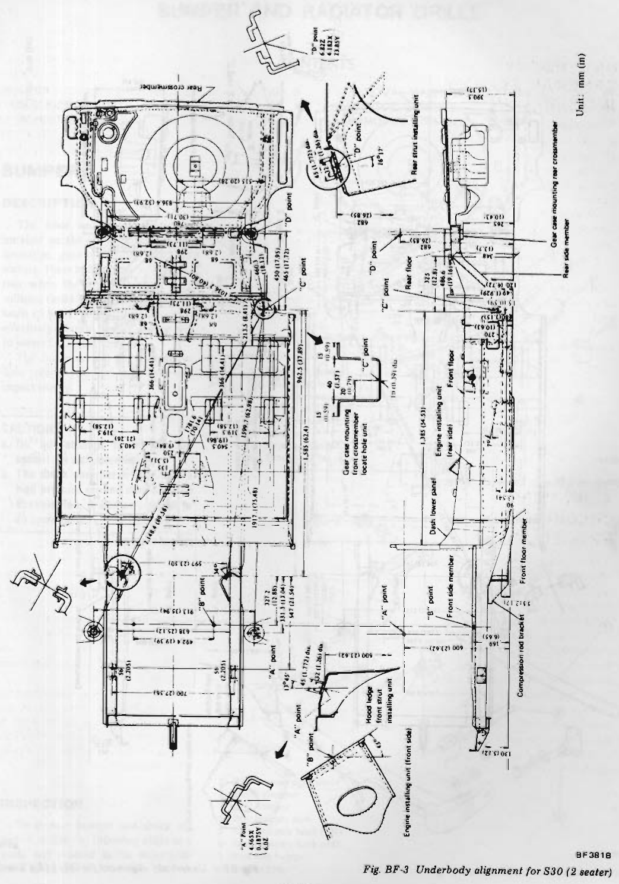
>
> - **Summary:** Comprehensive dimensional blueprint of underbody datum lines, diagonal checks, width measurements, and vertical reference heights for the S30 (2-seater) chassis, detailing measuring points 'A', 'B', 'C', and 'D'.
> - **Components:** Front side member, Front floor member, Compression rod bracket, Hood ledge front strut installing unit, Engine installing unit (front side / rear side), Dash lower panel, Gear case mounting front crossmember locate hole unit, Gear case mounting rear crossmember, Rear floor, Rear side member, Rear strut installing unit, Rear crossmember
> - **Callouts:** **(A point)** Front strut mounting and engine cradle forward datum location; **(B point)** Front side member reference datum location; **(C point)** Floor pan / gear case crossmember reference datum location; **(D point)** Rear strut tower installing unit reference datum location
> - **Specs / Measurements:** Front track / frame width: 700 mm (27.56 in); Front crossmember locating hole distance: 600 mm (23.62 in); Diagonal front engine bay: 1,148.6 mm (45.22 in); Front-to-rear floor span: 1,385 mm (54.53 in); Rear crossmember width: 780 mm (30.71 in), 836.4 mm (32.93 in); Unit: mm (in)
> - **Mechanic Notes:** All measurements are symmetrical along car center line. Tram gauge must be maintained parallel to underbody plane. Unit is mm (in).
> - **Tags:** `underbody alignment`, `chassis dimensions`, `frame tramming`, `datum points`, `S30`, `collision repair`

---

<!-- Page 6 (BF-6) -->

> 🖼️ **Fig. BF-4 Underbody alignment for GS30 (2 + 2 seater)** `[BF382B]` *(Type: `alignment_orientation`)*
>
> 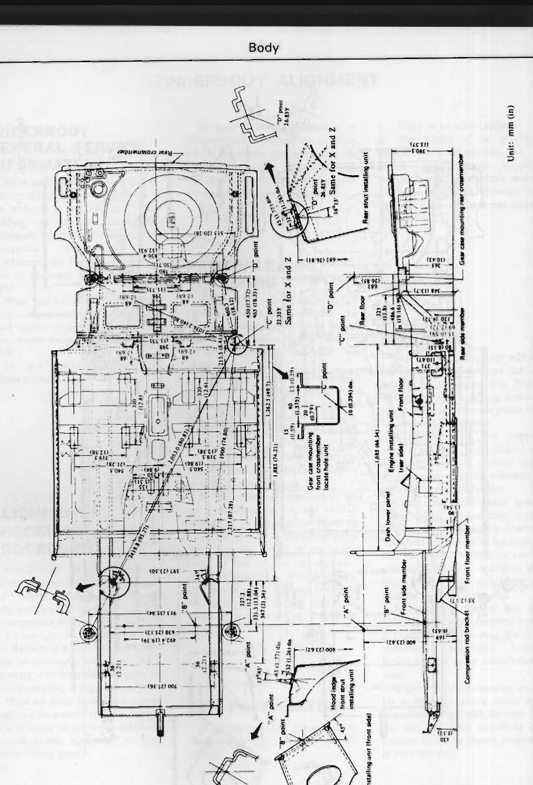
>
> - **Summary:** Comprehensive dimensional blueprint of underbody datum lines, diagonal checks, width measurements, and vertical reference heights for the GS30 (2+2 seater) chassis, showing extended 300 mm floor dimensions.
> - **Components:** Front side member, Front floor member, Compression rod bracket, Hood ledge front strut installing unit, Engine installing unit (front side / rear side), Dash lower panel, Gear case mounting front crossmember locate hole unit, Gear case mounting rear crossmember, Rear floor, Rear side member, Rear strut installing unit, Rear crossmember
> - **Callouts:** **(A point)** Front strut mounting and engine cradle forward datum location; **(B point)** Front side member reference datum location; **(C point)** Floor pan / gear case crossmember reference datum location; **(D point)** Rear strut tower installing unit reference datum location
> - **Specs / Measurements:** Wheelbase extended by 300 mm (11.81 in) over S30; Front-to-rear floor span: 1,685 mm (66.34 in) vs 1,385 mm (54.53 in); Diagonal measurements: 2,419.8 mm (95.27 in), 2,053.0 mm (80.83 in); Overall span reference: 2,217 mm (87.28 in); Unit: mm (in)
> - **Mechanic Notes:** Points A, B, C, D follow identical reference geometry as S30 except for the 300 mm (11.81 in) extension in the floor pan between dash lower panel and rear floor.
> - **Tags:** `underbody alignment`, `chassis dimensions`, `frame tramming`, `GS30`, `2+2 seater`, `collision repair`

---

<!-- Page 7 (BF-7) -->
# BUMPER AND RADIATOR GRILLE

### CONTENTS
| Section | Page |
| :--- | :--- |
| BUMPER | BF-7 |
| DESCRIPTION | BF-7 |
| INSPECTION | BF-7 |
| REMOVAL AND INSTALLATION | BF-9 |
| RADIATOR GRILLE | BF-10 |
| REMOVAL AND INSTALLATION | BF-10 |

# BUMPER

## DESCRIPTION

The front and rear bumpers are installed on the car body through the strut-type, gas-and-oil-filled shock absorbers. These bumpers are so designed that when the car is involved in a collision (solid barrier) at a speed of 8 km/h (5 MPH) or less, they retract to effectively absorb impact energy and to prevent car from damage.
The bumpers will be returned to their original positions upon absorbing impact energy.

> [!CAUTION]
> a. Do not attempt to hit the car against the wall intentionally.  
> b. The shock absorber is filled with a high pressure gas and should not be disassembled, drilled or exposed to an open flame.

> 🖼️ **Fig. BF-5 Exploded view of front bumper** `[BF383B]` *(Type: `exploded_view`)*
>
> 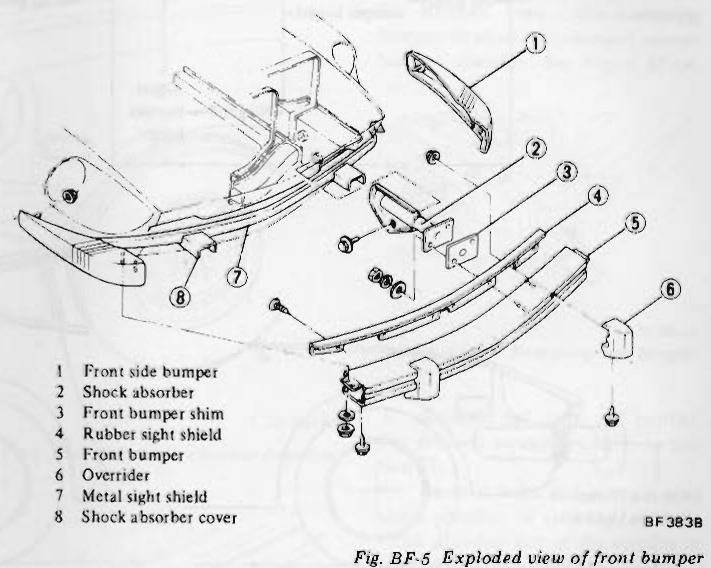
>
> - **Summary:** Exploded view showing front bumper bar, side bumper ends, shock absorber struts, shims, rubber and metal sight shields, and overrider brackets.
> - **Components:** Front side bumper, Shock absorber, Front bumper shim, Rubber sight shield, Front bumper, Overrider, Metal sight shield, Shock absorber cover
> - **Callouts:** **(1)** Front side bumper; **(2)** Shock absorber; **(3)** Front bumper shim; **(4)** Rubber sight shield; **(5)** Front bumper; **(6)** Overrider; **(7)** Metal sight shield; **(8)** Shock absorber cover
> - **Specs / Measurements:** Impact capability: 8 km/h (5 MPH) solid barrier
> - **Mechanic Notes:** Gas-and-oil-filled shock absorbers must not be drilled, disassembled, or heated.
> - **Tags:** `front bumper`, `shock absorber`, `exploded view`, `overrider`, `sight shield`

> 🖼️ **Fig. BF-6 Exploded view of rear bumper** `[BF384B]` *(Type: `exploded_view`)*
>
> 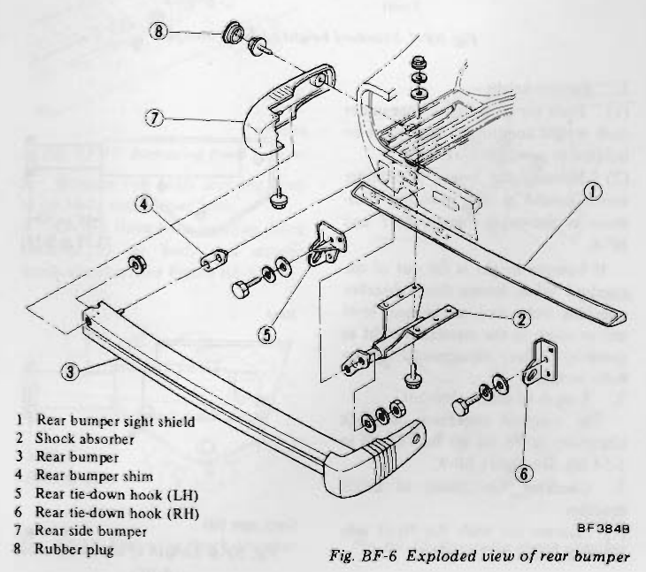
>
> - **Summary:** Exploded view showing rear bumper assembly, shock absorbers, tie-down hooks, shims, side bumpers, and sight shields.
> - **Components:** Rear bumper sight shield, Shock absorber, Rear bumper, Rear bumper shim, Rear tie-down hook (LH), Rear tie-down hook (RH), Rear side bumper, Rubber plug
> - **Callouts:** **(1)** Rear bumper sight shield; **(2)** Shock absorber; **(3)** Rear bumper; **(4)** Rear bumper shim; **(5)** Rear tie-down hook (LH); **(6)** Rear tie-down hook (RH); **(7)** Rear side bumper; **(8)** Rubber plug
> - **Mechanic Notes:** Includes rear tie-down hooks LH and RH mounted with the bumper shock absorbers.
> - **Tags:** `rear bumper`, `shock absorber`, `tie-down hook`, `exploded view`

## INSPECTION

To inspect bumper and shock absorber, utilize the following chart as a guide and proceed in the order indicated in the chart.

---

<!-- Page 8 (BF-8) -->
### Bumper system inspection chart

> 🖼️ **Bumper system inspection chart**  *(Type: `cutaway_flow`)*
>
> 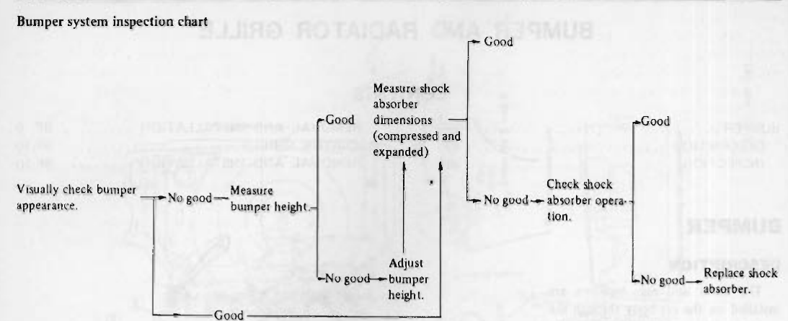
>
> - **Summary:** Flowchart for inspecting bumper appearance, measuring bumper height, checking shock absorber dimensions (compressed and expanded), checking operation, and replacing shock absorbers if faulty.
> - **Components:** Bumper appearance check, Bumper height measurement, Shock absorber dimensions check, Shock absorber operation check
> - **Mechanic Notes:** Guide to systematically evaluate bumper alignment, stroke, and shock absorber condition.
> - **Tags:** `inspection flowchart`, `bumper inspection`, `troubleshooting`

> 🖼️ **Fig. BF-7 Standard height of front bumper** `[BF980A]` *(Type: `inspection_measurement`)*
>
> 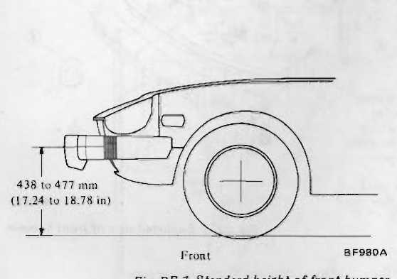
>
> - **Summary:** Measurement diagram showing front bumper height from ground line under curb weight conditions.
> - **Components:** Front bumper, Ground datum line
> - **Specs / Measurements:** Front bumper standard height: 438 to 477 mm (17.24 to 18.78 in)
> - **Mechanic Notes:** Measure under curb weight conditions with tires inflated to rated pressure.
> - **Tags:** `front bumper height`, `inspection`, `measurement`

> 🖼️ **Fig. BF-8 Standard height of rear bumper** `[BF981A]` *(Type: `inspection_measurement`)*
>
> 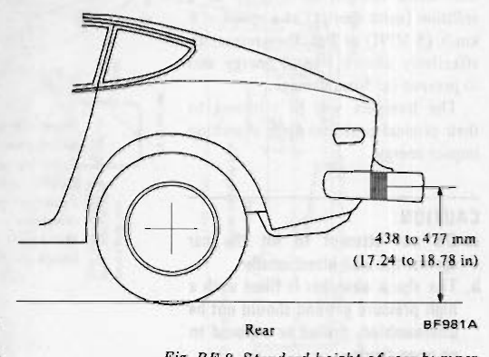
>
> - **Summary:** Measurement diagram showing rear bumper height from ground line under curb weight conditions.
> - **Components:** Rear bumper, Ground datum line
> - **Specs / Measurements:** Rear bumper standard height: 438 to 477 mm (17.24 to 18.78 in)
> - **Mechanic Notes:** Measure under curb weight conditions with tires inflated to rated pressure.
> - **Tags:** `rear bumper height`, `inspection`, `measurement`

### 1. Bumper height
(1) Place car on a flat surface under curb weight conditions. Tires must be inflated to rated pressure.  
(2) Measure the height of bumper above ground at two mounting locations as shown in Figures BF-7 and BF-8.  
If bumper height is far out of the standard value, loosen shock absorber attaching bolts and set bumper level and as close to the standard height as possible. After adjustment, tighten bolts securely.

### 2. Length of shock absorber
The standard dimension of shock absorbers is 86 to 90 mm (3.39 to 3.54 in). See Figure BF-9.

> 🖼️ **Fig. BF-9 Length of shock absorber** `[BF348A]` *(Type: `inspection_measurement`)*
>
> 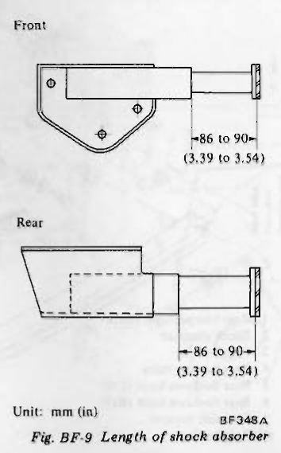
>
> - **Summary:** Dimensional drawing of front and rear bumper shock absorber exposed shaft/bracket length.
> - **Components:** Front shock absorber, Rear shock absorber
> - **Specs / Measurements:** Front shock absorber standard length: 86 to 90 mm (3.39 to 3.54 in); Rear shock absorber standard length: 86 to 90 mm (3.39 to 3.54 in)
> - **Mechanic Notes:** Unit: mm (in). If dimension is out of range, shock absorber has failed to return or is collapsed.
> - **Tags:** `bumper shock absorber`, `length`, `dimension`, `inspection`

### 3. Checking functioning of shock absorber
(1) Locate car with the front side towards a solid wall or pillar.  
(2) Set parking brake and set transmission in 1st gear (manual transmission), or park position (automatic transmission).  
Place wheel chocks securely.

> [!NOTE]
> a. Make sure that car does not move at all.  
> b. Make sure that ignition switch is turned off.

(3) Place a jack between wall and either bumper overrider aligning it with shock absorber on that side.

> [!NOTE]
> Use a jack of more than 400 kg (881 lb) capacity.

(4) Gradually extend jack approximately 40 mm (1.57 in). [The bumper should move approximately 40 mm (1.57 in) back through shock absorber effect]. See Figure BF-10. <!-- Page 9 (BF-9) --> (5) Retract jack and check that bumper returns to its original position without binding and hesitation.  
Conduct a test as above on the other shock absorber.  
If either shock absorber fails to return to the original position, replace.  
(6) Utilize the same test procedure as above when testing rear bumper shock absorbers.

> [!CAUTION]
> Be careful not to allow jack slipping out of overrider.

> 🖼️ **Fig. BF-10 Checking shock absorber function** `[BF982A]` *(Type: `procedure_step`)*
>
> 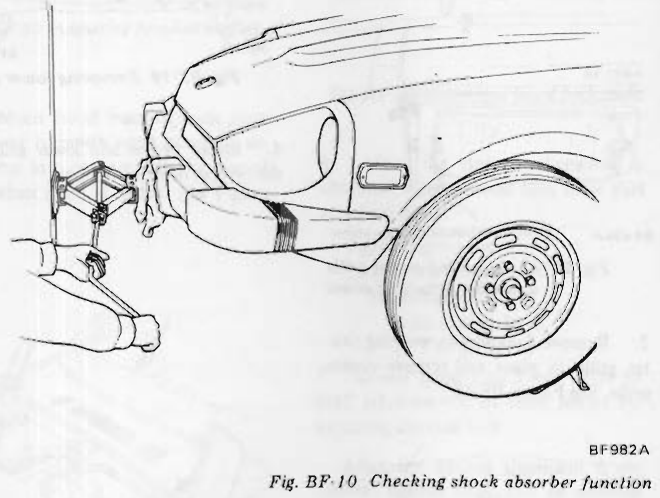
>
> - **Summary:** Illustration showing screw jack positioned against solid wall and bumper overrider to compress bumper shock absorber 40 mm.
> - **Components:** Solid wall, Jack, Overrider, Front bumper, Wheel chock
> - **Specs / Measurements:** Stroke: approx. 40 mm (1.57 in); Jack capacity: > 400 kg (881 lb)
> - **Mechanic Notes:** Caution: Do not allow jack to slip out of overrider. Ensure parking brake is set and wheels chocked.
> - **Tags:** `shock absorber test`, `jack test`, `compression test`

# REMOVAL AND INSTALLATION

## Front bumper
1. Loosen three screws securing front inner fender front protector to car body, then remove two nuts securing front side bumper to car body.

> 🖼️ **Fig. BF-11 Removing front side bumper securing nut** `[BF023B]` *(Type: `procedure_step`)*
>
> 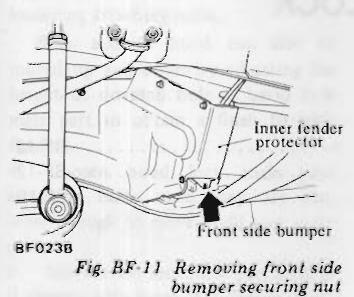
>
> - **Summary:** Location of nuts securing front side bumper through inner fender protector.
> - **Components:** Inner fender protector, Front side bumper, Securing nuts
> - **Callouts:** **(Inner fender protector)** Inner fender protector; **(Front side bumper)** Front side bumper
> - **Mechanic Notes:** Loosen three screws on inner fender protector to reach the two side bumper nuts.
> - **Tags:** `front side bumper`, `inner fender protector`, `removal`

2. Remove two nuts securing bumper to shock absorber and remove bumper assembly. See Figure BF-12.

> 🖼️ **Fig. BF-12 Removing front bumper** `[BF983A]` *(Type: `procedure_step`)*
>
> 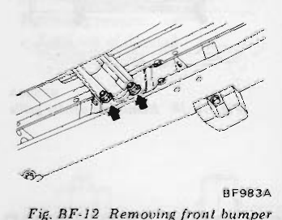
>
> - **Summary:** Removing two nuts per side securing front bumper assembly to shock absorber mounts.
> - **Components:** Front bumper, Shock absorber mount, Nuts
> - **Mechanic Notes:** Remove two nuts securing bumper to shock absorber brackets.
> - **Tags:** `front bumper removal`, `attaching nuts`

3. Remove two bolts securing horn to car body and remove horn.  
4. Loosen three bolts securing shock absorber to car body and remove shock absorber. See Figure BF-13.

> 🖼️ **Fig. BF-13 Removing shock absorber** `[BF498A]` *(Type: `procedure_step`)*
>
> 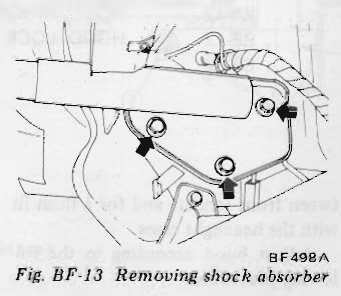
>
> - **Summary:** Loosening three bolts securing front bumper shock absorber to front side frame member.
> - **Components:** Front bumper shock absorber, Frame rail, Attaching bolts
> - **Mechanic Notes:** Remove horn before unbolting shock absorber.
> - **Tags:** `front shock absorber`, `removal`

5. Install front bumper assembly in the reverse order of removal.  
When installing bumper, set it level and as close to the standard height as possible. See Figure BF-7.

## Rear bumper
1. Remove side bumper plug, then remove two bolts securing rear side bumper to car body.  
2. Remove two nuts securing bumper to shock absorber and remove bumper assembly. See Figure BF-14.

> 🖼️ **Fig. BF-14 Removing rear bumper** `[BF984A]` *(Type: `procedure_step`)*
>
> 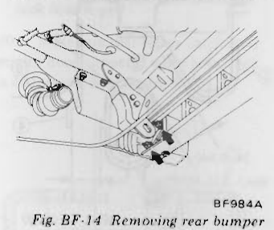
>
> - **Summary:** Removing rear bumper assembly from rear shock absorber brackets.
> - **Components:** Rear bumper, Shock absorber brackets, Attaching nuts
> - **Mechanic Notes:** Remove side bumper plugs and bolts before removing bumper to shock absorber nuts.
> - **Tags:** `rear bumper removal`

3. Remove fuel tank and muffler. For removal procedures, refer to Section FE.  
4. Remove bolts and nuts securing shock absorber to car body, and take shock absorber out of the opening in car body. See Figure BF-15.

> 🖼️ **Fig. BF-15 Removing shock absorber** `[BF985A / BF986A]` *(Type: `procedure_step`)*
>
> 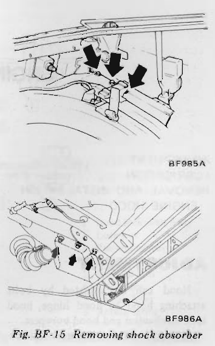
>
> - **Summary:** Removing rear shock absorber bolts and withdrawing unit through opening in car body.
> - **Components:** Rear shock absorber, Body opening, Attaching bolts
> - **Mechanic Notes:** Requires removal of fuel tank and muffler (Section FE).
> - **Tags:** `rear shock absorber removal` <!-- Page 10 (BF-10) --> 5. Install rear bumper assembly in the reverse order of removal.  
When installing bumper, set it level and as close to the standard height as possible. See Figure BF-8.
- California models:  
Make sure that clearance between muffler and left shock absorber heat shield, and between muffler and spare tire housing heat shield is as indicated in Figure BF-16.

> 🖼️ **Fig. BF-16 Clearances between muffler and L.H. shock absorber heat shield (California models)** `[BF385B]` *(Type: `inspection_measurement`)*
>
> 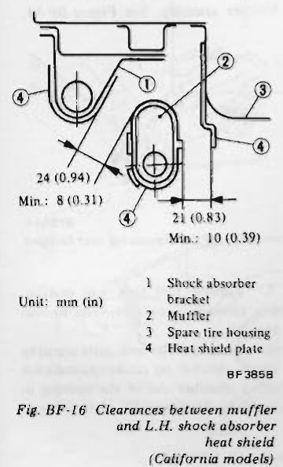
>
> - **Summary:** Clearance diagram for California exhaust system around muffler, shock absorber bracket, spare tire housing, and heat shield plates.
> - **Components:** Shock absorber bracket, Muffler, Spare tire housing, Heat shield plate
> - **Callouts:** **(1)** Shock absorber bracket; **(2)** Muffler; **(3)** Spare tire housing; **(4)** Heat shield plate
> - **Specs / Measurements:** Muffler to shock absorber bracket: 24 mm (0.94 in), Min.: 8 mm (0.31 in); Muffler to spare tire housing: 21 mm (0.83 in), Min.: 10 mm (0.39 in); Unit: mm (in)
> - **Mechanic Notes:** California models only: check heat shield clearances carefully to prevent exhaust overheating of rear body components.
> - **Tags:** `exhaust clearance`, `heat shield`, `muffler`, `California models`

# RADIATOR GRILLE

## REMOVAL AND INSTALLATION

1. Loosen two screws securing front combination lamp cover and move cover inside, then remove screw securing center grille upper bar to body. See Figure BF-17.

> 🖼️ **Fig. BF-17 Removing center grille upper bar attaching screw** `[BF499A]` *(Type: `procedure_step`)*
>
> 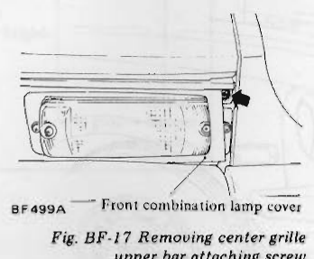
>
> - **Summary:** Accessing center grille upper bar screw after moving front combination lamp cover inside.
> - **Components:** Front combination lamp cover, Center grille upper bar, Attaching screw
> - **Callouts:** **(Front combination lamp cover)** Front combination lamp cover
> - **Mechanic Notes:** Loosen two combination lamp cover screws to reach upper grille bar screw.
> - **Tags:** `grille removal`, `combination lamp cover`

2. Remove four screws securing center grille in place and remove center grille. See Figure BF-18.

> 🖼️ **Fig. BF-18 Removing center grille** `[BF500A]` *(Type: `procedure_step`)*
>
> 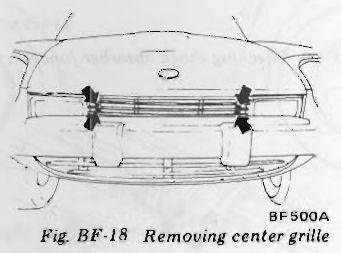
>
> - **Summary:** Locations of four screws securing center radiator grille.
> - **Components:** Center grille, Mounting screws
> - **Mechanic Notes:** Remove four screws securing center grille in place.
> - **Tags:** `center grille removal`

3. Remove three screws securing lower grille in place and remove lower grille. See Figure BF-19.

> 🖼️ **Fig. BF-19 Removing lower grille** `[BF501A]` *(Type: `procedure_step`)*
>
> 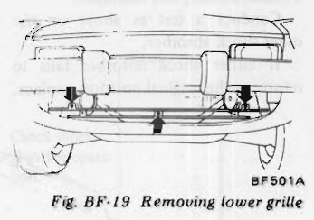
>
> - **Summary:** Locations of three screws securing lower radiator grille.
> - **Components:** Lower grille, Mounting screws
> - **Mechanic Notes:** Remove three screws securing lower grille.
> - **Tags:** `lower grille removal`

4. Install center and lower grille in the reverse order of removal.

# ENGINE HOOD AND HOOD LOCK

### CONTENTS
| Section | Page |
| :--- | :--- |
| ADJUSTMENT | BF-10 |
| LUBRICATION | BF-12 |
| REMOVAL AND INSTALLATION | BF-12 |
| ENGINE HOOD | BF-12 |
| TORSION BAR | BF-12 |
| HOOD HINGE | BF-12 |
| HOOD LOCK | BF-12 |

## ADJUSTMENT

Hood can be adjusted by bolts attaching hood to hood hinge, hood lock mechanism and hood bumpers.  
Adjust hood for an even fit between front fenders and for a flush fit with the headlight cases.  
Adjust hood according to the following procedure:  
1. Adjust hood fore and aft by loosening bolts attaching hood to hinge and repositioning hood. See Figure BF-20.

---

<!-- Page 11 (BF-11) -->

> 🖼️ **Fig. BF-20 Adjusting hood attaching bolts** `[BF356A]` *(Type: `procedure_step`)*
>
> 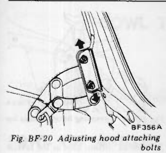
>
> - **Summary:** Loosening hood hinge attaching bolts to adjust fore-and-aft position of the hood.
> - **Components:** Hood hinge, Hood, Attaching bolts
> - **Mechanic Notes:** Adjust fore and aft position before setting lock and bumper heights.
> - **Tags:** `hood hinge`, `hood adjustment`

2. Loosen hood bumper lock nuts and lower bumpers until bumpers do not come into contact with the rear of hood when hood is closed. See Figure BF-21.

> 🖼️ **Fig. BF-21 Adjusting hood bumper height** `[BF357A]` *(Type: `procedure_step`)*
>
> 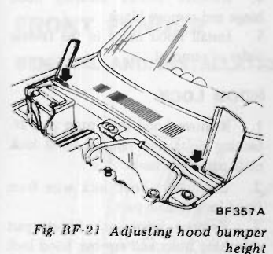
>
> - **Summary:** Adjusting rubber bumper height on cowl ledge to set rear hood height flush with fenders.
> - **Components:** Hood bumper, Lock nut, Cowl ledge
> - **Mechanic Notes:** Lower bumpers during initial alignment so they do not hold hood open prematurely.
> - **Tags:** `hood bumper`, `hood height adjustment`

3. Adjust hood lock mechanism after hood has been properly aligned. Hood lock male part can be moved fore and aft and from side to side to align it with hood lock female part by loosening attaching bolts.  
Rear end of hood can also be moved up and down by adjusting the height of dovetail bolt of hood lock male part to obtain a flush fit with fenders.  
4. Loosen hood lock male part attaching bolts until they are just loose enough to move hood lock male part.  
5. Move hood lock male part until it is aligned with hood lock female part. See Figure BF-22.

> 🖼️ **Fig. BF-22 Adjusting hood lock male part** `[BF359A]` *(Type: `procedure_step`)*
>
> 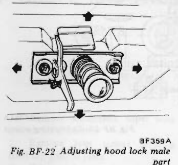
>
> - **Summary:** Slotted hole adjustment of hood lock male part fore/aft and side-to-side.
> - **Components:** Hood lock male part, Attaching bolts, Dovetail pin
> - **Specs / Measurements:** Attaching bolts torque: 0.38 to 0.51 kg-m (2.7 to 3.7 ft-lb)
> - **Mechanic Notes:** Loosen bolts just enough to slide male part into perfect alignment with female receiver.
> - **Tags:** `hood lock male part`, `hood latch adjustment`

6. After the desired alignment is obtained, tighten hood lock male part attaching bolts.

Tightening torque:  
Male and female part attaching bolts:  
0.38 to 0.51 kg-m (2.7 to 3.7 ft-lb)

7. Lower hood 1 to 3 mm (0.04 to 0.12 in) from top of front fender by adjusting dovetail bolt.  
After the desired alignment is obtained, tighten lock nut of dovetail bolt.

Tightening torque:  
Lock nut of dovetail bolt:  
1.5 to 2.6 kg-m (11 to 19 ft-lb)

8. Raise two hood bumpers until hood is flush with fenders.  
9. Open and close hood several times to check the operation.  
Check hood lock male part for complete engagement with hood lock female part.

> [!NOTE]
> Full engagement must be obtained for proper hood lock male part adjustment. If complete engagement is not obtained, readjust hood lock male part for full engagement of dovetail bolt and hood lock female part.

10. Make sure that safety catch lever retains hood properly when hood lock is disengaged. See Figure BF-23.

> 🖼️ **Fig. BF-23 Safety catch lever** `[BF360A]` *(Type: `inspection_measurement`)*
>
> 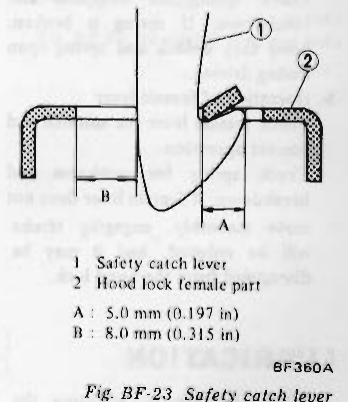
>
> - **Summary:** Safety catch lever engagement clearances with hood lock female part.
> - **Components:** Safety catch lever, Hood lock female part
> - **Callouts:** **(1)** Safety catch lever; **(2)** Hood lock female part
> - **Specs / Measurements:** Clearance A: 5.0 mm (0.197 in); Clearance B: 8.0 mm (0.315 in)
> - **Mechanic Notes:** Verify safety catch lever reliably retains hood when main lock is disengaged.
> - **Tags:** `safety catch lever`, `hood safety latch`, `inspection clearance`

> 🖼️ **Fig. BF-24 Sectional view of hood lock** `[BF358A]` *(Type: `cutaway_flow`)*
>
> 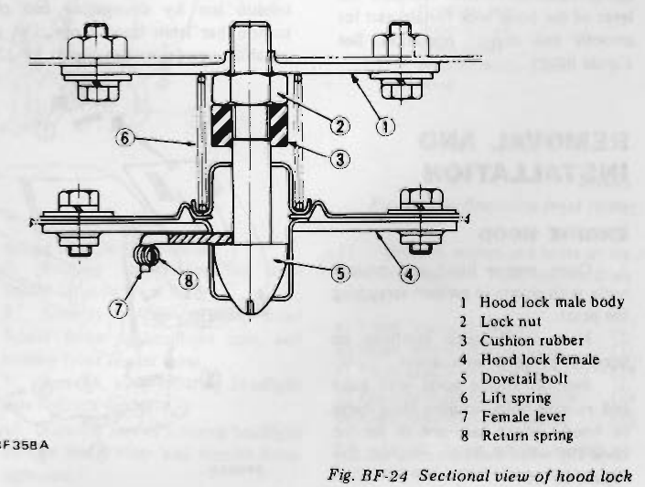
>
> - **Summary:** Cross section through hood lock male and female components showing dovetail bolt, springs, cushion rubber, and release lever.
> - **Components:** Hood lock male body, Lock nut, Cushion rubber, Hood lock female, Dovetail bolt, Lift spring, Female lever, Return spring
> - **Callouts:** **(1)** Hood lock male body; **(2)** Lock nut; **(3)** Cushion rubber; **(4)** Hood lock female; **(5)** Dovetail bolt; **(6)** Lift spring; **(7)** Female lever; **(8)** Return spring
> - **Specs / Measurements:** Lock nut of dovetail bolt torque: 1.5 to 2.6 kg-m (11 to 19 ft-lb); Male & female part attaching bolts torque: 0.38 to 0.51 kg-m (2.7 to 3.7 ft-lb)
> - **Mechanic Notes:** Dovetail bolt height sets the rear hood pull-down clearance (1 to 3 mm below fender top).
> - **Tags:** `hood lock sectional view`, `dovetail bolt`, `cutaway`

---

<!-- Page 12 (BF-12) -->

> 🖼️ **Fig. BF-25 Lubricating points** `[BF361A]` *(Type: `alignment_orientation`)*
>
> 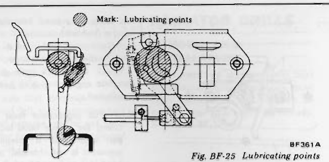
>
> - **Summary:** Lubricating points on hood safety catch lever, female lever pivot, and return spring.
> - **Components:** Hood lock female part, Safety catch lever, Return spring, Pivot
> - **Mechanic Notes:** Lubricate shaded points with multi-purpose grease to ensure smooth engagement and prevent unlatching.
> - **Tags:** `hood lock lubrication`, `maintenance`

> [!NOTE]
> When inspecting the hood lock, observe the following:  
> a. **Operation of safety catch lever**  
> Check caulking portion of safety catch lever shaft for wear.  
> Check spring for weakness and breakdown. If spring is broken, hood may unlock and spring open during driving.  
> b. **Operation of female lever**  
> Check female lever for smooth and correct operation.  
> Check spring for weakness and breakdown. If female lever does not move smoothly, engaging stroke will be reduced, and it may be disengaged from the hood lock.

## LUBRICATION

When checking or adjusting the hood lock, thoroughly lubricate the pivot, catcher and return spring of the safety catch lever. Also lubricate the lever of the hood lock female part for smooth and correct operation. See Figure BF-25.

# REMOVAL AND INSTALLATION

## ENGINE HOOD

1. Open engine hood and protect body with covers to prevent scratching the paint.  
2. Mark hood hinge locations on hood for proper reinstallation.  
3. Support engine hood with hand and remove bolts securing hood hinge to hood, taking care not to let the hood slip when bolts are removed. See Figure BF-26.

> 🖼️ **Fig. BF-26 Removing hood** `[BF362A]` *(Type: `procedure_step`)*
>
> 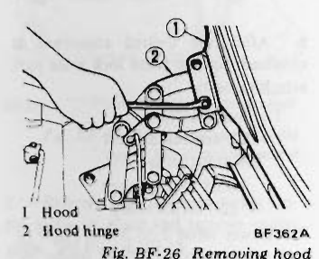
>
> - **Summary:** Supporting hood and removing bolts securing hood hinge to hood.
> - **Components:** Hood, Hood hinge
> - **Callouts:** **(1)** Hood; **(2)** Hood hinge
> - **Mechanic Notes:** Mark hinge location before removing bolts to aid reinstallation.
> - **Tags:** `hood removal`, `hood hinge`

4. Remove hood from car.  
5. Install hood in the reverse order of removal.

## TORSION BAR

1. Open engine hood.  
2. Support hood and remove each torsion bar by disengaging end of torsion bar from hood hinge. Use a suitable screwdriver. See Figure BF-27.

> 🖼️ **Fig. BF-27 Removing hood torsion bar** `[BF363A]` *(Type: `procedure_step`)*
>
> 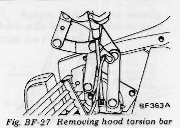
>
> - **Summary:** Disengaging end of hood hinge counterbalance torsion bar using a screwdriver.
> - **Components:** Torsion bar, Hood hinge, Screwdriver
> - **Mechanic Notes:** Support hood securely before releasing torsion bar tension.
> - **Tags:** `hood torsion bar`, `removal`

3. Install torsion bars in the reverse order of removal.

## HOOD HINGE

1. Open engine hood and protect body with covers to prevent scratching the paint.  
2. Remove hood.  
3. Remove torsion bars.  
4. Remove screws securing hood hinge and remove hinge.  
5. Install hood hinge in the reverse order of removal.

## HOOD LOCK

1. Remove hood lock male part attaching bolts and remove hood lock male part from hood.  
2. Disconnect hood lock wire from hood lock female part.  
3. Remove hood lock female part attaching bolts and remove hood lock female part from hood lock bracket.  
4. Remove clamp attaching screw and remove clamp. Remove hood lock wire bracket attaching screws. Then, remove hood lock wire.  
5. Install hood lock mechanism in the reverse order of removal.

> 🖼️ **Fig. BF-28 Hood lock** `[BF988A]` *(Type: `exploded_view`)*
>
> 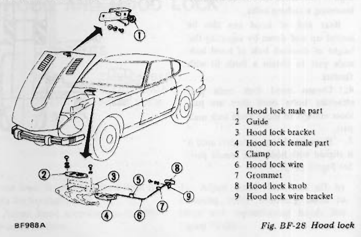
>
> - **Summary:** Exploded view of the complete hood lock mechanism, release wire, knob, bracket, and male/female latches.
> - **Components:** Hood lock male part, Guide, Hood lock bracket, Hood lock female part, Clamp, Hood lock wire, Grommet, Hood lock knob, Hood lock wire bracket
> - **Callouts:** **(1)** Hood lock male part; **(2)** Guide; **(3)** Hood lock bracket; **(4)** Hood lock female part; **(5)** Clamp; **(6)** Hood lock wire; **(7)** Grommet; **(8)** Hood lock knob; **(9)** Hood lock wire bracket
> - **Mechanic Notes:** Shows the routing of the hood release cable through cowl grommet to the interior knob.
> - **Tags:** `hood lock`, `release cable`, `exploded view`

---

<!-- Page 13 (BF-13) -->
# COWL TOP GRILLE AND FRONT FENDER

### CONTENTS
| Section | Page |
| :--- | :--- |
| COWL TOP GRILLE | BF-13 |
| REMOVAL AND INSTALLATION | BF-13 |
| FRONT FENDER | BF-13 |
| REMOVAL AND INSTALLATION | BF-13 |

# COWL TOP GRILLE

## REMOVAL AND INSTALLATION

1. Open engine hood and protect front fenders with covers to prevent scratching the paint.  
2. Remove windshield wiper arms and blades as a unit.  
3. Remove four screws securing cowl top grille in place.  
4. Take cowl top grille out in forward direction with the front end lifted. See Figure BF-29.  
5. Install cowl top grille in the reverse order of removal.

> 🖼️ **Fig. BF-29 Removing cowl top grille** `[BF365A]` *(Type: `procedure_step`)*
>
> 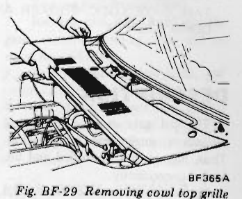
>
> - **Summary:** Lifting the front edge of the cowl top grille and pulling forward to disengage from windshield lower edge.
> - **Components:** Cowl top grille, Cowl panel
> - **Mechanic Notes:** Wiper arms must be removed prior to pulling cowl grille forward.
> - **Tags:** `cowl top grille`, `removal`

# FRONT FENDER

## REMOVAL AND INSTALLATION

> 🖼️ **Fig. BF-30 Removing front fender** `[BF989A]` *(Type: `exploded_view`)*
>
> 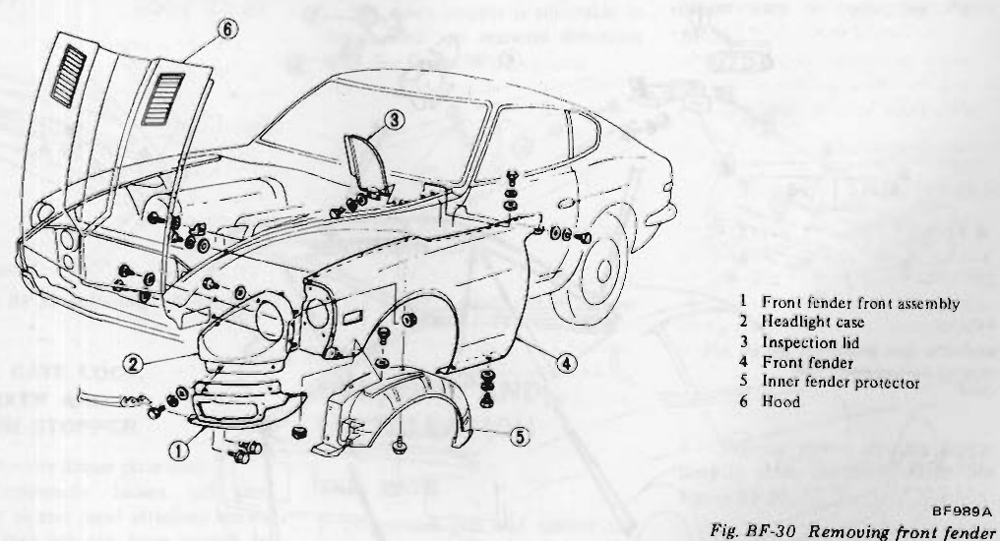
>
> - **Summary:** Exploded view showing front fender assembly, headlight case, front fender front extension, inspection lid, inner protector, and attaching fastener locations.
> - **Components:** Front fender front assembly, Headlight case, Inspection lid, Front fender, Inner fender protector, Hood
> - **Callouts:** **(1)** Front fender front assembly; **(2)** Headlight case; **(3)** Inspection lid; **(4)** Front fender; **(5)** Inner fender protector; **(6)** Hood
> - **Mechanic Notes:** Fasteners: side sill (2), front pillar (1), cowl top (2), hood bumper (2), hood ledge (3).
> - **Tags:** `front fender`, `exploded view`, `headlight case`, `inspection lid`

1. Remove inner fender protector.  
2. Remove front bumper.  
3. Remove headlight and side flasher lamp.  
4. Remove two screws securing inspection lid in place, and remove inspection lid.  
5. Remove windshield wiper arms and blades as a unit, and remove cowl top grille.  
6. Remove screws securing front fender front to front apron.  
7. Remove screws securing front fender front to front fender.  
8. Remove screws securing front fender front to headlight case, and remove front fender front.  
9. Remove nuts securing headlight case to front fender.  
10. Remove screws securing headlight case to hood ledge and remove headlight case.  
11. Remove screws and bolts in the following manner. Then remove front fender.  
a) Front fender to side sill (2)  
b) Front fender to front pillar (1)  
c) Front fender to cowl top (2)  
d) Hood bumper to front fender (2)  
e) Front fender to hood ledge (3)  
12. Install front fender in the reverse order of removal.

---

<!-- Page 14 (BF-14) -->
# TAIL GATE AND REAR PANEL FINISHER

### CONTENTS
| Section | Page |
| :--- | :--- |
| DESCRIPTION | BF-14 |
| ADJUSTMENT | BF-15 |
| TAIL GATE HINGE | BF-15 |
| TAIL GATE LOCK, STRIKER AND DOWN STOPPER | BF-15 |
| REMOVAL AND INSTALLATION | BF-15 |
| TAIL GATE | BF-15 |
| TAIL GATE LOCK AND STRIKER | BF-15 |
| REAR PANEL FINISHER | BF-15 |

## DESCRIPTION

The tail gate opens upward and utilizes a single-sheet construction. Thus, luggage can be loaded and unloaded conveniently.  
The tail gate stay utilizes a gas spring (filled with nitrogen gas) which increases the operating smoothness and improves the external appearance.

> [!CAUTION]
> The tail gate stay is filled with highly compressed nitrogen gas. Do not disassemble it.

In order to ease tail gate installation and removal, split type hinges are used. The hinges are secured with both side installation screws.  
A push-button type tail gate lock has been adopted. When the push-button is locked, the push-button can be depressed but not unlocked.

> 🖼️ **Fig. BF-31 Structural view of tail gate** `[BF367A]` *(Type: `exploded_view`)*
>
> 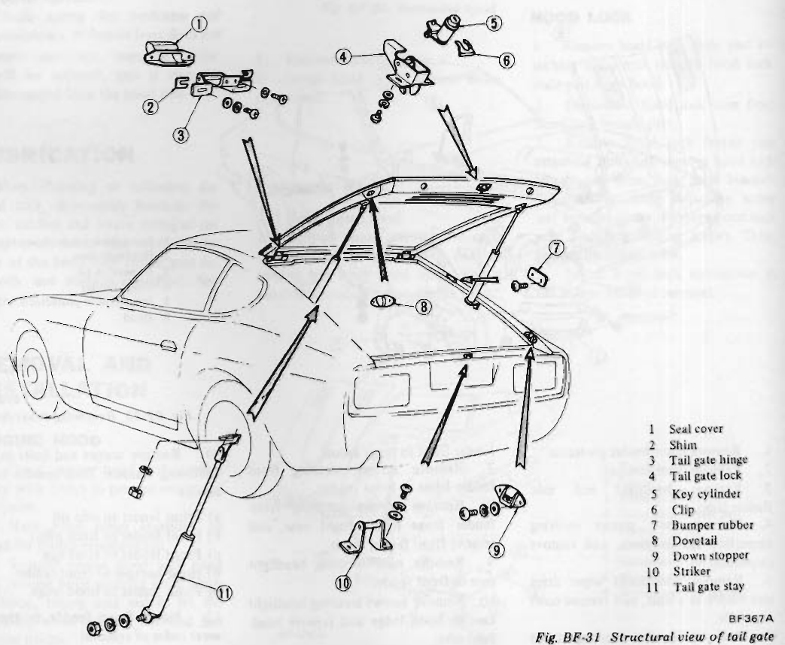
>
> - **Summary:** Exploded structural view of tail gate assembly, hinges, shims, gas stay, latch lock, key cylinder, down stopper, and striker.
> - **Components:** Seal cover, Shim, Tail gate hinge, Tail gate lock, Key cylinder, Clip, Bumper rubber, Dovetail, Down stopper, Striker, Tail gate stay
> - **Callouts:** **(1)** Seal cover; **(2)** Shim; **(3)** Tail gate hinge; **(4)** Tail gate lock; **(5)** Key cylinder; **(6)** Clip; **(7)** Bumper rubber; **(8)** Dovetail; **(9)** Down stopper; **(10)** Striker; **(11)** Tail gate stay
> - **Mechanic Notes:** Hinges are split type. Tail gate stay is gas-pressurized; handle with care.
> - **Tags:** `tail gate`, `exploded view`, `hatch`, `tail gate stay`, `latch`

---

<!-- Page 15 (BF-15) -->
# ADJUSTMENT

## TAIL GATE HINGE

1. The fore-and-aft adjustment is correct when the clearance between tail gate and roof is held within 3.5 to 5.5 mm (0.138 to 0.217 in). If necessary, adjust it by shim(s) between hinge and body. The rear end of tail gate should be made flush with rear fender. See Figure BF-32.  
2. Before making side-to-side and up-and-down adjustments of tail gate, loosen tail gate hinge attaching bolt just enough to move tail gate.  
3. Move tail gate to left or right as required to obtain an equal clearance between tail gate and rear fender on both sides.  
4. Move tail gate up and down to obtain a flush fit between tail gate and roof.  
5. After adjustment is completed, tighten tail gate hinge attaching bolts securely.

> 🖼️ **Fig. BF-32 Adjusting tail gate hinge** `[BF368A]` *(Type: `procedure_step`)*
>
> 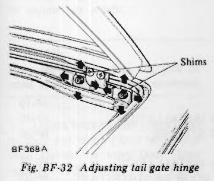
>
> - **Summary:** Adjusting tail gate hinge position and adding or removing shims to set roof-to-tailgate gap.
> - **Components:** Tail gate hinge, Shims, Roof panel, Tail gate
> - **Callouts:** **(Shims)** Shims
> - **Specs / Measurements:** Roof-to-tail gate clearance: 3.5 to 5.5 mm (0.138 to 0.217 in)
> - **Mechanic Notes:** Insert shims between hinge and body for fore-and-aft adjustment.
> - **Tags:** `tail gate hinge`, `shims`, `hinge adjustment`

## TAIL GATE LOCK, STRIKER AND DOWN STOPPER

1. Remove license plate lamp.  
2. Temporarily loosen tail gate striker to rear panel attaching screws until they are just loose enough to move striker.  
3. Move striker up or down as required until tail gate is flush with rear fenders. See Figure BF-33.  
4. After correct adjustment is made, tighten screws securely.  
5. Loosen tail gate lock attaching screws until they are just loose enough to move tail gate lock.  
6. Open and close tail gate two or three times to ensure that it is locked properly without binding. Then tighten attaching screws. See Figure BF-34.

> 🖼️ **Fig. BF-33 Adjusting striker** `[BF370A]` *(Type: `procedure_step`)*
>
> 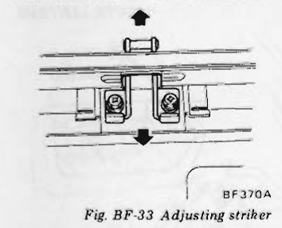
>
> - **Summary:** Loosening tail gate striker screws and moving striker vertically to flush tailgate with fenders.
> - **Components:** Striker, Rear panel, Attaching screws
> - **Mechanic Notes:** Remove license lamp first to gain access to striker adjusting screws.
> - **Tags:** `tail gate striker`, `striker adjustment`

> 🖼️ **Fig. BF-34 Adjusting tail gate lock** `[BF369A]` *(Type: `procedure_step`)*
>
> 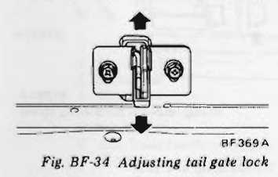
>
> - **Summary:** Adjusting tail gate latch lock mechanism alignment to prevent binding on striker.
> - **Components:** Tail gate lock, Attaching screws
> - **Mechanic Notes:** Test operation by opening and closing tail gate two or three times before final tightening.
> - **Tags:** `tail gate lock`, `latch adjustment`

The down stopper is adjustable in the forward and rearward directions only. See Figure BF-35.

> 🖼️ **Fig. BF-35 Adjusting down stopper** `[BF371A]` *(Type: `procedure_step`)*
>
> 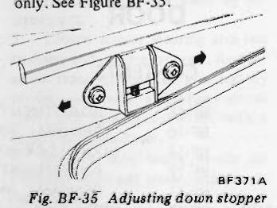
>
> - **Summary:** Forward and rearward slotted adjustment of the tailgate down stopper.
> - **Components:** Down stopper, Attaching screws
> - **Mechanic Notes:** Down stopper adjusts in forward/rearward directions only.
> - **Tags:** `down stopper`, `tail gate stopper`

# REMOVAL AND INSTALLATION

## TAIL GATE

1. Open tail gate and remove tail gate stay.

> [!CAUTION]
> Place rags between roof and upper end of tail gate to avoid damaging painted surfaces.

2. Remove tail gate to hinge attaching screws.  
3. Hold tail gate and remove it.

> [!CAUTION]
> Be careful not to scratch tail gate stay when installing. A scratched stay may cause gas leakage.

## TAIL GATE LOCK AND STRIKER

1. Remove lock from tail gate.  
2. Remove trim, insert hand into the gate, remove retaining clip, and remove key cylinder.  
3. Remove license plate lamp, and remove striker.  
4. The down stopper and rubber bumper can be removed simply by loosening the installation screws.

## REAR PANEL FINISHER

1. Remove rear panel trim.  
2. Disconnect rear combination lamp connector.  
3. Remove nuts securing rear combination lamp to body. See Figure BF-36.

> 🖼️ **Fig. BF-36 Removing nuts attaching rear combination lamp to body** `[BF372A]` *(Type: `procedure_step`)*
>
> 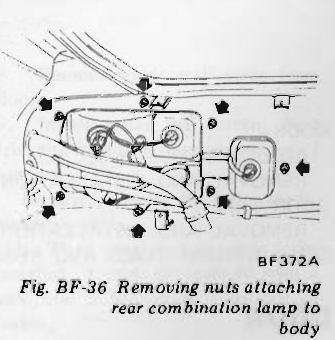
>
> - **Summary:** Accessing rear combination lamp mounting nuts from inside luggage compartment.
> - **Components:** Rear combination lamp, Attaching nuts, Harness connector
> - **Wiring / Connections:** Rear combination lamp connector
> - **Mechanic Notes:** Disconnect wiring connector before removing attaching nuts.
> - **Tags:** `rear combination lamp`, `removal`, `nuts`

4. Remove screws securing license lamp in place, and detach lamp. See Figure BF-37.

> 🖼️ **Fig. BF-37 Removing license lamp** `[BF373A]` *(Type: `procedure_step`)*
>
> 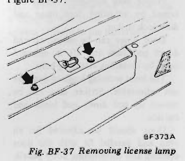
>
> - **Summary:** Removing screws securing license lamp to rear panel.
> - **Components:** License lamp, Mounting screws
> - **Mechanic Notes:** Detach lamp assembly after loosening screws.
> - **Tags:** `license lamp`, `removal`

---

<!-- Page 16 (BF-16) -->
5. Remove plastic rivets securing rear panel finisher to rear panel. See Figure BF-38.

> 🖼️ **Fig. BF-38 Removing rivets** `[BF990A]` *(Type: `procedure_step`)*
>
> 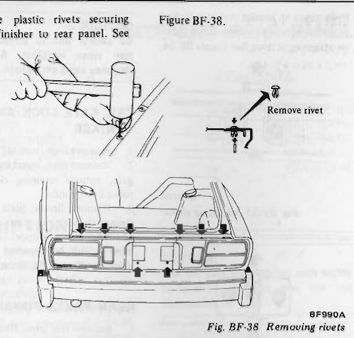
>
> - **Summary:** Method of pushing out center pin of plastic rivets on rear panel finisher using a small punch and hammer.
> - **Components:** Plastic rivet, Punch / skinny bar, Hammer, Rear panel finisher
> - **Callouts:** **(Remove rivet)** Remove rivet
> - **Mechanic Notes:** Push center pin in to release expansion collar of the rivet.
> - **Tags:** `plastic rivets`, `rear panel finisher`, `removal`

6. Remove finisher and rear combination lamp as a unit.

> 🖼️ **Fig. BF-39 Removing finisher and combination lamp assembly** `[BF375A]` *(Type: `procedure_step`)*
>
> 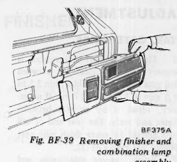
>
> - **Summary:** Detaching rear finisher and combination lamp unit together from rear panel.
> - **Components:** Rear panel finisher, Rear combination lamp, Rear body panel
> - **Mechanic Notes:** Remove as a complete assembly before separating lamps and trim rim.
> - **Tags:** `rear finisher removal`, `combination lamp`

7. Remove screws securing rear combination lamp to finisher, and remove rear combination lamp.  
8. Remove screws securing rim to finisher, and remove rim.

> [!CAUTION]
> Be careful not to scratch the painted surface of body, finisher, etc. with tool or the like.

9. Install finisher in the reverse order of removal.

# DOOR

### CONTENTS
| Section | Page |
| :--- | :--- |
| DOOR | BF-16 |
| ADJUSTMENT | BF-16 |
| REMOVAL AND INSTALLATION | BF-17 |
| DOOR TRIM | BF-17 |
| REMOVAL AND INSTALLATION | BF-17 |
| DOOR WINDOW GLASS AND REGULATOR | BF-18 |
| ADJUSTMENT | BF-19 |
| REMOVAL AND INSTALLATION | BF-19 |
| DOOR LOCK AND STRIKER | BF-20 |
| ADJUSTMENT | BF-21 |
| REMOVAL AND INSTALLATION | BF-21 |
| BODY SIDE AND DOOR WEATHERSTRIPS | BF-22 |

## DOOR

### ADJUSTMENT

Proper door alignment can be obtained by adjusting door hinge and door lock striker.  
Door hinge can be moved up and down and fore and aft in enlarged holes by loosening attaching bolts.  
The bolts securing hinge to door are not adjustable. Striker also can be moved up and down and inside and outside.  
Door should be adjusted for an even and parallel fit with the door opening and surrounding body panels.

> [!CAUTION]
> Be careful not to distort or mar door and surrounding body panels when adjusting. See Figures BF-40 and BF-41.

> 🖼️ **Fig. BF-40 Adjusting door hinge** `[BF653A]` *(Type: `procedure_step`)*
>
> 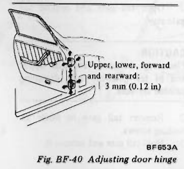
>
> - **Summary:** Door hinge adjustment directions and allowable adjustment limits.
> - **Components:** Door hinge, Door assembly, A-pillar
> - **Specs / Measurements:** Adjustment limit: Upper, lower, forward and rearward: 3 mm (0.12 in)
> - **Mechanic Notes:** Holes in body pillar are enlarged for adjustment; hinge-to-door bolts are non-adjustable.
> - **Tags:** `door hinge`, `door alignment`, `adjustment`

> 🖼️ **Fig. BF-41 Adjusting door lock striker** `[BF991A]` *(Type: `procedure_step`)*
>
> 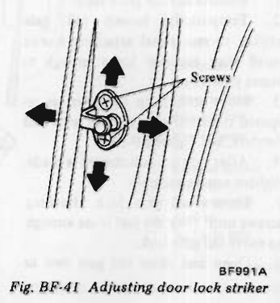
>
> - **Summary:** Adjusting door lock striker vertically and horizontally on B-pillar.
> - **Components:** Door lock striker, Screws, B-pillar
> - **Callouts:** **(Screws)** Screws
> - **Mechanic Notes:** Adjust striker only after door hinge alignment has been finalized.
> - **Tags:** `door striker`, `striker adjustment`

---

<!-- Page 17 (BF-17) -->
Front door hinge can be adjusted without removing front fender by using Door Hinge Wrench ST08720000. See Figure BF-42.

> 🖼️ **Fig. BF-42 Adjusting door hinge** `[BF992A]` *(Type: `procedure_step`)*
>
> 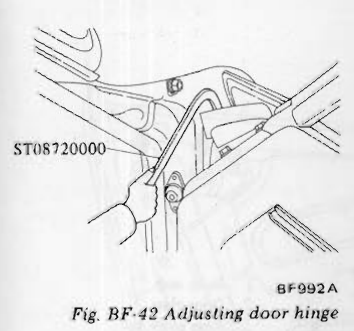
>
> - **Summary:** Using Door Hinge Wrench ST08720000 to reach and turn door hinge body bolts without removing front fender.
> - **Components:** Door hinge wrench ST08720000, Door hinge, Front pillar
> - **Callouts:** **(ST08720000)** Special Service Tool Door Hinge Wrench
> - **Specs / Measurements:** Special tool: Door Hinge Wrench ST08720000 (J 25610)
> - **Mechanic Notes:** Enables door alignment and removal while front fender remains mounted on car.
> - **Tags:** `door hinge wrench`, `ST08720000`, `special tool`, `door adjustment`

### REMOVAL AND INSTALLATION

1. With door in full open position, place a garage jack or stand under door to support its weight.

> [!CAUTION]
> Place rag between door and jack or stand to protect door from scratches.

2. Loosen bolts attaching door hinge to body and remove door with hinge from the car by using Door Hinge Wrench ST08720000. See Figure BF-42.  
3. Untighten bolts attaching hinge to door and remove hinge.  
4. Install door in the reverse order of removal.

# DOOR TRIM

## REMOVAL AND INSTALLATION

> 🖼️ **Fig. BF-43 Removing door trim** `[BF485A]` *(Type: `exploded_view`)*
>
> 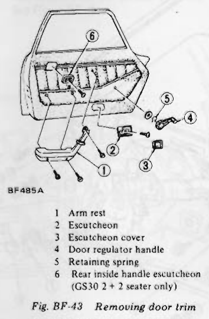
>
> - **Summary:** Exploded view of door trim hardware including arm rest, escutcheons, regulator handle, and retaining spring clip.
> - **Components:** Arm rest, Escutcheon, Escutcheon cover, Door regulator handle, Retaining spring, Rear inside handle escutcheon (GS30 2 + 2 seater only)
> - **Callouts:** **(1)** Arm rest; **(2)** Escutcheon; **(3)** Escutcheon cover; **(4)** Door regulator handle; **(5)** Retaining spring; **(6)** Rear inside handle escutcheon (GS30 2 + 2 seater only)
> - **Mechanic Notes:** Orient window regulator handle forward when door window is fully closed.
> - **Tags:** `door trim`, `exploded view`, `window crank`, `arm rest`

1. Open door and leave it open.  
2. Remove door lock knob by unscrewing it.  
3. Loosen screws securing arm rest to door, and remove arm rest. Remove screw from tip end of arm rest by prying cover with a flat-head screwdriver and backing screw off with a cross-head screwdriver.  
4. Remove door inside handle escutcheon cover and screw, and detach escutcheon.

> 🖼️ **Fig. BF-44 Removing escutcheon cover** `[BF654A]` *(Type: `procedure_step`)*
>
> 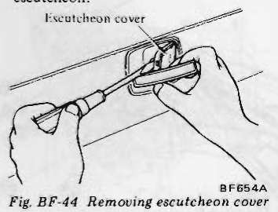
>
> - **Summary:** Prying off inside handle escutcheon screw cover with a screwdriver.
> - **Components:** Escutcheon cover, Inside handle escutcheon, Screwdriver
> - **Callouts:** **(Escutcheon cover)** Escutcheon cover
> - **Mechanic Notes:** Pry carefully to prevent scarring decorative plastic escutcheon.
> - **Tags:** `escutcheon cover`, `door handle trim`

5. Remove rear inside handle escutcheon and rear inside handle. (GS30 2 + 2 seater only)  
6. Remove spring retaining regulator handle in place, and detach regulator handle and washer. See Figure BF-43.  
7. Using a screwdriver, remove door finisher retaining clips from door, and remove door trim. See Figure BF-45.

> 🖼️ **Fig. BF-45 Removing door trim** `[BF086]` *(Type: `procedure_step`)*
>
> 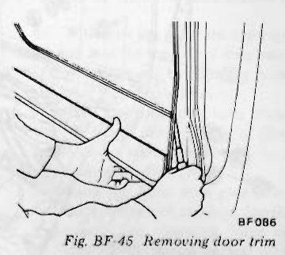
>
> - **Summary:** Using a flat tool or screwdriver to pop door finisher retaining clips from door inner panel.
> - **Components:** Door trim panel, Retaining clips, Door inner panel, Screwdriver
> - **Mechanic Notes:** Pry close to clip positions to avoid breaking fiberboard panel backing.
> - **Tags:** `door trim removal`, `door panel clips`

8. Remove water seal screen from door.  
9. Install water seal screen, door trim and fittings in the reverse order of removal.  
However, observe the following installation notes.  
(1) When water seal screen is to be installed, it must be replaced with a new one if broken or suspected of leaking.  
(2) When installing door regulator handle, make sure that knob is faced forward with side window glass completely closed.  
(3) When cleaning door finisher, use a damp or wet cloth; do not use any solvent harmful to the material.

---

<!-- Page 18 (BF-18) -->
# DOOR WINDOW GLASS AND REGULATOR

> 🖼️ **Fig. BF-46 Door window glass and regulator for S30 (2 seater)** `[BF993A]` *(Type: `exploded_view`)*
>
> 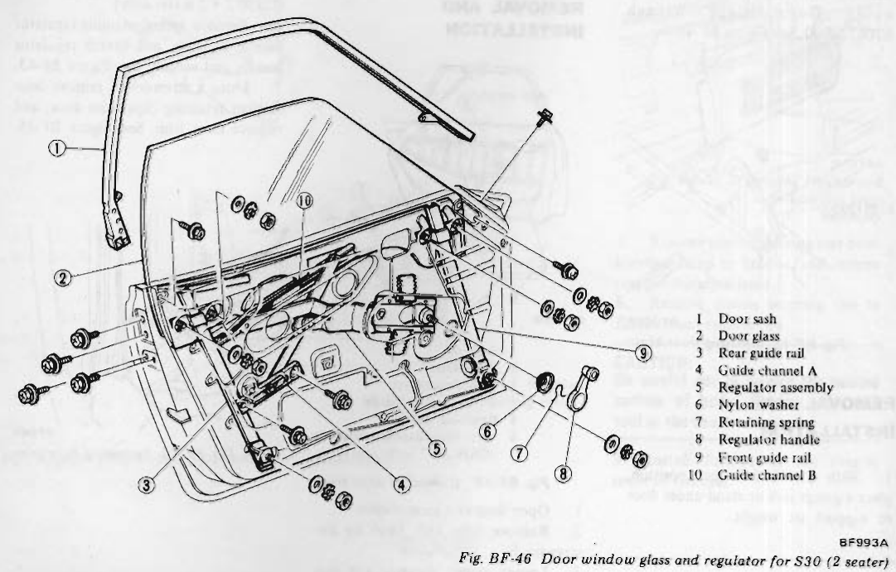
>
> - **Summary:** Exploded view of door window glass, sash, front and rear guide rails, guide channels A and B, regulator mechanism, and crank handle for S30 2-seater.
> - **Components:** Door sash, Door glass, Rear guide rail, Guide channel A, Regulator assembly, Nylon washer, Retaining spring, Regulator handle, Front guide rail, Guide channel B
> - **Callouts:** **(1)** Door sash; **(2)** Door glass; **(3)** Rear guide rail; **(4)** Guide channel A; **(5)** Regulator assembly; **(6)** Nylon washer; **(7)** Retaining spring; **(8)** Regulator handle; **(9)** Front guide rail; **(10)** Guide channel B
> - **Mechanic Notes:** Specific to S30 two-seater door. Note layout of guide channel A and B mounting screws.
> - **Tags:** `door glass`, `regulator`, `exploded view`, `S30`, `guide rails`

> 🖼️ **Fig. BF-47 Door window glass and regulator for GS30 (2 + 2 seater)** `[BF994A]` *(Type: `exploded_view`)*
>
> 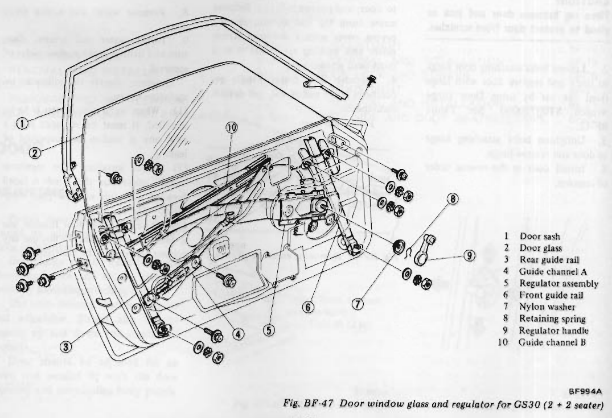
>
> - **Summary:** Exploded view of door window glass, sash, front and rear guide rails, guide channels A and B, regulator mechanism, and crank handle for GS30 2+2 seater.
> - **Components:** Door sash, Door glass, Rear guide rail, Guide channel A, Regulator assembly, Front guide rail, Nylon washer, Retaining spring, Regulator handle, Guide channel B
> - **Callouts:** **(1)** Door sash; **(2)** Door glass; **(3)** Rear guide rail; **(4)** Guide channel A; **(5)** Regulator assembly; **(6)** Front guide rail; **(7)** Nylon washer; **(8)** Retaining spring; **(9)** Regulator handle; **(10)** Guide channel B
> - **Mechanic Notes:** Specific to GS30 2+2 seater door. Different door sash and glass length from 2-seater.
> - **Tags:** `door glass`, `regulator`, `exploded view`, `GS30`, `2+2 seater`

---

<!-- Page 19 (BF-19) -->
# ADJUSTMENT

Door glass alignment can be accomplished by adjusting front and rear guide rails and guide channel.  
1. To obtain proper alignment of glass, temporarily loosen front and rear guide rails.  
For lower adjusting bolt, tighten it all the way. Then return four turns and secure lock nut at that position. See Figure BF-48.

> 🖼️ **Fig. BF-48 Guide rail adjusting mechanism** `[BF995A]` *(Type: `procedure_step`)*
>
> 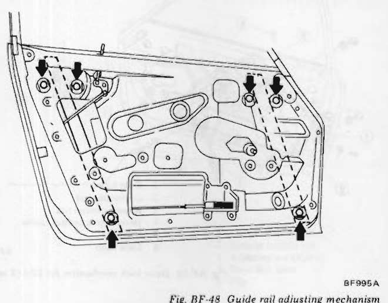
>
> - **Summary:** Adjusting bolts and slotted holes on inner door frame for front and rear window guide rails.
> - **Components:** Front guide rail, Rear guide rail, Lower adjusting bolt, Lock nut
> - **Specs / Measurements:** Lower bolt: tighten fully then back off 4 turns and lock
> - **Mechanic Notes:** Initial setting for lower adjusting bolt: tighten all the way, then return 4 turns and lock.
> - **Tags:** `guide rail adjustment`, `door window`

2. With glass in the up position, adjust guide rail upper adjusting bolts so that the clearance between outside door panel and outside glass face is 22 to 24 mm (0.87 to 0.94 in). Raise and lower glass to assure a fit. See Figure BF-49.

> 🖼️ **Fig. BF-49 Proper clearance between outside door panel and glass** `[BF996A]` *(Type: `inspection_measurement`)*
>
> 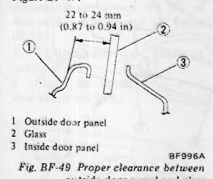
>
> - **Summary:** Cross section through door window opening showing clearance between glass outer surface and outer door panel skin.
> - **Components:** Outside door panel, Glass, Inside door panel
> - **Callouts:** **(1)** Outside door panel; **(2)** Glass; **(3)** Inside door panel
> - **Specs / Measurements:** Clearance: 22 to 24 mm (0.87 to 0.94 in)
> - **Mechanic Notes:** Adjust guide rail upper adjusting bolts to establish 22 to 24 mm clearance.
> - **Tags:** `door glass clearance`, `window adjustment`

The sideways free play of glass can be adjusted by moving front and rear guide rails fore and aft. See Figure BF-50.

> 🖼️ **Fig. BF-50 Adjusting front and rear guide rails** `[BF997A]` *(Type: `procedure_step`)*
>
> 
>
> - **Summary:** Fore and aft adjustment arrows for front and rear guide rails to eliminate sideways glass free play.
> - **Components:** Front guide rail, Rear guide rail, Adjustment bolts
> - **Mechanic Notes:** Move rails fore and aft to eliminate unwanted sideways glass play.
> - **Tags:** `guide rails`, `glass free play`

3. Make sure that outside door weatherstrip makes proper contact with door glass when door glass is raised and lowered.  
4. With glass up, adjust glass in parallel with the top rail of door sash by moving guide channel A up and down.  
5. Adjustment of guide channel A can be accomplished by the following procedure:  
When door glass is as in picture (A) of Figure BF-51, move guide channel up. Move it down if as in picture (B).

> 🖼️ **Fig. BF-51 Adjusting guide channel A** `[BF479]` *(Type: `alignment_orientation`)*
>
> 
>
> - **Summary:** Diagram showing glass tilt conditions (A - front tilted down, B - rear tilted down) and how adjusting guide channel A corrects parallel alignment with top rail.
> - **Components:** Door sash, Door glass
> - **Callouts:** **(1)** Door sash; **(2)** Door glass
> - **Mechanic Notes:** Move guide channel A up for condition (A); move down for condition (B).
> - **Tags:** `guide channel A`, `glass parallel adjustment`, `door sash`

6. With glass up, move the top edge of glass into the top rail of door sash. Obtain a tight seal by adjusting guide rail lower adjusting bolts evenly.  
7. Turn lower adjusting bolts clockwise to release the top edge of glass from door sash inside welt and counterclockwise to tighten.  
8. Raise and lower door glass to be sure the operation of regulator handle is smooth. The operating force of regulator handle should be less than 3.5 kg (7.7 lb) at the knob of regulator handle.  
If proper operating force is still not obtained, adjust regulator mechanism according to the following procedures:  
(1) Lubricate guide rollers, guide rails and regulator linkage.  
(2) Perform outside and inside door weatherstrip-to-door glass adjustment.  
(3) Adjust guide rails in parallel.

# REMOVAL AND INSTALLATION

1. Lower door glass.  
2. Remove arm rest, regulator handle, inside door handle escutcheon, door lock knob, rear inside handle (GS30 2 + 2 seater only), door trim and water seal screen. See Figure BF-52.

> 🖼️ **Fig. BF-52 Removing door trim** `[BF998A]` *(Type: `procedure_step`)*
>
> 
>
> - **Summary:** Door inner frame after removal of door trim and water screen showing access cutouts.
> - **Components:** Door inner panel, Access holes, Water seal screen
> - **Mechanic Notes:** Remove water seal screen carefully to access regulator and guide channel fasteners.
> - **Tags:** `door trim removal`, `inner door access`

---

<!-- Page 20 (BF-20) -->
3. Remove door outer molding.  
4. Remove screws securing door sash to door inner panel and draw door sash up.  
5. With glass in the full down position, support door glass and remove screws attaching glass back plate to guide channel B. See Figure BF-53.

> 🖼️ **Fig. BF-53 Removing screws attaching glass back plate to guide channel B** `[BF999A]` *(Type: `procedure_step`)*
>
> 
>
> - **Summary:** Accessing screws connecting the door glass bottom bracket to regulator guide channel B.
> - **Components:** Glass back plate, Guide channel B, Screws
> - **Mechanic Notes:** Support glass securely from dropping when screws are removed.
> - **Tags:** `glass back plate`, `guide channel B`, `glass removal`

6. Loosen bolts adjusting front and rear guide rail and raise door glass and draw it upwards.  
7. Remove guide rails from door. See Figure BF-54.

> 🖼️ **Fig. BF-54 Removing guide rail** `[BF1000A]` *(Type: `procedure_step`)*
>
> 
>
> - **Summary:** Removing front and rear vertical guide rails through inner door panel access openings.
> - **Components:** Front guide rail, Rear guide rail, Door inner panel
> - **Mechanic Notes:** Remove guide rails after lifting glass upwards and out.
> - **Tags:** `guide rail removal`

8. Remove screws attaching guide channel A, regulator arm base and regulator base and then remove them through the lower opening of inside door panel. See Figure BF-55.

> 🖼️ **Fig. BF-55 Removing regulator assembly** `[BF001B]` *(Type: `procedure_step`)*
>
> 
>
> - **Summary:** Withdrawing the regulator mechanism assembly through the lower inner door panel opening.
> - **Components:** Regulator assembly, Guide channel A, Lower opening
> - **Mechanic Notes:** Collapse arms to maneuver mechanism through the lower stamped cutout.
> - **Tags:** `regulator removal`, `window regulator`

9. Install regulator assembly, guide rails, and door glass in the reverse order of removal.

# DOOR LOCK AND STRIKER

> 🖼️ **Fig. BF-56 Door lock mechanism for S30 (2 seater)** `[BF002B]` *(Type: `exploded_view`)*
>
> 
>
> - **Summary:** Exploded view of the door lock mechanism, rods, interior handle, and lock knob for S30 2-seater.
> - **Components:** Door lock, Connecting rod, Remote control rod, Door remote control handle, Knob rod, Lock knob
> - **Callouts:** **(1)** Door lock; **(2)** Connecting rod; **(3)** Remote control rod; **(4)** Door remote control handle; **(5)** Knob rod; **(6)** Lock knob
> - **Mechanic Notes:** Single inner handle configuration for two-seater models.
> - **Tags:** `door lock mechanism`, `S30`, `exploded view`, `door latch`

> 🖼️ **Fig. BF-57 Door lock mechanism for GS30 (2 + 2 seater)** `[BF003B]` *(Type: `exploded_view`)*
>
> 
>
> - **Summary:** Exploded view of door lock linkage for GS30 2+2 seater showing front remote handle, rear inside handle, rods, and lock mechanism.
> - **Components:** Outside door handle, Key cylinder, Outside door handle rod, Door lock, Connecting rod, Remote control rod, Door remote control handle, Rod, Rear inside handle, Knob rod, Lock knob, Rear inside handle bracket, Rod
> - **Callouts:** **(1)** Outside door handle; **(2)** Key cylinder; **(3)** Outside door handle rod; **(4)** Door lock; **(5)** Connecting rod; **(6)** Remote control rod; **(7)** Door remote control handle; **(8)** Rod; **(9)** Rear inside handle; **(10)** Knob rod; **(11)** Lock knob; **(12)** Rear inside handle bracket; **(13)** Rod
> - **Mechanic Notes:** GS30 2+2 model includes an auxiliary rear inside door release handle and linkage.
> - **Tags:** `door lock mechanism`, `GS30`, `2+2 seater`, `rear inside handle`

---

<!-- Page 21 (BF-21) -->
# ADJUSTMENT

## Outside door handle

Outside door handle adjustment can be accomplished by adjusting the clearance between outside door lock lever and adjusting nut (nylon) located on outside door handle rod.  
To adjust outside door handle, turn adjusting nut clockwise or counterclockwise to obtain clearance of 0 to 1.0 mm (0 to 0.039 in). See Figure BF-58.

> 🖼️ **Fig. BF-58 Adjusting outside door handle free play** `[BF004B]` *(Type: `alignment_orientation`)*
>
> 
>
> - **Summary:** Adjusting nylon nut on outside handle pushrod to establish 0 to 1.0 mm clearance with lock lever.
> - **Components:** Outside door handle, Remote control rod, Adjusting nut (Nylon), Door lock lever, Clip
> - **Callouts:** **(1)** Outside door handle; **(2)** Remote control rod; **(3)** Adjusting nut (Nylon); **(4)** Door lock lever; **(5)** Clip
> - **Specs / Measurements:** Clearance: 0 to 1.0 mm (0 to 0.039 in)
> - **Mechanic Notes:** Turn nylon adjusting nut to set zero-to-minimal clearance without pre-loading latch.
> - **Tags:** `outside door handle`, `nylon adjusting nut`, `free play`

## Inside door handle

1. Partially loosen inside door handle attaching screws.  
2. With inside door lock knob set on (closed), move inside door handle in elongated holes toward the rear of door until it stops moving. See Figure BF-59.  
3. Tighten inside door handle attaching screws.  
4. Check the operation of inside door handle and lock.

> 🖼️ **Fig. BF-59 Adjusting inside door handle** `[BF005B]` *(Type: `procedure_step`)*
>
> 
>
> - **Summary:** Adjusting inside door handle in elongated mounting slots with lock knob engaged.
> - **Components:** Inside door lock knob, Bell-crank, Door inside handle
> - **Callouts:** **(1)** Inside door lock knob; **(2)** Bell-crank; **(3)** Door inside handle
> - **Mechanic Notes:** Move handle rearward in slotted holes until it stops, then tighten screws.
> - **Tags:** `inside door handle`, `adjustment`, `bell crank`

## Door lock striker

Door lock striker can be moved from side to side and up and down to align it with door lock latch. Adjust door lock striker after door hinge has been adjusted.

# REMOVAL AND INSTALLATION

1. Open door and leave it open.  
2. Remove door trim and water seal screen. Refer to page BF-17 for Removal and Installation of Door Trim.  
3. With glass down, remove door sash.  
4. Draw out window glass. Refer to Door Window Glass and Regulator section.  
5. Remove inside door handle and bell-crank attaching screws.  
6. Remove rear remote control bracket securing bolts and remove rear inside handle. (GS30 2 + 2 seater only)  
7. Loosen screws securing rear guide rail and remove rear guide rail.  
8. Loosen screw attaching bell crank with lock knob rod and remote control knob.  
9. Remove key cylinder retaining clip, and remove key cylinder.  
10. Loosen nuts attaching outside door handle and remove handle with rod. See Figure BF-60.

> 🖼️ **Fig. BF-60 Removing outside door handle** `[BF006B]` *(Type: `procedure_step`)*
>
> 
>
> - **Summary:** Loosening outside door handle attaching nuts from inner door cavity.
> - **Components:** Outside door handle, Attaching nuts, Door outer skin
> - **Mechanic Notes:** Remove handle together with vertical connecting rod.
> - **Tags:** `outside door handle`, `removal`

11. Remove door lock installation screws. Then, remove door lock from opening on the inside door panel.

> 🖼️ **Fig. BF-61 Removing door lock assembly** `[BF466]` *(Type: `procedure_step`)*
>
> 
>
> - **Summary:** Removing latch mechanism screws from door shut-face and withdrawing latch from inside door.
> - **Components:** Door lock assembly, Shut-face screws, Inner door opening
> - **Mechanic Notes:** Withdraw lock assembly through access hole in inner door panel.
> - **Tags:** `door lock assembly`, `removal`

12. Loosen door lock striker attaching screws and remove door lock from body. See Figure BF-62.

> 🖼️ **Fig. BF-62 Removing door lock striker** `[BF991A]` *(Type: `procedure_step`)*
>
> 
>
> - **Summary:** Loosening screws securing striker plate to body pillar.
> - **Components:** Door lock striker, Screws, B-pillar
> - **Callouts:** **(Screws)** Screws
> - **Mechanic Notes:** Use impact screwdriver if striker screws are excessively tight.
> - **Tags:** `door striker removal`

---

<!-- Page 22 (BF-22) -->
13. Install door lock mechanism in the reverse order of removal and apply small amount of multi-purpose grease to all movable surfaces of door lock assembly to obtain smooth operation.

> [!CAUTION]
> If door is heated over 80°C (176°F) when repainting door, nylon nut should be removed to avoid deformation.

> [!NOTE]
> Check return springs, actuating levers and other component parts for deformation, fatigue or rusting. Faulty parts must be replaced.

# BODY SIDE AND DOOR WEATHERSTRIPS

Body side weatherstrip is attached to body side flange. Door weatherstrip is attached to door sash. See Figure BF-63.

> 🖼️ **Fig. BF-63 Body side and door weatherstrips** `[BF007B / BF008B / BF009B]` *(Type: `cutaway_flow`)*
>
> 
>
> - **Summary:** Door opening perimeter view and cross-sectional profiles of body side and door sash weatherstrips for 2-seater and 2+2 seater.
> - **Components:** Body side weatherstrip, Door weatherstrip, Body flange, Door sash
> - **Callouts:** **(Section: A-A)** Body side weatherstrip cross section on pillar flange; **(Section: B-B (2 seater))** Door sash upper weatherstrip profile for 2-seater; **(Section: B-B, C-C (2 + 2 seater))** Door sash upper weatherstrip profile for 2+2 seater
> - **Mechanic Notes:** Profiles differ between 2-seater and 2+2 models at section B-B/C-C.
> - **Tags:** `weatherstrips`, `door sash seal`, `cross sections`, `body side seal`

## Removal

### Body side weatherstrip:
Loosen screws retaining scuff plate, and remove body side weatherstrip assembly by pulling out by hand. See Figure BF-64.

> 🖼️ **Fig. BF-64 Removing body side weatherstrip** `[BF010B]` *(Type: `procedure_step`)*
>
> 
>
> - **Summary:** Removing scuff plate and pulling body side weatherstrip off the door aperture pinchweld.
> - **Components:** Body side weatherstrip, Scuff plate, Kicking plate
> - **Callouts:** **(1)** Body side weatherstrip; **(2)** Scuff plate; **(3)** Kicking plate
> - **Mechanic Notes:** Loosen scuff plate screws before pulling weatherstrip.
> - **Tags:** `body side weatherstrip`, `scuff plate`, `removal`

### Door weatherstrip:
1. Remove rivets retaining door weatherstrip from door by prying off with standard screwdriver. See Figure BF-65.  
2. Pull out door weatherstrip from groove of door sash.

> 🖼️ **Fig. BF-65 Prying off rivets** `[BF011B]` *(Type: `procedure_step`)*
>
> 
>
> - **Summary:** Prying off plastic rivets retaining door weatherstrip to door sash groove using a screwdriver.
> - **Components:** Rivets, Door sash, Screwdriver, Weatherstrip
> - **Callouts:** **(Rivets)** Weatherstrip retaining rivets; **(Door sash)** Door window frame sash
> - **Mechanic Notes:** Pry carefully to release rivets without tearing weatherstrip rubber channel.
> - **Tags:** `door weatherstrip`, `rivets`, `removal`

## Installation

1. Sweep up foreign materials, dust or dirt on the body side flange or door sash groove. If necessary, use rag soaking wet with thinner.  
2. Apply adhesive evenly to the weatherstrip and the portion where weatherstrip may be seated.  
3. Position weatherstrip and bite body side flange with welt or install rivets in position.

---

<!-- Page 23 (BF-23) -->
# WINDSHIELD GLASS

### CONTENTS
| Section | Page |
| :--- | :--- |
| FRONT WINDSHIELD GLASS | BF-23 |
| REMOVAL | BF-23 |
| INSTALLATION | BF-23 |
| SIDE WINDOW | BF-24 |
| TAIL GATE GLASS | BF-25 |

# FRONT WINDSHIELD GLASS

> 🖼️ **Fig. BF-66 Front windshield glass** `[BF012B]` *(Type: `exploded_view`)*
>
> 
>
> - **Summary:** Exploded view of front windshield glass, perimeter weatherstrip, stainless moldings, and cross section A-A showing adhesive application points.
> - **Components:** Windshield molding, Weatherstrip, Windshield glass, Body flange
> - **Callouts:** **(1)** Windshield molding; **(2)** Weatherstrip; **(3)** Windshield glass
> - **Specs / Measurements:** Apply adhesive to body flange lip and weatherstrip mating groove as shown in section A-A
> - **Mechanic Notes:** Apply adhesive to specific sealing contact points on weatherstrip before mounting glass.
> - **Tags:** `windshield glass`, `weatherstrip`, `adhesive application`, `cross section`

## REMOVAL

1. Remove inside rearview mirror.  
2. Remove instrument panel garnish.  
3. Remove windshield wiper blades together with arms.  
4. Remove windshield molding.

> [!CAUTION]
> Be careful not to deform the molding.

5. Detach adhesive on the windshield flange side by applying a spatula or standard screwdriver from the outside.  
6. Depressing weatherstrip toward outside, lightly tap and remove windshield glass to the outside.

> [!NOTE]
> Windshield glass removal must be started from the upper side portion.

> 🖼️ **Fig. BF-67 Removing front windshield glass** `[BF390A]` *(Type: `procedure_step`)*
>
> 
>
> - **Summary:** Separating windshield glass adhesive bead using a spatula worked around flange from outside.
> - **Components:** Windshield glass, Spatula, Weatherstrip, Pillar flange
> - **Mechanic Notes:** Always start removal from upper side portion to prevent sudden drop.
> - **Tags:** `windshield removal`, `spatula`

## INSTALLATION

> [!CAUTION]
> Care should be exercised to make certain glass does not strike body metal during installation. Edge chips can lead to future breaks.

1. For installation, use string and spatula as shown in Figure BF-68.  
2. Apply adhesive to appropriate portions of weatherstrip as shown in Figure BF-66, and apply the weatherstrip to the windshield glass.

> 🖼️ **Fig. BF-68 Tools for installation of windshield glass** `[BF391A]` *(Type: `procedure_step`)*
>
> 
>
> - **Summary:** Required hand tools for installing windshield glass: capillary tube, spatula, and draw string.
> - **Components:** Capillary tube, Spatula, String
> - **Callouts:** **(1)** Capillary tube; **(2)** Spatula; **(3)** String
> - **Mechanic Notes:** Capillary tube used for injecting adhesive into rubber channel; strong nylon string used to pull rubber lip over pinchweld.
> - **Tags:** `windshield tools`, `spatula`, `capillary tube`, `string installation`

3. Place string into weatherstrip groove.  
4. Set windshield glass in the windshield flange from the outside, and put the string into the compartment side. <!-- Page 24 (BF-24) --> > [!NOTE]
> The operation should be carried out by two persons; one works outside and the other inside.

5. Pull the string (person working inside) in such a manner that the weatherstrip correctly engages with the flange. At the same time, lightly tap the glass (person working outside) by hand and assist the person working inside.

> [!NOTE]
> If the weatherstrip is not fitted into the flange correctly but mounted on the flange, correctly fit the weatherstrip into the flange by the use of a spatula.

6. Tap the overall glass area lightly to settle the weatherstrip down evenly and tightly on the flange.  
7. Apply adhesive to the entire periphery.  
8. Install windshield molding.  
9. Install windshield wiper blades and arms.  
10. Install instrument panel garnish.  
11. Install inside rearview mirror.

# SIDE WINDOW

> [!CAUTION]
> Be careful not to scratch painted surfaces of car body when handling side window.

> 🖼️ **Fig. BF-69 Structural view of side window for S30 (2 seater)** `[BF014B]` *(Type: `exploded_view`)*
>
> 
>
> - **Summary:** Exploded view of fixed quarter side window, frame sash, weatherstrips, joint covers, and rubber seals for S30 2-seater.
> - **Components:** Glass, Weatherstrip, Upper weatherstrip, Joint cover, Outer weatherstrip, Sealing rubber, Side window sash
> - **Callouts:** **(1)** Glass; **(2)** Weatherstrip; **(3)** Upper weatherstrip; **(4)** Joint cover; **(5)** Outer weatherstrip; **(6)** Sealing rubber; **(7)** Side window sash
> - **Mechanic Notes:** Fixed quarter glass installation on S30 2-seater.
> - **Tags:** `side window`, `quarter glass`, `S30`, `exploded view`

> 🖼️ **Fig. BF-70 Structural view of side window for GS30 (2 + 2 seater)** `[BF386B]` *(Type: `exploded_view`)*
>
> 
>
> - **Summary:** Exploded view of hinged/opening rear side window glass, center pillar, upper bracket, sash, latch handle, rubber washer, and finisher nut for GS30 2+2 seater.
> - **Components:** Side window glass, Side window weatherstrip, Center pillar, Side window upper bracket, Side window sash, Side window handle, Rubber washer, Finisher nut
> - **Callouts:** **(1)** Side window glass; **(2)** Side window weatherstrip; **(3)** Center pillar; **(4)** Side window upper bracket; **(5)** Side window sash; **(6)** Side window handle; **(7)** Rubber washer; **(8)** Finisher nut
> - **Mechanic Notes:** Hinged vent window design specific to GS30 2+2 models, utilizing pivot brackets and toggle latch handle.
> - **Tags:** `side window`, `vent window`, `GS30`, `2+2 seater`, `exploded view`

---

<!-- Page 25 (BF-25) -->
# TAIL GATE GLASS

The instructions for windshield glass apply also to tail gate glass removal and installation, with the exception that sealing agent is used rather than adhesive.

> 🖼️ **Fig. BF-71 Structural view of tail gate glass** `[BF015B]` *(Type: `exploded_view`)*
>
> 
>
> - **Summary:** Exploded view of tail gate glass, surrounding rubber weatherstrip, and stainless trim moldings with cross section A-A.
> - **Components:** Tail gate molding, Weatherstrip, Tail gate glass, Tail gate frame
> - **Callouts:** **(1)** Tail gate molding; **(2)** Weatherstrip; **(3)** Tail gate glass
> - **Specs / Measurements:** Use sealing agent rather than adhesive during installation
> - **Mechanic Notes:** Use non-hardening sealing agent instead of adhesive for tailgate glass.
> - **Tags:** `tail gate glass`, `hatch glass`, `weatherstrip`, `molding`

# SEAT

### CONTENTS
| Section | Page |
| :--- | :--- |
| DESCRIPTION | BF-25 |
| FRONT SEAT | BF-26 |
| REMOVAL AND INSTALLATION | BF-26 |
| REAR SEAT (GS30 2 + 2 seater models only) | BF-26 |
| REMOVAL AND INSTALLATION | BF-26 |

## DESCRIPTION

The front seats are a separate, bucket type which is equipped with a high seatback. The high seatback is combined with a head rest.  
The reclining seat can be tilted 6° forward and 36° backward, from the neutral position, with a pitch of 3° by lifting the tilt control lever located on the door side of the seat cushion.  
These seats can also be moved 180 mm (7.09 in) in the fore-and-aft direction with a pitch of 20 mm (0.79 in).  
The seatback of rear seat can be folded flush to the rear floor by releasing seatback lock. (GS30 2 + 2 seater only)

> 🖼️ **Fig. BF-72 Structural view of front and rear seats** `[BF016B]` *(Type: `exploded_view`)*
>
> 
>
> - **Summary:** Exploded structural view of front reclining bucket seats, slide rails, and GS30 2+2 folding rear seat assembly.
> - **Components:** Front seat, Rear seat cushion, Rear seatback, Seat slide rail, Reclining device, Seatback lock, Seatback hinge, Seatback striker
> - **Callouts:** **(1)** Front seat; **(2)** Rear seat cushion; **(3)** Rear seatback; **(4)** Seat slide rail; **(5)** Reclining device; **(6)** Seatback lock; **(7)** Seatback hinge; **(8)** Seatback striker
> - **Specs / Measurements:** Reclining tilt: 6° forward, 36° backward, pitch 3°; Slide travel: 180 mm (7.09 in), pitch 20 mm (0.79 in)
> - **Mechanic Notes:** Rear seatback folds flush with floor on 2+2 model.
> - **Tags:** `front seat`, `rear seat`, `slide rail`, `reclining mechanism`, `exploded view`

---

<!-- Page 26 (BF-26) -->
> [!CAUTION]
> In conformity with MVSS No. 302, be sure to remove the thin polyethylene covers from seat cushions and seat backs at:  
> a. Pre-delivery service  
> b. Parts replacements

# FRONT SEAT

## REMOVAL AND INSTALLATION

1. Remove bolts attaching the front of seat bracket to floor. See Figure BF-73.

> 🖼️ **Fig. BF-73 Removing front attaching bolts of front seat** `[BF488A]` *(Type: `procedure_step`)*
>
> 
>
> - **Summary:** Removing front mounting bracket bolts securing front seat track to floor pan.
> - **Components:** Front seat bracket, Mounting bolts, Floor pan
> - **Mechanic Notes:** Slide seat rearward to expose front floor bracket bolts.
> - **Tags:** `front seat removal`, `seat bracket bolts`

2. Remove bolts attaching the rear of seat bracket to floor.  
3. Then remove front seat assembly from car.  
4. Install front seat assembly in the reverse order of removal.

# REAR SEAT (GS30 2 + 2 seater models only)

## REMOVAL AND INSTALLATION

1. Remove screws attaching rear seat front end and rear seat cushion. See Figure BF-74.

> 🖼️ **Fig. BF-74 Removing rear seat cushion** `[BF489A]` *(Type: `procedure_step`)*
>
> 
>
> - **Summary:** Removing front securing screws to detach rear seat cushion on GS30 2+2.
> - **Components:** Rear seat cushion, Securing screws, Floor pan
> - **Mechanic Notes:** GS30 2+2 only: unscrew front retaining screws before lifting cushion.
> - **Tags:** `rear seat cushion`, `GS30`, `removal`

2. Fold seatback forward by releasing seatback lock, and remove screws attaching rear floor mat.  
3. Remove bolts attaching rear seatback to body and remove it from body. See Figure BF-75.

> 🖼️ **Fig. BF-75 Removing rear seatback** `[BF490A]` *(Type: `procedure_step`)*
>
> 
>
> - **Summary:** Removing hinge pivot bolts attaching rear seatback to body side structure on GS30 2+2.
> - **Components:** Rear seatback, Attaching bolts, Body bracket
> - **Mechanic Notes:** Fold seatback forward and pull mat away to reach hinge mounting bolts.
> - **Tags:** `rear seatback`, `GS30`, `seat hinge bolts`

4. Install rear seat cushion and seatback in the reverse order of removal.

# SEAT BELT

### CONTENTS
| Section | Page |
| :--- | :--- |
| DESCRIPTION | BF-26 |
| REMOVAL AND INSTALLATION | BF-27 |
| INSPECTION OF BUCKLE SWITCH | BF-27 |

## DESCRIPTION

The front seat belt assembly is a three-point type and consists essentially of a shoulder belt, outer and inner lap belts. The shoulder and outer lap belts are a combined unit and cannot be separated from each other.  
The outer lap and the shoulder belt incorporate sensitive emergency locking retractors in their construction. This retractor serves to securely restrain the belt in case of emergency, as in a collision or abrupt stop of the car, thus protecting the seat occupant against serious injury. Under normal conditions, the belt can be freely pulled out.  
The inner lap belt is a flexible wire combined with a buckle. The buckle includes a switch which functions as a seat belt warning device.  
The rear seat belt is a two-point type. It includes an automatic belt locking-retractor device.

---

<!-- Page 27 (BF-27) -->
> [!CAUTION]
> a. In conformity with MVSS No. 302, be sure to remove the thin polyethylene covers from seat belts at:  
> (1) Pre-delivery service  
> (2) Parts replacements  
> b. If the car has been in a collision or has overturned, replace the entire belt assembly, regardless of the exact nature of accident.  
> c. If the condition of any component of a seat belt is questionable, replace entire belt assembly. Never attempt to repair belt components.  
> d. If webbing is cut, frayed, or damaged, replace belt assembly.  
> e. Do not spill drinks, oil, etc. on inner lap belt buckle. Never oil tongue and buckle.  
> f. Use only a genuine Nissan seat belt assembly.

# REMOVAL AND INSTALLATION

1. Disconnect battery ground cable.  
2. Disconnect buckle switch harness at connector.  
3. Loosen bolt holding inner lap belt and remove inner lap belt. See Figure BF-76.

> 🖼️ **Fig. BF-76 Removing inner lap belt** `[BF176A]` *(Type: `procedure_step`)*
>
> 
>
> - **Summary:** Removing floor anchor bolt securing inner buckle stalk and wire harness.
> - **Components:** Inner lap belt, Buckle switch wire, Anchor bolt, Floor tunnel
> - **Wiring / Connections:** Buckle switch electrical wire connector
> - **Mechanic Notes:** Disconnect buckle switch harness connector before unbolting anchor.
> - **Tags:** `inner lap belt`, `buckle switch`, `removal`

4. Removing shoulder belt

### S30 models
(1) Remove synthetic resin clip and strut cover. See Figure BF-77.

> 🖼️ **Fig. BF-77 Removing strut cover clip** `[BF658A]` *(Type: `procedure_step`)*
>
> 
>
> - **Summary:** Removing synthetic resin plastic clip from rear strut tower trim cover.
> - **Components:** Strut cover, Resin clip, Strut tower
> - **Mechanic Notes:** S30 models: pry center pin to remove clip without breaking cover.
> - **Tags:** `strut cover clip`, `trim clip`, `removal`

(2) Loosen anchor bolt securing shoulder belt and remove shoulder belt with escutcheon. See Figure BF-78.

> 🖼️ **Fig. BF-78 Removing shoulder belt (for S30 2 seater models)** `[BF659A]` *(Type: `procedure_step`)*
>
> 
>
> - **Summary:** Removing shoulder belt guide anchor bolt and escutcheon on rear strut tower for S30 2-seater.
> - **Components:** Shoulder belt, Anchor bolt, Escutcheon, Strut tower cover
> - **Mechanic Notes:** Keep washers and spacers in proper order for reassembly.
> - **Tags:** `shoulder belt`, `S30`, `anchor bolt`

### GS30 2 + 2 seater models
(1) Remove screws securing escutcheon.  
(2) Detach door weatherstrip.  
(3) Remove garnish and quarter panel.  
(4) Loosen anchor bolt securing shoulder belt and remove shoulder belt with escutcheon. See Figure BF-79.

> 🖼️ **Fig. BF-79 Removing shoulder belt (for GS30 2 + 2 seater models)** `[BF660A]` *(Type: `procedure_step`)*
>
> 
>
> - **Summary:** Removing shoulder belt upper anchor bolt and escutcheon on B/C-pillar for GS30 2+2 seater.
> - **Components:** Shoulder belt, Anchor bolt, Escutcheon, Quarter panel trim
> - **Mechanic Notes:** Requires removal of quarter panel trim and weatherstrip to reach anchor bolt.
> - **Tags:** `shoulder belt`, `GS30`, `2+2 seater`, `anchor bolt`

5. Remove E.L.R. cover and loosen two anchor bolts securing outer lap belt, then remove shoulder and outer lap belt assembly. See Figure BF-80.

> 🖼️ **Fig. BF-80 Removing shoulder and outer lap belts** `[BF398A]` *(Type: `procedure_step`)*
>
> 
>
> - **Summary:** Removing ELR retractor cover and two floor anchor bolts securing outer retractor unit.
> - **Components:** ELR cover, Outer lap belt retractor, Anchor bolts, Sill
> - **Callouts:** **(ELR cover)** ELR cover
> - **Mechanic Notes:** Shoulder and outer lap belts are an integral retractor unit; replace as a set.
> - **Tags:** `ELR retractor`, `outer lap belt`, `removal`

6. Removing rear seat belt.  
Remove seat cushion and seatback, then loosen anchor bolts securing rear seat belts and remove rear seat belts. See Figure BF-81.

> 🖼️ **Fig. BF-81 Removing rear seat belts** `[BF503A]` *(Type: `procedure_step`)*
>
> 
>
> - **Summary:** Loosening rear floor anchor bolts securing rear seat belts on GS30 2+2.
> - **Components:** Rear seat belt, Anchor bolt, Floor pan
> - **Mechanic Notes:** Rear seats must be removed before unbolting rear seat belt retractors.
> - **Tags:** `rear seat belts`, `GS30`, `removal`

7. Install front and rear seat belts in the reverse order of removal.  
Observe the following.

> [!NOTE]
> Install inner lap belt in such a way that it is routed midway between seat cushion and seatback.

# INSPECTION OF BUCKLE SWITCH

The buckle switch contacts are normally closed. When tongue is latched to buckle, the tip end of tongue pushes push rod, thus opening the switch contacts.  
1. Disconnect battery ground cable.  
2. Disconnect buckle switch wire harness. <!-- Page 28 (BF-28) --> 3. Check buckle switch for proper operation, using a test light. The light should go out when tongue of outer lap belt is latched to buckle, and go on when it is unlatched. Replace belt assembly if necessary.

> [!NOTE]
> When checking buckle switch operation, make sure that power is held below 16 volts and 13 mA.

# INTERIOR TRIM

### CONTENTS
| Section | Page |
| :--- | :--- |
| DASH SIDE TRIM | BF-28 |
| REMOVAL AND INSTALLATION | BF-28 |
| BODY SIDE TRIM | BF-28 |
| SPARE TIRE COMPARTMENT LID | BF-28 |
| TAIL GATE TRIM | BF-28 |
| FLOOR CONSOLE | BF-29 |
| REMOVAL AND INSTALLATION | BF-29 |
| INSIDE REARVIEW MIRROR | BF-29 |

# DASH SIDE TRIM

## REMOVAL AND INSTALLATION

### Driver's seat side
1. Remove two flasher units (for turn signal and hazard).  
2. Remove hood lock control bracket.  
3. Remove fastener securing dash side trim to dash side panel and remove dash side trim.  
4. Install dash side trim in the reverse order of removal.

### Passenger's seat side
1. Remove fuse block and relay bracket.  
2. Remove fastener securing dash side trim to dash side panel and remove dash side trim.  
3. Install dash side trim in the reverse order of removal.

# BODY SIDE TRIM

Push in the center of the fastener with skinny bar. Fastener can be pulled out easily. See Figure BF-38.

> 🖼️ **Fig. BF-82 Body side trim (2 + 2 seater)** `[BF024B]` *(Type: `exploded_view`)*
>
> 
>
> - **Summary:** Exploded view of interior body side trim panels for GS30 2+2 seater including quarter panel garnish, rail garnish, reservoir protector, and rear trim.
> - **Components:** Quarter panel garnish, Tail rail garnish, Reservoir tank protector, Body side rear trim
> - **Callouts:** **(1)** Quarter panel garnish; **(2)** Tail rail garnish; **(3)** Reservoir tank protector; **(4)** Body side rear trim
> - **Mechanic Notes:** Use punch/skinny bar to push center pin of expansion fasteners to remove.
> - **Tags:** `body side trim`, `quarter panel garnish`, `GS30`, `interior trim`

# SPARE TIRE COMPARTMENT LID

> 🖼️ **Fig. BF-83 Spare tire compartment lid** `[BF018B]` *(Type: `exploded_view`)*
>
> 
>
> - **Summary:** Exploded view of rear floor spare tire well lid, hinges, and prop rod/support mechanism.
> - **Components:** Spare tire compartment lid, Hinges, Floor support
> - **Mechanic Notes:** Flush floor mounted spare tire cover.
> - **Tags:** `spare tire compartment lid`, `rear floor`

# TAIL GATE TRIM

> 🖼️ **Fig. BF-84 Tail gate trim** `[BF401A]` *(Type: `exploded_view`)*
>
> 
>
> - **Summary:** Layout of retaining clips and screws for the tailgate inner trim finisher panel.
> - **Components:** Tail gate trim panel, Fastener clips
> - **Mechanic Notes:** Carefully release perimeter clips to prevent tearing trim panel.
> - **Tags:** `tail gate trim`, `hatch trim`, `clips`

---

<!-- Page 29 (BF-29) -->
# FLOOR CONSOLE

## REMOVAL AND INSTALLATION

1. Remove five screws securing floor console in place.  
2. Disconnect wiring harnesses from console.  
3. Install floor console in the reverse order of removal.

> 🖼️ **Fig. BF-85 Floor console** `[BF019B]` *(Type: `exploded_view`)*
>
> 
>
> - **Summary:** Exploded view of center floor console, shift boot opening, armrest pocket, mounting screws, and harness connections.
> - **Components:** Floor console, Mounting screws, Shift boot opening, Wiring harness
> - **Specs / Measurements:** 5 mounting screws
> - **Wiring / Connections:** Console electrical wiring harnesses
> - **Mechanic Notes:** Remove 5 screws and unplug wiring before lifting console over shifter.
> - **Tags:** `floor console`, `center console`, `exploded view`

# INSIDE REARVIEW MIRROR

> 🖼️ **Fig. BF-86 Inside rearview mirror** `[BF403A]` *(Type: `exploded_view`)*
>
> 
>
> - **Summary:** Exploded view of inside rearview mirror, mounting bracket, base cover, and attaching screws.
> - **Components:** Inside rearview mirror, Mounting bracket, Cover, Screws
> - **Mechanic Notes:** Pry off base cover to access mounting screws.
> - **Tags:** `rearview mirror`, `inside mirror`, `exploded view`

---

<!-- Page 30 (BF-30) -->
# INSTRUMENT PANEL

> 🖼️ **Fig. BF-87 Instrument panel** `[BF020B]` *(Type: `exploded_view`)*
>
> 
>
> - **Summary:** Exploded view of the dashboard assembly, instrument upper garnish, padded main dashboard shell, lower brackets, and mounting hardware.
> - **Components:** Instrument garnish, Instrument panel with pad, Lower mounting brackets, Upper cowl brackets
> - **Callouts:** **(1)** Instrument garnish; **(2)** Instrument panel with pad
> - **Wiring / Connections:** Junction block harness; Combination switch harness; Ignition switch harness; Stop lamp switch harness; Flasher units harness; Door switch harness
> - **Mechanic Notes:** Always disconnect battery cable before beginning dash removal. Speedometer cable must be uncoupled.
> - **Tags:** `instrument panel`, `dashboard`, `exploded view`, `garnish`

## REMOVAL AND INSTALLATION

1. Remove cable from battery terminal.  
2. Remove horn pad, steering wheel and shell cover. Refer to Section ST (Page ST-3) for Removal.  
3. Remove screws securing instrument garnish to instrument, and detach garnish.  
4. Remove screws securing upper instrument to cowl top panel.  
5. Remove screws securing instrument finisher to instrument, and detach finisher.

> 🖼️ **Fig. BF-88 Removing instrument finisher** `[BF405A]` *(Type: `procedure_step`)*
>
> 
>
> - **Summary:** Detaching center gauge / heater control instrument finisher from dash structure.
> - **Components:** Instrument finisher, Center dash opening, Air control bezel
> - **Mechanic Notes:** Remove screws securing finisher before withdrawing center panel.
> - **Tags:** `instrument finisher`, `center bezel`, `removal`

6. Remove floor console.  
7. Remove screws securing air control finisher to instrument.  
8. Remove screws securing instrument to the upper side of floor tunnel.  
9. Remove screws securing side ventilator control bracket in place.  
10. Remove screws from each side of lower instrument.  
11. Disconnect instrument harnesses at:  
(1) Junction block  
(2) Combination switch  
(3) Ignition switch  
(4) Stop lamp switch  
(5) Flasher units (for turn signal and hazard)  
(6) Door switch  
12. Disconnect cable from speedometer.  
13. Install instrument panel in the reverse order of removal.

# INSTRUMENT PANEL UNDER COVER

1. Remove two screws securing under cover to instrument panel.  
2. Install instrument panel under cover in the reverse order of removal.

> 🖼️ **Fig. BF-89 Instrument panel under cover** `[BF048B]` *(Type: `exploded_view`)*
>
> 
>
> - **Summary:** Lower steering column / pedal area under-dash trim cover and retaining screws.
> - **Components:** Instrument panel under cover, Attaching screws
> - **Specs / Measurements:** 2 attaching screws
> - **Mechanic Notes:** Remove two screws to take down under cover.
> - **Tags:** `under cover`, `knee panel`, `instrument panel`

---

<!-- Page 31 (BF-31) -->
# BODY SEALING

## DESCRIPTION

Sealer is applied to the individual panel joints to secure body sealing.

> 🖼️ **Fig. BF-90 Sealing body panel joint** `[BF021B]` *(Type: `alignment_orientation`)*
>
> 
>
> - **Summary:** Overview map and cross sections detailing factory sealer locations on body panel seams and joints (Sections A-A through H-H).
> - **Components:** Inner sill, Outer sill, Body side member, Rear floor panel, Rear fender panel, Roof panel, Drip, Gasoline filler case, Mud guard, Tail rail main, Complement band, Dash floor panel, Dash side panel, Front fender baffle, Front fender panel, Door, Cowl top outer panel, Cowl top inner panel, Dash lower panel, Front floor panel, Wheel housing outer panel, Rod sealer
> - **Callouts:** **(Section: A-A)** Inner sill and outer sill joint; **(Section: B-B)** Body side member, rear floor panel, and rear fender panel joint; **(Section: C-C)** Roof panel and drip rail joint; **("D" portion)** Gasoline filler unit (Right side) - lower portion and overall circumference; **(Section: E-E)** Rear fender panel, mud guard, tail rail main, and complement band joint; **(Section: F-F)** Dash floor panel, dash side panel, front fender baffle, front fender panel, and door joint; **(Section: G-G)** Cowl top outer panel, cowl top inner panel, dash lower panel, and front floor panel; **(Section: H-H)** Rear fender panel, rod sealer, and wheel housing outer panel
> - **Mechanic Notes:** Reapply appropriate seam sealer and rod sealer to these specific joint profiles during body repair to prevent water leaks and corrosion.
> - **Tags:** `body sealing`, `panel joints`, `seam sealer`, `cross sections`, `rust prevention`

---

<!-- Page 32 (BF-32) -->

> 🖼️ **Fig. BF-91 Sealing rear panel joint** `[BF022B]` *(Type: `alignment_orientation`)*
>
> 
>
> - **Summary:** Detailed seam sealing locations on rear body panel, tail member, spare tire housing, and quarter extension joints (Sections J-J and K-K).
> - **Components:** Rear fender panel, Extension rear panel, Rear panel, Spare tire housing, Tail member, Spot sealer, Rod sealer
> - **Callouts:** **(Section: J-J)** Rear fender panel to extension rear panel joint; **(Section: K-K)** Rear panel, tail member, spare tire housing, spot sealer, and rod sealer joints
> - **Mechanic Notes:** Apply spot sealer and rod sealer as specified to prevent exhaust gas and moisture ingress into luggage compartment.
> - **Tags:** `rear panel sealing`, `spot sealer`, `rod sealer`, `tail member`

> 🖼️ **Fig. BF-92 Sealing rear wheel housing** `[BF406A]` *(Type: `alignment_orientation`)*
>
> 
>
> - **Summary:** Rear wheelhouse sealing points and wiring grommet adhesive sealing (Section L-L).
> - **Components:** Rear wheel housing, Wire grommet, Adhesive
> - **Callouts:** **(Section: L-L)** Grommet to body sheet metal sealing with adhesive
> - **Wiring / Connections:** Harness grommet through rear wheelhouse/side member
> - **Mechanic Notes:** Ensure adhesive seal around rubber grommet L-L to prevent wheel splash from entering body cavity.
> - **Tags:** `wheel housing sealing`, `grommet adhesive`, `seam sealer`

# SPECIAL SERVICE TOOL

| Tool number & tool name | Kent-Moore No. | Reference page or Fig. No. |
| :--- | :--- | :--- |
| **ST08720000** Door adjusting wrench | J 25610 | Fig. BF-42 Page BF-17 |

> 🖼️ **Door adjusting wrench ST08720000 (Kent-Moore J 25610)**  *(Type: `special_service_tool`)*
>
> 
>
> - **Summary:** Special curved offset box wrench designed to reach door hinge mounting bolts inside the fender gap.
> - **Components:** Door adjusting wrench ST08720000
> - **Specs / Measurements:** Kent-Moore No. J 25610
> - **Mechanic Notes:** Permits adjusting or removing door hinges without removing front fenders.
> - **Tags:** `special service tool`, `door adjusting wrench`, `ST08720000`, `J 25610`

---

## Segmented Diagrams Index

| Figure | Code | Type | Page | Caption | Key Components / Callouts | File |
| :--- | :--- | :--- | :--- | :--- | :--- | :--- |
| **Fig. BF-1** | `BF974A` | `exploded_view` | BF-2 | Fig. BF-1 Body construction | Front apron, Hood, Front fender (RH), Door (RH), Side window (RH) | [fig_bf_1_body_construction.png](diagrams/BF Body/fig_bf_1_body_construction.png) |
| **Fig. BF-2** | `BF380B` | `exploded_view` | BF-3 | Fig. BF-2 Structure of body main unit | Body main unit, Front side members, Strut towers, Dash panel, Floor tunnel | [fig_bf_2_structure_of_body_main_unit.png](diagrams/BF Body/fig_bf_2_structure_of_body_main_unit.png) |
| **Fig. BF-3** | `BF381B` | `alignment_orientation` | BF-5 | Fig. BF-3 Underbody alignment for S30 (2 seater) | Front side member, Front floor member, Compression rod bracket, Hood ledge front strut installing unit, Engine installing unit (front side / rear side) | [fig_bf_3_underbody_alignment_s30_2_seater.png](diagrams/BF Body/fig_bf_3_underbody_alignment_s30_2_seater.png) |
| **Fig. BF-4** | `BF382B` | `alignment_orientation` | BF-6 | Fig. BF-4 Underbody alignment for GS30 (2 + 2 seater) | Front side member, Front floor member, Compression rod bracket, Hood ledge front strut installing unit, Engine installing unit (front side / rear side) | [fig_bf_4_underbody_alignment_gs30_2_plus_2_seater.png](diagrams/BF Body/fig_bf_4_underbody_alignment_gs30_2_plus_2_seater.png) |
| **Fig. BF-5** | `BF383B` | `exploded_view` | BF-7 | Fig. BF-5 Exploded view of front bumper | Front side bumper, Shock absorber, Front bumper shim, Rubber sight shield, Front bumper | [fig_bf_5_exploded_view_of_front_bumper.png](diagrams/BF Body/fig_bf_5_exploded_view_of_front_bumper.png) |
| **Fig. BF-6** | `BF384B` | `exploded_view` | BF-7 | Fig. BF-6 Exploded view of rear bumper | Rear bumper sight shield, Shock absorber, Rear bumper, Rear bumper shim, Rear tie-down hook (LH) | [fig_bf_6_exploded_view_of_rear_bumper.png](diagrams/BF Body/fig_bf_6_exploded_view_of_rear_bumper.png) |
| **Bumper system inspection chart** | `-` | `cutaway_flow` | BF-8 | Bumper system inspection chart | Bumper appearance check, Bumper height measurement, Shock absorber dimensions check, Shock absorber operation check | [fig_bumper_system_inspection_chart.png](diagrams/BF Body/fig_bumper_system_inspection_chart.png) |
| **Fig. BF-7** | `BF980A` | `inspection_measurement` | BF-8 | Fig. BF-7 Standard height of front bumper | Front bumper, Ground datum line | [fig_bf_7_standard_height_of_front_bumper.png](diagrams/BF Body/fig_bf_7_standard_height_of_front_bumper.png) |
| **Fig. BF-8** | `BF981A` | `inspection_measurement` | BF-8 | Fig. BF-8 Standard height of rear bumper | Rear bumper, Ground datum line | [fig_bf_8_standard_height_of_rear_bumper.png](diagrams/BF Body/fig_bf_8_standard_height_of_rear_bumper.png) |
| **Fig. BF-9** | `BF348A` | `inspection_measurement` | BF-8 | Fig. BF-9 Length of shock absorber | Front shock absorber, Rear shock absorber | [fig_bf_9_length_of_shock_absorber.png](diagrams/BF Body/fig_bf_9_length_of_shock_absorber.png) |
| **Fig. BF-10** | `BF982A` | `procedure_step` | BF-9 | Fig. BF-10 Checking shock absorber function | Solid wall, Jack, Overrider, Front bumper, Wheel chock | [fig_bf_10_checking_shock_absorber_function.png](diagrams/BF Body/fig_bf_10_checking_shock_absorber_function.png) |
| **Fig. BF-11** | `BF023B` | `procedure_step` | BF-9 | Fig. BF-11 Removing front side bumper securing nut | Inner fender protector, Front side bumper, Securing nuts | [fig_bf_11_removing_front_side_bumper_securing_nut.png](diagrams/BF Body/fig_bf_11_removing_front_side_bumper_securing_nut.png) |
| **Fig. BF-12** | `BF983A` | `procedure_step` | BF-9 | Fig. BF-12 Removing front bumper | Front bumper, Shock absorber mount, Nuts | [fig_bf_12_removing_front_bumper.png](diagrams/BF Body/fig_bf_12_removing_front_bumper.png) |
| **Fig. BF-13** | `BF498A` | `procedure_step` | BF-9 | Fig. BF-13 Removing shock absorber | Front bumper shock absorber, Frame rail, Attaching bolts | [fig_bf_13_removing_shock_absorber.png](diagrams/BF Body/fig_bf_13_removing_shock_absorber.png) |
| **Fig. BF-14** | `BF984A` | `procedure_step` | BF-9 | Fig. BF-14 Removing rear bumper | Rear bumper, Shock absorber brackets, Attaching nuts | [fig_bf_14_removing_rear_bumper.png](diagrams/BF Body/fig_bf_14_removing_rear_bumper.png) |
| **Fig. BF-15** | `BF985A / BF986A` | `procedure_step` | BF-9 | Fig. BF-15 Removing shock absorber | Rear shock absorber, Body opening, Attaching bolts | [fig_bf_15_removing_shock_absorber.png](diagrams/BF Body/fig_bf_15_removing_shock_absorber.png) |
| **Fig. BF-16** | `BF385B` | `inspection_measurement` | BF-10 | Fig. BF-16 Clearances between muffler and L.H. shock absorber heat shield (California models) | Shock absorber bracket, Muffler, Spare tire housing, Heat shield plate | [fig_bf_16_clearances_between_muffler_and_lh_shock_absorber_heat_shield.png](diagrams/BF Body/fig_bf_16_clearances_between_muffler_and_lh_shock_absorber_heat_shield.png) |
| **Fig. BF-17** | `BF499A` | `procedure_step` | BF-10 | Fig. BF-17 Removing center grille upper bar attaching screw | Front combination lamp cover, Center grille upper bar, Attaching screw | [fig_bf_17_removing_center_grille_upper_bar_attaching_screw.png](diagrams/BF Body/fig_bf_17_removing_center_grille_upper_bar_attaching_screw.png) |
| **Fig. BF-18** | `BF500A` | `procedure_step` | BF-10 | Fig. BF-18 Removing center grille | Center grille, Mounting screws | [fig_bf_18_removing_center_grille.png](diagrams/BF Body/fig_bf_18_removing_center_grille.png) |
| **Fig. BF-19** | `BF501A` | `procedure_step` | BF-10 | Fig. BF-19 Removing lower grille | Lower grille, Mounting screws | [fig_bf_19_removing_lower_grille.png](diagrams/BF Body/fig_bf_19_removing_lower_grille.png) |
| **Fig. BF-20** | `BF356A` | `procedure_step` | BF-11 | Fig. BF-20 Adjusting hood attaching bolts | Hood hinge, Hood, Attaching bolts | [fig_bf_20_adjusting_hood_attaching_bolts.png](diagrams/BF Body/fig_bf_20_adjusting_hood_attaching_bolts.png) |
| **Fig. BF-21** | `BF357A` | `procedure_step` | BF-11 | Fig. BF-21 Adjusting hood bumper height | Hood bumper, Lock nut, Cowl ledge | [fig_bf_21_adjusting_hood_bumper_height.png](diagrams/BF Body/fig_bf_21_adjusting_hood_bumper_height.png) |
| **Fig. BF-22** | `BF359A` | `procedure_step` | BF-11 | Fig. BF-22 Adjusting hood lock male part | Hood lock male part, Attaching bolts, Dovetail pin | [fig_bf_22_adjusting_hood_lock_male_part.png](diagrams/BF Body/fig_bf_22_adjusting_hood_lock_male_part.png) |
| **Fig. BF-23** | `BF360A` | `inspection_measurement` | BF-11 | Fig. BF-23 Safety catch lever | Safety catch lever, Hood lock female part | [fig_bf_23_safety_catch_lever.png](diagrams/BF Body/fig_bf_23_safety_catch_lever.png) |
| **Fig. BF-24** | `BF358A` | `cutaway_flow` | BF-11 | Fig. BF-24 Sectional view of hood lock | Hood lock male body, Lock nut, Cushion rubber, Hood lock female, Dovetail bolt | [fig_bf_24_sectional_view_of_hood_lock.png](diagrams/BF Body/fig_bf_24_sectional_view_of_hood_lock.png) |
| **Fig. BF-25** | `BF361A` | `alignment_orientation` | BF-12 | Fig. BF-25 Lubricating points | Hood lock female part, Safety catch lever, Return spring, Pivot | [fig_bf_25_lubricating_points.png](diagrams/BF Body/fig_bf_25_lubricating_points.png) |
| **Fig. BF-26** | `BF362A` | `procedure_step` | BF-12 | Fig. BF-26 Removing hood | Hood, Hood hinge | [fig_bf_26_removing_hood.png](diagrams/BF Body/fig_bf_26_removing_hood.png) |
| **Fig. BF-27** | `BF363A` | `procedure_step` | BF-12 | Fig. BF-27 Removing hood torsion bar | Torsion bar, Hood hinge, Screwdriver | [fig_bf_27_removing_hood_torsion_bar.png](diagrams/BF Body/fig_bf_27_removing_hood_torsion_bar.png) |
| **Fig. BF-28** | `BF988A` | `exploded_view` | BF-12 | Fig. BF-28 Hood lock | Hood lock male part, Guide, Hood lock bracket, Hood lock female part, Clamp | [fig_bf_28_hood_lock.png](diagrams/BF Body/fig_bf_28_hood_lock.png) |
| **Fig. BF-29** | `BF365A` | `procedure_step` | BF-13 | Fig. BF-29 Removing cowl top grille | Cowl top grille, Cowl panel | [fig_bf_29_removing_cowl_top_grille.png](diagrams/BF Body/fig_bf_29_removing_cowl_top_grille.png) |
| **Fig. BF-30** | `BF989A` | `exploded_view` | BF-13 | Fig. BF-30 Removing front fender | Front fender front assembly, Headlight case, Inspection lid, Front fender, Inner fender protector | [fig_bf_30_removing_front_fender.png](diagrams/BF Body/fig_bf_30_removing_front_fender.png) |
| **Fig. BF-31** | `BF367A` | `exploded_view` | BF-14 | Fig. BF-31 Structural view of tail gate | Seal cover, Shim, Tail gate hinge, Tail gate lock, Key cylinder | [fig_bf_31_structural_view_of_tail_gate.png](diagrams/BF Body/fig_bf_31_structural_view_of_tail_gate.png) |
| **Fig. BF-32** | `BF368A` | `procedure_step` | BF-15 | Fig. BF-32 Adjusting tail gate hinge | Tail gate hinge, Shims, Roof panel, Tail gate | [fig_bf_32_adjusting_tail_gate_hinge.png](diagrams/BF Body/fig_bf_32_adjusting_tail_gate_hinge.png) |
| **Fig. BF-33** | `BF370A` | `procedure_step` | BF-15 | Fig. BF-33 Adjusting striker | Striker, Rear panel, Attaching screws | [fig_bf_33_adjusting_striker.png](diagrams/BF Body/fig_bf_33_adjusting_striker.png) |
| **Fig. BF-34** | `BF369A` | `procedure_step` | BF-15 | Fig. BF-34 Adjusting tail gate lock | Tail gate lock, Attaching screws | [fig_bf_34_adjusting_tail_gate_lock.png](diagrams/BF Body/fig_bf_34_adjusting_tail_gate_lock.png) |
| **Fig. BF-35** | `BF371A` | `procedure_step` | BF-15 | Fig. BF-35 Adjusting down stopper | Down stopper, Attaching screws | [fig_bf_35_adjusting_down_stopper.png](diagrams/BF Body/fig_bf_35_adjusting_down_stopper.png) |
| **Fig. BF-36** | `BF372A` | `procedure_step` | BF-15 | Fig. BF-36 Removing nuts attaching rear combination lamp to body | Rear combination lamp, Attaching nuts, Harness connector | [fig_bf_36_removing_nuts_attaching_rear_combination_lamp_to_body.png](diagrams/BF Body/fig_bf_36_removing_nuts_attaching_rear_combination_lamp_to_body.png) |
| **Fig. BF-37** | `BF373A` | `procedure_step` | BF-15 | Fig. BF-37 Removing license lamp | License lamp, Mounting screws | [fig_bf_37_removing_license_lamp.png](diagrams/BF Body/fig_bf_37_removing_license_lamp.png) |
| **Fig. BF-38** | `BF990A` | `procedure_step` | BF-16 | Fig. BF-38 Removing rivets | Plastic rivet, Punch / skinny bar, Hammer, Rear panel finisher | [fig_bf_38_removing_rivets.png](diagrams/BF Body/fig_bf_38_removing_rivets.png) |
| **Fig. BF-39** | `BF375A` | `procedure_step` | BF-16 | Fig. BF-39 Removing finisher and combination lamp assembly | Rear panel finisher, Rear combination lamp, Rear body panel | [fig_bf_39_removing_finisher_and_combination_lamp_assembly.png](diagrams/BF Body/fig_bf_39_removing_finisher_and_combination_lamp_assembly.png) |
| **Fig. BF-40** | `BF653A` | `procedure_step` | BF-16 | Fig. BF-40 Adjusting door hinge | Door hinge, Door assembly, A-pillar | [fig_bf_40_adjusting_door_hinge.png](diagrams/BF Body/fig_bf_40_adjusting_door_hinge.png) |
| **Fig. BF-41** | `BF991A` | `procedure_step` | BF-16 | Fig. BF-41 Adjusting door lock striker | Door lock striker, Screws, B-pillar | [fig_bf_41_adjusting_door_lock_striker.png](diagrams/BF Body/fig_bf_41_adjusting_door_lock_striker.png) |
| **Fig. BF-42** | `BF992A` | `procedure_step` | BF-17 | Fig. BF-42 Adjusting door hinge | Door hinge wrench ST08720000, Door hinge, Front pillar | [fig_bf_42_adjusting_door_hinge.png](diagrams/BF Body/fig_bf_42_adjusting_door_hinge.png) |
| **Fig. BF-43** | `BF485A` | `exploded_view` | BF-17 | Fig. BF-43 Removing door trim | Arm rest, Escutcheon, Escutcheon cover, Door regulator handle, Retaining spring | [fig_bf_43_removing_door_trim.png](diagrams/BF Body/fig_bf_43_removing_door_trim.png) |
| **Fig. BF-44** | `BF654A` | `procedure_step` | BF-17 | Fig. BF-44 Removing escutcheon cover | Escutcheon cover, Inside handle escutcheon, Screwdriver | [fig_bf_44_removing_escutcheon_cover.png](diagrams/BF Body/fig_bf_44_removing_escutcheon_cover.png) |
| **Fig. BF-45** | `BF086` | `procedure_step` | BF-17 | Fig. BF-45 Removing door trim | Door trim panel, Retaining clips, Door inner panel, Screwdriver | [fig_bf_45_removing_door_trim.png](diagrams/BF Body/fig_bf_45_removing_door_trim.png) |
| **Fig. BF-46** | `BF993A` | `exploded_view` | BF-18 | Fig. BF-46 Door window glass and regulator for S30 (2 seater) | Door sash, Door glass, Rear guide rail, Guide channel A, Regulator assembly | [fig_bf_46_door_window_glass_and_regulator_s30_2_seater.png](diagrams/BF Body/fig_bf_46_door_window_glass_and_regulator_s30_2_seater.png) |
| **Fig. BF-47** | `BF994A` | `exploded_view` | BF-18 | Fig. BF-47 Door window glass and regulator for GS30 (2 + 2 seater) | Door sash, Door glass, Rear guide rail, Guide channel A, Regulator assembly | [fig_bf_47_door_window_glass_and_regulator_gs30_2_plus_2_seater.png](diagrams/BF Body/fig_bf_47_door_window_glass_and_regulator_gs30_2_plus_2_seater.png) |
| **Fig. BF-48** | `BF995A` | `procedure_step` | BF-19 | Fig. BF-48 Guide rail adjusting mechanism | Front guide rail, Rear guide rail, Lower adjusting bolt, Lock nut | [fig_bf_48_guide_rail_adjusting_mechanism.png](diagrams/BF Body/fig_bf_48_guide_rail_adjusting_mechanism.png) |
| **Fig. BF-49** | `BF996A` | `inspection_measurement` | BF-19 | Fig. BF-49 Proper clearance between outside door panel and glass | Outside door panel, Glass, Inside door panel | [fig_bf_49_proper_clearance_between_outside_door_panel_and_glass.png](diagrams/BF Body/fig_bf_49_proper_clearance_between_outside_door_panel_and_glass.png) |
| **Fig. BF-50** | `BF997A` | `procedure_step` | BF-19 | Fig. BF-50 Adjusting front and rear guide rails | Front guide rail, Rear guide rail, Adjustment bolts | [fig_bf_50_adjusting_front_and_rear_guide_rails.png](diagrams/BF Body/fig_bf_50_adjusting_front_and_rear_guide_rails.png) |
| **Fig. BF-51** | `BF479` | `alignment_orientation` | BF-19 | Fig. BF-51 Adjusting guide channel A | Door sash, Door glass | [fig_bf_51_adjusting_guide_channel_a.png](diagrams/BF Body/fig_bf_51_adjusting_guide_channel_a.png) |
| **Fig. BF-52** | `BF998A` | `procedure_step` | BF-19 | Fig. BF-52 Removing door trim | Door inner panel, Access holes, Water seal screen | [fig_bf_52_removing_door_trim.png](diagrams/BF Body/fig_bf_52_removing_door_trim.png) |
| **Fig. BF-53** | `BF999A` | `procedure_step` | BF-20 | Fig. BF-53 Removing screws attaching glass back plate to guide channel B | Glass back plate, Guide channel B, Screws | [fig_bf_53_removing_screws_attaching_glass_back_plate_to_guide_channel_b.png](diagrams/BF Body/fig_bf_53_removing_screws_attaching_glass_back_plate_to_guide_channel_b.png) |
| **Fig. BF-54** | `BF1000A` | `procedure_step` | BF-20 | Fig. BF-54 Removing guide rail | Front guide rail, Rear guide rail, Door inner panel | [fig_bf_54_removing_guide_rail.png](diagrams/BF Body/fig_bf_54_removing_guide_rail.png) |
| **Fig. BF-55** | `BF001B` | `procedure_step` | BF-20 | Fig. BF-55 Removing regulator assembly | Regulator assembly, Guide channel A, Lower opening | [fig_bf_55_removing_regulator_assembly.png](diagrams/BF Body/fig_bf_55_removing_regulator_assembly.png) |
| **Fig. BF-56** | `BF002B` | `exploded_view` | BF-20 | Fig. BF-56 Door lock mechanism for S30 (2 seater) | Door lock, Connecting rod, Remote control rod, Door remote control handle, Knob rod | [fig_bf_56_door_lock_mechanism_for_s30_2_seater.png](diagrams/BF Body/fig_bf_56_door_lock_mechanism_for_s30_2_seater.png) |
| **Fig. BF-57** | `BF003B` | `exploded_view` | BF-20 | Fig. BF-57 Door lock mechanism for GS30 (2 + 2 seater) | Outside door handle, Key cylinder, Outside door handle rod, Door lock, Connecting rod | [fig_bf_57_door_lock_mechanism_for_gs30_2_plus_2_seater.png](diagrams/BF Body/fig_bf_57_door_lock_mechanism_for_gs30_2_plus_2_seater.png) |
| **Fig. BF-58** | `BF004B` | `alignment_orientation` | BF-21 | Fig. BF-58 Adjusting outside door handle free play | Outside door handle, Remote control rod, Adjusting nut (Nylon), Door lock lever, Clip | [fig_bf_58_adjusting_outside_door_handle_free_play.png](diagrams/BF Body/fig_bf_58_adjusting_outside_door_handle_free_play.png) |
| **Fig. BF-59** | `BF005B` | `procedure_step` | BF-21 | Fig. BF-59 Adjusting inside door handle | Inside door lock knob, Bell-crank, Door inside handle | [fig_bf_59_adjusting_inside_door_handle.png](diagrams/BF Body/fig_bf_59_adjusting_inside_door_handle.png) |
| **Fig. BF-60** | `BF006B` | `procedure_step` | BF-21 | Fig. BF-60 Removing outside door handle | Outside door handle, Attaching nuts, Door outer skin | [fig_bf_60_removing_outside_door_handle.png](diagrams/BF Body/fig_bf_60_removing_outside_door_handle.png) |
| **Fig. BF-61** | `BF466` | `procedure_step` | BF-21 | Fig. BF-61 Removing door lock assembly | Door lock assembly, Shut-face screws, Inner door opening | [fig_bf_61_removing_door_lock_assembly.png](diagrams/BF Body/fig_bf_61_removing_door_lock_assembly.png) |
| **Fig. BF-62** | `BF991A` | `procedure_step` | BF-21 | Fig. BF-62 Removing door lock striker | Door lock striker, Screws, B-pillar | [fig_bf_62_removing_door_lock_striker.png](diagrams/BF Body/fig_bf_62_removing_door_lock_striker.png) |
| **Fig. BF-63** | `BF007B / BF008B / BF009B` | `cutaway_flow` | BF-22 | Fig. BF-63 Body side and door weatherstrips | Body side weatherstrip, Door weatherstrip, Body flange, Door sash | [fig_bf_63_body_side_and_door_weatherstrips.png](diagrams/BF Body/fig_bf_63_body_side_and_door_weatherstrips.png) |
| **Fig. BF-64** | `BF010B` | `procedure_step` | BF-22 | Fig. BF-64 Removing body side weatherstrip | Body side weatherstrip, Scuff plate, Kicking plate | [fig_bf_64_removing_body_side_weatherstrip.png](diagrams/BF Body/fig_bf_64_removing_body_side_weatherstrip.png) |
| **Fig. BF-65** | `BF011B` | `procedure_step` | BF-22 | Fig. BF-65 Prying off rivets | Rivets, Door sash, Screwdriver, Weatherstrip | [fig_bf_65_prying_off_rivets.png](diagrams/BF Body/fig_bf_65_prying_off_rivets.png) |
| **Fig. BF-66** | `BF012B` | `exploded_view` | BF-23 | Fig. BF-66 Front windshield glass | Windshield molding, Weatherstrip, Windshield glass, Body flange | [fig_bf_66_front_windshield_glass.png](diagrams/BF Body/fig_bf_66_front_windshield_glass.png) |
| **Fig. BF-67** | `BF390A` | `procedure_step` | BF-23 | Fig. BF-67 Removing front windshield glass | Windshield glass, Spatula, Weatherstrip, Pillar flange | [fig_bf_67_removing_front_windshield_glass.png](diagrams/BF Body/fig_bf_67_removing_front_windshield_glass.png) |
| **Fig. BF-68** | `BF391A` | `procedure_step` | BF-23 | Fig. BF-68 Tools for installation of windshield glass | Capillary tube, Spatula, String | [fig_bf_68_tools_for_installation_of_windshield_glass.png](diagrams/BF Body/fig_bf_68_tools_for_installation_of_windshield_glass.png) |
| **Fig. BF-69** | `BF014B` | `exploded_view` | BF-24 | Fig. BF-69 Structural view of side window for S30 (2 seater) | Glass, Weatherstrip, Upper weatherstrip, Joint cover, Outer weatherstrip | [fig_bf_69_structural_view_of_side_window_for_s30_2_seater.png](diagrams/BF Body/fig_bf_69_structural_view_of_side_window_for_s30_2_seater.png) |
| **Fig. BF-70** | `BF386B` | `exploded_view` | BF-24 | Fig. BF-70 Structural view of side window for GS30 (2 + 2 seater) | Side window glass, Side window weatherstrip, Center pillar, Side window upper bracket, Side window sash | [fig_bf_70_structural_view_of_side_window_for_gs30_2_plus_2_seater.png](diagrams/BF Body/fig_bf_70_structural_view_of_side_window_for_gs30_2_plus_2_seater.png) |
| **Fig. BF-71** | `BF015B` | `exploded_view` | BF-25 | Fig. BF-71 Structural view of tail gate glass | Tail gate molding, Weatherstrip, Tail gate glass, Tail gate frame | [fig_bf_71_structural_view_of_tail_gate_glass.png](diagrams/BF Body/fig_bf_71_structural_view_of_tail_gate_glass.png) |
| **Fig. BF-72** | `BF016B` | `exploded_view` | BF-25 | Fig. BF-72 Structural view of front and rear seats | Front seat, Rear seat cushion, Rear seatback, Seat slide rail, Reclining device | [fig_bf_72_structural_view_of_front_and_rear_seats.png](diagrams/BF Body/fig_bf_72_structural_view_of_front_and_rear_seats.png) |
| **Fig. BF-73** | `BF488A` | `procedure_step` | BF-26 | Fig. BF-73 Removing front attaching bolts of front seat | Front seat bracket, Mounting bolts, Floor pan | [fig_bf_73_removing_front_attaching_bolts_of_front_seat.png](diagrams/BF Body/fig_bf_73_removing_front_attaching_bolts_of_front_seat.png) |
| **Fig. BF-74** | `BF489A` | `procedure_step` | BF-26 | Fig. BF-74 Removing rear seat cushion | Rear seat cushion, Securing screws, Floor pan | [fig_bf_74_removing_rear_seat_cushion.png](diagrams/BF Body/fig_bf_74_removing_rear_seat_cushion.png) |
| **Fig. BF-75** | `BF490A` | `procedure_step` | BF-26 | Fig. BF-75 Removing rear seatback | Rear seatback, Attaching bolts, Body bracket | [fig_bf_75_removing_rear_seatback.png](diagrams/BF Body/fig_bf_75_removing_rear_seatback.png) |
| **Fig. BF-76** | `BF176A` | `procedure_step` | BF-27 | Fig. BF-76 Removing inner lap belt | Inner lap belt, Buckle switch wire, Anchor bolt, Floor tunnel | [fig_bf_76_removing_inner_lap_belt.png](diagrams/BF Body/fig_bf_76_removing_inner_lap_belt.png) |
| **Fig. BF-77** | `BF658A` | `procedure_step` | BF-27 | Fig. BF-77 Removing strut cover clip | Strut cover, Resin clip, Strut tower | [fig_bf_77_removing_strut_cover_clip.png](diagrams/BF Body/fig_bf_77_removing_strut_cover_clip.png) |
| **Fig. BF-78** | `BF659A` | `procedure_step` | BF-27 | Fig. BF-78 Removing shoulder belt (for S30 2 seater models) | Shoulder belt, Anchor bolt, Escutcheon, Strut tower cover | [fig_bf_78_removing_shoulder_belt_s30_2_seater.png](diagrams/BF Body/fig_bf_78_removing_shoulder_belt_s30_2_seater.png) |
| **Fig. BF-79** | `BF660A` | `procedure_step` | BF-27 | Fig. BF-79 Removing shoulder belt (for GS30 2 + 2 seater models) | Shoulder belt, Anchor bolt, Escutcheon, Quarter panel trim | [fig_bf_79_removing_shoulder_belt_gs30_2_plus_2_seater.png](diagrams/BF Body/fig_bf_79_removing_shoulder_belt_gs30_2_plus_2_seater.png) |
| **Fig. BF-80** | `BF398A` | `procedure_step` | BF-27 | Fig. BF-80 Removing shoulder and outer lap belts | ELR cover, Outer lap belt retractor, Anchor bolts, Sill | [fig_bf_80_removing_shoulder_and_outer_lap_belts.png](diagrams/BF Body/fig_bf_80_removing_shoulder_and_outer_lap_belts.png) |
| **Fig. BF-81** | `BF503A` | `procedure_step` | BF-27 | Fig. BF-81 Removing rear seat belts | Rear seat belt, Anchor bolt, Floor pan | [fig_bf_81_removing_rear_seat_belts.png](diagrams/BF Body/fig_bf_81_removing_rear_seat_belts.png) |
| **Fig. BF-82** | `BF024B` | `exploded_view` | BF-28 | Fig. BF-82 Body side trim (2 + 2 seater) | Quarter panel garnish, Tail rail garnish, Reservoir tank protector, Body side rear trim | [fig_bf_82_body_side_trim_2_plus_2_seater.png](diagrams/BF Body/fig_bf_82_body_side_trim_2_plus_2_seater.png) |
| **Fig. BF-83** | `BF018B` | `exploded_view` | BF-28 | Fig. BF-83 Spare tire compartment lid | Spare tire compartment lid, Hinges, Floor support | [fig_bf_83_spare_tire_compartment_lid.png](diagrams/BF Body/fig_bf_83_spare_tire_compartment_lid.png) |
| **Fig. BF-84** | `BF401A` | `exploded_view` | BF-28 | Fig. BF-84 Tail gate trim | Tail gate trim panel, Fastener clips | [fig_bf_84_tail_gate_trim.png](diagrams/BF Body/fig_bf_84_tail_gate_trim.png) |
| **Fig. BF-85** | `BF019B` | `exploded_view` | BF-29 | Fig. BF-85 Floor console | Floor console, Mounting screws, Shift boot opening, Wiring harness | [fig_bf_85_floor_console.png](diagrams/BF Body/fig_bf_85_floor_console.png) |
| **Fig. BF-86** | `BF403A` | `exploded_view` | BF-29 | Fig. BF-86 Inside rearview mirror | Inside rearview mirror, Mounting bracket, Cover, Screws | [fig_bf_86_inside_rearview_mirror.png](diagrams/BF Body/fig_bf_86_inside_rearview_mirror.png) |
| **Fig. BF-87** | `BF020B` | `exploded_view` | BF-30 | Fig. BF-87 Instrument panel | Instrument garnish, Instrument panel with pad, Lower mounting brackets, Upper cowl brackets | [fig_bf_87_instrument_panel.png](diagrams/BF Body/fig_bf_87_instrument_panel.png) |
| **Fig. BF-88** | `BF405A` | `procedure_step` | BF-30 | Fig. BF-88 Removing instrument finisher | Instrument finisher, Center dash opening, Air control bezel | [fig_bf_88_removing_instrument_finisher.png](diagrams/BF Body/fig_bf_88_removing_instrument_finisher.png) |
| **Fig. BF-89** | `BF048B` | `exploded_view` | BF-30 | Fig. BF-89 Instrument panel under cover | Instrument panel under cover, Attaching screws | [fig_bf_89_instrument_panel_under_cover.png](diagrams/BF Body/fig_bf_89_instrument_panel_under_cover.png) |
| **Fig. BF-90** | `BF021B` | `alignment_orientation` | BF-31 | Fig. BF-90 Sealing body panel joint | Inner sill, Outer sill, Body side member, Rear floor panel, Rear fender panel | [fig_bf_90_sealing_body_panel_joint.png](diagrams/BF Body/fig_bf_90_sealing_body_panel_joint.png) |
| **Fig. BF-91** | `BF022B` | `alignment_orientation` | BF-32 | Fig. BF-91 Sealing rear panel joint | Rear fender panel, Extension rear panel, Rear panel, Spare tire housing, Tail member | [fig_bf_91_sealing_rear_panel_joint.png](diagrams/BF Body/fig_bf_91_sealing_rear_panel_joint.png) |
| **Fig. BF-92** | `BF406A` | `alignment_orientation` | BF-32 | Fig. BF-92 Sealing rear wheel housing | Rear wheel housing, Wire grommet, Adhesive | [fig_bf_92_sealing_rear_wheel_housing.png](diagrams/BF Body/fig_bf_92_sealing_rear_wheel_housing.png) |
| **ST08720000** | `-` | `special_service_tool` | BF-32 | Door adjusting wrench ST08720000 (Kent-Moore J 25610) | Door adjusting wrench ST08720000 | [tool_st08720000_door_adjusting_wrench.png](diagrams/BF Body/tool_st08720000_door_adjusting_wrench.png) |
