# BRAKE SYSTEM

<!-- Page 1 (BR-1) -->
# SECTION BR

# BRAKE SYSTEM

## CONTENTS

| Section | Page |
| :--- | :--- |
| BRAKE SYSTEM | BR-2 |
| FRONT DISC BRAKE | BR-7 |
| REAR BRAKE | BR-10 |
| HAND BRAKE | BR-13 |
| MASTER-VAC | BR-14 |
| SERVICE DATA AND SPECIFICATIONS | BR-19 |
| TROUBLE DIAGNOSES AND CORRECTIONS | BR-21 |
| SPECIAL SERVICE TOOLS | BR-24 |

**DATSUN 280Z**
**MODEL S30 SERIES**

**NISSAN MOTOR CO., LTD. TOKYO, JAPAN**

---

<!-- Page 2 (BR-2) -->
## BRAKE SYSTEM

### CONTENTS

| Section | Page | Section | Page |
| :--- | :--- | :--- | :--- |
| DESCRIPTION | BR-2 | INSPECTION | BR-4 |
| BRAKE PEDAL | BR-3 | ASSEMBLY | BR-4 |
| REMOVAL | BR-3 | INSTALLATION | BR-4 |
| INSPECTION | BR-3 | BRAKE FLUID LEVEL SWITCH | BR-5 |
| INSTALLATION | BR-3 | BRAKE LINE | BR-5 |
| ADJUSTMENT | BR-3 | INSPECTION | BR-5 |
| ADJUSTING BRAKE PEDAL | BR-3 | NP-VALVE | BR-6 |
| MASTER CYLINDER | BR-3 | OPERATING TEST | BR-6 |
| REMOVAL | BR-4 | REMOVAL AND INSTALLATION | BR-6 |
| DISASSEMBLY | BR-4 | BLEEDING HYDRAULIC SYSTEM | BR-6 |

> 🖼️ **Fig. BR-1 Brake system** `[BR071A]` *(Type: `component_location`)*
>
> 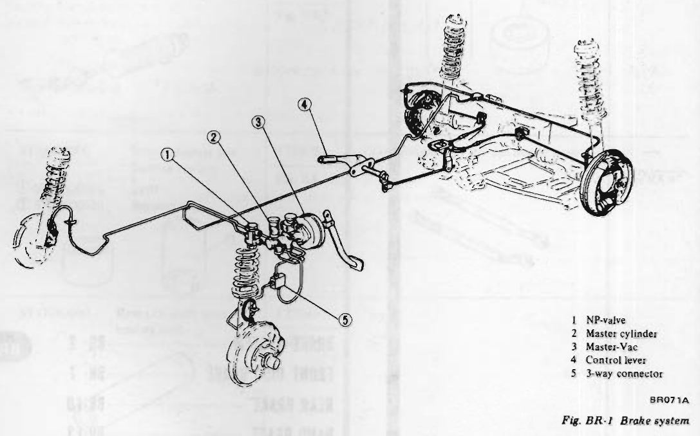
>
> - **Summary:** Chassis layout schematic showing hydraulic brake lines, master cylinder, Master-Vac, NP-valve, 3-way connector, front disc brakes, rear drum brakes, and hand brake control lever.
> - **Components:** NP-valve, Master cylinder, Master-Vac, Control lever, 3-way connector, Front disc brake, Rear drum brake, Hydraulic brake line, Hand brake cable
> - **Callouts:** **(1)** NP-valve; **(2)** Master cylinder; **(3)** Master-Vac; **(4)** Control lever; **(5)** 3-way connector
> - **Mechanic Notes:** NP-valve is connected between master cylinder rear outlet and rear wheel circuits to modulate hydraulic pressure and prevent rear lockup.
> - **Tags:** `brake system`, `hydraulic piping`, `chassis layout`, `NP-valve`, `Master-Vac`, `master cylinder`

### DESCRIPTION

The S30 series cars are equipped with disc brake for front, drum brake for rear, and a Master-Vac, to get great braking force.

The front disc brake is Girling-Sumitomo model S-16, and the pad is operated with two pistons.

The leading-trailing type rear drum brake is equipped with auto-adjuster, and in order to get enough cooling effect, aluminum finned brake drums are installed.

Moreover, the brake system is equipped with a NP-valve to prevent skid due to early rear wheel locking.

The hand brake is of a mechanical type, which brakes rear wheels, and is operated by the control lever through linkage and wire.

The control lever is located in the seat side center. The hand brake may also be used as an emergency brake.

---

<!-- Page 3 (BR-3) -->
### BRAKE PEDAL

The brake pedal is installed on the bracket which also supports the steering column, and the bracket is secured under the dash panel. The stop lamp switch is installed on the pedal bracket, and is operated by pedal arm.

> 🖼️ **Fig. BR-2 Brake pedal mounting** `[BR074A]` *(Type: `component_location`)*
>
> 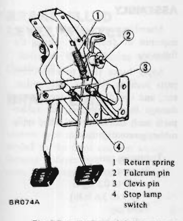
>
> - **Summary:** Brake pedal assembly mounted to pedal bracket under dashboard with stop lamp switch, fulcrum pin, and return spring.
> - **Components:** Return spring, Fulcrum pin, Clevis pin, Stop lamp switch, Pedal arm, Pedal bracket
> - **Callouts:** **(1)** Return spring; **(2)** Fulcrum pin; **(3)** Clevis pin; **(4)** Stop lamp switch
> - **Mechanic Notes:** Fulcrum pin tightening torque: 3.5 to 4.0 kg-m (25 to 29 ft-lb).
> - **Tags:** `brake pedal`, `mounting`, `bracket`, `stop lamp switch`, `return spring`

#### REMOVAL

(For parts item numbers, refer to Figure BR-2.)
1. Remove return spring ①.
2. Remove clevis pin ③ from the push rod, and separate pedal from Master-Vac.
3. Remove fulcrum pin ② and remove the pedal.

> 🖼️ **Fig. BR-3 Brake pedal components** `[BR075A]` *(Type: `exploded_view`)*
>
> 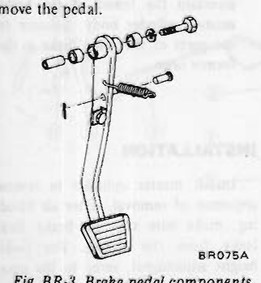
>
> - **Summary:** Exploded view of brake pedal arm, bushings, sleeve, fulcrum bolt, clevis pin, return spring, and pedal pad.
> - **Components:** Brake pedal arm, Pedal pad, Bushing, Sleeve, Fulcrum pin/bolt, Nut, Return spring, Clevis pin
> - **Mechanic Notes:** Lubricate pedal shaft sleeve unit and clevis pin unit with multi-purpose grease.
> - **Tags:** `brake pedal`, `pedal bushing`, `pedal components`, `exploded view`

#### INSPECTION

Check brake pedal for the following items, and correct or replace if required.
1. Pedal bushing and sleeve for wear, deformation, and/or damage.
2. Pedal arm for twisting, bending, and/or cracking.

#### INSTALLATION

Install brake pedal in reverse sequence of removal, noting the following:
1. Be sure to fill pedal shaft sleeve unit and clevis pin unit with recommended multi-purpose grease sufficiently.
2. Be sure to tighten fulcrum pin under tightening torque of 3.5 to 4.0 kg-m (25 to 29 ft-lb).

#### ADJUSTMENT

##### ADJUSTING BRAKE PEDAL

1. Loosen lock nut, turn the push rod clevis, and adjust push rod length properly so that height of pedal pad upper surface is 206 mm (8.11 in) with pedal stopper non-effected.
2. Next, turn back stopper, and depress pedal so that pedal pad height is reduced from 206 mm (8.11 in) to 203 mm (7.99 in). See Figure BR-4.

> 🖼️ **Fig. BR-4 Adjusting brake pedal** `[BR619]` *(Type: `inspection_measurement`)*
>
> 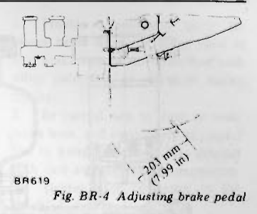
>
> - **Summary:** Diagram illustrating brake pedal height measurement from floor to pedal pad upper surface, lock nut, and stopper adjustment.
> - **Components:** Pedal pad, Pedal stopper, Push rod, Push rod clevis, Lock nut
> - **Specs / Measurements:** 206 mm (8.11 in) with pedal stopper non-effected; 203 mm (7.99 in) pedal height after stopper adjustment; 15 mm (0.59 in) pedal depression for stop lamp switch illumination
> - **Mechanic Notes:** Turn back stopper to reduce pedal height from 206 mm (8.11 in) to 203 mm (7.99 in).
> - **Tags:** `brake pedal adjustment`, `pedal height`, `push rod clevis`, `stop lamp switch`

> [!NOTE]
> a. Install stop lamp switch so that installation screw end surface is flush against bracket.
> b. After the above processes, make sure that lamp is on when pedal is pushed down by 15 mm (0.59 in) at the place of the brake pedal pad and it is off when pedal is released. Repeat it for several times.

### MASTER CYLINDER

The brake system adopts a tandem type master cylinder. Even the front or rear hydraulic circuit falls into a faulty condition, sufficient braking force can be obtained by another. For the front wheels, the disc brake is used, and thus, a large capacity reservoir is used.

> 🖼️ **Fig. BR-5 Master cylinder** `[BR072A]` *(Type: `exploded_view`)*
>
> 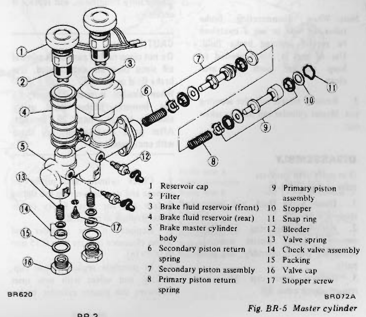
>
> - **Summary:** Exploded view of tandem master cylinder body, front/rear reservoirs, primary and secondary piston assemblies, check valves, and bleeder.
> - **Components:** Reservoir cap, Filter, Brake fluid reservoir (front), Brake fluid reservoir (rear), Brake master cylinder body, Secondary piston return spring, Secondary piston assembly, Primary piston return spring, Primary piston assembly, Stopper, Snap ring, Bleeder, Valve spring, Check valve assembly, Packing, Valve cap, Stopper screw
> - **Callouts:** **(1)** Reservoir cap; **(2)** Filter; **(3)** Brake fluid reservoir (front); **(4)** Brake fluid reservoir (rear); **(5)** Brake master cylinder body; **(6)** Secondary piston return spring; **(7)** Secondary piston assembly; **(8)** Primary piston return spring; **(9)** Primary piston assembly; **(10)** Stopper; **(11)** Snap ring; **(12)** Bleeder; **(13)** Valve spring; **(14)** Check valve assembly; **(15)** Packing; **(16)** Valve cap; **(17)** Stopper screw
> - **Mechanic Notes:** NABCO and TOKIKO makes are not interchangeable. Match parts to the brand of the body.
> - **Tags:** `master cylinder`, `tandem master cylinder`, `primary piston`, `secondary piston`, `exploded view`

---

<!-- Page 4 (BR-4) -->

> 🖼️ **Fig. BR-6 Cross-sectional view of master cylinder** `[BR212]` *(Type: `cutaway_flow`)*
>
> 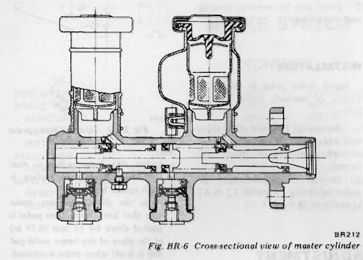
>
> - **Summary:** Cross-sectional cutaway diagram of tandem master cylinder showing internal passages, primary piston, secondary piston, return springs, check valve, and reservoir fluid ports.
> - **Components:** Master cylinder body, Front reservoir, Rear reservoir, Primary piston, Secondary piston, Return springs, Check valve, Piston cups
> - **Specs / Measurements:** Allowable cylinder to piston clearance: max 0.15 mm (0.0059 in)
> - **Mechanic Notes:** Apply clean brake fluid to cylinder bore and pistons, and light rubber grease to piston cups during reassembly.
> - **Tags:** `master cylinder`, `cross section`, `cutaway`, `piston ports`, `tandem cylinder`

#### REMOVAL

1. Disconnect wiring to brake fluid level gauge.
2. Disconnect front and rear brake tubes from master cylinder.

> [!CAUTION]
> When removing brake tubes, use suitable tube wrench. Never use open end or adjustable wrench.

> [!NOTE]
> When disconnecting brake tubes, be sure to use a container to receive draining brake fluid. Use of rags is also suggested to keep adjacent parts and area clean.

3. Remove master cylinder securing nut. Master cylinder can then be taken out.

#### DISASSEMBLY

(For parts item numbers refer to Figure BR-5)
1. Drain brake fluid, and remove stopper screw ⑰.
2. Remove snap ring ⑪, and remove primary piston assembly, secondary piston assembly, and other parts.
3. Remove valve cap ⑯, and remove check valve ⑭.

> [!NOTE]
> Disassemble master cylinder carefully so that the sliding surface of the piston and piston cup are not damaged. Do not remove fluid reservoir unless really necessary. Moreover, do not remove piston cup unless piston is replaced.

#### INSPECTION

Thoroughly clean all disassembled parts, check for wear, damage, and other faulty conditions, and replace if necessary.

> [!CAUTION]
> Do not clean rubber parts with mineral oil since they are deteriorated. Use brake fluid or alcohol.
> When alcohol is used, however, do not immerse rubber parts under alcohol longer than 30 seconds. After parts are cleaned, dry them with compressed air.

1. Check cylinder and piston for damage and uneven wear on the sliding surface and for other faulty conditions. Replace as required.
2. Replace, if the cylinder and piston clearance is more than 0.15 mm (0.0059 in).
3. In principle replace piston cup, packing and valves with new ones whenever the master cylinder is disassembled. Be sure to replace, if damaged, worn, weakened, or expanded.
4. Check return springs for wear, damage and other faulty conditions, and replace as required.
5. Replace others, if deformed, damaged, or faulty.

#### ASSEMBLY

Assemble master cylinder in reverse sequence of disassembly, noting the following:

Apply brake fluid to component parts such as cylinder bore, piston, etc., and install carefully so as not to damage them. Moreover, for rubber parts such as piston cup, etc., apply rubber grease slightly.

Tightening torque:
- Stopper screw: 0.4 to 0.5 kg-m (2.9 to 3.6 ft-lb)
- Valve cap: 8 to 9 kg-m (58 to 65 ft-lb)

> [!NOTE]
> The brake master cylinder is available in both NABCO make and TOKIKO make. There is no interchangeability of repair kits or component parts between NABCO and TOKIKO makes. When replacing the repair kit or component parts, ascertain the brand of the brake master cylinder body. Be sure to use parts of the same make as the former ones.

#### INSTALLATION

Install master cylinder in reverse sequence of removal. After air bleeding, make sure that no brake fluid leaks from the circuit. For pedal height adjustment, refer to the paragraph of pedal adjustment.

> [!CAUTION]
> When installing brake tubes, use Flare Nut Torque Wrench GG94310000. <!-- Page 5 (BR-5) --> Tightening torque:
- Brake tube: 1.5 to 1.8 kg-m (11 to 13 ft-lb)
- Master cylinder installation nut: 0.8 to 1.1 kg-m (5.8 to 8.0 ft-lb)

### BRAKE FLUID LEVEL SWITCH

Refer to Brake Warning System (Section BE).

### BRAKE LINE

The brake lines branched from the tandem type master cylinder are extended to the front and rear wheels, forming independent hydraulic circuits. In addition, the rear wheel side circuit is equipped with the NP-valve so as to protect the rear wheels from locking during rapid braking. The brake line is a galvanized double-layer steel tube.

#### INSPECTION

Check brake lines (tubes and hoses) for crack and/or damage, and replace, if faulty. When brake fluid leaks from joint, retighten or replace.

> [!CAUTION]
> When removing brake tubes and hoses, use suitable tube wrench. Never use open end or adjustable wrench.

Pay attention to the following when installing brake lines.
1. Provide a sufficient space between brake lines and other parts so that brake lines are not interfered with other parts due to vibration during driving.
2. Be careful not to warp or twist brake hose, and particularly be careful not to bring brake hose into contact with tires and suspension components.
3. Tighten each connector to the specified torque.

> [!CAUTION]
> When installing brake tubes, use Flare Nut Torque Wrench GG94310000.

4. Upon completion of brake line installation, be sure to bleed the air.

> 🖼️ **Fig. BR-7 Brake line** `[BR073A]` *(Type: `component_location`)*
>
> 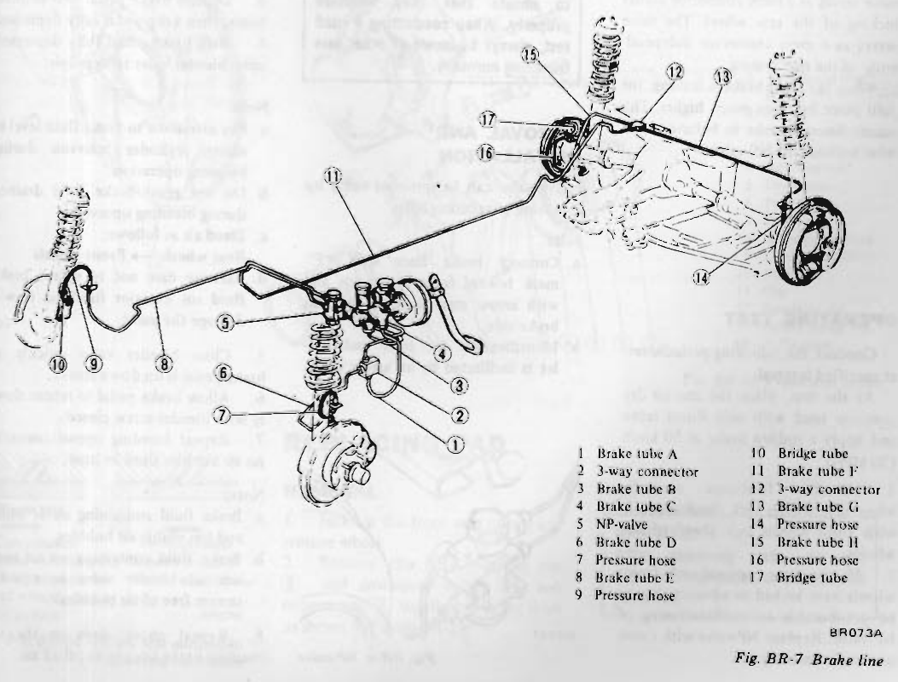
>
> - **Summary:** Schematic routing of galvanized steel brake tubes, flexible pressure hoses, 3-way connectors, NP-valve, and bridge tubes across chassis.
> - **Components:** Brake tube A, 3-way connector, Brake tube B, Brake tube C, NP-valve, Brake tube D, Pressure hose, Brake tube E, Bridge tube, Brake tube F, Brake tube G, Brake tube H
> - **Callouts:** **(1)** Brake tube A; **(2)** 3-way connector; **(3)** Brake tube B; **(4)** Brake tube C; **(5)** NP-valve; **(6)** Brake tube D; **(7)** Pressure hose; **(8)** Brake tube E; **(9)** Pressure hose; **(10)** Bridge tube; **(11)** Brake tube F; **(12)** 3-way connector; **(13)** Brake tube G; **(14)** Pressure hose; **(15)** Brake tube H; **(16)** Pressure hose; **(17)** Bridge tube
> - **Specs / Measurements:** Brake tube tightening torque: 1.5 to 1.8 kg-m (11 to 13 ft-lb); Pressure hose tightening torque: 1.7 to 2.0 kg-m (12 to 14 ft-lb)
> - **Mechanic Notes:** Use flare nut torque wrench GG94310000. Ensure hoses do not contact tires or suspension members during steering and travel.
> - **Tags:** `brake lines`, `tubes`, `pressure hoses`, `routing`, `3-way connector`, `NP-valve`

---

<!-- Page 6 (BR-6) -->

> 🖼️ **Fig. BR-8 Cross-sectional view of NP-valve** `[BR622]` *(Type: `cutaway_flow`)*
>
> 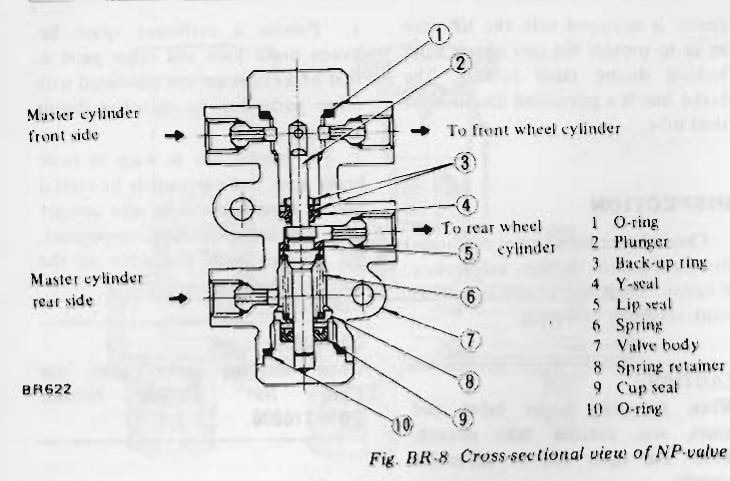
>
> - **Summary:** Cutaway diagram of NP-valve (proportioning valve) showing internal plunger, lip seal, cup seal, spring, Y-seal, and inlet/outlet fluid paths.
> - **Components:** O-ring, Plunger, Back-up ring, Y-seal, Lip seal, Spring, Valve body, Spring retainer, Cup seal
> - **Callouts:** **(1)** O-ring; **(2)** Plunger; **(3)** Back-up ring; **(4)** Y-seal; **(5)** Lip seal; **(6)** Spring; **(7)** Valve body; **(8)** Spring retainer; **(9)** Cup seal; **(10)** O-ring
> - **Mechanic Notes:** Port connections: Master cylinder front side, Master cylinder rear side, To front wheel cylinder, To rear wheel cylinder.
> - **Tags:** `NP-valve`, `proportioning valve`, `cross section`, `plunger`, `cup seal`

### NP-VALVE

This valve controls the pressure of the rear wheel cylinder to prevent the earlier locking of the rear wheel. The valve serves as a mere connector independently of the rear system.

When the front brake is leaking, the split point becomes much higher. This causes the rear brake to behave as if it were without the NP-valve.

#### OPERATING TEST

Conduct the following periodic test at specified interval.

At the test, place the car on dry concrete road with only driver laden and apply a sudden brake at 50 km/h (30 MPH).
1. NP-valve functions normally when rear wheels lock simultaneously with front wheels lock ahead of rear wheels.
2. If the rear, instead of front, wheels have locked in advance, it may be attributable to malfunctioning of NP-valve. Replace NP-valve with a new one as an assembly.

> [!WARNING]
> Before driving, test brake by depressing brake pedal. It should not bottom. Then, while driving slowly, pump brakes several times to ensure that they function properly. When conducting a road test, always be aware of other cars travelling normally.

#### REMOVAL AND INSTALLATION

NP-valve can be removed easily by removing installation bolts.

> [!NOTE]
> a. Connect brake lines with "F" mark toward front brake side and with arrow mark toward the rear brake side.
> b. Identification for inlet and outlet is facilitated by an arrow mark.

> 🖼️ **Fig. BR-9 NP-valve** `[BR627]` *(Type: `component_location`)*
>
> 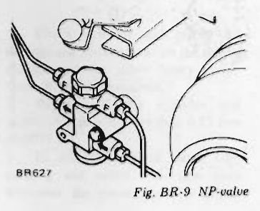
>
> - **Summary:** External view of NP-valve showing body mounting and direction arrow mark for correct line installation.
> - **Components:** NP-valve body, Mounting bracket, Hydraulic connections
> - **Mechanic Notes:** Connect brake lines with 'F' mark toward front brake side and with arrow mark toward rear brake side.
> - **Tags:** `NP-valve`, `installation`, `alignment`, `arrow mark`

### BLEEDING HYDRAULIC SYSTEM

Hydraulic brake system must be bled whenever any line has been disconnected or air has entered into system.

When pedal action has a "spongy" feel, it is an indication that air has entered the system.

Bleeding the hydraulic system is an essential part of regular brake service.
1. Clean all dirt around master cylinder reservoir, remove cap and top up reservoir with recommended brake fluid.
   > [!NOTE]
   > Do not mix two different brand oils.
2. Thoroughly clean mud and dust from bleeder valve so that outlet hole is free from any foreign material. Install a bleeder hose on bleeder valve. Place the other end of hose in a container filled with brake fluid.
3. Depress brake pedal two or three times, then keep pedal fully depressed.
4. With brake pedal fully depressed, open bleeder valve to expel air.
   > [!NOTE]
   > a. Pay attention to brake fluid level in master cylinder reservoir during bleeding operation.
   > b. Do not reuse brake fluid drained during bleeding operation.
   > c. Bleed air as follows; Rear wheels -> Front wheels
   > d. Exercise care not to splash brake fluid on exterior finish as it will damage the paint.
5. Close bleeder valve quickly as brake pedal is on down stroke.
6. Allow brake pedal to return slowly with bleeder screw closed.
7. Repeat bleeding operations until no air bubbles show in hose.
   > [!NOTE]
   > a. Brake fluid containing air is white and has visible air bubbles.
   > b. Brake fluid containing no air runs out of bleeder valve in a solid stream free of air bubbles.
8. Repeat above steps on the remaining brake lines to expel all air.

---

<!-- Page 7 (BR-7) -->
## FRONT DISC BRAKE

### CONTENTS

| Section | Page | Section | Page |
| :--- | :--- | :--- | :--- |
| REPLACING PAD | BR-7 | INSPECTION | BR-8 |
| REMOVAL | BR-7 | ASSEMBLY | BR-9 |
| INSPECTION | BR-8 | REINSTALLATION | BR-9 |
| INSTALLATION | BR-8 | DISASSEMBLING CALIPERS | BR-9 |
| REPLACING PISTON SEAL | BR-8 | INSPECTING ROTOR | BR-9 |
| REMOVAL | BR-8 | ADJUSTING FRONT BRAKE | BR-9 |
| DISASSEMBLY | BR-8 | | |

Girling-Sumitomo model S-16 disc brake is used. Rigidity of the caliper is high, brake pedal feeling is adequate, and the pad dragging is minimized. The pad is returned by elasticity of the piston seal. When the pad is worn, the piston operating stroke increases, slipping occurs on the piston seal surface, and thus, clearance is adjusted automatically. See Figure BR-11.

Moreover, in order to prevent brake squealing, a shim is inserted behind the pad.

> 🖼️ **Fig. BR-10 Front disc brake** `[BR629]` *(Type: `exploded_view`)*
>
> 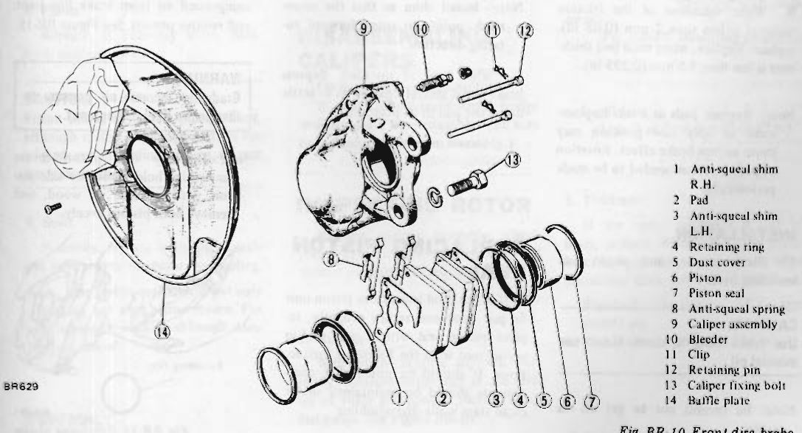
>
> - **Summary:** Exploded view of Girling-Sumitomo model S-16 front disc brake caliper assembly, pistons, seals, dust covers, pads, shims, and retaining hardware.
> - **Components:** Anti-squeal shim R.H., Pad, Anti-squeal shim L.H., Retaining ring, Dust cover, Piston, Piston seal, Anti-squeal spring, Caliper assembly, Bleeder, Clip, Retaining pin, Caliper fixing bolt, Baffle plate
> - **Callouts:** **(1)** Anti-squeal shim R.H.; **(2)** Pad; **(3)** Anti-squeal shim L.H.; **(4)** Retaining ring; **(5)** Dust cover; **(6)** Piston; **(7)** Piston seal; **(8)** Anti-squeal spring; **(9)** Caliper assembly; **(10)** Bleeder; **(11)** Clip; **(12)** Retaining pin; **(13)** Caliper fixing bolt; **(14)** Baffle plate
> - **Mechanic Notes:** Anti-squeal shims are directional; install with arrow mark pointing in rotor forward rotating direction.
> - **Tags:** `front disc brake`, `caliper`, `Girling-Sumitomo S-16`, `brake pad`, `exploded view`

> 🖼️ **Fig. BR-11 Piston seal automatic adjusting operation** `[BR055]` *(Type: `cutaway_flow`)*
>
> 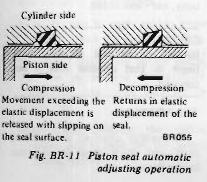
>
> - **Summary:** Cross-sectional diagrams illustrating elastic deformation of piston seal during compression and return retraction during decompression.
> - **Components:** Piston seal, Caliper cylinder groove, Piston
> - **Mechanic Notes:** Movement exceeding elastic displacement slips along seal surface for auto-adjustment; seal returns piston upon decompression.
> - **Tags:** `piston seal`, `auto adjustment`, `seal retraction`, `cutaway`

### REPLACING PAD

#### REMOVAL

1. Jack up the front side of car, and remove wheel.
2. Remove clip ①, retaining pin ②, and anti-squeal spring ③, and remove pad ④ together with the shim as shown in Figure BR-12.

> [!WARNING]
> After removing pads, do not depress brake pedal, or pistons will jump out.

---

<!-- Page 8 (BR-8) -->

> 🖼️ **Fig. BR-12 Removing pad** `[BR645]` *(Type: `procedure_step`)*
>
> 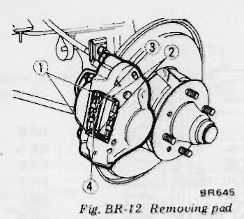
>
> - **Summary:** Removal procedure of retaining clip, pin, anti-squeal spring, and brake pad from caliper.
> - **Components:** Clip, Retaining pin, Anti-squeal spring, Brake pad
> - **Callouts:** **(1)** Clip; **(2)** Retaining pin; **(3)** Anti-squeal spring; **(4)** Pad
> - **Mechanic Notes:** Remove clip, slide out retaining pin, take off anti-squeal spring, then extract pads with shims.
> - **Tags:** `pad removal`, `front disc brake`, `retaining pin`, `anti-squeal spring`

> 🖼️ **Fig. BR-13 Applying grease** `[BR680]` *(Type: `alignment_orientation`)*
>
> 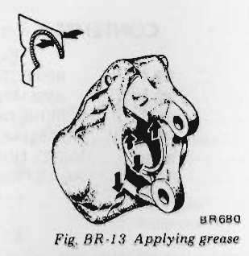
>
> - **Summary:** Illustration indicating shaded areas on caliper guides and both sides of anti-squeal shims where brake grease must be applied, showing rotation arrow on shim.
> - **Components:** Caliper contact surfaces, Anti-squeal shim
> - **Mechanic Notes:** Apply pad grease to working portions of caliper and both sides of shim. Ensure shim arrow points in forward rotor rotation direction. Never grease pad friction faces.
> - **Tags:** `brake grease`, `anti-squeal shim`, `caliper lubrication`

> 🖼️ **Fig. BR-14 Removing calipers** `[BR057]` *(Type: `procedure_step`)*
>
> 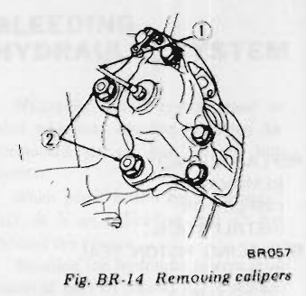
>
> - **Summary:** Removing brake hydraulic line and two caliper mounting bolts from knuckle spindle.
> - **Components:** Brake tube connection, Caliper fixing bolt, Caliper body, Knuckle spindle
> - **Callouts:** **(1)** Brake tube; **(2)** Caliper installation bolt
> - **Specs / Measurements:** Caliper installation bolt torque: 7.3 to 9.9 kg-m (53 to 72 ft-lb)
> - **Mechanic Notes:** Use flare nut wrench on brake line.
> - **Tags:** `caliper removal`, `knuckle spindle`, `caliper bolts`

#### INSPECTION

1. Clean pad with carbon tetrachloride.
2. When oil and/or grease is heavily sticked on pad, or when deteriorated or deformed due to overheating, replace pad with a new one.
3. When thickness of the friction material is less than 2 mm (0.08 in), replace. Replace, when total pad thickness is less than 7.5 mm (0.295 in).

> [!NOTE]
> Replace pads as a set. Replacement at only one position may cause uneven brake effect. Rotation of pads is recommended to be made periodically.

#### INSTALLATION

1. Clean calipers and piston pad installing parts.
   > [!CAUTION]
   > Use brake fluid to clean. Never use mineral oil.
   > [!NOTE]
   > Be careful not to get oil on rotor.
2. Depress piston into cylinder so that new pad can be installed.
   > [!NOTE]
   > Note that brake fluid may overflow from reservoir. Carry out operation by loosening breather to release brake fluid.
3. Apply pad grease to working portions of caliper and both sides of shim (portion marked with oblique line in figure). See Figure BR-13.
   > [!NOTE]
   > Do not grease friction face of pad.
4. Install pad and anti-squeal shim, assemble anti-squeal spring and retaining pin, and secure them with clip.
   > [!NOTE]
   > Install shim so that the arrow mark points to rotor forward rotating direction.
5. When pad is installed, depress brake pedal several times so as to settle down the pad in its position.

### REPLACING PISTON SEAL

If brake fluid leaks from piston unit or pad does not return properly, replace piston seal with a new one in accordance with the following instructions. It should be noted that components should be maintained under clean state while disassembling.

#### REMOVAL

1. Remove pad.
2. Disconnect the brake line ① and caliper installation bolt ②, and remove caliper assembly from knuckle spindle.

> [!CAUTION]
> When removing brake tube, use suitable tube wrench. Never use open end or adjustable wrench.

#### DISASSEMBLY

1. Remove mud and dust from caliper assembly before disassembly.
2. Remove retaining ring ④ and dust cover ⑤ in that order. (Refer to Figure BR-10.)
3. Hold caliper with hand, apply compressed air from brake line joint, and remove pistons. See Figure BR-15.

> 🖼️ **Fig. BR-15 Removing piston** `[BR681]` *(Type: `procedure_step`)*
>
> 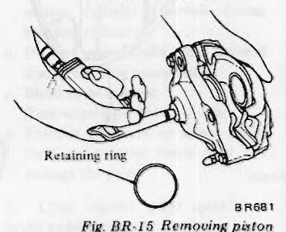
>
> - **Summary:** Applying compressed air to caliper fluid inlet while retaining ring is removed to expel pistons.
> - **Components:** Caliper body, Piston, Air nozzle, Retaining ring
> - **Mechanic Notes:** Gradually apply compressed air. Hold smoother piston with wood block to extract both pistons evenly.
> - **Tags:** `piston removal`, `compressed air`, `caliper disassembly`

> [!WARNING]
> Gradually increase air pressure so that piston does not pop out.

> [!NOTE]
> If only one piston moves smoothly, hold smoother side piston with a piece of wood, and remove both pistons evenly.

4. Remove piston seal from cylinder, and clean inside.

> [!CAUTION]
> Remove piston seal carefully with finger so that cylinder wall is not damaged.

#### INSPECTION

Thoroughly clean all disassembled parts, and check them for the following items. <!-- Page 9 (BR-9) --> > [!CAUTION]
> When cleaning rubber parts, use alcohol or brake fluid. If rubber parts are cleaned with mineral oil, they will be deteriorated.

1. **Calipers**
   If cylinder wall is damaged or worn, replace. If cylinder wall is rusted or foreign matters are accumulated on cylinder wall, carefully polish with fine emery paper so that cylinder wall is not damaged. If rusted or roughened excessively, replace.
2. **Pad**
   See paragraph covering replacement of pad.
3. **Piston**
   Replace, if unevenly worn, damaged, and/or rusted.
   > [!CAUTION]
   > Piston sliding surface is plated. Thus, although rusted or foreign matters are sticked on the sliding surface, do not use emery paper.
4. **Seals**
   Primarily, replace both piston seals and dust covers whenever overhauling.
   > [!NOTE]
   > The piston seal affects not only leaking but also piston return. For this reason, replace although damage is minor.

#### ASSEMBLY

1. Install the piston seal carefully so that the seal is not damaged.
   > [!NOTE]
   > Be sure to apply rubber grease to the piston seal before installing.
2. Install dust cover on the piston, and the piston into the cylinder. Clamp the dust cover with the retaining ring.
   > [!NOTE]
   > When inserting the piston, apply brake fluid to the piston sliding surface.
3. After assembly is completely accomplished on one cylinder, assemble another side in the same manner.

#### REINSTALLATION

Reinstallation is in reverse sequence of removal. After pad is installed completely, bleed hydraulic line.

Tightening torque:
- Caliper installation bolt: 7.3 to 9.9 kg-m (53 to 72 ft-lb)

> [!CAUTION]
> When installing brake tubes, use Flare Nut Torque Wrench GG94310000.

#### DISASSEMBLING CALIPERS

Do not remove bridge bolt.
If brake fluid leaks from bridge seal, replace a new assembly. (Be sure to replace calipers as an assembly.)

### INSPECTING ROTOR

Remove caliper assembly, check rotor for deflection and damage, and correct or replace as required.

1. **Runout**
   With wheel bearing adjusted correctly, measure deflection at the center of rotor pad contact surface using dial gauge. See Figure BR-16.
   - Runout limit: 0.10 mm (0.0039 in) Total indicator reading

> 🖼️ **Fig. BR-16 Measuring runout** `[BR350]` *(Type: `inspection_measurement`)*
>
> 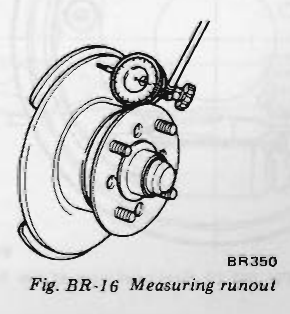
>
> - **Summary:** Dial indicator setup positioned at rotor pad contact surface centerline to measure total indicator runout while turning rotor.
> - **Components:** Brake rotor, Dial indicator, Magnetic base / stand, Wheel hub
> - **Specs / Measurements:** Runout limit: 0.10 mm (0.0039 in) Total indicator reading
> - **Mechanic Notes:** Wheel bearings must be correctly adjusted prior to runout measurement.
> - **Tags:** `rotor runout`, `dial indicator`, `disc inspection`

2. **Parallelism**
   Measure thickness toward the entire periphery on the same circumference using a micrometer. See Figure BR-17.
   - Parallelism: Less than 0.03 mm (0.0012 in)

> 🖼️ **Fig. BR-17 Measuring parallelism** `[BR351]` *(Type: `inspection_measurement`)*
>
> 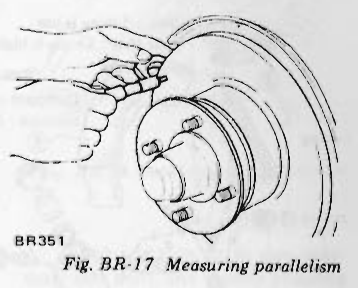
>
> - **Summary:** Micrometer measurement taken around the circumference of brake rotor pad contact surface to determine parallelism / thickness variation.
> - **Components:** Brake rotor, Micrometer
> - **Specs / Measurements:** Parallelism limit: Less than 0.03 mm (0.0012 in)
> - **Mechanic Notes:** Measure thickness at multiple points around entire periphery on the same circumference.
> - **Tags:** `rotor parallelism`, `micrometer`, `thickness variation`

3. **Thickness**
   If the rotor thickness is out of limit, replace. When correcting thickness, be sure that the thickness after correction does not exceed the limit.
   - Standard thickness: 12.5 mm (0.492 in)
   - Wear limit: 10.5 mm (0.413 in)

### ADJUSTING FRONT BRAKE

Ordinarily, adjustment is not required because clearance between pad and rotor is adjusted automatically by elasticity of piston seal.

---

<!-- Page 10 (BR-10) -->
## REAR BRAKE

### CONTENTS

| Section | Page | Section | Page |
| :--- | :--- | :--- | :--- |
| REPLACING BRAKE SHOE | BR-10 | REMOVAL | BR-11 |
| REMOVAL | BR-10 | INSPECTION | BR-12 |
| INSTALLATION | BR-11 | ASSEMBLY AND INSTALLATION | BR-12 |
| DISASSEMBLY AND INSPECTION | BR-11 | ADJUSTING REAR BRAKE | BR-12 |

> 🖼️ **Fig. BR-18 Rear brake** `[BR079A]` *(Type: `exploded_view`)*
>
> 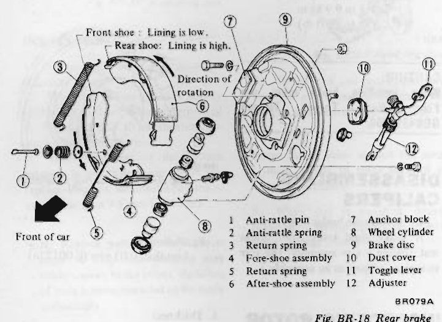
>
> - **Summary:** Exploded view of leading-trailing rear drum brake showing backing plate, wheel cylinder, brake shoes, return springs, anti-rattle pins, toggle lever, and automatic adjuster.
> - **Components:** Anti-rattle pin, Anti-rattle spring, Return spring, Fore-shoe assembly, Return spring, After-shoe assembly, Anchor block, Wheel cylinder, Brake disc, Dust cover, Toggle lever, Adjuster
> - **Callouts:** **(1)** Anti-rattle pin; **(2)** Anti-rattle spring; **(3)** Return spring; **(4)** Fore-shoe assembly; **(5)** Return spring; **(6)** After-shoe assembly; **(7)** Anchor block; **(8)** Wheel cylinder; **(9)** Brake disc; **(10)** Dust cover; **(11)** Toggle lever; **(12)** Adjuster
> - **Mechanic Notes:** Front shoe lining is low; rear shoe lining is high. Fore-shoe is in trailing side and after-shoe is in leading side.
> - **Tags:** `rear brake`, `drum brake`, `brake shoes`, `leading-trailing`, `exploded view`

The rear brake system is a leading-trailing type with aluminum finned drum. Parking brake is of an auto-adjusting type. When the hand brake is operated, the toggle lever turns the adjusting nut, and thus, clearance between the brake shoe and brake drum is adjusted automatically.

> 🖼️ **Fig. BR-19 Sectional view of rear brake** `[BR886]` *(Type: `cutaway_flow`)*
>
> 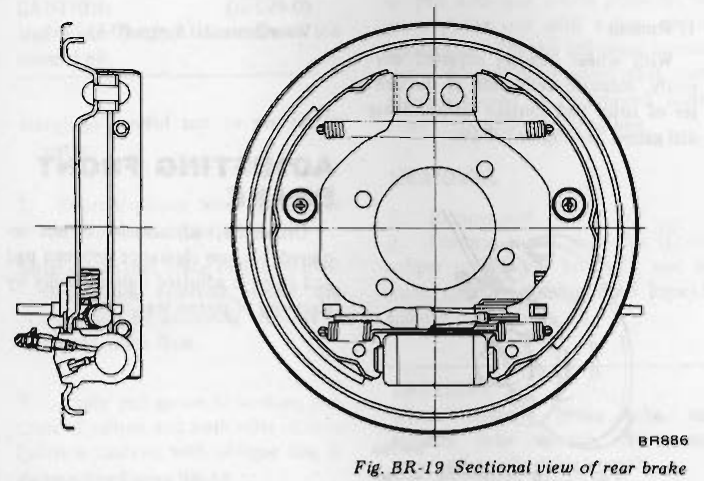
>
> - **Summary:** Cross-sectional assembly drawing of rear drum brake mechanism showing wheel cylinder, shoe web engagement, adjuster strut, and drum contact.
> - **Components:** Brake drum, Brake shoes, Wheel cylinder, Adjuster strut, Backing plate
> - **Mechanic Notes:** Shows alignment of automatic adjuster strut between leading and trailing shoes.
> - **Tags:** `rear brake`, `sectional view`, `cutaway`, `drum brake assembly`

> 🖼️ **Fig. BR-20 Adjuster assembly (Left-hand side)** `[BR887]` *(Type: `exploded_view`)*
>
> 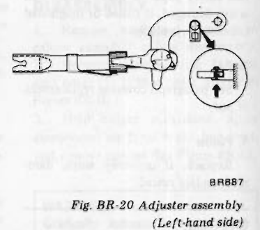
>
> - **Summary:** Exploded detail of left-hand brake automatic adjuster assembly, including threaded adjusting screw, sleeve, toggle lever, ratchet claw, and pivot pin.
> - **Components:** Adjuster body, Threaded adjusting screw, Toggle lever, Ratchet claw, Stopper pin
> - **Mechanic Notes:** Adjuster mechanisms differ between LH and RH sides; threads are side-specific.
> - **Tags:** `adjuster assembly`, `rear brake`, `toggle lever`, `auto adjuster`

### REPLACING BRAKE SHOE

#### REMOVAL

1. Jack up car, support it with a stand and remove tire.
2. Remove brake drum. When it is hard to remove brake drum, apply the following instructions.
   (1) Fully pull up center brake lever.
   (2) Push out or tap out cotter pin and remove stopper from toggle lever.
   (3) Release center brake lever.
3. Remove anti-rattling spring, and then remove both brake shoes.

> 🖼️ **Fig. BR-21 Removing toggle lever stopper** `[RA286]` *(Type: `procedure_step`)*
>
> 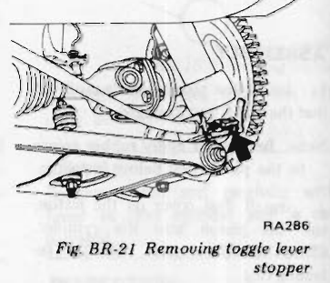
>
> - **Summary:** Technique for removing cotter pin and stopper from toggle lever through the backing plate aperture when brake drum is stuck.
> - **Components:** Toggle lever, Cotter pin, Toggle lever stopper, Backing plate
> - **Mechanic Notes:** Fully pull up center hand brake lever, push/tap out cotter pin to release stopper, then release lever to slacken shoes for drum removal.
> - **Tags:** `toggle lever stopper`, `stuck drum removal`, `rear brake service`

---

<!-- Page 11 (BR-11) -->
#### INSTALLATION

Before installing brake shoe, check wheel cylinder operation. If it does not operate properly, disassemble and adjust. For details, see the paragraph covering disassembly. When replacing brake shoe, be sure that fore-shoe is in trailing side and after-shoe is in leading side.
1. Apply brake grease to adjuster, adjusting nut and threaded portion of adjusting nut.
2. Apply brake grease to brake disc and anchor block.
3. Install brake shoe, return spring, and anti-rattling spring.
   > [!NOTE]
   > Be careful not to allow grease to stick on brake shoe lining.
4. Install brake drum, pull hand lever several times, and with the automatic adjusting operation, adjust brake shoe and brake drum clearance.
   > [!NOTE]
   > Continue the adjustment until click is eliminated from adjusting wheel claw.

> 🖼️ **Fig. BR-22 Applying brake grease** `[BR889]` *(Type: `alignment_orientation`)*
>
> 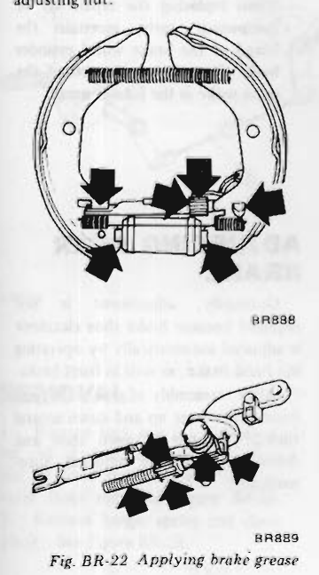
>
> - **Summary:** Lube points on brake shoes, adjuster assembly, adjusting nut threads, and toggle lever contacts indicated by bold arrows.
> - **Components:** Brake shoes, Adjuster assembly, Adjusting nut, Toggle lever contact points
> - **Mechanic Notes:** Apply brake grease to adjuster sliding slots, threaded screw shaft, and shoe web contact tips. Do not contaminate friction linings.
> - **Tags:** `brake grease`, `lubrication points`, `brake shoes`, `adjuster`

> 🖼️ **Fig. BR-23 Applying brake grease** `[BR890]` *(Type: `alignment_orientation`)*
>
> 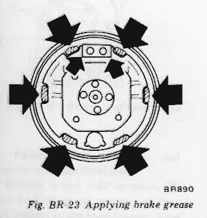
>
> - **Summary:** Six lubrication points on the rear brake backing plate (brake disc) ledges and anchor block where brake shoe edges slide.
> - **Components:** Brake disc / backing plate, Anchor block, Shoe contact pads
> - **Mechanic Notes:** Apply thin layer of brake grease to the 6 shoe ledge contact pads on backing plate and anchor block.
> - **Tags:** `backing plate`, `anchor block`, `brake grease`, `contact pads`

### DISASSEMBLY AND INSPECTION

#### REMOVAL

1. Jack up car, and remove wheels, brake drum and brake shoe.
   > [!NOTE]
   > For details, refer to the paragraph covering brake shoe replacement.
2. Remove brake tube ①, loosen bolts ② and remove wheel cylinder. See Figure BR-24.
   > [!CAUTION]
   > When removing brake tube, use suitable tube wrench. Never use open end wrench or adjustable wrench.
3. When removing brake disc, withdraw axle shaft, and remove attaching bolts. (Refer to Section "RA".)
4. Disassemble wheel cylinder (See Figure BR-25.)
   Remove dust cover and withdraw piston.

> 🖼️ **Fig. BR-24 Removing wheel cylinder** `[BR891]` *(Type: `procedure_step`)*
>
> 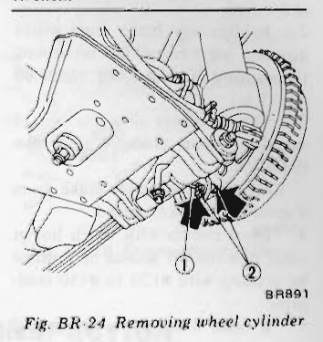
>
> - **Summary:** Disconnection of rear hydraulic brake line and removal of two wheel cylinder mounting bolts on backing plate.
> - **Components:** Brake tube, Wheel cylinder mounting bolts, Backing plate, Wheel cylinder body
> - **Callouts:** **(1)** Brake tube; **(2)** Bolts
> - **Specs / Measurements:** Wheel cylinder bolt torque: 0.6 to 0.8 kg-m (4.3 to 5.8 ft-lb)
> - **Mechanic Notes:** Use flare nut wrench on brake line fitting.
> - **Tags:** `wheel cylinder`, `removal`, `brake tube`, `backing plate`

> 🖼️ **Fig. BR-25 Wheel cylinder and adjustor** `[BR892]` *(Type: `exploded_view`)*
>
> 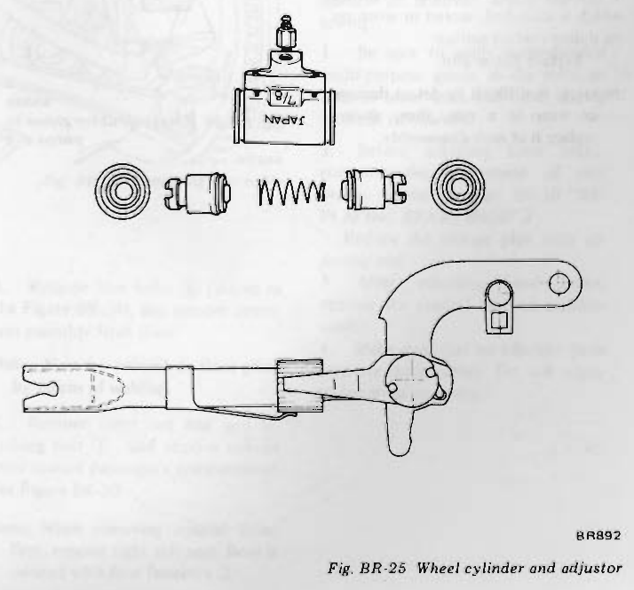
>
> - **Summary:** Exploded view of rear wheel cylinder body, bleeder screw, dust boot, piston, cup seal, spring, and automatic adjuster strut with toggle lever.
> - **Components:** Wheel cylinder body, Bleeder valve, Dust cover / boot, Piston, Piston cup, Spring, Adjuster assembly, Toggle lever
> - **Mechanic Notes:** NABCO and TOKIKO wheel cylinders are not interchangeable. Match parts by manufacturer.
> - **Tags:** `wheel cylinder`, `adjuster`, `piston cup`, `exploded view`

---

<!-- Page 12 (BR-12) -->
#### INSPECTION

##### Brake drum
1. Check brake drum for cracks, uneven wear or deflection, and replace as required.
2. Replace any brake drum whose diameter is 1.5 mm (0.059 in) beyond the standard inner diameter of 228.60 mm (9 in).
3. The maximum allowable out of round of drum inside is 0.05 mm (0.0020 in).
   Recondition or replace brake drum if specified limit is exceeded.
4. Drum surface with which linings come into contact should be finished by grinding with #120 to #150 sandpaper.
5. If brake drum shows any sign of score marks or partial or stopped wear on its contact surface, machine finish it with a drum racer.
   > [!NOTE]
   > After brake drum has been completely reconditioned or replaced, check drum and shoe for proper contact pattern.

##### Wheel cylinder
1. Replace any cylinder or piston which is scratched, scored or worn on its sliding contact surface.
2. Replace piston cup.
   > [!NOTE]
   > It is difficult to detect damage or wear in a cup; thus, always replace it at each disassembly.
3. Replace cylinder if contacting face of cylinder is worn locally or stepped.
4. Replace if the cylinder and piston clearance is more than 0.15 mm (0.0059 in).
5. Replace dust cover if damaged.

#### ASSEMBLY AND INSTALLATION

The rear brake can be assembled and installed in reverse sequence of disassembly and removal. However, note the following:
1. Apply brake fluid to piston cup and insert pistons into cylinder with spring.
2. Apply rubber grease to inside of rubber boot and install it to cylinder.
3. When installing wheel cylinder and adjuster to brake disc, apply brake grease to cylinder, disc and the specified portion of adjuster as shown in Figure BR-22.

> [!NOTE]
> The brake wheel cylinder is available in both NABCO make and TOKIKO make. There is no interchangeability of repair kits or component parts between NABCO and TOKIKO makes.
> When replacing the repair kit or component parts, ascertain the brand of the brake wheel cylinder body. Be sure to use parts of the same make as the former ones.

> 🖼️ **Fig. BR-26 Applying rubber grease to piston cup** `[BR893]` *(Type: `cutaway_flow`)*
>
> 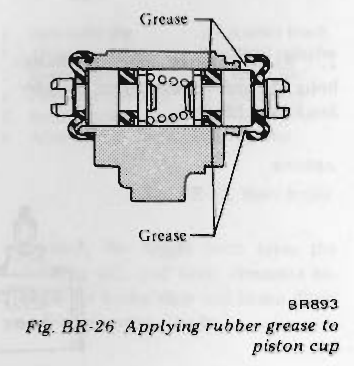
>
> - **Summary:** Cross section of wheel cylinder piston cup assembly showing application points for rubber grease along lip groove and sealing contact.
> - **Components:** Piston cup, Piston, Wheel cylinder bore, Rubber grease
> - **Mechanic Notes:** Apply rubber grease to cup grooves and lips prior to inserting into cylinder.
> - **Tags:** `rubber grease`, `wheel cylinder`, `piston cup`, `lubrication`

### ADJUSTING REAR BRAKE

Ordinarily, adjustment is not required because brake shoe clearance is adjusted automatically by operating the hand brake, as well as front brake.

After reassembly of rear brake, pull hand brake lever up and down several times. Clearance between shoe and drum will then be adjusted automatically.

---

<!-- Page 13 (BR-13) -->
## HAND BRAKE

The hand brake linkage is in floor tunnel. Hence, removal and other operations must be done after removing propeller shaft.

> 🖼️ **Fig. BR-27 Hand brake linkage** `[BR639]` *(Type: `exploded_view`)*
>
> 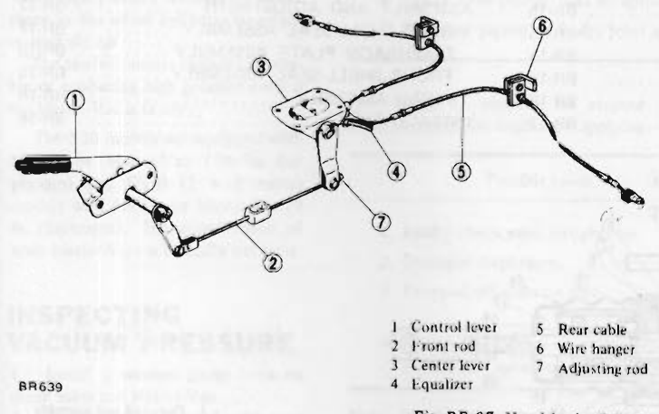
>
> - **Summary:** Component layout of parking brake linkage showing control lever, front rod, center lever, equalizer, rear cables, wire hangers, and adjusting rod.
> - **Components:** Control lever, Front rod, Center lever, Equalizer, Rear cable, Wire hanger, Adjusting rod
> - **Callouts:** **(1)** Control lever; **(2)** Front rod; **(3)** Center lever; **(4)** Equalizer; **(5)** Rear cable; **(6)** Wire hanger; **(7)** Adjusting rod
> - **Mechanic Notes:** Linkage is located inside tunnel; propeller shaft removal required for access.
> - **Tags:** `hand brake linkage`, `parking brake`, `equalizer`, `control lever`

> 🖼️ **Fig. BR-30 Removing control lever** `[BR641]` *(Type: `procedure_step`)*
>
> 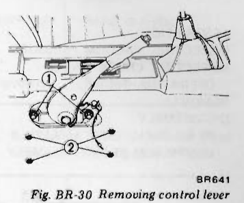
>
> - **Summary:** Removal of center console boot fasteners and control lever pivot mounting bolt from passenger compartment floor.
> - **Components:** Control lever assembly, Attaching bolt, Fasteners, Boot
> - **Callouts:** **(1)** Attaching bolt; **(2)** Four fasteners
> - **Mechanic Notes:** Remove right-hand seat to remove control lever into cabin.
> - **Tags:** `control lever`, `hand brake lever`, `fasteners`

### INSPECTION

Check all parts for excessive wear and damage, and replace, if necessary.

### INSTALLATION

Install hand brake in reverse sequence of removal, noting the following.
1. Be sure to apply recommended multi-purpose grease to the pivot on control lever head and other sliding portions sufficiently.
2. Before adjusting hand brake, complete the adjustment of rear brakes. (Refer to page BR-10 "REPLACING BRAKE SHOE".)
   Reduce the linkage play with adjusting rod.
3. After adjusting hand brake, operate the control lever to stabilize cable.
4. Make sure that no adjacent parts interfere with cables. Do not apply undue stress to cables.

### REMOVAL

1. Remove lock nut ① and adjusting rod ② from the rear end, clevis pin ③ from the front end, and remove front rod. See Figure BR-28.
2. Remove hanger spring and clevis pin ④. See Figure BR-28.
3. Remove clevis pin ⑥ and separate rear cable from lever.
   Remove wheel side retainers ⑦ from both sides, and remove equalizer side retainer in the same manner. Rear cable can be removed. See Figure BR-29.
4. Remove four bolts ⑤ (shown in the Figure BR-28), and remove center arm assembly from floor.
   > [!NOTE]
   > Nuts are secured on floor panel by means of welding.
5. Remove front rod end and attaching bolt ①, and remove control lever toward passenger's compartment. See Figure BR-30.
   > [!NOTE]
   > When removing control lever, first, remove right side seat. Boot is secured with four fasteners ②.

> 🖼️ **Fig. BR-28 Removal of hand brake** `[BR696]` *(Type: `procedure_step`)*
>
> 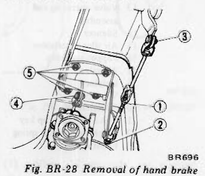
>
> - **Summary:** Under-chassis view showing disconnection of adjusting rod nut, clevis pins, hanger spring, and four mounting bolts of center arm.
> - **Components:** Lock nut, Adjusting rod, Clevis pin, Center arm assembly, Mounting bolts
> - **Callouts:** **(1)** Lock nut; **(2)** Adjusting rod; **(3)** Clevis pin; **(4)** Clevis pin and hanger spring; **(5)** Four bolts
> - **Mechanic Notes:** Center arm nuts are welded to floor panel.
> - **Tags:** `hand brake removal`, `center arm`, `adjusting rod`

> 🖼️ **Fig. BR-29 Removing rear cable** `[BR644]` *(Type: `procedure_step`)*
>
> 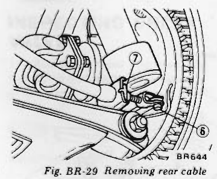
>
> - **Summary:** Disconnection of parking brake cable from wheel brake backing plate toggle lever and removal of cable housing retainer clips.
> - **Components:** Rear cable, Backing plate, Toggle lever clevis pin, Cable retainers
> - **Callouts:** **(6)** Clevis pin; **(7)** Wheel side retainers
> - **Mechanic Notes:** Remove wheel-side retainers and equalizer-side retainer to withdraw cable.
> - **Tags:** `parking brake cable`, `cable retainer`, `rear cable removal`

---

<!-- Page 14 (BR-14) -->
## MASTER-VAC

### CONTENTS

| Section | Page | Section | Page |
| :--- | :--- | :--- | :--- |
| DESCRIPTION | BR-15 | FRONT SHELL-SEAL ASSEMBLY | BR-17 |
| INSPECTING VACUUM PRESSURE | BR-15 | INSPECTION | BR-17 |
| INSPECTING CHECK VALVE | BR-15 | ASSEMBLY AND ADJUSTMENT | BR-17 |
| OPERATING TEST | BR-15 | REAR SHELL-SEAL ASSEMBLY | BR-17 |
| REMOVAL | BR-16 | DIAPHRAGM PLATE ASSEMBLY | BR-18 |
| DISASSEMBLY | BR-16 | FRONT SHELL-SEAL ASSEMBLY | BR-18 |
| REAR SHELL-SEAL ASSEMBLY | BR-16 | FINAL ASSEMBLY | BR-18 |
| DIAPHRAGM PLATE ASSEMBLY | BR-17 | INSTALLATION | BR-18 |

> 🖼️ **Fig. BR-31 Cross-sectional view of Master-Vac** `[BR684]` *(Type: `cutaway_flow`)*
>
> 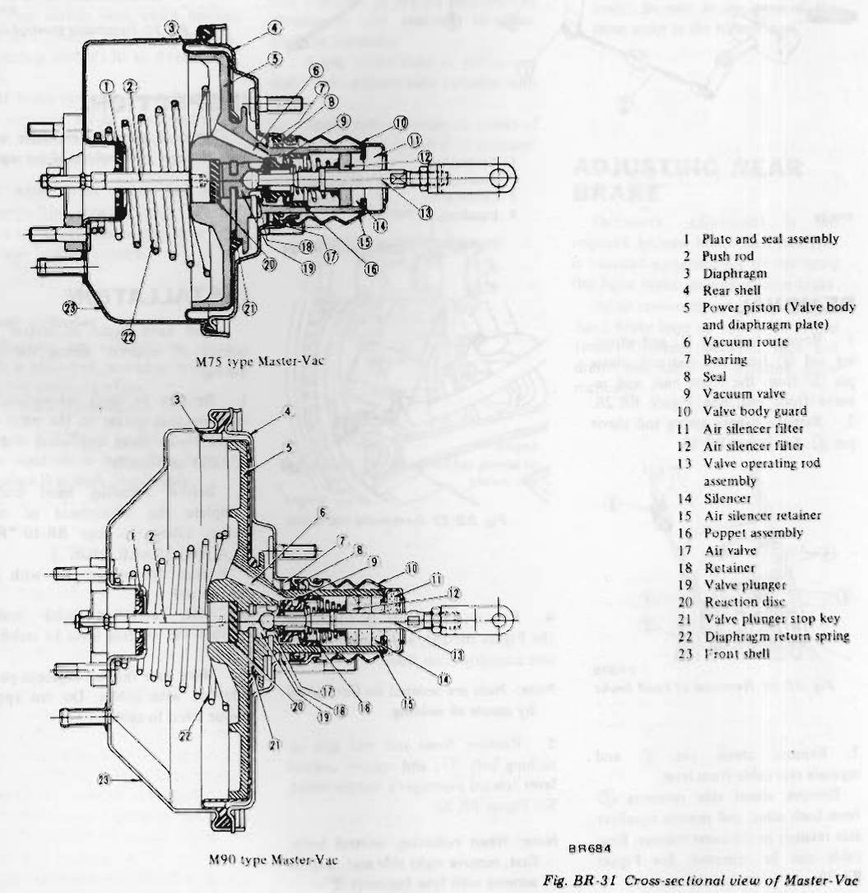
>
> - **Summary:** Comparative cross-sectional cutaways of both M75 type (top) and M90 type (bottom) vacuum brake boosters detailing internal valves, reaction disc, power piston, and return springs.
> - **Components:** Plate and seal assembly, Push rod, Diaphragm, Rear shell, Power piston (Valve body and diaphragm plate), Vacuum route, Bearing, Seal, Vacuum valve, Valve body guard, Air silencer filter, Valve operating rod assembly, Silencer, Air silencer retainer, Poppet assembly, Air valve, Retainer, Valve plunger, Reaction disc, Valve plunger stop key, Diaphragm return spring, Front shell
> - **Callouts:** **(1)** Plate and seal assembly; **(2)** Push rod; **(3)** Diaphragm; **(4)** Rear shell; **(5)** Power piston (Valve body and diaphragm plate); **(6)** Vacuum route; **(7)** Bearing; **(8)** Seal; **(9)** Vacuum valve; **(10)** Valve body guard; **(11)** Air silencer filter; **(12)** Air silencer filter; **(13)** Valve operating rod assembly; **(14)** Silencer; **(15)** Air silencer retainer; **(16)** Poppet assembly; **(17)** Air valve; **(18)** Retainer; **(19)** Valve plunger; **(20)** Reaction disc; **(21)** Valve plunger stop key; **(22)** Diaphragm return spring; **(23)** Front shell
> - **Mechanic Notes:** M75 type fitted to 2-seater models; M90 type fitted to 2+2 GS30 models.
> - **Tags:** `Master-Vac`, `vacuum booster`, `M75`, `M90`, `cross section`, `reaction disc`

---

<!-- Page 15 (BR-15) -->
### DESCRIPTION

A Master-Vac which decreases the pedal operating force and effectively and certainly brakes all wheels is installed between the brake pedal and the master cylinder. As the brake pedal is depressed, fluid is forced under high pressure through the brake pipes to the wheel cylinders to retard or stop the car.

The tandem master cylinder is capable of producing high pressure even if the Master-Vac is faulty.

The S30 models are equipped with M75 type Master-Vac (7 1/2 in diaphragm) and GS30 (2 + 2 seater) models with M90 type Master-Vac (9 in diaphragm). The construction of both Master-Vacs is basically the same.

### INSPECTING VACUUM PRESSURE

1. Install a vacuum gauge between check valve and Master-Vac.
2. Increase engine speed, and stop the engine when the vacuum gauge indicates 500 mmHg (19.69 inHg). See Figure BR-32.

> 🖼️ **Fig. BR-32 Installing vacuum gauge** `[BR072]` *(Type: `inspection_measurement`)*
>
> 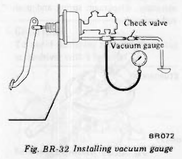
>
> - **Summary:** Connecting vacuum test gauge into line between check valve and Master-Vac booster.
> - **Components:** Vacuum gauge, Check valve, Vacuum hose, Master-Vac
> - **Specs / Measurements:** Test vacuum: 500 mmHg (19.69 inHg); Max allowable drop in 15 sec: 25 mmHg (0.98 inHg)
> - **Mechanic Notes:** Engine stopped at 500 mmHg; monitor drop after 15 seconds without braking and with full braking force.
> - **Tags:** `vacuum gauge`, `vacuum leak test`, `Master-Vac testing`

(1) When 15 seconds are elapsed after stopping the engine without braking and pressure drops more than 25 mmHg (0.98 in Hg):

| Possible cause | Corrective action |
| :--- | :--- |
| 1. Faulty check valve airtightness. | Replace. |
| 2. Faulty push rod seal airtightness. | Replace. |
| 3. Faulty airtightness between valve body and seal. | Repair or replace. |
| 4. Faulty valve plunger seat airtightness. | Repair or replace. |
| 5. Damaged piping or faulty joint airtightness. | Repair or replace. |

(2) When 15 seconds are elapsed after stopping the engine by applying full braking force, and pressure drops more than 25 mmHg (0.98 in Hg):

| Possible cause | Corrective action |
| :--- | :--- |
| 1. Faulty check valve airtightness. | Replace. |
| 2. Damaged diaphragm. | Replace. |
| 3. Dropped off reaction disc. | Reinstall and check the push rod for returning. |
| 4. Faulty airtightness on poppet assembly seat surface and valve body surface. | Repair or replace. |

> [!NOTE]
> When a replacement is required, be sure to replace Master-Vac as an assembly.

### INSPECTING CHECK VALVE

1. Remove clip and disconnect the hoses from both ends. Check valve can be removed.
2. Using a Master-Vac tester, apply vacuum pressure of 500 mmHg (19.69 in Hg) to Master-Vac side of check valve. When pressure drops more than 10 mmHg (0.39 in Hg) within 15 seconds replace check valve with a new one.
3. When pressure is applied to Master-Vac side of check valve and valve does not open, replace check valve with a new one. See Figure BR-34.

> 🖼️ **Fig. BR-33 Removing check valve** `[BR685]` *(Type: `procedure_step`)*
>
> 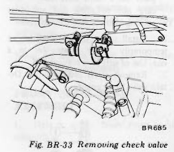
>
> - **Summary:** Location and removal of brake booster vacuum line check valve from engine compartment.
> - **Components:** Check valve, Vacuum hoses, Clips
> - **Mechanic Notes:** Disconnect spring clips at both ends to remove check valve.
> - **Tags:** `check valve`, `vacuum hose`, `removal`

> 🖼️ **Fig. BR-34 Cross-sectional view of check valve** `[BR211]` *(Type: `cutaway_flow`)*
>
> 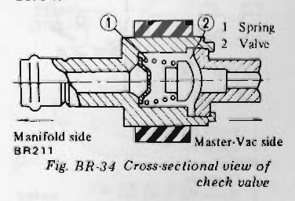
>
> - **Summary:** Cutaway view of check valve showing internal valve disc, spring, and flow direction from Master-Vac side to manifold side.
> - **Components:** Check valve spring, Check valve disc / valve
> - **Callouts:** **(1)** Spring; **(2)** Valve
> - **Specs / Measurements:** Max allowable leak at 500 mmHg in 15 sec: 10 mmHg (0.39 inHg)
> - **Mechanic Notes:** One-way flow only: opens towards intake manifold side.
> - **Tags:** `check valve`, `cross section`, `one-way valve`

### OPERATING TEST

1. Connect an oil pressure gauge to brake line at master cylinder connection.
2. Start engine and increase engine speed until vacuum pressure gauge indicates 500 mmHg (19.69 inHg).
3. With the vacuum pressure constant at 500 mmHg (19.69 inHg), measure the oil pressure with respect to various pedal operating forces.
4. Relationship between oil pressure and pedal operating force is illustrated in Figure BR-35 or BR-36. If test results are not as specified in Figure BR-35 or BR-36, check Master-Vac as described under "Inspection" before removal of this unit. Also check brake line for any evidence of fluid leakage. <!-- Page 16 (BR-16) --> described under "Inspection" before removal of this unit. Also check brake line for any evidence of fluid leakage.

> [!NOTE]
> Determine whether source of problem is in Master-Vac or check valve. Before coming to any final conclusion, always inspect check valve.

> 🖼️ **Fig. BR-35 Performance curve of Master-Vac (M90 type)** `[BR686]` *(Type: `graph_chart`)*
>
> 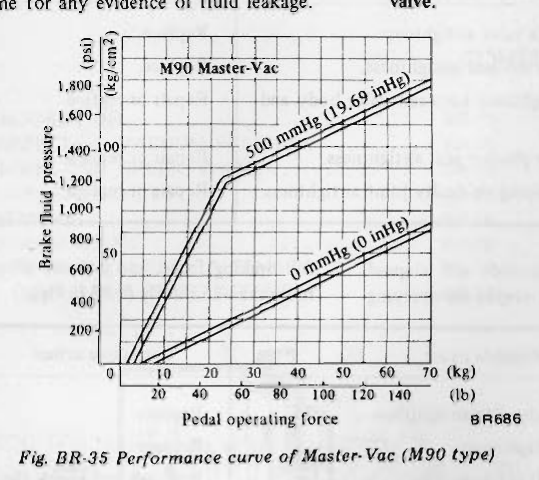
>
> - **Summary:** Output performance graph for M90 (9-inch) booster plotting brake fluid pressure (psi, kg/cm²) against pedal operating force (kg, lb) at 500 mmHg and 0 mmHg vacuum.
> - **Specs / Measurements:** Test vacuum: 500 mmHg (19.69 inHg); 0 mmHg (0 inHg)
> - **Mechanic Notes:** Knee point occurs at approximately 25-30 kg pedal force with 500 mmHg vacuum.
> - **Tags:** `performance curve`, `M90`, `Master-Vac`, `boost ratio`, `pressure graph`

> 🖼️ **Fig. BR-36 Performance curve of Master-Vac (M75 type)** `[BR687]` *(Type: `graph_chart`)*
>
> 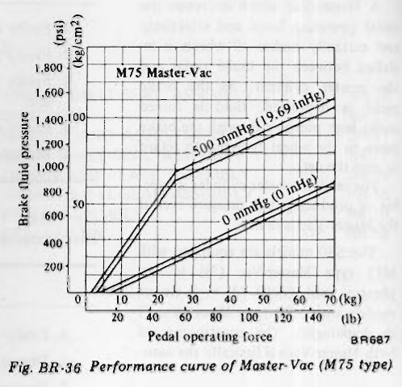
>
> - **Summary:** Output performance graph for M75 (7.5-inch) booster plotting brake fluid pressure against pedal force at 500 mmHg and 0 mmHg vacuum.
> - **Specs / Measurements:** Test vacuum: 500 mmHg (19.69 inHg); 0 mmHg (0 inHg)
> - **Mechanic Notes:** Knee point occurs at approximately 30-35 kg pedal force with 500 mmHg vacuum.
> - **Tags:** `performance curve`, `M75`, `Master-Vac`, `boost ratio`, `pressure graph`

### REMOVAL

Referring to Figure BR-37, remove parts in numerical order enumerated.
Install these parts in reverse sequence of removal.

> 🖼️ **Fig. BR-37 Removal method of Master-Vac** `[BR689]` *(Type: `procedure_step`)*
>
> 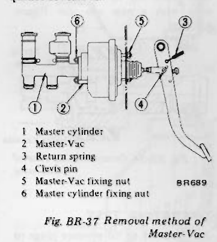
>
> - **Summary:** Numbered sequence for disconnecting pedal return spring, clevis pin, master cylinder nuts, and Master-Vac firewall mounting nuts.
> - **Components:** Master cylinder, Master-Vac, Return spring, Clevis pin, Master-Vac fixing nut, Master cylinder fixing nut
> - **Callouts:** **(1)** Master cylinder; **(2)** Master-Vac; **(3)** Return spring; **(4)** Clevis pin; **(5)** Master-Vac fixing nut; **(6)** Master cylinder fixing nut
> - **Mechanic Notes:** Remove in numerical order 1 to 6.
> - **Tags:** `Master-Vac removal`, `firewall mounting`, `clevis pin`

> [!NOTE]
> After Master-Vac is properly installed on car, be sure to conduct an air-tight test and operation test described previously in this Section.

### DISASSEMBLY

When disassembling Master-Vac, observe the following instructions.
a) Thoroughly clean mud or dust from Master-Vac.
b) Extreme care should be taken not to allow dirt, dust, water or any other foreign matter getting into any component-parts. Be sure to select a clean place before disassembly or assembly.
c) Mark mating joints so that they may be installed exactly in their original positions.
d) Keep all disassembled parts arranged properly so that they may readily be assembled at any time.
e) Clean rubber parts and synthetic-resin parts in alcohol.
f) After all disassembled parts are cleaned in an approved solvent, place on a clean work bench. Use care not to allow dirt and dust coming into contact these parts.

1. Install spacer on rear shell spacer temporarily. Place Master-Vac in a vise. Use of soft jaws is suggested.
2. Remove clevis and lock nut. Detach valve body guard. See Figure BR-38.
3. Identify front shell and rear shell clearly so that they may be reassembled in their original positions from which they were withdrawn. (Bolts to be attached on dashboard are not same in pitch.)
4. Using special tool "Master-Vac Wrench ST08080000", remove rear shell-seal assembly, and disassemble diaphragm plate assembly, front shell assembly, diaphragm spring and push rod assembly. See Figure BR-39.

> 🖼️ **Fig. BR-38 Removing rear shell** `[BR176]` *(Type: `procedure_step`)*
>
> 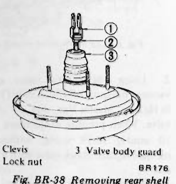
>
> - **Summary:** Removal of operating rod clevis, lock nut, and rubber valve body guard.
> - **Components:** Clevis, Lock nut, Valve body guard
> - **Callouts:** **(1)** Clevis; **(2)** Lock nut; **(3)** Valve body guard
> - **Mechanic Notes:** Remove clevis, lock nut, and guard prior to unscrewing rear shell.
> - **Tags:** `rear shell`, `clevis removal`, `valve body guard`

> 🖼️ **Fig. BR-39 Removing rear shell** `[BR177]` *(Type: `special_service_tool`)*
>
> 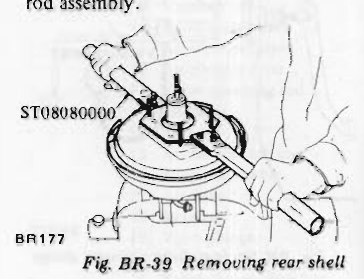
>
> - **Summary:** Using special tool Master-Vac Wrench ST08080000 to rotate and unlock rear shell from front shell lugs.
> - **Components:** Master-Vac rear shell, Master-Vac front shell, Special tool ST08080000
> - **Mechanic Notes:** Turn tool counterclockwise to disengage interlocking shell tabs.
> - **Tags:** `ST08080000`, `Master-Vac wrench`, `shell disassembly`, `special tool`

#### REAR SHELL-SEAL ASSEMBLY

Pry off seal assembly with use of a screwdriver as shown.

> [!NOTE]
> Do not disassemble seal assembly unless absolutely necessary. Whenever this is to be removed, use care not to damage it.

---

<!-- Page 17 (BR-17) -->

> 🖼️ **Fig. BR-40 Removing seal** `[BR178]` *(Type: `procedure_step`)*
>
> 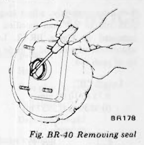
>
> - **Summary:** Prying off oil seal assembly from rear shell housing using a flat screwdriver.
> - **Components:** Rear shell, Seal assembly, Screwdriver
> - **Mechanic Notes:** Do not disassemble seal unless necessary; avoid scratching rear shell seat.
> - **Tags:** `rear seal`, `seal removal`, `rear shell`

#### DIAPHRAGM PLATE ASSEMBLY

1. Place diaphragm plate assembly on a clean work bench. Detach diaphragm from groove in plate as shown. See Figure BR-41.
2. Using a screwdriver as shown, evenly pry air silencer retainer until it is detached from diaphragm plate assembly. See Figure BR-42.

> [!CAUTION]
> To avoid damaging retaines, never tap screwdriver with a hammer.

> 🖼️ **Fig. BR-41 Separating diaphragm** `[BR079]` *(Type: `procedure_step`)*
>
> 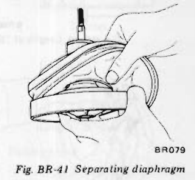
>
> - **Summary:** Peeling rubber diaphragm bead out of the annular groove in bakelite diaphragm plate.
> - **Components:** Rubber diaphragm, Diaphragm plate
> - **Mechanic Notes:** Detach diaphragm bead carefully to avoid tearing.
> - **Tags:** `diaphragm removal`, `diaphragm plate`, `rubber diaphragm`

> 🖼️ **Fig. BR-42 Removing air silencer retainer** `[BR179]` *(Type: `procedure_step`)*
>
> 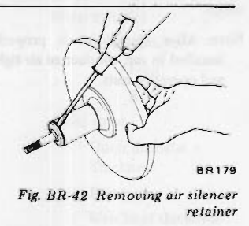
>
> - **Summary:** Prying air silencer retainer evenly out of diaphragm plate using screwdriver blade.
> - **Components:** Air silencer retainer, Diaphragm plate, Screwdriver
> - **Mechanic Notes:** Never tap screwdriver with a hammer; pry evenly around retainer.
> - **Tags:** `air silencer retainer`, `diaphragm plate`, `silencer removal`

3. Pull out valve plunger stop key and withdraw silencer and plunger assembly. See Figure BR-43 and Figure BR-44.

> [!NOTE]
> To remove valve plunger stop key properly, proceed as follows: With key hole facing down, lightly push valve operating rod simultaneously while applying vibration to it.

> 🖼️ **Fig. BR-43 Pulling out stop key** `[BR180]` *(Type: `procedure_step`)*
>
> 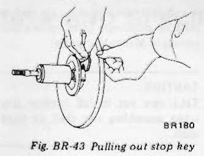
>
> - **Summary:** Extracting valve plunger stop key from valve body hub while vibrating push rod.
> - **Components:** Valve plunger stop key, Valve body, Operating rod
> - **Mechanic Notes:** Point key hole downward, lightly push rod and vibrate to disengage stop key.
> - **Tags:** `valve plunger stop key`, `stop key removal`, `plunger assembly`

> 🖼️ **Fig. BR-44 Removing valve operating rod assembly** `[BR181]` *(Type: `procedure_step`)*
>
> 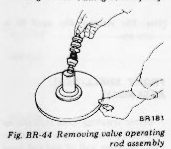
>
> - **Summary:** Withdrawing valve operating rod, silencer elements, and air valve plunger assembly from power piston.
> - **Components:** Valve operating rod, Silencers, Air valve plunger, Diaphragm plate
> - **Mechanic Notes:** Rod and plunger assembly are staked together and cannot be disassembled.
> - **Tags:** `operating rod`, `plunger withdrawal`, `air valve`

4. Withdraw reaction disc. See Figure BR-45.

> [!CAUTION]
> Valve rod and plunger assembly cannot be disassembled, since they are staked.

> [!NOTE]
> Be sure to install new reaction disc at each reassembly.

> 🖼️ **Fig. BR-45 Removing reaction disc** `[BR182]` *(Type: `procedure_step`)*
>
> 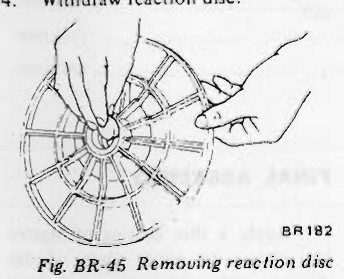
>
> - **Summary:** Removing rubber reaction disc from center cavity of diaphragm plate.
> - **Components:** Reaction disc, Diaphragm plate center hub
> - **Mechanic Notes:** Always replace reaction disc with a new one at each reassembly.
> - **Tags:** `reaction disc`, `diaphragm plate`, `booster feedback`

#### FRONT SHELL-SEAL ASSEMBLY

1. Detach spacer from front shell assembly. See Figure BR-46.
2. Withdraw front seal assembly.

> 🖼️ **Fig. BR-46 Removing spacer** `[BR183]` *(Type: `procedure_step`)*
>
> 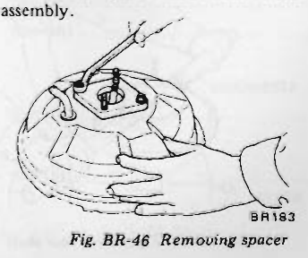
>
> - **Summary:** Detaching mounting stud spacer from front shell housing using screwdriver.
> - **Components:** Front shell, Mounting stud spacer
> - **Mechanic Notes:** Pry spacer off front shell studs.
> - **Tags:** `front shell`, `spacer removal`, `booster shell`

### INSPECTION

1. Check poppet assembly for condition. If it shows evidence of wear or otherwise damage, replace it and valve operating rod assembly.
2. Check other component-parts for condition. If any part shows evidence of wear or otherwise damage, replace it with a new one.

### ASSEMBLY AND ADJUSTMENT

Assemble in reverse sequence of disassembly.

#### REAR SHELL-SEAL ASSEMBLY

Apply a coating of Master-Vac grease to sealing surface and lip of seal, and install that seal in rear shell with the use of special tool "Master-Vac Oil Seal Retainer Drift ST08090000" [190.50 mm (7 1/2 in) diameter diaphragm ST08060000]. See Figure BR-47.

> 🖼️ **Fig. BR-47 Installing oil seal** `[BR184]` *(Type: `special_service_tool`)*
>
> 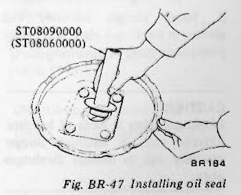
>
> - **Summary:** Pressing oil seal into rear shell using drift tool ST08090000 (9") or ST08060000 (7.5").
> - **Components:** Rear shell, Oil seal, Drift ST08090000 / ST08060000
> - **Specs / Measurements:** Length 'A': 10.2 to 10.8 mm (0.402 to 0.425 in) for 9 in dia; Length 'A': 6.7 to 7.0 mm (0.264 to 0.276 in) for 7.5 in dia
> - **Mechanic Notes:** Align tool pawl with seal hole; drive until specified protrusion 'A' is achieved.
> - **Tags:** `ST08090000`, `ST08060000`, `oil seal drift`, `seal installation`

> [!NOTE]
> Referring to Figure BR-48, install seal in place by properly aligning pawl of special tool with seal hole. Adjustment is correct when specified length at "A" is obtained.

| Diaphragm dia. mm (in) | Length "A" mm (in) |
| :--- | :--- |
| 228.60 (9) | 10.2 to 10.8 (0.402 to 0.425) |
| 190.50 (7 1/2) | 6.7 to 7.0 (0.264 to 0.276) |

---

<!-- Page 18 (BR-18) -->

> 🖼️ **Fig. BR-48 Length at "A"** `[BR185]` *(Type: `inspection_measurement`)*
>
> 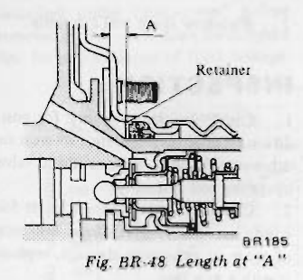
>
> - **Summary:** Cross section showing seal depth dimension 'A' measured from retainer edge in rear shell.
> - **Components:** Rear shell, Retainer, Seal
> - **Specs / Measurements:** Length 'A': 10.2 to 10.8 mm (0.402 to 0.425 in) for 228.60 mm (9 in) diaphragm; Length 'A': 6.7 to 7.0 mm (0.264 to 0.276 in) for 190.50 mm (7.5 in) diaphragm
> - **Mechanic Notes:** Critical seal press depth dimension A.
> - **Tags:** `length A`, `seal depth`, `rear shell seal`

#### DIAPHRAGM PLATE ASSEMBLY

1. Apply a thin coating of grease to sliding contact portion on periphery of plunger assembly. See Figure BR-49.
2. Install plunger assembly and silencer in diaphragm plate, and lightly push plunger stop key in place. See Figure BR-50.

> [!CAUTION]
> Diaphragm plate is made of bakelite. Exercise care in installing plunger assembly not to damage diaphragm plate.

3. Before installing diaphragm into position, apply a thin coating of mica-powder to it except outer diameter and seating portion with which shell comes into contact.
4. Before installing reaction disc in place on diaphragm plate, apply a thin coating of Master-Vac grease.

> [!CAUTION]
> Take care not to fall reaction disc when assembling rear shell on front shell.

> [!NOTE]
> The reaction disc must be a new one.

> 🖼️ **Fig. BR-49 Requiring grease place** `[BR186]` *(Type: `alignment_orientation`)*
>
> 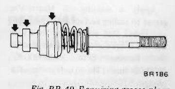
>
> - **Summary:** Arrows pointing to outer cylindrical sliding surfaces of plunger assembly requiring Master-Vac grease.
> - **Components:** Plunger assembly, Sliding contact lands
> - **Mechanic Notes:** Apply thin coat of Master-Vac grease to sliding periphery of plunger assembly.
> - **Tags:** `grease point`, `plunger assembly`, `Master-Vac grease`

> 🖼️ **Fig. BR-50 Inserting stop key** `[BR187]` *(Type: `procedure_step`)*
>
> 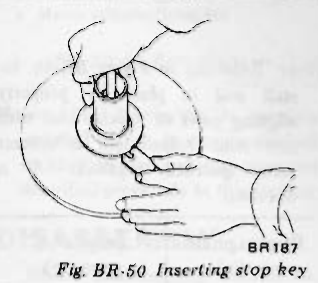
>
> - **Summary:** Pushing valve plunger stop key home into slot of bakelite diaphragm plate.
> - **Components:** Diaphragm plate, Stop key
> - **Mechanic Notes:** Diaphragm plate is bakelite; insert key gently without cracking plate.
> - **Tags:** `stop key insertion`, `bakelite plate`, `plunger lock`

#### FRONT SHELL-SEAL ASSEMBLY

Before installing front shell-seal assembly, apply a coating of Master-Vac grease to inner wall of seal and front shell with which seal comes into contact.

#### FINAL ASSEMBLY

1. Apply a thin coating of Master-Vac grease to outer edges of diaphragm with which rear and front shells come into contact, before installing diaphragm in position.
2. Before installing push rod assembly in place, apply a coating of Master-Vac grease to sliding contact surface of diaphragm plate.
3. Align marks scribed in rear shell and front shell. Carefully turn special tool "Master-Vac Wrench ST08080000" clockwise until it reaches notch in shell retainer. See Figure BR-51.
4. After assembly, adjust length of push rod to less than specified value indicated in Figure BR-52. Length adjustment of push rod is made at the tip of push rod. See Figure BR-53.

- Length "B": 9.75 to 10.00 mm (0.3839 to 0.3937 in)

> 🖼️ **Fig. BR-51 Tightening rear shell** `[BR177]` *(Type: `special_service_tool`)*
>
> 
>
> - **Summary:** Turning rear shell clockwise using wrench ST08080000 until locking notches engage front shell tabs.
> - **Components:** Master-Vac shell, Wrench ST08080000
> - **Mechanic Notes:** Align scribe marks, turn clockwise until tool reaches notch in shell retainer.
> - **Tags:** `ST08080000`, `shell tightening`, `lock ring`, `assembly`

> 🖼️ **Fig. BR-52 Length at "B"** `[BR688]` *(Type: `inspection_measurement`)*
>
> 
>
> - **Summary:** Diagram illustrating push rod tip protrusion dimension 'B' beyond booster front shell mounting face.
> - **Components:** Push rod, Front shell mounting face
> - **Specs / Measurements:** Length 'B': 9.75 to 10.00 mm (0.3839 to 0.3937 in)
> - **Mechanic Notes:** Adjust push rod tip length to 9.75 to 10.00 mm before mounting master cylinder.
> - **Tags:** `length B`, `push rod protrusion`, `booster adjustment`

> 🖼️ **Fig. BR-53 Adjusting push rod length** `[BR189]` *(Type: `procedure_step`)*
>
> 
>
> - **Summary:** Holding push rod serrations with pliers while turning adjusting screw tip with wrench.
> - **Components:** Push rod serrated shaft, Adjusting screw tip, Pliers, Wrench
> - **Specs / Measurements:** Length 'B': 9.75 to 10.00 mm (0.3839 to 0.3937 in)
> - **Mechanic Notes:** Lock push rod body securely to prevent turning inner diaphragm while adjusting tip.
> - **Tags:** `push rod adjustment`, `tip screw`, `booster push rod`

### INSTALLATION

Install in reverse sequence of removal.

> [!NOTE]
> After Master-Vac is properly installed in car, conduct an air-tight and operating tests.

---

<!-- Page 19 (BR-19) -->
## SERVICE DATA AND SPECIFICATIONS

| Item | Unit | Value |
| :--- | :--- | :--- |
| **Brake pedal** | | |
| Height | mm (in) | 203 (7.99) |
| Free play (at pedal pad) | mm (in) | 1 to 5 (0.04 to 0.20) |
| Full stroke | mm (in) | 123 (4.84) |
| Depressed height | mm (in) | 92 (3.62) |
| **Master cylinder** | | |
| Inner diameter | mm (in) | 22.23 (7/8) |
| Allowable clearance between cylinder and piston | mm (in) | 0.15 (0.0059) |
| **Master-Vac** | | |
| Diaphragm diameter: 2 seater | mm (in) | 190.50 (7 1/2) |
| Diaphragm diameter: 2 + 2 seater | mm (in) | 228.60 (9) |
| Length "A": 2 seater | mm (in) | 6.7 to 7.0 (0.264 to 0.276) |
| Length "A": 2 + 2 seater | mm (in) | 10.2 to 10.8 (0.402 to 0.425) |
| Length "B" | mm (in) | 9.75 to 10.00 (0.3839 to 0.3937) |
| **Parking brake** | | |
| Type | | Mechanical, operating on rear wheels |
| Notch | | 6th [Pulling force 20 to 25 kg (44 to 55 lb)] |
| **Service brake** | | |
| Type: Front | | Disc (Girling-Sumitomo S-16) |
| Type: Rear | | Drum (Leading-trailing) |
| **Wheel cylinder** | | |
| Inner diameter: Front | mm (in) | 53.98 (2 1/8) |
| Inner diameter: Rear | mm (in) | 22.23 (7/8) |
| **Brake rotor** | | |
| Outer diameter x Thickness | mm (in) | 271 x 12.5 (10.67 x 0.492) |
| Run-out | mm (in) | 0.10 (0.0039) |
| Wear limit thickness | mm (in) | 10.5 (0.413) |
| **Brake pad** | | |
| Dimension (Width x thickness x length) | mm (in) | 51.6 x 9.7 x 77.8 (2.031 x 0.382 x 3.063) |
| Wear limit (Min. thickness) | mm (in) | 2.0 (0.079) |

---

<!-- Page 20 (BR-20) -->
### SERVICE DATA AND SPECIFICATIONS (CONTINUED)

| Item | Unit | Value |
| :--- | :--- | :--- |
| **Brake drum** | | |
| Inner diameter | mm (in) | 228.60 (9) |
| Wear limit of diameter | mm (in) | 230.0 (9.06) |
| **Brake lining** | | |
| Dimension (Width x thickness x length) | mm (in) | 40 x 4.5 x 219.5 (1.57 x 0.177 x 8.64) |
| Wear limit (Min. thickness) | mm (in) | 1.5 (0.059) |
| **Brake adjustment notches** | | |
| Front | | Not necessary |
| Rear | | Not necessary |

### Tightening torque

| Component | Unit | Value |
| :--- | :--- | :--- |
| Master cylinder to Master-Vac | kg-m (ft-lb) | 0.8 to 1.1 (5.8 to 8.0) |
| Master cylinder stopper screw | kg-m (ft-lb) | 0.4 to 0.5 (2.9 to 3.6) |
| Brake tube connector | kg-m (ft-lb) | 1.5 to 1.8 (11 to 13) |
| Brake hose connector | kg-m (ft-lb) | 1.7 to 2.0 (12 to 14) |
| Air bleeder valve | kg-m (ft-lb) | 0.7 to 0.9 (5.1 to 6.5) |
| Fulcrum shaft (Brake pedal) | kg-m (ft-lb) | 3.5 to 4.0 (25 to 29) |
| Connector mounting bolt: 6 mm dia. bolt | kg-m (ft-lb) | 0.5 to 0.7 (3.6 to 5.1) |
| Connector mounting bolt: 8 mm dia. bolt | kg-m (ft-lb) | 0.8 to 1.1 (5.8 to 8.0) |
| Caliper bolt | kg-m (ft-lb) | 7.3 to 9.9 (53 to 72) |
| Rotor bolt | kg-m (ft-lb) | 3.9 to 5.3 (28 to 38) |
| Wheel cylinder bolt | kg-m (ft-lb) | 0.6 to 0.8 (4.3 to 5.8) |
| Brake disc (Back plate) nut | kg-m (ft-lb) | 4.0 to 5.3 (29 to 38) |
| Master-Vac to body nut | kg-m (ft-lb) | 0.8 to 1.1 (5.8 to 8.0) |
| Master-Vac operating rod lock nut | kg-m (ft-lb) | 1.6 to 2.2 (12 to 16) |

---

<!-- Page 21 (BR-21) -->
## TROUBLE DIAGNOSES AND CORRECTIONS

| Condition | Possible causes | Corrective action |
| :--- | :--- | :--- |
| **Locked brake pedal** | Swollen master cylinder seals due to poor fluid quality or contamination by kerosene, gasoline or mineral oil. | Flush the system, replace all rubber parts, refill with new fluid and air bleed the lines. |
| | Pistons or valve carrier locked by deposits of fluid, foreign matter, etc. | Clean and bleed the system. |
| | Seized master cylinder piston due to infiltrations of water through rear end due to faulty boot or seals. | Service the master cylinder, replace the piston and the boot and/or seals, to prevent water infiltration. |
| | Seized pedal shaft. | Smooth bushings, or if other sliding parts are damaged to a remarkable extent, replace them and lubricate. |
| | Clogged transfer port. | Disassemble and clean master cylinder. |
| | No compensation takes place. Weak return spring. | Replace faulty spring. |
| **Spongy pedal** | Air in brake system because of imperfect bleeding. | Bleed thoroughly. |
| | Swollen hose due to deterioration. | Replace the hose and bleed the system. |
| | Hose swells under fluid pressure due to poor hose quality. | Fit new hoses and bleed the system. |
| | Use of a poor quality brake fluid (boiling point of which is too low). | Replace the fluid with the specified brake fluid and bleed the system. |
| | Clogged reservoir filler cap vent hole. This promotes a vacuum in master cylinder that sucks air through rear seal. | Clean reservoir filler cap and bleed the system. |
| **Pedal yields under slight pressure** | Deteriorated check valve. | Fit a new check valve, make sure that there are no burrs, roughness or blow holes in master cylinder, and bleed the system. |
| | Fluid leaks through connection. | Tighten connections, and if necessary, replace faulty parts. Bleed the system. |
| | Fluid leaks at wheel cylinders. | Replace the seals and packings being damaged. Wipe and clean brake shoe linings. |
| | Fluid leaks through hoses. | Replace the damaged hose, and bleed the system. |
| | Low fluid level in reservoir. | Add specified fluid up to correct level. |

---

<!-- Page 22 (BR-22) -->
### TROUBLE DIAGNOSES AND CORRECTIONS (CONTINUED)

| Condition | Probable cause | Corrective action |
| :--- | :--- | :--- |
| **Poor pedal reserve** | Master cylinder relief port clogged with foreign matter. | Clean and bleed the system. |
| | System has not been bled. | Bleed the system. |
| | Excessive clearance between shoes and drum. | Adjust auto-adjuster operation. |
| **Excessive pedal reserve** | Fluid level in reservoir is too low. | Top up with specified brake fluid, bleed the system, if required. |
| | Deteriorated rubber seals in master cylinder or in wheel cylinders. | Replace seals and bleed the system. |
| | Excessively swollen hoses due to poor hose quality. | Replace by designated hoses and bleed the system. |
| | Thermal expansion of drums due to excessive overheating. | Allow drums to cool off. Check brake shoe linings and drums. Replace damaged parts. |
| **Brake locked after pedal return** | Worn or broken return spring. | Replace faulty springs. |
| | Improper brake shoe return. | Grease brake shoe and wheel cylinder sliding surface. |
| | Clogged master cylinder relief port. | Clean and bleed the system. |
| | Swollen or stuck rubber seals due to contamination by kerosene, mineral oil, gasoline, etc. | Flush the system, replace all rubber parts, refill with new brake fluid and bleed the system. |
| **Unbalanced brakes** | Fluid leakage at one wheel cylinder only. | Wipe, clean or replace the brake shoe linings or lining pads, service the wheel cylinder and bleed the system. |
| | Rusted or corroded edges of a wheel cylinder. | Eliminate rust and replace the boots. |
| | Seized piston in wheel cylinder or caliper assembly. | Service the wheel cylinder, replace the rear wheel cylinder piston or caliper assembly and bleed the system. |
| | Hose obstructed due to swollen or clogged inner lining. | Replace or clean the hose and bleed the system. |
| | Obstructed flow in metal pipe due to crushing or clogging (if the brakes on one axle are excluded, weak braking may result). | Replace or clean the pipe and bleed the system. |
| | Faulty seals at one half caliper. | Take down and strip the half caliper, replace seals and dust covers. |

---

<!-- Page 23 (BR-23) -->
### TROUBLE DIAGNOSES AND CORRECTIONS (CONTINUED)

| Condition | Probable cause | Corrective action |
| :--- | :--- | :--- |
| **Brake linings dragging all the time on drums or brake discs** | Insufficient shoe-to-drum clearance. | Adjust clearance. |
| | Weak shoe return springs. | Replace the springs. |
| | Brake pedal has no free travel. | Set the push rod length as prescribed. |
| | Seized master cylinder piston. | Service the master cylinder, replace the piston and bleed the system. |
| | Master cylinder flooded due to clogged relief port. | Service the master cylinder, replace the check valve if deteriorated, clean the relief port and bleed the system. |
| | Brake disc run-out. | Check brake disc for run-out, and replace faulty parts, if necessary. |
| **Weak brakes** | Fluid leakage from wheel cylinders. | Wipe and clean the brake shoe linings, service the wheel cylinder replacing damaged parts, and bleed the system. |
| | Fluid leakage from caliper cylinders. | Take down and strip the calipers; replace all rubber seals and clean lining pads. |
| | — Master-Vac — This problem mainly results from improper function of Master-Vac. Please check as follows: | |
| | Improper Master-Vac function due to poor vacuum. | Check the pipe or hose connections, and fasten if necessary. Or replace a faulty vacuum hose. |
| | Required vacuum is not maintained. | Wipe, clean or replace the check valve and check the grommet for loose fit, re-fit or replace it. Replace seal or retighten plate and seal assembly-to-front shell bolts. Clean or replace poppet rubber. Replace diaphragm and diaphragm plate. |
| | Weak pressure on shoes due to use of too thick fluid. | Flush the system and refill with specified fluid. Bleed the system. |
| | Dust on drums or linings soiled with oil. | Remove and clean drums thoroughly. |
| | Weak shoe return springs. | Check springs and replace as required. |
| | Drum out of round. | Correct drums by means of a lathe. |

---

<!-- Page 24 (BR-24) -->
## SPECIAL SERVICE TOOLS

| Tool number & tool name | Kent-Moore No. | Reference page or Fig. No. | Unit application |
| :--- | :--- | :--- | :--- |
| **GG94310000** Flare nut torque wrench | — | Page BR-4 Page BR-5 Page BR-9 | * |
| **ST08080000** Master-Vac wrench | — | Fig. BR-39 Fig. BR-51 | * |
| **ST08060000** Master-Vac oil seal retainer drift (4.5", 6", 7.5") | J 25609 | Fig. BR-47 | 7½" Master-Vac |
| **ST08090000** Master-Vac oil seal retainer drift (9") | — | Fig. BR-47 | 9" Master-Vac |

\*: Applicable to all S30 series models

> 🖼️ **GG94310000 Flare nut torque wrench**  *(Type: `special_service_tool`)*
>
> 
>
> - **Summary:** Special flare nut torque wrench designed for hydraulic brake line fittings.
> - **Components:** Flare nut torque wrench GG94310000
> - **Specs / Measurements:** Applicable to brake tube connectors
> - **Mechanic Notes:** Prevents rounding of flare nuts on tubing joints.
> - **Tags:** `GG94310000`, `flare nut wrench`, `special service tool`, `torque wrench`

> 🖼️ **ST08080000 Master-Vac wrench**  *(Type: `special_service_tool`)*
>
> 
>
> - **Summary:** Spanner wrench with locating pins to engage Master-Vac rear shell for opening and closing booster halves.
> - **Components:** Master-Vac wrench ST08080000
> - **Mechanic Notes:** Used to twist and lock rear shell to front shell notches.
> - **Tags:** `ST08080000`, `Master-Vac wrench`, `special service tool`, `booster spanner`

> 🖼️ **ST08060000 Master-Vac oil seal retainer drift (4.5", 6", 7.5")**  *(Type: `special_service_tool`)*
>
> 
>
> - **Summary:** Flanged driver drift with alignment pawl for installing oil seal to precise depth 'A' in 7.5-inch Master-Vac rear shell.
> - **Components:** Seal retainer drift ST08060000 / J 25609
> - **Specs / Measurements:** Dia: 4.5", 6", 7.5"; Depth A: 6.7 to 7.0 mm (0.264 to 0.276 in)
> - **Mechanic Notes:** Applicable to 7 1/2" Master-Vac on 2-seater models.
> - **Tags:** `ST08060000`, `J 25609`, `seal drift`, `7.5 inch Master-Vac`

> 🖼️ **ST08090000 Master-Vac oil seal retainer drift (9")**  *(Type: `special_service_tool`)*
>
> 
>
> - **Summary:** Flanged driver drift with alignment pawl for installing oil seal to precise depth 'A' in 9-inch Master-Vac rear shell.
> - **Components:** Seal retainer drift ST08090000
> - **Specs / Measurements:** Dia: 9"; Depth A: 10.2 to 10.8 mm (0.402 to 0.425 in)
> - **Mechanic Notes:** Applicable to 9" Master-Vac on 2+2 seater models.
> - **Tags:** `ST08090000`, `seal drift`, `9 inch Master-Vac`

---

## Segmented Diagrams Index

| Figure | Code | Type | Page | Caption | Key Components / Callouts | File |
| :--- | :--- | :--- | :--- | :--- | :--- | :--- |
| **Fig. BR-1** | `BR071A` | `component_location` | BR-2 | Fig. BR-1 Brake system | NP-valve, Master cylinder, Master-Vac, Control lever, 3-way connector | [fig_br_1_brake_system.png](diagrams/BR Brake System/fig_br_1_brake_system.png) |
| **Fig. BR-2** | `BR074A` | `component_location` | BR-3 | Fig. BR-2 Brake pedal mounting | Return spring, Fulcrum pin, Clevis pin, Stop lamp switch, Pedal arm | [fig_br_2_brake_pedal_mounting.png](diagrams/BR Brake System/fig_br_2_brake_pedal_mounting.png) |
| **Fig. BR-3** | `BR075A` | `exploded_view` | BR-3 | Fig. BR-3 Brake pedal components | Brake pedal arm, Pedal pad, Bushing, Sleeve, Fulcrum pin/bolt | [fig_br_3_brake_pedal_components.png](diagrams/BR Brake System/fig_br_3_brake_pedal_components.png) |
| **Fig. BR-4** | `BR619` | `inspection_measurement` | BR-3 | Fig. BR-4 Adjusting brake pedal | Pedal pad, Pedal stopper, Push rod, Push rod clevis, Lock nut | [fig_br_4_adjusting_brake_pedal.png](diagrams/BR Brake System/fig_br_4_adjusting_brake_pedal.png) |
| **Fig. BR-5** | `BR072A` | `exploded_view` | BR-3 | Fig. BR-5 Master cylinder | Reservoir cap, Filter, Brake fluid reservoir (front), Brake fluid reservoir (rear), Brake master cylinder body | [fig_br_5_master_cylinder.png](diagrams/BR Brake System/fig_br_5_master_cylinder.png) |
| **Fig. BR-6** | `BR212` | `cutaway_flow` | BR-4 | Fig. BR-6 Cross-sectional view of master cylinder | Master cylinder body, Front reservoir, Rear reservoir, Primary piston, Secondary piston | [fig_br_6_cross_sectional_view_of_master_cylinder.png](diagrams/BR Brake System/fig_br_6_cross_sectional_view_of_master_cylinder.png) |
| **Fig. BR-7** | `BR073A` | `component_location` | BR-5 | Fig. BR-7 Brake line | Brake tube A, 3-way connector, Brake tube B, Brake tube C, NP-valve | [fig_br_7_brake_line.png](diagrams/BR Brake System/fig_br_7_brake_line.png) |
| **Fig. BR-8** | `BR622` | `cutaway_flow` | BR-6 | Fig. BR-8 Cross-sectional view of NP-valve | O-ring, Plunger, Back-up ring, Y-seal, Lip seal | [fig_br_8_cross_sectional_view_of_np_valve.png](diagrams/BR Brake System/fig_br_8_cross_sectional_view_of_np_valve.png) |
| **Fig. BR-9** | `BR627` | `component_location` | BR-6 | Fig. BR-9 NP-valve | NP-valve body, Mounting bracket, Hydraulic connections | [fig_br_9_np_valve.png](diagrams/BR Brake System/fig_br_9_np_valve.png) |
| **Fig. BR-10** | `BR629` | `exploded_view` | BR-7 | Fig. BR-10 Front disc brake | Anti-squeal shim R.H., Pad, Anti-squeal shim L.H., Retaining ring, Dust cover | [fig_br_10_front_disc_brake.png](diagrams/BR Brake System/fig_br_10_front_disc_brake.png) |
| **Fig. BR-11** | `BR055` | `cutaway_flow` | BR-7 | Fig. BR-11 Piston seal automatic adjusting operation | Piston seal, Caliper cylinder groove, Piston | [fig_br_11_piston_seal_automatic_adjusting_operation.png](diagrams/BR Brake System/fig_br_11_piston_seal_automatic_adjusting_operation.png) |
| **Fig. BR-12** | `BR645` | `procedure_step` | BR-8 | Fig. BR-12 Removing pad | Clip, Retaining pin, Anti-squeal spring, Brake pad | [fig_br_12_removing_pad.png](diagrams/BR Brake System/fig_br_12_removing_pad.png) |
| **Fig. BR-13** | `BR680` | `alignment_orientation` | BR-8 | Fig. BR-13 Applying grease | Caliper contact surfaces, Anti-squeal shim | [fig_br_13_applying_grease.png](diagrams/BR Brake System/fig_br_13_applying_grease.png) |
| **Fig. BR-14** | `BR057` | `procedure_step` | BR-8 | Fig. BR-14 Removing calipers | Brake tube connection, Caliper fixing bolt, Caliper body, Knuckle spindle | [fig_br_14_removing_calipers.png](diagrams/BR Brake System/fig_br_14_removing_calipers.png) |
| **Fig. BR-15** | `BR681` | `procedure_step` | BR-8 | Fig. BR-15 Removing piston | Caliper body, Piston, Air nozzle, Retaining ring | [fig_br_15_removing_piston.png](diagrams/BR Brake System/fig_br_15_removing_piston.png) |
| **Fig. BR-16** | `BR350` | `inspection_measurement` | BR-9 | Fig. BR-16 Measuring runout | Brake rotor, Dial indicator, Magnetic base / stand, Wheel hub | [fig_br_16_measuring_runout.png](diagrams/BR Brake System/fig_br_16_measuring_runout.png) |
| **Fig. BR-17** | `BR351` | `inspection_measurement` | BR-9 | Fig. BR-17 Measuring parallelism | Brake rotor, Micrometer | [fig_br_17_measuring_parallelism.png](diagrams/BR Brake System/fig_br_17_measuring_parallelism.png) |
| **Fig. BR-18** | `BR079A` | `exploded_view` | BR-10 | Fig. BR-18 Rear brake | Anti-rattle pin, Anti-rattle spring, Return spring, Fore-shoe assembly, Return spring | [fig_br_18_rear_brake.png](diagrams/BR Brake System/fig_br_18_rear_brake.png) |
| **Fig. BR-19** | `BR886` | `cutaway_flow` | BR-10 | Fig. BR-19 Sectional view of rear brake | Brake drum, Brake shoes, Wheel cylinder, Adjuster strut, Backing plate | [fig_br_19_sectional_view_of_rear_brake.png](diagrams/BR Brake System/fig_br_19_sectional_view_of_rear_brake.png) |
| **Fig. BR-20** | `BR887` | `exploded_view` | BR-10 | Fig. BR-20 Adjuster assembly (Left-hand side) | Adjuster body, Threaded adjusting screw, Toggle lever, Ratchet claw, Stopper pin | [fig_br_20_adjuster_assembly_left_hand_side.png](diagrams/BR Brake System/fig_br_20_adjuster_assembly_left_hand_side.png) |
| **Fig. BR-21** | `RA286` | `procedure_step` | BR-10 | Fig. BR-21 Removing toggle lever stopper | Toggle lever, Cotter pin, Toggle lever stopper, Backing plate | [fig_br_21_removing_toggle_lever_stopper.png](diagrams/BR Brake System/fig_br_21_removing_toggle_lever_stopper.png) |
| **Fig. BR-22** | `BR889` | `alignment_orientation` | BR-11 | Fig. BR-22 Applying brake grease | Brake shoes, Adjuster assembly, Adjusting nut, Toggle lever contact points | [fig_br_22_applying_brake_grease.png](diagrams/BR Brake System/fig_br_22_applying_brake_grease.png) |
| **Fig. BR-23** | `BR890` | `alignment_orientation` | BR-11 | Fig. BR-23 Applying brake grease | Brake disc / backing plate, Anchor block, Shoe contact pads | [fig_br_23_applying_brake_grease.png](diagrams/BR Brake System/fig_br_23_applying_brake_grease.png) |
| **Fig. BR-24** | `BR891` | `procedure_step` | BR-11 | Fig. BR-24 Removing wheel cylinder | Brake tube, Wheel cylinder mounting bolts, Backing plate, Wheel cylinder body | [fig_br_24_removing_wheel_cylinder.png](diagrams/BR Brake System/fig_br_24_removing_wheel_cylinder.png) |
| **Fig. BR-25** | `BR892` | `exploded_view` | BR-11 | Fig. BR-25 Wheel cylinder and adjustor | Wheel cylinder body, Bleeder valve, Dust cover / boot, Piston, Piston cup | [fig_br_25_wheel_cylinder_and_adjustor.png](diagrams/BR Brake System/fig_br_25_wheel_cylinder_and_adjustor.png) |
| **Fig. BR-26** | `BR893` | `cutaway_flow` | BR-12 | Fig. BR-26 Applying rubber grease to piston cup | Piston cup, Piston, Wheel cylinder bore, Rubber grease | [fig_br_26_applying_rubber_grease_to_piston_cup.png](diagrams/BR Brake System/fig_br_26_applying_rubber_grease_to_piston_cup.png) |
| **Fig. BR-27** | `BR639` | `exploded_view` | BR-13 | Fig. BR-27 Hand brake linkage | Control lever, Front rod, Center lever, Equalizer, Rear cable | [fig_br_27_hand_brake_linkage.png](diagrams/BR Brake System/fig_br_27_hand_brake_linkage.png) |
| **Fig. BR-30** | `BR641` | `procedure_step` | BR-13 | Fig. BR-30 Removing control lever | Control lever assembly, Attaching bolt, Fasteners, Boot | [fig_br_30_removing_control_lever.png](diagrams/BR Brake System/fig_br_30_removing_control_lever.png) |
| **Fig. BR-28** | `BR696` | `procedure_step` | BR-13 | Fig. BR-28 Removal of hand brake | Lock nut, Adjusting rod, Clevis pin, Center arm assembly, Mounting bolts | [fig_br_28_removal_of_hand_brake.png](diagrams/BR Brake System/fig_br_28_removal_of_hand_brake.png) |
| **Fig. BR-29** | `BR644` | `procedure_step` | BR-13 | Fig. BR-29 Removing rear cable | Rear cable, Backing plate, Toggle lever clevis pin, Cable retainers | [fig_br_29_removing_rear_cable.png](diagrams/BR Brake System/fig_br_29_removing_rear_cable.png) |
| **Fig. BR-31** | `BR684` | `cutaway_flow` | BR-14 | Fig. BR-31 Cross-sectional view of Master-Vac | Plate and seal assembly, Push rod, Diaphragm, Rear shell, Power piston (Valve body and diaphragm plate) | [fig_br_31_cross_sectional_view_of_master_vac.png](diagrams/BR Brake System/fig_br_31_cross_sectional_view_of_master_vac.png) |
| **Fig. BR-32** | `BR072` | `inspection_measurement` | BR-15 | Fig. BR-32 Installing vacuum gauge | Vacuum gauge, Check valve, Vacuum hose, Master-Vac | [fig_br_32_installing_vacuum_gauge.png](diagrams/BR Brake System/fig_br_32_installing_vacuum_gauge.png) |
| **Fig. BR-33** | `BR685` | `procedure_step` | BR-15 | Fig. BR-33 Removing check valve | Check valve, Vacuum hoses, Clips | [fig_br_33_removing_check_valve.png](diagrams/BR Brake System/fig_br_33_removing_check_valve.png) |
| **Fig. BR-34** | `BR211` | `cutaway_flow` | BR-15 | Fig. BR-34 Cross-sectional view of check valve | Check valve spring, Check valve disc / valve | [fig_br_34_cross_sectional_view_of_check_valve.png](diagrams/BR Brake System/fig_br_34_cross_sectional_view_of_check_valve.png) |
| **Fig. BR-35** | `BR686` | `graph_chart` | BR-16 | Fig. BR-35 Performance curve of Master-Vac (M90 type) | performance curve, M90, Master-Vac, boost ratio, pressure graph | [fig_br_35_performance_curve_of_master_vac_m90.png](diagrams/BR Brake System/fig_br_35_performance_curve_of_master_vac_m90.png) |
| **Fig. BR-36** | `BR687` | `graph_chart` | BR-16 | Fig. BR-36 Performance curve of Master-Vac (M75 type) | performance curve, M75, Master-Vac, boost ratio, pressure graph | [fig_br_36_performance_curve_of_master_vac_m75.png](diagrams/BR Brake System/fig_br_36_performance_curve_of_master_vac_m75.png) |
| **Fig. BR-37** | `BR689` | `procedure_step` | BR-16 | Fig. BR-37 Removal method of Master-Vac | Master cylinder, Master-Vac, Return spring, Clevis pin, Master-Vac fixing nut | [fig_br_37_removal_method_of_master_vac.png](diagrams/BR Brake System/fig_br_37_removal_method_of_master_vac.png) |
| **Fig. BR-38** | `BR176` | `procedure_step` | BR-16 | Fig. BR-38 Removing rear shell | Clevis, Lock nut, Valve body guard | [fig_br_38_removing_rear_shell.png](diagrams/BR Brake System/fig_br_38_removing_rear_shell.png) |
| **Fig. BR-39** | `BR177` | `special_service_tool` | BR-16 | Fig. BR-39 Removing rear shell | Master-Vac rear shell, Master-Vac front shell, Special tool ST08080000 | [fig_br_39_removing_rear_shell.png](diagrams/BR Brake System/fig_br_39_removing_rear_shell.png) |
| **Fig. BR-40** | `BR178` | `procedure_step` | BR-17 | Fig. BR-40 Removing seal | Rear shell, Seal assembly, Screwdriver | [fig_br_40_removing_seal.png](diagrams/BR Brake System/fig_br_40_removing_seal.png) |
| **Fig. BR-41** | `BR079` | `procedure_step` | BR-17 | Fig. BR-41 Separating diaphragm | Rubber diaphragm, Diaphragm plate | [fig_br_41_separating_diaphragm.png](diagrams/BR Brake System/fig_br_41_separating_diaphragm.png) |
| **Fig. BR-42** | `BR179` | `procedure_step` | BR-17 | Fig. BR-42 Removing air silencer retainer | Air silencer retainer, Diaphragm plate, Screwdriver | [fig_br_42_removing_air_silencer_retainer.png](diagrams/BR Brake System/fig_br_42_removing_air_silencer_retainer.png) |
| **Fig. BR-43** | `BR180` | `procedure_step` | BR-17 | Fig. BR-43 Pulling out stop key | Valve plunger stop key, Valve body, Operating rod | [fig_br_43_pulling_out_stop_key.png](diagrams/BR Brake System/fig_br_43_pulling_out_stop_key.png) |
| **Fig. BR-44** | `BR181` | `procedure_step` | BR-17 | Fig. BR-44 Removing valve operating rod assembly | Valve operating rod, Silencers, Air valve plunger, Diaphragm plate | [fig_br_44_removing_valve_operating_rod_assembly.png](diagrams/BR Brake System/fig_br_44_removing_valve_operating_rod_assembly.png) |
| **Fig. BR-45** | `BR182` | `procedure_step` | BR-17 | Fig. BR-45 Removing reaction disc | Reaction disc, Diaphragm plate center hub | [fig_br_45_removing_reaction_disc.png](diagrams/BR Brake System/fig_br_45_removing_reaction_disc.png) |
| **Fig. BR-46** | `BR183` | `procedure_step` | BR-17 | Fig. BR-46 Removing spacer | Front shell, Mounting stud spacer | [fig_br_46_removing_spacer.png](diagrams/BR Brake System/fig_br_46_removing_spacer.png) |
| **Fig. BR-47** | `BR184` | `special_service_tool` | BR-17 | Fig. BR-47 Installing oil seal | Rear shell, Oil seal, Drift ST08090000 / ST08060000 | [fig_br_47_installing_oil_seal.png](diagrams/BR Brake System/fig_br_47_installing_oil_seal.png) |
| **Fig. BR-48** | `BR185` | `inspection_measurement` | BR-18 | Fig. BR-48 Length at "A" | Rear shell, Retainer, Seal | [fig_br_48_length_at_a.png](diagrams/BR Brake System/fig_br_48_length_at_a.png) |
| **Fig. BR-49** | `BR186` | `alignment_orientation` | BR-18 | Fig. BR-49 Requiring grease place | Plunger assembly, Sliding contact lands | [fig_br_49_requiring_grease_place.png](diagrams/BR Brake System/fig_br_49_requiring_grease_place.png) |
| **Fig. BR-50** | `BR187` | `procedure_step` | BR-18 | Fig. BR-50 Inserting stop key | Diaphragm plate, Stop key | [fig_br_50_inserting_stop_key.png](diagrams/BR Brake System/fig_br_50_inserting_stop_key.png) |
| **Fig. BR-51** | `BR177` | `special_service_tool` | BR-18 | Fig. BR-51 Tightening rear shell | Master-Vac shell, Wrench ST08080000 | [fig_br_51_tightening_rear_shell.png](diagrams/BR Brake System/fig_br_51_tightening_rear_shell.png) |
| **Fig. BR-52** | `BR688` | `inspection_measurement` | BR-18 | Fig. BR-52 Length at "B" | Push rod, Front shell mounting face | [fig_br_52_length_at_b.png](diagrams/BR Brake System/fig_br_52_length_at_b.png) |
| **Fig. BR-53** | `BR189` | `procedure_step` | BR-18 | Fig. BR-53 Adjusting push rod length | Push rod serrated shaft, Adjusting screw tip, Pliers, Wrench | [fig_br_53_adjusting_push_rod_length.png](diagrams/BR Brake System/fig_br_53_adjusting_push_rod_length.png) |
| **GG94310000** | `-` | `special_service_tool` | BR-24 | GG94310000 Flare nut torque wrench | Flare nut torque wrench GG94310000 | [fig_sst_gg94310000_flare_nut_torque_wrench.png](diagrams/BR Brake System/fig_sst_gg94310000_flare_nut_torque_wrench.png) |
| **ST08080000** | `-` | `special_service_tool` | BR-24 | ST08080000 Master-Vac wrench | Master-Vac wrench ST08080000 | [fig_sst_st08080000_master_vac_wrench.png](diagrams/BR Brake System/fig_sst_st08080000_master_vac_wrench.png) |
| **ST08060000** | `-` | `special_service_tool` | BR-24 | ST08060000 Master-Vac oil seal retainer drift (4.5", 6", 7.5") | Seal retainer drift ST08060000 / J 25609 | [fig_sst_st08060000_master_vac_oil_seal_retainer_drift.png](diagrams/BR Brake System/fig_sst_st08060000_master_vac_oil_seal_retainer_drift.png) |
| **ST08090000** | `-` | `special_service_tool` | BR-24 | ST08090000 Master-Vac oil seal retainer drift (9") | Seal retainer drift ST08090000 | [fig_sst_st08090000_master_vac_oil_seal_retainer_drift.png](diagrams/BR Brake System/fig_sst_st08090000_master_vac_oil_seal_retainer_drift.png) |
