# CLUTCH

<!-- Page 1 (CL-1) -->
# SERVICE MANUAL

## DATSUN 280Z
### MODEL S30 SERIES

---

# SECTION CL

# CLUTCH

## CONTENTS

| Section | Page |
| :--- | :--- |
| **CLUTCH** | CL-2 |
| **CLUTCH CONTROL** | CL-5 |
| **SERVICE DATA AND SPECIFICATION** | CL-10 |
| **TROUBLE DIAGNOSES AND CORRECTIONS** | CL-11 |
| **SPECIAL SERVICE TOOLS** | CL-13 |

---
**NISSAN MOTOR CO., LTD.**
TOKYO, JAPAN

---

<!-- Page 2 (CL-2) -->
# CLUTCH

## CONTENTS

| Item | Page | Item | Page |
| :--- | :--- | :--- | :--- |
| DESCRIPTION | CL-2 | INSPECTION | CL-4 |
| CLUTCH DISC AND COVER | CL-2 | INSTALLATION | CL-4 |
| REMOVAL | CL-2 | PILOT BUSHING | CL-4 |
| INSPECTION | CL-2 | REMOVAL | CL-4 |
| INSTALLATION | CL-3 | INSPECTION | CL-4 |
| RELEASE BEARING | CL-4 | INSTALLATION | CL-5 |
| REMOVAL | CL-4 | | |

---

## DESCRIPTION

There are two types of clutch — C225S for S30 models and D240K for GS30 (2 + 2 seater) models.

The clutch is a single dry disc diaphragm spring type. The major components are clutch cover, pressure plate, diaphragm spring, and wire rings. The clutch disc is provided with riveted plates on both surfaces and coil springs arranged in a link. The coil springs absorb shock while engaging the clutch, softening the smoothing clutch engagement.

Release bearing, sleeve, and withdrawal lever are used to control clutch engagement and disengagement.

Each part of the clutch assembly is secured with rivets. Therefore, when a problem is uncorrectable, replace the clutch assembly.

> 🖼️ **Fig. CL-1 Construction of clutch** `[CL234]` *(Type: `cutaway_flow`)*
>
> 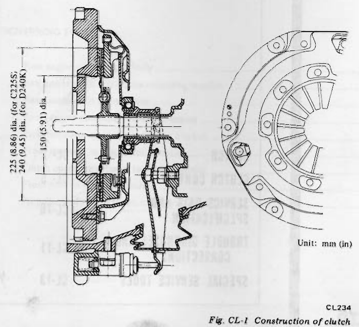
>
> - **Summary:** Cross-sectional cutaway drawing showing the construction and major internal components of the assembled clutch unit on the flywheel, including diaphragm spring, pressure plate, disc, and release bearing sleeve.
> - **Components:** Flywheel, Clutch disc, Pressure plate, Clutch cover, Diaphragm spring, Release bearing sleeve, Withdrawal lever, Wire rings
> - **Specs / Measurements:** 225 (8.86) dia. (for C225S); 240 (9.45) dia. (for D240K); 150 (5.91) dia.
> - **Mechanic Notes:** All dimensions indicated in mm (in). S30 2-seater uses C225S (225 mm OD); GS30 2+2 uses D240K (240 mm OD).
> - **Tags:** `clutch construction`, `cutaway`, `clutch disc`, `pressure plate`, `dimensions`, `C225S`, `D240K`

## CLUTCH DISC AND COVER

### REMOVAL

1. Remove transmission from engine. For removal procedure, refer to the Section Transmission.
2. Insert Clutch Aligning Bar KV30100100 into clutch disc hub until it will no longer go. It is important to support weight of clutch disc in the steps that follow. See Figure CL-2.

> 🖼️ **Fig. CL-2 Supporting clutch assembly** `[CL339]` *(Type: `procedure_step`)*
>
> 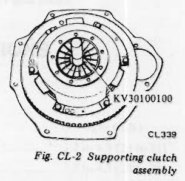
>
> - **Summary:** Illustration showing Clutch Aligning Bar KV30100100 inserted through the clutch disc hub and cover to support the assembly weight during removal and installation.
> - **Components:** Clutch aligning bar KV30100100, Clutch cover assembly, Clutch disc, Flywheel
> - **Callouts:** **(KV30100100)** Clutch aligning bar
> - **Specs / Measurements:** Tool: KV30100100
> - **Mechanic Notes:** Insert alignment tool until fully seated to prevent disc damage when loosening cover bolts.
> - **Tags:** `clutch aligning bar`, `removal`, `KV30100100`, `special tool`

3. Loosen bolts attaching clutch cover to flywheel, one turn each at a time, until spring pressure is released. Be sure to turn them out in a criss-cross fashion.
4. Remove clutch disc and cover assembly.

### INSPECTION

Wash all the disassembled parts except disc assembly in suitable cleaning solvent to remove dirt and grease before making inspection and adjustment.

---

<!-- Page 3 (CL-3) -->
### Flywheel and pressure plate

Check friction surface of flywheel and pressure plate for scoring or roughness. Slight roughness may be smoothed by using fine emery cloth. If surface is deeply scored or grooved, the part should be replaced.

### Clutch disc assembly

Inspect clutch disc for worn or oily facings, loose rivets and broken or loose torsional springs.

1. If facings are oily, the disc should be replaced. In this case, inspect transmission front cover oil seal, pilot bushing, engine rear oil seals and other points for oil leakage.
2. The disc should also be replaced when facings are worn locally or worn down to less than 0.3 mm (0.012 in) at rivet. See Figure CL-3.

> 🖼️ **Fig. CL-3 Measuring clutch lining** `[CL089]` *(Type: `inspection_measurement`)*
>
> 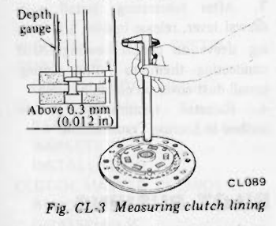
>
> - **Summary:** Measurement of clutch lining wear using a depth gauge to measure depth from friction surface to rivet head.
> - **Components:** Clutch disc facing, Rivet, Depth gauge
> - **Callouts:** **(Depth gauge)** Depth gauge measuring tool; **(Above 0.3 mm (0.012 in))** Allowable minimum depth to rivet head
> - **Specs / Measurements:** Minimum rivet depth: 0.3 mm (0.012 in)
> - **Mechanic Notes:** Replace disc when facings are worn down to less than 0.3 mm (0.012 in) above rivet head.
> - **Tags:** `clutch facing`, `measurement`, `wear limit`, `depth gauge`, `rivet depth`

3. Check disc plate for runout whenever the old disc or a new one is installed.
4. If runout exceeds the specified value at the outer circumference, replace or repair disc. See Figure CL-4.

**Runout: 0.5 mm (0.020 in) total indicator reading**

**R (from the hub center):**
- **112 mm (4.41 in) C225S**
- **119.5 mm (4.70 in) D240K**

> 🖼️ **Fig. CL-4 Repairing disc runout** `[CL112]` *(Type: `procedure_step`)*
>
> 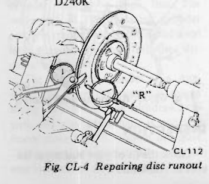
>
> - **Summary:** Clutch disc mounted on mandrel/lathe with dial gauge measuring runout at radius R, and bending tool used to correct runout.
> - **Components:** Clutch disc, Dial indicator, Bending repair lever tool
> - **Callouts:** **(R)** Radius from hub center for runout inspection
> - **Specs / Measurements:** Runout limit: 0.5 mm (0.020 in) TIR; R (C225S): 112 mm (4.41 in); R (D240K): 119.5 mm (4.70 in)
> - **Mechanic Notes:** Never hold disc plate forcibly with pliers or bend excessively to avoid cracking facing.
> - **Tags:** `clutch disc`, `runout`, `dial indicator`, `repair`, `truing`

> [!CAUTION]
> When repairing disc plate, never hold it forcibly with pliers or bend it excessively; otherwise facing will be damaged.

5. Check the fit of disc hub on transmission main drive gear splines for smooth sliding. If splines are worn that is, backlash exceeds 0.4 mm (0.016 in) at the outer edge of clutch disc, clutch disc or main drive gear should be replaced.

### Clutch cover assembly

1. Check the end surface of diaphragm spring for wear. If excessive wear is found, replace clutch cover assembly.
2. Measure the height of diaphragm spring as outlined below:

(1) Place Distance Piece ST20050100 on Base Plate ST20050010 and then tighten clutch cover assembly on the base plate by using Set Bolts ST20050051. See Figure CL-5.

> 🖼️ **Fig. CL-5 Measuring the height of diaphragm spring** `[CL236]` *(Type: `inspection_measurement`)*
>
> 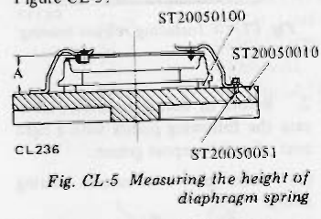
>
> - **Summary:** Cross-sectional setup of clutch cover assembly mounted to Base Plate ST20050010 with Distance Piece ST20050100 and Set Bolts ST20050051 for measuring spring height A.
> - **Components:** Clutch cover, Diaphragm spring, Distance Piece ST20050100, Base Plate ST20050010, Set Bolts ST20050051
> - **Callouts:** **(ST20050100)** Distance Piece; **(ST20050010)** Base Plate; **(ST20050051)** Set Bolts; **(A)** Diaphragm spring height
> - **Specs / Measurements:** Height A (C225S): 33 to 35 mm (1.30 to 1.38 in); Height A (D240K): 37.5 to 39.5 mm (1.48 to 1.56 in); Toe unevenness limit: < 0.5 mm (0.020 in)
> - **Mechanic Notes:** Measure height A at several points around the fingers with vernier depth gauge.
> - **Tags:** `diaphragm spring height`, `measurement`, `ST20050100`, `ST20050010`, `ST20050051`

(2) Measure the height "A" at several points with a vernier caliper depth gauge. See Figure CL-5. If the height "A" of spring end is beyond the specified value, adjust the spring height with Diaphragm Spring Adjusting Wrench ST20050240 as shown in Figure CL-6.

**A:**
- **33 to 35 mm (1.30 to 1.38 in) C225S**
- **37.5 to 39.5 mm (1.48 to 1.56 in) D240K**

If necessary, replace clutch cover assembly. Also, unevenness of diaphragm spring toe height should be less than 0.5 mm (0.020 in).

> 🖼️ **Fig. CL-6 Adjusting spring height** `[CL091]` *(Type: `procedure_step`)*
>
> 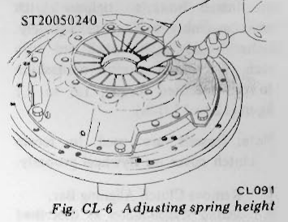
>
> - **Summary:** Technician using Diaphragm Spring Adjusting Wrench ST20050240 to pry and bend diaphragm spring fingers to uniform height.
> - **Components:** Clutch cover assembly, Diaphragm spring fingers, Diaphragm spring adjusting wrench ST20050240
> - **Callouts:** **(ST20050240)** Diaphragm spring adjusting wrench
> - **Specs / Measurements:** Tool: ST20050240; Max unevenness: 0.5 mm (0.020 in)
> - **Mechanic Notes:** Carefully pry fingers up or down to bring all tips within 0.5 mm height tolerance.
> - **Tags:** `adjusting spring height`, `ST20050240`, `diaphragm spring wrench`

3. Inspect thrust rings for wear or damage. As these parts are invisible from outside, shake cover assembly up and down to listen for clattering noise, or hammer lightly on rivets and listen for a slightly cracked noise. Any of these noises indicates need of replacement as a complete assembly.

## INSTALLATION

1. Apply a light coat of grease (including Molybdenum Disulphide) to transmission main drive gear splines. Slide clutch disc on main drive gear several times. Remove clutch disc and wipe off excess lubricant pushed off by disc hub.

> [!NOTE]
> Take special care to prevent grease or oil from getting on clutch linings.

2. Install clutch disc and clutch cover assembly. Support clutch disc and cover assemblies with Clutch Aligning Bar KV30100100. See Figure CL-7.

> [!NOTE]
> Be sure to keep disc facings, flywheel and pressure plate clean and dry.

> 🖼️ **Fig. CL-7 Installing clutch cover assembly** `[CL340]` *(Type: `procedure_step`)*
>
> 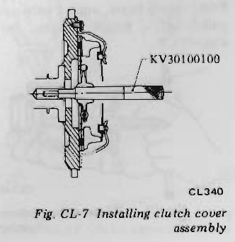
>
> - **Summary:** Installation cross-section of clutch disc and cover assembly onto flywheel using Clutch Aligning Bar KV30100100.
> - **Components:** Flywheel, Clutch disc, Clutch cover, Clutch aligning bar KV30100100
> - **Callouts:** **(KV30100100)** Clutch aligning bar
> - **Specs / Measurements:** Tool: KV30100100
> - **Mechanic Notes:** Keep disc facings, flywheel and pressure plate clean and dry.
> - **Tags:** `clutch installation`, `KV30100100`, `aligning bar`

---

<!-- Page 4 (CL-4) -->
3. Install bolts to tighten clutch cover assembly to flywheel squarely. Bolts should be tightened one turn each at a time in a criss-cross fashion to the specified torque, **1.6 to 2.1 kg-m (12 to 15 ft-lb)**.

> [!NOTE]
> Dowels are used to locate clutch cover on flywheel properly.

4. Remove Clutch Aligning Bar.
5. Install transmission as described in the pertinent parts.

---

## RELEASE BEARING

### REMOVAL

1. Remove transmission from engine. For removal procedure, refer to the Section Transmission.
2. Remove holder spring from bearing sleeve; disconnect clutch withdrawal lever from bearing sleeve.
3. Remove release bearing and sleeve as an assembly from mainshaft. See Figure CL-8.

> 🖼️ **Fig. CL-8 Removing clutch release mechanism** `[CL047]` *(Type: `procedure_step`)*
>
> 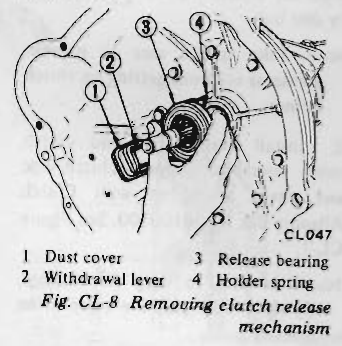
>
> - **Summary:** View of the clutch housing interior showing removal of the release mechanism components.
> - **Components:** Dust cover, Withdrawal lever, Release bearing, Holder spring
> - **Callouts:** **(1)** Dust cover; **(2)** Withdrawal lever; **(3)** Release bearing; **(4)** Holder spring
> - **Mechanic Notes:** Disconnect holder spring before withdrawing sleeve assembly.
> - **Tags:** `release mechanism`, `release bearing`, `withdrawal lever`, `holder spring`, `dust cover`

4. Remove clutch release bearing from bearing sleeve, using a universal puller and a suitable adapter. See Figure CL-9.

> 🖼️ **Fig. CL-9 Disassembling release bearing** `[CL145]` *(Type: `procedure_step`)*
>
> 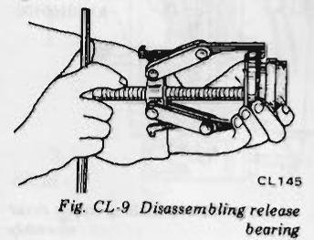
>
> - **Summary:** Technician using universal puller and adapter plates to pull the release bearing off the bearing sleeve.
> - **Components:** Release bearing, Bearing sleeve, Universal puller, Puller adapter plates
> - **Mechanic Notes:** Support bearing sleeve properly while pulling bearing.
> - **Tags:** `release bearing`, `disassembly`, `puller`, `bearing sleeve`

### INSPECTION

Check for abnormal wear on contact surface of withdrawal lever, ball pin and bearing sleeve.

Hold bearing inner race and rotate outer race while applying pressure to it. If the bearing rotation is rough or noisy, replace bearing.

### INSTALLATION

1. Assemble release bearing on sleeve, using a press. See Figure CL-10.

> [!NOTE]
> Do not press outer race.

> 🖼️ **Fig. CL-10 Installing release bearing** `[CL117]` *(Type: `procedure_step`)*
>
> 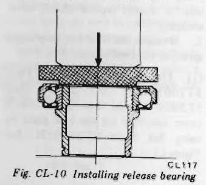
>
> - **Summary:** Press setup pressing release bearing onto sleeve, applying force only to inner race.
> - **Components:** Press ram, Driver adapter, Release bearing inner race, Release bearing outer race, Bearing sleeve
> - **Mechanic Notes:** Do not press outer race. Press only on inner race.
> - **Tags:** `release bearing`, `press`, `installation`, `inner race`

2. Before or during assembly, lubricate the following points with a light coat of multi-purpose grease.
(1) Inner groove of release bearing sleeve.

> 🖼️ **Fig. CL-11 Lubricating recess of bearing sleeve** `[CL093]` *(Type: `component_location`)*
>
> 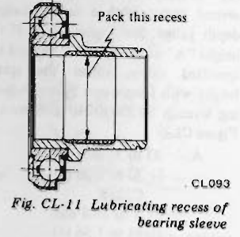
>
> - **Summary:** Cross section of bearing sleeve indicating inner recess to be packed with multi-purpose grease.
> - **Components:** Bearing sleeve, Inner grease recess, Release bearing
> - **Callouts:** **(Pack this recess)** Inner annular grease recess in bearing sleeve
> - **Mechanic Notes:** Pack inner groove lightly with multi-purpose grease.
> - **Tags:** `bearing sleeve`, `lubrication`, `grease recess`

(2) Contact surface of withdrawal lever, lever ball pin and bearing sleeve.
(3) Contact surfaces of transmission front cover. See Figure CL-12.

> 🖼️ **Fig. CL-12 Lubricating points of withdrawal lever and front cover** `[CL111]` *(Type: `component_location`)*
>
> 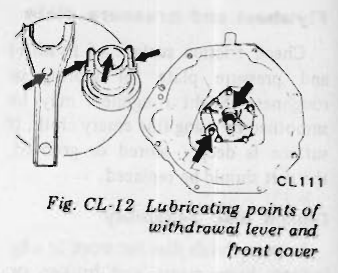
>
> - **Summary:** Diagram showing contact points on withdrawal lever fork ends, ball pin pivot socket, and transmission front cover nose to lubricate.
> - **Components:** Withdrawal lever, Lever ball pin socket, Transmission front cover tubular guide
> - **Mechanic Notes:** Apply very light coat of multi-purpose grease; avoid excess.
> - **Tags:** `withdrawal lever`, `lubrication points`, `transmission front cover`

(4) Contact surfaces of transmission main drive gear splines. [grease (including Molybdenum Disulphide)]

> [!NOTE]
> A very small amount of grease should be applied to the above points. If too much lubricant is applied, it will run out on the friction plates when hot, resulting in damaged clutch disc facings.

3. After lubricating, install withdrawal lever, release bearing and bearing sleeve on clutch housing. After connecting them to holder spring, install dust cover on clutch housing.
4. Reinstall transmission as described in Section Transmission.

---

## PILOT BUSHING

### REMOVAL

1. Remove transmission from engine. For removal procedure, refer to the Section Transmission.
2. Remove clutch disc and cover assembly. Refer to Clutch Disc.
3. Remove pilot bushing in crankshaft by Pilot Bushing Puller ST16610001. See Figure CL-13.

> 🖼️ **Fig. CL-13 Removing pilot bushing** `[CL088]` *(Type: `procedure_step`)*
>
> 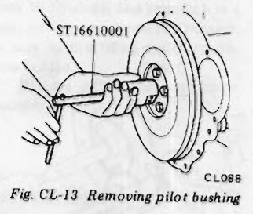
>
> - **Summary:** Removal of pilot bushing from rear crankshaft bore using Pilot Bushing Puller ST16610001 (Kent-Moore J 23907).
> - **Components:** Crankshaft flywheel flange, Pilot bushing, Pilot Bushing Puller ST16610001
> - **Callouts:** **(ST16610001)** Pilot Bushing Puller
> - **Specs / Measurements:** Tool: ST16610001 (J 23907)
> - **Mechanic Notes:** Expand puller jaws inside bushing and turn center bolt to extract.
> - **Tags:** `pilot bushing puller`, `removal`, `crankshaft`, `ST16610001`, `J23907`

### INSPECTION

Check the fit of pilot bushing in the bore of crankshaft. <!-- Page 5 (CL-5) --> Check pilot bushing in crankshaft for wear, roughness or bellmouthed condition. If necessary, replace it. When bushing is faulty, be sure to check transmission main drive gear at the same time.

### INSTALLATION

1. Before installing a new bushing, thoroughly clean bushing hole. Install bushing in crankshaft, using a soft hammer. Bushing need not be oiled. See Figure CL-14.

> 🖼️ **Fig. CL-14 Installing pilot bushing** `[EM702]` *(Type: `procedure_step`)*
>
> 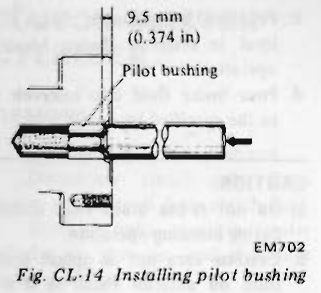
>
> - **Summary:** Cross-sectional drawing showing the installation depth of the pilot bushing into the crankshaft bore.
> - **Components:** Crankshaft end, Pilot bushing, Drift/driver
> - **Callouts:** **(Pilot bushing)** Pilot bushing; **(9.5 mm (0.374 in))** Bushing insertion depth
> - **Specs / Measurements:** Bushing depth: 9.5 mm (0.374 in)
> - **Mechanic Notes:** Bushing need not be oiled. Drive in squarely with a soft hammer/drift to specified depth.
> - **Tags:** `pilot bushing`, `installation depth`, `crankshaft`, `EM702`

2. Install clutch disc and clutch cover assembly. Refer to Clutch Disc.
3. Install transmission as described in Section Transmission.

---

# CLUTCH CONTROL

## CONTENTS

| Item | Page | Item | Page |
| :--- | :--- | :--- | :--- |
| DESCRIPTION | CL-5 | ASSEMBLY | CL-8 |
| BLEEDING CLUTCH SYSTEM | CL-6 | INSTALLATION | CL-8 |
| ADJUSTMENT | CL-6 | OPERATING CYLINDER | CL-8 |
| CLUTCH PEDAL HEIGHT | CL-6 | REMOVAL | CL-8 |
| CLUTCH PEDAL | CL-7 | DISASSEMBLY | CL-8 |
| REMOVAL | CL-7 | INSPECTION | CL-8 |
| INSPECTION | CL-7 | ASSEMBLY | CL-8 |
| INSTALLATION | CL-7 | INSTALLATION | CL-8 |
| CLUTCH MASTER CYLINDER | CL-7 | CLUTCH LINE | CL-9 |
| REMOVAL | CL-7 | INSPECTION | CL-9 |
| DISASSEMBLY | CL-7 | REMOVAL | CL-9 |
| INSPECTION | CL-7 | INSTALLATION | CL-9 |

---

## DESCRIPTION

The hydraulic clutch control consists of a pendent pedal, master cylinder, operating cylinder and withdrawal lever.

When the clutch pedal is depressed, the piston of the master cylinder forces the brake fluid to the operating cylinder through a pipe line. The movement of the operating cylinder piston is transmitted to the withdrawal lever through the push rod, thus disengaging the clutch.

The operating cylinder is a non-adjustable type that uses no return spring. In this unit, the withdrawal-to-push rod play adjustment is not necessary since the "S" shown in Figure CL-16 serves to automatically compensate for wear on clutch disc.

> 🖼️ **Fig. CL-15 Clutch operating system** `[CL238]` *(Type: `component_location`)*
>
> 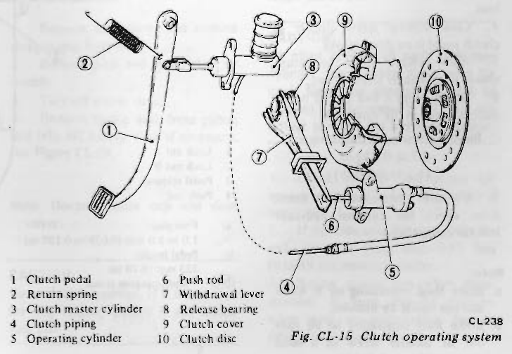
>
> - **Summary:** Schematic diagram of the complete hydraulic clutch control linkage and operating system from pedal to clutch disc.
> - **Components:** Clutch pedal, Return spring, Clutch master cylinder, Clutch piping, Operating cylinder, Push rod, Withdrawal lever, Release bearing, Clutch cover, Clutch disc
> - **Callouts:** **(1)** Clutch pedal; **(2)** Return spring; **(3)** Clutch master cylinder; **(4)** Clutch piping; **(5)** Operating cylinder; **(6)** Push rod; **(7)** Withdrawal lever; **(8)** Release bearing; **(9)** Clutch cover; **(10)** Clutch disc
> - **Wiring / Connections:** Hydraulic line connecting master cylinder to operating cylinder
> - **Mechanic Notes:** Operating cylinder is non-adjustable; pedal depression directly actuates master cylinder and slave cylinder.
> - **Tags:** `clutch control`, `system diagram`, `master cylinder`, `operating cylinder`, `pedal linkage`

---

<!-- Page 6 (CL-6) -->

> 🖼️ **Fig. CL-16 Non-adjustable operating cylinder** `[CL121]` *(Type: `cutaway_flow`)*
>
> 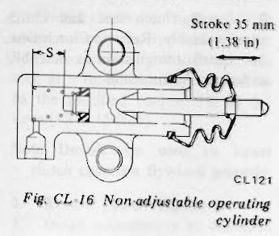
>
> - **Summary:** Internal cross-section of the non-adjustable clutch operating cylinder showing piston stroke and automatic compensation dimension S.
> - **Components:** Cylinder body, Piston, Piston cup, Push rod, Dust boot
> - **Callouts:** **(S)** Automatic compensation travel range; **(Stroke 35 mm (1.38 in))** Operating cylinder total stroke
> - **Specs / Measurements:** Stroke: 35 mm (1.38 in)
> - **Mechanic Notes:** Non-adjustable design uses dimension S to self-adjust as clutch disc facing wears.
> - **Tags:** `operating cylinder`, `slave cylinder`, `cutaway`, `stroke`, `self-adjusting`

## BLEEDING CLUTCH SYSTEM

The hydraulic clutch system must be bled whenever clutch line has been disconnected or air has entered it.

When pedal action has a "spongy" feeling, it is an indication that air has entered into the system.

Bleeding clutch system is an essential part of regular clutch service.

1. Remove reservoir cap and top up with recommended brake fluid.
2. Thoroughly clean mud and dust from bleeder screw of operating cylinder so that outlet hole is free from any foreign material. Install bleeder hose (vinyl hose) on bleeder screw.

Place the other end of it in a container filled with brake fluid.

3. Have a co-worker depress clutch pedal two or three times. With clutch pedal depressed fully, loosen bleeder screw to bleed air out of clutch system.
4. Close bleeder screw quickly as clutch pedal is on down stroke.
5. Allow clutch pedal to return slowly with bleeder screw closed.
6. Repeat steps 4 and 5 until no air bubble shows in the vinyl hose.

**Bleeder screw tightening torque: 0.7 to 0.9 kg-m (5.1 to 6.5 ft-lb)**

7. Operate clutch several times; then, check for external hydraulic leaks at connections.

> [!NOTE]
> a. Brake fluid containing air is white and has visible air bubbles.
> b. Brake fluid containing no air runs out of bleeder screw in a solid stream without air bubbles.
> c. Pay close attention to clutch fluid level in reservoir during bleeding operation.
> d. Pour brake fluid into reservoir up to the specified level.

> [!CAUTION]
> a. Do not re-use brake fluid drained during bleeding operation.
> b. Exercise care not to splash brake fluid on exterior finish as it will damage the paint.
> c. When tightening flare nut, use Flare Nut Torque Wrench GG94310000.

---

## ADJUSTMENT

### CLUTCH PEDAL HEIGHT

1. Loosen lock nut A. Adjust pedal height to **223 mm (8.78 in)** by adjusting pedal stopper, and tighten lock nut A to specifications.
2. Loosen lock nut B.
3. By turning push rod in or out, adjust clutch pedal free play resulting from clearance between clevis pin and clutch pedal to **1.0 to 5.0 mm (0.039 to 0.197 in)**. Measure on top face of pedal pad.

**Tightening torque:**
- **Lock nut A (Pedal stopper lock nut): 0.8 to 1.2 kg-m (5.8 to 8.7 ft-lb)**
- **Lock nut B (Push rod adjusting nut): 0.8 to 1.2 kg-m (5.8 to 8.7 ft-lb)**

> [!NOTE]
> a. Pedal free play appeared due to clearance among pedal hole, push rod and piston should be measured on top face of pedal pad.
> b. Depress and release clutch pedal over its entire stroke to ensure that the clutch linkage operates smoothly without squeaking, interference or binding.

> 🖼️ **Fig. CL-17 Pedal height adjustment** `[CL338]` *(Type: `alignment_orientation`)*
>
> 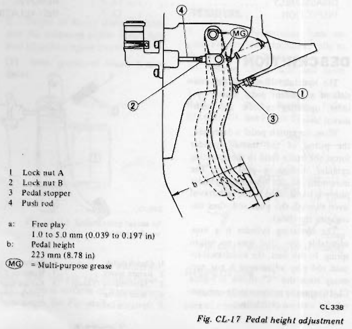
>
> - **Summary:** Side view schematic of clutch pedal linkage showing pedal height measurement b, free play a, lock nuts A and B, pedal stopper, and lubrication points.
> - **Components:** Clutch pedal, Push rod, Pedal stopper bolt, Lock nut A, Lock nut B, Clevis pin
> - **Callouts:** **(1)** Lock nut A; **(2)** Lock nut B; **(3)** Pedal stopper; **(4)** Push rod; **(a)** Free play: 1.0 to 5.0 mm (0.039 to 0.197 in); **(b)** Pedal height: 223 mm (8.78 in); **(MG)** Multi-purpose grease
> - **Specs / Measurements:** Pedal height (b): 223 mm (8.78 in); Free play (a): 1.0 to 5.0 mm (0.039 to 0.197 in); Lock nut A torque: 0.8 to 1.2 kg-m (5.8 to 8.7 ft-lb); Lock nut B torque: 0.8 to 1.2 kg-m (5.8 to 8.7 ft-lb)
> - **Mechanic Notes:** First adjust pedal height with stopper bolt (lock nut A), then adjust free play with push rod (lock nut B). Measure free play on top face of pedal pad.
> - **Tags:** `pedal height`, `free play`, `adjustment`, `lock nut`, `pedal stopper`

---

<!-- Page 7 (CL-7) -->
## CLUTCH PEDAL

> 🖼️ **Fig. CL-18 Exploded view of clutch pedal** `[CL239]` *(Type: `exploded_view`)*
>
> 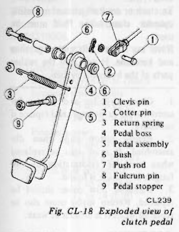
>
> - **Summary:** Exploded view drawing of the clutch pedal assembly, fulcrum pin, bushings, return spring, and clevis connection.
> - **Components:** Clevis pin, Cotter pin, Return spring, Pedal boss, Pedal assembly, Bush, Push rod, Fulcrum pin, Pedal stopper
> - **Callouts:** **(1)** Clevis pin; **(2)** Cotter pin; **(3)** Return spring; **(4)** Pedal boss; **(5)** Pedal assembly; **(6)** Bush; **(7)** Push rod; **(8)** Fulcrum pin; **(9)** Pedal stopper
> - **Specs / Measurements:** Fulcrum pin torque: 3.5 to 4.8 kg-m (25 to 35 ft-lb)
> - **Mechanic Notes:** Measure pedal height from toe board before disassembly. Grease clevis pin friction surfaces.
> - **Tags:** `clutch pedal`, `exploded view`, `bush`, `fulcrum pin`, `clevis pin`

### REMOVAL

1. Unhook return spring.
2. Pry off cotter pin and remove clevis pin; disconnect push rod from pedal assembly.
3. Back off fulcrum pin and remove pedal assembly.

> [!NOTE]
> Before removing pedal, be sure to measure the pedal head height from toe board.

### INSPECTION

Thoroughly clean all disassembled parts (indicated below) and carefully check for wear, damage and other abnormal conditions. Repair or replace, if necessary.
1. Pedal head rubber
2. Return spring
3. Pedal lever boss
4. Clevis pin
5. Nylon bushing
6. Pedal shaft, etc.

### INSTALLATION

Installation is in the reverse order of removal.

Apply multi-purpose grease to the friction surface of clevis pin. See Figure CL-17.

**Tightening torque:**
- **Fulcrum pin: 3.5 to 4.8 kg-m (25 to 35 ft-lb)**

---

## CLUTCH MASTER CYLINDER

### REMOVAL

1. Remove clevis pin at push rod.
2. Disconnect clutch tube from master cylinder and drain clutch fluid.
3. Remove bolts securing master cylinder to the car, and dismount master cylinder.

> [!CAUTION]
> When disconnecting clutch tube, use suitable flare nut wrench. Never use an open end wrench or adjustable wrench.

> [!NOTE]
> When disconnecting clutch tube, be sure to receive draining clutch fluid into a container. Use of rags is also suggested to keep adjacent parts and area clean.

> 🖼️ **Fig. CL-19 Exploded view of master cylinder**  *(Type: `exploded_view`)*
>
> 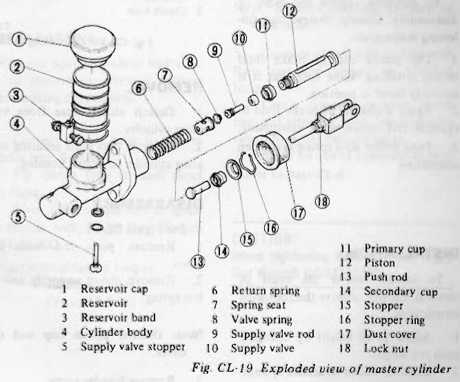
>
> - **Summary:** Detailed exploded view of clutch master cylinder and internal valve components.
> - **Components:** Reservoir cap, Reservoir, Reservoir band, Cylinder body, Supply valve stopper, Return spring, Spring seat, Valve spring, Supply valve rod, Supply valve, Primary cup, Piston, Push rod, Secondary cup, Stopper, Stopper ring, Dust cover, Lock nut
> - **Callouts:** **(1)** Reservoir cap; **(2)** Reservoir; **(3)** Reservoir band; **(4)** Cylinder body; **(5)** Supply valve stopper; **(6)** Return spring; **(7)** Spring seat; **(8)** Valve spring; **(9)** Supply valve rod; **(10)** Supply valve; **(11)** Primary cup; **(12)** Piston; **(13)** Push rod; **(14)** Secondary cup; **(15)** Stopper; **(16)** Stopper ring; **(17)** Dust cover; **(18)** Lock nut
> - **Specs / Measurements:** Piston clearance limit: 0.15 mm (0.0059 in)
> - **Mechanic Notes:** Never detach reservoir from cylinder body. Always renew rubber cups upon disassembly.
> - **Tags:** `clutch master cylinder`, `exploded view`, `supply valve`, `piston cup`, `rebuild`

### DISASSEMBLY

1. Remove dust cover and remove stopper ring from body.
2. Remove push rod and piston assembly.
3. Take off piston cups.
4. Remove spring seat from piston and take off supply valve if necessary. See Figure CL-19.

> [!NOTE]
> Discard piston cup and dust cover.

> [!CAUTION]
> Never detach reservoir. If it is removed for any reason, discard it and install new one.

### INSPECTION

> [!CAUTION]
> To clean or wash all parts of master cylinder, clean brake fluid must be used. Never use mineral oils such as gasoline and kerosene. It will ruin the rubber parts of the hydraulic system.

1. Check cylinder and piston for uneven wear or damage, and replace if necessary.
2. If the clearance between cylinder and piston is more than **0.15 mm (0.0059 in)**, replace cylinder.
3. Renew piston cup when disassembled. It must also be replaced when wear or deformation due to fatigue or damage is found. <!-- Page 8 (CL-8) --> 4. Damaged dust cover, oil reservoir or cap, should be replaced. Return spring and valve spring must also be replaced when they are broken or weak.
5. Replace clutch hose and tube if any abnormal sign of damage or deformation is found.

### ASSEMBLY

To assemble, reverse the order of disassembly. Closely observe the following instructions.
1. Dip piston cup in brake fluid before installing. Make sure that it is correctly faced in position.
2. Apply a coating of brake fluid to cylinder and piston when assembling.
3. Press piston into spring seat when assembling.

### INSTALLATION

To install, reverse the order of removal. Closely observe the following instructions.
1. Adjust pedal height by changing push rod length.
2. Bleed air out of hydraulic system.

**Tightening torque:**
- **Master cylinder to dash panel securing bolts: 0.8 to 1.1 kg-m (5.8 to 8.0 ft-lb)**
- **Clutch tube connector: 1.5 to 1.8 kg-m (11 to 13 ft-lb)**

> [!CAUTION]
> When connecting clutch tube, use Flare Nut Torque Wrench GG94310000.

> [!NOTE]
> When tightening flare nut, hold pipe by hand to prevent it from twisting.

---

## OPERATING CYLINDER

> 🖼️ **Fig. CL-20 Operating cylinder** `[CL221]` *(Type: `component_location`)*
>
> 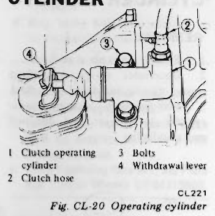
>
> - **Summary:** Operating cylinder mounted on clutch housing, connected to clutch hydraulic hose and withdrawal lever.
> - **Components:** Clutch operating cylinder, Clutch hose, Mounting bolts, Withdrawal lever
> - **Callouts:** **(1)** Clutch operating cylinder; **(2)** Clutch hose; **(3)** Bolts; **(4)** Withdrawal lever
> - **Wiring / Connections:** Clutch hose connection
> - **Mechanic Notes:** Keep clutch hose routed away from exhaust pipe.
> - **Tags:** `operating cylinder`, `slave cylinder`, `withdrawal lever`, `installation`

### REMOVAL

1. Detach clutch hose from operating cylinder.
2. Remove two bolts securing operating cylinder to clutch housing.

### DISASSEMBLY

See Figure CL-21.
1. Remove push rod with dust cover.
2. Remove piston assembly and piston spring.

> [!NOTE]
> Discard piston cup and dust cover.

3. Remove bleeder screw.

> 🖼️ **Fig. CL-21 Exploded view of operating cylinder** `[CL222]` *(Type: `exploded_view`)*
>
> 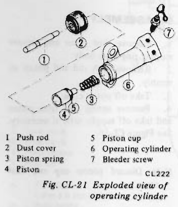
>
> - **Summary:** Exploded diagram of the clutch slave operating cylinder and internal components.
> - **Components:** Push rod, Dust cover, Piston spring, Piston, Piston cup, Operating cylinder body, Bleeder screw
> - **Callouts:** **(1)** Push rod; **(2)** Dust cover; **(3)** Piston spring; **(4)** Piston; **(5)** Piston cup; **(6)** Operating cylinder; **(7)** Bleeder screw
> - **Mechanic Notes:** Pay attention to cup direction when sliding over piston. Discard old cup and dust boot.
> - **Tags:** `operating cylinder`, `exploded view`, `slave cylinder`, `piston cup`

### INSPECTION

Visually inspect all disassembled parts, replacing those found worn or damaged beyond specifications.

> [!CAUTION]
> To clean or wash all parts of operating cylinder, clean brake fluid must be used. Never use mineral oils such as gasoline and kerosene. It will ruin the rubber parts of the hydraulic system.

1. Check cylinder and piston for uneven wear or damage, and replace if necessary.
2. Renew piston cup when disassembled. It must also be replaced when wear or deformation due to fatigue or damage is found.
3. Damaged dust cover should be replaced. Return spring must also be replaced when it is broken or weak.

### ASSEMBLY

Assembly is in the reverse order of disassembly. However, observe the following assembly notes.
1. Prior to assembly, dip a new piston cup in clean brake fluid. In installing piston cup, pay particular attention to its direction.
2. Dip cylinder and piston in clean brake fluid before assembly.

### INSTALLATION

Install operating cylinder in the reverse order of removal. Observe the following:

Bleed air thoroughly from clutch hydraulic system. Refer to Bleeding Clutch System for bleeding.

> [!NOTE]
> a. Use new gasket.
> b. When operating cylinder is removed from, or installed on, clutch housing without disconnecting clutch hose from operating cylinder, loosen bleeder screw so that push rod moves lightly.
> c. Exercise care not to warp or twist clutch hose. Be sure to install clutch hose away from exhaust tube.
> d. When tightening flare nut, hold pipe by hand to prevent it from twisting. <!-- Page 9 (CL-9) --> > [!CAUTION]
> When connecting clutch tube, use Flare Nut Torque Wrench GG94310000.

**Tightening torque:**
- **Operating cylinder to clutch housing securing bolts: 2.5 to 3.0 kg-m (18 to 22 ft-lb)**
- **Bleeder screw: 0.7 to 0.9 kg-m (5.1 to 6.5 ft-lb)**
- **Clutch hose connector: 1.7 to 2.0 kg-m (12 to 14 ft-lb)**

---

## CLUTCH LINE

### INSPECTION

Check clutch lines (tube and hose) for evidence of cracks, deterioration or other damage. Replace if necessary.

If leakage occurs at or around joints, retighten and, if necessary, replace damaged parts.

### REMOVAL

> [!CAUTION]
> When disconnecting clutch tube, use suitable flare nut wrench. Never use an open end wrench or adjustable wrench.

1. Disconnect clutch tube from clutch hose at bracket on side member.
2. Remove lock spring fixing hose to bracket, then disengage hose from bracket. Remove lock plate from bracket.
3. Remove clutch hose from operating cylinder.
4. Disconnect clutch tube from master cylinder.
5. Remove clamp fixing clutch tube to dash panel.

### INSTALLATION

Wipe the opening ends of hydraulic line to remove any foreign matters before making connections.

1.
(1) Connect clutch tube to master cylinder with flare nut.
(2) Fix clutch tube to dash panel with clamp.
(3) Then tighten flare nut to specified torque with Brake Pipe Wrench GG94310000.

**Flare nut tightening torque: 1.5 to 1.8 kg-m (11 to 13 ft-lb)**

2. Install clutch hose on operating cylinder with a gasket in place.

> [!NOTE]
> Use new gasket.

**Tightening torque: 1.7 to 2.0 kg-m (12 to 14 ft-lb)**

3. Fit lock plate to bracket.
4. Engage the opposite end of hose with bracket. Install lock spring fixing hose to bracket.

> [!NOTE]
> Exercise care not to warp or twist hose.

5. Connect clutch tube to hose with flare nut and tighten to specified torque.
6. Check distance between clutch line and adjacent parts (especially between hose and exhaust tube).
7. Bleed air out of hydraulic system. Refer to page CL-6.

> [!CAUTION]
> When tightening flare nut, use Flare Nut Wrench GG94310000.

---

<!-- Page 10 (CL-10) -->
# SERVICE DATA AND SPECIFICATIONS

### Clutch cover

| Item | Unit | C225S (S30) | D240K [GS30 (2 + 2 seater)] |
| :--- | :--- | :--- | :--- |
| Clutch cover type | | C225S (S30) | D240K [GS30 (2 + 2 seater)] |
| Diaphragm spring-to-flywheel height | mm (in) | 34 (1.339) | 38.5 (1.516) |
| Unevenness of diaphragm spring toe height | mm (in) | 0.5 (0.020) | 0.5 (0.020) |
| Diaphragm spring installed load | kg (lb) | 550 (1,213) | 500 (1,102) |
| Out of flatness of pressure plate | mm (in) | 0.05 (0.0020) | 0.05 (0.0020) |
| Allowable refacing limit | mm (in) | 1.0 (0.0394) | 1.0 (0.0394) |

### Clutch disc

| Item | Unit | C225S | D240K |
| :--- | :--- | :--- | :--- |
| Facing size (Outer dia. x inside dia. x thickness) | mm (in) | 225 x 150 x 3.5 (8.86 x 5.91 x 0.138) | 240 x 150 x 3.5 (9.45 x 5.91 x 0.138) |
| Allowable minimum depth of rivet head from facing surface | mm (in) | 0.3 (0.012) | 0.3 (0.012) |
| Allowable free play of spline | mm (in) | 0.4 (0.016) | 0.4 (0.016) |

### Clutch pedal

| Item | Unit | Standard |
| :--- | :--- | :--- |
| Free play | mm (in) | 1 to 5.0 (0.039 to 0.197) |
| Pedal height | mm (in) | 223 (8.78) |

### Master cylinder — clutch

| Item | Unit | Standard |
| :--- | :--- | :--- |
| Master cylinder diameter | mm (in) | 15.87 (0.6248) |

### Operating cylinder — clutch

| Item | Unit | Standard |
| :--- | :--- | :--- |
| Operating cylinder diameter | mm (in) | 19.05 (0.7500) |

### Tightening torque

| Component / Fastener | kg-m | ft-lb |
| :--- | :--- | :--- |
| Clutch assembly securing bolt | 1.6 to 2.1 | 12 to 15 |
| Push rod adjusting nut | 0.8 to 1.2 | 5.8 to 8.7 |
| Pedal stopper lock nut | 0.8 to 1.2 | 5.8 to 8.7 |
| Clutch tube connector (Flare nut) | 1.5 to 1.8 | 11 to 13 |
| Operating cylinder to clutch housing securing bolts | 2.5 to 3.0 | 18 to 22 |
| Clutch hose connector | 1.7 to 2.0 | 12 to 14 |

---

<!-- Page 11 (CL-11) -->
# TROUBLE DIAGNOSES AND CORRECTIONS

| Condition | Probable cause and testing | Corrective action |
| :--- | :--- | :--- |
| **Clutch slips** | Slipping of the clutch may be noticeable when any of the following symptoms is encountered during operation: (1) Car will not respond to engine speed during acceleration. (2) Insufficient car speed. (3) Lack of power during uphill driving.  Some of the above conditions are also experienced when engine problem is occurring. First determine whether engine or clutch is causing the problem. If slipping clutch is left unheeded, wear and/or overheating will occur on clutch facing until it is no longer serviceable.  **TO TEST FOR SLIPPING CLUTCH, proceed as follows:** During upgrade travelling, run engine at about 40 to 50 km/h (25 to 31 MPH) with gear shift lever in 3rd speed position, shift into highest gear and at the same time rev up engine. If clutch is slipping, car will not readily respond to depression of accelerator pedal.  • Clutch facing worn excessively. • Oil or grease on clutch facing. • Warped clutch cover or pressure plate. |             Replace. Replace. Repair or replace. |
| **Clutch drags** | Dragging clutch is particularly noticeable when shifting gears, especially into low gear.  **TO TEST FOR DRAGGING CLUTCH, proceed as follows:** (1) Start engine. Disengage clutch. Shift into reverse gear, and then into Neutral. Gradually increase engine speed, and again shift into reverse gear. If clutch is dragging, gear "grating" is heard when shifting from Neutral into Reverse. (2) Stop engine and shift gear. (Conduct this test at each gear position.) (3) Gears are smoothly shifted in step (2), but drag when shifting to 1st speed position at idling.   a. If dragging is encountered at the end of shifting, check condition of synchromechanism in transmission.   b. If dragging is encountered at the beginning of shifting, proceed to step (4) below. (4) Push change lever toward Reverse side, depress pedal to check for free travel.   a. If pedal can be depressed further, check clutch condition.   b. If pedal cannot be depressed further, proceed to step (5) below. (5) Check clutch control. (pedal height, free pedal play, etc.) If no abnormal condition exists and if pedal cannot be depressed further, check clutch condition.  • Clutch disc runout or warped. • Wear or rust on hub splines in clutch disc. • Diaphragm spring toe height out of adjustment or toe tip worn. • Worn or improperly installed parts. |                     Repair or replace. Clean and lubricate with grease, or replace. Adjust or replace. Repair or replace. | <!-- Page 12 (CL-12) --> | Condition | Probable cause and testing | Corrective action |
| :--- | :--- | :--- |
| **Clutch chatters** | Clutch chattering is usually noticeable when car is just rolled off with clutch partially engaged.  • Weak or broken clutch disc torsion spring. • Oil or grease on clutch facing. • Clutch facing out of proper contact or clutch disc runout. • Loose rivets. • Warped pressure plate or clutch cover surface. • Unevenness of diaphragm spring toe height. • Loose engine mounting or deteriorated rubber. |   Replace. Replace. Replace. Replace. Repair or replace. Adjust or replace. Retighten or replace. |
| **Noisy clutch** | **A noise is heard after clutch is disengaged.** • Damaged release bearing.  **A noise is heard when clutch is disengaged.** • Insufficient grease on the sliding surface of bearing sleeve. • Clutch cover and bearing are not installed correctly.  **A noise is heard when car is suddenly started off with clutch partially engaged.** • Damaged pilot bushing. |  Replace.   Apply grease. Adjust.   Replace. |
| **Clutch grabs** | When grabbing of clutch occurs, car will not start off smoothly from a standing start or clutch is engaged before clutch pedal is fully depressed.  • Oil or grease on clutch facing. • Clutch facing worn or loose rivets. • Wear or rust on splines in drive shaft and clutch disc. • Warped flywheel or pressure plate. • Loose mountings for engine or power train units. |   Replace. Replace. Clean or replace. Repair or replace. Retighten. |

---

<!-- Page 13 (CL-13) -->
# SPECIAL SERVICE TOOLS

| Tool number & tool name | Kent-Moore No. | Reference page or Fig. No. |
| :--- | :--- | :--- |
| **KV30100100** Clutch aligning bar | — | Fig. CL-2 Fig. CL-7 |
| **ST20050240** Diaphragm adjusting wrench | — | Fig. CL-6 |
| **ST20050100** Distance piece | — | Fig. CL-5 |
| **ST16610001** Pilot bushing puller | J 23907 | Fig. CL-13 |
| **ST20050010** Base plate | — | Fig. CL-5 |
| **GG94310000** Flare nut torque wrench | — | Page CL-6 Page CL-8 Page CL-9 |
| **ST20050051** Set bolts | — | Fig. CL-5 |

> 🖼️ **KV30100100 Clutch aligning bar**  *(Type: `special_service_tool`)*
>
> 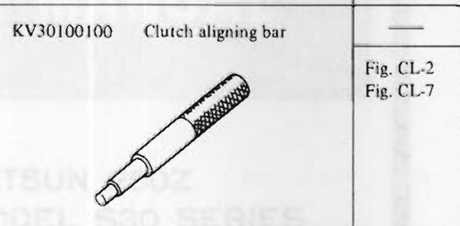
>
> - **Summary:** Special service tool drawing of clutch aligning arbor KV30100100.
> - **Components:** Clutch aligning bar
> - **Specs / Measurements:** Tool: KV30100100
> - **Mechanic Notes:** Used to align and center clutch disc with pilot bushing and cover during assembly.
> - **Tags:** `clutch aligning bar`, `KV30100100`, `special service tool`

> 🖼️ **ST20050240 Diaphragm adjusting wrench**  *(Type: `special_service_tool`)*
>
> 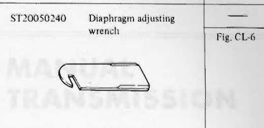
>
> - **Summary:** Special service tool drawing of slotted diaphragm spring toe bending wrench ST20050240.
> - **Components:** Diaphragm adjusting wrench
> - **Specs / Measurements:** Tool: ST20050240
> - **Mechanic Notes:** Used to pry diaphragm spring fingers to uniform height.
> - **Tags:** `diaphragm adjusting wrench`, `ST20050240`, `special service tool`

> 🖼️ **ST20050100 Distance piece**  *(Type: `special_service_tool`)*
>
> 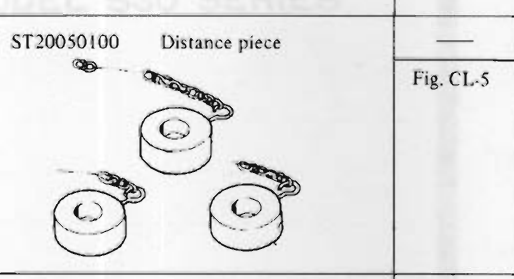
>
> - **Summary:** Special service tool drawing of ring distance pieces ST20050100 used for clutch cover height measurement.
> - **Components:** Distance piece set
> - **Specs / Measurements:** Tool: ST20050100
> - **Mechanic Notes:** Placed between clutch cover and base plate.
> - **Tags:** `distance piece`, `ST20050100`, `special service tool`

> 🖼️ **ST16610001 Pilot bushing puller**  *(Type: `special_service_tool`)*
>
> 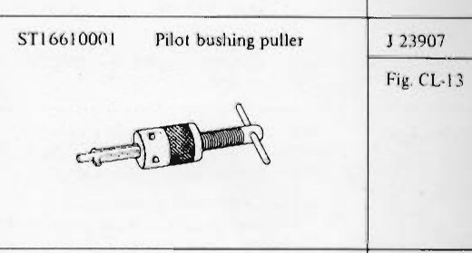
>
> - **Summary:** Special service tool drawing of internal expanding collet pilot bushing puller ST16610001 (Kent-Moore J 23907).
> - **Components:** Pilot bushing puller
> - **Specs / Measurements:** Tool: ST16610001; Kent-Moore: J 23907
> - **Mechanic Notes:** Extracts pilot bushing from rear crankshaft bore without damaging crank.
> - **Tags:** `pilot bushing puller`, `ST16610001`, `J23907`, `special service tool`

> 🖼️ **ST20050010 Base plate**  *(Type: `special_service_tool`)*
>
> 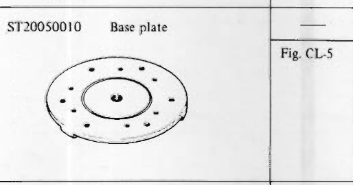
>
> - **Summary:** Special service tool drawing of circular fixture base plate ST20050010.
> - **Components:** Base plate
> - **Specs / Measurements:** Tool: ST20050010
> - **Mechanic Notes:** Simulates flywheel surface when checking diaphragm spring height.
> - **Tags:** `base plate`, `ST20050010`, `special service tool`

> 🖼️ **GG94310000 Flare nut torque wrench**  *(Type: `special_service_tool`)*
>
> 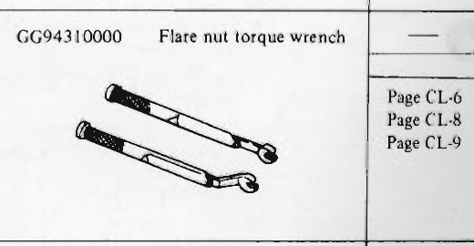
>
> - **Summary:** Special service tool drawing of flare nut torque wrench and crowfoot adapter GG94310000.
> - **Components:** Flare nut torque wrench
> - **Specs / Measurements:** Tool: GG94310000
> - **Mechanic Notes:** Prevents rounding and overtightening of hydraulic tube flare nuts.
> - **Tags:** `flare nut torque wrench`, `GG94310000`, `special service tool`

> 🖼️ **ST20050051 Set bolts**  *(Type: `special_service_tool`)*
>
> 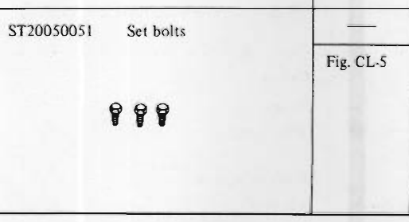
>
> - **Summary:** Special service tool drawing of stepped set bolts ST20050051 used to secure clutch cover to base plate.
> - **Components:** Set bolts
> - **Specs / Measurements:** Tool: ST20050051
> - **Mechanic Notes:** Secures cover to base plate ST20050010.
> - **Tags:** `set bolts`, `ST20050051`, `special service tool`

---

## Segmented Diagrams Index

| Figure | Code | Type | Page | Caption | Key Components / Callouts | File |
| :--- | :--- | :--- | :--- | :--- | :--- | :--- |
| **Fig. CL-1** | `CL234` | `cutaway_flow` | CL-2 | Fig. CL-1 Construction of clutch | Flywheel, Clutch disc, Pressure plate, Clutch cover, Diaphragm spring | [fig_cl_1_construction_of_clutch.png](diagrams/CL Clutch/fig_cl_1_construction_of_clutch.png) |
| **Fig. CL-2** | `CL339` | `procedure_step` | CL-2 | Fig. CL-2 Supporting clutch assembly | Clutch aligning bar KV30100100, Clutch cover assembly, Clutch disc, Flywheel | [fig_cl_2_supporting_clutch_assembly.png](diagrams/CL Clutch/fig_cl_2_supporting_clutch_assembly.png) |
| **Fig. CL-3** | `CL089` | `inspection_measurement` | CL-3 | Fig. CL-3 Measuring clutch lining | Clutch disc facing, Rivet, Depth gauge | [fig_cl_3_measuring_clutch_lining.png](diagrams/CL Clutch/fig_cl_3_measuring_clutch_lining.png) |
| **Fig. CL-4** | `CL112` | `procedure_step` | CL-3 | Fig. CL-4 Repairing disc runout | Clutch disc, Dial indicator, Bending repair lever tool | [fig_cl_4_repairing_disc_runout.png](diagrams/CL Clutch/fig_cl_4_repairing_disc_runout.png) |
| **Fig. CL-5** | `CL236` | `inspection_measurement` | CL-3 | Fig. CL-5 Measuring the height of diaphragm spring | Clutch cover, Diaphragm spring, Distance Piece ST20050100, Base Plate ST20050010, Set Bolts ST20050051 | [fig_cl_5_measuring_height_of_diaphragm_spring.png](diagrams/CL Clutch/fig_cl_5_measuring_height_of_diaphragm_spring.png) |
| **Fig. CL-6** | `CL091` | `procedure_step` | CL-3 | Fig. CL-6 Adjusting spring height | Clutch cover assembly, Diaphragm spring fingers, Diaphragm spring adjusting wrench ST20050240 | [fig_cl_6_adjusting_spring_height.png](diagrams/CL Clutch/fig_cl_6_adjusting_spring_height.png) |
| **Fig. CL-7** | `CL340` | `procedure_step` | CL-3 | Fig. CL-7 Installing clutch cover assembly | Flywheel, Clutch disc, Clutch cover, Clutch aligning bar KV30100100 | [fig_cl_7_installing_clutch_cover_assembly.png](diagrams/CL Clutch/fig_cl_7_installing_clutch_cover_assembly.png) |
| **Fig. CL-8** | `CL047` | `procedure_step` | CL-4 | Fig. CL-8 Removing clutch release mechanism | Dust cover, Withdrawal lever, Release bearing, Holder spring | [fig_cl_8_removing_clutch_release_mechanism.png](diagrams/CL Clutch/fig_cl_8_removing_clutch_release_mechanism.png) |
| **Fig. CL-9** | `CL145` | `procedure_step` | CL-4 | Fig. CL-9 Disassembling release bearing | Release bearing, Bearing sleeve, Universal puller, Puller adapter plates | [fig_cl_9_disassembling_release_bearing.png](diagrams/CL Clutch/fig_cl_9_disassembling_release_bearing.png) |
| **Fig. CL-10** | `CL117` | `procedure_step` | CL-4 | Fig. CL-10 Installing release bearing | Press ram, Driver adapter, Release bearing inner race, Release bearing outer race, Bearing sleeve | [fig_cl_10_installing_release_bearing.png](diagrams/CL Clutch/fig_cl_10_installing_release_bearing.png) |
| **Fig. CL-11** | `CL093` | `component_location` | CL-4 | Fig. CL-11 Lubricating recess of bearing sleeve | Bearing sleeve, Inner grease recess, Release bearing | [fig_cl_11_lubricating_recess_of_bearing_sleeve.png](diagrams/CL Clutch/fig_cl_11_lubricating_recess_of_bearing_sleeve.png) |
| **Fig. CL-12** | `CL111` | `component_location` | CL-4 | Fig. CL-12 Lubricating points of withdrawal lever and front cover | Withdrawal lever, Lever ball pin socket, Transmission front cover tubular guide | [fig_cl_12_lubricating_points_of_withdrawal_lever_and_front_cover.png](diagrams/CL Clutch/fig_cl_12_lubricating_points_of_withdrawal_lever_and_front_cover.png) |
| **Fig. CL-13** | `CL088` | `procedure_step` | CL-4 | Fig. CL-13 Removing pilot bushing | Crankshaft flywheel flange, Pilot bushing, Pilot Bushing Puller ST16610001 | [fig_cl_13_removing_pilot_bushing.png](diagrams/CL Clutch/fig_cl_13_removing_pilot_bushing.png) |
| **Fig. CL-14** | `EM702` | `procedure_step` | CL-5 | Fig. CL-14 Installing pilot bushing | Crankshaft end, Pilot bushing, Drift/driver | [fig_cl_14_installing_pilot_bushing.png](diagrams/CL Clutch/fig_cl_14_installing_pilot_bushing.png) |
| **Fig. CL-15** | `CL238` | `component_location` | CL-5 | Fig. CL-15 Clutch operating system | Clutch pedal, Return spring, Clutch master cylinder, Clutch piping, Operating cylinder | [fig_cl_15_clutch_operating_system.png](diagrams/CL Clutch/fig_cl_15_clutch_operating_system.png) |
| **Fig. CL-16** | `CL121` | `cutaway_flow` | CL-6 | Fig. CL-16 Non-adjustable operating cylinder | Cylinder body, Piston, Piston cup, Push rod, Dust boot | [fig_cl_16_non_adjustable_operating_cylinder.png](diagrams/CL Clutch/fig_cl_16_non_adjustable_operating_cylinder.png) |
| **Fig. CL-17** | `CL338` | `alignment_orientation` | CL-6 | Fig. CL-17 Pedal height adjustment | Clutch pedal, Push rod, Pedal stopper bolt, Lock nut A, Lock nut B | [fig_cl_17_pedal_height_adjustment.png](diagrams/CL Clutch/fig_cl_17_pedal_height_adjustment.png) |
| **Fig. CL-18** | `CL239` | `exploded_view` | CL-7 | Fig. CL-18 Exploded view of clutch pedal | Clevis pin, Cotter pin, Return spring, Pedal boss, Pedal assembly | [fig_cl_18_exploded_view_of_clutch_pedal.png](diagrams/CL Clutch/fig_cl_18_exploded_view_of_clutch_pedal.png) |
| **Fig. CL-19** | `-` | `exploded_view` | CL-7 | Fig. CL-19 Exploded view of master cylinder | Reservoir cap, Reservoir, Reservoir band, Cylinder body, Supply valve stopper | [fig_cl_19_exploded_view_of_master_cylinder.png](diagrams/CL Clutch/fig_cl_19_exploded_view_of_master_cylinder.png) |
| **Fig. CL-20** | `CL221` | `component_location` | CL-8 | Fig. CL-20 Operating cylinder | Clutch operating cylinder, Clutch hose, Mounting bolts, Withdrawal lever | [fig_cl_20_operating_cylinder.png](diagrams/CL Clutch/fig_cl_20_operating_cylinder.png) |
| **Fig. CL-21** | `CL222` | `exploded_view` | CL-8 | Fig. CL-21 Exploded view of operating cylinder | Push rod, Dust cover, Piston spring, Piston, Piston cup | [fig_cl_21_exploded_view_of_operating_cylinder.png](diagrams/CL Clutch/fig_cl_21_exploded_view_of_operating_cylinder.png) |
| **KV30100100** | `-` | `special_service_tool` | CL-13 | KV30100100 Clutch aligning bar | Clutch aligning bar | [tool_kv30100100_clutch_aligning_bar.png](diagrams/CL Clutch/tool_kv30100100_clutch_aligning_bar.png) |
| **ST20050240** | `-` | `special_service_tool` | CL-13 | ST20050240 Diaphragm adjusting wrench | Diaphragm adjusting wrench | [tool_st20050240_diaphragm_adjusting_wrench.png](diagrams/CL Clutch/tool_st20050240_diaphragm_adjusting_wrench.png) |
| **ST20050100** | `-` | `special_service_tool` | CL-13 | ST20050100 Distance piece | Distance piece set | [tool_st20050100_distance_piece.png](diagrams/CL Clutch/tool_st20050100_distance_piece.png) |
| **ST16610001** | `-` | `special_service_tool` | CL-13 | ST16610001 Pilot bushing puller | Pilot bushing puller | [tool_st16610001_pilot_bushing_puller.png](diagrams/CL Clutch/tool_st16610001_pilot_bushing_puller.png) |
| **ST20050010** | `-` | `special_service_tool` | CL-13 | ST20050010 Base plate | Base plate | [tool_st20050010_base_plate.png](diagrams/CL Clutch/tool_st20050010_base_plate.png) |
| **GG94310000** | `-` | `special_service_tool` | CL-13 | GG94310000 Flare nut torque wrench | Flare nut torque wrench | [tool_gg94310000_flare_nut_torque_wrench.png](diagrams/CL Clutch/tool_gg94310000_flare_nut_torque_wrench.png) |
| **ST20050051** | `-` | `special_service_tool` | CL-13 | ST20050051 Set bolts | Set bolts | [tool_st20050051_set_bolts.png](diagrams/CL Clutch/tool_st20050051_set_bolts.png) |
