# COOLING SYSTEM

<!-- Page 1 (CO-1) -->
# SERVICE MANUAL
## DATSUN 280Z
## MODEL S30 SERIES

---

# SECTION CO
# COOLING SYSTEM

| Section | Page |
| :--- | :--- |
| COOLING SYSTEM | CO-2 |
| SPECIFICATIONS | CO-7 |
| TROUBLE DIAGNOSES AND CORRECTIONS | CO-8 |

**NISSAN MOTOR CO., LTD. TOKYO, JAPAN**

---

<!-- Page 2 (CO-2) -->
# COOLING SYSTEM

## CONTENTS

| Section | Page | Section | Page |
| :--- | :--- | :--- | :--- |
| DESCRIPTION | CO-2 | THERMOSTAT | CO-5 |
| COOLANT LEVEL | CO-3 | REMOVAL AND INSTALLATION | CO-5 |
| DRAINING AND FLUSHING THE COOLING SYSTEM | CO-3 | INSPECTION | CO-5 |
| WATER PUMP | CO-3 | RADIATOR | CO-5 |
| REMOVAL AND INSTALLATION | CO-3 | REMOVAL AND INSTALLATION | CO-6 |
| DISASSEMBLY | CO-3 | INSPECTION | CO-6 |
| INSPECTION AND ADJUSTMENT | CO-3 | RADIATOR RESERVOIR TANK | CO-6 |
| TEM-COUPLING | CO-4 | OPERATION | CO-6 |
| INSPECTION | CO-5 | INSPECTION | CO-7 |
| | | REMOVAL AND INSTALLATION | CO-7 |

## DESCRIPTION

The cooling system is of the conventional pressure type. A centrifugal pump built in the front cover of the engine serves to circulate the coolant. The pressure type radiator filler cap installed on the radiator operates the cooling system at higher than atmospheric pressure. The higher pressure raises the boiling point of the coolant and increases the cooling efficiency of the radiator. When the thermostat is closed, the coolant remains in the cylinder head and block for swift warming up of the engine. After it reaches the normal operating temperature, the coolant circulates through the radiator.

> 🖼️ **Fig. CO-1 Cooling system (Inset: Models equipped with radiator reservoir tank)** `[CO027, CO062]` *(Type: `cutaway_flow`)*
>
> 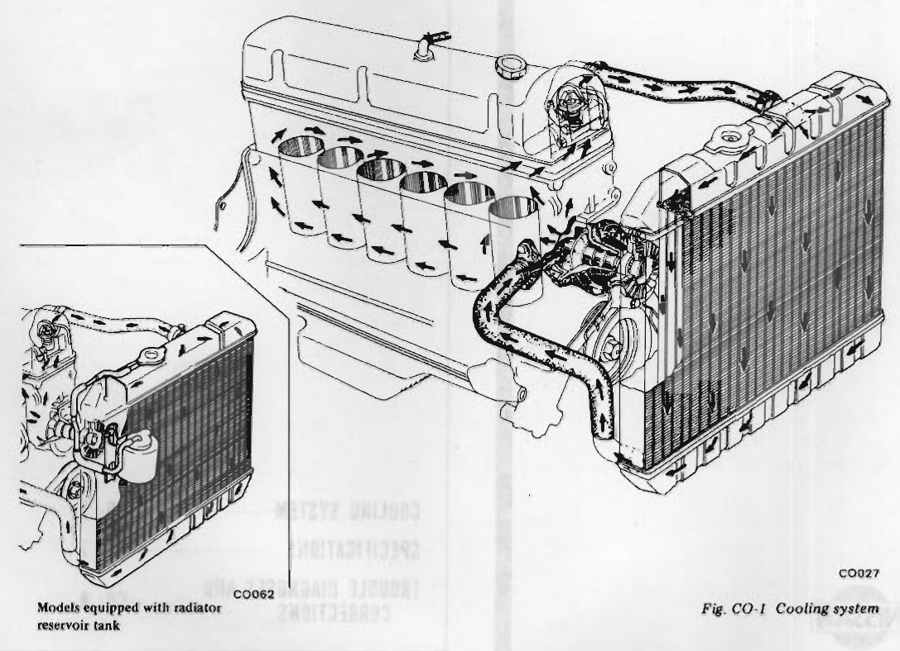
>
> - **Summary:** Cutaway flow diagram of the L28 cooling system showing coolant circulation pathways through the cylinder block, cylinder head, thermostat, water pump, and downflow radiator. Inset at lower-left illustrates configuration for models equipped with a radiator reservoir tank.
> - **Components:** Cylinder block, Cylinder head, Thermostat housing, Thermostat, Water pump, Downflow radiator, Radiator pressure cap, Upper radiator hose, Lower radiator hose, Cooling fan and pulley, Radiator reservoir tank (coolant recovery tank)
> - **Specs / Measurements:** Radiator cap preset relief pressure: 0.9 kg/cm² (13 psi)
> - **Mechanic Notes:** When thermostat is closed, coolant recirculates within block and head for rapid warmup. Once normal operating temperature is achieved, coolant circulates through radiator core.
> - **Tags:** `cooling system`, `circulation`, `flow diagram`, `radiator`, `water pump`, `thermostat`, `reservoir tank`, `L28`

---

<!-- Page 3 (CO-3) -->
## COOLANT LEVEL

The coolant level should be checked and maintained as follows:
* About 25 mm (1 in) below the bottom of filler neck.
* For models equipped with reservoir tank, see page CO-7, "INSPECTION" of radiator reservoir tank.

> [!CAUTION]
> To avoid serious personal injury, never remove radiator cap quickly when engine is hot. Sudden release of cooling system pressure is very dangerous. If it is necessary to remove radiator cap when radiator is hot, turn cap slowly counterclockwise to the first stop. After all pressure in the cooling system is released, turn cap passing the stop and remove it.

## DRAINING AND FLUSHING THE COOLING SYSTEM

To drain the cooling system remove radiator cap, release drain cock at the bottom of radiator and drain plug on the side of cylinder block. If heater system is installed, set heater temperature control valve to open position. After the coolant is drained completely, close drain cock and plug and refill the system with clean soft water.

## WATER PUMP

The water pump is of a centrifugal type, which is mounted on the engine front cover. The fan and pulley are bolted at the pulley hub. The pump shaft is supported by a double row of ball bearings press fit in an aluminum die cast pump body. The bearings are permanently lubricated and sealed to prevent loss of lubricant and entry of dirt.

The pump contains an impeller that turns on a steel shaft which rotates in the ball bearings, and the volute chamber is built in the front cover assembly. The inlet of the pump is connected to the radiator's lower tank by a hose.

> 🖼️ **Fig. CO-2 Water pump and front cover** `[CO005]` *(Type: `exploded_view`)*
>
> 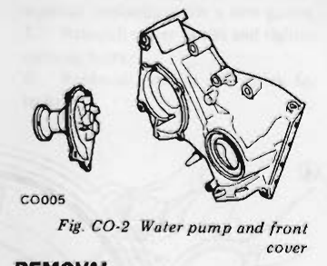
>
> - **Summary:** Exploded view showing relationship of centrifugal water pump assembly to engine front cover and integrated volute chamber.
> - **Components:** Water pump assembly, Engine front cover, Volute chamber, Mounting gasket surface, Fan pulley hub
> - **Mechanic Notes:** Volute chamber is cast directly into front cover assembly. Water pump outer bearing race is press-fit into aluminum body; unit cannot be disassembled.
> - **Tags:** `water pump`, `front cover`, `volute chamber`, `exploded view`

### REMOVAL AND INSTALLATION

#### Removal

1. Drain coolant into a clean container.
2. Loosen bolts retaining fan shroud to radiator and remove shroud.
3. Loosen belt, then remove fan blade and pulley from hub.
4. Remove pump assembly and gasket from front cover.

> [!NOTE]
> Prior to removing water pump, clean the cooling system with suitable cleaner.

> 🖼️ **Fig. CO-3 Removing water pump** `[CO006]` *(Type: `procedure_step`)*
>
> 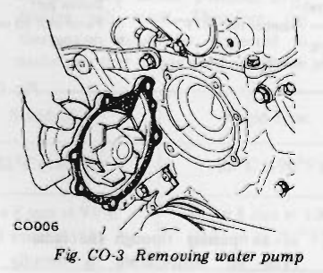
>
> - **Summary:** Procedure diagram showing removal of water pump housing and gasket from front cover of engine.
> - **Components:** Water pump, Engine front cover, Securing bolts, Gasket
> - **Mechanic Notes:** Clean cooling system with suitable cleaner before pump removal. Always replace gasket with a new one upon installation.
> - **Tags:** `water pump`, `removal`, `front cover`, `service procedure`

#### Installation

1. Be sure to clean the gasket surfaces in contact with pump and front cover. Always use new gaskets when installing pump assembly. Be sure to tighten bolts.
2. Fill cooling system and check for leaks at pump.
3. Install fan pulley and fan blade, and tighten fixing bolts securely. Install belt and adjust to specified tension.

### DISASSEMBLY

Water pump is made of aluminum and its bearing outer race is of a press fit type. For this reason, water pump should not be disassembled.

### INSPECTION AND ADJUSTMENT

#### Inspection

Inspect pump assembly for the following conditions and replace if necessary.
1. Badly rusted or corroded body assembly and vane.
2. Excessive end play or roughness of bearings in operation.

> [!NOTE]
> If excessive mechanical seal squeak occurs when engine is running, use suitable water pump seal lubricant to prevent squeak.

#### Adjustment

Fan belt should be properly adjusted at all times. A tight belt causes wear of alternator and water pump bearings. A loose belt brings about improper cooling fan, water pump, and alternator operation.

Check the belt deflection between alternator and fan pulley by force of 10 kg (22 lb).

* **Fan belt deflection:** 8 to 12 mm (0.31 to 0.47 in)

If adjustment is necessary, loosen bolt retaining alternator adjusting bar to alternator. Move alternator toward or away from engine until the correct tension is obtained.

---

<!-- Page 4 (CO-4) -->
# TEM-COUPLING

> 🖼️ **Fig. CO-4 Cross-sectional view of Tem-coupling** `[CO078]` *(Type: `cutaway_flow`)*
>
> 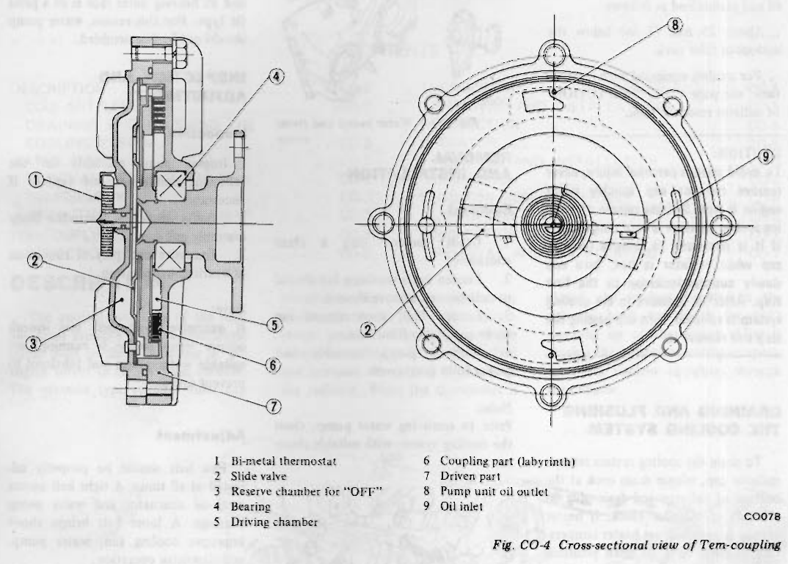
>
> - **Summary:** Cross-sectional and front elevation views of temperature-sensing viscous fan coupling (Tem-coupling), showing internal fluid passages, bimetal thermostat, slide valve, and labyrinth drive surfaces.
> - **Components:** Bi-metal thermostat, Slide valve, Reserve chamber for "OFF", Bearing, Driving chamber, Coupling part (labyrinth), Driven part, Pump unit oil outlet, Oil inlet
> - **Callouts:** **(1)** Bi-metal thermostat; **(2)** Slide valve; **(3)** Reserve chamber for "OFF"; **(4)** Bearing; **(5)** Driving chamber; **(6)** Coupling part (labyrinth); **(7)** Driven part; **(8)** Pump unit oil outlet; **(9)** Oil inlet
> - **Specs / Measurements:** ON condition fan speed: up to about 2,450 rpm; OFF condition fan slip speed: about 1,600 rpm
> - **Mechanic Notes:** Coiled bimetal senses radiator discharge air temp. When hot, bimetal expands opening slide valve (2) to deliver silicone oil to labyrinth (6). When cold, valve closes and centrifugal force collects oil back into reserve chamber (3).
> - **Tags:** `tem-coupling`, `fan clutch`, `cross-section`, `cutaway`, `viscous coupling`, `bi-metal`

Tem-coupling is a type of fan coupling which is provided with a temperature control system.

The conventional coupling always slips the fan at a high speed under a constant ratio regardless of the engine cooling requirement.

The slipping ratio of the Tem-coupling, however, is properly changed with the cooling requirement.

"ON" denotes that cooling is required and the fan operates up to about 2,450 rpm. When high cooling is not required (during cold season, with the engine warmed up, etc.), the operation is placed under "OFF" condition and the fan slips at about 1,600 rpm.

The coiled bimetal thermostat installed on the front center portion of the Tem-coupling detects temperature of air passing through the radiator (The air temperature is directly relative to the engine coolant temperature.) and the inside slide valve is opened or closed as required, and thus, the ON-OFF control is performed. When the air temperature rises, the bimetal is expanded, and the valve is opened, silicon oil is forwarded to the groove that transmits torque, and the system is placed under "ON" condition.

When the valve closes, silicon oil is not supplied to the groove, oil in the groove is accumulated on the Tem-coupling periphery due to the centrifugal force, and led into the reserve chamber. Now, oil is eliminated from the groove, and the system is placed under "OFF" condition.

With this system, when fan cooling is not required, the output loss is minimized and noise can be far reduced.

> 🖼️ **Fig. CO-5 Characteristic of Tem-coupling** `[CO029]` *(Type: `graph_chart`)*
>
> 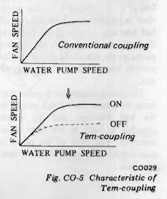
>
> - **Summary:** Performance graphs comparing fan speed vs water pump speed for conventional fixed-ratio slip coupling versus variable ON/OFF temperature-controlled Tem-coupling.
> - **Components:** Conventional coupling curve, Tem-coupling ON curve, Tem-coupling OFF curve, Fan speed axis, Water pump speed axis
> - **Specs / Measurements:** Max ON speed: ~2,450 rpm; OFF slip speed: ~1,600 rpm
> - **Mechanic Notes:** Tem-coupling limits top fan speed and dramatically cuts power drag and acoustic noise when coolant temperatures are moderate or low.
> - **Tags:** `tem-coupling`, `graph`, `performance chart`, `fan speed`, `water pump speed`

---

<!-- Page 5 (CO-5) -->
### INSPECTION

Check Tem-coupling for oil leakage or bend of bimetal.

If the above symptoms are found, replace it with a new one as an assembly.

---

# THERMOSTAT

A wax pellet type thermostat is mounted in the thermostat housing at the cylinder head water outlet.

The founction of the thermostat is to control the flow of coolant, facilitating fast engine warm up and regulating coolant temperature. The thermostat is designed to open and close at predetermined temperatures and if not operating properly should be removed and tested as described below.

### REMOVAL AND INSTALLATION

1. Drain coolant partially.
2. Disconnect upper radiator hose at water outlet.
3. Remove bolts and remove water outlet, gasket, and thermostat from thermostat housing.
4. After checking thermostat, reinstall, replacing with a new gasket.
5. Reinstall water outlet and tighten securing bolts.
6. Replenish coolant and check for leaks.

> 🖼️ **Fig. CO-6 Removing thermostat** `[CO073]` *(Type: `exploded_view`)*
>
> 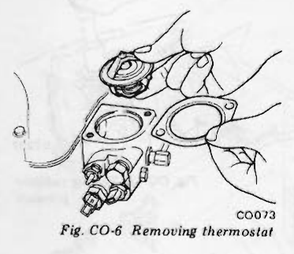
>
> - **Summary:** Exploded view of thermostat assembly, gasket, water outlet neck, and housing bolted onto cylinder head.
> - **Components:** Water outlet neck, Thermostat, Gasket, Thermostat housing, Securing bolts
> - **Mechanic Notes:** Always replace gasket when reassembling. Tighten securing bolts evenly.
> - **Tags:** `thermostat`, `housing`, `water outlet`, `gasket`, `exploded view`

### INSPECTION

A sticking thermostat will prevent the cooling system from functioning properly. If the thermostat sticks in the open position, the engine warms up very slowly. If the thermostat sticks in the closed position, over heating will result. Therefore, the thermostat should be inspected to make sure that it is in good condition.

1. Submerge thermostat in hot water 5°C (9°F) above the temperature specified in the following table.
2. After preparing for the marked screwdriver at about 8 mm (0.31 in) from the tip, inspect the lift height of valve by inserting it.
3. Now, place thermostat in water 5°C (9°F) below the specified temperature.

> 🖼️ **Fig. CO-7 Inspecting thermostat** `[CO011]` *(Type: `inspection_measurement`)*
>
> 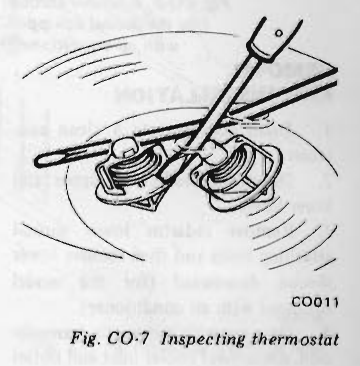
>
> - **Summary:** Testing thermostat valve opening lift in hot water bath using a screwdriver marked at 8 mm (0.31 in).
> - **Components:** Thermostat, Heated water container, Screwdriver with 8 mm mark
> - **Specs / Measurements:** Test temperature: 5°C (9°F) above opening spec; Valve lift inspection height: 8 mm (0.31 in); Cool-down temp: 5°C (9°F) below opening spec
> - **Mechanic Notes:** Thermostat cannot be repaired; replace if opening temperature or minimum 8 mm lift is out of specification.
> - **Tags:** `thermostat inspection`, `valve lift`, `bench test`, `water bath`

If thermostat does not operate at the above specified temperature, it must be replaced because it cannot be repaired.

| Item | Standard | Frigid type | Tropical type |
| :--- | :--- | :--- | :--- |
| Valve opening temperature | 82°C (180°F) | 88°C (190°F) | 76.5°C (170°F) |
| Max. valve lift | above 8 mm at 95°C (0.31 in at 203°F) | above 8 mm at 100°C (0.31 in at 212°F) | above 8 mm at 90°C (0.31 in at 194°F) |

> [!NOTE]
> It is necessary to check a new thermostat before installing it in the engine.

---

# RADIATOR

The radiator is a conventional down flow type having top and bottom tanks to distribute the coolant flow uniformly through the vertical tube of radiator core. The radiator shroud improves fan performance (only for the model equipped with air conditioner).

The radiator filler cap is designed to maintain a pre-set pressure [0.9 kg/cm² 13 psi) above atmospheric pressure.

The relief valve consisting of a blow-off valve and a vacuum valve, helps to prevent the coolant from boiling by giving pressure to it. However, when the pressure is reduced below atmospheric pressure, the vacuum valve allows air to re-enter the radiator preventing the formation of a vacuum in the cooling system. The bottom tank on cars equipped with automatic transmission incorporates an oil cooler for the transmission fluid.

> 🖼️ **Fig. CO-8 Radiator for manual transmission** `[CO012]` *(Type: `exploded_view`)*
>
> 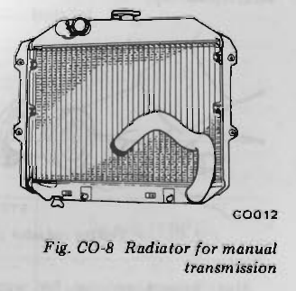
>
> - **Summary:** Perspective view of downflow radiator assembly with top tank, bottom tank, filler neck, hoses, and drain cock for manual transmission models.
> - **Components:** Downflow radiator assembly, Radiator filler neck and cap, Upper radiator hose, Lower radiator hose, Bottom tank drain cock
> - **Specs / Measurements:** System pressure: 0.9 kg/cm² (13 psi); Manual transmission capacity: 10.3 liters (10 7/8 US qt, 9 1/8 Imp qt)
> - **Mechanic Notes:** Automatic transmission radiators additionally integrate a transmission fluid cooler inside the bottom tank.
> - **Tags:** `radiator`, `manual transmission`, `downflow radiator`, `hoses`, `drain cock`

---

<!-- Page 6 (CO-6) -->

> 🖼️ **Fig. CO-9 Radiator shroud (for the model equipped with air conditioner)**  *(Type: `component_location`)*
>
> 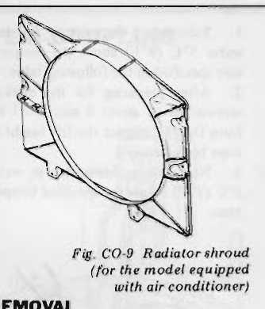
>
> - **Summary:** Two-piece cooling fan shroud design used on factory air-conditioned models.
> - **Components:** Upper radiator shroud, Lower radiator shroud, Mounting bolt flanges
> - **Mechanic Notes:** Lower shroud is detached and removed downwards before removing radiator; upper shroud lifts out with radiator.
> - **Tags:** `radiator shroud`, `fan shroud`, `air conditioner`, `cooling fan`

### REMOVAL AND INSTALLATION

1. Drain coolant into a clean container.
2. Disconnect radiator's upper and lower hoses.
3. Remove radiator lower shroud attaching bolts and then remove lower shroud downward (for the model equipped with air conditioner).
4. On a car with automatic transmission, disconnect cooler inlet and outlet pipes from radiator.
5. Remove radiator retaining bolts and then remove radiator upward.
On a car with air conditioner, remove radiator along with upper shroud upward.
6. Install radiator in the reverse sequence of removal.

### INSPECTION

Radiator cap should be checked for working pressure at regular tune-up intervals. First, check rubber seal on cap for tears, cracks or deterioration after cleaning it. Then, install radiator cap on a tester. If cap does not hold or will not release at the specified pressure, replace cap.

> 🖼️ **Fig. CO-10 Testing radiator cap** `[ET012]` *(Type: `inspection_measurement`)*
>
> 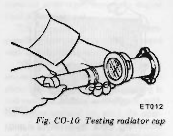
>
> - **Summary:** Bench testing radiator cap relief pressure using a hand pump pressure tester and cap adapter.
> - **Components:** Radiator cap, Cap tester adapter, Hand pressure pump and gauge
> - **Specs / Measurements:** Working release pressure: 0.9 kg/cm² (13 psi)
> - **Mechanic Notes:** Inspect rubber seal for cracks or hardness. Cap must hold pressure and release at specified relief value.
> - **Tags:** `radiator cap test`, `pressure cap`, `inspection`, `cap tester`

Also, inspect radiator for water leakage using cap tester and applying a pressure of 1.6 kg/cm² (23 psi).

If a defect is detected, repair or replace radiator.

> 🖼️ **Fig. CO-11 Testing radiator pressure** `[ET237]` *(Type: `inspection_measurement`)*
>
> 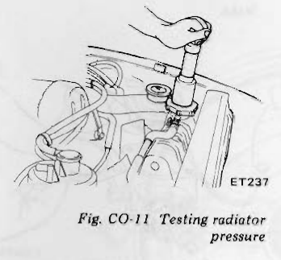
>
> - **Summary:** Cooling system leak detection test using hand pressure pump attached directly to radiator filler neck.
> - **Components:** Radiator filler neck, Hand pressure pump, Pressure gauge
> - **Specs / Measurements:** Applied test pressure: 1.6 kg/cm² (23 psi)
> - **Mechanic Notes:** Apply 1.6 kg/cm² (23 psi) to locate seam leaks, hose leaks, or core defects. Repair or replace radiator if leaking.
> - **Tags:** `cooling system pressure test`, `leak test`, `radiator test`

> 🖼️ **Fig. CO-12 Structural view of cooling system** `[CO038]` *(Type: `cutaway_flow`)*
>
> 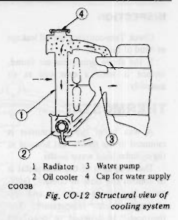
>
> - **Summary:** Side elevation structural cross-section showing alignment of radiator, bottom tank oil cooler, water pump, fan, and filler neck.
> - **Components:** Radiator, Oil cooler, Water pump, Cap for water supply, Cooling fan
> - **Callouts:** **(1)** Radiator; **(2)** Oil cooler; **(3)** Water pump; **(4)** Cap for water supply
> - **Mechanic Notes:** Illustrates packaging of automatic transmission fluid cooler inside the radiator bottom tank.
> - **Tags:** `cooling system structure`, `radiator`, `oil cooler`, `water pump`, `automatic transmission`

---

# RADIATOR RESERVOIR TANK

### OPERATION

The radiator reservoir tank is mounted to the right hand side core support through the bracket. When the coolant temperature in the radiator rises and pressure builds up to an extent, the pressure relief valve provided in the radiator cap opens to release excess coolant into the reservoir tank. When the coolant temperature lowers and pressure decreases in the radiator, the vacuum valve provided in the radiator cap opens to allow the coolant to re-enter the radiator.

> 🖼️ **Fig. CO-13 Operation of reservoir tank** `[CO074, CO075]` *(Type: `cutaway_flow`)*
>
> 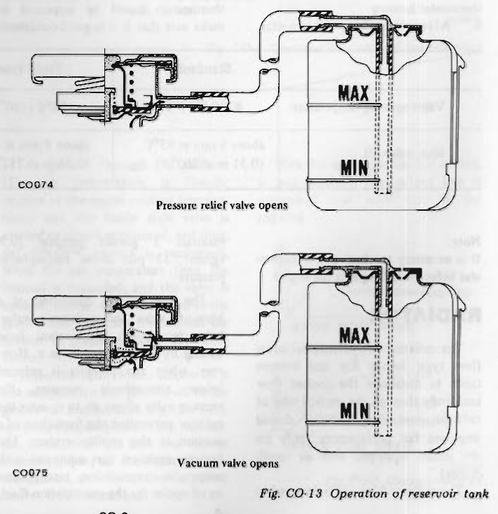
>
> - **Summary:** Dual diagram illustrating dynamic valving in radiator cap and fluid transfer with reservoir tank during pressure relief and vacuum recovery states.
> - **Components:** Radiator cap pressure relief valve, Radiator cap vacuum valve, Reservoir tank, Overflow transfer hose, MAX level line, MIN level line
> - **Callouts:** **(Upper diagram)** Pressure relief valve opens; **(Lower diagram)** Vacuum valve opens
> - **Specs / Measurements:** Cap relief pressure: 0.9 kg/cm² (13 psi)
> - **Mechanic Notes:** When engine heats up, thermal expansion forces relief valve open into reservoir tank. When cooling down, vacuum valve opens allowing coolant to siphon back into radiator.
> - **Tags:** `radiator cap`, `reservoir tank`, `pressure relief valve`, `vacuum valve`, `coolant recovery`

---

<!-- Page 7 (CO-7) -->
### INSPECTION

Check the amount of coolant in the reservoir tank. If the coolant level is below the MIN. level, remove the reservoir tank filler cap and add enough coolant to reach MAX. level.

If the reservoir tank is empty, check the coolant level in the radiator. If the coolant in the radiator is insufficient, pour it into radiator up to the radiator cap and also pour it into the reservoir tank until MAX. level.

If the coolant in the reservoir tank decreases abnormally rapid, check for a leak in the cooling system.

### REMOVAL AND INSTALLATION

Upper side of reservoir tank bracket is bolted to radiator core support together with radiator. Lower side is bolted to radiator core support with stud bolts.

Reservoir tank is only inserted to reservoir tank bracket and can be easily removed.

To install reservoir tank, reverse the order of removal.

> [!CAUTION]
> Be careful not to damage radiator fins and core tube when installing.

> 🖼️ **Fig. CO-14 Installing reservoir tank** `[CO076]` *(Type: `exploded_view`)*
>
> 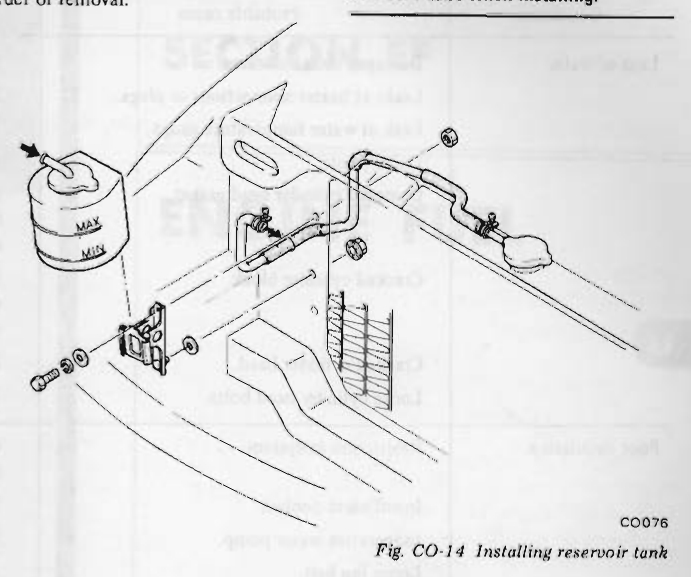
>
> - **Summary:** Exploded view showing installation of coolant reservoir tank, mounting bracket, hoses, and hardware to front radiator core support.
> - **Components:** Reservoir tank, Reservoir tank bracket, Radiator core support, Overflow hose, Hose clamps, Stud bolts, Bolts and nuts
> - **Mechanic Notes:** Upper bracket attaches to core support together with radiator; lower bracket mounts with stud bolts. Slide reservoir tank into bracket; take care not to strike or damage radiator fins during assembly.
> - **Tags:** `reservoir tank`, `bracket`, `core support`, `installation`, `exploded view`

---

# SPECIFICATIONS

* **Engine:** L28

### Radiator

| Item | Specification |
| :--- | :--- |
| Type | Corrugated fin and tube |
| Cap relief pressure | 0.9 kg/cm² (13 psi) |
| Testing pressure | 1.6 kg/cm² (23 psi) |
| Water capacity (including engine, heater and reservoir tank): | |
| - Manual transmission model | 10.3 liters (10 7/8 U.S. qt, 9 1/8 Imp. qt) |
| - Automatic transmission model | 10.1 liters (10 5/8 U.S. qt, 8 7/8 Imp. qt) |

### Fan

| Item | Specification |
| :--- | :--- |
| Tem-coupling | Installed |
| No. of blades x outer diameter | 8 x 410 mm (16.14 in) |
| Fan belt deflection | 8 to 12 mm (0.31 to 0.47 in) |

### Thermostat

| Item | Standard | Frigid type | Tropical type |
| :--- | :--- | :--- | :--- |
| Valve opening temperature | 82°C (180°F) | 88°C (190°F) | 76.5°C (170°F) |
| Max. valve lift | above 8 mm at 95°C (0.31 in at 203°F) | above 8 mm at 100°C (0.31 in at 212°F) | above 8 mm at 90°C (0.31 in at 194°F) |

---

<!-- Page 8 (CO-8) -->
# TROUBLE DIAGNOSES AND CORRECTIONS

| Condition | Probable cause | Corrective action |
| :--- | :--- | :--- |
| Loss of water | Damaged radiator seams. | Repair. |
| | Leaks at heater connections or plugs. | Repair. |
| | Leak at water temperature gauge. | Tighten. |
| | Loose joints. | Tighten. |
| | Damaged cylinder head gasket. | Replace. Check engine oil for contamination and refill as necessary. |
| | Cracked cylinder block. | Replace. Check engine oil in crankcase for mixing with water by pulling oil level gauge. |
| | Cracked cylinder head. | Replace. |
| | Loose cylinder head bolts. | Tighten. |
| Poor circulation | Restriction in system. | Check hoses for crimps, and clear the system of rust and sludge by flushing radiator. |
| | Insufficient coolant. | Replenish. |
| | Inoperative water pump. | Replace. |
| | Loose fan belt. | Adjust. |
| | Inoperative thermostat. | Replace. |
| Corrosion | Excessive impurity in water. | Use soft, clean water. (rain water is satisfactory). |
| | Infrequent flushing and draining of system. | Cooling system should be drained and flushed thoroughly at least twice a year. Permanent antifreeze (Ethylene glycol base) can be used throughout the seasons of a year. |
| Overheating | Malfunctioning thermostat. | Replace. |
| | Radiator fin choked with mud, chaff, etc. | Clean out air passage thoroughly by using air pressure from engine side of radiator. |
| | Incorrect ignition and valve timing. | Adjust. |
| | Dirty oil and sludge in engine. | Refill. |
| | Inoperative water pump. | Replace. |
| | Loose fan belt. | Adjust. |
| | Restricted radiator. | Flush radiator. |
| | Inaccurate temperature gauge. | Replace. |
| | Impurity in water. | Use soft, clean water. |
| Overcooling | Malfunctioning thermostat. | Replace. |
| | Inaccurate temperature gauge. | Replace. |

---

## Segmented Diagrams Index

| Figure | Code | Type | Page | Caption | Key Components / Callouts | File |
| :--- | :--- | :--- | :--- | :--- | :--- | :--- |
| **Fig. CO-1** | `CO027, CO062` | `cutaway_flow` | CO-2 | Fig. CO-1 Cooling system (Inset: Models equipped with radiator reservoir tank) | Cylinder block, Cylinder head, Thermostat housing, Thermostat, Water pump | [fig_co_1_cooling_system.png](diagrams/CO Cooling System/fig_co_1_cooling_system.png) |
| **Fig. CO-2** | `CO005` | `exploded_view` | CO-3 | Fig. CO-2 Water pump and front cover | Water pump assembly, Engine front cover, Volute chamber, Mounting gasket surface, Fan pulley hub | [fig_co_2_water_pump_front_cover.png](diagrams/CO Cooling System/fig_co_2_water_pump_front_cover.png) |
| **Fig. CO-3** | `CO006` | `procedure_step` | CO-3 | Fig. CO-3 Removing water pump | Water pump, Engine front cover, Securing bolts, Gasket | [fig_co_3_removing_water_pump.png](diagrams/CO Cooling System/fig_co_3_removing_water_pump.png) |
| **Fig. CO-4** | `CO078` | `cutaway_flow` | CO-4 | Fig. CO-4 Cross-sectional view of Tem-coupling | Bi-metal thermostat, Slide valve, Reserve chamber for "OFF", Bearing, Driving chamber | [fig_co_4_tem_coupling.png](diagrams/CO Cooling System/fig_co_4_tem_coupling.png) |
| **Fig. CO-5** | `CO029` | `graph_chart` | CO-4 | Fig. CO-5 Characteristic of Tem-coupling | Conventional coupling curve, Tem-coupling ON curve, Tem-coupling OFF curve, Fan speed axis, Water pump speed axis | [fig_co_5_characteristic_of_tem_coupling.png](diagrams/CO Cooling System/fig_co_5_characteristic_of_tem_coupling.png) |
| **Fig. CO-6** | `CO073` | `exploded_view` | CO-5 | Fig. CO-6 Removing thermostat | Water outlet neck, Thermostat, Gasket, Thermostat housing, Securing bolts | [fig_co_6_removing_thermostat.png](diagrams/CO Cooling System/fig_co_6_removing_thermostat.png) |
| **Fig. CO-7** | `CO011` | `inspection_measurement` | CO-5 | Fig. CO-7 Inspecting thermostat | Thermostat, Heated water container, Screwdriver with 8 mm mark | [fig_co_7_inspecting_thermostat.png](diagrams/CO Cooling System/fig_co_7_inspecting_thermostat.png) |
| **Fig. CO-8** | `CO012` | `exploded_view` | CO-5 | Fig. CO-8 Radiator for manual transmission | Downflow radiator assembly, Radiator filler neck and cap, Upper radiator hose, Lower radiator hose, Bottom tank drain cock | [fig_co_8_radiator_manual_transmission.png](diagrams/CO Cooling System/fig_co_8_radiator_manual_transmission.png) |
| **Fig. CO-9** | `-` | `component_location` | CO-6 | Fig. CO-9 Radiator shroud (for the model equipped with air conditioner) | Upper radiator shroud, Lower radiator shroud, Mounting bolt flanges | [fig_co_9_radiator_shroud.png](diagrams/CO Cooling System/fig_co_9_radiator_shroud.png) |
| **Fig. CO-10** | `ET012` | `inspection_measurement` | CO-6 | Fig. CO-10 Testing radiator cap | Radiator cap, Cap tester adapter, Hand pressure pump and gauge | [fig_co_10_testing_radiator_cap.png](diagrams/CO Cooling System/fig_co_10_testing_radiator_cap.png) |
| **Fig. CO-11** | `ET237` | `inspection_measurement` | CO-6 | Fig. CO-11 Testing radiator pressure | Radiator filler neck, Hand pressure pump, Pressure gauge | [fig_co_11_testing_radiator_pressure.png](diagrams/CO Cooling System/fig_co_11_testing_radiator_pressure.png) |
| **Fig. CO-12** | `CO038` | `cutaway_flow` | CO-6 | Fig. CO-12 Structural view of cooling system | Radiator, Oil cooler, Water pump, Cap for water supply, Cooling fan | [fig_co_12_structural_view_cooling_system.png](diagrams/CO Cooling System/fig_co_12_structural_view_cooling_system.png) |
| **Fig. CO-13** | `CO074, CO075` | `cutaway_flow` | CO-6 | Fig. CO-13 Operation of reservoir tank | Radiator cap pressure relief valve, Radiator cap vacuum valve, Reservoir tank, Overflow transfer hose, MAX level line | [fig_co_13_operation_of_reservoir_tank.png](diagrams/CO Cooling System/fig_co_13_operation_of_reservoir_tank.png) |
| **Fig. CO-14** | `CO076` | `exploded_view` | CO-7 | Fig. CO-14 Installing reservoir tank | Reservoir tank, Reservoir tank bracket, Radiator core support, Overflow hose, Hose clamps | [fig_co_14_installing_reservoir_tank.png](diagrams/CO Cooling System/fig_co_14_installing_reservoir_tank.png) |
