# EMISSION CONTROL SYSTEM

<!-- Page 1 (EC-1) -->
# SECTION EC - EMISSION CONTROL SYSTEM

### CONTENTS

| Section | Page |
| :--- | :--- |
| GENERAL DESCRIPTION | EC-2 |
| CRANKCASE EMISSION CONTROL SYSTEM | EC-2 |
| EXHAUST EMISSION CONTROL SYSTEM | EC-3 |
| EVAPORATIVE EMISSION CONTROL SYSTEM | EC-22 |
| SERVICE DATA AND SPECIFICATIONS | EC-26 |

---

<!-- Page 2 (EC-2) -->
## GENERAL DESCRIPTION

There are three types of emission control system. These are:
1. Closed type crankcase emission control system.
2. Exhaust emission control system.
3. Evaporative emission control system.

Periodic inspection and required servicing of these systems should be carried out to reduce harmful emissions to a minimum.

## CRANKCASE EMISSION CONTROL SYSTEM

### DESCRIPTION

This system returns blow-by gas to both the intake manifold and throttle chamber.
The positive crankcase ventilation (P.C.V.) valve is provided to conduct crankcase blow-by gas to the intake manifold.
During partial throttle operation of the engine, the intake manifold sucks the blow-by gas through the P.C.V. valve.
Normally, the capacity of the valve is sufficient to handle any blow-by and a small amount of ventilating air.
The ventilating air is then drawn from throttle chamber, through the tube connecting throttle chamber to rocker cover, into the crankcase.
Under full-throttle condition, the manifold vacuum is insufficient to draw the blow-by flow through the valve, and its flow goes through the tube connection in the reverse direction.
On cars with an excessively high blow-by, some of the flow will go through the tube connection to throttle chamber under all conditions.

> 🖼️ **Fig. EC-1 Crankcase emission control system** `[EC805]` *(Type: `cutaway_flow`)*
>
> 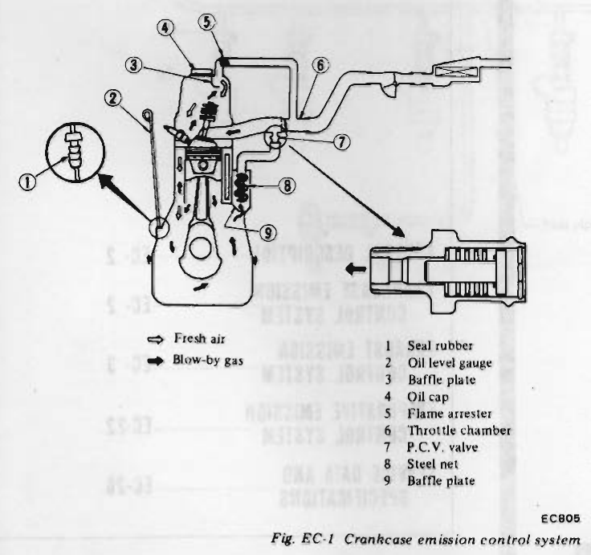
>
> - **Summary:** Cross-sectional cutaway diagram showing crankcase ventilation gas flow routes with P.C.V. valve detail under partial and full throttle conditions.
> - **Components:** Seal rubber, Oil level gauge, Baffle plate, Oil cap, Flame arrester, Throttle chamber, P.C.V. valve, Steel net
> - **Callouts:** **(1)** Seal rubber; **(2)** Oil level gauge; **(3)** Baffle plate; **(4)** Oil cap; **(5)** Flame arrester; **(6)** Throttle chamber; **(7)** P.C.V. valve; **(8)** Steel net; **(9)** Baffle plate
> - **Wiring / Connections:** Ventilation hose between throttle chamber and rocker cover; Hose between crankcase and P.C.V. valve to intake manifold
> - **Mechanic Notes:** Ensure that flame arrester is surely inserted in hose between throttle chamber and rocker cover. Check for hissing sound and strong vacuum at P.C.V. valve inlet at idle.
> - **Tags:** `crankcase emission control`, `pcv valve`, `blow-by gas`, `flame arrester`, `ventilation hose`

### INSPECTION

#### P.C.V. VALVE
With engine running at idle, remove the ventilation hose from P.C.V. valve. If the valve is working, a hissing noise will be heard as air passes through the valve and a strong vacuum should be felt immediately when a finger is placed over valve inlet.

#### VENTILATION HOSES
1. Check hoses and hose connections for leaks.
2. Disconnect all hoses and clean with compressed air.
If any hose cannot be freed of obstructions, replace.
Ensure that flame arrester is surely inserted in hose between throttle chamber and rocker cover.

---

<!-- Page 3 (EC-3) -->
# EXHAUST EMISSION CONTROL SYSTEM

### CONTENTS

| Section | Page | Section | Page |
| :--- | :--- | :--- | :--- |
| DESCRIPTION | EC-3 | REMOVAL AND INSTALLATION | EC-12 |
| BOOST CONTROLLED DECELERATION DEVICE (B.C.D.D.) | EC-5 | INSPECTION | EC-13 |
| DESCRIPTION | EC-5 | CATALYTIC CONVERTER SYSTEM | EC-14 |
| OPERATION | EC-5 | DESCRIPTION | EC-14 |
| REMOVAL AND INSTALLATION | EC-6 | OPERATION | EC-15 |
| INSPECTION | EC-6 | REMOVAL AND INSTALLATION | EC-15 |
| EXHAUST GAS RECIRCULATION (E.G.R.) CONTROL SYSTEM | EC-9 | FLOOR TEMPERATURE WARNING SYSTEM | EC-16 |
| DESCRIPTION | EC-9 | DESCRIPTION | EC-16 |
| OPERATION | EC-10 | OPERATION | EC-17 |
| | | REMOVAL AND INSTALLATION | EC-18 |

### DESCRIPTION

The exhaust emission control system is made up of the following:
1. Boost controlled deceleration device (B.C.D.D.).
2. Exhaust gas recirculation (E.G.R.) system.
3. Catalytic converter system (California models).
4. Floor temperature warning system (California models).

---

<!-- Page 4 (EC-4) -->

> 🖼️ **Fig. EC-2 Location of emission control system components** `[EC242A]` *(Type: `component_location`)*
>
> 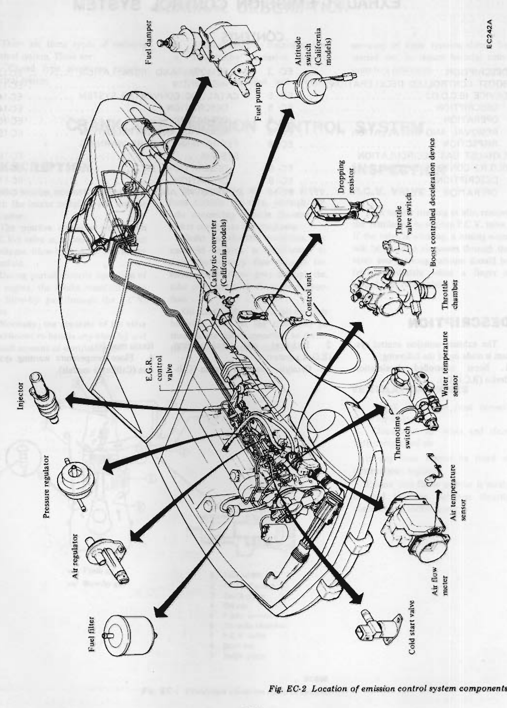
>
> - **Summary:** Phantom vehicle perspective showing layout and locations of all major emission control and EFI components on the Datsun 280Z chassis and engine bay.
> - **Components:** Fuel damper, Fuel pump, Altitude switch (California models), Dropping resistor, Throttle valve switch, Boost controlled deceleration device, Throttle chamber, Water temperature sensor, Thermotime switch, Air temperature sensor, Air flow meter, Cold start valve, Fuel filter, Air regulator, Pressure regulator, Injector, E.G.R. control valve, Catalytic converter (California models), Control unit
> - **Callouts:** **(Fuel damper)** Fuel damper; **(Fuel pump)** Fuel pump; **(Altitude switch (California models))** Altitude switch (California models); **(Dropping resistor)** Dropping resistor; **(Throttle valve switch)** Throttle valve switch; **(Boost controlled deceleration device)** Boost controlled deceleration device; **(Throttle chamber)** Throttle chamber; **(Water temperature sensor)** Water temperature sensor; **(Thermotime switch)** Thermotime switch; **(Air temperature sensor)** Air temperature sensor; **(Air flow meter)** Air flow meter; **(Cold start valve)** Cold start valve; **(Fuel filter)** Fuel filter; **(Air regulator)** Air regulator; **(Pressure regulator)** Pressure regulator; **(Injector)** Injector; **(E.G.R. control valve)** E.G.R. control valve; **(Catalytic converter (California models))** Catalytic converter (California models); **(Control unit)** Control unit
> - **Mechanic Notes:** Shows component locations throughout vehicle including under-hood EFI components, chassis underbody catalytic converter, and passenger cabin / rear fuel system elements.
> - **Tags:** `component location`, `emission control components`, `engine bay`, `catalytic converter`, `altitude switch`, `bcdd`

---

<!-- Page 5 (EC-5) -->
## BOOST CONTROLLED DECELERATION DEVICE (B.C. D. D.)

### DESCRIPTION

The Boost Controlled Deceleration Device (B.C.D.D.) is employed to reduce HC emissions emitted during coasting. The B.C.D.D., installed under the throttle chamber as a part of it, supplies additional air to the intake manifold during coasting to maintain the manifold vacuum at the proper operating pressure.

There are two diaphragms in the device unit. Diaphragm I detects the manifold vacuum and makes the Vacuum Control Valve open when the vacuum exceeds the operating pressure. Diaphragm II operates the Air Control Valve according to the vacuum transmitted through the Vacuum Control Valve. The Air Control Valve regulates the amount of additional air so that the manifold vacuum can be kept at the proper operating pressure. On California models, the operating pressure changes depending on altitude; thus, diaphragm II and control valve operations are adjusted automatically in coincidence with the altitude at which the vehicle is driven. The graph shown in Figure indicates change in operating pressure for changes in atmospheric pressure and altitude. See Figure EC-13.

On manual transmission models, this system consists of B.C.D.D., vacuum control solenoid valve, speed-detecting switch and amplifier.
On automatic transmission models, it consists of B.C.D.D., vacuum control solenoid valve and inhibitor switch.

### OPERATION

#### B.C.D.D.
Diaphragm I (11) monitors the manifold vacuum; when the vacuum exceeds a pre-determined value, it acts so as to open the vacuum control valve (10). This causes the manifold vacuum to be introduced into vacuum chamber II (19) and actuates diaphragm II (13).
When diaphragm II operates, the air control valve (14) opens the passage and introduces the additional air into the manifold.
The amount of air is controlled by the servo-action of the air control valve (14) and vacuum control valve (10) so that the manifold vacuum may be kept at the pre-determined value.
The B.C.D.D. operates when engine speed is in the range of 1,800 to 2,000 rpm.

#### Vacuum controlled solenoid valve

**Manual transmission models:**
The vacuum controlled solenoid valve is controlled by a speed detecting switch that is actuated by the speedometer needle.
As the car speed falls below 10 M.P.H., this switch is actuated, producing a signal. This signal actuates the amplifier to open the vacuum control solenoid valve.

**Automatic transmission models:**
When the shift lever is in the "N" or "P" position, the inhibitor switch mounted on the transmission turns on to open the vacuum control solenoid valve.

> 🖼️ **Fig. EC-3 Schematic drawing of B.C.D.D.** `[EC243A]` *(Type: `cutaway_flow`)*
>
> 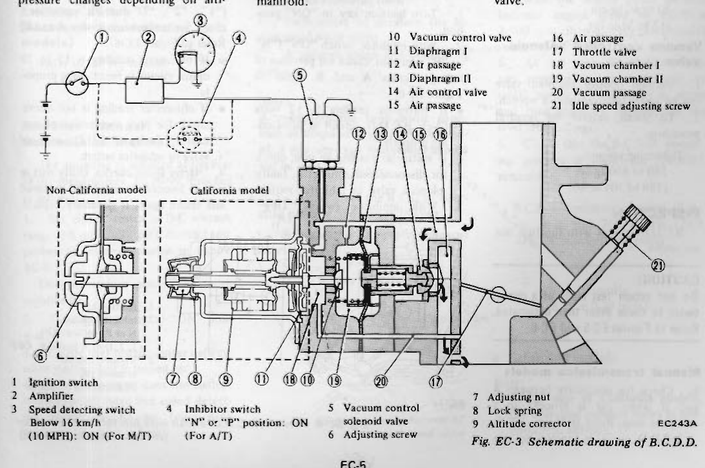
>
> - **Summary:** Internal pneumatic cutaway and electrical control schematic of the B.C.D.D. unit showing Non-California and California altitude corrector configurations.
> - **Components:** Ignition switch, Amplifier, Speed detecting switch, Inhibitor switch, Vacuum control solenoid valve, Adjusting screw, Adjusting nut, Lock spring, Altitude corrector, Vacuum control valve, Diaphragm I, Air passage, Diaphragm II, Air control valve, Throttle valve, Vacuum chamber I, Vacuum chamber II, Vacuum passage, Idle speed adjusting screw
> - **Callouts:** **(1)** Ignition switch; **(2)** Amplifier; **(3)** Speed detecting switch Below 16 km/h (10 MPH): ON (For M/T); **(4)** Inhibitor switch \"N\" or \"P\" position: ON (For A/T); **(5)** Vacuum control solenoid valve; **(6)** Adjusting screw; **(7)** Adjusting nut; **(8)** Lock spring; **(9)** Altitude corrector; **(10)** Vacuum control valve; **(11)** Diaphragm I; **(12)** Air passage; **(13)** Diaphragm II; **(14)** Air control valve; **(15)** Air passage; **(16)** Air passage; **(17)** Throttle valve; **(18)** Vacuum chamber I; **(19)** Vacuum chamber II; **(20)** Vacuum passage; **(21)** Idle speed adjusting screw
> - **Specs / Measurements:** B.C.D.D. operating range: 1,800 to 2,000 rpm; Speed detecting switch closes below 16 km/h (10 MPH)
> - **Wiring / Connections:** Ignition switch to amplifier and solenoid valve; Speed detecting switch (M/T) to amplifier; Inhibitor switch (A/T) circuit
> - **Mechanic Notes:** California model incorporates altitude corrector with adjusting nut and lock spring; Non-California model utilizes adjusting screw.
> - **Tags:** `bcdd`, `boost controlled deceleration device`, `schematic`, `altitude corrector`, `vacuum control valve`, `solenoid valve`

---

<!-- Page 6 (EC-6) -->
## REMOVAL AND INSTALLATION

### B.C.D.D.

> [!NOTE]
> The B.C.D.D. cannot be disassembled. If it is found to be functioning unsatisfactorily, it must be replaced as an assembly.

1. Remove B.C.D.D. by unscrewing the three securing screw (1).
Do not unscrew the four B.C.D.D. assembly screws (2).

> 🖼️ **Fig. EC-4 Removing B.C.D.D.** `[EC689]` *(Type: `procedure_step`)*
>
> 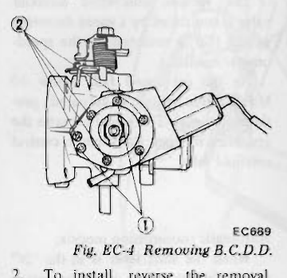
>
> - **Summary:** Illustration of the underside of the throttle chamber indicating which three screws to remove and cautioning against removing the four assembly screws.
> - **Components:** Throttle chamber, B.C.D.D. assembly, Securing screws, Assembly screws
> - **Callouts:** **(1)** Three securing screws; **(2)** Four B.C.D.D. assembly screws
> - **Specs / Measurements:** Securing screws tightening torque: 20 to 40 kg-cm (17 to 35 in-lb)
> - **Mechanic Notes:** Do not unscrew the four B.C.D.D. assembly screws (2). Replace B.C.D.D. as an assembly if malfunctioning.
> - **Tags:** `bcdd removal`, `throttle chamber`, `securing screws`

2. To install, reverse the removal procedure.

**Tightening torque:**
- B.C.D.D. securing screws: 20 to 40 kg-cm (17 to 35 in-lb)

### Vacuum controlled solenoid valve
1. Vacuum control solenoid valve can be easily removed with a wrench.
2. To install, reverse the removal procedure.

**Tightening torque:**
- Vacuum control solenoid valve: 180 to 350 kg-cm (156 to 304 in-lb)

## INSPECTION

B.C.D.D. circuit with function test connector.

> [!CAUTION]
> Do not attach test leads of a circuit tester to those other than designated. Refer to Figures EC-5 and EC-6.

### Manual transmission models
1. Check for continuity between A and B when car is brought to a complete stop. Refer to Figure EC-5.
B.C.D.D. circuit is functioning properly if continuity exists and voltmeter reading is 0 volts (d-c) in step 2 below.
If continuity does not exist, check for disconnected connector and/or faulty amplifier, speed detecting switch or B.C.D.D. solenoid valve.
2. Check for presence of voltage across A and B [at a speed of more than 16 km/h* (10 MPH)]. Refer to Figure EC-5.
* Conduct this test by one of the following two methods:
  1) Raising up rear axle housing with stand.
  2) Chassis dynamometer test
- If voltmeter reading is 0 volt at a speed of more than 16 km/h (10 MPH), circuit is functioning properly.
- If voltmeter reading is not 0 volt, check for disconnected connector, burned fuse, faulty amplifier, B.C.D.D. solenoid valve or speed detecting switch.
3. If, by above checks, faulty part or unit is located, it should be removed and tested again. If necessary, replace.

> 🖼️ **Fig. EC-5 Checking B.C.D.D. circuit with function test connector (for manual transmission)** `[EC373]` *(Type: `electrical_schematic`)*
>
> 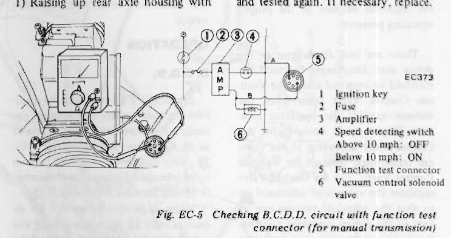
>
> - **Summary:** Wiring test diagram and multimeter hookup to terminals A and B of the function test connector for manual transmission vehicles.
> - **Components:** Multimeter, Function test connector, Ignition key, Fuse, Amplifier, Speed detecting switch, Vacuum control solenoid valve
> - **Callouts:** **(1)** Ignition key; **(2)** Fuse; **(3)** Amplifier; **(4)** Speed detecting switch (Above 10 mph: OFF / Below 10 mph: ON); **(5)** Function test connector; **(6)** Vacuum control solenoid valve
> - **Specs / Measurements:** Speed switch threshold: 16 km/h (10 MPH); Continuity at complete stop: Yes; Voltage above 16 km/h: 0 V (d-c)
> - **Wiring / Connections:** Terminals A and B of function test connector
> - **Mechanic Notes:** Do not attach test leads to terminals other than designated A and B.
> - **Tags:** `bcdd circuit`, `function test connector`, `manual transmission`, `speed detecting switch`, `amplifier`

### Automatic transmission models
1. Turn ignition key to "ON" position.
2. With inhibitor switch "ON" ("N" or "P" position), check for presence of voltage across A and B. Refer to Figure EC-6.
- If voltmeter reading is 12 volts (d-c), B.C.D.D. circuit is functioning properly.
- If voltmeter reading is zero, check for disconnected connector, faulty solenoid valve or inhibitor switch.
3. With inhibitor switch "OFF" ("1", "2", "D" or "R" position), check for resistance between A and B. Refer to Figure EC-6.
- If ohmmeter reading is 15 to 28 ohms, circuit is functioning properly.
- If ohmmeter reading is not above, check for poor connection of connector, faulty B.C.D.D. solenoid valve or inhibitor switch.
4. If, by above checks, faulty part or unit is located, it should be removed and tested again. If necessary, replace.

> 🖼️ **Fig. EC-6 Checking B.C.D.D. circuit with function test connector (for automatic transmission)** `[EC374]` *(Type: `electrical_schematic`)*
>
> 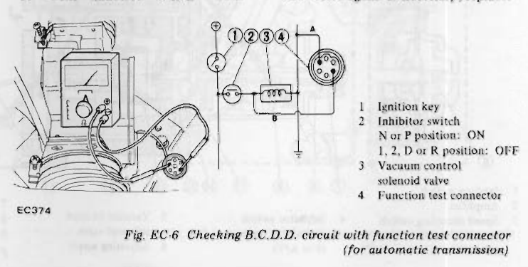
>
> - **Summary:** Circuit schematic and tester connection diagram for testing B.C.D.D. via the test connector on automatic transmission models.
> - **Components:** Multimeter, Function test connector, Ignition key, Inhibitor switch, Vacuum control solenoid valve
> - **Callouts:** **(1)** Ignition key; **(2)** Inhibitor switch (N or P position: ON / 1, 2, D or R position: OFF); **(3)** Vacuum control solenoid valve; **(4)** Function test connector
> - **Specs / Measurements:** Voltage in N or P: 12 V (d-c); Resistance in gear (1, 2, D, R): 15 to 28 ohms
> - **Wiring / Connections:** Terminals A and B of function test connector
> - **Mechanic Notes:** Check for 12V in N/P and 15 to 28 ohms in drive/reverse ranges across terminals A and B.
> - **Tags:** `bcdd circuit`, `function test connector`, `automatic transmission`, `inhibitor switch`, `solenoid resistance`

---

<!-- Page 7 (EC-7) -->
### B.C.D.D. solenoid valve

1. Turn on engine key. (Do not start engine.)
2. Ensure that solenoid valve clicks when intermittently electrified as shown in Figure EC-7.

> 🖼️ **Fig. EC-7 Checking solenoid valve** `[EC690]` *(Type: `procedure_step`)*
>
> 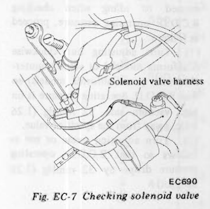
>
> - **Summary:** Connecting jumper test wire from battery positive terminal to the disconnected B.C.D.D. solenoid valve harness connector to listen for valve click.
> - **Components:** B.C.D.D. solenoid valve, Harness connector, Jumper test lead, Battery
> - **Callouts:** **(Solenoid valve harness)** Solenoid valve harness
> - **Wiring / Connections:** Intermittent electrification to solenoid terminal
> - **Mechanic Notes:** Turn on ignition key without starting engine, ensure solenoid clicks when energized.
> - **Tags:** `bcdd solenoid`, `solenoid test`, `click test`

3. If a click is heard, solenoid valve is normal.
4. If a click is not heard at all, check for continuity with a circuit tester. If discontinuity is detected, replace solenoid valve.

### Inhibitor switch (Automatic transmission models)
Refer to the AT section.

### Amplifier (Manual transmission models)
The amplifier is installed at the rear of the speedometer. To check, proceed as follows:
1. Set circuit tester in D-C ampere range (1A min, full scale), connect test probes of tester as shown in Figure EC-8.
Do not confuse positive line with negative line.
2. Turn ignition key to "ON" position.
3. Ensure that tester pointer deflects when ignition key is turned on.
4. If tester pointer does not deflect when solenoid valve and speed detecting switch circuits are functioning properly, amplifier is faulty.

> 🖼️ **Fig. EC-8 Checking amplifier** `[EC691]` *(Type: `electrical_schematic`)*
>
> 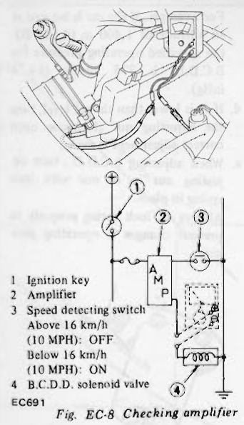
>
> - **Summary:** Circuit schematic showing ammeter connection between ignition key circuit and amplifier to test current draw upon key turn-on.
> - **Components:** Ignition key, Amplifier, Speed detecting switch, B.C.D.D. solenoid valve, Ammeter / Circuit tester
> - **Callouts:** **(1)** Ignition key; **(2)** Amplifier; **(3)** Speed detecting switch (Above 16 km/h / 10 MPH: OFF, Below 16 km/h / 10 MPH: ON); **(4)** B.C.D.D. solenoid valve
> - **Specs / Measurements:** Tester range: DC ampere (1A min full scale)
> - **Wiring / Connections:** Test probes in series with amplifier circuit
> - **Mechanic Notes:** Do not confuse positive line with negative line. Tester needle should deflect when ignition is switched ON.
> - **Tags:** `bcdd amplifier`, `speedometer`, `amplifier test`, `current check`

### Operating pressure of B.C.D.D.

Generally, it is unnecessary to adjust the B.C.D.D., however, if it should become necessary to adjust it, the procedure is as follows:

#### Prepare the following tools
1. Tachometer to measure the engine speed while idling.
2. A vacuum gauge and connecting pipe.

> [!NOTE]
> A quick-response type boost gauge such as Bourdon's type is recommended; a mercury-type manometer should not be used.

To properly set the B.C.D.D. operating pressure, proceed as follows:
1. Remove the harness of solenoid valve.

> 🖼️ **Fig. EC-9 Removing harness of solenoid valve** `[EC690]` *(Type: `procedure_step`)*
>
> 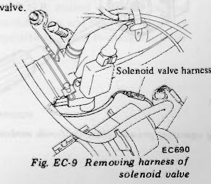
>
> - **Summary:** Disconnecting the electrical plug harness from the B.C.D.D. vacuum control solenoid valve on the throttle chamber.
> - **Components:** Throttle chamber, B.C.D.D. solenoid valve, Harness connector
> - **Callouts:** **(Solenoid valve harness)** Solenoid valve harness
> - **Wiring / Connections:** Solenoid harness connector disconnected
> - **Mechanic Notes:** Always disconnect solenoid harness prior to performing B.C.D.D. operating pressure check or adjustment.
> - **Tags:** `bcdd solenoid harness`, `throttle chamber`, `disconnect harness`

2. Connect rubber hose between vacuum gauge and intake manifold as shown.

> 🖼️ **Fig. EC-10 Connecting vacuum gauge** `[EC244A]` *(Type: `procedure_step`)*
>
> 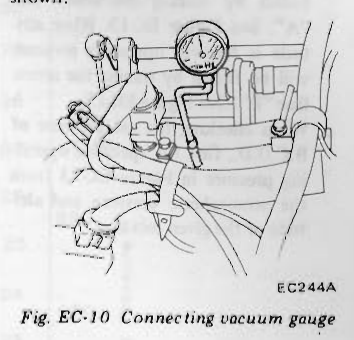
>
> - **Summary:** Vacuum gauge connection via rubber hose tee to the intake manifold vacuum fitting.
> - **Components:** Vacuum gauge, Connecting pipe / hose, Intake manifold, Throttle chamber
> - **Specs / Measurements:** Quick-response Bourdon type boost gauge recommended; Do not use mercury manometer
> - **Wiring / Connections:** Rubber vacuum hose to intake manifold fitting
> - **Mechanic Notes:** Use Bourdon tube boost gauge for fast response during rapid throttle snapping.
> - **Tags:** `vacuum gauge`, `intake manifold vacuum`, `bcdd test`

3. Warm up the engine until it is heated to operating temperature.
Then adjust the engine at normal idling setting. Refer to the item "Checking and Adjusting Engine Idle RPM and Mixture Ratio".

**Idling engine speed:**
- Manual transmission: 800 rpm
- Automatic transmission (in "D" position): 700 rpm

4. Run the engine under no load. Increase engine speed to 3,000 to 3,500 rpm, then quickly close throttle valve.
5. At that time, the manifold vacuum pressure increases abruptly to -600 mmHg (-23.6 inHg) or above and then gradually decreases to the level set at idling.
6. Check that the B.C.D.D. operating pressure is within the specified pressure.

**B.C.D.D. operating pressure [0 m, sea level and 760 mmHg (29.9 inHg), atmospheric pressure]:**
- -470 ± 10 mmHg (-18.50 ± 0.39 inHg)

#### California models

> [!NOTE]
> a. In the case of California models, the operating pressure varies in proportion to altitude. <!-- Page 8 (EC-8) --> b. When atmospheric pressure is known, operating pressure will be found by tracing the arrow line "A". See Figure EC-13. When altitude is known, operating pressure will be found by tracing the arrow line "B". See Figure EC-13.
c. When checking the set pressure of B.C.D.D., find the specified operating pressure in Figure EC-13 from the atmospheric pressure and altitude of the given location.
For example, if the car is located at an altitude of 1,400 m (4,600 ft), the specified operating pressure for B.C.D.D. is 375 mmHg (14.76 inHg).
d. If it is lower than the set level, turn the adjusting nut clockwise until correct adjustment is made.
e. When adjusting B.C.D.D., turn adjusting nut in or out with lock spring in place.
Always set lock spring properly to prevent changes in operating pressure.

> 🖼️ **Fig. EC-11 Adjusting operating pressure (California models)** `[EC802]` *(Type: `procedure_step`)*
>
> 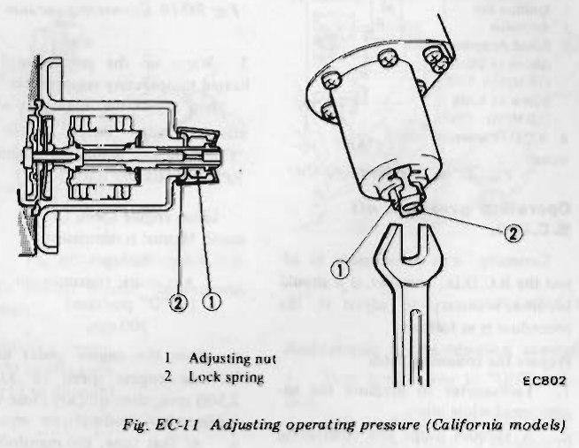
>
> - **Summary:** Adjusting the B.C.D.D. operating pressure on California models using a wrench on the adjusting nut through the lock spring.
> - **Components:** B.C.D.D. body, Adjusting nut, Lock spring, Open end wrench
> - **Callouts:** **(1)** Adjusting nut; **(2)** Lock spring
> - **Specs / Measurements:** 1/4 turn CCW = 32 mmHg (1.26 inHg) drop; 1/2 turn CCW = 64 mmHg (2.52 inHg) drop
> - **Mechanic Notes:** Turn adjusting nut in or out with lock spring in place. Always set lock spring properly to prevent drift in operating pressure.
> - **Tags:** `bcdd adjustment`, `california models`, `adjusting nut`, `lock spring`

#### Non-California models

> [!NOTE]
> If it is lower than the set level, turn the adjusting screw counterclockwise until correct adjustment is made.

> 🖼️ **Fig. EC-12 Adjusting operating pressure (Non-California models)** `[EC096A]` *(Type: `procedure_step`)*
>
> 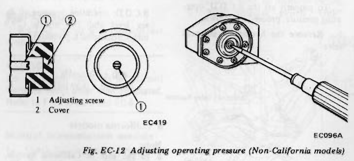
>
> - **Summary:** Cross-section and screwdriver adjustment of the B.C.D.D. operating pressure adjusting screw on Non-California models.
> - **Components:** Adjusting screw, Cover, Screwdriver, B.C.D.D. housing
> - **Callouts:** **(1)** Adjusting screw; **(2)** Cover
> - **Specs / Measurements:** 1/4 turn CW = 32 mmHg (1.26 inHg) drop; 1/2 turn CW = 64 mmHg (2.52 inHg) drop
> - **Mechanic Notes:** Turn adjusting screw counterclockwise if operating pressure is lower than set level. Clockwise turn decreases vacuum setting.
> - **Tags:** `bcdd adjustment`, `non-california models`, `adjusting screw`, `cover`

7. Race the engine and check for adjustment.
8. If it is lower than the set level, turn the adjusting screw or nut until correct adjustment is made.
9. Race the engine and check for adjustment.
10. If engine speed cannot be decreased to idling when checking B.C.D.D. operating pressure, proceed as follows:
  (1) Turn adjusting nut clockwise (California models) or screw counterclockwise (non-California models) so that B.C.D.D. operating pressure is on high vacuum side, 32 mmHg (1.26 inHg) away from the specified value.
  (2) Turn adjusting screw or nut as follows so that B.C.D.D. operating pressure drops by 32 mmHg (1.26 inHg).
  - **California models:** Turn adjusting nut 1/4 of a turn counterclockwise.
  - **Non-California models:** Turn adjusting screw 1/4 of a turn clockwise.
11. If B.C.D.D. operating pressure cannot be observed clearly even in step 10 (1), proceed as follows:
  (1) Turn adjusting nut clockwise (California models) or screw counterclockwise (non-California models) so that B.C.D.D. operating pressure is on high vacuum side, 64 mmHg (2.52 inHg) away from the specified value.
  (2) Turn adjusting screw or nut as follows:
  - **California models:** Turn adjusting nut 1/2 of a turn counterclockwise.
  - **Non-California models:** Turn adjusting screw 1/2 of a turn clockwise.

> [!NOTE]
> The B.C.D.D. operating pressure should be correctly set within the specified range after the above adjustments, even if the engine speed cannot be decreased to idling.

---

<!-- Page 9 (EC-9) -->

> 🖼️ **Fig. EC-13 Changes in operating pressure versus changes in atmospheric pressure and altitude (California models)** `[EC379]` *(Type: `graph_chart`)*
>
> 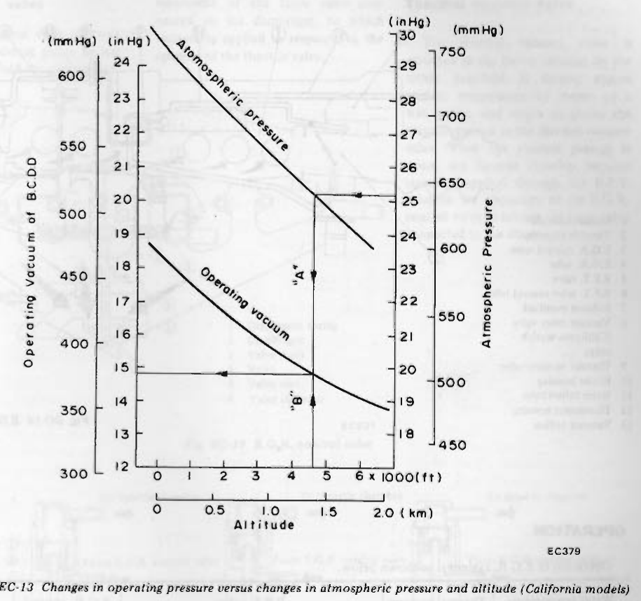
>
> - **Summary:** Engineering graph plotting operating vacuum of B.C.D.D. (mmHg and inHg) against atmospheric pressure and altitude in thousands of feet and kilometers.
> - **Components:** Operating vacuum scale (300 to 600 mmHg / 12 to 24 inHg), Atmospheric pressure scale (450 to 750 mmHg / 18 to 30 inHg), Altitude scale (0 to 6000 ft / 0 to 2.0 km), Atmospheric pressure curve, Operating vacuum curve
> - **Callouts:** **(A)** Arrow line tracing from atmospheric pressure; **(B)** Arrow line tracing from altitude
> - **Specs / Measurements:** Sea level: -470 mmHg (-18.5 inHg); 1,400 m (4,600 ft): 375 mmHg (14.76 inHg)
> - **Mechanic Notes:** Use trace line A when atmospheric pressure is known, trace line B when altitude is known.
> - **Tags:** `bcdd graph`, `altitude compensation`, `atmospheric pressure`, `operating vacuum curve`, `california models`

# EXHAUST GAS RECIRCULATION (E.G.R.) CONTROL SYSTEM

### DESCRIPTION

In the exhaust gas recirculation system, a part of the exhaust gas is returned to the combustion chamber to lower the spark flame temperature during combustion. This results in a reduction of the nitrogen oxide content in the exhaust gas.
The thermal vacuum valve and B.P.T. valve are located in the vacuum line between the throttle chamber and the E.G.R. control valve. The thermal vacuum valve and the B.P.T. valve are operated according to changes in water temperature and exhaust pressure, respectively.
Exhaust gases are recirculated in the intake manifold when intake manifold pressure is high enough [50 mmHg (1.97 inHg) min. inside the E.G.R. control vacuum chamber], the thermal vacuum valve is opened and the B.P.T. valve is closed.
Figure EC-14 shows a functional diagram of the E.G.R. control system.

---

<!-- Page 10 (EC-10) -->

> 🖼️ **Fig. EC-14 E.G.R. control system** `[EC931]` *(Type: `cutaway_flow`)*
>
> 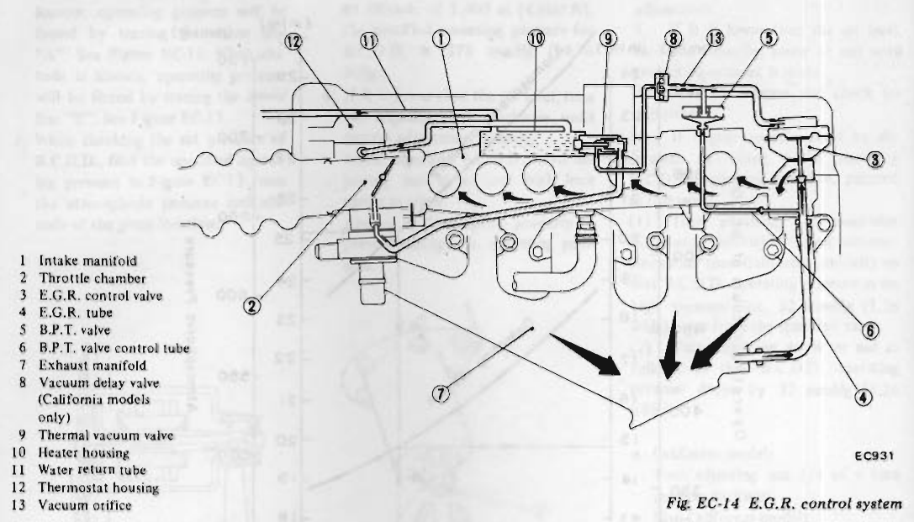
>
> - **Summary:** Functional schematic diagram of the complete E.G.R. circuit showing routing between intake manifold, throttle chamber, E.G.R. valve, B.P.T. valve, thermal vacuum valve, and exhaust manifold.
> - **Components:** Intake manifold, Throttle chamber, E.G.R. control valve, E.G.R. tube, B.P.T. valve, B.P.T. valve control tube, Exhaust manifold, Vacuum delay valve (California models only), Thermal vacuum valve, Heater housing, Water return tube, Thermostat housing, Vacuum orifice
> - **Callouts:** **(1)** Intake manifold; **(2)** Throttle chamber; **(3)** E.G.R. control valve; **(4)** E.G.R. tube; **(5)** B.P.T. valve; **(6)** B.P.T. valve control tube; **(7)** Exhaust manifold; **(8)** Vacuum delay valve (California models only); **(9)** Thermal vacuum valve; **(10)** Heater housing; **(11)** Water return tube; **(12)** Thermostat housing; **(13)** Vacuum orifice
> - **Specs / Measurements:** Operating range: water temp 50 to 95°C (122 to 203°F); B.P.T. valve exhaust threshold: 21 to 33 mmH2O (0.82 to 1.30 inH2O)
> - **Wiring / Connections:** Vacuum lines between throttle chamber, thermal vacuum valve, B.P.T. valve, and E.G.R. control valve; Exhaust pressure sensing line to B.P.T. valve
> - **Mechanic Notes:** E.G.R. is deactivated at idle and full throttle. California models include vacuum delay valve (8).
> - **Tags:** `egr system`, `egr control valve`, `bpt valve`, `thermal vacuum valve`, `vacuum delay valve`, `plumbing schematic`

### OPERATION

Operation of E.G.R. system is as shown below.

| Water temperature °C (°F) | Thermal vacuum valve | B.P.T. valve mmH2O (inH2O) | E.G.R. control valve | E.G.R. |
| :--- | :--- | :--- | :--- | :--- |
| Below 47 to 53 (117 to 127) or Above 92 to 98 (198 to 208) | Closed | Exhaust pressure 21 to 33 (0.82 to 1.30) max. -> Open | Closed | Not actuated |
| Below 47 to 53 (117 to 127) or Above 92 to 98 (198 to 208) | Closed | Exhaust pressure 21 to 33 (0.82 to 1.30) min. -> Closed | Closed | Not actuated |
| Between 50 and 95 (122 to 203) | Open | Exhaust pressure 21 to 33 (0.82 to 1.30) max. -> Open | Closed | Not actuated |
| Between 50 and 95 (122 to 203) | Open | Exhaust pressure 21 to 33 (0.82 to 1.30) min. -> Closed | Open | Actuated |

> [!NOTE]
> With the engine at idle or at full throttle, the E.G.R. control valve closes to deactivate the E.G.R. system regardless of water temperature (operation of the thermal vacuum valve) and B.P.T. valve.

---

<!-- Page 11 (EC-11) -->
### E.G.R. Control valve

The E.G.R. control valve controls the quantity of exhaust gas to be led to the intake manifold through vertical movement of the taper valve connected to the diaphragm, to which vacuum is applied in response to the opening of the throttle valve.

> 🖼️ **Fig. EC-15 E.G.R. control valve** `[EC231]` *(Type: `cutaway_flow`)*
>
> 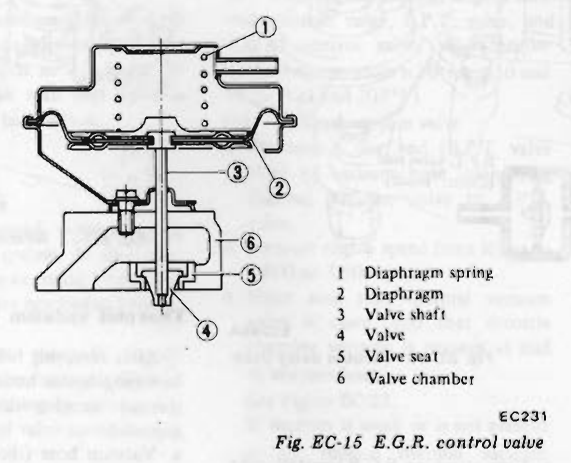
>
> - **Summary:** Cross-sectional detail of the E.G.R. control valve showing internal diaphragm, spring, valve shaft, valve seat, and valve chamber.
> - **Components:** Diaphragm spring, Diaphragm, Valve shaft, Valve, Valve seat, Valve chamber
> - **Callouts:** **(1)** Diaphragm spring; **(2)** Diaphragm; **(3)** Valve shaft; **(4)** Valve; **(5)** Valve seat; **(6)** Valve chamber
> - **Wiring / Connections:** Vacuum port on top of diaphragm chamber
> - **Mechanic Notes:** Inspect diaphragm for leaks and valve stem for sticking or carbon deposits.
> - **Tags:** `egr control valve`, `cutaway`, `valve shaft`, `diaphragm`

### Thermal vacuum valve

The thermal vacuum valve is mounted in the heater housing on the intake manifold. It detects engine coolant temperature by means of a wax pellet, and opens or closes the vacuum passage in the thermal vacuum valve. When the vacuum passage is open, the throttle chamber vacuum signal is applied through the B.P.T. valve to the diaphragm of the E.G.R. control valve to actuate the taper valve connected to the diaphragm.

> 🖼️ **Fig. EC-16 Thermal vacuum valve** `[EC934]` *(Type: `cutaway_flow`)*
>
> 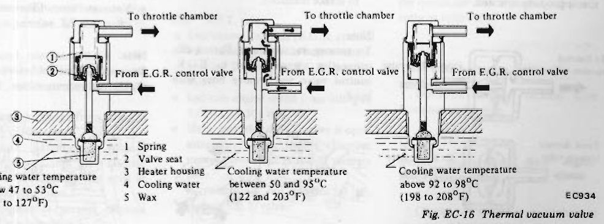
>
> - **Summary:** Sectional views of the thermal vacuum valve at three temperature states: below 47-53°C (closed), 50-95°C (open), and above 92-98°C (closed).
> - **Components:** Spring, Valve seat, Heater housing, Cooling water, Wax pellet
> - **Callouts:** **(1)** Spring; **(2)** Valve seat; **(3)** Heater housing; **(4)** Cooling water; **(5)** Wax
> - **Specs / Measurements:** Below 47 to 53°C (117 to 127°F): Closed; Between 50 and 95°C (122 and 203°F): Open; Above 92 to 98°C (198 to 208°F): Closed
> - **Wiring / Connections:** Port to throttle chamber; Port from E.G.R. control valve
> - **Mechanic Notes:** Wax element expands to open valve in normal range and closes valve above overheating threshold.
> - **Tags:** `thermal vacuum valve`, `wax pellet`, `coolant temperature`, `cutaway`

### B.P.T. valve

The B.P.T. valve monitors exhaust pressure to activate the diaphragm, controlling intake manifold vacuum applied to the E.G.R. control valve. In other words, recirculated exhaust gas is controlled in response to positioning of the E.G.R. control valve or to engine operation.

> 🖼️ **Fig. EC-17 B.P.T. valve** `[EC088A]` *(Type: `cutaway_flow`)*
>
> 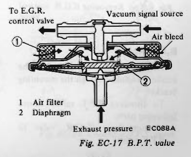
>
> - **Summary:** Cross-sectional cutaway of the back-pressure transducer (B.P.T.) valve showing air filter, diaphragm, exhaust pressure port, and air bleed.
> - **Components:** Air filter, Diaphragm, Exhaust pressure port, Air bleed, Vacuum signal source port, Port to E.G.R. control valve
> - **Callouts:** **(1)** Air filter; **(2)** Diaphragm
> - **Specs / Measurements:** Actuation pressure: 21 to 33 mmH2O (0.82 to 1.30 inH2O)
> - **Wiring / Connections:** Vacuum signal source line; Line to E.G.R. control valve; Exhaust pressure pickup line
> - **Mechanic Notes:** Diaphragm bleeds air to vent vacuum until sufficient exhaust backpressure pushes diaphragm closed.
> - **Tags:** `bpt valve`, `back pressure transducer`, `air bleed`, `diaphragm`, `cutaway`

### Vacuum delay valve (California models only)

During rapid acceleration the vacuum delay valve prevents an abrupt escape of vacuum from the line between the throttle chamber and E.G.R. control valve, and increases the length of E.G.R. operation. The valve is designed for one-way operation and consists of a one-way umbrella valve and a sintered steel fluidic restrictor.

---

<!-- Page 12 (EC-12) -->

> 🖼️ **Fig. EC-18 Vacuum delay valve** `[EC245A]` *(Type: `component_location`)*
>
> 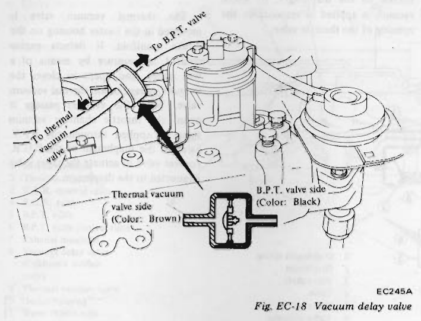
>
> - **Summary:** Installation orientation and hose routing of the vacuum delay valve located between thermal vacuum valve (brown side) and B.P.T. valve (black side).
> - **Components:** Vacuum delay valve, Hose to thermal vacuum valve, Hose to B.P.T. valve
> - **Callouts:** **(Thermal vacuum valve side)** Color: Brown; **(B.P.T. valve side)** Color: Black
> - **Wiring / Connections:** Brown side connected toward thermal vacuum valve; Black side connected toward B.P.T. valve
> - **Mechanic Notes:** Pay strict attention to valve color orientation: Brown side faces thermal vacuum valve, Black side faces B.P.T. valve.
> - **Tags:** `vacuum delay valve`, `color coding`, `hose routing`, `orientation`

When installing this valve, ensure that it properly oriented.

> 🖼️ **Fig. EC-19 Operation of vacuum delay valve** `[EC697]` *(Type: `cutaway_flow`)*
>
> 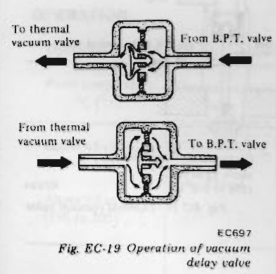
>
> - **Summary:** Flow direction schematic of vacuum delay valve showing open umbrella flow toward thermal vacuum valve and restricted flow toward B.P.T. valve.
> - **Components:** Umbrella valve, Fluidic restrictor orifice, Valve body
> - **Mechanic Notes:** One-way operation allows rapid flow during release and restricted flow during vacuum application.
> - **Tags:** `vacuum delay valve`, `umbrella valve`, `fluidic restrictor`, `flow diagram`

## REMOVAL AND INSTALLATION

### E.G.R. control valve
E.G.R. control valve is installed on intake manifold through a gasket. To dismount E.G.R. control valve, remove the following parts:
- Vacuum hose connecting E.G.R. control valve to B.P.T. valve.
- Heat shield plate for E.G.R. control valve.
- Nuts attaching E.G.R. control valve to intake manifold.

> [!NOTE]
> To remove vacuum hose, flatten clip connecting vacuum hose to E.G.R. control valve and remove hose with hand.

> 🖼️ **Fig. EC-20 Removing E.G.R. control valve** `[EC246A]` *(Type: `procedure_step`)*
>
> 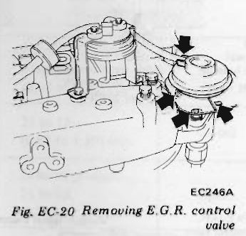
>
> - **Summary:** Removal of E.G.R. control valve nuts from intake manifold studs and vacuum hose disconnection.
> - **Components:** E.G.R. control valve, Intake manifold, Securing nuts, Vacuum hose
> - **Wiring / Connections:** Flatten hose clip to disconnect vacuum hose
> - **Mechanic Notes:** Flatten clip connecting vacuum hose to E.G.R. control valve and remove hose by hand. Replace gasket upon reassembly.
> - **Tags:** `egr valve removal`, `intake manifold`, `hose clip`

### B.P.T. valve
The B.P.T. valve is attached to the intake manifold through the mounting bracket.
To dismount B.P.T. valve, remove following parts:
- Vacuum hose (E.G.R. valve to B.P.T. valve)
- Vacuum hose (Thermal vacuum valve to B.P.T. valve)
- B.P.T. valve control tube.
- Bolts attaching B.P.T. valve to mounting bracket

> 🖼️ **Fig. EC-21 Removing B.P.T. valve** `[EC247A]` *(Type: `procedure_step`)*
>
> 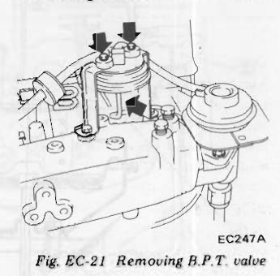
>
> - **Summary:** Dismounting B.P.T. valve and control tube from intake manifold bracket.
> - **Components:** B.P.T. valve, Mounting bracket, Control tube, Mounting bolts, Vacuum hoses
> - **Mechanic Notes:** Disconnect both vacuum hoses and unbolt B.P.T. valve from bracket.
> - **Tags:** `bpt valve removal`, `mounting bracket`, `control tube`

### Thermal vacuum valve
After removing following parts and loosening heater housing fixing bolts, thermal vacuum valve can be dismounted.
- Vacuum hose (throttle chamber to thermal vacuum valve)
- Vacuum hose (Thermal vacuum valve to B.P.T. valve)

> [!NOTE]
> Drain engine coolant before dismounting thermal vacuum valve.

> 🖼️ **Fig. EC-22 Removing thermal vacuum valve** `[EC937]` *(Type: `procedure_step`)*
>
> 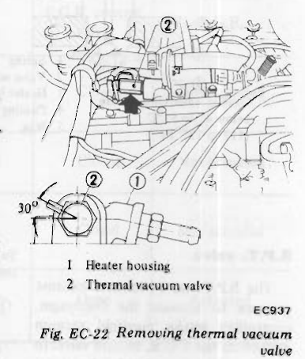
>
> - **Summary:** Removal and installation angle of thermal vacuum valve threaded into heater housing at 30 degree tilt angle.
> - **Components:** Heater housing, Thermal vacuum valve
> - **Callouts:** **(1)** Heater housing; **(2)** Thermal vacuum valve
> - **Specs / Measurements:** Installation tilt angle: 30°; Tightening torque: 2.2 kg-m (16 ft-lb) max
> - **Mechanic Notes:** Install thermal vacuum valve at a tilt angle of 30° as shown. Tighten to 2.2 kg-m (16 ft-lb) max. Drain coolant before removal.
> - **Tags:** `thermal vacuum valve`, `heater housing`, `tilt angle`, `removal`

To install E.G.R. control system components, reverse the order of removal.

---

<!-- Page 13 (EC-13) -->
| Model | Type | Identification |
| :--- | :--- | :--- |
| S30 | M/T, A/T | EVK72-42 G |

> [!NOTE]
> Install thermal vacuum valve at a tilt angle of 30° as shown in Figure EC-22, and tighten to 2.2 kg-m (16 ft-lb) max. Make sure that valve is water-tight after installation.

## INSPECTION

### Entire system
1. Make a thorough visual check of E.G.R. control system. If necessary, wipe away oil to facilitate inspection. If any hoses are cracked or broken, replace.
2. With engine stopped, inspect E.G.R. control valve for any indication of binding or sticking by moving diaphragm of control valve upwards with finger.
3. With engine running, inspect thermal vacuum valve, when engine coolant temperature is below 47°C (117°F).
  - Disconnect one end (B.P.T. valve side) of vacuum hose connecting thermal vacuum valve to B.P.T. valve.
  - Increase engine speed from idling to 3,000 to 3,500 rpm.
  - Make sure that thermal vacuum valve is close, and that throttle chamber vacuum does not exist at end of vacuum hose.
  - If a vacuum is present, replace thermal vacuum valve.

> 🖼️ **Fig. EC-23 Checking thermal vacuum valve** `[EC248A]` *(Type: `procedure_step`)*
>
> 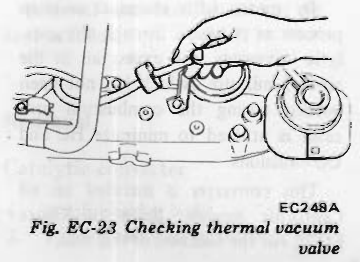
>
> - **Summary:** Checking vacuum presence at the hose disconnected from the thermal vacuum valve with finger while engine is revved.
> - **Components:** Thermal vacuum valve, Vacuum hose, Intake manifold
> - **Specs / Measurements:** Engine rev: 3,000 to 3,500 rpm; Below 47°C: Closed (no vacuum); 50 to 95°C: Open (vacuum present)
> - **Wiring / Connections:** Hose disconnected at B.P.T. valve side
> - **Mechanic Notes:** Ensure throttle chamber vacuum is felt with finger when engine is warm (50 to 95°C) at 3,000-3,500 rpm.
> - **Tags:** `thermal vacuum valve inspection`, `vacuum check`, `finger test`

4. With engine running, inspect thermal vacuum valve, B.P.T. valve, and E.G.R. control valve, when engine coolant temperature is between 50 and 95°C (122 and 203°F).

**(1) Thermal vacuum valve**
- Disconnect one end (B.P.T. valve side) of vacuum hose connecting thermal vacuum valve to B.P.T. valve.
- Increase engine speed from idling to 3,000 to 3,500 rpm.
- Make sure that thermal vacuum valve is open, and that throttle chamber vacuum is present at end of vacuum hose. See Figure EC-23.
If vacuum is weak or is not present at all, replace thermal vacuum valve.

**(2) B.P.T. valve**
- Disconnect one end (E.G.R. control valve side) of vacuum hose connecting B.P.T. valve to E.G.R. control valve.
- Increase engine speed from idling to 3,000 to 3,500 rpm.
- Make sure that B.P.T. valve is operating, and that throttle chamber vacuum is present at end of vacuum hose.
If vacuum is not present at all, replace B.P.T. valve.

> 🖼️ **Fig. EC-24 Checking B.P.T. valve** `[EC249A]` *(Type: `procedure_step`)*
>
> 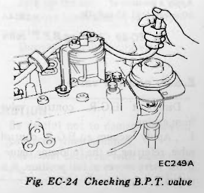
>
> - **Summary:** Checking for vacuum at the disconnected hose from the B.P.T. valve leading to the E.G.R. valve at 3,000 to 3,500 rpm.
> - **Components:** B.P.T. valve, Vacuum hose to E.G.R. valve
> - **Specs / Measurements:** Engine rev: 3,000 to 3,500 rpm; Vacuum should be present when operating properly
> - **Wiring / Connections:** Hose disconnected at E.G.R. valve side
> - **Mechanic Notes:** If vacuum is not present at hose end during 3,000 to 3,500 rpm rev, replace B.P.T. valve.
> - **Tags:** `bpt valve inspection`, `vacuum check`, `bpt test`

**(3) E.G.R. control valve**
- Make sure that E.G.R. control valve is operated when engine speed is increased from idling to 3,000 to 3,500 rpm.
Place a finger on diaphragm of E.G.R. control valve to check for valve movement. If diaphragm does not move, replace E.G.R. control valve.

> 🖼️ **Fig. EC-25 Checking E.G.R. control valve** `[EC250A]` *(Type: `procedure_step`)*
>
> 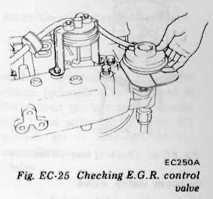
>
> - **Summary:** Feeling diaphragm of E.G.R. control valve with finger to confirm movement when revving engine from idle to 3,000-3,500 rpm.
> - **Components:** E.G.R. control valve, Diaphragm
> - **Specs / Measurements:** Engine rev: 3,000 to 3,500 rpm; Diaphragm should lift smoothly
> - **Mechanic Notes:** Place finger under diaphragm to feel upward movement as engine is revved. If it does not move, replace valve.
> - **Tags:** `egr control valve inspection`, `diaphragm movement`, `finger check`

If any difficulty is encountered in judging the condition of any component during above inspection, check the questionable component independently as follows:

### Thermal vacuum valve
Dismount thermal vacuum valve from heater housing.

> [!NOTE]
> Before dismounting, drain engine coolant from engine.

Check to be sure that thermal vacuum valve opens or closes in response to engine coolant temperature as specified.

If test results satisfy the following, thermal vacuum valve is properly functioning:

| Coolant temperature | Vacuum passage |
| :--- | :--- |
| Below 47°C (117°F) | Closed |
| 50 to 95°C (122 to 203°F) | Open |
| Above 98°C (208°F) | Closed |

---

<!-- Page 14 (EC-14) -->
> [!CAUTION]
> Do not allow water to get inside the thermal vacuum valve.

> 🖼️ **Fig. EC-26 Checking thermal vacuum valve** `[EC938]` *(Type: `procedure_step`)*
>
> 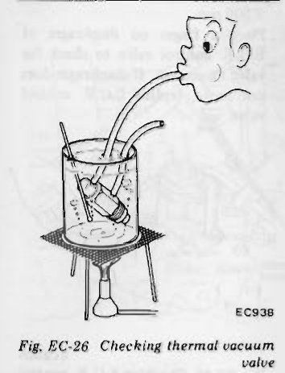
>
> - **Summary:** Blowing air orally through thermal vacuum valve submerged in heated water bath to verify opening and closing temperatures.
> - **Components:** Thermal vacuum valve, Water beaker, Thermometer, Burner stand, Hose
> - **Mechanic Notes:** Do not allow water to get inside the thermal vacuum valve while heating.
> - **Tags:** `thermal vacuum valve`, `bench test`, `water bath`

### Vacuum delay valve (California models only)
1. Remove vacuum delay valve.
2. Blow air through port on B.P.T. valve side, then through the other port (on thermal vacuum valve side). Vacuum delay valve is in good condition if, when finger is placed over port on thermal vacuum valve side, air flow resistance is greater than that on the other side.

> 🖼️ **Fig. EC-27 Checking vacuum delay valve** `[EC704]` *(Type: `procedure_step`)*
>
> 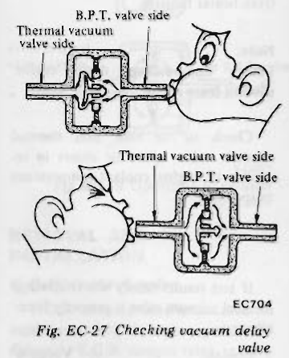
>
> - **Summary:** Testing vacuum delay valve by blowing orally from each side while covering opposite port with finger.
> - **Components:** Vacuum delay valve
> - **Callouts:** **(Thermal vacuum valve side)** Thermal vacuum valve side; **(B.P.T. valve side)** B.P.T. valve side
> - **Mechanic Notes:** Resistance should be greater when blowing from B.P.T. valve side with thermal valve side covered.
> - **Tags:** `vacuum delay valve`, `air flow test`, `bench check`

3. If a considerable air flow resistance is felt at port on thermal vacuum valve side in step 2 above and if the condition of vacuum delay valve is questionable, dip port (on B.P.T. valve side) into a cup filled with water. Blow air through the other port. Small air bubbles should appear.

> 🖼️ **Fig. EC-28 Checking vacuum delay valve** `[EC279]` *(Type: `procedure_step`)*
>
> 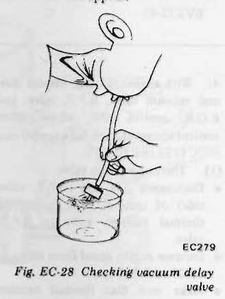
>
> - **Summary:** Submerging B.P.T. side port into cup of water while blowing through the other port to observe small air bubbles.
> - **Components:** Vacuum delay valve, Cup with water
> - **Mechanic Notes:** Small air bubbles indicate proper orifice flow. Avoid oil or dirt entering valve.
> - **Tags:** `vacuum delay valve`, `bubble test`, `water test`

> [!CAUTION]
> Be careful to avoid entry of oil or dirt into valve.

### B.P.T. valve
Disconnect B.P.T. valve from engine.
1. Apply a pressure above 50 mmH2O (1.97 inH2O) to B.P.T. valve and orally suck port back, as shown in Figure EC-29, to check for leakage. If a leak is noted, replace valve.

> 🖼️ **Fig. EC-29 Checking B.P.T. valve** `[EC104A]` *(Type: `procedure_step`)*
>
> 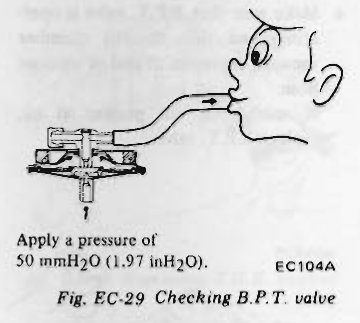
>
> - **Summary:** Testing B.P.T. valve leakage by applying pressure above 50 mmH2O to lower fitting while orally sucking vacuum port.
> - **Components:** B.P.T. valve, Pressure line
> - **Specs / Measurements:** Applied pressure: above 50 mmH2O (1.97 inH2O)
> - **Mechanic Notes:** If leakage occurs while sucking port back under applied pressure, replace valve.
> - **Tags:** `bpt valve test`, `oral suction`, `leak check`

### E.G.R. control valve
Dismount E.G.R. control valve from engine.
1. Apply vacuum to E.G.R. control valve, referring to the following figure. If the valve moves to full position, it is normal. E.G.R. control valve will remain open for more than 30 seconds after vacuum has cut off.

> 🖼️ **Fig. EC-30 Checking E.G.R. control valve** `[EC129A]` *(Type: `procedure_step`)*
>
> 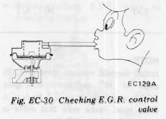
>
> - **Summary:** Testing E.G.R. valve diaphragm and seat by applying oral vacuum suction to vacuum hose port.
> - **Components:** E.G.R. control valve, Vacuum hose
> - **Specs / Measurements:** Hold time: > 30 seconds after vacuum is cut off
> - **Mechanic Notes:** Valve must open fully and hold open position for more than 30 seconds after sealing hose.
> - **Tags:** `egr valve test`, `vacuum hold test`, `oral suction`

2. Visually check E.G.R. control valve for damage, wrinkle or deformation.
3. Clean the seating surface of E.G.R. control valve with a brush and compressed air, and remove foreign matter from around the valve and port.

> 🖼️ **Fig. EC-31 Cleaning E.G.R. control valve** `[EC350]` *(Type: `procedure_step`)*
>
> 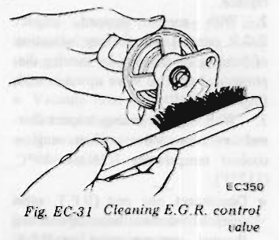
>
> - **Summary:** Cleaning carbon deposits from the E.G.R. control valve seating surface using a wire brush.
> - **Components:** E.G.R. control valve, Wire brush, Valve seat
> - **Mechanic Notes:** Clean seating surface and port with brush and compressed air. Check for wrinkles or deformation.
> - **Tags:** `egr cleaning`, `carbon removal`, `wire brush`

## CATALYTIC CONVERTER SYSTEM

### DESCRIPTION
The catalytic converter accelerates the chemical reaction of hydrocarbons (HC) and carbon monoxide (CO) in the exhaust gas, and changes them into harmless carbon dioxide (CO2) and water (H2O).
This chemical reaction process requires the proper amount of air.
By means of a chemical reaction process as it passes through the catalytic converter, the excess air in the air-fuel mixture (which has not been burned during the combustion process) is utilized to minimize HC and CO emissions.
This converter is installed on all California models. Refer to Figure EC-32 for the location of this unit.

---

<!-- Page 15 (EC-15) -->

> 🖼️ **Fig. EC-32 Location of catalytic converter** `[EC380]` *(Type: `component_location`)*
>
> 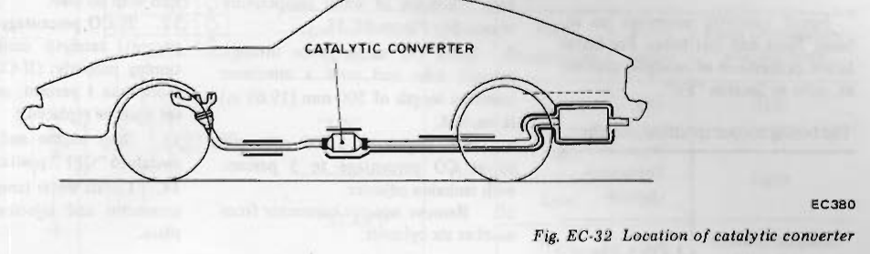
>
> - **Summary:** Vehicle side profile outline indicating catalytic converter position in the exhaust system under the floorpan.
> - **Components:** Catalytic converter, Exhaust manifold, Muffler, Exhaust pipe
> - **Callouts:** **(CATALYTIC CONVERTER)** Catalytic converter
> - **Mechanic Notes:** California models only. Positioned under passenger floor area in exhaust line.
> - **Tags:** `catalytic converter location`, `exhaust system`, `underbody layout`

### OPERATION

#### Catalytic converter
The exhaust gas which is left unburned during combustion process is gradually oxidized with excess oxygen, and is converted into harmless carbon dioxide (CO2) and water (H2O). The catalytic converter, located in the exhaust line, further cleans exhaust gases through catalytic action, and changes residual hydrocarbons (HC) and carbon monoxide (CO) contained in the exhaust gas into carbon dioxide (CO2) and water (H2O) before the exhaust gas is discharged to the atmosphere.

> 🖼️ **Fig. EC-33 Operation of catalytic converter** `[EC382]` *(Type: `cutaway_flow`)*
>
> 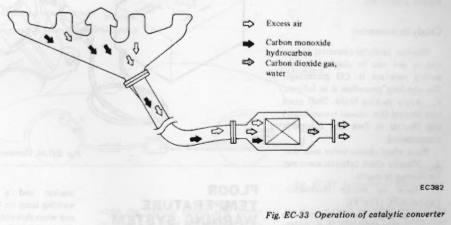
>
> - **Summary:** Flow diagram showing exhaust gases (HC, CO) mixing with excess air from exhaust manifold through catalytic converter bed to form CO2 and H2O.
> - **Components:** Exhaust manifold, Catalytic converter monolith/pellet bed, Exhaust pipe
> - **Callouts:** **(Excess air)** Excess air; **(Carbon monoxide hydrocarbon)** Carbon monoxide hydrocarbon; **(Carbon dioxide gas, water)** Carbon dioxide gas, water
> - **Mechanic Notes:** Catalyst promotes oxidation of unburned hydrocarbons and carbon monoxide using residual excess oxygen.
> - **Tags:** `catalytic converter operation`, `chemical oxidation`, `exhaust gas flow`

## REMOVAL AND INSTALLATION

Removal and installation can be done as follows:

### Removal

#### Catalytic converter
1. Apply parking brake.
2. Place wheel lock under each tire.
3. Jack up the car.
4. Remove lower shelter of catalytic converter.
5. Dismount catalytic converter.

> 🖼️ **Fig. EC-34 Removing catalytic converter** `[EC706]` *(Type: `procedure_step`)*
>
> 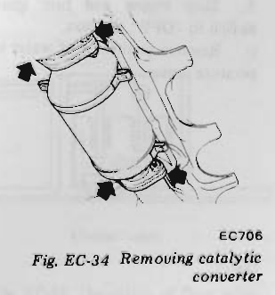
>
> - **Summary:** Unbolting catalytic converter flange bolts connecting to front and rear exhaust tubes and lower heat shelter.
> - **Components:** Catalytic converter, Lower shelter, Flange bolts
> - **Mechanic Notes:** Never wet catalyzer with water or oil. Handle carefully to prevent internal ceramic fracture.
> - **Tags:** `catalytic converter removal`, `exhaust flanges`, `heat shield`

> [!CAUTION]
> a. Be careful not to damage catalytic converter when handling.
> b. Never wet catalyzer with water, oil, etc.

---

<!-- Page 16 (EC-16) -->
### Installation

Install catalytic converter to exhaust front and rear tubes. For installation procedures of catalytic converter, refer to Section "FE".

#### Tightening torque specifications chart

| Component | Tightening torque |
| :--- | :--- |
| Catalytic converter to exhaust front and rear tubes | 3.2 to 4.3 kg-m (23 to 31 ft-lb) |

### Inspection

#### Preliminary inspection
Visually check condition of ignition system, E.F.I. system and component parts including hoses, tubes, and wires, replace if necessary.

#### Catalytic converter
Whether catalytic converter is normal or not can be checked by observing variation in CO percentage.
The checking procedure is as follows:
1. Apply parking brake. Shift gears into Neutral (for manual transmission) and Neutral or Park (for automatic transmission).
Place wheel chocks under each tire.
2. Visually check catalytic converter for damage or cracks.
3. Warm up engine thoroughly. [About 80°C (176°F)]
4. After engine has warmed up, run engine at 2,000 rpm for a few minutes under no load until catalytic converter reaches operating temperature.
5. Stop engine and turn ignition switch to "OFF" position.
6. Remove connector of water temperature sensor.
7. Connect Emission adjuster to harness connector of water temperature sensor. See Figure EC-35.

> 🖼️ **Fig. EC-35 Connecting emission adjuster** `[EC707]` *(Type: `procedure_step`)*
>
> 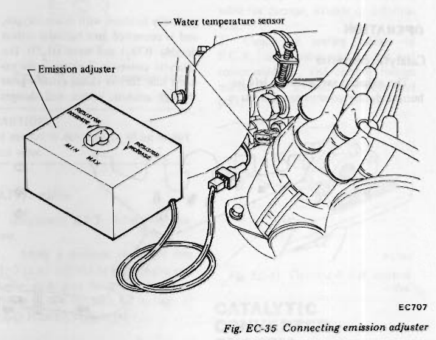
>
> - **Summary:** Connecting the variable resistance emission adjuster tool to the disconnected water temperature sensor harness connector.
> - **Components:** Emission adjuster tool, Water temperature sensor, Harness connector, Engine thermostat housing
> - **Callouts:** **(Emission adjuster)** Emission adjuster; **(Water temperature sensor)** Water temperature sensor
> - **Specs / Measurements:** Probe insertion depth: minimum 500 mm (19.69 in); Baseline setting: 3% CO at 2,000 rpm; Pass criterion with #6 injector disconnected: < 1% CO
> - **Wiring / Connections:** Emission adjuster plugged into water temp sensor harness
> - **Mechanic Notes:** Simulate rich condition with emission adjuster, then cut #6 cylinder; CO must drop below 1% if catalyst is active.
> - **Tags:** `emission adjuster`, `catalytic converter test`, `co test`, `water temp sensor harness`

8. Insert CO meter probe through exhaust tube end until a minimum insertion length of 500 mm (19.69 in) is reached.
9. Run engine at 2,000 rpm and adjust CO percentage to 3 percent with emission adjuster.
10. Remove injector connector from number six cylinder.
11. Keep engine running at 2,000 rpm with no load.
12. If CO percentage is less than 1 percent, catalytic converter is functioning properly. (If CO percentage is more than 1 percent, catalytic converter must be replaced.)
13. Stop engine and turn ignition switch to "OFF" position.
14. Locate water temperature sensor connector and injector connector in place.

## FLOOR TEMPERATURE WARNING SYSTEM

### DESCRIPTION

The floor temperature warning system consists of a floor sensor installed on the car's floor, floor sensor relay installed on passenger seat bracket and a floor temperature warning lamp on the instrument panel and wires that connect these parts.
When the floor temperature rises to an abnormal level, the warning lamp will light to call the attention of the driver. The wiring diagram of this system, and location of the floor sensor are illustrated in Figures EC-36 and EC-37.

---

<!-- Page 17 (EC-17) -->

> 🖼️ **Fig. EC-36 Floor temperature warning system circuit** `[EC105A]` *(Type: `electrical_schematic`)*
>
> 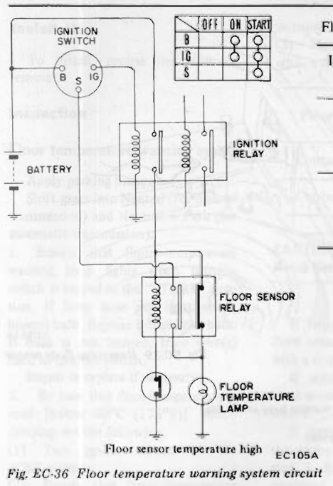
>
> - **Summary:** Schematic of floor temperature warning circuit showing battery, ignition switch, ignition relay, floor sensor relay, floor sensor, and floor temperature lamp.
> - **Components:** Ignition switch, Battery, Ignition relay, Floor sensor relay, Floor temperature lamp, Floor sensor
> - **Callouts:** **(1)** Floor sensor temperature high; **(2)** Floor temperature lamp
> - **Wiring / Connections:** Ignition switch B, IG, S, A terminals; Relay coil and contact connections
> - **Mechanic Notes:** Floor sensor acts as normally closed contact at low temperature; opens when overheated, de-energizing relay and illuminating warning lamp.
> - **Tags:** `floor temperature warning`, `circuit schematic`, `floor sensor relay`, `wiring`

#### Floor temperature warning lamp operation chart

| Ignition switch position | Ignition relay | Floor temperature | Floor sensor | Floor temperature warning lamp |
| :--- | :--- | :--- | :--- | :--- |
| "ON" | ON | Low | ON | OFF |
| "ON" | ON | High | OFF | Light |
| "START" | ON | Low | ON | Light |
| "START" | ON | High | OFF | Light |

> 🖼️ **Fig. EC-37 Location of floor sensor** `[EC398]` *(Type: `component_location`)*
>
> 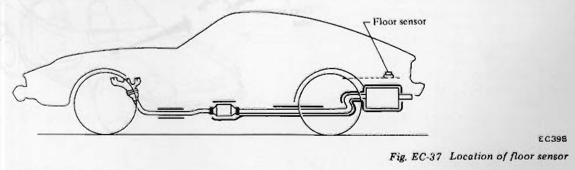
>
> - **Summary:** Chassis elevation outline showing location of the floor temperature sensor mounted above catalytic converter floor area.
> - **Components:** Floor sensor, Floor panel, Exhaust pipe
> - **Callouts:** **(Floor sensor)** Floor sensor
> - **Mechanic Notes:** Sensor is located under passenger floor carpet area above the exhaust pipe / catalytic converter section.
> - **Tags:** `floor sensor location`, `passenger floor`, `chassis`

### OPERATION

Floor temperature will exceed normal level when temperature rise in the exhaust system succeeding the catalytic converter is caused by either an engine problem or severe driving conditions. Under this condition the floor sensor turns off, causing the starting switch line of the floor sensor relay to turn off and the ignition switch line to turn on, as a result, the floor temperature warning lamp comes on.
When the floor temperature drops below the specified level, the floor sensor relay contacts close.
As the contacts close, the ignition line of the floor sensor relay turns off, while the starting switch side comes on. Thus, the floor temperature warning lamp goes out.
The lamp is functioning satisfactorily, if it remains on while the starting motor is in operation. The lamp goes out when the ignition switch is in "ON" position.

> 🖼️ **Fig. EC-38 Operation of floor sensor** `[EC827]` *(Type: `cutaway_flow`)*
>
> 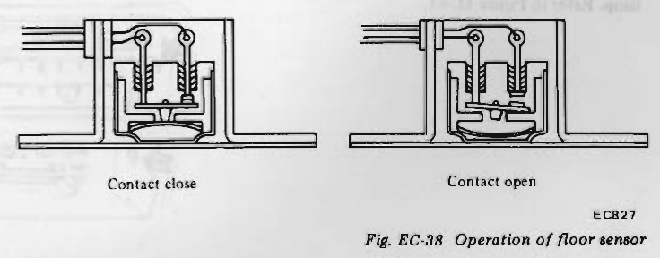
>
> - **Summary:** Internal bimetal mechanism of the floor sensor showing contacts closed (normal) and contacts open (overheated condition).
> - **Components:** Bimetal disc / element, Electrical contacts, Terminal leads, Sensor housing
> - **Callouts:** **(Contact close)** Normal operating temperature; **(Contact open)** Overheated condition
> - **Specs / Measurements:** Contacts open above 115°C (239°F); Contacts close below 92°C (198°F)
> - **Mechanic Notes:** Bimetallic disc snaps open at elevated floor temperatures, breaking relay coil ground.
> - **Tags:** `floor sensor operation`, `bimetal contacts`, `cutaway`

---

<!-- Page 18 (EC-18) -->
## REMOVAL AND INSTALLATION

### Removal

#### Floor sensor
Remove protector before removing floor sensor. Refer to Figure EC-39.

> 🖼️ **Fig. EC-39 Removing floor sensor** `[EC251A]` *(Type: `procedure_step`)*
>
> 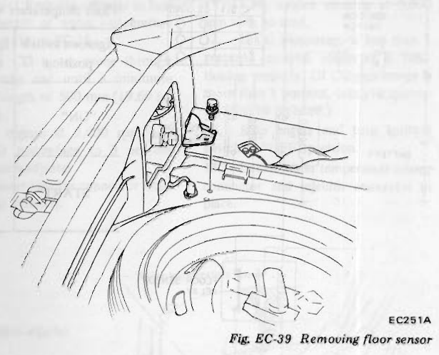
>
> - **Summary:** Interior passenger footwell view showing removal of floor protector and sensor screws.
> - **Components:** Floor sensor, Protector, Mounting screws, Floor carpet
> - **Mechanic Notes:** Remove protective cover before loosening floor sensor mounting screws.
> - **Tags:** `floor sensor removal`, `passenger footwell`, `protector`

#### Floor sensor relay
Remove front passenger seat before removing floor sensor relay. Refer to Figure EC-40.

> 🖼️ **Fig. EC-40 Location of floor sensor relay** `[EC252A]` *(Type: `component_location`)*
>
> 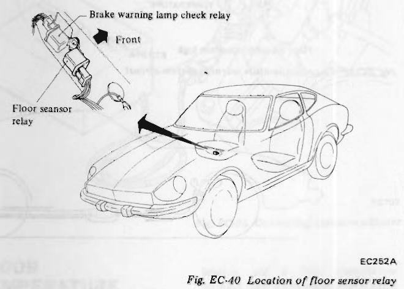
>
> - **Summary:** Perspective drawing showing floor sensor relay and brake warning lamp check relay mounted beneath passenger seat.
> - **Components:** Floor sensor relay, Brake warning lamp check relay, Passenger seat frame bracket
> - **Callouts:** **(Brake warning lamp check relay)** Brake warning lamp check relay; **(Floor sensor relay)** Floor sensor relay; **(Front)** Front of vehicle
> - **Wiring / Connections:** Relay harness plug under passenger seat
> - **Mechanic Notes:** Remove front passenger seat to access the floor sensor relay on seat bracket.
> - **Tags:** `floor sensor relay`, `brake check relay`, `under seat location`

#### Floor temperature warning lamp
Remove instrument finisher before removing floor temperature warning lamp. Refer to Figure EC-41.

> 🖼️ **Fig. EC-41 Location of floor temperature lamp** `[EC437]` *(Type: `component_location`)*
>
> 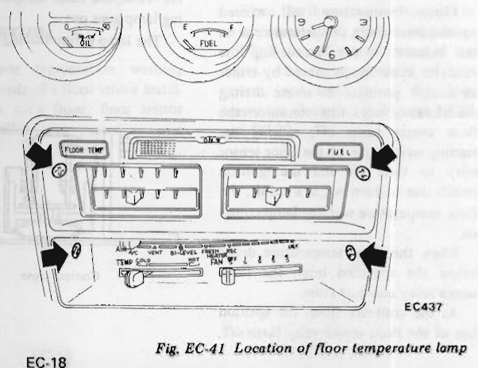
>
> - **Summary:** Dashboard center console view showing location of FLOOR TEMP warning light lens on heater/vent finisher panel.
> - **Components:** Instrument finisher panel, FLOOR TEMP warning lamp, Heater control panel, Gauges
> - **Callouts:** **(FLOOR TEMP)** Floor temperature warning indicator; **(FUEL)** Fuel warning indicator
> - **Mechanic Notes:** Remove center console instrument finisher panel to replace bulb or warning unit.
> - **Tags:** `floor temp lamp`, `instrument cluster`, `center console`, `warning lamp`

---

<!-- Page 19 (EC-19) -->
### Installation

To install, reverse the order of removal.

### Inspection

#### Floor temperature warning system
Apply parking brake.
Shift gears into Neutral (for manual transmission) and Neutral or Park (for automatic transmission).
1. Ensure that floor temperature warning lamp lights when ignition switch is turned to the "START" position. If lamp does not light, check burned bulb. Replace burned out bulb. If bulb is not burned, trace wire(s) back to ignition switch.
Repair or replace if necessary.
2. Be sure that floor temperature is cool [below 80°C (176°F)] before carrying out the following:
  (1) Turn ignition switch to the "ON" position.
  (2) Ensure that floor temperature warning lamp goes out.
  (3) Heat areas around floor sensor with a proper heater to ensure that floor temperature warning lamp comes on when floor is heated to specifications in the table below.

| Floor sensor | Floor temperature warning lamp | Floor temperature |
| :--- | :--- | :--- |
| Contacts close | OFF | Below 92°C (198°F) |
| Contacts open | ON | Above 115°C (239°F) |

> [!CAUTION]
> Avoid heating floor sensor directly.

> [!NOTE]
> The floor sensor may be heated through the floor by a proper heater.

- If lamp does not come on, check floor sensor connector for continuity with a circuit tester.
- If continuity exists after heating areas around floor sensor, replace floor sensor.
- If continuity does not exist, trace the wiring back to relay or proceed to step 3. Repair or replace wire(s) if necessary.
3. Turn ignition switch to the "ON" position, and disconnect floor sensor connector. The lamp should remain on. If not, check floor sensor relay for continuity with a circuit tester.
Conduct checks under the heading following "floor sensor relay", and if relay is found normal, trace wire(s) back to ignition switch. Repair faulty wiring if necessary. Refer to Figure EC-42.

---

<!-- Page 20 (EC-20) -->

> 🖼️ **Fig. EC-42 Wiring diagram of floor temperature warning system** `[EC118A]` *(Type: `electrical_schematic`)*
>
> 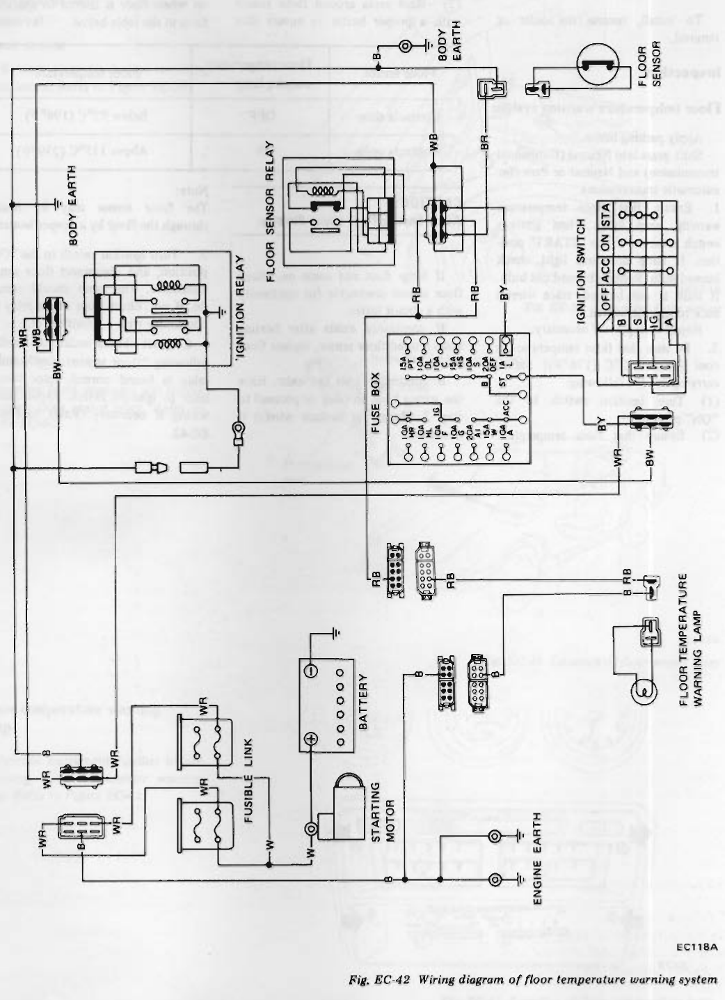
>
> - **Summary:** Complete schematic diagram of floor temperature warning system showing wire colors, connector pinouts, battery, fusible links, starting motor, ignition switch, fuse box, ignition relay, floor sensor relay, floor sensor, and floor temperature warning lamp.
> - **Components:** Battery, Fusible link, Starting motor, Engine earth, Body earth, Fuse box, Ignition switch, Ignition relay, Floor sensor relay, Floor sensor, Floor temperature warning lamp
> - **Callouts:** **(FUSE BOX)** Fuse box; **(IGNITION RELAY)** Ignition relay; **(FLOOR SENSOR RELAY)** Floor sensor relay; **(IGNITION SWITCH)** Ignition switch; **(FLOOR SENSOR)** Floor sensor; **(FLOOR TEMPERATURE WARNING LAMP)** Floor temperature warning lamp
> - **Wiring / Connections:** WR (White/Red); WB (White/Black); BW (Black/White); RB (Red/Black); BY (Black/Yellow); BR (Black/Red); B (Black ground)
> - **Mechanic Notes:** Shows all multi-pin harness connectors, wire color coding, and relay pin numbers for floor temperature warning circuitry.
> - **Tags:** `wiring diagram`, `floor temperature warning`, `schematic`, `wire colors`, `harness connectors`

---

<!-- Page 21 (EC-21) -->

> 🖼️ **Fig. EC-43 Floor temperature warning lamp ON with ignition switch in \"START\" position** `[EC119A]` *(Type: `electrical_schematic`)*
>
> 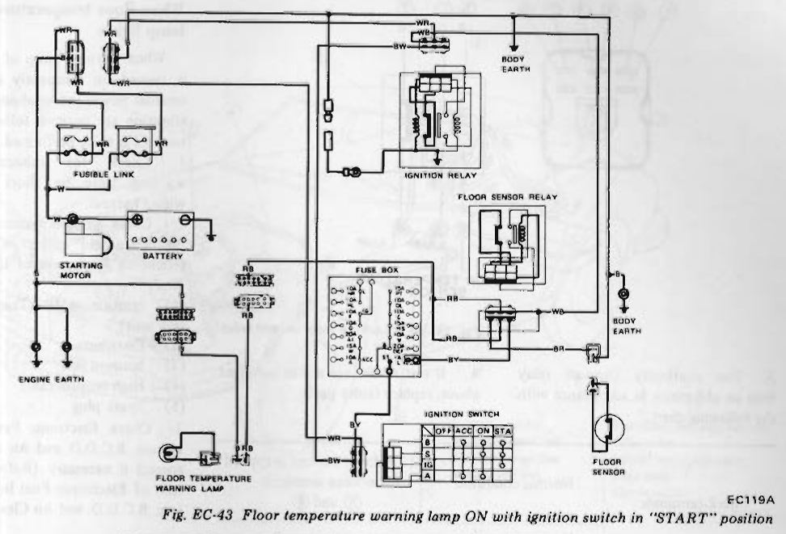
>
> - **Summary:** Current flow path through circuit diagram when ignition switch is in START position, proving bulb bulb-check functionality.
> - **Components:** Battery, Starting motor, Ignition switch (STA contact closed), Fuse box, Floor temperature warning lamp, Floor sensor relay
> - **Wiring / Connections:** BY line energized from STA terminal to illuminate warning lamp during cranking
> - **Mechanic Notes:** Heavy lines trace circuit from starter terminal through warning lamp to ground during cranking.
> - **Tags:** `floor temp circuit`, `start position`, `bulb check`, `current trace`

> 🖼️ **Fig. EC-44 Floor temperature warning lamp ON with floor sensor turned OFF** `[EC120A]` *(Type: `electrical_schematic`)*
>
> 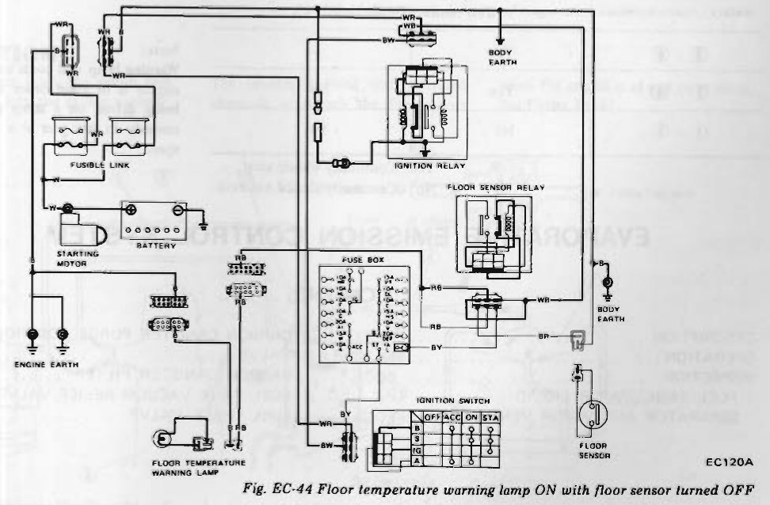
>
> - **Summary:** Current flow path when floor sensor bimetal opens (OFF state), de-energizing relay and routing 12V through relay normally-closed contacts to warning lamp.
> - **Components:** Battery, Ignition switch (ON), Ignition relay, Fuse box, Floor sensor relay (de-energized), Floor sensor (open circuit), Floor temperature warning lamp (illuminated)
> - **Wiring / Connections:** Current flow traced through de-energized relay contacts to lamp
> - **Mechanic Notes:** When sensor heats above 115°C, its internal contact opens, cutting relay coil ground; relay returns to NC position and lights bulb.
> - **Tags:** `floor temp circuit`, `overheat condition`, `sensor open`, `current trace`

### Floor sensor relay

> [!CAUTION]
> Before applying test voltage to relay, connect a fuse in series with lead wire to prevent damage to the circuit.

1. Disconnect ground cable from battery.
2. Remove relay from car.

---

<!-- Page 22 (EC-22) -->

> 🖼️ **Fig. EC-45 Checking floor sensor relay** `[EC900]` *(Type: `inspection_measurement`)*
>
> 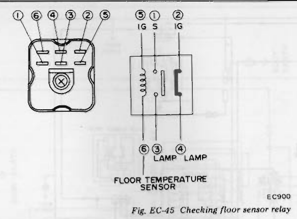
>
> - **Summary:** Terminal pin numbering and internal coil/switch diagram of the floor sensor relay for bench continuity testing.
> - **Components:** Floor sensor relay, Terminals 1, 2, 3, 4, 5, 6
> - **Callouts:** **(1)** IG; **(2)** IG; **(3)** LAMP; **(4)** LAMP; **(5)** IG; **(6)** S (FLOOR TEMPERATURE SENSOR)
> - **Specs / Measurements:** Terminals 5-6: Coil continuity (Yes); Terminals 2-4: NC contact (Yes normal, No energized); Terminals 1-3: NO contact (No normal, Yes energized)
> - **Wiring / Connections:** 12V DC applied across coil terminals 5 and 6
> - **Mechanic Notes:** Use fused test lead when energizing terminals 5 and 6.
> - **Tags:** `floor sensor relay`, `relay testing`, `pinout`, `terminal continuity`

3. Test continuity through relay with an ohmmeter in accordance with the following chart:

| Check terminals | Normal condition | 12V direct current is applied between terminals 5 and 6 |
| :--- | :--- | :--- |
| (5) - (6) | Yes | - |
| (2) - (4) | Yes | No |
| (1) - (3) | No | Yes |

* Yes: Continuity should exist.
* No: Continuity should not exist.

4. If test results are not as indicated above, replace faulty parts.

### When floor temperature warning lamp lights
When warning lamp of this system is turned on frequently and further unusual power loss or abnormal engine vibration are noticed, following maintenance is to be performed:
1. Check for misactuation of warning lamp by short circuit of wiring harness.
2. Check ignition system for following items and correct if necessary. (Refer to Inspection of Ignition System.)
  (1) Ignition AMP (Transistor ignition unit)
  (2) Distributor
  (3) Ignition coil
  (4) High tension cable
  (5) Spark plug
3. Check Electronic Fuel Injection system, B.C.D.D. and Air cleaner, and correct if necessary. (Refer to Inspection of Electronic Fuel Injection System, B.C.D.D. and Air Cleaner.)

> [!NOTE]
> Warning lamp will come on even if the engine is in good order if the car is being driven on a steep slope continuously in low gear at a high engine speed.

# EVAPORATIVE EMISSION CONTROL SYSTEM

### CONTENTS

| Section | Page | Section | Page |
| :--- | :--- | :--- | :--- |
| DESCRIPTION | EC-22 | CARBON CANISTER PURGE CONTROL VALVE | EC-25 |
| OPERATION | EC-23 | CARBON CANISTER FILTER | EC-25 |
| INSPECTION | EC-24 | FUEL TANK VACUUM RELIEF VALVE | EC-25 |
| FUEL TANK, VAPOR LIQUID SEPARATOR AND VAPOR VENT LINE | EC-24 | FUEL CHECK VALVE | EC-25 |

### DESCRIPTION

The evaporative emission control system is used to reduce hydrocarbons emitted to the atmosphere from the fuel system. This reduction of hydrocarbons is accomplished by activated charcoals in the carbon canister.
This system is made up of the following:
1. Fuel tank with positive sealing filler cap
2. Vapor-liquid separator
3. Check valve
4. Vapor vent line
5. Carbon canister
6. Vacuum signal line
7. Canister purge line

---

<!-- Page 23 (EC-23) -->

> 🖼️ **Fig. EC-46 Schematic drawing of evaporative emission control system** `[EC712]` *(Type: `cutaway_flow`)*
>
> 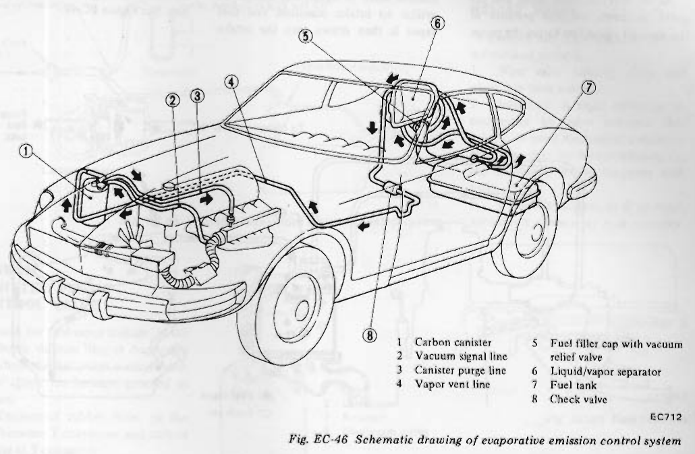
>
> - **Summary:** Chassis perspective view showing complete evaporative plumbing: fuel tank, filler cap, separator, vapor lines, check valve, and canister.
> - **Components:** Carbon canister, Vacuum signal line, Canister purge line, Vapor vent line, Fuel filler cap with vacuum relief valve, Liquid/vapor separator, Fuel tank, Check valve
> - **Callouts:** **(1)** Carbon canister; **(2)** Vacuum signal line; **(3)** Canister purge line; **(4)** Vapor vent line; **(5)** Fuel filler cap with vacuum relief valve; **(6)** Liquid/vapor separator; **(7)** Fuel tank; **(8)** Check valve
> - **Wiring / Connections:** Plumbing lines connecting rear separator, underbody vapor line, and engine compartment canister
> - **Mechanic Notes:** Fuel tank is sealed with a vacuum relief filler cap. Vapors pass through liquid/vapor separator and check valve to canister.
> - **Tags:** `evaporative system`, `carbon canister`, `liquid vapor separator`, `chassis plumbing`

### OPERATION

Fuel vapors from the sealed fuel tank are led into the carbon canister.
The canister is filled with activated charcoals to absorb the fuel vapors when the engine is at rest or at idling. See Figure EC-47.

> 🖼️ **Fig. EC-47 Evaporative emission control system (Fuel vapor flow when engine is at rest or at idling)** `[EC121A]` *(Type: `cutaway_flow`)*
>
> 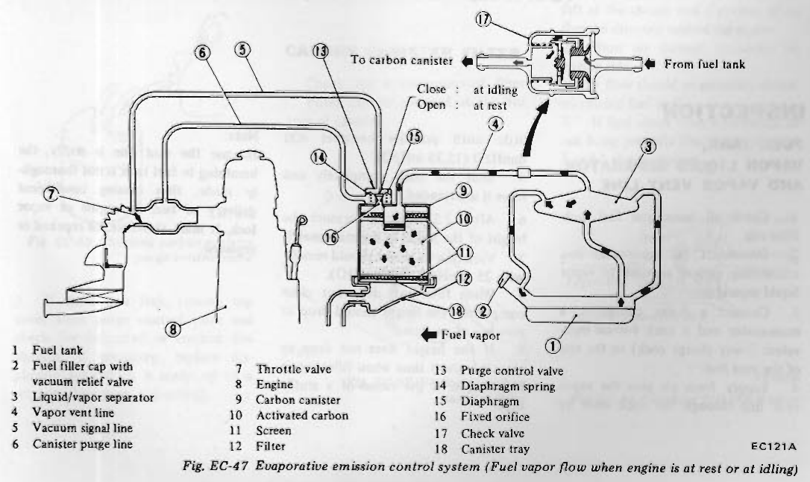
>
> - **Summary:** Functional flow schematic at rest or idle showing vapor trapped in activated carbon while purge control valve remains closed.
> - **Components:** Fuel tank, Fuel filler cap with vacuum relief valve, Liquid/vapor separator, Vapor vent line, Vacuum signal line, Canister purge line, Throttle valve, Engine, Carbon canister, Activated carbon, Screen, Filter, Purge control valve, Diaphragm spring, Diaphragm, Fixed orifice, Check valve, Canister tray
> - **Callouts:** **(1)** Fuel tank; **(2)** Fuel filler cap with vacuum relief valve; **(3)** Liquid/vapor separator; **(4)** Vapor vent line; **(5)** Vacuum signal line; **(6)** Canister purge line; **(7)** Throttle valve; **(8)** Engine; **(9)** Carbon canister; **(10)** Activated carbon; **(11)** Screen; **(12)** Filter; **(13)** Purge control valve; **(14)** Diaphragm spring; **(15)** Diaphragm; **(16)** Fixed orifice; **(17)** Check valve; **(18)** Canister tray
> - **Mechanic Notes:** At rest or idle, purge control valve diaphragm spring holds valve closed so vapors are retained in activated carbon.
> - **Tags:** `evaporative flow`, `idle state`, `rest state`, `purge control valve closed`, `carbon canister`

---

<!-- Page 24 (EC-24) -->
As the throttle valve opens and car speed increases, vacuum pressure in the vacuum signal line forces the purge control valve to open, and admits an orifice to intake manifold and fuel vapor is then drawn into the intake manifold through the canister purge line. See Figure EC-48.

> 🖼️ **Fig. EC-48 Evaporative emission control system (Fuel vapor flow when engine is running)** `[EC122A]` *(Type: `cutaway_flow`)*
>
> 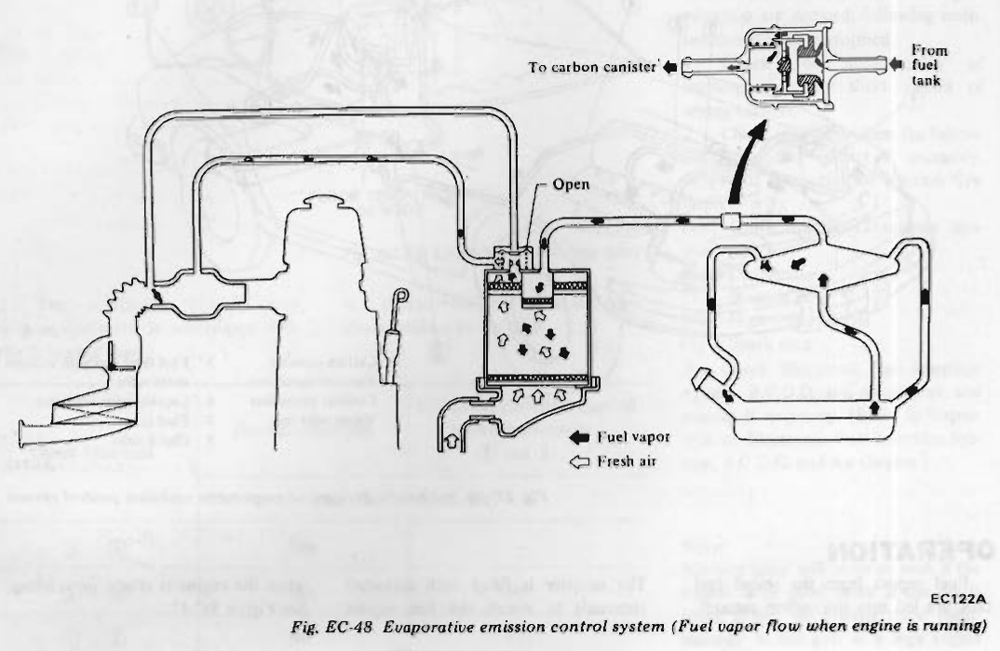
>
> - **Summary:** Functional flow schematic showing purge control valve opened by port vacuum during running conditions, admitting fresh air through canister bottom and purging vapors to intake manifold.
> - **Components:** Throttle chamber, Intake manifold, Carbon canister, Purge control valve (open), Liquid/vapor separator, Fuel tank, Check valve
> - **Callouts:** **(Open)** Purge control valve open; **(Fuel vapor)** Fuel vapor flow; **(Fresh air)** Fresh air flow
> - **Wiring / Connections:** Vacuum signal line to throttle chamber port; Purge line to intake manifold port
> - **Mechanic Notes:** Throttle vacuum lifts diaphragm against spring, pulling fresh air through canister bottom filter and purging absorbed vapors into engine.
> - **Tags:** `evaporative flow`, `running state`, `purge operation`, `carbon canister purging`

## INSPECTION

### FUEL TANK, VAPOR LIQUID SEPARATOR AND VAPOR VENT LINE

1. Check all hoses and fuel tank filler cap.
2. Disconnect the vapor vent line connecting carbon canister to vapor liquid separator.
3. Connect a 3-way connector, a manometer and a cock (or an equivalent 3-way charge cock) to the end of the vent line.
4. Supply fresh air into the vapor vent line through the cock little by little until pressure becomes 400 mmH2O (15.75 inH2O).
5. Shut the cock completely and leave it unattended.
6. After 2.5 minutes, measure the height of the liquid in the manometer.
7. Variation in height should remain with 25 mmH2O (0.98 inH2O).
8. When filler cap does not close completely, the height should drop to zero in a short time.
9. If the height does not drop to zero in a short time when filler cap is removed, it is the cause of a stuffy hose.

> [!NOTE]
> In case the vent line is stuffy, the breathing in fuel tank is not thoroughly made, thus causing insufficient delivery of fuel to engine or vapor lock. It must, therefore, be repaired or replaced.

---

<!-- Page 25 (EC-25) -->

> 🖼️ **Fig. EC-49 Checking evaporative emission control system** `[EC715]` *(Type: `procedure_step`)*
>
> 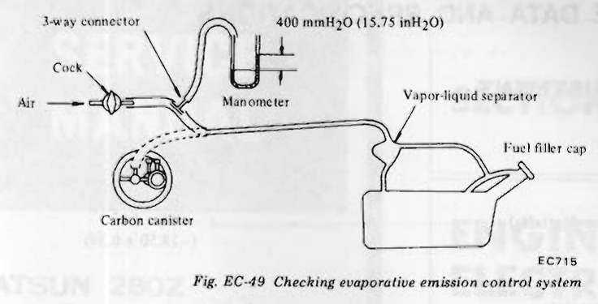
>
> - **Summary:** Apparatus setup for pressure testing vapor vent line, separator, and tank using manometer, 3-way connector cock, and hand air pump.
> - **Components:** Manometer, 3-way connector cock, Carbon canister, Vapor-liquid separator, Fuel filler cap
> - **Specs / Measurements:** Test pressure: 400 mmH2O (15.75 inH2O); Max allowable pressure drop: 25 mmH2O (0.98 inH2O) over 2.5 minutes
> - **Wiring / Connections:** Manometer tee connected to disconnected vent line at canister
> - **Mechanic Notes:** If pressure drops immediately, filler cap or vent hoses leak. If pressure does not drop when cap removed, line is clogged.
> - **Tags:** `evaporative leak test`, `manometer`, `pressure check`, `vapor vent line`

### CARBON CANISTER PURGE CONTROL VALVE

Check for fuel vapor leakage, in the distributor vacuum line, at diaphragm of carbon canister purge control valve.
To check for leakage, proceed as follows:
1. Disconnect rubber hose, in the line, between T-connector and carbon canister at T-connector.
2. Inhale air into the opening of rubber hose running to vacuum hole in carbon canister and ensure that there is no leak.

> 🖼️ **Fig. EC-50 Checking carbon canister purge control valve** `[ET349]` *(Type: `procedure_step`)*
>
> 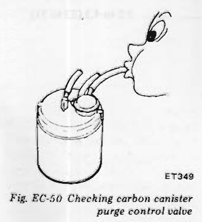
>
> - **Summary:** Inhaling oral suction on disconnected rubber hose to canister purge control valve diaphragm port to check for diaphragm leakage.
> - **Components:** Carbon canister, Purge control valve vacuum hose
> - **Mechanic Notes:** There must be no leakage when inhaling on hose. If leaking, replace diaphragm kit.
> - **Tags:** `purge control valve`, `canister diaphragm test`, `oral suction`

> 🖼️ **Fig. EC-51 Carbon canister purge control valve** `[ET350]` *(Type: `exploded_view`)*
>
> 
>
> - **Summary:** Exploded view of the purge control valve assembly on top of the carbon canister.
> - **Components:** Cover, Diaphragm, Retainer, Diaphragm spring, Canister body
> - **Callouts:** **(1)** Cover; **(2)** Diaphragm; **(3)** Retainer; **(4)** Diaphragm spring
> - **Mechanic Notes:** Diaphragm kit consists of retainer, diaphragm, and spring.
> - **Tags:** `purge control valve`, `exploded view`, `diaphragm kit`, `carbon canister`

3. If there is a leak, remove top cover from purge control valve and check for dislocated or cracked diaphragm. If necessary, replace diaphragm kit (which is made up of a retainer, diaphragm and spring).

### CARBON CANISTER FILTER

Check for a contaminated filter. Filter can be removed at the bottom of canister.

> 🖼️ **Fig. EC-52 Replacing carbon canister filter** `[EF201]` *(Type: `procedure_step`)*
>
> 
>
> - **Summary:** Hand removal and replacement of the fibrous bottom filter pad of the carbon canister.
> - **Components:** Carbon canister, Bottom filter pad
> - **Mechanic Notes:** Filter pad is easily pulled out from bottom recess of canister body when dirty.
> - **Tags:** `carbon canister filter`, `filter replacement`, `canister bottom`

### FUEL TANK VACUUM RELIEF VALVE

Remove fuel filler cap and see that it functions properly.
1. Wipe valve housing clean and place it in your mouth.
2. Inhale air. A slight resistance accompanied by valve indicates that valve is in good mechanical condition. Note also that, by further inhaling air, the resistance should disappear with valve clicks.
3. If valve is clogged, or if no resistance is felt, replace cap as an assembly.

> 🖼️ **Fig. EC-53 Fuel filler cap** `[EC089A]` *(Type: `cutaway_flow`)*
>
> 
>
> - **Summary:** Cross-sectional cutaway of fuel filler cap vacuum relief valve mechanism showing internal spring and sealing gasket.
> - **Components:** Filler cap shell, Vacuum relief valve spring, Valve seal disc, Filler neck gasket
> - **Mechanic Notes:** Oral inhalation should produce slight resistance then click as valve opens. Replace cap if clogged or free-leaking.
> - **Tags:** `fuel filler cap`, `vacuum relief valve`, `cap cutaway`

### FUEL CHECK VALVE

1. Blow air through connector on fuel tank side.
A considerable resistance should be felt at the mouth and a portion of air flow be directed toward the engine.
2. Blow air through connector on engine side.
Air flow should be smoothly directed toward fuel tank.
3. If fuel check valve is suspected of not being properly functioning in steps 1 and 2 above, replace.

> 🖼️ **Fig. EC-54 Checking fuel check valve** `[EC090A]` *(Type: `cutaway_flow`)*
>
> 
>
> - **Summary:** Cross-sectional flow diagram of two-way fuel check valve showing differential resistance between fuel tank side and engine side.
> - **Components:** Engine side fitting, Fuel tank side fitting, Valve disc, Internal spring
> - **Callouts:** **(Engine side)** Engine side; **(Fuel tank side)** Fuel tank side; **(Evaporative fuel flow)** Evaporative fuel flow (toward engine); **(Fresh air flow)** Fresh air flow (toward tank)
> - **Mechanic Notes:** Air blown into engine side should flow freely toward tank; air blown into tank side should show considerable resistance.
> - **Tags:** `fuel check valve`, `differential resistance`, `vapor check valve`, `cutaway`

---

<!-- Page 26 (EC-26) -->
# SERVICE DATA AND SPECIFICATIONS

### INSPECTION AND ADJUSTMENT

#### B.C.D.D.

| Item | Unit | Value |
| :--- | :--- | :--- |
| B.C.D.D. operating pressure [0 m, sea level and 760 mmHg (29.9 inHg), atmospheric pressure] | mmHg (inHg) | -470 ± 10 (-18.50 ± 0.39) |

#### E. G. R. SYSTEM

| Thermal vacuum valve operating temperature | Coolant temperature °C (°F) | Vacuum passage |
| :--- | :--- | :--- |
| Below 47 (117) | Coolant temperature | Closed |
| 50 to 95 (122 to 203) | Coolant temperature | Open |
| Above 98 (208) | Coolant temperature | Closed |

#### FLOOR TEMPERATURE WARNING SYSTEM

| Item | Unit | Value |
| :--- | :--- | :--- |
| Floor sensor, contacts opening temperature | °C (°F) | Above 115 (239) |

### TIGHTENING TORQUE

| Component | Unit | Tightening torque |
| :--- | :--- | :--- |
| B.C.D.D. | kg-cm (in-lb) | 20 to 40 (17 to 35) |
| B.C.D.D. vacuum control solenoid | kg-cm (in-lb) | 180 to 350 (156 to 304) |
| E.G.R. thermal vacuum valve | kg-m (ft-lb) | Less than 2.2 (16) |
| Catalytic converter bolt | kg-m (ft-lb) | 3.2 to 4.3 (23 to 31) |

---

## Segmented Diagrams Index

| Figure | Code | Type | Page | Caption | Key Components / Callouts | File |
| :--- | :--- | :--- | :--- | :--- | :--- | :--- |
| **Fig. EC-1** | `EC805` | `cutaway_flow` | EC-2 | Fig. EC-1 Crankcase emission control system | Seal rubber, Oil level gauge, Baffle plate, Oil cap, Flame arrester | [fig_ec_1_crankcase_emission_control_system.png](diagrams/EC Emission Control System/fig_ec_1_crankcase_emission_control_system.png) |
| **Fig. EC-2** | `EC242A` | `component_location` | EC-4 | Fig. EC-2 Location of emission control system components | Fuel damper, Fuel pump, Altitude switch (California models), Dropping resistor, Throttle valve switch | [fig_ec_2_location_of_emission_control_system_components.png](diagrams/EC Emission Control System/fig_ec_2_location_of_emission_control_system_components.png) |
| **Fig. EC-3** | `EC243A` | `cutaway_flow` | EC-5 | Fig. EC-3 Schematic drawing of B.C.D.D. | Ignition switch, Amplifier, Speed detecting switch, Inhibitor switch, Vacuum control solenoid valve | [fig_ec_3_schematic_drawing_of_bcdd.png](diagrams/EC Emission Control System/fig_ec_3_schematic_drawing_of_bcdd.png) |
| **Fig. EC-4** | `EC689` | `procedure_step` | EC-6 | Fig. EC-4 Removing B.C.D.D. | Throttle chamber, B.C.D.D. assembly, Securing screws, Assembly screws | [fig_ec_4_removing_bcdd.png](diagrams/EC Emission Control System/fig_ec_4_removing_bcdd.png) |
| **Fig. EC-5** | `EC373` | `electrical_schematic` | EC-6 | Fig. EC-5 Checking B.C.D.D. circuit with function test connector (for manual transmission) | Multimeter, Function test connector, Ignition key, Fuse, Amplifier | [fig_ec_5_checking_bcdd_circuit_function_test_connector_mt.png](diagrams/EC Emission Control System/fig_ec_5_checking_bcdd_circuit_function_test_connector_mt.png) |
| **Fig. EC-6** | `EC374` | `electrical_schematic` | EC-6 | Fig. EC-6 Checking B.C.D.D. circuit with function test connector (for automatic transmission) | Multimeter, Function test connector, Ignition key, Inhibitor switch, Vacuum control solenoid valve | [fig_ec_6_checking_bcdd_circuit_function_test_connector_at.png](diagrams/EC Emission Control System/fig_ec_6_checking_bcdd_circuit_function_test_connector_at.png) |
| **Fig. EC-7** | `EC690` | `procedure_step` | EC-7 | Fig. EC-7 Checking solenoid valve | B.C.D.D. solenoid valve, Harness connector, Jumper test lead, Battery | [fig_ec_7_checking_solenoid_valve.png](diagrams/EC Emission Control System/fig_ec_7_checking_solenoid_valve.png) |
| **Fig. EC-8** | `EC691` | `electrical_schematic` | EC-7 | Fig. EC-8 Checking amplifier | Ignition key, Amplifier, Speed detecting switch, B.C.D.D. solenoid valve, Ammeter / Circuit tester | [fig_ec_8_checking_amplifier.png](diagrams/EC Emission Control System/fig_ec_8_checking_amplifier.png) |
| **Fig. EC-9** | `EC690` | `procedure_step` | EC-7 | Fig. EC-9 Removing harness of solenoid valve | Throttle chamber, B.C.D.D. solenoid valve, Harness connector | [fig_ec_9_removing_harness_of_solenoid_valve.png](diagrams/EC Emission Control System/fig_ec_9_removing_harness_of_solenoid_valve.png) |
| **Fig. EC-10** | `EC244A` | `procedure_step` | EC-7 | Fig. EC-10 Connecting vacuum gauge | Vacuum gauge, Connecting pipe / hose, Intake manifold, Throttle chamber | [fig_ec_10_connecting_vacuum_gauge.png](diagrams/EC Emission Control System/fig_ec_10_connecting_vacuum_gauge.png) |
| **Fig. EC-11** | `EC802` | `procedure_step` | EC-8 | Fig. EC-11 Adjusting operating pressure (California models) | B.C.D.D. body, Adjusting nut, Lock spring, Open end wrench | [fig_ec_11_adjusting_operating_pressure_california_models.png](diagrams/EC Emission Control System/fig_ec_11_adjusting_operating_pressure_california_models.png) |
| **Fig. EC-12** | `EC096A` | `procedure_step` | EC-8 | Fig. EC-12 Adjusting operating pressure (Non-California models) | Adjusting screw, Cover, Screwdriver, B.C.D.D. housing | [fig_ec_12_adjusting_operating_pressure_non_california_models.png](diagrams/EC Emission Control System/fig_ec_12_adjusting_operating_pressure_non_california_models.png) |
| **Fig. EC-13** | `EC379` | `graph_chart` | EC-9 | Fig. EC-13 Changes in operating pressure versus changes in atmospheric pressure and altitude (California models) | Operating vacuum scale (300 to 600 mmHg / 12 to 24 inHg), Atmospheric pressure scale (450 to 750 mmHg / 18 to 30 inHg), Altitude scale (0 to 6000 ft / 0 to 2.0 km), Atmospheric pressure curve, Operating vacuum curve | [fig_ec_13_changes_in_operating_pressure_vs_altitude.png](diagrams/EC Emission Control System/fig_ec_13_changes_in_operating_pressure_vs_altitude.png) |
| **Fig. EC-14** | `EC931` | `cutaway_flow` | EC-10 | Fig. EC-14 E.G.R. control system | Intake manifold, Throttle chamber, E.G.R. control valve, E.G.R. tube, B.P.T. valve | [fig_ec_14_egr_control_system.png](diagrams/EC Emission Control System/fig_ec_14_egr_control_system.png) |
| **Fig. EC-15** | `EC231` | `cutaway_flow` | EC-11 | Fig. EC-15 E.G.R. control valve | Diaphragm spring, Diaphragm, Valve shaft, Valve, Valve seat | [fig_ec_15_egr_control_valve.png](diagrams/EC Emission Control System/fig_ec_15_egr_control_valve.png) |
| **Fig. EC-16** | `EC934` | `cutaway_flow` | EC-11 | Fig. EC-16 Thermal vacuum valve | Spring, Valve seat, Heater housing, Cooling water, Wax pellet | [fig_ec_16_thermal_vacuum_valve.png](diagrams/EC Emission Control System/fig_ec_16_thermal_vacuum_valve.png) |
| **Fig. EC-17** | `EC088A` | `cutaway_flow` | EC-11 | Fig. EC-17 B.P.T. valve | Air filter, Diaphragm, Exhaust pressure port, Air bleed, Vacuum signal source port | [fig_ec_17_bpt_valve.png](diagrams/EC Emission Control System/fig_ec_17_bpt_valve.png) |
| **Fig. EC-18** | `EC245A` | `component_location` | EC-12 | Fig. EC-18 Vacuum delay valve | Vacuum delay valve, Hose to thermal vacuum valve, Hose to B.P.T. valve | [fig_ec_18_vacuum_delay_valve.png](diagrams/EC Emission Control System/fig_ec_18_vacuum_delay_valve.png) |
| **Fig. EC-19** | `EC697` | `cutaway_flow` | EC-12 | Fig. EC-19 Operation of vacuum delay valve | Umbrella valve, Fluidic restrictor orifice, Valve body | [fig_ec_19_operation_of_vacuum_delay_valve.png](diagrams/EC Emission Control System/fig_ec_19_operation_of_vacuum_delay_valve.png) |
| **Fig. EC-20** | `EC246A` | `procedure_step` | EC-12 | Fig. EC-20 Removing E.G.R. control valve | E.G.R. control valve, Intake manifold, Securing nuts, Vacuum hose | [fig_ec_20_removing_egr_control_valve.png](diagrams/EC Emission Control System/fig_ec_20_removing_egr_control_valve.png) |
| **Fig. EC-21** | `EC247A` | `procedure_step` | EC-12 | Fig. EC-21 Removing B.P.T. valve | B.P.T. valve, Mounting bracket, Control tube, Mounting bolts, Vacuum hoses | [fig_ec_21_removing_bpt_valve.png](diagrams/EC Emission Control System/fig_ec_21_removing_bpt_valve.png) |
| **Fig. EC-22** | `EC937` | `procedure_step` | EC-12 | Fig. EC-22 Removing thermal vacuum valve | Heater housing, Thermal vacuum valve | [fig_ec_22_removing_thermal_vacuum_valve.png](diagrams/EC Emission Control System/fig_ec_22_removing_thermal_vacuum_valve.png) |
| **Fig. EC-23** | `EC248A` | `procedure_step` | EC-13 | Fig. EC-23 Checking thermal vacuum valve | Thermal vacuum valve, Vacuum hose, Intake manifold | [fig_ec_23_checking_thermal_vacuum_valve.png](diagrams/EC Emission Control System/fig_ec_23_checking_thermal_vacuum_valve.png) |
| **Fig. EC-24** | `EC249A` | `procedure_step` | EC-13 | Fig. EC-24 Checking B.P.T. valve | B.P.T. valve, Vacuum hose to E.G.R. valve | [fig_ec_24_checking_bpt_valve.png](diagrams/EC Emission Control System/fig_ec_24_checking_bpt_valve.png) |
| **Fig. EC-25** | `EC250A` | `procedure_step` | EC-13 | Fig. EC-25 Checking E.G.R. control valve | E.G.R. control valve, Diaphragm | [fig_ec_25_checking_egr_control_valve.png](diagrams/EC Emission Control System/fig_ec_25_checking_egr_control_valve.png) |
| **Fig. EC-26** | `EC938` | `procedure_step` | EC-14 | Fig. EC-26 Checking thermal vacuum valve | Thermal vacuum valve, Water beaker, Thermometer, Burner stand, Hose | [fig_ec_26_checking_thermal_vacuum_valve.png](diagrams/EC Emission Control System/fig_ec_26_checking_thermal_vacuum_valve.png) |
| **Fig. EC-27** | `EC704` | `procedure_step` | EC-14 | Fig. EC-27 Checking vacuum delay valve | Vacuum delay valve | [fig_ec_27_checking_vacuum_delay_valve.png](diagrams/EC Emission Control System/fig_ec_27_checking_vacuum_delay_valve.png) |
| **Fig. EC-28** | `EC279` | `procedure_step` | EC-14 | Fig. EC-28 Checking vacuum delay valve | Vacuum delay valve, Cup with water | [fig_ec_28_checking_vacuum_delay_valve_water.png](diagrams/EC Emission Control System/fig_ec_28_checking_vacuum_delay_valve_water.png) |
| **Fig. EC-29** | `EC104A` | `procedure_step` | EC-14 | Fig. EC-29 Checking B.P.T. valve | B.P.T. valve, Pressure line | [fig_ec_29_checking_bpt_valve_oral.png](diagrams/EC Emission Control System/fig_ec_29_checking_bpt_valve_oral.png) |
| **Fig. EC-30** | `EC129A` | `procedure_step` | EC-14 | Fig. EC-30 Checking E.G.R. control valve | E.G.R. control valve, Vacuum hose | [fig_ec_30_checking_egr_control_valve_oral.png](diagrams/EC Emission Control System/fig_ec_30_checking_egr_control_valve_oral.png) |
| **Fig. EC-31** | `EC350` | `procedure_step` | EC-14 | Fig. EC-31 Cleaning E.G.R. control valve | E.G.R. control valve, Wire brush, Valve seat | [fig_ec_31_cleaning_egr_control_valve.png](diagrams/EC Emission Control System/fig_ec_31_cleaning_egr_control_valve.png) |
| **Fig. EC-32** | `EC380` | `component_location` | EC-15 | Fig. EC-32 Location of catalytic converter | Catalytic converter, Exhaust manifold, Muffler, Exhaust pipe | [fig_ec_32_location_of_catalytic_converter.png](diagrams/EC Emission Control System/fig_ec_32_location_of_catalytic_converter.png) |
| **Fig. EC-33** | `EC382` | `cutaway_flow` | EC-15 | Fig. EC-33 Operation of catalytic converter | Exhaust manifold, Catalytic converter monolith/pellet bed, Exhaust pipe | [fig_ec_33_operation_of_catalytic_converter.png](diagrams/EC Emission Control System/fig_ec_33_operation_of_catalytic_converter.png) |
| **Fig. EC-34** | `EC706` | `procedure_step` | EC-15 | Fig. EC-34 Removing catalytic converter | Catalytic converter, Lower shelter, Flange bolts | [fig_ec_34_removing_catalytic_converter.png](diagrams/EC Emission Control System/fig_ec_34_removing_catalytic_converter.png) |
| **Fig. EC-35** | `EC707` | `procedure_step` | EC-16 | Fig. EC-35 Connecting emission adjuster | Emission adjuster tool, Water temperature sensor, Harness connector, Engine thermostat housing | [fig_ec_35_connecting_emission_adjuster.png](diagrams/EC Emission Control System/fig_ec_35_connecting_emission_adjuster.png) |
| **Fig. EC-36** | `EC105A` | `electrical_schematic` | EC-17 | Fig. EC-36 Floor temperature warning system circuit | Ignition switch, Battery, Ignition relay, Floor sensor relay, Floor temperature lamp | [fig_ec_36_floor_temperature_warning_system_circuit.png](diagrams/EC Emission Control System/fig_ec_36_floor_temperature_warning_system_circuit.png) |
| **Fig. EC-37** | `EC398` | `component_location` | EC-17 | Fig. EC-37 Location of floor sensor | Floor sensor, Floor panel, Exhaust pipe | [fig_ec_37_location_of_floor_sensor.png](diagrams/EC Emission Control System/fig_ec_37_location_of_floor_sensor.png) |
| **Fig. EC-38** | `EC827` | `cutaway_flow` | EC-17 | Fig. EC-38 Operation of floor sensor | Bimetal disc / element, Electrical contacts, Terminal leads, Sensor housing | [fig_ec_38_operation_of_floor_sensor.png](diagrams/EC Emission Control System/fig_ec_38_operation_of_floor_sensor.png) |
| **Fig. EC-39** | `EC251A` | `procedure_step` | EC-18 | Fig. EC-39 Removing floor sensor | Floor sensor, Protector, Mounting screws, Floor carpet | [fig_ec_39_removing_floor_sensor.png](diagrams/EC Emission Control System/fig_ec_39_removing_floor_sensor.png) |
| **Fig. EC-40** | `EC252A` | `component_location` | EC-18 | Fig. EC-40 Location of floor sensor relay | Floor sensor relay, Brake warning lamp check relay, Passenger seat frame bracket | [fig_ec_40_location_of_floor_sensor_relay.png](diagrams/EC Emission Control System/fig_ec_40_location_of_floor_sensor_relay.png) |
| **Fig. EC-41** | `EC437` | `component_location` | EC-18 | Fig. EC-41 Location of floor temperature lamp | Instrument finisher panel, FLOOR TEMP warning lamp, Heater control panel, Gauges | [fig_ec_41_location_of_floor_temperature_lamp.png](diagrams/EC Emission Control System/fig_ec_41_location_of_floor_temperature_lamp.png) |
| **Fig. EC-42** | `EC118A` | `electrical_schematic` | EC-20 | Fig. EC-42 Wiring diagram of floor temperature warning system | Battery, Fusible link, Starting motor, Engine earth, Body earth | [fig_ec_42_wiring_diagram_floor_temperature_warning_system.png](diagrams/EC Emission Control System/fig_ec_42_wiring_diagram_floor_temperature_warning_system.png) |
| **Fig. EC-43** | `EC119A` | `electrical_schematic` | EC-21 | Fig. EC-43 Floor temperature warning lamp ON with ignition switch in \"START\" position | Battery, Starting motor, Ignition switch (STA contact closed), Fuse box, Floor temperature warning lamp | [fig_ec_43_floor_temp_warning_lamp_on_start.png](diagrams/EC Emission Control System/fig_ec_43_floor_temp_warning_lamp_on_start.png) |
| **Fig. EC-44** | `EC120A` | `electrical_schematic` | EC-21 | Fig. EC-44 Floor temperature warning lamp ON with floor sensor turned OFF | Battery, Ignition switch (ON), Ignition relay, Fuse box, Floor sensor relay (de-energized) | [fig_ec_44_floor_temp_warning_lamp_on_floor_sensor_off.png](diagrams/EC Emission Control System/fig_ec_44_floor_temp_warning_lamp_on_floor_sensor_off.png) |
| **Fig. EC-45** | `EC900` | `inspection_measurement` | EC-22 | Fig. EC-45 Checking floor sensor relay | Floor sensor relay, Terminals 1, 2, 3, 4, 5, 6 | [fig_ec_45_checking_floor_sensor_relay.png](diagrams/EC Emission Control System/fig_ec_45_checking_floor_sensor_relay.png) |
| **Fig. EC-46** | `EC712` | `cutaway_flow` | EC-23 | Fig. EC-46 Schematic drawing of evaporative emission control system | Carbon canister, Vacuum signal line, Canister purge line, Vapor vent line, Fuel filler cap with vacuum relief valve | [fig_ec_46_schematic_drawing_evaporative_emission_control_system.png](diagrams/EC Emission Control System/fig_ec_46_schematic_drawing_evaporative_emission_control_system.png) |
| **Fig. EC-47** | `EC121A` | `cutaway_flow` | EC-23 | Fig. EC-47 Evaporative emission control system (Fuel vapor flow when engine is at rest or at idling) | Fuel tank, Fuel filler cap with vacuum relief valve, Liquid/vapor separator, Vapor vent line, Vacuum signal line | [fig_ec_47_evaporative_emission_flow_at_rest_or_idling.png](diagrams/EC Emission Control System/fig_ec_47_evaporative_emission_flow_at_rest_or_idling.png) |
| **Fig. EC-48** | `EC122A` | `cutaway_flow` | EC-24 | Fig. EC-48 Evaporative emission control system (Fuel vapor flow when engine is running) | Throttle chamber, Intake manifold, Carbon canister, Purge control valve (open), Liquid/vapor separator | [fig_ec_48_evaporative_emission_flow_when_running.png](diagrams/EC Emission Control System/fig_ec_48_evaporative_emission_flow_when_running.png) |
| **Fig. EC-49** | `EC715` | `procedure_step` | EC-25 | Fig. EC-49 Checking evaporative emission control system | Manometer, 3-way connector cock, Carbon canister, Vapor-liquid separator, Fuel filler cap | [fig_ec_49_checking_evaporative_emission_control_system.png](diagrams/EC Emission Control System/fig_ec_49_checking_evaporative_emission_control_system.png) |
| **Fig. EC-50** | `ET349` | `procedure_step` | EC-25 | Fig. EC-50 Checking carbon canister purge control valve | Carbon canister, Purge control valve vacuum hose | [fig_ec_50_checking_carbon_canister_purge_control_valve.png](diagrams/EC Emission Control System/fig_ec_50_checking_carbon_canister_purge_control_valve.png) |
| **Fig. EC-51** | `ET350` | `exploded_view` | EC-25 | Fig. EC-51 Carbon canister purge control valve | Cover, Diaphragm, Retainer, Diaphragm spring, Canister body | [fig_ec_51_carbon_canister_purge_control_valve.png](diagrams/EC Emission Control System/fig_ec_51_carbon_canister_purge_control_valve.png) |
| **Fig. EC-52** | `EF201` | `procedure_step` | EC-25 | Fig. EC-52 Replacing carbon canister filter | Carbon canister, Bottom filter pad | [fig_ec_52_replacing_carbon_canister_filter.png](diagrams/EC Emission Control System/fig_ec_52_replacing_carbon_canister_filter.png) |
| **Fig. EC-53** | `EC089A` | `cutaway_flow` | EC-25 | Fig. EC-53 Fuel filler cap | Filler cap shell, Vacuum relief valve spring, Valve seal disc, Filler neck gasket | [fig_ec_53_fuel_filler_cap.png](diagrams/EC Emission Control System/fig_ec_53_fuel_filler_cap.png) |
| **Fig. EC-54** | `EC090A` | `cutaway_flow` | EC-25 | Fig. EC-54 Checking fuel check valve | Engine side fitting, Fuel tank side fitting, Valve disc, Internal spring | [fig_ec_54_checking_fuel_check_valve.png](diagrams/EC Emission Control System/fig_ec_54_checking_fuel_check_valve.png) |
