# SECTION EE - ENGINE ELECTRICAL

<!-- Page 1 (EE-1) -->
# SERVICE MANUAL

## DATSUN 280Z
## MODEL S30 SERIES

# SECTION EE

# ENGINE ELECTRICAL SYSTEM

### CONTENTS

| Section | Page |
| :--- | :---: |
| BATTERY | EE-2 |
| STARTING MOTOR | EE-3 |
| CHARGING CIRCUIT | EE-13 |
| ALTERNATOR | EE-16 |
| REGULATOR | EE-21 |
| TROUBLE DIAGNOSES AND CORRECTIONS (Including alternator) | EE-23 |
| IGNITION CIRCUIT | EE-24 |
| DISTRIBUTOR | EE-26 |
| TRANSISTOR IGNITION UNIT | EE-30 |
| IGNITION COIL | EE-40 |
| SPARK PLUG | EE-41 |

**NISSAN MOTOR CO., LTD. TOKYO, JAPAN**

---

<!-- Page 2 (EE-2) -->
# BATTERY

### CONTENTS

| Item | Page | Item | Page |
| :--- | :---: | :--- | :---: |
| REMOVAL | EE-2 | BATTERY FREEZING | EE-2 |
| CHECKING ELECTROLYTE LEVEL | EE-2 | CHARGING | EE-3 |
| CHECKING SPECIFIC GRAVITY | EE-2 | INSTALLATION | EE-3 |

> [!WARNING]
> Never touch positive and negative terminals at the same time with bare hands. This could result in injury.

## REMOVAL

1. Disconnect negative and positive cables.
2. Remove nuts from battery clamps; take off clamps.
3. Remove battery.

## CHECKING ELECTROLYTE LEVEL

Remove six vent plugs and check for electrolyte level in each cell.
If necessary, pour distilled water.

## CHECKING SPECIFIC GRAVITY

Specific gravity of battery electrolyte is tested by a hydrometer. If the state of charge of battery is 60% or specific gravity reading is below 1.20 [as corrected at 20°C (68°F)], battery must be recharged or battery-electrolyte concentration adjusted.

Add or subtract gravity points according to whether the electrolyte temperature is above or below 20°C (68°F) standard.

The gravity of electrolyte changes 0.0007 for every 1°C (1.8°F) temperature. A correction can then be made by using the following formula:

$$S_{20} = St + 0.0007(t - 20)$$

Where,
- $St$: Specific gravity of electrolyte at $t$ °C
- $S_{20}$: Specific gravity of electrolyte corrected at 20°C (68°F)
- $t$: Electrolyte temperature

For example: A hydrometer reading of 1.260 at 30°C (86°F) would be 1.267 corrected to 20°C (68°F), indicating fully charged battery. On the other hand, a hydrometer reading of 1.220 at -10°C (14°F) would be 1.199 corrected to 20°C (68°F), indicating a partially charged battery.

The state of charge of battery can be determined by the following table if the specific gravity of electrolyte is known. Before checking, be sure that cells are filled to correct level.

> 🖼️ **Fig. EE-3 Charging condition** `[EE473]` *(Type: `graph_chart`)*
>
> 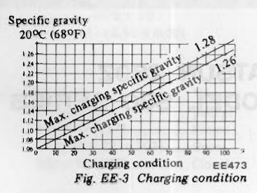
>
> - **Summary:** Graph showing relationship between specific gravity at 20°C (68°F) (1.06 to 1.28) and charging condition percentage (0% to 100%). Lines indicate max charging specific gravity 1.28 and 1.26.
> - **Components:** Graph curves for 1.28 and 1.26 specific gravity
> - **Specs / Measurements:** Specific gravity: 1.06 to 1.28 at 20°C (68°F); Charging condition: 0% to 100%
> - **Mechanic Notes:** Recharge if battery charge condition is below 60% or specific gravity is below 1.20.
> - **Tags:** `battery charging condition`, `specific gravity graph`

> 🖼️ **Fig. EE-4 Specific gravity at electrolyte temperature** `[EE003]` *(Type: `graph_chart`)*
>
> 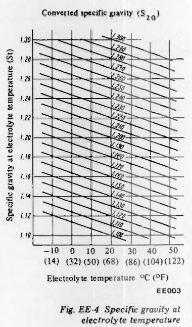
>
> - **Summary:** Nomograph chart for converting specific gravity at electrolyte temperature St (-10°C to 50°C) to converted specific gravity S20 (1.10 to 1.30).
> - **Components:** Temperature axis, Measured specific gravity lines, Converted specific gravity scale
> - **Specs / Measurements:** Temperature range: -10°C to 50°C (14°F to 122°F); Converted specific gravity: 1.100 to 1.300
> - **Mechanic Notes:** Formula: S20 = St + 0.0007*(t - 20).
> - **Tags:** `temperature correction`, `specific gravity chart`

> 🖼️ **Fig. EE-1 Checking specific gravity** `[EE001]` *(Type: `inspection_measurement`)*
>
> 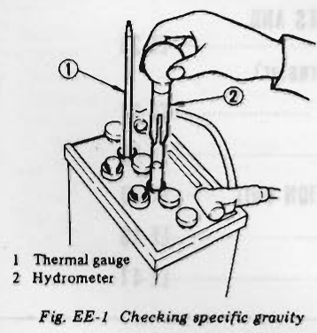
>
> - **Summary:** Illustration of checking battery electrolyte specific gravity and temperature using a hydrometer and a thermal gauge inserted into the battery cells.
> - **Components:** Battery, Vent hole, Thermal gauge, Hydrometer
> - **Callouts:** **(1)** Thermal gauge; **(2)** Hydrometer
> - **Mechanic Notes:** Insert hydrometer vertically into cell; ensure float moves freely without clinging to sides.
> - **Tags:** `battery`, `specific gravity`, `hydrometer`, `thermal gauge`

> 🖼️ **Fig. EE-2 Checking specific gravity**  *(Type: `inspection_measurement`)*
>
> 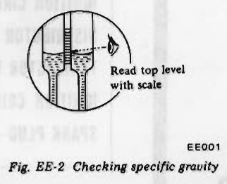
>
> - **Summary:** Close-up diagram showing how to read the top level of the hydrometer float with scale at eye level.
> - **Components:** Hydrometer float, Glass barrel, Electrolyte meniscus
> - **Specs / Measurements:** Read top level with scale
> - **Mechanic Notes:** Read the scale line aligned with the surface meniscus of the electrolyte.
> - **Tags:** `hydrometer`, `specific gravity reading`, `scale`

## BATTERY FREEZING

Battery electrolyte freezing point varies with acid concentration or its specific gravity. A battery with an insufficient charge will freeze at lower temperatures. If specific gravity of a battery falls below 1.1, this is an <!-- Page 3 (EE-3) --> indication that battery is completely discharged and will freeze readily when temperatures fall below freezing.

> 🖼️ **Fig. EE-5 Freezing point of electrolyte** `[EE004]` *(Type: `graph_chart`)*
>
> 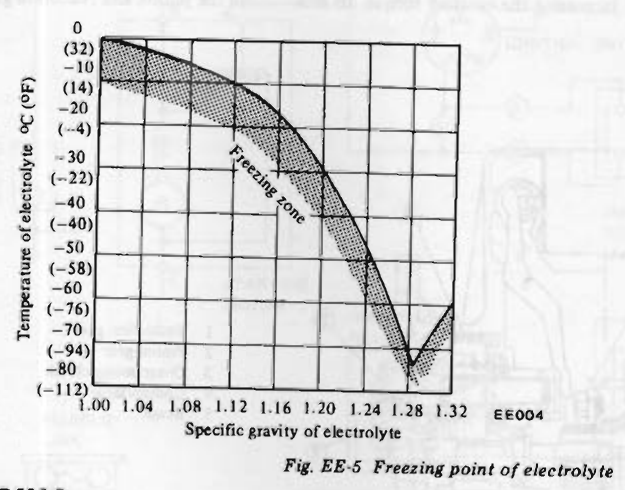
>
> - **Summary:** Graph showing the freezing point temperature of battery electrolyte (°C and °F) vs specific gravity (1.00 to 1.32), indicating the shaded freezing zone.
> - **Components:** Electrolyte temperature scale, Specific gravity scale, Freezing zone curve
> - **Specs / Measurements:** At 1.100 sp gr: freezes around -8°C (18°F); At 1.200 sp gr: freezes around -27°C (-17°F); At 1.280 sp gr: freezes around -68°C (-90°F)
> - **Mechanic Notes:** A discharged battery will freeze and crack the case at normal winter temperatures.
> - **Tags:** `battery freezing point`, `electrolyte curve`, `specific gravity`

> [!NOTE]
> Use extreme caution to avoid freezing battery since freezing will generally ruin the battery.

## CHARGING

If electrolyte level is satisfactory, battery must be recharged when electrolyte-gravity reading falls below 1.20. If battery on car is quick-charged to bring it up to full charge, the operation should be carried out with negative cable removed.

Prior to charging, corroded terminals should be cleaned with a brush and common baking-soda solution. In addition, the following items should be observed while battery is being charged.

1. Be sure that electrolyte level is above top of each plate.
2. Keep removed plugs in a safe place.
3. Do not allow electrolyte temperature to go over 45°C (113°F).
4. After recharging, check to be certain that specific gravity does not exceed 1.260 or 1.280 (N70Z) [at 20°C (68°F)]. Correction can be made by adding distilled water into cells as necessary.
5. Keep battery away from open flame while it is being recharged.
6. After all vent plugs have been tightened, clean all sprayed electrolyte off upper face of battery.

## INSTALLATION

1. Install and tighten clamps securely.
2. After clamps have been tightened, clean battery cable terminals and apply grease to retard formation of corrosion.

---

# STARTING MOTOR

### CONTENTS

| Item | Page | Item | Page |
| :--- | :---: | :--- | :---: |
| DESCRIPTION | EE-4 | BRUSH HOLDER TEST FOR GROUND | EE-9 |
| OPERATION | EE-6 | BALL BEARING | EE-9 |
| CONSTRUCTION | EE-7 | MAGNETIC SWITCH ASSEMBLY | EE-9 |
| REMOVAL | EE-7 | ASSEMBLY | EE-9 |
| DISASSEMBLY | EE-7 | TEST | EE-9 |
| CLEANING AND INSPECTION | EE-8 | PERFORMANCE TEST | EE-9 |
| TERMINAL | EE-8 | DIAGNOSES OF TEST | EE-10 |
| FIELD COIL | EE-8 | MAGNETIC SWITCH ASSEMBLY TEST | EE-10 |
| BRUSHES AND BRUSH LEAD WIRE | EE-8 | SERVICE DATA AND SPECIFICATIONS | EE-11 |
| BRUSH SPRING TENSION | EE-8 | TROUBLE DIAGNOSES AND CORRECTIONS | EE-12 |
| ARMATURE ASSEMBLY | EE-8 | | |
| OVERRUNNING CLUTCH ASSEMBLY | EE-9 | | |

---

<!-- Page 4 (EE-4) -->
## DESCRIPTION

### Reduction gear type

The reduction gear, located between the armature and pinion gear, transmits the rotation of the armature to the pinion gear, thereby reducing the speed from the armature and increasing the rotating torque. In construction, the pinion gear is located independently of the armature. The brush and commutator are positioned on the pinion and reduction gear side.

> 🖼️ **Fig. EE-6 Reduction gear starting motor [S114-254]** `[EE610]` *(Type: `cutaway_flow`)*
>
> ![Fig. EE-6 Reduction gear starting motor [S114-254]](diagrams/EE Engine Electrical/fig_ee_6_reduction_gear_starting_motor.png)
>
> - **Summary:** Cross-sectional cutaway illustration of the Hitachi S114-254 reduction gear starter motor highlighting the planetary/reduction gearing arrangement and brush placement.
> - **Components:** Magnetic switch / solenoid, Armature, Reduction gear, Pinion gear, Overrunning clutch, Commutator, Brush, Shift lever
> - **Callouts:** **(1)** Reduction gear; **(2)** Pinion gear; **(3)** Overrunning clutch; **(4)** Commutator; **(5)** Brush
> - **Specs / Measurements:** Model: S114-254
> - **Mechanic Notes:** Pinion gear is located independently of armature; commutator and brushes are located on the pinion/reduction gear side.
> - **Tags:** `starter motor`, `reduction gear`, `S114-254`, `cutaway`

---

<!-- Page 5 (EE-5) -->

> 🖼️ **Fig. EE-7 Circuit diagram of starting system** `[EE611]` *(Type: `electrical_schematic`)*
>
> 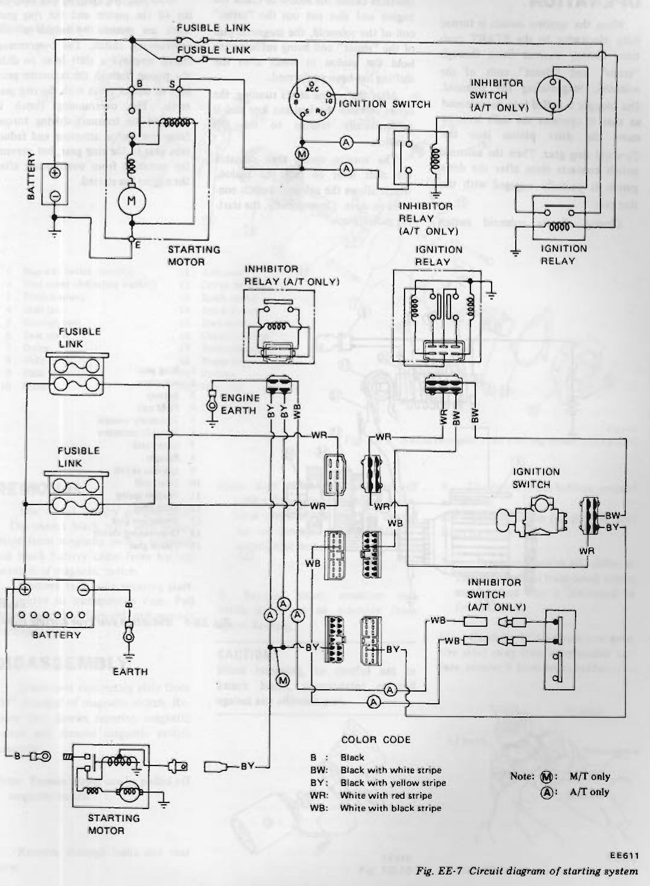
>
> - **Summary:** Complete electrical schematic and harness wiring diagram of the starting system showing battery, fusible links, ignition switch, starting motor, inhibitor switch (A/T only), and ignition / inhibitor relay.
> - **Components:** Battery, Fusible link, Ignition switch, Starting motor, Inhibitor switch (A/T only), Inhibitor relay (A/T only), Ignition relay, Engine earth, Harness connectors
> - **Callouts:** **(B)** Starter battery terminal; **(S)** Starter solenoid control terminal; **(M)** Manual transmission only / Solenoid motor terminal; **(E)** Earth ground; **(A)** Automatic transmission only
> - **Wiring / Connections:** B : Black; BW : Black with white stripe; BY : Black with yellow stripe; WR : White with red stripe; WB : White with black stripe
> - **Mechanic Notes:** Note: (M) indicates M/T only; (A) indicates A/T only. Inhibitor switch prevents cranking unless A/T is in P or N.
> - **Tags:** `starting system`, `schematic`, `wiring diagram`, `inhibitor switch`, `relay`

---

<!-- Page 6 (EE-6) -->
## OPERATION

When the ignition switch is turned fully clockwise to the START position, battery current flows through "series" and "shunt" coils of the solenoid, magnetizing the solenoid. The plunger is pulled into the solenoid so that it operates the shift lever to move the drive pinion into the flywheel ring gear. Then the solenoid switch contacts close after the drive pinion is partially engaged with the ring gear.

Closing of the solenoid switch contacts causes the motor to crank the engine and also cut out the "series" coil of the solenoid, the magnetic pull of the "shunt" coil being sufficient to hold the pinion in mesh after the shifting has been performed.

After the engine starts running, the driver releases the ignition key and it automatically returns to the ON position.

The torsion spring then actuates the shift lever to pull the pinion, which allows the solenoid switch contacts to open. Consequently, the starting motor stops.

More positive meshing and demeshing of the pinion and the ring gear teeth are secured by means of the overrunning clutch. The overrunning clutch employs a shift lever to slide the pinion through the reduction gear, into or out of mesh with the ring gear teeth. The overrunning clutch is designed to transmit driving torque from the motor armature and reduction gear to the ring gear, but prevent the armature from overrunning after the engine has started.

> 🖼️ **Fig. EE-8 Reduction gear type starting motor** `[EE613]` *(Type: `cutaway_flow`)*
>
> 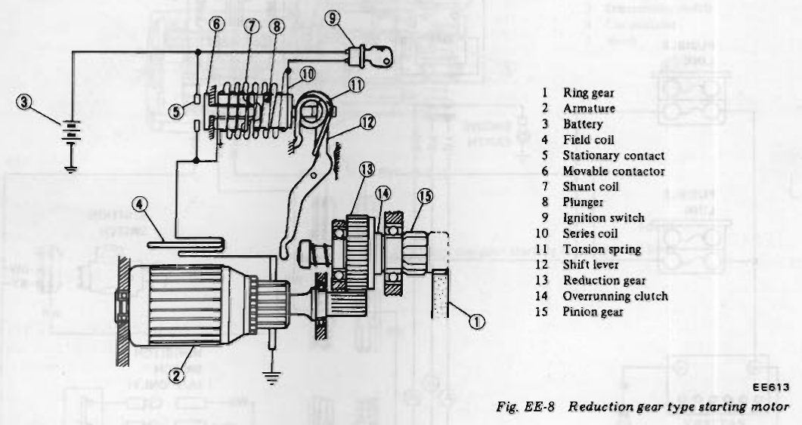
>
> - **Summary:** Functional schematic diagram showing the internal electrical circuits (series coil, shunt coil, contacts) and mechanical linkages (shift lever, reduction gear, overrunning clutch, pinion gear) of the starter motor.
> - **Components:** Ring gear, Armature, Battery, Field coil, Stationary contact, Movable contactor, Shunt coil, Plunger, Ignition switch, Series coil, Torsion spring, Shift lever, Reduction gear, Overrunning clutch, Pinion gear
> - **Callouts:** **(1)** Ring gear; **(2)** Armature; **(3)** Battery; **(4)** Field coil; **(5)** Stationary contact; **(6)** Movable contactor; **(7)** Shunt coil; **(8)** Plunger; **(9)** Ignition switch; **(10)** Series coil; **(11)** Torsion spring; **(12)** Shift lever; **(13)** Reduction gear; **(14)** Overrunning clutch; **(15)** Pinion gear
> - **Mechanic Notes:** Plunger pulls in and closes movable contactor 6 across stationary contacts 5, cutting out pull-in series coil 10 while hold-in shunt coil 7 maintains engagement.
> - **Tags:** `starter operation`, `reduction gear`, `solenoid operation`, `cutaway`

---

<!-- Page 7 (EE-7) -->
## CONSTRUCTION

### Reduction gear type

> 🖼️ **Fig. EE-9 Reduction gear type starting motor (S114-254)** `[EE614]` *(Type: `exploded_view`)*
>
> 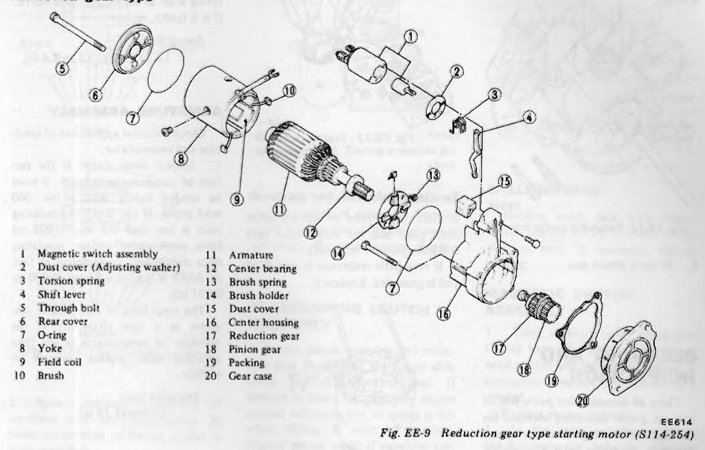
>
> - **Summary:** Exploded view diagram of the Hitachi S114-254 starter motor showing all individual components and assembly order.
> - **Components:** Magnetic switch assembly, Dust cover (Adjusting washer), Torsion spring, Shift lever, Through bolt, Rear cover, O-ring, Yoke, Field coil, Brush, Armature, Center bearing, Brush spring, Brush holder, Dust cover, Center housing, Reduction gear, Pinion gear, Packing, Gear case
> - **Callouts:** **(1)** Magnetic switch assembly; **(2)** Dust cover (Adjusting washer); **(3)** Torsion spring; **(4)** Shift lever; **(5)** Through bolt; **(6)** Rear cover; **(7)** O-ring; **(8)** Yoke; **(9)** Field coil; **(10)** Brush; **(11)** Armature; **(12)** Center bearing; **(13)** Brush spring; **(14)** Brush holder; **(15)** Dust cover; **(16)** Center housing; **(17)** Reduction gear; **(18)** Pinion gear; **(19)** Packing; **(20)** Gear case
> - **Specs / Measurements:** Model: S114-254
> - **Mechanic Notes:** Pay attention to the position of dust covers, packing, O-rings, and adjusting washers during disassembly.
> - **Tags:** `exploded view`, `starting motor`, `S114-254`, `components`

## REMOVAL

1. Disconnect battery ground cable. Disconnect black wire with yellow stripe from magnetic switch terminal, and black battery cable from battery terminal of magnetic switch.
2. Remove two bolts securing starting motor to transmission case. Pull starter assembly forward and remove starting motor.

## DISASSEMBLY

1. Disconnect connecting plate from "M" terminal of magnetic switch. Remove two screws securing magnetic switch and remove magnetic switch assembly.

> [!NOTE]
> Torsion spring can be pulled off magnetic switch.

2. Remove through bolts and rear cover.

> [!NOTE]
> Rear cover can be pried off with a flat-blade screwdriver inserted between it and yoke. Be careful not to damage packing while removing rear cover.

3. Remove yoke, armature and brush holder as an assembly from center housing.

> [!CAUTION]
> When removing, be careful not to knock brush, commutator or coil against any adjacent part.

> 🖼️ **Fig. EE-10 [Removing magnetic switch and center housing]** `[EE615]` *(Type: `procedure_step`)*
>
> ![Fig. EE-10 [Removing magnetic switch and center housing]](diagrams/EE Engine Electrical/fig_ee_10_magnetic_switch_and_center_housing.png)
>
> - **Summary:** Illustration of detaching the magnetic switch assembly and O-ring/torsion spring from the center housing.
> - **Components:** Magnetic switch, Center housing, O-ring, Torsion spring
> - **Mechanic Notes:** Torsion spring can be pulled off magnetic switch after separating.
> - **Tags:** `magnetic switch`, `removal`, `center housing`

4. To remove brush holders, proceed as follows:
   (1) Remove brush (on positive side) from its holder.

> [!NOTE]
> Brush on positive side differs in that it is isolated from brush holder and its lead wire is connected to field coil.

   (2) Carefully lifting brush (on negative side) away from commutator surface, remove it from brush holder.

> 🖼️ **Fig. EE-11 Removing brush holder** `[EE616]` *(Type: `procedure_step`)*
>
> 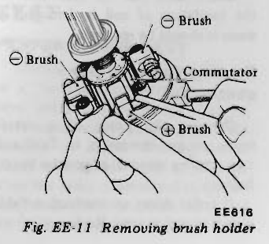
>
> - **Summary:** Hand illustration demonstrating how to lift the brushes and extract the brush holder assembly from the armature commutator.
> - **Components:** Brush, Commutator, Brush holder
> - **Callouts:** **(Brush)** Carbon brush (positive and negative sides); **(Commutator)** Armature commutator
> - **Mechanic Notes:** Lift brush on negative side away from commutator surface to withdraw holder safely.
> - **Tags:** `brush holder`, `brush removal`, `commutator` <!-- Page 8 (EE-8) --> 5. Remove bolts securing center housing to gear case, and detach center housing.

> 🖼️ **Fig. EE-12 Removing center housing** `[EE685]` *(Type: `procedure_step`)*
>
> 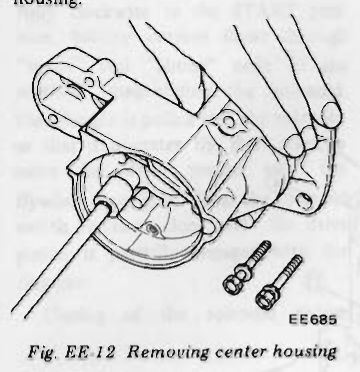
>
> - **Summary:** Illustration of unscrewing bolts securing the center housing to the gear case and detaching the housing.
> - **Components:** Center housing, Gear case, Securing bolts
> - **Mechanic Notes:** Detach center housing carefully to access pinion gear.
> - **Tags:** `center housing`, `starter disassembly`, `gear case`

6. Remove pinion gear.

## CLEANING AND INSPECTION

Clean all disassembled parts, but do not use grease dissolving solvents for cleaning overrunning clutch, armature assembly, magnetic switch assembly and field coils since such a solvent would dissolve grease packed in clutch mechanism and would damage coils or other insulators.
Check them for excessive damage or wear, and replace if necessary.

## TERMINAL

Check terminal for damage and wear, and replace magnetic switch assembly if necessary.

## FIELD COIL

Check field coil for insulation. If the insulation of coil is damaged or worn it should be replaced.

### Testing field coil for continuity:

Connect the probe of a circuit tester or an ohmmeter to field coil two positive terminal of positive brush holder.
If tester shows no conduction field circuit or coil is open. Replace it.

> 🖼️ **Fig. EE-13 Testing field coil for continuity** `[EE016]` *(Type: `inspection_measurement`)*
>
> 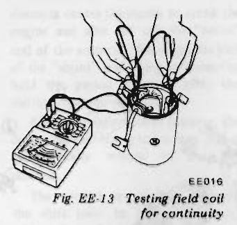
>
> - **Summary:** Ohmmeter probes connected to the two positive terminals of the field coil inside the yoke to check for electrical continuity.
> - **Components:** Yoke, Field coil terminals, Circuit tester / Ohmmeter
> - **Specs / Measurements:** Continuity check: conduction required; open circuit means replace
> - **Mechanic Notes:** If tester shows no conduction, field coil is open. Replace yoke assembly.
> - **Tags:** `field coil`, `continuity test`, `ohmmeter`

### Testing field coil for ground:

Place one probe of circuit tester onto yoke and the other onto field coil lead (positive terminal).
If very little resistance is read, field coil is grounded. Replace it.

> 🖼️ **Fig. EE-14 Testing field coil for ground** `[EE017]` *(Type: `inspection_measurement`)*
>
> 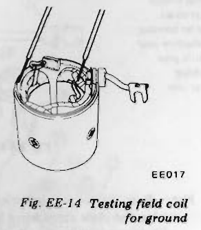
>
> - **Summary:** Circuit tester probes applied between the starter yoke body and positive field coil lead to test for insulation breakdown / grounding.
> - **Components:** Yoke, Field coil lead, Circuit tester
> - **Specs / Measurements:** Ground test: high resistance / no continuity required
> - **Mechanic Notes:** If very little resistance is read, field coil is grounded. Replace yoke assembly.
> - **Tags:** `field coil`, `ground test`, `insulation test`

## BRUSHES AND BRUSH LEAD WIRE

Check the surface condition of brush contact and wear of brush. If a loose contact is found it should be replaced.
If brush is worn so that its length is less than specified value, replace.

- **Serviceable length limit**: 11 mm (0.43 in)

Check the connection of lead clip and lead wire.
Check brush holders and spring clip to see if they are not deformed or bent, and will properly hold brushes against the commutator.
If brushes or brush holders are dirty, they should be cleaned.

## BRUSH SPRING TENSION

Check brush spring tension by a spring scale as shown in Figure EE-15. If it is faulty, replace.

- **Spring tension**: 1.6 to 2.0 kg (3.5 to 4.4 lb)

> 🖼️ **Fig. EE-15 Inspecting brush spring tension** `[EE018]` *(Type: `inspection_measurement`)*
>
> 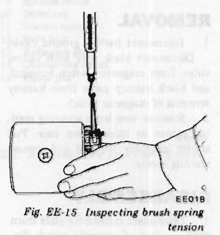
>
> - **Summary:** Spring scale hooked to the brush spring clip to measure pull tension at the moment of release from the brush.
> - **Components:** Brush holder, Brush spring, Spring scale
> - **Specs / Measurements:** Spring tension: 1.6 to 2.0 kg (3.5 to 4.4 lb)
> - **Mechanic Notes:** Read tension when spring just releases from brush. Replace if outside specification.
> - **Tags:** `brush spring tension`, `spring scale`, `inspection`

## ARMATURE ASSEMBLY

Check external appearance of armature and commutator.
1. Inspect commutator. If the surface of commutator is rough, it must be sanded lightly with a No. 500 sand paper. If the depth of insulating mica is less than 0.2 mm (0.008 in) from commutator surface, insulating mica should also be undercut so that its depth is 0.5 to 0.8 mm (0.020 to 0.031 in).
The wear limit of commutator diameter is 1 mm (0.04 in). If the diameter of commutator is less than specified value, replace armature assembly.

- **Diameter limit**: 29 mm (1.14 in) <!-- Page 9 (EE-9) --> > 🖼️ **Fig. EE-16 Undercutting insulating mica** `[EE021]` *(Type: `procedure_step`)*
>
> 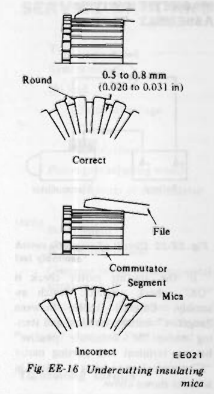
>
> - **Summary:** Diagram illustrating proper vs incorrect undercut profiles and depth of commutator segment insulating mica using a file.
> - **Components:** Commutator segment, Mica insulation, File tool
> - **Callouts:** **(Round)** Correct rounded edge profile; **(Correct)** Proper square cut 0.5 to 0.8 mm deep; **(Incorrect)** Improper V-cut or incomplete cut
> - **Specs / Measurements:** Depth: 0.5 to 0.8 mm (0.020 to 0.031 in); Limit before undercut: 0.2 mm (0.008 in)
> - **Mechanic Notes:** Undercut must be square at bottom, not V-groove. Deburr copper segments slightly.
> - **Tags:** `commutator`, `mica undercutting`, `starter repair`

2. Inspect soldered connection of armature lead and commutator. If loose connection is found, solder it using resin flux.
3. Armature test for ground:
Using a circuit tester, place one test probe onto armature core or shaft and other onto each commutator bar.
If tester shows continuity, armature is grounded and must be replaced.

> 🖼️ **Fig. EE-17 Testing armature for ground** `[EE686]` *(Type: `inspection_measurement`)*
>
> 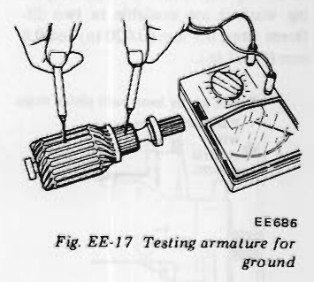
>
> - **Summary:** Circuit tester probes placed between armature shaft/core and commutator segments to detect short to ground.
> - **Components:** Armature core, Commutator bars, Armature shaft, Tester
> - **Specs / Measurements:** Continuity indicates ground fault (replace armature)
> - **Mechanic Notes:** Any continuity between any commutator segment and the core/shaft indicates a bad armature.
> - **Tags:** `armature ground test`, `circuit tester`

4. Check armature for short by placing it on armature tester (growler) with a piece of iron over armature core, rotating armature. If the plate vibrates, armature is shorted. Replace it.

> 🖼️ **Fig. EE-18 Testing armature for short** `[EE687]` *(Type: `inspection_measurement`)*
>
> 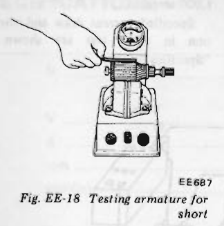
>
> - **Summary:** Armature mounted on a growler tester with a thin steel blade held over the core while slowly rotating to check for shorted windings.
> - **Components:** Armature tester (growler), Armature, Hacksaw blade / feeler blade
> - **Mechanic Notes:** If the iron blade vibrates or is attracted to the core, armature coil is shorted.
> - **Tags:** `growler`, `armature short test`

5. Check armature for continuity by placing probes of tester on two segments side by side. If tester shows no continuity, the circuit is open. Replace it.

## OVERRUNNING CLUTCH ASSEMBLY

Inspect pinion assembly and reduction gear. Pinion gear shaft must slide freely through reduction gear. If damage is found or resistance except normal resistance due to spring is felt when sliding, it must be repaired. Inspect pinion teeth. If excessive rubbing is found on teeth, replace. Flywheel ring gear also must be inspected.

> 🖼️ **Fig. EE-19 Pinion and reduction gear overrunning clutch** `[EE617]` *(Type: `exploded_view`)*
>
> 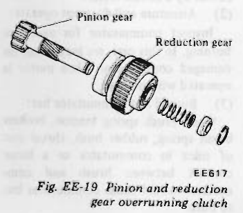
>
> - **Summary:** Exploded view showing the pinion gear shaft, reduction gear, spring, and washer of the overrunning clutch assembly.
> - **Components:** Pinion gear, Reduction gear, Spring, Washer, Snap ring
> - **Callouts:** **(Pinion gear)** Pinion gear and shaft; **(Reduction gear)** Reduction gear and overrunning clutch
> - **Mechanic Notes:** Pinion gear shaft must slide freely through reduction gear.
> - **Tags:** `pinion gear`, `reduction gear`, `overrunning clutch`

## BRUSH HOLDER TEST FOR GROUND

Using a circuit tester, place one test probe onto negative side of brush holder and another onto positive side. If tester shows continuity, brush holder is shorted to ground. Replace brush holder.

> 🖼️ **Fig. EE-20 Testing brush for ground** `[EE025]` *(Type: `inspection_measurement`)*
>
> 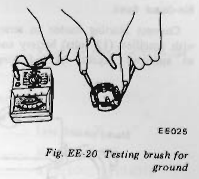
>
> - **Summary:** Circuit tester probes applied across the brush holder plate between positive and negative sides to check for insulation breakdown.
> - **Components:** Brush holder assembly, Circuit tester
> - **Specs / Measurements:** Continuity indicates ground short (replace brush holder)
> - **Mechanic Notes:** Ensure positive brush holder is properly insulated from the base plate.
> - **Tags:** `brush holder`, `ground test`, `insulation test`

## BALL BEARING

Holding outer race with finger, rotate bearing to see if there is any play or bind. If necessary, replace bearing.

## MAGNETIC SWITCH ASSEMBLY

1. Using a circuit tester, check continuity between "S" terminal of magnetic switch and switch body metal. If continuity does not exist, shunt coil is opened. Replace switch assembly.
2. In the same manner as above, check continuity between terminals "S" and "M". If continuity does not exist, series coil is opened. Replace switch assembly.

## ASSEMBLY

Reassemble starting motor in reverse sequence of disassembly.
When assembling, be sure to apply grease to gear case and rear cover bearing metal, and apply oil lightly to pinion.

---

## TEST

### PERFORMANCE TEST

Starting motor should be subjected to a "no-load" test whenever it has been overhauled to ensure that its performance will be satisfactory when installed on engine. Starting motor should also be subjected to the test when the cause of abnormal operation is to be determined. A brief outline of the test is given below.

---

<!-- Page 10 (EE-10) -->
### No-load test

Connect starting motor in series with specified (12 volts) battery and an ammeter capable of indicating 1,000 amperes.
Specified current draw and revolution in these test are shown in "Specifications".

> 🖼️ **Fig. EE-21 No-load testing** `[EE026]` *(Type: `inspection_measurement`)*
>
> 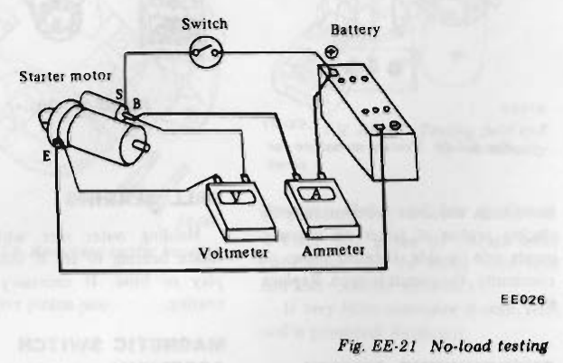
>
> - **Summary:** Wiring hookup schematic for starter motor no-load test showing 12V battery, high-capacity ammeter (0-1000A), switch, voltmeter, and starter motor terminals S, B, and E.
> - **Components:** Starting motor, 12V Battery, Switch, Voltmeter, Ammeter
> - **Callouts:** **(S)** Solenoid switch terminal; **(B)** Main battery terminal; **(E)** Ground/earth
> - **Specs / Measurements:** Voltage: 12V; Ammeter capacity: 1,000A
> - **Mechanic Notes:** Connect switch between battery positive and starter 'S' terminal; monitor current draw and RPM.
> - **Tags:** `no load test`, `starter bench test`, `ammeter hookup`

## DIAGNOSES OF TEST

1. Low speed with no-load and high current draw may result from the following:
   (1) Tight, dirty or worn bearings.
   (2) Bent armature shaft or loosened field probe.
   (3) Shorted armature; Check armature further.
   (4) A grounded armature or field;
       a. Remove input terminal.
       b. Raise two negative side brushes from commutator.
       c. Using a circuit tester, place one probe onto input terminal and the other onto yoke.
       d. If tester indicates continuity, raise the other two brushes and check field and armature separately to determine whether field or armature is grounded.
2. Failure to operate with high current draw may be caused by the following:
   (1) A grounded or open field coil: Inspect the connection and trace circuit by a circuit tester.
   (2) Armature coil does not operate: Inspect commutator for excessive burning. In this case, arc may occur on damaged commutator when motor is operated with no-load.
   (3) Burned out commutator bar: Weak brush spring tension, broken brush spring, rubber bush, thrust out of mica in commutator or a loose contact between brush and commutator would cause commutator bar to burn.
3. Low current draw and low no-load speed would cause high internal resistance due to loose connections, damaged leads, dirty commutator and causes listed on item 2-(3).

## MAGNETIC SWITCH ASSEMBLY TEST

> 🖼️ **Fig. EE-22 Circuit of magnetic switch assembly test** `[EE351]` *(Type: `electrical_schematic`)*
>
> 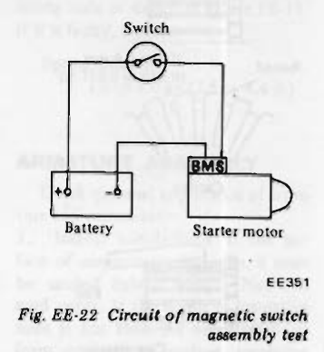
>
> - **Summary:** Circuit schematic for testing the starter magnetic switch pull-in: positive battery connects through switch to S terminal, negative battery connects to M terminal.
> - **Components:** Battery, Switch, Starter motor terminals (B, M, S)
> - **Callouts:** **(B)** Battery terminal; **(M)** Motor terminal; **(S)** Solenoid terminal
> - **Specs / Measurements:** Battery voltage: 12V
> - **Mechanic Notes:** Connect negative battery to M terminal and positive through switch to S terminal to actuate plunger.
> - **Tags:** `magnetic switch test`, `pull in test`, `schematic`

If the starting motor check is "OK", check magnetic switch assembly. Connect cables between "negative" battery terminal and starting motor "M" terminal, "positive" battery terminal and starting motor "S" terminal connecting a switch in series as shown above.

With the switch on compare difference in height of pinion when it is pushed out with magnetic switch energized and when it is pulled out by hand until its stopper touches reduction gear.

- **Clearance $\ell$**: 0.3 to 1.5 mm (0.012 to 0.059 in)

If necessary, adjust it by changing or adding adjusting washer(s). Adjusting washers are available in two different sizes, 0.5 mm (0.020 in) and 0.8 mm (0.031 in).

> 🖼️ **Fig. EE-23 Measuring clearance "l"** `[EE688]` *(Type: `inspection_measurement`)*
>
> 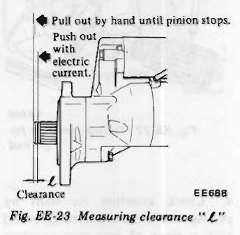
>
> - **Summary:** Illustration of measuring pinion gap clearance 'l' between pinion energized position and manual pull-out stop against reduction gear.
> - **Components:** Pinion gear, Stopper / Reduction gear, Housing
> - **Callouts:** **(Clearance l)** Gap difference between electric stroke and full hand stroke
> - **Specs / Measurements:** Clearance l: 0.3 to 1.5 mm (0.012 to 0.059 in); Adjusting washer sizes: 0.5 mm (0.020 in), 0.8 mm (0.031 in)
> - **Mechanic Notes:** Adjust clearance by adding or removing washers under magnetic switch mounting.
> - **Tags:** `pinion clearance`, `clearance l`, `adjusting washer`

---

<!-- Page 11 (EE-11) -->
## SERVICE DATA AND SPECIFICATIONS

### Starting Motor Specifications

| Item | Unit | Value |
| :--- | :---: | :--- |
| Type | | Reduction gear type S114-254 |
| System voltage | V | 12 |
| **No load** | | |
| - Terminal voltage | V | 12 |
| - Current | A | Less than 100 |
| - Revolution | rpm | More than 4,300 |
| Pinion gear adjusting washer | mm (in) | 0.5 (0.020), 0.8 (0.031) |
| Outer diameter of commutator | mm (in) | More than 29 (1.14) |
| Brush length | mm (in) | More than 11 (0.43) |
| Brush spring tension | kg (lb) | 1.6 to 2.0 (3.5 to 4.4) |
| Clearance between bearing metal and armature shaft | mm (in) | Ball bearing type |
| Clearance "$\ell$" between pinion front edges when pushed out with magnetic switch and when pulled out by hand | mm (in) | 0.3 to 1.5 (0.012 to 0.059) |

### Tightening torque

| Fastener | kg-cm | ft-lb |
| :--- | :---: | :---: |
| Terminal nuts | 115 to 160 | 8.3 to 11.6 (100 to 139 in-lb) |
| Magnetic switch attaching bolts | 38 to 51 | 2.7 to 3.7 (33 to 44 in-lb) |
| Gear case attaching bolts | 64 to 85 | 4.6 to 6.1 (56 to 74 in-lb) |

---

<!-- Page 12 (EE-12) -->
## TROUBLE DIAGNOSES AND CORRECTIONS

| Condition | Probable cause | Corrective action |
| :--- | :--- | :--- |
| Starting motor will not operate. | Discharged battery. | Charge or replace battery. |
| | Damaged solenoid switch. | Repair or replace solenoid switch. |
| | Loose connections of terminal. | Clean and tighten terminal. |
| | Damaged field coil. | Replace yoke. |
| | Damaged brushes. | Replace brushes. |
| | Damaged bearing. | Replace bearing. |
| | Starting motor inoperative. | Remove starting motor and make test. |
| | Damaged armature. | Replace armature. |
| Noisy starting motor. | Loose securing bolt. | Tighten. |
| | Worn pinion gear. | Replace. |
| | Poor lubrication. | Add oil. |
| | Worn commutator. | Replace. |
| | Worn brushes. | Replace. |
| Starting motor cranks slowly. | Discharged battery. | Charge. |
| | Loose connection of terminal. | Clean and tighten. |
| | Worn brushes. | Replace. |
| | Locked brushes. | Inspect brush spring tension or repair brush holder. |
| | Loose connections of terminal. | Clean and tighten terminal. |
| | Damaged field coil. | Replace yoke. |
| | Damaged brushes. | Replace brushes. |
| | Damaged bearing. | Replace bearing. |
| | Starting motor inoperative. | Remove starting motor and make test. |
| | Damaged armature. | Replace armature. |

---

<!-- Page 13 (EE-13) -->
# CHARGING CIRCUIT

The charging circuit consists of a battery, an alternator incorporating an IC voltage regulator and wiring that connects these parts. The purpose of this system is to convert mechanical energy from the engine into electrical energy which is used to operate all electrically operated units and to keep the battery fully charged.

With the ignition switch in ON, the circuit between transistor Tr1 of the IC voltage regulator and ground is closed. Current from the battery then flows along the route shown by the arrow in Figure EE-24, turning on the charge warning lamp and flowing on through terminal L to excite the rotor.

When the alternator begins to operate, three-phase alternating current is induced in the stator coil. This alternating current is rectified by the positive and negative silicon diodes.

When the voltage at terminal B is higher than battery voltage, current produced at the stator flows to recharge the battery. While the battery is being re-charged, the voltage at terminal L is equal to that of terminal B. At this point, there is no voltage differential on either side of the charge warning lamp, which causes the charge warning lamp to turn off. In other words, current does not flow from the battery to terminal L. Accordingly, current flow through the rotor as shown in Figure EE-25, is taken over by current produced at the stator. The circuit between terminal F and Tr1 is then closed. See Figure EE-25.

The IC voltage regulator monitors generating voltage to be applied to the battery at terminal S. When current exceeds the specified value, it then flows through the zener diode (ZD), closing the circuit consisting of transistor Tr3 and resistor R2. At this point, current neither flows through transistor Tr1 to ground nor to the rotor, thereby reducing the voltage generated at the stator. See Figure EE-26.

When voltage generated at terminal S is reduced to the specified value, transistor allows current to flow through the rotor, increasing the generating voltage.

In this manner, output voltage from the alternator does not rise above the specified value by the ON-OFF operation of the rotor coil through the IC voltage regulator.

> 🖼️ **Fig. EE-24 Simplified charging circuit (1)** `[EE618]` *(Type: `electrical_schematic`)*
>
> 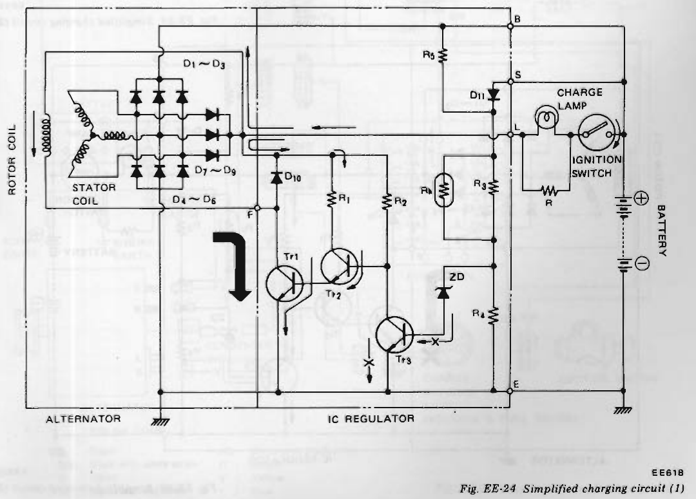
>
> - **Summary:** Simplified circuit schematic (1) showing initial excitation state with ignition switch ON and engine stopped: current flows from battery through charge lamp to rotor coil and Tr1 to ground.
> - **Components:** Alternator, IC Regulator, Rotor coil, Stator coil, Diodes (D1-D3, D4-D6, D7-D9, D10, D11), Transistors Tr1, Tr2, Tr3, Zener diode ZD, Thermistors Rh, Resistors R1-R5, R, Charge lamp, Ignition switch, Battery
> - **Callouts:** **(B)** Battery terminal; **(S)** Voltage sensing terminal; **(L)** Lamp / initial excitation terminal; **(F)** Field terminal; **(E)** Earth ground
> - **Mechanic Notes:** Charge warning lamp is illuminated because battery voltage passes through lamp to terminal L and Tr1 to ground.
> - **Tags:** `charging circuit`, `IC regulator`, `warning lamp`, `schematic` <!-- Page 14 (EE-14) --> > 🖼️ **Fig. EE-25 Simplified charging circuit (2)** `[EE619]` *(Type: `electrical_schematic`)*
>
> 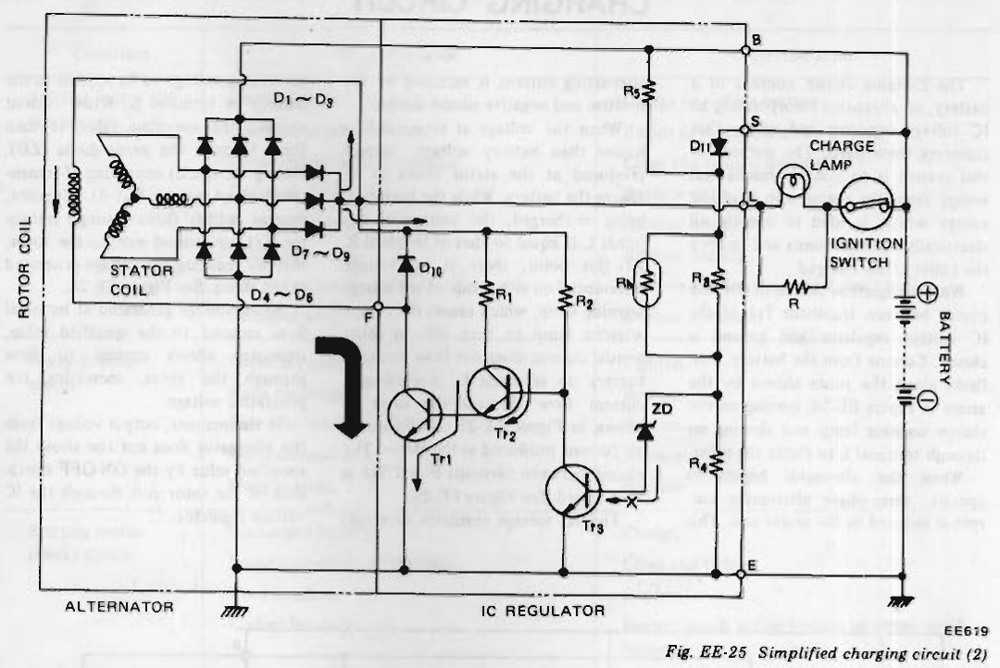
>
> - **Summary:** Simplified charging circuit schematic (2) with alternator running below regulation voltage: stator supplies rotor current via sub-diodes D7-D9; voltage at L equals B so charge lamp turns OFF.
> - **Components:** Alternator, IC Regulator, Rotor coil, Stator coil, Diodes D1-D11, Transistors Tr1, Tr2, Tr3, Zener diode ZD, Charge lamp, Ignition switch, Battery
> - **Callouts:** **(B)** Main battery output; **(S)** Sense terminal; **(L)** Lamp terminal; **(F)** Field terminal; **(E)** Ground
> - **Mechanic Notes:** Equal voltage across charge lamp extinguishes bulb while alternator self-excites through D7-D9.
> - **Tags:** `charging circuit`, `running state`, `warning lamp off`, `schematic`

> 🖼️ **Fig. EE-26 Simplified charging circuit (3)** `[EE683]` *(Type: `electrical_schematic`)*
>
> 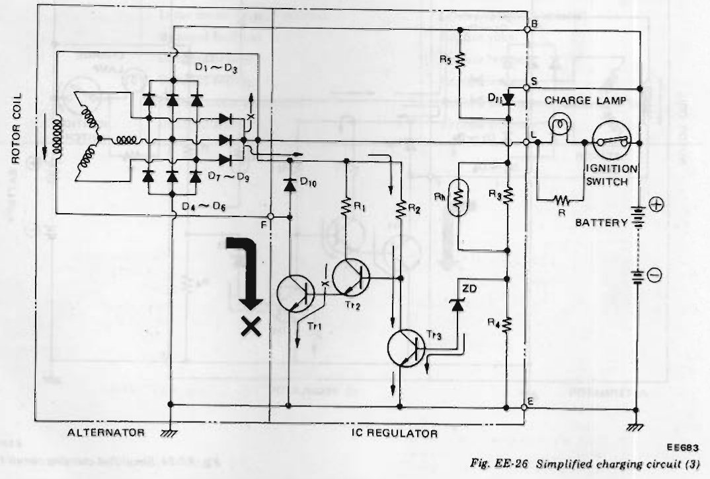
>
> - **Summary:** Simplified charging circuit schematic (3) when battery voltage exceeds specified setpoint: Zener diode ZD conducts, turning ON Tr3, which turns OFF Tr1 and stops rotor field current.
> - **Components:** Alternator, IC Regulator, Rotor coil, Stator coil, Diodes D1-D11, Transistors Tr1, Tr2, Tr3, Zener diode ZD
> - **Callouts:** **(B)** Battery terminal; **(S)** Sense terminal; **(L)** Lamp terminal; **(F)** Field terminal; **(E)** Ground
> - **Specs / Measurements:** Regulated voltage threshold triggers ZD conduction
> - **Mechanic Notes:** Tr3 ON shorts base of Tr2/Tr1 to ground, cutting off field current until voltage drops below threshold.
> - **Tags:** `voltage regulation`, `zener diode`, `overvoltage cutoff`, `schematic`

---

<!-- Page 15 (EE-15) -->

> 🖼️ **Fig. EE-27 Circuit diagram of charging system** `[EE621]` *(Type: `electrical_schematic`)*
>
> 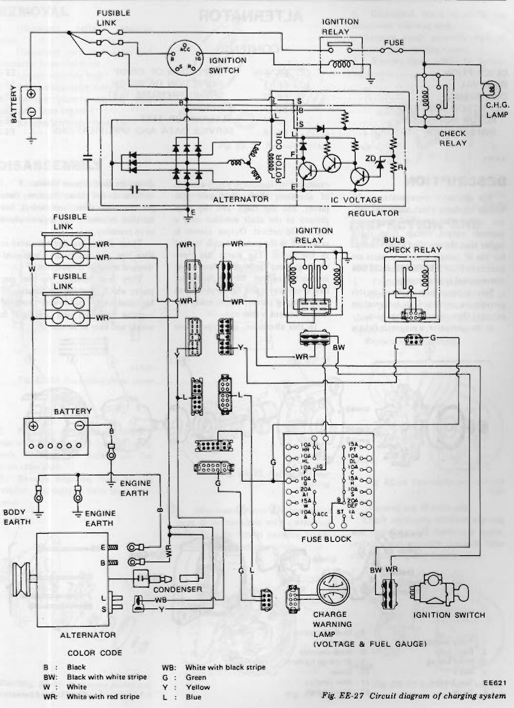
>
> - **Summary:** Comprehensive wiring harness schematic of the Datsun 280Z charging system including alternator, IC voltage regulator, battery, fusible links, fuse block, ignition switch, ignition relay, and bulb check relay.
> - **Components:** Battery, Fusible link, Ignition switch, Ignition relay, Bulb check relay, Fuse block, Charge warning lamp (Voltage & fuel gauge), Alternator, IC voltage regulator, Condenser, Engine earth, Body earth
> - **Callouts:** **(B)** Alternator main battery stud; **(E)** Alternator earth stud; **(L)** Lamp terminal on 2-pin connector; **(S)** Voltage sense terminal on 2-pin connector
> - **Wiring / Connections:** B : Black; BW : Black with white stripe; W : White; WR : White with red stripe; WB : White with black stripe; G : Green; Y : Yellow; L : Blue
> - **Mechanic Notes:** Bulb check relay connects charge lamp circuit during cranking for bulb verification.
> - **Tags:** `charging system`, `complete schematic`, `wire color codes`, `fuse block`, `relays`

---

<!-- Page 16 (EE-16) -->
# ALTERNATOR

### CONTENTS

| Item | Page | Item | Page |
| :--- | :---: | :--- | :---: |
| DESCRIPTION | EE-16 | INSPECTION OF DIODE | EE-18 |
| REMOVAL | EE-17 | INSPECTION OF BRUSH | EE-19 |
| DISASSEMBLY | EE-17 | SPRING PRESSURE TEST | EE-19 |
| INSPECTION AND REPAIR | EE-17 | ASSEMBLY | EE-19 |
| ROTOR INSPECTION | EE-17 | ALTERNATOR TEST | EE-20 |
| INSPECTION OF STATOR | EE-18 | SERVICE DATA AND SPECIFICATIONS | EE-20 |

## DESCRIPTION

The alternator incorporates an IC voltage regulator which maintains voltage within the specified range and prevents output voltage from rising higher than the specified value. Except for the IC circuit, alternator parts are essentially the same as those of the conventional type alternator.

Service procedures outlined in this section are restricted to information on other than the voltage regulator.

In the alternator, a magnetic field is produced by the rotor which consists of alternator shaft, field coil, pole pieces, and slip rings. The slip rings pressed in the shaft conduct only a small field current. Output current is generated in the armature coils located in the stator. The stator has three windings and generates three-phase alternating current. Silicon diodes act like a one-way valve for electricity so that charging current passes easily but reverse current is shut out.

In this alternator, can type silicon diodes are used as main diodes.

Nine diodes (three negative, three positive and three sub-diodes), are installed in positive and negative plates as an assembly.

These diodes are direct-soldered at their tips, and constructed with positive and negative conjunction.

They are mounted on the two plates which combine the function of heat-dissipating plate and positive/negative terminals and are light in weight and easy to service.

> 🖼️ **Fig. EE-28 Alternator** `[EE623]` *(Type: `exploded_view`)*
>
> 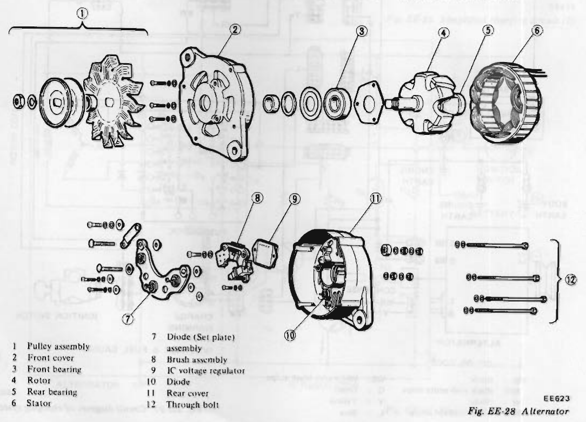
>
> - **Summary:** Exploded view diagram of the Hitachi LR160-42 alternator with built-in IC regulator showing all internal and external components in order of assembly.
> - **Components:** Pulley assembly, Front cover, Front bearing, Rotor, Rear bearing, Stator, Diode (Set plate) assembly, Brush assembly, IC voltage regulator, Diode, Rear cover, Through bolt
> - **Callouts:** **(1)** Pulley assembly; **(2)** Front cover; **(3)** Front bearing; **(4)** Rotor; **(5)** Rear bearing; **(6)** Stator; **(7)** Diode (Set plate) assembly; **(8)** Brush assembly; **(9)** IC voltage regulator; **(10)** Diode; **(11)** Rear cover; **(12)** Through bolt
> - **Specs / Measurements:** Model: LR160-42 (60A)
> - **Mechanic Notes:** Contains 9 total diodes: 3 positive, 3 negative, and 3 trio/sub-diodes mounted on heat sink plates.
> - **Tags:** `alternator`, `exploded view`, `LR160-42`, `components`

---

<!-- Page 17 (EE-17) -->
## REMOVAL

1. Disconnect battery negative cable.
2. Disconnect two lead wires and connector from alternator.
3. Loosen adjusting bolt.
4. Remove alternator drive belt.
5. Remove parts associated with alternator from engine.
6. Remove alternator from car.

## DISASSEMBLY

1. Remove through bolts. Separate front cover with rotor from rear cover with stator by lightly tapping front bracket with a wooden mallet.

> 🖼️ **Fig. EE-29 Separating front cover** `[EE525]` *(Type: `procedure_step`)*
>
> 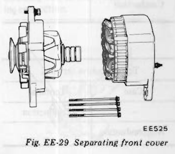
>
> - **Summary:** Illustration of alternator through bolts removed and separating front cover with rotor from rear cover with stator.
> - **Components:** Front cover, Rear cover, Through bolts
> - **Mechanic Notes:** Tap front bracket lightly with wooden mallet to split housings.
> - **Tags:** `alternator disassembly`, `housing separation`

2. Place rear cover side of rotor in a vise with soft jaw, and remove pulley nuts. Then remove pulley and fan from rotor shaft.
3. Remove setscrews from bearing retainer, and separate rotor from front cover.

> 🖼️ **Fig. EE-30 Removing pulley and fan** `[EE526]` *(Type: `procedure_step`)*
>
> 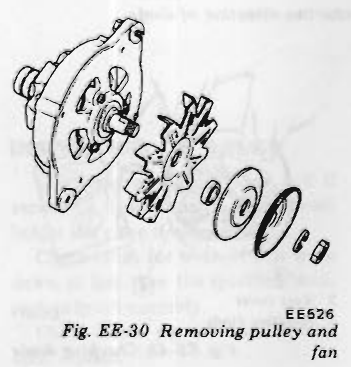
>
> - **Summary:** Exploded illustration of pulley nut, spring washer, pulley, fan, and spacer being removed from the rotor shaft.
> - **Components:** Pulley nut, Pulley, Fan, Spacer, Front cover
> - **Mechanic Notes:** Hold rotor in vise with soft jaws to prevent scratching pole pieces when breaking nut loose.
> - **Tags:** `pulley removal`, `fan`, `rotor shaft`

> 🖼️ **Fig. EE-31 Removing rotor** `[EE527]` *(Type: `procedure_step`)*
>
> 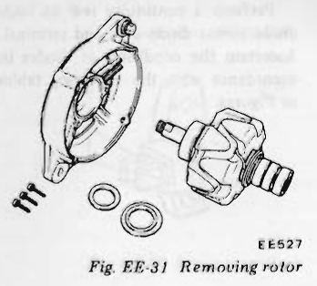
>
> - **Summary:** Illustration showing removal of rotor assembly from the front cover after removing bearing retainer setscrews.
> - **Components:** Front cover, Rotor, Retainer setscrews
> - **Mechanic Notes:** Remove bearing retainer screws before pressing rotor out of front bearing.
> - **Tags:** `rotor removal`, `front bearing retainer`

4. Pull rear bearing off rotor assembly with a bearing puller press.

> 🖼️ **Fig. EE-32 [Pressing rear bearing onto rotor shaft]** `[EE037]` *(Type: `procedure_step`)*
>
> ![Fig. EE-32 [Pressing rear bearing onto rotor shaft]](diagrams/EE Engine Electrical/fig_ee_32_pressing_bearing.png)
>
> - **Summary:** Arbor press fixture used for installing or supporting the rear bearing on the alternator rotor shaft.
> - **Components:** Rotor shaft, Ball bearing, Press plate, Arbor press
> - **Mechanic Notes:** Apply force only to bearing inner race when pressing.
> - **Tags:** `press`, `bearing replacement`, `rotor`

> 🖼️ **Fig. EE-33 Pulling out rear bearing** `[EE038]` *(Type: `procedure_step`)*
>
> 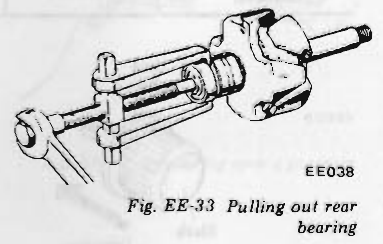
>
> - **Summary:** Bearing puller tool attached to pull the rear bearing off the rotor slip ring shaft.
> - **Components:** Rotor shaft, Rear bearing, Puller tool
> - **Mechanic Notes:** Take care not to gouge or damage copper slip rings with puller jaws.
> - **Tags:** `bearing puller`, `rear bearing`, `rotor`

5. Disconnect stator coil lead wires from diode terminals with a soldering iron. Remove screws securing brush; remove stator from rear cover.

> 🖼️ **Fig. EE-34 [Disconnecting stator leads]** `[EE623]` *(Type: `procedure_step`)*
>
> ![Fig. EE-34 [Disconnecting stator leads]](diagrams/EE Engine Electrical/fig_ee_34_disconnecting_stator_leads.png)
>
> - **Summary:** Technician using a soldering iron and needle-nose pliers to unsolder stator coil lead wires from the diode plate terminals.
> - **Components:** Soldering iron, Stator lead wires, Diode plate terminals, Pliers
> - **Mechanic Notes:** Perform soldering/unsoldering as quickly as possible to avoid overheating silicon diodes.
> - **Tags:** `soldering`, `stator leads`, `diode terminal`

6. Disconnect wires at diode terminal with soldering iron.
Remove brush assembly with IC regulator by loosening screws.
7. Remove diode holder by loosening screws.

> 🖼️ **Fig. EE-35 [Removing brush assembly and diode holder]** `[EE624]` *(Type: `exploded_view`)*
>
> ![Fig. EE-35 [Removing brush assembly and diode holder]](diagrams/EE Engine Electrical/fig_ee_35_removing_brush_and_regulator.png)
>
> - **Summary:** Exploded view showing screws and mounting positions for brush assembly with IC regulator and diode holder in the rear cover.
> - **Components:** Diode holder, Brush assembly with IC regulator, Rear cover, Screws, Nuts
> - **Mechanic Notes:** Disconnect diode wires with soldering iron before loosening screws.
> - **Tags:** `brush assembly`, `IC regulator`, `diode holder`, `rear cover`

---

## INSPECTION AND REPAIR

### ROTOR INSPECTION

1. Continuity test of rotor coil:
Apply tester between slip ring of rotor as shown in Figure EE-36. If there is no continuity field coil is open. Replace rotor assembly.

> 🖼️ **Fig. EE-36 Continuity test of rotor coil** `[EE531]` *(Type: `inspection_measurement`)*
>
> 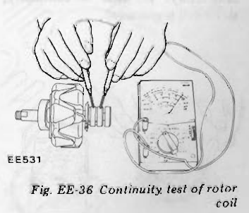
>
> - **Summary:** Multimeter / circuit tester probes applied across both slip rings of the rotor to test for continuity through the field coil.
> - **Components:** Rotor, Slip rings, Circuit tester / Ohmmeter
> - **Specs / Measurements:** Continuity must exist across slip rings
> - **Mechanic Notes:** If there is no continuity, field coil is open. Replace rotor assembly.
> - **Tags:** `rotor continuity`, `slip rings`, `field coil`

2. Ground test of rotor coil:
Check continuity between slip ring and rotor core. If continuity exists, replace rotor assembly, because rotor coil or slip ring may be grounded.

> 🖼️ **Fig. EE-37 Testing rotor coil for ground** `[EE532]` *(Type: `inspection_measurement`)*
>
> 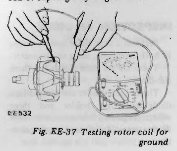
>
> - **Summary:** Circuit tester probes applied between slip ring and rotor iron pole core to check for short to ground.
> - **Components:** Rotor pole core, Slip ring, Circuit tester
> - **Specs / Measurements:** No continuity (infinite resistance) required
> - **Mechanic Notes:** If continuity exists, rotor coil or slip ring is grounded; replace rotor.
> - **Tags:** `rotor ground test`, `insulation check`

---

<!-- Page 18 (EE-18) -->
## INSPECTION OF STATOR

1. Continuity test:
Stator is normal when there is continuity between individual stator coil terminals. When there is no continuity between individual terminals, cable is broken. Replace stator assembly.

> 🖼️ **Fig. EE-38 Testing stator for continuity** `[EE533]` *(Type: `inspection_measurement`)*
>
> 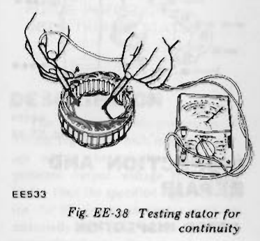
>
> - **Summary:** Ohmmeter probes testing continuity between the different phase leads of the disconnected stator winding.
> - **Components:** Stator coil assembly, Stator lead wires, Circuit tester
> - **Specs / Measurements:** Continuity must exist between all phase leads
> - **Mechanic Notes:** If no continuity between individual terminals, winding is broken; replace stator.
> - **Tags:** `stator continuity`, `ohmmeter`, `windings`

2. Ground test:
If each lead wire of stator coil (including neutral wire) is not conductive with stator core, condition is satisfactory. If there is continuity, stator coil is grounded.

> 🖼️ **Fig. EE-39 Testing stator for ground** `[EE534]` *(Type: `inspection_measurement`)*
>
> 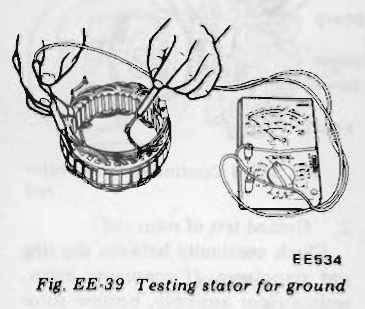
>
> - **Summary:** Tester probe connected to stator lamination core while other probe contacts each winding lead wire to ensure no ground fault.
> - **Components:** Stator core, Stator lead wires, Circuit tester
> - **Specs / Measurements:** No continuity (infinite resistance) required
> - **Mechanic Notes:** If any winding lead conducts to the laminated core, stator coil is grounded; replace stator.
> - **Tags:** `stator ground test`, `insulation`

## INSPECTION OF DIODE

Perform a continuity test on diodes in both directions, using an ohmmeter.
There are six main diodes and three sub-diodes.
Three main diodes are pressed into diode (positive) holder and three others (negative) into rear cover. Sub-diodes are soldered onto brush assembly.

Perform a continuity test on each diode across diode case and terminal. Ascertain the condition of diodes in accordance with the following tables or Figures.

> 🖼️ **Fig. EE-40 [Auxiliary diodes]** `[EE625]` *(Type: `component_location`)*
>
> ![Fig. EE-40 [Auxiliary diodes]](diagrams/EE Engine Electrical/fig_ee_40_auxiliary_diodes.png)
>
> - **Summary:** Diagram showing the physical location of the trio auxiliary (sub) diodes mounted on the brush assembly plate.
> - **Components:** Brush assembly, Auxiliary diodes (trio), Diode terminals
> - **Callouts:** **(Auxiliary diodes)** Sub-diode trio
> - **Mechanic Notes:** Sub-diodes supply excitation field current to rotor once alternator is spinning.
> - **Tags:** `auxiliary diodes`, `sub diodes`, `brush assembly`

### Diode holder (positive diodes)

| | Tester positive terminal: Case | Tester positive terminal: Terminal |
| :--- | :---: | :---: |
| **Tester negative terminal: Case** | — | Nonconduction |
| **Tester negative terminal: Terminal** | Conduction | — |

### Rear cover (negative diodes)

| | Tester positive terminal: Case | Tester positive terminal: Terminal |
| :--- | :---: | :---: |
| **Tester negative terminal: Case** | — | Conduction |
| **Tester negative terminal: Terminal** | Nonconduction | — |

> 🖼️ **Fig. EE-41 Conductive direction of diode** `[EE535]` *(Type: `alignment_orientation`)*
>
> 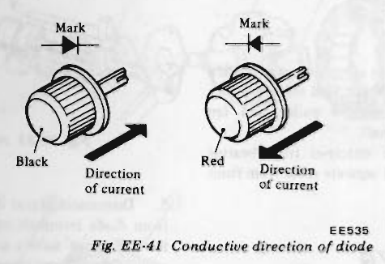
>
> - **Summary:** Illustration of diode polarity markings: Black mark indicates current flows from terminal to case; Red mark indicates current flows from case to terminal.
> - **Components:** Black marked diode, Red marked diode, Cathode / Anode case markings
> - **Callouts:** **(Black)** Direction of current: terminal to case; **(Red)** Direction of current: case to terminal
> - **Mechanic Notes:** Black marking = reverse polarity / positive plate; Red marking = forward polarity / negative plate.
> - **Tags:** `diode polarity`, `color markings`, `conduction direction`

> 🖼️ **Fig. EE-42 [Checking positive diode]** `[EE536]` *(Type: `inspection_measurement`)*
>
> ![Fig. EE-42 [Checking positive diode]](diagrams/EE Engine Electrical/fig_ee_42_checking_positive_diode.png)
>
> - **Summary:** Checking positive diodes on SR holder plate using ohmmeter probes between plate case and individual diode terminals.
> - **Components:** SR holder (positive heat sink), Positive diode, Ohmmeter
> - **Callouts:** **(1)** SR holder; **(2)** Positive diode
> - **Specs / Measurements:** Conduction in forward bias only; no conduction in reverse bias
> - **Mechanic Notes:** Conduction should occur only when tester negative probe is on terminal and positive on case.
> - **Tags:** `positive diode`, `SR holder`, `diode check`

> 🖼️ **Fig. EE-43 Checking diode** `[EE537]` *(Type: `inspection_measurement`)*
>
> 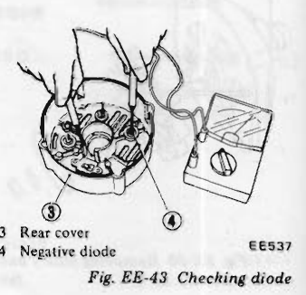
>
> - **Summary:** Checking negative diodes pressed into the rear cover using ohmmeter probes between rear housing and diode terminals.
> - **Components:** Rear cover, Negative diode, Ohmmeter
> - **Callouts:** **(3)** Rear cover; **(4)** Negative diode
> - **Specs / Measurements:** Conduction when tester positive is on terminal and negative on case
> - **Mechanic Notes:** Negative diodes conduct in the opposite probe configuration from positive diodes.
> - **Tags:** `negative diode`, `rear cover`, `diode check`

---

<!-- Page 19 (EE-19) -->

> 🖼️ **Fig. EE-44 Checking diode** `[EE626]` *(Type: `inspection_measurement`)*
>
> 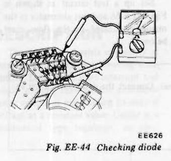
>
> - **Summary:** Testing the sub-diodes on the brush holder using ohmmeter test probes across the diode terminals.
> - **Components:** Brush assembly, Sub-diodes, Circuit tester
> - **Mechanic Notes:** Diodes must conduct in one direction only. If conducting both ways or neither way, replace.
> - **Tags:** `sub diode test`, `ohmmeter`

> [!CAUTION]
> If it is necessary to remove sub-diode, pinch diode lead wire with a pair of pliers to prevent heat transfer from soldering iron to diode when unsoldering connection.

> 🖼️ **Fig. EE-45 Removing sub-diode** `[EE627]` *(Type: `procedure_step`)*
>
> 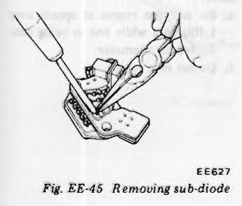
>
> - **Summary:** Using needle-nose pliers as a heat sink on diode lead while unsoldering the sub-diode terminal.
> - **Components:** Sub-diode, Pliers, Soldering iron, Brush holder
> - **Mechanic Notes:** Pinch diode lead with pliers to prevent destructive heat transfer to the silicon wafer.
> - **Tags:** `sub-diode replacement`, `soldering`, `heat sink`

If current flows in both positive and negative directions, diode is short-circuited. If current flows in one direction only as shown in Figures EE-40 and EE-41, diode is in good condition. Replace diodes if faulty.

## INSPECTION OF BRUSH

Check movement of brush and if movement is not smooth, check brush holder and clean if necessary.
Check brush for wear. If it is worn down to less than the specified limit, replace brush assembly.
Check brush pig tail and, if damaged, replace.

> 🖼️ **Fig. EE-46 Brush wear limit** `[EE538]` *(Type: `inspection_measurement`)*
>
> 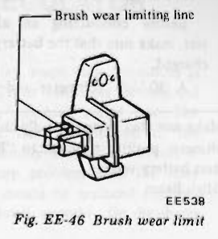
>
> - **Summary:** Illustration of the alternator carbon brush and brush holder showing the stamped brush wear limiting line.
> - **Components:** Carbon brush, Brush holder, Brush wear line
> - **Callouts:** **(Brush wear limiting line)** Limit line scored on brush body
> - **Specs / Measurements:** Wear limit length: 7 mm (0.28 in)
> - **Mechanic Notes:** Replace brush assembly if brush is worn down to the limiting line.
> - **Tags:** `brush wear`, `limit line`, `brush holder`

## SPRING PRESSURE TEST

With brush projected approximately 2 mm (0.08 in) from brush holder, measure brush spring pressure by the use of a spring balance. Normally, the rated pressure of a new brush spring is 255 to 345 gr (8.99 to 12.17 oz).

Moreover, when brush is worn, pressure decreases approximately 20 gr (0.71 oz) per 1 mm (0.04 in) wear.

> 🖼️ **Fig. EE-47 Measuring spring pressure** `[EE049]` *(Type: `inspection_measurement`)*
>
> 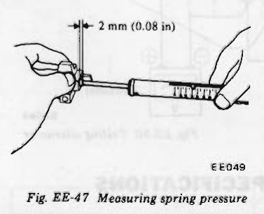
>
> - **Summary:** Measuring brush spring pressure with a spring balance while the brush tip projects 2 mm (0.08 in) from the holder.
> - **Components:** Brush holder, Carbon brush, Spring scale
> - **Specs / Measurements:** Projection: 2 mm (0.08 in); New spring pressure: 255 to 345 gr (8.99 to 12.17 oz); Rate of decrease: ~20 gr (0.71 oz) per 1 mm (0.04 in) wear
> - **Mechanic Notes:** Measure pressure when brush is projected exactly 2 mm from holder face.
> - **Tags:** `brush spring pressure`, `spring balance`, `inspection`

## ASSEMBLY

Assemble alternator in the reverse sequence of disassembly, noting the following:

1. When soldering each stator coil lead wire to diode assembly terminal, carry out the operation as fast as possible.
2. When installing diode A terminal, install insulating bushing correctly.
3. Tighten pulley nut. When pulley is tightened, make sure that deflection of V-groove is less than 0.3 mm (0.012 in).

- **Tightening torque (Pulley nut)**: 4.5 to 6.0 kg-m (33 to 43 ft-lb)

> 🖼️ **Fig. EE-48 Tightening pulley nut** `[EE051]` *(Type: `procedure_step`)*
>
> 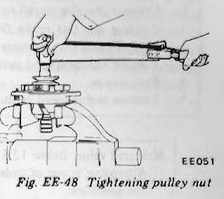
>
> - **Summary:** Tightening the alternator pulley nut with a torque wrench while securing the rotor shaft.
> - **Components:** Alternator pulley, Rotor shaft, Torque wrench
> - **Specs / Measurements:** Torque: 4.5 to 6.0 kg-m (33 to 43 ft-lb); Pulley V-groove deflection limit: less than 0.3 mm (0.012 in)
> - **Mechanic Notes:** Check that V-groove runout/deflection is under 0.3 mm after torquing nut.
> - **Tags:** `pulley nut`, `tightening torque`, `pulley runout`

4. Before installing front and rear sides of alternator, push rear cover brush up with fingers and retain brush, as shown in Figure EE-49, by inserting brush lift into brush lift hole from outside.

> 🖼️ **Fig. EE-49 Inserting brush lift** `[EE540]` *(Type: `procedure_step`)*
>
> 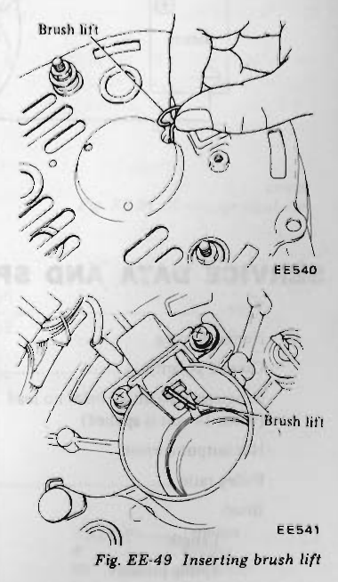
>
> - **Summary:** Two-panel illustration showing how to push the brushes up and retain them using a brush lift wire inserted through the rear cover access hole, and then releasing it.
> - **Components:** Rear cover, Brush lift pin / wire, Brushes, Brush lift hole
> - **Callouts:** **(Brush lift)** Retaining pin inserted from outside
> - **Mechanic Notes:** Insert wire from outside to hold brushes retracted during assembly. When withdrawing wire, push towards center to prevent damaging slip ring.
> - **Tags:** `brush lift`, `assembly technique`, `slip ring protection`

5. After installing front and rear sides of alternator, pull brush lift by pushing toward center.

> [!NOTE]
> Do not pull brush lift by pushing toward outside of cover as it will damage slip ring sliding surface.

---

<!-- Page 20 (EE-20) -->
- **Tightening torque (Through bolts)**: 0.35 to 0.40 kg-m (2.5 to 2.9 ft-lb)

---

## ALTERNATOR TEST

Before conducting an alternator test, make sure that the battery is fully charged.
A 30-Volt voltmeter and suitable test probes are necessary for the test.
Set up a test circuit as shown in Figure EE-50 and test alternator in the manner indicated in the flow chart below:

1. Connect charging circuit on car. Make sure that battery is fully charged.
2. Connect one test probe from voltmeter positive terminal to "BAT" terminal. Connect the other test probe to ground. Make sure that voltmeter registers battery voltage.
3. Turn on headlights and switch to High Beam.
4. Start engine.
5. Increase engine speed gradually.

- **Measured value: Below 12.5 Volts**: Alternator is out of order; remove and check it for condition.
- **Measured value: Over 12.5 Volts at idling 20°C (68°F); Over 14 Volts at 2,400 rpm 20°C (68°F)**: Alternator is in good condition.

> 🖼️ **Fig. EE-50 Testing alternator** `[EE684]` *(Type: `inspection_measurement`)*
>
> 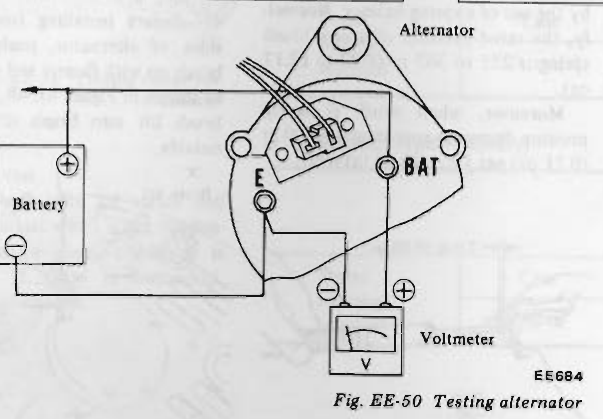
>
> - **Summary:** Wiring test diagram for on-vehicle alternator performance test showing connection of voltmeter between BAT terminal and ground (E).
> - **Components:** Alternator, Battery, Voltmeter, BAT terminal, Ground terminal (E)
> - **Callouts:** **(BAT)** Alternator output terminal; **(E)** Alternator ground; **(V)** Voltmeter (0-30V range)
> - **Specs / Measurements:** Idle: Over 12.5V at 20°C (68°F); 2,400 rpm: Over 14.0V at 20°C (68°F); Below 12.5V: Faulty
> - **Mechanic Notes:** Turn headlights on high beam before running test. Do not exceed 1,100 rpm during initial test, and do not race engine.
> - **Tags:** `alternator test`, `voltmeter hookup`, `bench test`, `charging test`

> [!NOTE]
> a. Do not run engine at speeds over 1,100 rpm while test is being conducted on alternator.
> b. Do not race engine.

---

## SERVICE DATA AND SPECIFICATIONS

### Alternator Specifications

| Item | Unit | Value |
| :--- | :---: | :--- |
| Type | | LR160-42 |
| Nominal rating | V-A | 12-60 |
| Ground polarity | | Negative |
| Minimum revolution under no load (When 14 volt is applied) | rpm | Less than 1,000 |
| Hot output current | A/rpm | 60/500 |
| Pulley ratio | | 2.09 |
| **Brush** | | |
| - Length | mm (in) | More than 7 (0.28) |
| - Spring pressure | gr (oz) | 255 to 345 (8.99 to 12.17) |
| Slip ring outer diameter | mm (in) | More than 30 (1.18) |
| Regulating voltage | V | 14.4 to 15.0 |

### Tightening torque

| Fastener | kg-m | ft-lb |
| :--- | :---: | :---: |
| Through bolts | 0.35 to 0.40 | 2.5 to 2.9 |
| Pulley nut | 4.5 to 6.0 | 33 to 43 |

---

<!-- Page 21 (EE-21) -->
# REGULATOR

## DESCRIPTION

The regulator consists essentially of integrated circuits incorporating transistors. These transistors interrupt and admit current flow to the alternator rotor coil, thus maintaining its output voltage at a constant value. Unlike in a mechanical type regulator, an electronic relay employing transistors is utilized. These transistors are enclosed in a very compact, sealed case. The electronic relay is soldered to the brush assembly inside the alternator. Should any problem with the relay arise, it should be replaced together with the brush assembly. On the charge warning lamp circuit, a diode is attached to the stator coil to monitor generating voltage at the stator so that when the monitored voltage and charging voltage are equal during re-charging, the charge warning lamp is turned off. Accordingly, a charge warning relay is not employed in this circuit.

> 🖼️ **Fig. EE-51 IC voltage regulator** `[EE629]` *(Type: `component_location`)*
>
> 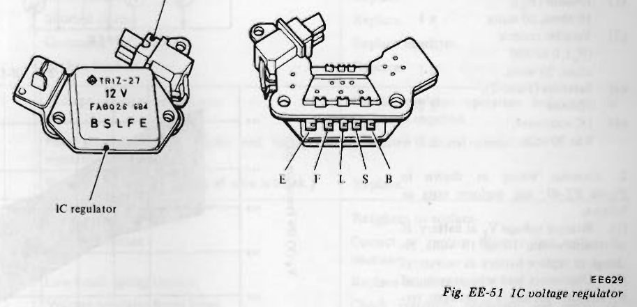
>
> - **Summary:** Front and rear view of the integrated circuit (IC) voltage regulator unit attached to the brush holder, showing terminal markings E, F, L, S, B and model stamping TRIZ-27 12V.
> - **Components:** IC regulator module (TRIZ-27 12V FA8026 684 BSLFE), Brush holder, Terminals E, F, L, S, B
> - **Callouts:** **(E)** Earth / ground terminal; **(F)** Field terminal; **(L)** Warning lamp terminal; **(S)** Battery voltage sensor terminal; **(B)** Battery output terminal; **(Brush)** Carbon brush
> - **Specs / Measurements:** Regulator stamp: TRIZ-27 12 V FAB026 684 BSLFE
> - **Mechanic Notes:** Unit is permanently sealed; if defective, replace entire IC regulator and brush assembly.
> - **Tags:** `IC regulator`, `pinout`, `terminals`, `brush holder`

> 🖼️ **Fig. EE-52 Circuit of regulator** `[EE630]` *(Type: `electrical_schematic`)*
>
> 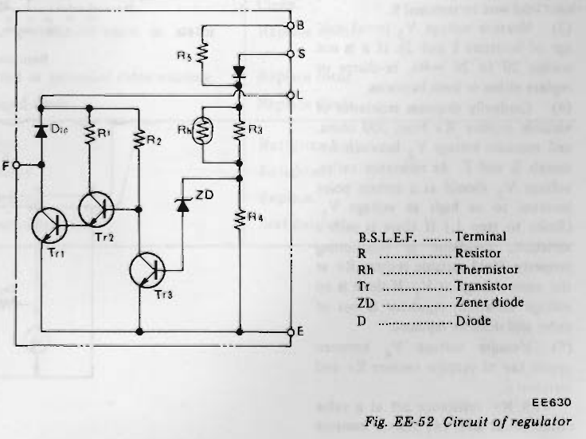
>
> - **Summary:** Internal electronic circuit schematic of the IC voltage regulator showing terminal connections B, S, L, F, E, transistors Tr1, Tr2, Tr3, zener diode ZD, thermistor Rh, and biasing resistors.
> - **Components:** Transistors Tr1, Tr2, Tr3, Zener diode ZD, Diode D10, Thermistor Rh, Resistors R1, R2, R3, R4, R5, Terminals B, S, L, F, E
> - **Callouts:** **(B,S,L,E,F)** Terminals; **(R)** Resistor; **(Rh)** Thermistor; **(Tr)** Transistor; **(ZD)** Zener diode; **(D)** Diode
> - **Mechanic Notes:** Thermistor Rh compensates regulated voltage based on ambient temperature.
> - **Tags:** `regulator schematic`, `internal circuit`, `transistors`, `zener diode`

---

<!-- Page 22 (EE-22) -->
## INSPECTION

Remove IC regulator and brushes at the same time, as outlined in "Disassembly and Assembly" section under the heading "Alternator".

> [!CAUTION]
> When performing test continuously, resistor may generate heat. If it becomes high temperature, stop testing for a while to avoid burning.

1. The following test equipment and accessories are required:
   - (1) Resistor ($R_1$): 10 ohms, 20 watts (x 1)
   - (2) Variable resistor ($R_v$): 0 to 300 ohms, 20 watts (x 1)
   - (3) Batteries (1 and 2): 12 volts (x 2)
   - (4) DC voltmeter: 0 to 30 volts (x 1)

2. Connect wiring as shown in Figure EE-49 [EE-53], and perform tests as follows:
   (1) Measure voltage $V_1$ at battery. If it is not within 10 to 13 volts, re-charge or replace battery as necessary.
   (2) Disconnect lead wire at terminal S; measure voltage $V_2$ between terminals F and E. If it is below 2.0 volts, regulator is functioning properly. Connect lead wire to terminal S.
   (3) Measure voltage $V_3$ (total voltage of batteries 1 and 2). If it is not within 20 to 26 volts, re-charge or replace either or both batteries.
   (4) Gradually decrease resistance of variable resistor $R_v$ from 300 ohms, and measure voltage $V_2$ between terminals E and F. As resistance varies, voltage $V_2$ should at a certain point increase to as high as voltage $V_1$. (Refer to step 1.) If there is such a variation, regulator is functioning properly. Hold variable resistor $R_v$ at the same voltage as $V_1$. If there is no voltage variation, regulator is out of order and must be replaced.
   (5) Measure voltage $V_4$ between center tap of variable resistor $R_v$ and terminal E.
       With $R_v$ resistance set at a value obtained in step (4) above, measure voltage $V_4$ to see if it is within specified range indicated in Figure EE-50 [EE-54]. If it is not, regulator is not functioning properly. Replace.
   (6) Reconnect wiring as shown in Figure EE-51 [EE-55], and repeat steps (4) and (5). If voltage $V_4$ is 0.5 to 2.0 volts higher than that in step (5), regulator is functioning properly. If it is not, replace.

> 🖼️ **Fig. EE-53 Testing regulator** `[EE631]` *(Type: `electrical_schematic`)*
>
> 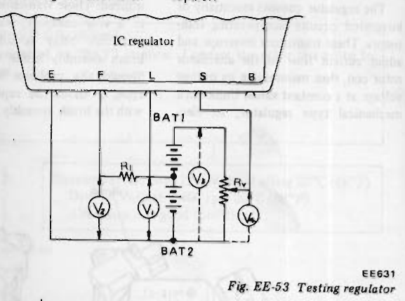
>
> - **Summary:** Wiring test setup for IC regulator bench testing steps 2 through 5, showing two 12V batteries, 10-ohm resistor R1, variable resistor Rv, voltmeters V1, V2, V3, V4, and terminals E, F, L, S, B.
> - **Components:** IC regulator, Battery 1 (BAT1), Battery 2 (BAT2), Resistor R1 (10Ω 20W), Variable resistor Rv (0-300Ω 20W), Voltmeters V1, V2, V3, V4
> - **Callouts:** **(E, F, L, S, B)** IC regulator terminals; **(BAT1)** 12V Battery 1; **(BAT2)** 12V Battery 2; **(R1)** 10-ohm 20W resistor; **(Rv)** 0-300 ohm variable resistor
> - **Specs / Measurements:** V1: 10 to 13V; V2 (S disconnected): Below 2.0V; V3: 20 to 26V
> - **Mechanic Notes:** Stop test if resistors become excessively hot. Terminal S connected to center tap of Rv.
> - **Tags:** `regulator bench test`, `test circuit`, `potentiometer`

> 🖼️ **Fig. EE-54 Testing regulator** `[EE632]` *(Type: `graph_chart`)*
>
> 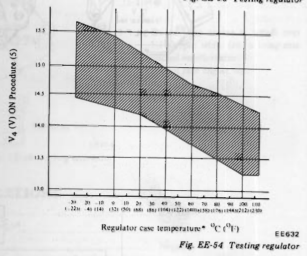
>
> - **Summary:** Characteristic graph showing acceptable band of voltage V4 (V) on Procedure (5) (13.0 to 15.5V) versus regulator case temperature (-30°C to 110°C / -22°F to 230°F).
> - **Components:** Voltage V4 axis, Regulator case temperature axis, Operating band curve
> - **Specs / Measurements:** At -20°C (-4°F): 14.5 to 15.6V; At 20°C (68°F): 14.1 to 14.9V; At 100°C (212°F): 13.2 to 14.0V
> - **Mechanic Notes:** Regulated voltage decreases with increasing temperature due to internal thermistor compensation.
> - **Tags:** `voltage regulation curve`, `temperature compensation`, `V4 specification`

> 🖼️ **Fig. EE-55 Testing regulator** `[EE633]` *(Type: `electrical_schematic`)*
>
> 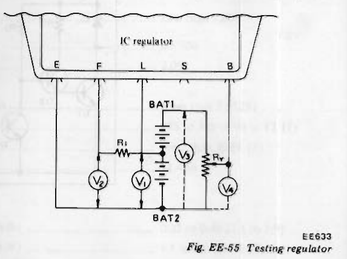
>
> - **Summary:** Modified circuit schematic for step 6 test of the IC regulator with terminal S disconnected from Rv and connected to BAT1.
> - **Components:** IC regulator, Batteries BAT1, BAT2, Resistor R1, Variable resistor Rv, Voltmeters V1, V2, V3, V4
> - **Callouts:** **(E, F, L, S, B)** IC regulator terminals; **(BAT1, BAT2)** Batteries; **(R1)** 10-ohm resistor; **(Rv)** Variable resistor
> - **Specs / Measurements:** V4 must be 0.5 to 2.0V higher than in step 5
> - **Mechanic Notes:** Verifies regulator sense circuit switching behavior.
> - **Tags:** `regulator test step 6`, `test circuit`, `sense terminal`

---

<!-- Page 23 (EE-23) -->
# Engine Electrical System

# TROUBLE DIAGNOSES AND CORRECTIONS
## (Including alternator)

| Condition | Probable cause | Corrective action |
| :--- | :--- | :--- |
| No output | Sticking brushes. | Correct or replace brushes and brush springs. |
| | Dirty brushes and slip rings. | Clean. |
| | Loose connections or broken leads. | Retighten or solder connections. Replace leads if necessary. |
| | Open stator winding. | Replace. |
| | Open rotor winding. | Replace. |
| | Open diodes. | Replace. |
| | Shorted rotor. | Replace. |
| | Shorted stator. | Replace. |
| | Grounded "A" terminal. | Replace insulator. |
| | Broken fan belt. | Replace. |
| Excessive output | Voltage regulator breakdown. | Check regulator operation and repair or replace as required. |
| | Poor grounding of alternator and voltage regulator "E" terminal. | Retighten terminal connection. |
| | Broken ground wire (color of wire is black.) | Replace. |
| Low output | Loose or worn fan belt. | Retighten or replace. |
| | Sticking brushes. | Correct or replace brushes and springs if necessary. |
| | Low brush spring tension. | Replace brush springs. |
| | Voltage regulator breakdown. | Check regulator operation and repair or replace as required. |
| | Dirty slip rings. | Clean. |
| | Partial short, ground, or open in stator winding. | Replace stator. |
| | Partially shorted or grounded rotor winding. | Replace rotor. |
| | Open or damaged diode. | Replace diode. |
| Noisy alternator | Loose mounting. | Retighten bolts. |
| | Loose drive pulley. | Retighten. |
| | Broken ball bearing. | Replace. |
| | Improperly seated brushes. | Seat correctly. |

---

<!-- Page 24 (EE-24) -->
# Engine Electrical System

# IGNITION CIRCUIT

## DESCRIPTION

The ignition circuit consists of ignition switch, transistor ignition unit, distributor, wiring, spark plugs and battery.

The distributor is of the contactless type and is equipped with a pick-up coil which electrically detects the ignition timing signal in place of the circuit breaker of the conventional distributor. The transistor ignition unit is a new addition, which generates the signal required for the make and break of the primary electric current for the ignition coil.

The low voltage current is supplied by the battery or alternator and flows through the primary circuit.

It consists of the ignition switch, primary winding of the ignition coil, transistor ignition unit and all connecting low tension wiring.

The high voltage current is produced by the ignition coil and flows through the secondary circuit, resulting in high voltage spark between the electrodes of the spark plugs in engine cylinders.

This circuit contains the secondary winding of the ignition coil, distributor high tension wires to coil and spark plugs, distributor rotor and cap.

When the ignition switch is turned on and the distributor reluctor rotates, the primary current flows through the primary winding of the coil and through transistors ignition unit to ground.

When the primary circuit is opened by circuit of transistor ignition unit, the magnetic field built up in the primary winding of the coil moves through the secondary winding of the coil, inducing high voltage. This high voltage is produced every time the primary circuit opens.

The high voltage current flows through the high tension wire to the distributor cap, then the rotor distributes the current to one of the spark plug terminals in the distributor cap.

Then the spark occurs while the high voltage current jumps the gap between the insulated electrode and the ground side electrode of the spark plug. This process is repeated for each power stroke of the engine.

The spark plug should be inspected, cleaned and regapped at tune up. Spark plugs should also be replaced periodically as specified in the "Maintenance Schedule".

The remainder of the ignition component parts should be inspected for only their operation, air gap of distributor, tightness of electrical terminals, and wiring condition.

Apply grease (NLGI consistency No. 1 containing MoS2 or equivalent) to distributor rotor shaft as required.

> 🖼️ **Fig. EE-56 Ignition system circuit diagram** `[EE634]` *(Type: `electrical_schematic`)*
>
> 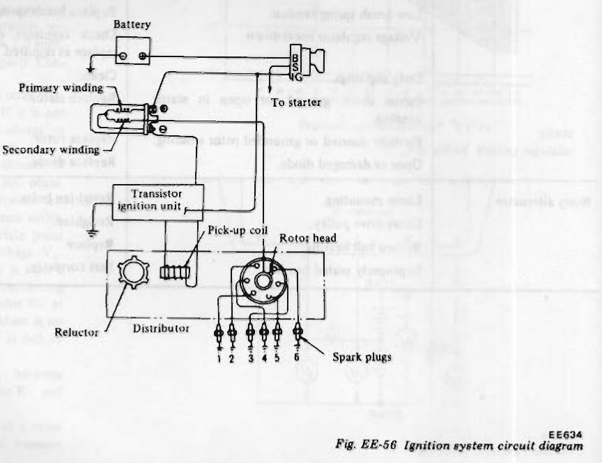
>
> - **Summary:** Functional circuit diagram of the contactless ignition system showing primary and secondary circuits, connections between the battery, ignition switch, starter, ignition coil, transistor ignition unit, distributor reluctor, pick-up coil, rotor head, and six spark plugs.
> - **Components:** Battery, Ignition switch, Starter, Primary winding, Secondary winding, Transistor ignition unit, Pick-up coil, Reluctor, Distributor, Rotor head, Spark plugs
> - **Callouts:** **(1)** Spark plug 1; **(2)** Spark plug 2; **(3)** Spark plug 3; **(4)** Spark plug 4; **(5)** Spark plug 5; **(6)** Spark plug 6
> - **Wiring / Connections:** Battery positive to ignition switch and starter; Ignition switch to ignition coil primary winding and transistor ignition unit; Pick-up coil signal wires to transistor ignition unit; Secondary winding high tension wire to distributor rotor head; Distributor cap terminals to spark plugs 1, 2, 3, 4, 5, 6
> - **Mechanic Notes:** Pick-up coil detects reluctor tooth pass and triggers the transistor ignition unit to open coil primary current, collapsing magnetic flux to fire secondary spark.
> - **Tags:** `ignition circuit`, `circuit diagram`, `distributor`, `transistor ignition unit`, `ignition coil`, `spark plug wiring`

---

<!-- Page 25 (EE-25) -->
# Engine Electrical System

# IGNITION SYSTEM CIRCUIT DIAGRAM

> 🖼️ **Fig. EE-57 Ignition system circuit diagram** `[EE635]` *(Type: `electrical_schematic`)*
>
> 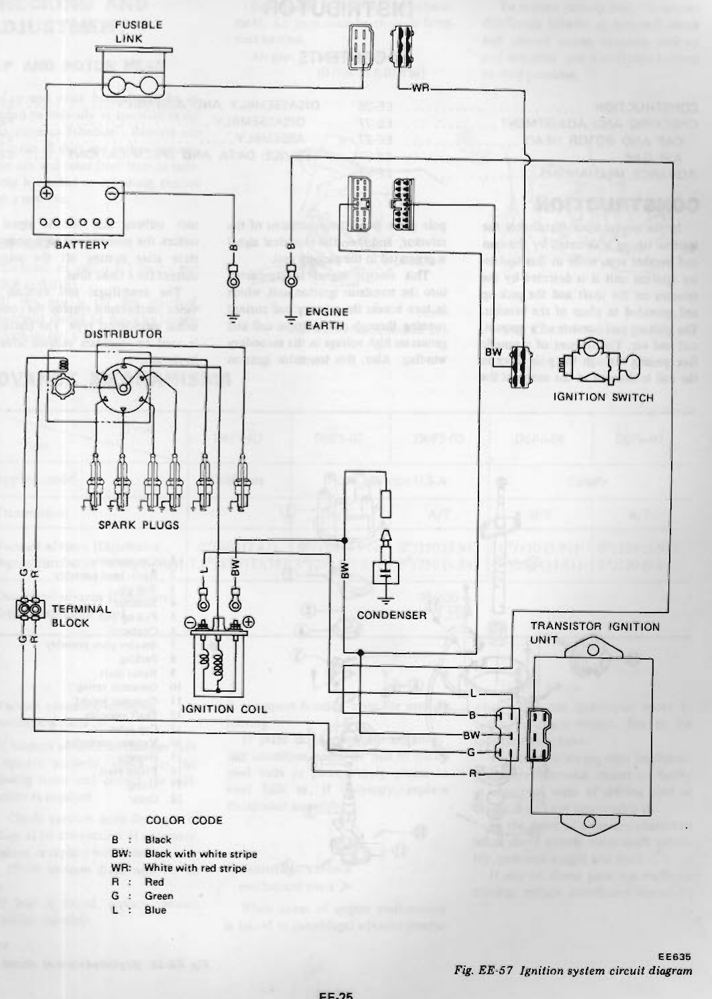
>
> - **Summary:** Detailed electrical system wiring diagram showing full vehicle connections between fusible link, battery, engine earth, ignition switch, distributor, terminal block, condenser, ignition coil (+ and - terminals), and transistor ignition unit with wire colors.
> - **Components:** Fusible link, Battery, Engine earth, Ignition switch, Distributor, Spark plugs, Terminal block, Ignition coil, Condenser, Transistor ignition unit
> - **Wiring / Connections:** B : Black (Earth/ground); BW : Black with white stripe (Switched power); WR : White with red stripe (Battery feed); R : Red (Pick-up coil lead); G : Green (Pick-up coil lead); L : Blue (Ignition coil negative to transistor ignition unit)
> - **Mechanic Notes:** Color codes: B = Black, BW = Black with white stripe, WR = White with red stripe, R = Red, G = Green, L = Blue. Condenser connects to BW lead at ignition coil (+).
> - **Tags:** `wiring diagram`, `ignition system`, `color codes`, `terminal block`, `transistor ignition unit`, `fusible link`

---

<!-- Page 26 (EE-26) -->
# Engine Electrical System

# DISTRIBUTOR

## CONTENTS

| Section | Page |
| :--- | :--- |
| CONSTRUCTION | EE-26 |
| CHECKING AND ADJUSTMENT | EE-27 |
| CAP AND ROTOR HEAD | EE-27 |
| AIR GAP | EE-27 |
| ADVANCE MECHANISMS | EE-27 |
| DISASSEMBLY AND ASSEMBLY | EE-28 |
| DISASSEMBLY | EE-28 |
| ASSEMBLY | EE-28 |
| SERVICE DATA AND SPECIFICATIONS | EE-29 |

## CONSTRUCTION

In the conventional distributor the ignition timing is detected by the cam and breaker arm, while in this transistor ignition unit it is detected by the reluctor on the shaft and the pick-up coil provided in place of the breaker. The pick-up coil consists of a magnet, coil and etc. The amount of magnetic flux passing through the pole piece in the coil is changed at the moment the pole piece faces the protrusion of the reluctor, and then the electrical signal is generated in the pick-up coil.

This electric signal is conducted into the transistor ignition unit, which in turn breaks the primary coil current running through the ignition coil and generates high voltage in the secondary winding. Also, this transistor ignition unit utilizes this electric signal to restore the primary coil to the original state after cutting off the primary current for a fixed time.

The centrifugal and vacuum advance mechanisms employ the conventional mechanical type. The contactor is used to eliminate vacuum advance hysteresis.

> 🖼️ **Fig. EE-58 Exploded view of distributor** `[EE635]` *(Type: `exploded_view`)*
>
> 
>
> - **Summary:** Exploded view diagram of the complete contactless distributor assembly showing internal and external components numbered 1 through 18.
> - **Components:** Cap assembly, Rotor head assembly, Roll pin, Reluctor, Pick-up coil, Contactor, Breaker plate assembly, Packing, Rotor shaft, Governor spring, Governor weight, Shaft assembly, Cap setter, Vacuum controller, Housing, Fixing plate, O-ring, Collar
> - **Callouts:** **(1)** Cap assembly; **(2)** Rotor head assembly; **(3)** Roll pin; **(4)** Reluctor; **(5)** Pick-up coil; **(6)** Contactor; **(7)** Breaker plate assembly; **(8)** Packing; **(9)** Rotor shaft; **(10)** Governor spring; **(11)** Governor weight; **(12)** Shaft assembly; **(13)** Cap setter; **(14)** Vacuum controller; **(15)** Housing; **(16)** Fixing plate; **(17)** O-ring; **(18)** Collar
> - **Mechanic Notes:** The contactor on the breaker plate is used to eliminate vacuum advance hysteresis. Reluctor is keyed to the shaft with a roll pin.
> - **Tags:** `distributor`, `exploded view`, `breaker plate`, `reluctor`, `pick-up coil`, `governor weight`, `vacuum controller`

---

<!-- Page 27 (EE-27) -->
# Engine Electrical System

## CHECKING AND ADJUSTMENT

### CAP AND ROTOR HEAD

Cap and rotor head should be inspected periodically as specified in the "Maintenance Schedule". Remove cap and clean all dust and carbon deposits from cap and rotor from time to time. If cap is cracked or is leaking, replace with a new one.

### AIR GAP

Standard air gap is 0.2 to 0.4 mm (0.008 to 0.016 in).

If the gap is off the standard, adjustment should be made by loosening pick-up coil screws.

Gap gauge is required for adjustment. Air gaps must be checked from time to time.

**Air gap: 0.2 to 0.4 mm (0.008 to 0.016 in)**

To remove pick-up coil, disconnect distributor harness at terminal block and remove screws securing pick-up coil assembly and distributor harness to their positions.

> 🖼️ **Fig. EE-59 Checking air gap** `[EE638]` *(Type: `inspection_measurement`)*
>
> 
>
> - **Summary:** Measurement illustration showing a flat feeler gauge inserted into the air gap between a reluctor tooth and the pick-up coil pole piece.
> - **Components:** Distributor body, Reluctor, Pick-up coil, Feeler gauge
> - **Specs / Measurements:** Air gap: 0.2 to 0.4 mm (0.008 to 0.016 in)
> - **Mechanic Notes:** Loosen pick-up coil screws to adjust gap to 0.2-0.4 mm (0.008-0.016 in).
> - **Tags:** `air gap`, `distributor`, `pick-up coil`, `feeler gauge`, `reluctor`

> 🖼️ **Fig. EE-60 Removing pick-up coil** `[EE636]` *(Type: `procedure_step`)*
>
> 
>
> - **Summary:** Procedure illustration showing removal of screws securing the pick-up coil assembly and harness within the distributor housing.
> - **Components:** Distributor housing, Pick-up coil assembly, Distributor harness, Screws, Screwdriver
> - **Wiring / Connections:** Distributor harness disconnected at terminal block
> - **Mechanic Notes:** Disconnect distributor harness at terminal block prior to removing securing screws.
> - **Tags:** `pick-up coil removal`, `distributor disassembly`, `harness screws`

### ADVANCE MECHANISMS

| Item | Type | D6F4-03 | D6F5-02 | D6F5-03 | D6F6-06 | D6F6-07 |
| :--- | :--- | :--- | :--- | :--- | :--- | :--- |
| Applied model | | California | Non-California U.S.A. | Non-California U.S.A. | Canada | Canada |
| Transmission | | | M/T | A/T | M/T | A/T |
| Vacuum advance [Distributor degree/distributor mmHg (inHg)] | | 0°/200 (7.87) 7.5°/350 (13.78) | 0°/150 (5.91) 9°/295 (11.61) | 0°/150 (5.91) 5°/250 (9.84) | 0°/150 (5.91) 9°/295 (11.61) | 0°/150 (5.91) 5°/250 (9.84) |
| Centrifugal advance [Distributor degree/distributor rpm] | | 0°/600 8.5°/1,250 | 0°/600 8.5°/1,250 | 0°/600 8.5°/1,250 | 0°/600 8.5°/1,250 | 0°/600 8.5°/1,250 |

≪ Vacuum advance mechanism mechanical parts ≫

If vacuum advance mechanism fails to operate properly, check for the following items and correct the malfunction as required.
1. Check vacuum inlet for signs of leakage at its connection. If necessary, retighten or replace with a new one.
2. Check vacuum diaphragm for air leak. If leak is found, replace vacuum controller assembly.
3. Inspect breaker plate for smooth moving. If plate does not move smoothly, this condition could be due to sticky steel balls or pivot. Apply grease to steel balls or, if necessary, replace distributor assembly.

≪ Centrifugal advance mechanical parts ≫

When cause of engine malfunction is traced to centrifugal advance mechanical parts, use distributor tester to check its characteristics. See to the specifications above.
If nothing is wrong with its characteristics, conceivable causes are faulty or abnormal wear of driving part or others. So do not disassemble it.
In the event of improper characteristics, check closely rotor shaft assembly, governor weight and shaft.
If any of above parts are malfunctioning, replace distributor assembly.

---

<!-- Page 28 (EE-28) -->
# Engine Electrical System

## DISASSEMBLY AND ASSEMBLY

### DISASSEMBLY

To disassemble, follow the below procedure.
1. Take off cap and remove rotor head.
2. Remove two screws shown in Figure EE-61, and detach vacuum controller.

> 🖼️ **Fig. EE-61 Removing vacuum controller** `[EE637]` *(Type: `procedure_step`)*
>
> 
>
> - **Summary:** Removing the two retaining screws securing the vacuum controller assembly to the distributor body.
> - **Components:** Vacuum controller, Distributor body, Screws
> - **Mechanic Notes:** Detach vacuum controller after removing the two securing screws.
> - **Tags:** `vacuum controller`, `distributor disassembly`, `vacuum advance`

3. Remove pick-up coil assembly.
4. Using two pry bars, pry reluctor from shaft. Be careful not to distort or damage the teeth of reluctor. Remove roll pin.
5. Remove breaker plate setscrews and remove breaker plate assembly.

> 🖼️ **Fig. EE-62 Removing breaker plate setscrews** `[EE296]` *(Type: `procedure_step`)*
>
> 
>
> - **Summary:** Using a screwdriver to unscrew the setscrews retaining the breaker plate assembly inside the distributor.
> - **Components:** Distributor body, Breaker plate assembly, Setscrews, Screwdriver
> - **Mechanic Notes:** Remove breaker plate setscrews to take out the breaker plate.
> - **Tags:** `breaker plate`, `distributor disassembly`, `setscrews`

6. Punch knock pin out and remove pinion.

> 🖼️ **Fig. EE-63 Removing knock pin** `[EE639]` *(Type: `procedure_step`)*
>
> 
>
> - **Summary:** Driving the knock pin out of the distributor drive pinion gear using a hammer and small pin punch.
> - **Components:** Pinion gear, Distributor shaft, Knock pin, Pin punch, Hammer
> - **Mechanic Notes:** Punch knock pin out to detach the lower drive pinion.
> - **Tags:** `knock pin`, `pinion`, `distributor shaft`, `pin punch`

7. Remove rotor shaft and drive shaft assembly.

> 🖼️ **Fig. EE-64 Removing rotor shaft and drive shaft assembly** `[EE297]` *(Type: `procedure_step`)*
>
> 
>
> - **Summary:** Withdrawing the rotor shaft and drive shaft sub-assembly upward out of the distributor housing.
> - **Components:** Distributor housing, Rotor shaft, Drive shaft assembly
> - **Mechanic Notes:** Slide the combined rotor shaft and drive shaft out of housing once pinion is removed.
> - **Tags:** `rotor shaft`, `drive shaft`, `distributor housing`

8. Mark rotor shaft and drive shaft. Remove packing from the top of rotor shaft and unscrew rotor shaft setscrew. Remove rotor shaft.

> 🖼️ **Fig. EE-65 Removing rotor shaft** `[EE075]` *(Type: `procedure_step`)*
>
> 
>
> - **Summary:** Unscrewing the internal rotor shaft setscrew from the top cavity of the rotor shaft with a screwdriver.
> - **Components:** Rotor shaft, Drive shaft, Setscrew, Screwdriver
> - **Mechanic Notes:** Mark rotor shaft and drive shaft first; remove packing from top of rotor shaft to access setscrew.
> - **Tags:** `rotor shaft`, `setscrew`, `match marks`, `packing`

9. Mark one of the governor springs and its bracket. Also mark one of the governor weights and its pivot pins.
10. Carefully unhook and remove governor springs.
11. Remove governor weights. Apply grease to governor weights, after disassembling.

### ASSEMBLY

To assemble, reverse the order of disassembly. Carefully observe the following instructions.
1. Align match marks so that parts are assembled to their original positions.
2. If, for any reason, contactor is removed from breaker plate, adjust cam-to-contactor clearance to 0.3 mm (0.012 in) as shown in Figure EE-66, after installation.

> 🖼️ **Fig. EE-66 Cam-to-contactor clearance** `[EE368]` *(Type: `inspection_measurement`)*
>
> 
>
> - **Summary:** Diagram illustrating clearance adjustment between the distributor shaft cam lobe and contactor arm on the breaker plate.
> - **Components:** Cam, Contactor arm, Breaker plate
> - **Specs / Measurements:** Clearance: 0.3 mm (0.012 in)
> - **Mechanic Notes:** Adjust cam-to-contactor clearance to exactly 0.3 mm (0.012 in) after reinstalling contactor.
> - **Tags:** `contactor`, `cam clearance`, `breaker plate`, `clearance specification`

3. Ensure that reluctor is properly oriented when installing on shaft. Always drive in roll pin with its slit toward the outer end of shaft. See Figure EE-67. Be sure to use a new roll pin.

> 🖼️ **Fig. EE-67 Driving in roll pin** `[EE373]` *(Type: `alignment_orientation`)*
>
> 
>
> - **Summary:** Diagram showing correct rotational orientation of the reluctor roll pin with its longitudinal slit facing outward.
> - **Components:** Reluctor, Shaft, Roll pin
> - **Mechanic Notes:** Always drive in roll pin with its slit toward the outer end of shaft. Always use a new roll pin.
> - **Tags:** `roll pin`, `reluctor`, `distributor shaft`, `slit orientation`

4. When installing pinion on shaft, be sure to install pinion gear correctly to position where it was installed.
5. Apply grease to the top of rotor shaft as required.
6. Check the operation of governor before installing distributor on engine.
7. Adjust ignition timing after distributor is installed on engine.

---

<!-- Page 29 (EE-29) -->
# Engine Electrical System

# SERVICE DATA AND SPECIFICATIONS

| Applied model | Non-California | Non-California | California | California |
| :--- | :--- | :--- | :--- | :--- |
| Transmission | M/T | A/T | M/T | A/T |
| Type | D6F5-02, D6F6-06* | D6F5-03, D6F6-07* | D6F4-03 | D6F4-03 |
| Firing order | 1-5-3-6-2-4 | 1-5-3-6-2-4 | 1-5-3-6-2-4 | 1-5-3-6-2-4 |
| Rotating direction | Counterclockwise | Counterclockwise | Counterclockwise | Counterclockwise |
| Duty | 70% (8 to 20% at idling) | 70% (8 to 20% at idling) | 70% (8 to 20% at idling) | 70% (8 to 20% at idling) |
| Air gap mm (in) | 0.2 to 0.4 (0.008 to 0.016) | 0.2 to 0.4 (0.008 to 0.016) | 0.2 to 0.4 (0.008 to 0.016) | 0.2 to 0.4 (0.008 to 0.016) |
| Cap insulation resistance MΩ | More than 50 | More than 50 | More than 50 | More than 50 |
| Rotor head insulation resistance MΩ | More than 50 | More than 50 | More than 50 | More than 50 |
| Cap carbon point length mm (in) | 10 (0.39) | 10 (0.39) | 10 (0.39) | 10 (0.39) |

\*For Canada

---

<!-- Page 30 (EE-30) -->
# Engine Electrical System

# TRANSISTOR IGNITION UNIT

## CONTENTS

| Section | Page |
| :--- | :--- |
| DESCRIPTION | EE-30 |
| TRANSISTOR IGNITION UNIT | EE-30 |
| REMOVAL AND INSTALLATION | EE-30 |
| INSPECTION | EE-31 |
| 1. POWER SUPPLY WIRING AND BATTERY CHECK | EE-31 |
| 2. CONTINUITY CHECK OF PRIMARY CIRCUIT | EE-31 |
| 3. PICK-UP COIL CONTINUITY CHECK | EE-32 |
| 4. PICK-UP COIL POWER SIGNAL PULSE CHECK | EE-32 |
| 5. TRANSISTOR IGNITION UNIT CHECK | EE-32 |

## DESCRIPTION

### TRANSISTOR IGNITION UNIT

The transistor ignition unit provides the following functions:
1. It makes and breaks the electric current in the primary circuit of the ignition coil.
2. The duty control circuit sets the rate of make and break within one cycle, i.e., this maintains good ignition characteristics of engine from low speed to high speed and is equal to the dwell angle in the conventional breaker type distributor.
3. A preventive circuit against locking is provided. This cuts off the primary electric current in the ignition coil even when the ignition switch is turned on with the engine not running.
4. In addition, a current limiting circuit is provided. This controls the electric current that flows in the power switching circuit so as not to exceed a certain level.

Each component part of this unit is highly reliable, however, should any part be found faulty, the entire assembly must be replaced.

> 🖼️ **Fig. EE-68 Transistor ignition unit circuit diagram** `[EE689]` *(Type: `electrical_schematic`)*
>
> 
>
> - **Summary:** Functional block diagram of the transistor ignition unit internal sub-circuits and wiring connections to the starter, ignition switch, battery, ignition coil, and distributor.
> - **Components:** Transistor ignition unit, Power switching circuit, Duty control circuit, Spark timing signal monitoring circuit, Lock preventing circuit, Ignition switch, Battery, Ignition coil, Distributor, Starter
> - **Wiring / Connections:** Power switching circuit connected to ignition coil (-); Lock preventing circuit and duty control circuit connected to power switching; Distributor pick-up leads to spark timing signal monitoring circuit; Ignition switch lead connected to starter and coil (+)
> - **Mechanic Notes:** Unit contains power switching, duty control, spark timing monitoring, and lock preventing circuits.
> - **Tags:** `transistor ignition unit`, `block diagram`, `lock preventing circuit`, `duty control circuit`

## REMOVAL AND INSTALLATION

Transistor ignition unit is located on the right-hand dash side panel in passenger compartment.
1. Disconnect battery terminals.
2. Disconnect ignition unit connector from unit.
3. Remove two setscrews and remove unit.

Note: To remove ignition unit connector, push latch of connector and pull the connector out.

4. To install, reverse the order of removal.

> 🖼️ **Fig. EE-69 External view of ignition unit** `[EE564]` *(Type: `component_location`)*
>
> 
>
> - **Summary:** Perspective view of the transistor ignition unit casing and multi-wire plug connector showing the push-release latch.
> - **Components:** Transistor ignition unit housing, Harness connector plug, Push release latch
> - **Wiring / Connections:** Harness multi-pin connector
> - **Mechanic Notes:** Located on right-hand dash side panel in passenger compartment. Push latch of connector to remove.
> - **Tags:** `transistor ignition unit`, `connector`, `push latch`, `component location`

---

<!-- Page 31 (EE-31) -->
# Engine Electrical System

## INSPECTION

If the engine does not run due to faulty ignition system, check the ignition system as follows:
Check for a cracked distributor rotor or cap and corroded terminals. Visually inspect high tension wire for condition and, if necessary, use an ignition oscilloscope or a circuit tester to make performance checks. Check spark plugs and adjust gaps as necessary.
Replace a spark plug which is not suitable for further use. If the above checks cannot correct the problem, check the entire ignition system with an oscilloscope or a circuit tester.

### CHECKING WITH AN OSCILLOSCOPE
An oscilloscope can be used for checking almost all the items in a transistor ignition system.

### CHECKING WITH A CIRCUIT TESTER
A circuit tester can not be used for the duty control circuit and power transistor performance tests. Both methods (use of an oscilloscope and a circuit tester) are described in this section.
The items are classified by numerals in accordance with the objective of checks to be performed. Several wiring diagrams are found on pages EE-36 to EE-40. The thick lines indicate the objective of each individual item check.
When checking a circuit with an oscilloscope or a circuit tester, be careful not to confuse the polarity of the lead wires if a potential difference exists between the check points at which the lead wires are to be contacted. Also, do not attempt to connect the lead wires to any points in the circuit other than those designated. Careless handling of the lead wires will result in damage to the transistor ignition unit as well as to the oscilloscope or circuit tester.
The connection of a tachometer or a timing light in parallel with an oscilloscope or a circuit tester is allowable, provided that such a connection is made with due consideration to wiring connections.

### 1. POWER SUPPLY WIRING AND BATTERY CHECK (See wiring diagram in Figure EE-82)
#### Procedure:
1. Disconnect ignition unit connector from unit.
2. Turn on ignition switch.
3. Connect a circuit tester or an oscilloscope as shown in the figure below.

> 🖼️ **Fig. EE-70 Checking power supply wiring and battery** `[EE565]` *(Type: `procedure_step`)*
>
> 
>
> - **Summary:** Connecting a DC voltmeter (50-volt range) between terminal BW (+) and terminal B (-) of the disconnected transistor ignition unit harness connector.
> - **Components:** Transistor ignition unit harness connector, Circuit tester / DC voltmeter, Terminal BW, Terminal B
> - **Specs / Measurements:** Tester range: DC 50-volt range; Expected voltage: Power source (battery) voltage
> - **Wiring / Connections:** BW (Black/White); B (Black)
> - **Mechanic Notes:** Turn on ignition switch before measuring. Full battery voltage must be present across BW and B.
> - **Tags:** `power supply check`, `battery check`, `harness connector`, `voltmeter`

#### Criterion:
| Result | Evaluation |
| :--- | :--- |
| When power source (battery) voltage is indicated | OK |
| Lower or no indication | N.G. |

If the result is "N.G." - Take the following measures:
1. Check "BW" and "B" color wire harnesses respectively, for proper conductance.
2. Check battery terminals for proper connection.
3. Check charge condition of battery if an excessively low voltage is indicated.

### 2. CONTINUITY CHECK OF PRIMARY CIRCUIT
#### 2-1. Checking primary circuit (See wiring diagram in Figure EE-83)
##### Procedure:
1. Disconnect ignition unit connector from unit.
2. Turn on ignition switch.
3. Connect a circuit tester.

> 🖼️ **Fig. EE-71 Checking primary circuit** `[EE566]` *(Type: `procedure_step`)*
>
> 
>
> - **Summary:** Connecting a DC voltmeter (50-volt range) between terminal L and terminal B on the disconnected transistor ignition unit connector.
> - **Components:** Transistor ignition unit harness connector, Circuit tester / DC voltmeter, Terminal L, Terminal B
> - **Specs / Measurements:** Tester range: DC 50-volt range; Expected voltage: Normal battery voltage
> - **Wiring / Connections:** L (Blue); B (Black)
> - **Mechanic Notes:** Checks primary coil circuit continuity through the ignition switch and coil primary winding to connector terminal L.
> - **Tags:** `primary circuit`, `ignition coil`, `continuity check`, `voltmeter`

##### Criterion:
| Result | Evaluation |
| :--- | :--- |
| When normal power source (battery) voltage is indicated | OK |
| Lower or no indication | N.G. |

If the result is "N.G." - Take the following measures:
1. Check "L" color wire harness for proper conductance.
2. Check ignition coil terminals for loose contact.
3. Check ignition coil for discontinuity.

#### 2-2. Checking ignition coil assembly (See wiring diagram in Figure EE-84)
##### Procedure:
1. Disconnect engine room harness from ignition coil.
2. Connect a circuit tester as shown in the figure below.

> 🖼️ **Fig. EE-72 Checking ignition coil assembly** `[EE567]` *(Type: `procedure_step`)*
>
> 
>
> - **Summary:** Measuring resistance across the positive (+) and negative (-) primary terminals of the isolated ignition coil using an ohmmeter on x 1 range.
> - **Components:** Ignition coil, Positive (+) terminal, Negative (-) terminal, Ohmmeter
> - **Specs / Measurements:** Tester range: Resistance x 1 range; Criterion: Approx. 0 ohm is OK; more than 1.8 ohm is N.G.
> - **Wiring / Connections:** Engine room harness disconnected from coil
> - **Mechanic Notes:** Disconnect engine room harness before checking resistance across (+) and (-) terminals.
> - **Tags:** `ignition coil`, `primary resistance`, `ohmmeter` <!-- Page 32 (EE-32) --> # Engine Electrical System

#### Criterion:
| Result | Evaluation |
| :--- | :--- |
| When approximately 0 ohm is indicated | OK |
| More than 1.8 ohm | N.G. |

If the result is "N.G." - Replace ignition coil assembly.

### 3. PICK-UP COIL CONTINUITY CHECK (See wiring diagram in Figure EE-85)
#### Procedure:
1. Disconnect ignition unit connector from unit.
2. Connect a circuit tester as shown in the figure below:

> 🖼️ **Fig. EE-73 Checking pick-up coil** `[EE568]` *(Type: `procedure_step`)*
>
> 
>
> - **Summary:** Connecting an ohmmeter (Resistance: x 10 range) between terminals G and R on the disconnected transistor ignition unit connector.
> - **Components:** Transistor ignition unit harness connector, Ohmmeter, Terminal G, Terminal R
> - **Specs / Measurements:** Tester range: Resistance x 10 range; Standard resistance: Approximately 720 ohm
> - **Wiring / Connections:** G (Green); R (Red)
> - **Mechanic Notes:** Pick-up coil resistance must be approximately 720 ohms. Far less or more indicates faulty coil.
> - **Tags:** `pick-up coil`, `continuity check`, `resistance`, `ohmmeter`

#### Criterion:
| Result | Evaluation |
| :--- | :--- |
| When approximately 720 ohm is indicated | OK |
| Far less than, or more than, 720 ohm | N.G. |

If the result is "N.G." - Replace pick-up coil assembly.

### 4. PICK-UP COIL POWER SIGNAL PULSE CHECK
#### Procedure:
1. Turn ignition switch off and disconnect electronic fuel injection harness connector from cold start valve.
2. Connect a circuit tester as shown in the figure below.
3. Rotate starter motor.
4. Read the tester indication.

> 🖼️ **Fig. EE-74 Checking pick-up coil power signal pulse** `[EE569]` *(Type: `procedure_step`)*
>
> 
>
> - **Summary:** Connecting a circuit tester on AC 2.5-volt range across terminals G and R while cranking the engine with starter motor.
> - **Components:** Transistor ignition unit harness connector, AC voltmeter / circuit tester, Terminal G, Terminal R
> - **Specs / Measurements:** Tester range: AC 2.5-volt range
> - **Wiring / Connections:** G (Green); R (Red)
> - **Mechanic Notes:** Disconnect cold start valve harness before test. The needle should deflect slightly while cranking.
> - **Tags:** `pick-up coil`, `signal pulse`, `AC voltmeter`, `cranking`

#### Criterion:
| Result | Evaluation |
| :--- | :--- |
| When pointer deflects slightly | OK |
| When pointer does not deflect at all | N.G. |

If the result is "N.G." - Replace pick-up coil assembly.

#### Procedure: (with an oscilloscope)
1. Turn ignition switch off and disconnect electronic fuel injection harness connector from cold start valve.
2. Connect the positive lead of an oscilloscope to "R", and the negative lead of the oscilloscope to "G" as shown in the figure below.
3. Set "SLOPE" select switch of oscilloscope to positive side. (If so equipped.)
4. Rotate starter motor.
5. Check the wave form as shown in the figure below.

> 🖼️ **Fig. EE-75 Checking pick-up coil power signal pulse** `[EE570]` *(Type: `procedure_step`)*
>
> 
>
> - **Summary:** Connecting oscilloscope positive probe to terminal R and negative probe to terminal G of the ignition unit harness connector.
> - **Components:** Transistor ignition unit harness connector, Oscilloscope, Terminal R, Terminal G
> - **Specs / Measurements:** Oscilloscope SLOPE switch: positive side
> - **Wiring / Connections:** Oscilloscope (+) to R; Oscilloscope (-) to G
> - **Mechanic Notes:** Set SLOPE switch to positive. Crank engine and observe generated waveform.
> - **Tags:** `oscilloscope`, `pick-up coil pulse`, `signal verification`

> 🖼️ **Fig. EE-76 Wave form of pick-up coil** `[EE268]` *(Type: `graph_chart`)*
>
> 
>
> - **Summary:** Oscilloscope waveform comparison of pick-up coil signal: continuous full line represents normal (OK), dashed line or absence represents abnormal (N.G.).
> - **Components:** Oscilloscope trace display
> - **Mechanic Notes:** A full smooth sine-like waveform confirms normal pick-up coil signal generation.
> - **Tags:** `waveform`, `pick-up coil`, `oscilloscope trace`

#### Criterion:
| Result | Evaluation |
| :--- | :--- |
| When the wave form takes the shape of a full line | OK |
| When the wave form takes the shape of a dashed line or when there is no wave form | N.G. |

If the result is "N.G." - Replace pick-up coil assembly.

### 5. TRANSISTOR IGNITION UNIT CHECK (See wiring diagram in Figure EE-86)
Check items 5-1 and 5-2 with an oscilloscope.

Where an oscilloscope is not available, check to make sure that all previous tests are satisfactory and that no spark is issuing from the secondary high-tension wire.

If everything else is satisfactory, then the transistor ignition unit is faulty or there is discontinuity in the secondary high-tension wire. Replace the faulty part. After replacement check the sparks from the secondary cord.

#### 5-1. Checking operation of transistor ignition unit
##### Procedure:
1. Connect engine room harness to ignition coil.
2. Connect ignition unit connector to ignition unit.
3. Turn ignition switch off and disconnect electronic fuel injection harness connectors from injectors and cold start valve.
4. Connect oscilloscope as shown in Figure EE-76, rotate the starter motor and observe the wave form on the oscilloscope. <!-- Page 33 (EE-33) --> # Engine Electrical System

> 🖼️ **Fig. EE-77 Checking operation of transistor ignition unit** `[EE571]` *(Type: `procedure_step`)*
>
> 
>
> - **Summary:** Connecting oscilloscope positive lead to ignition coil (-) terminal and negative lead to body metal ground.
> - **Components:** Oscilloscope, Ignition coil, Ignition coil (-) terminal, Body metal ground
> - **Wiring / Connections:** Oscilloscope positive probe to coil (-) terminal; Oscilloscope negative probe to body ground
> - **Mechanic Notes:** Tests transistor unit primary switching by monitoring primary voltage waveform at coil negative terminal.
> - **Tags:** `oscilloscope`, `ignition coil`, `transistor ignition unit`, `switching waveform`

> 🖼️ **Fig. EE-78 Wave form of pulse** `[EE452]` *(Type: `graph_chart`)*
>
> 
>
> - **Summary:** Oscilloscope voltage waveform traces: pattern (a) displays a proper high-voltage induced primary spike (OK); pattern (b) displays a deformed/flat pulse (N.G.).
> - **Components:** Oscilloscope display pattern (a), Oscilloscope display pattern (b)
> - **Callouts:** **(a)** Normal primary pulse spike (OK); **(b)** Abnormal low/flat pulse (N.G.)
> - **Mechanic Notes:** Pattern (a) confirms proper switching transistor operation. Pattern (b) indicates internal transistor unit defect.
> - **Tags:** `waveform`, `pulse trace`, `oscilloscope`, `transistor ignition unit`

#### Criterion:
See Figure EE-78.
| Result | Evaluation |
| :--- | :--- |
| When a wave form similar to (a) is observed | OK |
| When a wave form similar to (b) is observed or when no wave form is observed | N.G. |

If the result is "N.G.", the fault lies either in the transistor unit or in the secondary high-tension wire.
Replace these parts.

#### - If an oscilloscope is not available -
##### Procedure:
1. Connect engine room harness to ignition coil.
2. Connect ignition unit connector to ignition unit.
3. Turn ignition switch off and disconnect electronic fuel injection harness connectors from injector and cold start valve.
4. Keep the secondary high-tension wire end 4 to 5 mm (0.16 to 0.20 in) away from engine block, rotate the starter motor, and check whether sparks fly across the clearance.

##### Criterion:
| Result | Evaluation |
| :--- | :--- |
| Where sparks issue | OK |
| Where no spark issues | N.G. |

If the result is "N.G.", the fault lies either in the transistor unit or in the secondary high-tension wire.
Replace these parts.

#### 5-2. Checking operation of duty
##### Procedure:
1. Turn ignition switch off and connect electronic fuel injection harness connectors to injectors and cold start valve.
2. While the engine is idling, observe the wave form on the oscilloscope in the same way as stated in item 5-1, Figure EE-77. Determine the ratio t/T as shown in Figure EE-79.

> 🖼️ **Fig. EE-79 Wave form of duty pulse** `[EE257]` *(Type: `graph_chart`)*
>
> 
>
> - **Summary:** Oscilloscope trace illustrating duty cycle measurement at engine idle, showing conduction time t, total cycle period T, and formula t/T x 100 = 8 to 20%.
> - **Components:** Duty pulse waveform, Conduction time (t), Cycle period (T)
> - **Specs / Measurements:** Formula: (t / T) * 100 = 8 to 20% (at idling)
> - **Mechanic Notes:** Measure at engine idle speed. Duty ratio must be within 8% to 20%.
> - **Tags:** `duty pulse`, `dwell angle`, `oscilloscope`, `duty ratio`, `idling`

##### Criterion:
| Result | Evaluation |
| :--- | :--- |
| When a standard ratio of about 8 to 20% is obtained | OK |
| When the ratio obtained is less than 8%, or more than 20% | N.G. |

If the result is "N.G." - Replace transistor ignition unit.

#### 5-3. Checking lock preventive circuit
##### - If a circuit tester is used -
###### Procedure:
1. Connect a circuit tester as shown in Figure EE-80; positive terminal of tester is connected to - terminal of the ignition coil and negative terminal of tester is grounded.
2. Turn on ignition switch. Check to see whether the tester indicates the voltage of power source (battery) as soon as ignition switch is turned on. <!-- Page 34 (EE-34) --> # Engine Electrical System

> 🖼️ **Fig. EE-80 Checking lock preventive circuit** `[EE572]` *(Type: `procedure_step`)*
>
> 
>
> - **Summary:** Connecting a DC voltmeter (50-volt range) between the ignition coil (-) terminal and body metal ground to check the lock preventive circuit.
> - **Components:** Ignition coil, Ignition coil (-) terminal, Voltmeter / circuit tester, Body metal ground
> - **Specs / Measurements:** Tester range: DC 50-volt range; Expected voltage: Power source (battery) voltage as soon as switch is turned ON
> - **Wiring / Connections:** Voltmeter (+) to ignition coil (-) terminal; Voltmeter (-) to body ground
> - **Mechanic Notes:** When ignition switch is turned on without cranking, tester should immediately read battery voltage, verifying primary current cut-off.
> - **Tags:** `lock preventive circuit`, `voltmeter`, `ignition coil`, `transistor ignition unit`

###### Criterion:
| Result | Evaluation |
| :--- | :--- |
| When power source voltage is indicated | OK |
| When approximately zero-voltage is indicated | N.G. |

If the result is "N.G." - Take the following measures:
Replace transistor ignition unit.

##### - If an oscilloscope is used -
###### Procedure:
When using an oscilloscope instead of a tester, arrange the connection in the same way as shown in Figure EE-77. Turn on ignition switch.
Check to see whether the wave form on the oscilloscope rises up to the power source voltage as soon as ignition switch is turned on.

###### Criterion:
The same as described before for use of a tester.

> 🖼️ **Fig. EE-81 Wave form of lock preventive circuit** `[EE430]` *(Type: `graph_chart`)*
>
> 
>
> - **Summary:** Oscilloscope voltage trace showing rapid rise from 0V up to power source (battery) voltage immediately upon turning ignition switch ON.
> - **Components:** Oscilloscope voltage trace, 0V reference line, Power source voltage level, Ignition switch ON marker
> - **Specs / Measurements:** Voltage level: 0V to Power source voltage
> - **Mechanic Notes:** Waveform must sharply transition to full battery voltage upon switch closure, confirming lock prevention cut-off.
> - **Tags:** `lock preventive circuit`, `waveform`, `oscilloscope trace`

---

<!-- Page 35 (EE-35) -->
# Engine Electrical System

# WIRING DIAGRAM FOR ITEM (1)

> 🖼️ **Fig. EE-82 Wiring diagram for item (1) (Power supply wiring and battery check)** `[EE690]` *(Type: `electrical_schematic`)*
>
> 
>
> - **Summary:** Schematic highlighting in bold the power feed and ground circuit for test Item 1: from battery positive through fusible link and ignition switch to connector terminal BW, and from connector terminal B to earth ground.
> - **Components:** Battery, Fusible link, Ignition switch, Ignition coil assembly, Distributor, Terminal block, Connector, Ignition unit, Power switching circuit, Duty control circuit, Spark timing, signal monitoring circuit, Lock preventing circuit
> - **Wiring / Connections:** B: Black (Ground); BW: Black with white stripe (Switched battery feed); L: Blue; R: Red; G: Green
> - **Mechanic Notes:** Bold traces illustrate the exact supply and ground paths tested during Item 1 power supply verification.
> - **Tags:** `wiring diagram`, `item 1`, `power supply check`, `battery check`, `schematic`

---

<!-- Page 36 (EE-36) -->
# Engine Electrical System

# WIRING DIAGRAM FOR ITEM (2)-1

> 🖼️ **Fig. EE-83 Wiring diagram for item (2)-1 (Checking primary circuit)** `[EE691]` *(Type: `electrical_schematic`)*
>
> 
>
> - **Summary:** Schematic highlighting in bold the primary ignition circuit path for test Item 2-1: battery positive, fusible link, ignition switch, ignition coil (+) and (-) terminals, through lead L to the disconnected ignition unit connector.
> - **Components:** Battery, Fusible link, Ignition switch, Ignition coil assembly, Distributor, Terminal block, Connector, Ignition unit, Power switching circuit, Duty control circuit, Spark timing, signal monitoring circuit, Lock preventing circuit
> - **Wiring / Connections:** BW: Black/White (Ignition switch to coil +); L: Blue (Coil - to connector pin L); B: Black (Ground pin B)
> - **Mechanic Notes:** Bold lines show the complete circuit path tested when verifying primary coil voltage at connector pins L and B.
> - **Tags:** `wiring diagram`, `item 2-1`, `primary circuit check`, `schematic`

---

<!-- Page 37 (EE-37) -->
# Engine Electrical System

# WIRING DIAGRAM FOR ITEM (2)-2

> 🖼️ **Fig. EE-84 Wiring diagram for item (2)-2 (Checking ignition coil assembly)** `[EE692]` *(Type: `electrical_schematic`)*
>
> 
>
> - **Summary:** Schematic highlighting in bold the isolated ignition coil assembly for test Item 2-2 coil internal resistance measurement.
> - **Components:** Ignition coil assembly, Battery, Fusible link, Ignition switch, Distributor, Terminal block, Connector, Ignition unit
> - **Wiring / Connections:** Coil (+) terminal; Coil (-) terminal
> - **Mechanic Notes:** Bold lines highlight the ignition coil alone, isolated from vehicle harness for primary winding testing.
> - **Tags:** `wiring diagram`, `item 2-2`, `ignition coil check`, `schematic`

---

<!-- Page 38 (EE-38) -->
# Engine Electrical System

# WIRING DIAGRAM FOR ITEM (3)

> 🖼️ **Fig. EE-85 Wiring diagram for item (3) (Pick-up coil continuity check)** `[EE693]` *(Type: `electrical_schematic`)*
>
> 
>
> - **Summary:** Schematic highlighting in bold the distributor pick-up coil circuit for test Item 3: distributor pick-up coil, terminal block, and red (R) and green (G) wires connecting to the ignition unit harness plug.
> - **Components:** Distributor pick-up coil, Terminal block, Connector, Ignition unit, Ignition coil assembly, Battery, Fusible link, Ignition switch
> - **Wiring / Connections:** R: Red wire (Pick-up coil); G: Green wire (Pick-up coil)
> - **Mechanic Notes:** Bold lines highlight the signal wiring from distributor pick-up coil through terminal block to connector terminals G and R.
> - **Tags:** `wiring diagram`, `item 3`, `pick-up coil continuity`, `schematic`

---

<!-- Page 39 (EE-39) -->
# Engine Electrical System

# WIRING DIAGRAM FOR ITEM (5)

> 🖼️ **Fig. EE-86 Wiring diagram for item (5) (Transistor ignition unit check)** `[EE694]` *(Type: `electrical_schematic`)*
>
> 
>
> - **Summary:** Schematic highlighting in bold the complete operating transistor ignition unit and all interconnected circuits during dynamic testing (Item 5).
> - **Components:** Transistor ignition unit, Power switching circuit, Duty control circuit, Spark timing, signal monitoring circuit, Lock preventing circuit, Connector, Battery, Fusible link, Ignition switch, Ignition coil assembly, Distributor, Terminal block
> - **Wiring / Connections:** B: Black (Ground); BW: Black/White (Ignition switch power); L: Blue (Coil primary -); R: Red (Pick-up signal); G: Green (Pick-up signal)
> - **Mechanic Notes:** Bold lines show all connected harnesses and components active during Item 5 unit functional testing.
> - **Tags:** `wiring diagram`, `item 5`, `transistor ignition unit check`, `schematic`

---

<!-- Page 40 (EE-40) -->
# Engine Electrical System

# IGNITION COIL

The ignition coil is an oil-filled type. The ignition coil case is filled with oil which has good insulating and heat-radiating characteristics.

The ignition coil has a greater ratio between the primary and secondary windings to step up battery voltage to high voltage. This causes stronger sparks to jump the spark plug gap.

The cap is made of alkyd resin which offers high resistance to electric arc and increased insulation.

When high tension wire is installed to ignition coil, there should be no clearance between their caps.

Note: Do not disconnect high tension wires from spark plugs during engine running.

> 🖼️ **Fig. EE-87 Correct installation of high tension wire** `[EE354]` *(Type: `alignment_orientation`)*
>
> 
>
> - **Summary:** Cross-sectional drawing showing proper seating of the high tension wire terminal and protective rubber cap onto the ignition coil secondary tower.
> - **Components:** High tension wire, Rubber cap, Ignition coil tower
> - **Callouts:** **(1)** High tension wire; **(2)** Rubber cap
> - **Specs / Measurements:** Clearance: No clearance between caps
> - **Wiring / Connections:** High tension wire secondary connection
> - **Mechanic Notes:** Push rubber cap fully down so there is zero clearance between rubber cap and coil cap to prevent arcing.
> - **Tags:** `high tension wire`, `rubber cap`, `ignition coil`, `installation`

> 🖼️ **Fig. EE-88 Sectional view of ignition coil** `[EE578]` *(Type: `cutaway_flow`)*
>
> 
>
> - **Summary:** Internal cross-sectional cutaway view of the oil-filled ignition coil showing all 12 numbered internal and external parts.
> - **Components:** Rubber cap for ignition coil, Secondary terminal, Cap, Primary terminal, Spring, Secondary winding, Primary winding, Side core, Insulator, Center core, Segment, Case
> - **Callouts:** **(1)** Rubber cap for ignition coil; **(2)** Secondary terminal; **(3)** Cap; **(4)** Primary terminal; **(5)** Spring; **(6)** Secondary winding; **(7)** Primary winding; **(8)** Side core; **(9)** Insulator; **(10)** Center core; **(11)** Segment; **(12)** Case
> - **Wiring / Connections:** Primary terminals (+) and (-); Secondary center high tension socket
> - **Mechanic Notes:** Case is oil-filled for optimal heat radiation and insulation; cap is made of arc-resistant alkyd resin.
> - **Tags:** `ignition coil`, `cutaway`, `sectional view`, `primary winding`, `secondary winding`, `center core`

## SPECIFICATIONS

| Item | Specification |
| :--- | :--- |
| Type | C1T-30, STC-30 |
| Primary voltage | 12 V |
| Spark gap | more than 7 mm (0.28 in) |
| Primary resistance at 20°C (68°F) | 0.84 to 1.02 Ω |
| Secondary resistance at 20°C (68°F) | 8.2 to 12.4 kΩ |

---

<!-- Page 41 (EE-41) -->
# Engine Electrical System

# SPARK PLUG

## CONTENTS

| Section | Page |
| :--- | :--- |
| DESCRIPTION | EE-41 |
| INSPECTION | EE-41 |
| CLEANING AND REGAPPING | EE-41 |
| SERVICE DATA AND SPECIFICATIONS | EE-42 |
| TROUBLE DIAGNOSES AND CORRECTIONS | EE-43 |

## DESCRIPTION

The spark plugs are standard type, having 14 mm (0.55 in) threads and 1.0 to 1.1 mm (0.039 to 0.043 in) [Canadian models 0.7 to 0.8 mm (0.028 to 0.031)] gap.

Note: All spark plugs installed on an engine must be of the same brand and heat range.

## INSPECTION

1. Remove spark plug wire by pulling on boot, not on wire itself.
2. Remove spark plugs with spark plug wrench.
3. Check electrodes and inner and outer porcelains of plugs, noting the type of deposits and the degree of electrode erosion. Refer to Figure EE-89.

**Normal**: Brown to grayish-tan deposits and slight electrode wear indicate correct spark plug heat range.

**Carbon fouled**: Dry fluffy carbon deposits on the insulator and electrode are usually caused by weak ignition, too rich fuel mixture, dirty air cleaner, etc.
Check engine and repair if necessary.
When the car is used primarily for short distance travel, so that the engine does not run long enough to reach its normal operating temperature, it is advisable to use hot-type spark plugs.

**Oil fouled**: Wet black deposits indicate excessive oil entrance into combustion chamber through worn rings and pistons or excessive clearance between valve guides and stems.
Repair engine and replace faulty parts if necessary.

**Overheating**: White or light gray insulator with black or gray brown spots and bluish burnt electrodes indicate engine overheating. Moreover, the appearance results from incorrect ignition timing, loose spark plugs, low fuel pump pressure, wrong selection of fuel, a hotter plug, etc.
Check engine and repair if necessary.
When the car is frequently operated with throttle wide open for long periods of time, such as when towing another vehicle, it is advisable to use cold-type spark plugs.

> 🖼️ **Fig. EE-89 Spark plug** `[EE079]` *(Type: `inspection_measurement`)*
>
> 
>
> - **Summary:** Visual comparison showing spark plug electrode condition under four operating states: Normal, Carbon fouled, Overheating, and Worn.
> - **Components:** Spark plug insulator, Center electrode, Side (ground) electrode, Threaded shell
> - **Callouts:** **(Normal)** Normal operation (brown to grayish-tan deposits); **(Carbon fouled)** Carbon fouled (dry fluffy black carbon); **(Overheating)** Overheating (white/light gray insulator, burnt electrodes); **(Worn)** Worn (rounded/eroded electrodes)
> - **Mechanic Notes:** Diagnose combustion and heat range from spark plug appearance. Use hot plug for short trips, cold plug for continuous high-speed/towing operation.
> - **Tags:** `spark plug`, `inspection`, `carbon fouled`, `overheating`, `electrode wear`

4. After cleaning, dress electrodes with a small fine file to flatten the surfaces of both center and side electrodes in parallel. Set spark plug gap to specification.
5. Install spark plugs and torque each plug to 1.5 to 2.0 kg-m (11 to 14 ft-lb).
6. Connect spark plug wires.

## CLEANING AND REGAPPING

Clean spark plugs in a sand blast type cleaner. Avoid excessive blasting. Clean and remove carbon or oxide <!-- Page 42 (EE-42) --> # Engine Electrical System

deposits, but do not wear away porcelain. If deposits are too stubborn, discard plugs.

After cleaning spark plugs, renew firing surface of electrodes with file mentioned above. Then gap spark plugs to 1.0 to 1.1 mm (0.039 to 0.043 in) [Canada models 0.7 to 0.8 mm (0.028 to 0.031 in)] using a round wire feeler gauge. All spark plugs new or used should have gap checked and reset by bending ground electrode.

> 🖼️ **Fig. EE-90 Setting spark plug gap** `[EE080]` *(Type: `procedure_step`)*
>
> 
>
> - **Summary:** Using a wire feeler gauge and bending slot tool to measure and adjust the spark plug side ground electrode gap.
> - **Components:** Spark plug, Round wire feeler gauge, Electrode bending tool
> - **Specs / Measurements:** Standard plug gap: 1.0 to 1.1 mm (0.039 to 0.043 in); Canada plug gap: 0.7 to 0.8 mm (0.028 to 0.031 in)
> - **Mechanic Notes:** Measure with a round wire feeler gauge. Always reset gap by carefully bending the ground electrode; never bend the center electrode.
> - **Tags:** `spark plug gap`, `feeler gauge`, `regapping`, `electrode adjustment`

## SERVICE DATA AND SPECIFICATIONS

| Item | Specification |
| :--- | :--- |
| Type - Standard | B6ES-11, L45W-11, BR6ES* |
| Type - Hot type | B5ES-11, L46W-11, BR5ES* |
| Type - Cold type | B7ES-11, L44W-11, BR7ES* |
| Plug gap mm (in) | 1.0 to 1.1 (0.039 to 0.043) 0.7 to 0.8 (0.028 to 0.031)* |
| Tightening torque kg-m (ft-lb) | 1.5 to 2.0 (11 to 14) |

\*For Canada

---

<!-- Page 43 (EE-43) -->
# Engine Electrical System

# TROUBLE DIAGNOSES AND CORRECTIONS

### 1. When engine does not start
If there is no problem in fuel system, ignition system should be checked. This can be easily done by detaching a high tension wire from spark plug, starting engine and observing condition of spark that occurs between high tension wire and spark plug terminal. After checking this, repair as necessary.

Note: Turn ignition switch off and disconnect ground cable from battery and electronic fuel injection harness connector from injectors and cold start valve, to cut off supply of fuel to engine. Then, observe the condition of sparks while starter motor is in operation.

| Condition | Location | Probable cause | Corrective action |
| :--- | :--- | :--- | :--- |
| No spark at all | Distributor | Breakage of lead-wire on low tension side. | Repair. |
| | | Poor insulation of cap and rotor head. | Replace. |
| | | Open pick-up coil. | Replace. |
| | | Air gap wider than specification. | Adjust. |
| | Ignition coil | Wire breakage or short circuit of coil. | Replace with new one. |
| | High tension wire | Wire coming off. | Repair. |
| | | Faulty insulation. | Replace. |
| | Transistor ignition unit | Faulty transistor ignition unit. | Replace. |
| | | Breakage of circuit. | Replace. |
| | | Detaching of connection. | Repair. |
| Spark length More than 6 mm (0.236 in) | Spark plugs | Spark plug gap too wide. | Correct or replace. |
| | | Too much carbon. | Clean or replace. |
| | | Broken neck of insulator. | Replace. |
| | | Expiration of plug life. | Replace. |
| | Distributor | Air gap too wide. | Correct. |
| | Transistor ignition unit | Faulty transistor ignition unit. | Replace. |
| | | Breakage of circuit. | Replace. |
| | | Detaching of connection. | Repair. |

---

<!-- Page 44 (EE-44) -->
# Engine Electrical System

### 2. Engine rotates but does not run smoothly.
This may be caused by the ignition system or other engine conditions not related to ignition. Therefore, first a complete inspection of ignition system should be carried out.

| Condition | Location | Probable cause | Corrective action |
| :--- | :--- | :--- | :--- |
| Engine misses. | Distributor | Foreign matter on pick-up coil. | Clean. |
| | | Improper air gap. | Correct. |
| | | Leak of electricity at cap and rotor head. | Repair or replace. |
| | | Breakage of pick-up coil lead wire. | Replace. |
| | | Worn or shaky breaker plate. | Replace assembly. |
| | | Worn or shaky distributor driving shaft. | Replace assembly. |
| | Ignition coil | Layer short circuit or inferior quality coil. | Replace with good one. |
| | High tension wire | Deterioration of insulation with consequent leak of electricity. | Replace. |
| | Spark plugs | Fouled. | Clean. |
| | | Leak of electricity at upper porcelain insulator. | Repair or replace. |
| | | Spark plug gap too narrow. | Correct or replace. |
| | Transistor ignition unit | Faulty transistor ignition unit. | Replace. |
| | | Breakage of circuit. | Replace. |
| | | Detaching of connection. | Repair. |
| Engine causes knocking very often. | Distributor | Improper ignition timing (too advanced). | Correct. |
| | | Coming off or breakage of governor spring. | Correct or replace. |
| | | Worn pin or hole of governor. | Replace. |
| | Spark plugs | Burnt too much. | Replace. |
| Engine does not deliver enough power. | Distributor | Improper ignition timing (too retarded). | Correct. |
| | | Improper functioning governor. | Replace assembly. |
| | | Foreign particles stuck in air gap. | Clean. |
| | Spark plugs | Fouled. | Clean. |

---

## Segmented Diagrams Index

| Figure | Code | Type | Page | Caption | Key Components / Callouts | File |
| :--- | :--- | :--- | :--- | :--- | :--- | :--- |
| **Fig. EE-1** | `EE001` | `inspection_measurement` | EE-2 | Fig. EE-1 Checking specific gravity | Battery, Vent hole, Thermal gauge, Hydrometer | [fig_ee_1_checking_specific_gravity.png](diagrams/EE Engine Electrical/fig_ee_1_checking_specific_gravity.png) |
| **Fig. EE-2** | `-` | `inspection_measurement` | EE-2 | Fig. EE-2 Checking specific gravity | Hydrometer float, Glass barrel, Electrolyte meniscus | [fig_ee_2_checking_specific_gravity_scale.png](diagrams/EE Engine Electrical/fig_ee_2_checking_specific_gravity_scale.png) |
| **Fig. EE-3** | `EE473` | `graph_chart` | EE-2 | Fig. EE-3 Charging condition | Graph curves for 1.28 and 1.26 specific gravity | [fig_ee_3_charging_condition.png](diagrams/EE Engine Electrical/fig_ee_3_charging_condition.png) |
| **Fig. EE-4** | `EE003` | `graph_chart` | EE-2 | Fig. EE-4 Specific gravity at electrolyte temperature | Temperature axis, Measured specific gravity lines, Converted specific gravity scale | [fig_ee_4_specific_gravity_at_electrolyte_temperature.png](diagrams/EE Engine Electrical/fig_ee_4_specific_gravity_at_electrolyte_temperature.png) |
| **Fig. EE-5** | `EE004` | `graph_chart` | EE-3 | Fig. EE-5 Freezing point of electrolyte | Electrolyte temperature scale, Specific gravity scale, Freezing zone curve | [fig_ee_5_freezing_point_of_electrolyte.png](diagrams/EE Engine Electrical/fig_ee_5_freezing_point_of_electrolyte.png) |
| **Fig. EE-6** | `EE610` | `cutaway_flow` | EE-4 | Fig. EE-6 Reduction gear starting motor [S114-254] | Magnetic switch / solenoid, Armature, Reduction gear, Pinion gear, Overrunning clutch | [fig_ee_6_reduction_gear_starting_motor.png](diagrams/EE Engine Electrical/fig_ee_6_reduction_gear_starting_motor.png) |
| **Fig. EE-7** | `EE611` | `electrical_schematic` | EE-5 | Fig. EE-7 Circuit diagram of starting system | Battery, Fusible link, Ignition switch, Starting motor, Inhibitor switch (A/T only) | [fig_ee_7_starting_system_circuit.png](diagrams/EE Engine Electrical/fig_ee_7_starting_system_circuit.png) |
| **Fig. EE-8** | `EE613` | `cutaway_flow` | EE-6 | Fig. EE-8 Reduction gear type starting motor | Ring gear, Armature, Battery, Field coil, Stationary contact | [fig_ee_8_reduction_gear_starting_motor_operation.png](diagrams/EE Engine Electrical/fig_ee_8_reduction_gear_starting_motor_operation.png) |
| **Fig. EE-9** | `EE614` | `exploded_view` | EE-7 | Fig. EE-9 Reduction gear type starting motor (S114-254) | Magnetic switch assembly, Dust cover (Adjusting washer), Torsion spring, Shift lever, Through bolt | [fig_ee_9_starting_motor_exploded_view.png](diagrams/EE Engine Electrical/fig_ee_9_starting_motor_exploded_view.png) |
| **Fig. EE-10** | `EE615` | `procedure_step` | EE-7 | Fig. EE-10 [Removing magnetic switch and center housing] | Magnetic switch, Center housing, O-ring, Torsion spring | [fig_ee_10_magnetic_switch_and_center_housing.png](diagrams/EE Engine Electrical/fig_ee_10_magnetic_switch_and_center_housing.png) |
| **Fig. EE-11** | `EE616` | `procedure_step` | EE-7 | Fig. EE-11 Removing brush holder | Brush, Commutator, Brush holder | [fig_ee_11_removing_brush_holder.png](diagrams/EE Engine Electrical/fig_ee_11_removing_brush_holder.png) |
| **Fig. EE-12** | `EE685` | `procedure_step` | EE-8 | Fig. EE-12 Removing center housing | Center housing, Gear case, Securing bolts | [fig_ee_12_removing_center_housing.png](diagrams/EE Engine Electrical/fig_ee_12_removing_center_housing.png) |
| **Fig. EE-13** | `EE016` | `inspection_measurement` | EE-8 | Fig. EE-13 Testing field coil for continuity | Yoke, Field coil terminals, Circuit tester / Ohmmeter | [fig_ee_13_testing_field_coil_continuity.png](diagrams/EE Engine Electrical/fig_ee_13_testing_field_coil_continuity.png) |
| **Fig. EE-14** | `EE017` | `inspection_measurement` | EE-8 | Fig. EE-14 Testing field coil for ground | Yoke, Field coil lead, Circuit tester | [fig_ee_14_testing_field_coil_ground.png](diagrams/EE Engine Electrical/fig_ee_14_testing_field_coil_ground.png) |
| **Fig. EE-15** | `EE018` | `inspection_measurement` | EE-8 | Fig. EE-15 Inspecting brush spring tension | Brush holder, Brush spring, Spring scale | [fig_ee_15_inspecting_brush_spring_tension.png](diagrams/EE Engine Electrical/fig_ee_15_inspecting_brush_spring_tension.png) |
| **Fig. EE-16** | `EE021` | `procedure_step` | EE-9 | Fig. EE-16 Undercutting insulating mica | Commutator segment, Mica insulation, File tool | [fig_ee_16_undercutting_insulating_mica.png](diagrams/EE Engine Electrical/fig_ee_16_undercutting_insulating_mica.png) |
| **Fig. EE-17** | `EE686` | `inspection_measurement` | EE-9 | Fig. EE-17 Testing armature for ground | Armature core, Commutator bars, Armature shaft, Tester | [fig_ee_17_testing_armature_ground.png](diagrams/EE Engine Electrical/fig_ee_17_testing_armature_ground.png) |
| **Fig. EE-18** | `EE687` | `inspection_measurement` | EE-9 | Fig. EE-18 Testing armature for short | Armature tester (growler), Armature, Hacksaw blade / feeler blade | [fig_ee_18_testing_armature_short.png](diagrams/EE Engine Electrical/fig_ee_18_testing_armature_short.png) |
| **Fig. EE-19** | `EE617` | `exploded_view` | EE-9 | Fig. EE-19 Pinion and reduction gear overrunning clutch | Pinion gear, Reduction gear, Spring, Washer, Snap ring | [fig_ee_19_pinion_and_reduction_gear.png](diagrams/EE Engine Electrical/fig_ee_19_pinion_and_reduction_gear.png) |
| **Fig. EE-20** | `EE025` | `inspection_measurement` | EE-9 | Fig. EE-20 Testing brush for ground | Brush holder assembly, Circuit tester | [fig_ee_20_testing_brush_for_ground.png](diagrams/EE Engine Electrical/fig_ee_20_testing_brush_for_ground.png) |
| **Fig. EE-21** | `EE026` | `inspection_measurement` | EE-10 | Fig. EE-21 No-load testing | Starting motor, 12V Battery, Switch, Voltmeter, Ammeter | [fig_ee_21_no_load_testing.png](diagrams/EE Engine Electrical/fig_ee_21_no_load_testing.png) |
| **Fig. EE-22** | `EE351` | `electrical_schematic` | EE-10 | Fig. EE-22 Circuit of magnetic switch assembly test | Battery, Switch, Starter motor terminals (B, M, S) | [fig_ee_22_magnetic_switch_test_circuit.png](diagrams/EE Engine Electrical/fig_ee_22_magnetic_switch_test_circuit.png) |
| **Fig. EE-23** | `EE688` | `inspection_measurement` | EE-10 | Fig. EE-23 Measuring clearance "l" | Pinion gear, Stopper / Reduction gear, Housing | [fig_ee_23_measuring_clearance_l.png](diagrams/EE Engine Electrical/fig_ee_23_measuring_clearance_l.png) |
| **Fig. EE-24** | `EE618` | `electrical_schematic` | EE-13 | Fig. EE-24 Simplified charging circuit (1) | Alternator, IC Regulator, Rotor coil, Stator coil, Diodes (D1-D3, D4-D6, D7-D9, D10, D11) | [fig_ee_24_simplified_charging_circuit_1.png](diagrams/EE Engine Electrical/fig_ee_24_simplified_charging_circuit_1.png) |
| **Fig. EE-25** | `EE619` | `electrical_schematic` | EE-14 | Fig. EE-25 Simplified charging circuit (2) | Alternator, IC Regulator, Rotor coil, Stator coil, Diodes D1-D11 | [fig_ee_25_simplified_charging_circuit_2.png](diagrams/EE Engine Electrical/fig_ee_25_simplified_charging_circuit_2.png) |
| **Fig. EE-26** | `EE683` | `electrical_schematic` | EE-14 | Fig. EE-26 Simplified charging circuit (3) | Alternator, IC Regulator, Rotor coil, Stator coil, Diodes D1-D11 | [fig_ee_26_simplified_charging_circuit_3.png](diagrams/EE Engine Electrical/fig_ee_26_simplified_charging_circuit_3.png) |
| **Fig. EE-27** | `EE621` | `electrical_schematic` | EE-15 | Fig. EE-27 Circuit diagram of charging system | Battery, Fusible link, Ignition switch, Ignition relay, Bulb check relay | [fig_ee_27_circuit_diagram_of_charging_system.png](diagrams/EE Engine Electrical/fig_ee_27_circuit_diagram_of_charging_system.png) |
| **Fig. EE-28** | `EE623` | `exploded_view` | EE-16 | Fig. EE-28 Alternator | Pulley assembly, Front cover, Front bearing, Rotor, Rear bearing | [fig_ee_28_alternator_exploded_view.png](diagrams/EE Engine Electrical/fig_ee_28_alternator_exploded_view.png) |
| **Fig. EE-29** | `EE525` | `procedure_step` | EE-17 | Fig. EE-29 Separating front cover | Front cover, Rear cover, Through bolts | [fig_ee_29_separating_front_cover.png](diagrams/EE Engine Electrical/fig_ee_29_separating_front_cover.png) |
| **Fig. EE-30** | `EE526` | `procedure_step` | EE-17 | Fig. EE-30 Removing pulley and fan | Pulley nut, Pulley, Fan, Spacer, Front cover | [fig_ee_30_removing_pulley_and_fan.png](diagrams/EE Engine Electrical/fig_ee_30_removing_pulley_and_fan.png) |
| **Fig. EE-31** | `EE527` | `procedure_step` | EE-17 | Fig. EE-31 Removing rotor | Front cover, Rotor, Retainer setscrews | [fig_ee_31_removing_rotor.png](diagrams/EE Engine Electrical/fig_ee_31_removing_rotor.png) |
| **Fig. EE-32** | `EE037` | `procedure_step` | EE-17 | Fig. EE-32 [Pressing rear bearing onto rotor shaft] | Rotor shaft, Ball bearing, Press plate, Arbor press | [fig_ee_32_pressing_bearing.png](diagrams/EE Engine Electrical/fig_ee_32_pressing_bearing.png) |
| **Fig. EE-33** | `EE038` | `procedure_step` | EE-17 | Fig. EE-33 Pulling out rear bearing | Rotor shaft, Rear bearing, Puller tool | [fig_ee_33_pulling_rear_bearing.png](diagrams/EE Engine Electrical/fig_ee_33_pulling_rear_bearing.png) |
| **Fig. EE-34** | `EE623` | `procedure_step` | EE-17 | Fig. EE-34 [Disconnecting stator leads] | Soldering iron, Stator lead wires, Diode plate terminals, Pliers | [fig_ee_34_disconnecting_stator_leads.png](diagrams/EE Engine Electrical/fig_ee_34_disconnecting_stator_leads.png) |
| **Fig. EE-35** | `EE624` | `exploded_view` | EE-17 | Fig. EE-35 [Removing brush assembly and diode holder] | Diode holder, Brush assembly with IC regulator, Rear cover, Screws, Nuts | [fig_ee_35_removing_brush_and_regulator.png](diagrams/EE Engine Electrical/fig_ee_35_removing_brush_and_regulator.png) |
| **Fig. EE-36** | `EE531` | `inspection_measurement` | EE-17 | Fig. EE-36 Continuity test of rotor coil | Rotor, Slip rings, Circuit tester / Ohmmeter | [fig_ee_36_continuity_test_rotor_coil.png](diagrams/EE Engine Electrical/fig_ee_36_continuity_test_rotor_coil.png) |
| **Fig. EE-37** | `EE532` | `inspection_measurement` | EE-17 | Fig. EE-37 Testing rotor coil for ground | Rotor pole core, Slip ring, Circuit tester | [fig_ee_37_ground_test_rotor_coil.png](diagrams/EE Engine Electrical/fig_ee_37_ground_test_rotor_coil.png) |
| **Fig. EE-38** | `EE533` | `inspection_measurement` | EE-18 | Fig. EE-38 Testing stator for continuity | Stator coil assembly, Stator lead wires, Circuit tester | [fig_ee_38_testing_stator_continuity.png](diagrams/EE Engine Electrical/fig_ee_38_testing_stator_continuity.png) |
| **Fig. EE-39** | `EE534` | `inspection_measurement` | EE-18 | Fig. EE-39 Testing stator for ground | Stator core, Stator lead wires, Circuit tester | [fig_ee_39_testing_stator_ground.png](diagrams/EE Engine Electrical/fig_ee_39_testing_stator_ground.png) |
| **Fig. EE-40** | `EE625` | `component_location` | EE-18 | Fig. EE-40 [Auxiliary diodes] | Brush assembly, Auxiliary diodes (trio), Diode terminals | [fig_ee_40_auxiliary_diodes.png](diagrams/EE Engine Electrical/fig_ee_40_auxiliary_diodes.png) |
| **Fig. EE-41** | `EE535` | `alignment_orientation` | EE-18 | Fig. EE-41 Conductive direction of diode | Black marked diode, Red marked diode, Cathode / Anode case markings | [fig_ee_41_conductive_direction_of_diode.png](diagrams/EE Engine Electrical/fig_ee_41_conductive_direction_of_diode.png) |
| **Fig. EE-42** | `EE536` | `inspection_measurement` | EE-18 | Fig. EE-42 [Checking positive diode] | SR holder (positive heat sink), Positive diode, Ohmmeter | [fig_ee_42_checking_positive_diode.png](diagrams/EE Engine Electrical/fig_ee_42_checking_positive_diode.png) |
| **Fig. EE-43** | `EE537` | `inspection_measurement` | EE-18 | Fig. EE-43 Checking diode | Rear cover, Negative diode, Ohmmeter | [fig_ee_43_checking_negative_diode.png](diagrams/EE Engine Electrical/fig_ee_43_checking_negative_diode.png) |
| **Fig. EE-44** | `EE626` | `inspection_measurement` | EE-19 | Fig. EE-44 Checking diode | Brush assembly, Sub-diodes, Circuit tester | [fig_ee_44_checking_diode.png](diagrams/EE Engine Electrical/fig_ee_44_checking_diode.png) |
| **Fig. EE-45** | `EE627` | `procedure_step` | EE-19 | Fig. EE-45 Removing sub-diode | Sub-diode, Pliers, Soldering iron, Brush holder | [fig_ee_45_removing_sub_diode.png](diagrams/EE Engine Electrical/fig_ee_45_removing_sub_diode.png) |
| **Fig. EE-46** | `EE538` | `inspection_measurement` | EE-19 | Fig. EE-46 Brush wear limit | Carbon brush, Brush holder, Brush wear line | [fig_ee_46_brush_wear_limit.png](diagrams/EE Engine Electrical/fig_ee_46_brush_wear_limit.png) |
| **Fig. EE-47** | `EE049` | `inspection_measurement` | EE-19 | Fig. EE-47 Measuring spring pressure | Brush holder, Carbon brush, Spring scale | [fig_ee_47_measuring_spring_pressure.png](diagrams/EE Engine Electrical/fig_ee_47_measuring_spring_pressure.png) |
| **Fig. EE-48** | `EE051` | `procedure_step` | EE-19 | Fig. EE-48 Tightening pulley nut | Alternator pulley, Rotor shaft, Torque wrench | [fig_ee_48_tightening_pulley_nut.png](diagrams/EE Engine Electrical/fig_ee_48_tightening_pulley_nut.png) |
| **Fig. EE-49** | `EE540` | `procedure_step` | EE-19 | Fig. EE-49 Inserting brush lift | Rear cover, Brush lift pin / wire, Brushes, Brush lift hole | [fig_ee_49_inserting_brush_lift.png](diagrams/EE Engine Electrical/fig_ee_49_inserting_brush_lift.png) |
| **Fig. EE-50** | `EE684` | `inspection_measurement` | EE-20 | Fig. EE-50 Testing alternator | Alternator, Battery, Voltmeter, BAT terminal, Ground terminal (E) | [fig_ee_50_testing_alternator.png](diagrams/EE Engine Electrical/fig_ee_50_testing_alternator.png) |
| **Fig. EE-51** | `EE629` | `component_location` | EE-21 | Fig. EE-51 IC voltage regulator | IC regulator module (TRIZ-27 12V FA8026 684 BSLFE), Brush holder, Terminals E, F, L, S, B | [fig_ee_51_ic_voltage_regulator.png](diagrams/EE Engine Electrical/fig_ee_51_ic_voltage_regulator.png) |
| **Fig. EE-52** | `EE630` | `electrical_schematic` | EE-21 | Fig. EE-52 Circuit of regulator | Transistors Tr1, Tr2, Tr3, Zener diode ZD, Diode D10, Thermistor Rh, Resistors R1, R2, R3, R4, R5 | [fig_ee_52_circuit_of_regulator.png](diagrams/EE Engine Electrical/fig_ee_52_circuit_of_regulator.png) |
| **Fig. EE-53** | `EE631` | `electrical_schematic` | EE-22 | Fig. EE-53 Testing regulator | IC regulator, Battery 1 (BAT1), Battery 2 (BAT2), Resistor R1 (10Ω 20W), Variable resistor Rv (0-300Ω 20W) | [fig_ee_53_testing_regulator_step_2_to_5.png](diagrams/EE Engine Electrical/fig_ee_53_testing_regulator_step_2_to_5.png) |
| **Fig. EE-54** | `EE632` | `graph_chart` | EE-22 | Fig. EE-54 Testing regulator | Voltage V4 axis, Regulator case temperature axis, Operating band curve | [fig_ee_54_regulator_voltage_vs_temperature.png](diagrams/EE Engine Electrical/fig_ee_54_regulator_voltage_vs_temperature.png) |
| **Fig. EE-55** | `EE633` | `electrical_schematic` | EE-22 | Fig. EE-55 Testing regulator | IC regulator, Batteries BAT1, BAT2, Resistor R1, Variable resistor Rv, Voltmeters V1, V2, V3, V4 | [fig_ee_55_testing_regulator_step_6.png](diagrams/EE Engine Electrical/fig_ee_55_testing_regulator_step_6.png) |
| **Fig. EE-56** | `EE634` | `electrical_schematic` | EE-24 | Fig. EE-56 Ignition system circuit diagram | Battery, Ignition switch, Starter, Primary winding, Secondary winding | [fig_ee_56_ignition_system_circuit_diagram.png](diagrams/EE Engine Electrical/fig_ee_56_ignition_system_circuit_diagram.png) |
| **Fig. EE-57** | `EE635` | `electrical_schematic` | EE-25 | Fig. EE-57 Ignition system circuit diagram | Fusible link, Battery, Engine earth, Ignition switch, Distributor | [fig_ee_57_ignition_system_circuit_diagram.png](diagrams/EE Engine Electrical/fig_ee_57_ignition_system_circuit_diagram.png) |
| **Fig. EE-58** | `EE635` | `exploded_view` | EE-26 | Fig. EE-58 Exploded view of distributor | Cap assembly, Rotor head assembly, Roll pin, Reluctor, Pick-up coil | [fig_ee_58_exploded_view_of_distributor.png](diagrams/EE Engine Electrical/fig_ee_58_exploded_view_of_distributor.png) |
| **Fig. EE-59** | `EE638` | `inspection_measurement` | EE-27 | Fig. EE-59 Checking air gap | Distributor body, Reluctor, Pick-up coil, Feeler gauge | [fig_ee_59_checking_air_gap.png](diagrams/EE Engine Electrical/fig_ee_59_checking_air_gap.png) |
| **Fig. EE-60** | `EE636` | `procedure_step` | EE-27 | Fig. EE-60 Removing pick-up coil | Distributor housing, Pick-up coil assembly, Distributor harness, Screws, Screwdriver | [fig_ee_60_removing_pick_up_coil.png](diagrams/EE Engine Electrical/fig_ee_60_removing_pick_up_coil.png) |
| **Fig. EE-61** | `EE637` | `procedure_step` | EE-28 | Fig. EE-61 Removing vacuum controller | Vacuum controller, Distributor body, Screws | [fig_ee_61_removing_vacuum_controller.png](diagrams/EE Engine Electrical/fig_ee_61_removing_vacuum_controller.png) |
| **Fig. EE-62** | `EE296` | `procedure_step` | EE-28 | Fig. EE-62 Removing breaker plate setscrews | Distributor body, Breaker plate assembly, Setscrews, Screwdriver | [fig_ee_62_removing_breaker_plate_setscrews.png](diagrams/EE Engine Electrical/fig_ee_62_removing_breaker_plate_setscrews.png) |
| **Fig. EE-63** | `EE639` | `procedure_step` | EE-28 | Fig. EE-63 Removing knock pin | Pinion gear, Distributor shaft, Knock pin, Pin punch, Hammer | [fig_ee_63_removing_knock_pin.png](diagrams/EE Engine Electrical/fig_ee_63_removing_knock_pin.png) |
| **Fig. EE-64** | `EE297` | `procedure_step` | EE-28 | Fig. EE-64 Removing rotor shaft and drive shaft assembly | Distributor housing, Rotor shaft, Drive shaft assembly | [fig_ee_64_removing_rotor_shaft_and_drive_shaft_assembly.png](diagrams/EE Engine Electrical/fig_ee_64_removing_rotor_shaft_and_drive_shaft_assembly.png) |
| **Fig. EE-65** | `EE075` | `procedure_step` | EE-28 | Fig. EE-65 Removing rotor shaft | Rotor shaft, Drive shaft, Setscrew, Screwdriver | [fig_ee_65_removing_rotor_shaft.png](diagrams/EE Engine Electrical/fig_ee_65_removing_rotor_shaft.png) |
| **Fig. EE-66** | `EE368` | `inspection_measurement` | EE-28 | Fig. EE-66 Cam-to-contactor clearance | Cam, Contactor arm, Breaker plate | [fig_ee_66_cam_to_contactor_clearance.png](diagrams/EE Engine Electrical/fig_ee_66_cam_to_contactor_clearance.png) |
| **Fig. EE-67** | `EE373` | `alignment_orientation` | EE-28 | Fig. EE-67 Driving in roll pin | Reluctor, Shaft, Roll pin | [fig_ee_67_driving_in_roll_pin.png](diagrams/EE Engine Electrical/fig_ee_67_driving_in_roll_pin.png) |
| **Fig. EE-68** | `EE689` | `electrical_schematic` | EE-30 | Fig. EE-68 Transistor ignition unit circuit diagram | Transistor ignition unit, Power switching circuit, Duty control circuit, Spark timing signal monitoring circuit, Lock preventing circuit | [fig_ee_68_transistor_ignition_unit_circuit_diagram.png](diagrams/EE Engine Electrical/fig_ee_68_transistor_ignition_unit_circuit_diagram.png) |
| **Fig. EE-69** | `EE564` | `component_location` | EE-30 | Fig. EE-69 External view of ignition unit | Transistor ignition unit housing, Harness connector plug, Push release latch | [fig_ee_69_external_view_of_ignition_unit.png](diagrams/EE Engine Electrical/fig_ee_69_external_view_of_ignition_unit.png) |
| **Fig. EE-70** | `EE565` | `procedure_step` | EE-31 | Fig. EE-70 Checking power supply wiring and battery | Transistor ignition unit harness connector, Circuit tester / DC voltmeter, Terminal BW, Terminal B | [fig_ee_70_checking_power_supply_wiring_and_battery.png](diagrams/EE Engine Electrical/fig_ee_70_checking_power_supply_wiring_and_battery.png) |
| **Fig. EE-71** | `EE566` | `procedure_step` | EE-31 | Fig. EE-71 Checking primary circuit | Transistor ignition unit harness connector, Circuit tester / DC voltmeter, Terminal L, Terminal B | [fig_ee_71_checking_primary_circuit.png](diagrams/EE Engine Electrical/fig_ee_71_checking_primary_circuit.png) |
| **Fig. EE-72** | `EE567` | `procedure_step` | EE-31 | Fig. EE-72 Checking ignition coil assembly | Ignition coil, Positive (+) terminal, Negative (-) terminal, Ohmmeter | [fig_ee_72_checking_ignition_coil_assembly.png](diagrams/EE Engine Electrical/fig_ee_72_checking_ignition_coil_assembly.png) |
| **Fig. EE-73** | `EE568` | `procedure_step` | EE-32 | Fig. EE-73 Checking pick-up coil | Transistor ignition unit harness connector, Ohmmeter, Terminal G, Terminal R | [fig_ee_73_checking_pick_up_coil.png](diagrams/EE Engine Electrical/fig_ee_73_checking_pick_up_coil.png) |
| **Fig. EE-74** | `EE569` | `procedure_step` | EE-32 | Fig. EE-74 Checking pick-up coil power signal pulse | Transistor ignition unit harness connector, AC voltmeter / circuit tester, Terminal G, Terminal R | [fig_ee_74_checking_pick_up_coil_power_signal_pulse.png](diagrams/EE Engine Electrical/fig_ee_74_checking_pick_up_coil_power_signal_pulse.png) |
| **Fig. EE-75** | `EE570` | `procedure_step` | EE-32 | Fig. EE-75 Checking pick-up coil power signal pulse | Transistor ignition unit harness connector, Oscilloscope, Terminal R, Terminal G | [fig_ee_75_checking_pick_up_coil_power_signal_pulse_oscilloscope.png](diagrams/EE Engine Electrical/fig_ee_75_checking_pick_up_coil_power_signal_pulse_oscilloscope.png) |
| **Fig. EE-76** | `EE268` | `graph_chart` | EE-32 | Fig. EE-76 Wave form of pick-up coil | Oscilloscope trace display | [fig_ee_76_wave_form_of_pick_up_coil.png](diagrams/EE Engine Electrical/fig_ee_76_wave_form_of_pick_up_coil.png) |
| **Fig. EE-77** | `EE571` | `procedure_step` | EE-33 | Fig. EE-77 Checking operation of transistor ignition unit | Oscilloscope, Ignition coil, Ignition coil (-) terminal, Body metal ground | [fig_ee_77_checking_operation_of_transistor_ignition_unit.png](diagrams/EE Engine Electrical/fig_ee_77_checking_operation_of_transistor_ignition_unit.png) |
| **Fig. EE-78** | `EE452` | `graph_chart` | EE-33 | Fig. EE-78 Wave form of pulse | Oscilloscope display pattern (a), Oscilloscope display pattern (b) | [fig_ee_78_wave_form_of_pulse.png](diagrams/EE Engine Electrical/fig_ee_78_wave_form_of_pulse.png) |
| **Fig. EE-79** | `EE257` | `graph_chart` | EE-33 | Fig. EE-79 Wave form of duty pulse | Duty pulse waveform, Conduction time (t), Cycle period (T) | [fig_ee_79_wave_form_of_duty_pulse.png](diagrams/EE Engine Electrical/fig_ee_79_wave_form_of_duty_pulse.png) |
| **Fig. EE-80** | `EE572` | `procedure_step` | EE-34 | Fig. EE-80 Checking lock preventive circuit | Ignition coil, Ignition coil (-) terminal, Voltmeter / circuit tester, Body metal ground | [fig_ee_80_checking_lock_preventive_circuit.png](diagrams/EE Engine Electrical/fig_ee_80_checking_lock_preventive_circuit.png) |
| **Fig. EE-81** | `EE430` | `graph_chart` | EE-34 | Fig. EE-81 Wave form of lock preventive circuit | Oscilloscope voltage trace, 0V reference line, Power source voltage level, Ignition switch ON marker | [fig_ee_81_wave_form_of_lock_preventive_circuit.png](diagrams/EE Engine Electrical/fig_ee_81_wave_form_of_lock_preventive_circuit.png) |
| **Fig. EE-82** | `EE690` | `electrical_schematic` | EE-35 | Fig. EE-82 Wiring diagram for item (1) (Power supply wiring and battery check) | Battery, Fusible link, Ignition switch, Ignition coil assembly, Distributor | [fig_ee_82_wiring_diagram_item_1_power_supply_wiring_and_battery_check.png](diagrams/EE Engine Electrical/fig_ee_82_wiring_diagram_item_1_power_supply_wiring_and_battery_check.png) |
| **Fig. EE-83** | `EE691` | `electrical_schematic` | EE-36 | Fig. EE-83 Wiring diagram for item (2)-1 (Checking primary circuit) | Battery, Fusible link, Ignition switch, Ignition coil assembly, Distributor | [fig_ee_83_wiring_diagram_item_2_1_checking_primary_circuit.png](diagrams/EE Engine Electrical/fig_ee_83_wiring_diagram_item_2_1_checking_primary_circuit.png) |
| **Fig. EE-84** | `EE692` | `electrical_schematic` | EE-37 | Fig. EE-84 Wiring diagram for item (2)-2 (Checking ignition coil assembly) | Ignition coil assembly, Battery, Fusible link, Ignition switch, Distributor | [fig_ee_84_wiring_diagram_item_2_2_checking_ignition_coil_assembly.png](diagrams/EE Engine Electrical/fig_ee_84_wiring_diagram_item_2_2_checking_ignition_coil_assembly.png) |
| **Fig. EE-85** | `EE693` | `electrical_schematic` | EE-38 | Fig. EE-85 Wiring diagram for item (3) (Pick-up coil continuity check) | Distributor pick-up coil, Terminal block, Connector, Ignition unit, Ignition coil assembly | [fig_ee_85_wiring_diagram_item_3_pick_up_coil_continuity_check.png](diagrams/EE Engine Electrical/fig_ee_85_wiring_diagram_item_3_pick_up_coil_continuity_check.png) |
| **Fig. EE-86** | `EE694` | `electrical_schematic` | EE-39 | Fig. EE-86 Wiring diagram for item (5) (Transistor ignition unit check) | Transistor ignition unit, Power switching circuit, Duty control circuit, Spark timing, signal monitoring circuit, Lock preventing circuit | [fig_ee_86_wiring_diagram_item_5_transistor_ignition_unit_check.png](diagrams/EE Engine Electrical/fig_ee_86_wiring_diagram_item_5_transistor_ignition_unit_check.png) |
| **Fig. EE-87** | `EE354` | `alignment_orientation` | EE-40 | Fig. EE-87 Correct installation of high tension wire | High tension wire, Rubber cap, Ignition coil tower | [fig_ee_87_correct_installation_of_high_tension_wire.png](diagrams/EE Engine Electrical/fig_ee_87_correct_installation_of_high_tension_wire.png) |
| **Fig. EE-88** | `EE578` | `cutaway_flow` | EE-40 | Fig. EE-88 Sectional view of ignition coil | Rubber cap for ignition coil, Secondary terminal, Cap, Primary terminal, Spring | [fig_ee_88_sectional_view_of_ignition_coil.png](diagrams/EE Engine Electrical/fig_ee_88_sectional_view_of_ignition_coil.png) |
| **Fig. EE-89** | `EE079` | `inspection_measurement` | EE-41 | Fig. EE-89 Spark plug | Spark plug insulator, Center electrode, Side (ground) electrode, Threaded shell | [fig_ee_89_spark_plug.png](diagrams/EE Engine Electrical/fig_ee_89_spark_plug.png) |
| **Fig. EE-90** | `EE080` | `procedure_step` | EE-42 | Fig. EE-90 Setting spark plug gap | Spark plug, Round wire feeler gauge, Electrode bending tool | [fig_ee_90_setting_spark_plug_gap.png](diagrams/EE Engine Electrical/fig_ee_90_setting_spark_plug_gap.png) |
