# SECTION EF - ENGINE FUEL (EFI)

<!-- Page 1 (EF-1) -->
# SERVICE MANUAL
# DATSUN 280Z
# MODEL S30 SERIES

## SECTION EF
## ENGINE FUEL

### CONTENTS
| Section | Page |
| :--- | :--- |
| AIR CLEANER | EF- 2 |
| ELECTRONIC FUEL INJECTION SYSTEM CONSTRUCTION AND FUNCTION | EF- 3 |

**NISSAN MOTOR CO., LTD.**
TOKYO, JAPAN

---

<!-- Page 2 (EF-2) -->
# AIR CLEANER

The air cleaner, located between the front grille and the radiator, is secured to the radiator core support with four screws.

To prevent the water from the road into the air cleaner and to suck air from the engine compartment, an air duct is installed on the air cleaner.

The air cleaner filter is a viscous paper type and requires no cleaning.

> [!NOTE]
> Never attempt to clean the filter with a brush or air blast.

## REPLACEMENT

1. Unfasten air duct clamp and disengage air duct at air cleaner horn.
2. Remove three wing nuts on air cleaner.
3. Remove cover from air cleaner.

> 🖼️ **Fig. EF-1 Air cleaner filter** `[EF647]` *(Type: `exploded_view`)*
>
> 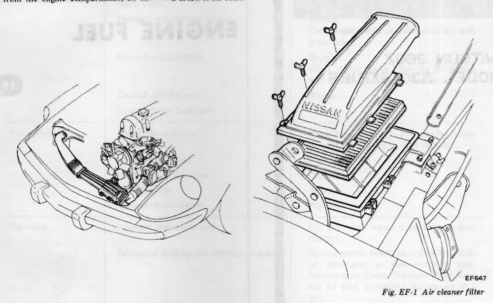
>
> - **Summary:** Exploded view of the front-mounted air cleaner housing showing the cover, three securing wing nuts, viscous paper filter element, and engine bay perspective.
> - **Components:** Air cleaner cover, Wing nuts, Air cleaner filter element, Air cleaner housing body, Air duct horn
> - **Specs / Measurements:** 3 wing nuts
> - **Mechanic Notes:** Viscous paper element requires no cleaning; never clean with brush or compressed air blast.
> - **Tags:** `air cleaner`, `filter`, `wing nuts`, `replacement`

4. Replace air cleaner filter.
5. To install the air cleaner filter, reverse the order of removal.

## REMOVAL AND INSTALLATION

1. Remove air duct securing bolt from radiator core support reinforce.
2. Unfasten air duct clamp and disengage air duct at air cleaner horn.
3. Unfasten clamp securing air duct running between air flow meter and air cleaner, and disengage air duct at air cleaner.
4. Remove four screws (two on the upper and two on the lower sides) from radiator core support, and detach air cleaner assembly.
5. To install the air cleaner assembly, reverse the order of removal.

> 🖼️ **Fig. EF-2 Air cleaner and air duct** `[EF648]` *(Type: `exploded_view`)*
>
> 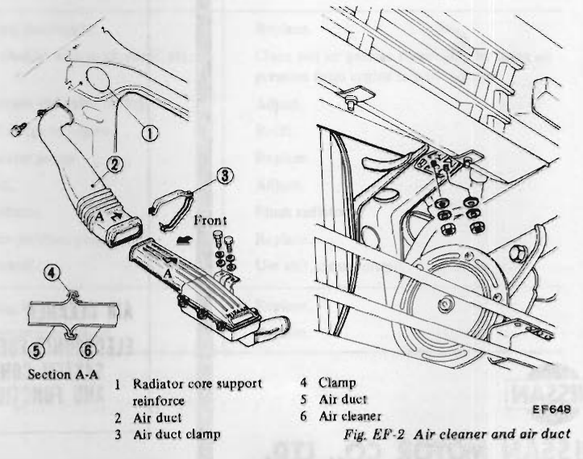
>
> - **Summary:** Exploded assembly and Section A-A cross-section of the air cleaner ductwork, clamps, and mounting to the radiator core support reinforce.
> - **Components:** Radiator core support reinforce, Air duct, Air duct clamp, Clamp, Air cleaner assembly, Mounting screws
> - **Callouts:** **(1)** Radiator core support reinforce; **(2)** Air duct; **(3)** Air duct clamp; **(4)** Clamp; **(5)** Air duct; **(6)** Air cleaner
> - **Specs / Measurements:** Four mounting screws (two upper, two lower)
> - **Mechanic Notes:** Air duct connects between air flow meter and air cleaner horn with hose clamps.
> - **Tags:** `air duct`, `clamp`, `radiator core support`, `air cleaner`, `installation`

---

<!-- Page 3 (EF-3) -->
# ELECTRONIC FUEL INJECTION SYSTEM CONSTRUCTION AND FUNCTION

## CONTENTS

| Section | Page |
| :--- | :--- |
| I. FEATURES | EF- 3 |
| II. ELECTRONIC FUEL INJECTION SYSTEM OPERATION | EF- 3 |
| III. ELECTRONIC CONTROL SYSTEM | EF- 6 |
| IV. FUEL INJECTION PULSE | EF- 8 |
| V. ELECTRONIC FUEL INJECTION SYSTEM COMPARTMENT PARTS | EF-12 |
| TROUBLE DIAGNOSES | EF-20 |
| INSPECTION | EF-20 |
| &nbsp;&nbsp;&nbsp;&nbsp;DESCRIPTION | EF-20 |
| &nbsp;&nbsp;&nbsp;&nbsp;CONTINUITY CHECK | EF-21 |
| CHECKING FUNCTIONAL PARTS | EF-30 |
| REMOVAL AND INSTALLATION | EF-40 |

## I. FEATURES

The Electronic Fuel Injection System employs various types of sensors to convert the engine operating conditions into electronic signals. These signals are sent to the control unit where the optimum injector open-valve time period is computed according to the information stored in the memory for control of fuel injection quantity.

The electronic fuel injection system has the following features:

1. **Improved exhaust emission**  
The electronic fuel injection system improves the transient response characteristics of the fuel system, permitting engine operation with lean mixture. This improves the exhaust emission performance of the engine.

2. **Improved fuel economy**  
The electronic fuel injection system permits optimum mixture ratio combustion under all operating conditions; this results in improved fuel economy.

3. **Driving performance**  
The electronic fuel injection system permits accurate mixture ratio control with respect to the cooling water temperature and intake air temperature, thereby improving the startability of the engine. With this electronic fuel injection system, the vehicle can be started immediately without any warming up even in cold weather.

- The electronic fuel injection system permits the supply of the optimum fuel quantity for each cylinder even at lower temperatures, thus greatly improving the startability of the engine.
- The electronic fuel injection system provides superior transient response characteristics for the engine without causing engine breathing or any other engine trouble.
- Since the fuel pressure is always maintained at a level of 2.55 kg/cm² (36.3 psi), no vapor lock occurs in this engine. This also gives the engine superior heat resistance.

The signal detector section of the electronic fuel injection system employs various types of sensors as indicated below:
(1) Air flow meter  
(2) Ignition coil negative terminal revolution trigger signal  
(3) Throttle valve switch  
(4) Water temperature sensor  
(5) Air temperature sensor  
(6) Thermotime switch  
(7) Starting switch  
(8) Altitude switch (California models only)  

The essential element of this electronic fuel injection system is the air flow meter which is mounted between the air cleaner and throttle chamber. It measures directly the quantity of intake air, and the injector open-valve time period is determined on the basis of the quantity of intake air required for one rotation of the engine.

Since this electronic fuel injection system directly measures the air flow rate, it is also called the "L-Jetronic system", the "L" being taken from the German "Luft" (air).

## II. ELECTRONIC FUEL INJECTION SYSTEM OPERATION

The following Figure EF-3 is an outline of operation of each component of the electronic fuel injection system.

### 1. Fuel system

#### (1) Fuel flow
Fuel is sucked from the fuel tank into the fuel pump, from which it is discharged under pressure. As it flows through the mechanical fuel damper, pulsation in the fuel flow is damped. Then, the fuel is filtered in the fuel filter, goes through the fuel line, and is injected into the intake manifold cylinder branch from the injector.

Surplus fuel is led through the pressure regulator and is returned to the fuel tank. The pressure regulator controls the fuel pressure in such a manner that the pressure difference between the fuel pressure and the intake manifold vacuum is always 2.55 kg/cm² (36.3 psi). During starting operation of the engine when the cooling water temperature is below the specification, the cold start valve is actuated by the thermotime switch to increase the quantity of fuel.

> [!NOTE]
> For the specified temperature of cooling water, see the "Thermotime Switch".

#### (2) Fuel injection system
The fuel injection system provides simultaneous injection of fuel into the intake manifold for all cylinders. Injection of fuel occurs at each rotation of the engine, and the injected amount of fuel per injection is half the quantity required for one cycle operation of the engine. The ignition signal of the <!-- Page 4 (EF-4) --> ignition coil is utilized for correct injection of fuel. In this case, the signal from the ignition coil does not specify the timing for injection. It specifies the frequency of injections only, since the injection timing is always set to be constant.

### 2. Air flow system

Intake air from the air cleaner is metered at the air flow meter, flows through the throttle chamber and into the intake manifold, and then flows through each intake manifold branch into the cylinder. Air flow during driving is controlled by the throttle valve located in the throttle chamber. During idling operation, the throttle valve is in the almost closed position, and the air is led through the bypass port mounted to the throttle chamber. In this case, the quantity of suction air is adjusted by means of the idle speed adjusting screw. During warming-up operation, the air flow is bypassed through the air regulator to increase engine rpm.

---

<!-- Page 5 (EF-5) -->

> 🖼️ **Fig. EF-3 Electronic fuel injection air and fuel flow system** `[EF119A]` *(Type: `cutaway_flow`)*
>
> 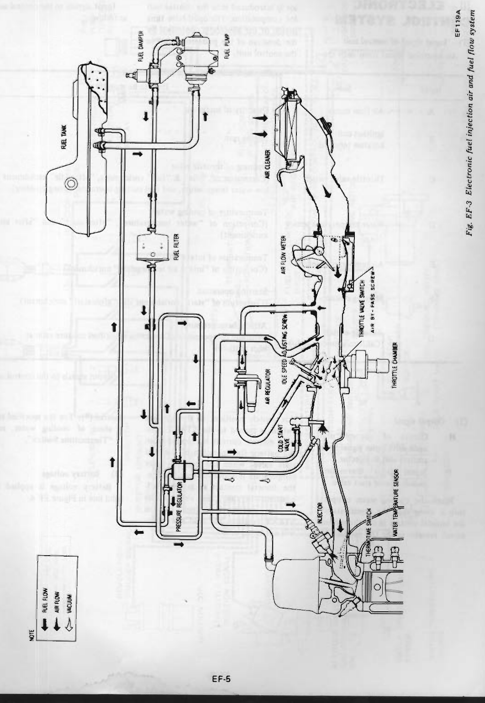
>
> - **Summary:** System flow diagram showing fuel delivery from fuel tank through pump, damper, filter, rail, pressure regulator, and injectors, alongside air passage through air cleaner, air flow meter, throttle chamber, cold start valve, and auxiliary air regulator.
> - **Components:** Fuel tank, Fuel damper, Fuel pump, Fuel filter, Pressure regulator, Injector, Air cleaner, Air flow meter, Throttle valve switch, Air by-pass screw, Throttle chamber, Idle speed adjusting screw, Air regulator, Cold start valve, Thermotime switch, Water temperature sensor
> - **Specs / Measurements:** Fuel line pressure maintained at 2.55 kg/cm² (36.3 psi) higher than intake manifold vacuum
> - **Wiring / Connections:** Black solid arrow: Fuel Flow; White/hollow arrow: Air Flow; Hatched/shaded arrow: Vacuum
> - **Mechanic Notes:** Surplus fuel returns to the tank via the pressure regulator; air regulator provides bypass air during warmup.
> - **Tags:** `flow system`, `fuel circuit`, `air induction`, `vacuum routing`, `L-Jetronic`

---

<!-- Page 6 (EF-6) -->
# III. ELECTRONIC CONTROL SYSTEM

## (1) Input signal of control unit

An electrical signal from each sensor is introduced into the control unit for computation. The open-valve time period of the injector is controlled by the duration of the pulse computed in the control unit.

Input signals to the control unit are as follows:

| Input | Sensor | Item to be monitored |
| :---: | :--- | :--- |
| A | Air flow meter | Quantity of intake air |
| B | Ignition coil negative terminal | Engine rpm |
| C | Throttle valve switch | Opening of throttle valve (Correction of "idle" & "full" enrichment, "after idle" enrichment at low water temperature, and fuel cutting operation during coasting) |
| D | Water temperature sensor | Temperature of cooling water (Correction of "water temperature", "after start" and "after idle" enrichment) |
| E | Air temperature sensor | Temperature of intake air (Correction of "intake air temperature" enrichment) |
| F | Starting switch | Starting operation (Correction of "start" enrichment and "after start" enrichment) |
| G | Altitude switch (California models only) | Atmospheric pressure (Altitude compensation; Correction of air-fuel mixture ratio at high altitude) |

*Input signals to the control unit.*

## (2) Output signal

- **H**: Output of control unit open-valve pulse signal from control unit to injector.
- **I**: Signal from thermotime switch to cold start valve.

When the cooling water temperature is lower than the specification*, the bimetal contact in the thermotime switch remains in the ON position. At this switch position, if the ignition switch is turned to the START position, electric current is supplied from the battery for operation of the cold start valve. When the cooling water temperature is above the specification, the bimetal contact is in the OFF position. In this case, even if the ignition switch is turned to the START position, the cold start valve will not be actuated.

> [!NOTE]
> Asterisk(*): For the specified temperature of cooling water, see the "Thermotime Switch".

## (3) Battery voltage

Battery voltage is applied to the solid line in Figure EF-4.

---

<!-- Page 7 (EF-7) -->

> 🖼️ **Fig. EF-4 Electronic control signal** `[EF120A]` *(Type: `electrical_schematic`)*
>
> 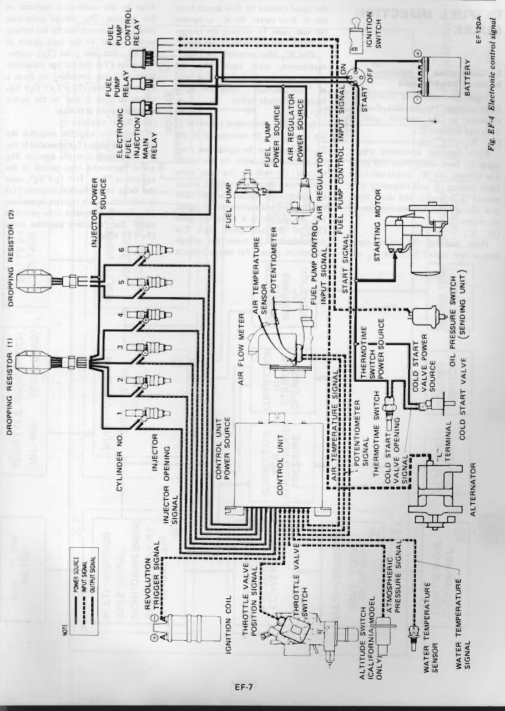
>
> - **Summary:** Wiring schematic outlining power distribution from battery and ignition switch through main and fuel pump relays, sensor signal inputs to the control unit, dropping resistor connections, and injector drive circuits.
> - **Components:** Dropping resistor (1), Dropping resistor (2), Injectors 1-6, Electronic fuel injection main relay, Fuel pump relay, Fuel pump control relay, Fuel pump, Air regulator, Starting motor, Ignition switch, Battery, Oil pressure switch (sending unit), Alternator ('L' terminal), Cold start valve, Thermotime switch, Air flow meter, Control unit, Ignition coil, Throttle valve switch, Altitude switch (California model only), Water temperature sensor
> - **Specs / Measurements:** Injectors 1 to 6 fed via two 3-channel dropping resistors
> - **Wiring / Connections:** Solid line: Power source; Dashed line: Input signal; Dotted line: Output signal
> - **Mechanic Notes:** Power is routed via main relay and fuel pump relays; output pulses drive injectors in parallel groups through dropping resistors.
> - **Tags:** `wiring schematic`, `power source`, `input signal`, `output signal`, `control unit`, `relays`

---

<!-- Page 8 (EF-8) -->
# IV. FUEL INJECTION PULSE

## 1. Generation of injection pulse in control unit

Figure EF-5 shows the control unit block diagram. The function of major elements in the control unit is described as follows:

### (1) IC₁
Upon receiving revolution trigger signal ① from the ignition coil negative terminal, the IC₁ carries out wave form shaping ② and frequency conversion ③ operation and issues injection timing signal for each rotation of the engine.

### (2) IC₂
Upon receiving the timing signal (engine rpm signal) from the IC₁ and the signal (intake air flow signal) from the air flow meter, the IC₂ computes the base pulse Tp utilizing the charge-discharge characteristics of condenser.

The IC₂ also corrects the "start" enrichment, using signal from the starter, and the air-fuel mixture ratio at "high altitude", using the signal from the altitude switch.

### (3) IC₃
In the IC₃ enrichment are added to the base pulse Tp determined in the IC₂ depending on the signals sent from the sensors. The input for the multi-vibrator ⑤ includes the base pulse (Tp), water temperature signal, intake air temperature signal, throttle valve switch signal and starting switch signal, and the output is a corrected pulse (Tq) of the base pulse (Tp). The multi-vibrator ⑥ issues the voltage correction pulse (Ts) which corrects delay in the mechanical response of the injector. The voltage correction pulse (Ts) is determined by the battery voltage signal. In the logic circuit of the IC₃, the base pulse (Tp), correction pulse (Tq) and voltage correction pulse (Ts) are combined to form a summation pulse ($Tg = Tp + Tq + Ts$), which in turn is sent to the power amplifier in the next stage.

### (4) Power amplifier
The power amplifier amplifies the summation pulse (Tg) generated in the IC₃, and sends it to the injector. The actual open-valve time period of the injector is "$Tg - Ts = Tp + Tq$", since the delay in mechanical response (Ts) is inherent in the injector operation. This actual open-valve time period is called the "effective injection pulse ($Te = Tp + Tq$)".

---

<!-- Page 9 (EF-9) -->

> 🖼️ **Fig. EF-5 Control unit block diagram** `[EF651]` *(Type: `electrical_schematic`)*
>
> 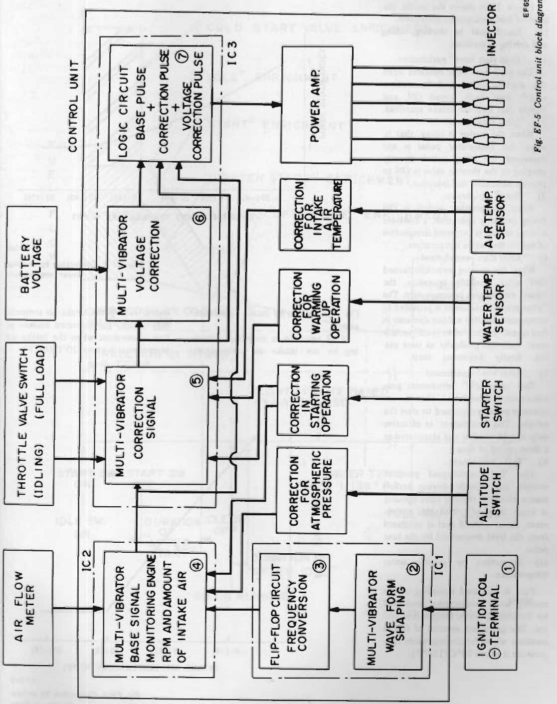
>
> - **Summary:** Functional block diagram of control unit electronics showing internal stages IC1 (wave shaping, frequency conversion), IC2 (base pulse Tp calculation), IC3 (enrichment corrections Tq and voltage correction Ts), logic summation, and output power amplifier driving the 6 injectors.
> - **Components:** Ignition coil (-) terminal, Air flow meter, Throttle valve switch (idling, full load), Battery voltage, Altitude switch, Starter switch, Water temp sensor, Air temp sensor, Control unit, IC1, IC2, IC3, Power amp, 6 Injectors
> - **Callouts:** **(1)** Ignition coil negative terminal; **(2)** Multi-vibrator wave form shaping; **(3)** Flip-flop circuit frequency conversion; **(4)** Multi-vibrator base signal monitoring engine rpm and amount of intake air; **(5)** Multi-vibrator correction signal; **(6)** Multi-vibrator voltage correction; **(7)** Logic circuit base pulse + correction pulse + voltage correction pulse
> - **Specs / Measurements:** Tg = Tp + Tq + Ts; Te = Tp + Tq (effective injection pulse)
> - **Wiring / Connections:** Input signals A-G fed into IC1, IC2, IC3; Output from power amplifier to parallel injectors
> - **Mechanic Notes:** Summation pulse Tg includes mechanical lag Ts; effective pulse Te delivers precise fuel quantity per rotation.
> - **Tags:** `control unit`, `block diagram`, `IC1`, `IC2`, `IC3`, `power amplifier`, `pulse computation`

---

<!-- Page 10 (EF-10) -->
# 2. Correction of fuel enrichment

Figure EF-8 shows the model diagram of fuel enrichment correction.

## (1) Enrichment in starting, idling and driving operations.

### 1) "Cold start valve" enrichment
The cold start valve operates when the starting switch and thermotime switch have been turned ON, and injects fuel into the intake manifold.

### 2) "Idle" enrichment
When the engine is idling, that is, when the accelerator pedal is not depressed, the idling switch directly coupled to the throttle valve is ON to provide additional fuel injection.

### 3) "Start" enrichment
When the starting switch is ON during cranking operation, a constant amount of fuel is increased irrespective of the cooling water temperature.

### 4) "After start" enrichment
When the starting switch is turned OFF after cranking operation, the "start" enrichment becomes zero. The "after start" enrichment is provided to compensate for this sudden decrease in fuel quantity. The "after start" enrichment decreases gradually as time passes, finally becoming zero.

### 5) "After idle" enrichment
The "after idle" enrichment provides smooth acceleration when the accelerator pedal is depressed to start the vehicle. This enrichment is effective only in cold weather and attenuated in a short period of time.

### 6) "Full" enrichment
The "full" enrichment provides smooth full throttle driving performance when the throttle valve opening is more than 34°. With this enrichment, about 27% of fuel is increased from the level determined by the base pulse.

## (2) Correction by cooling water temperature.

Fuel is increased according to the cooling water temperature monitored by the cooling water temperature sensor. The increased amount of fuel is constant when the cooling water temperature is above 70°C (158°F).

> 🖼️ **Fig. EF-6 Correction by cooling water temperature** `[EF345]` *(Type: `graph_chart`)*
>
> 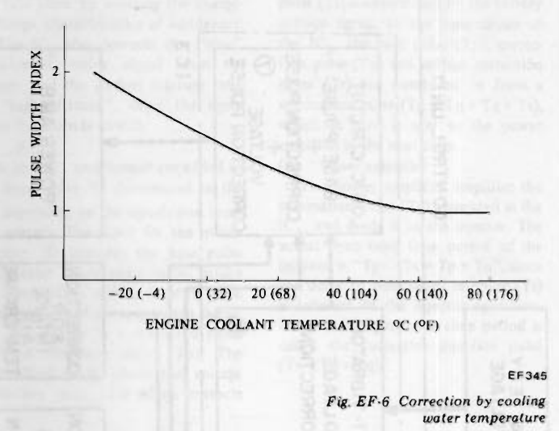
>
> - **Summary:** Characteristic graph plotting pulse width index against engine coolant temperature from -20°C (-4°F) to 80°C (176°F), showing enrichment falling to 1.0 at 70°C (158°F).
> - **Components:** Pulse width index curve, Coolant temperature axis
> - **Specs / Measurements:** Enrichment factor: ~2.0 at -20°C (-4°F); Constant factor 1.0 above 70°C (158°F)
> - **Mechanic Notes:** Coolant enrichment terminates once water temperature reaches 70°C (158°F).
> - **Tags:** `water temperature`, `enrichment curve`, `graph`, `coolant`

## (3) Correction by intake air temperature.

Fuel injection is increased according to the intake air temperature monitored by the intake air temperature sensor. The increased amount of fuel is constant when the intake air temperature is above 20°C (68°F).

> 🖼️ **Fig. EF-7 Correction by intake air temperature** `[EF346]` *(Type: `graph_chart`)*
>
> 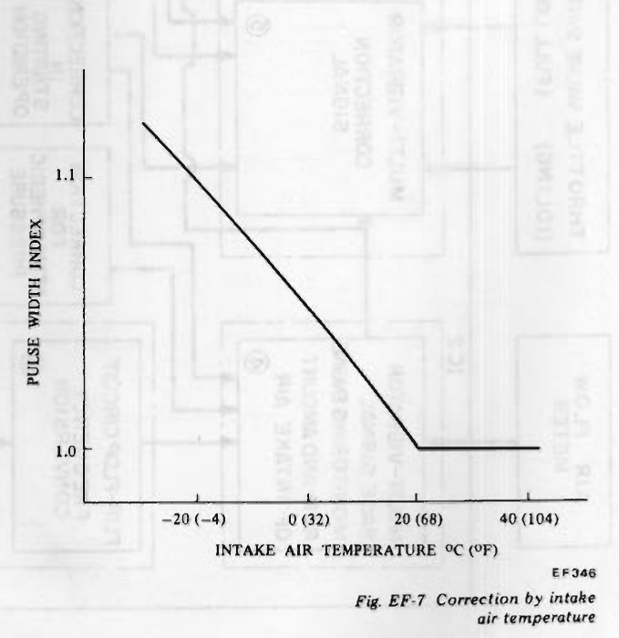
>
> - **Summary:** Characteristic graph plotting pulse width index against intake air temperature from -20°C (-4°F) to 40°C (104°F), showing enrichment falling to 1.0 at 20°C (68°F).
> - **Components:** Pulse width index curve, Intake air temperature axis
> - **Specs / Measurements:** Enrichment factor: ~1.1+ at -20°C (-4°F); Constant factor 1.0 above 20°C (68°F)
> - **Mechanic Notes:** Intake air temperature compensation is active below 20°C (68°F).
> - **Tags:** `intake air temperature`, `enrichment curve`, `graph`, `pulse width`

---

<!-- Page 11 (EF-11) -->

> 🖼️ **Fig. EF-8 Correction of fuel enrichment** `[EF946]` *(Type: `graph_chart`)*
>
> 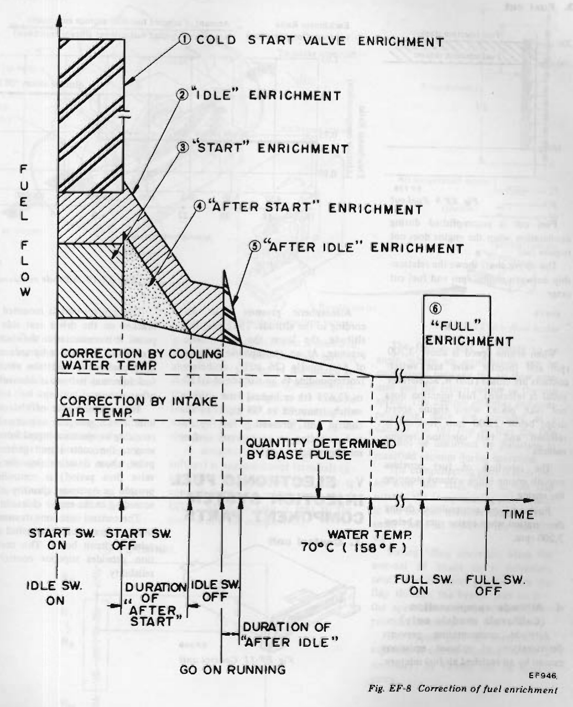
>
> - **Summary:** Composite fuel flow versus time chart illustrating the overlapping fuel enrichment phases during cold cranking, warmup, idle, off-idle acceleration, and full throttle operation.
> - **Components:** Cold start valve enrichment, Idle enrichment, Start enrichment, After start enrichment, After idle enrichment, Full enrichment, Water temp correction baseline, Intake air temp correction baseline, Base pulse quantity
> - **Callouts:** **(1)** Cold start valve enrichment; **(2)** 'Idle' enrichment; **(3)** 'Start' enrichment; **(4)** 'After start' enrichment; **(5)** 'After idle' enrichment; **(6)** 'Full' enrichment
> - **Specs / Measurements:** Water temp stabilization at 70°C (158°F); Full throttle enrichment active at > 34° opening (~27% increase)
> - **Mechanic Notes:** Shows sequential transition from Start switch ON to Start switch OFF, Idle switch ON/OFF, duration of after-start, duration of after-idle, and running mode.
> - **Tags:** `fuel enrichment`, `fuel flow curve`, `enrichment timing`, `after start`, `full enrichment`

---

<!-- Page 12 (EF-12) -->
# 3. Fuel cut

> 🖼️ **Fig. EF-9 Fuel cut** `[EF778]` *(Type: `graph_chart`)*
>
> 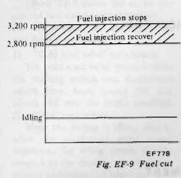
>
> - **Summary:** Chart illustrating deceleration fuel cut operating range: injection stops at 3,200 rpm when throttle idle switch is closed, and recovers at 2,800 rpm.
> - **Components:** Fuel cut threshold (3,200 rpm), Fuel recovery threshold (2,800 rpm), Idle speed zone
> - **Specs / Measurements:** Fuel injection stops: 3,200 rpm; Fuel injection recovers: 2,800 rpm
> - **Mechanic Notes:** Requires idle contacts closed; prevents unnecessary fuel consumption and emissions during high-rpm deceleration.
> - **Tags:** `fuel cut`, `deceleration`, `rpm threshold`, `fuel economy`

Fuel cut is accomplished during deceleration when the engine does not require fuel.

The above chart shows the relationship between engine rpm and fuel cut range.

When engine speed is above 3,200 rpm and throttle valve idle switch contacts are closed (that is, accelerator pedal is released), fuel injection does not take place; when engine speed drops below 2,800 rpm, fuel cut is released and fuel injection recommences.

The injection of fuel provides smooth engine idling without stopping the engine.

Fuel cut is not accomplished during deceleration when engine rpm is below 3,200 rpm.

# 4. Altitude compensation (California models only)

$$\text{Enrichment Ratio (Altitude Compensation)} = \frac{\text{Amount of injected fuel with altitude enrichment}}{\text{Amount of injected fuel without altitude enrichment}}$$

> 🖼️ **Fig. EF-10 Altitude compensation** `[EF947]` *(Type: `graph_chart`)*
>
> 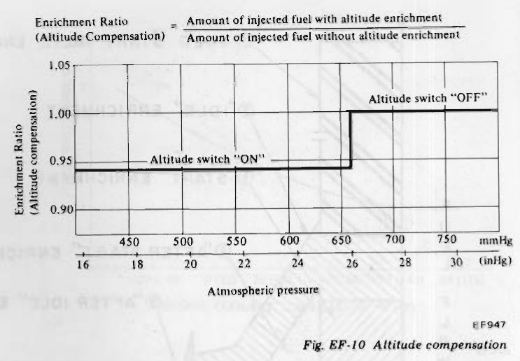
>
> - **Summary:** Step graph of altitude enrichment ratio versus atmospheric pressure from 450 to 750 mmHg (16 to 30 inHg), stepping from 1.00 down to 0.94 below 660 mmHg (26 inHg).
> - **Components:** Altitude switch status curve, Atmospheric pressure axis
> - **Specs / Measurements:** Switch point: 660 mmHg (26 inHg) / 1,120 m (3,675 ft); Enrichment ratio: 0.94 (ON) vs 1.00 (OFF) (6% reduction)
> - **Mechanic Notes:** California models only; adjusts mixture lean to compensate for thinner air at high altitude.
> - **Tags:** `altitude compensation`, `California model`, `atmospheric pressure`, `660 mmHg`

Altitude compensation prevents deterioration of exhaust emissions caused by an enriched air-fuel mixture.

Atmospheric pressure varies according to the altitude. The higher the altitude, the lower the atmospheric pressure. At an atmospheric pressure of 660 mmHg (26 inHg) or below [corresponding to an altitude of 1,120 m (3,675 ft) or higher], the altitude switch transmits an ON signal to the control unit, decreasing fuel by 6% and providing an appropriate air-fuel mixture ratio.

# V. ELECTRONIC FUEL INJECTION SYSTEM COMPONENT PARTS

## 1. Control unit

> 🖼️ **Fig. EF-11 Control unit** `[EF349]` *(Type: `exploded_view`)*
>
> 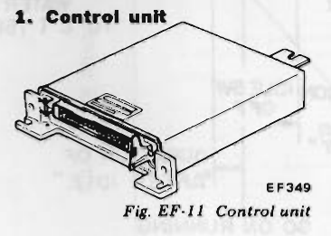
>
> - **Summary:** Isometric external view of the metal control unit box and its dash-mounting bracket.
> - **Components:** Control unit metal chassis, Mounting bracket, 35-pin harness socket
> - **Specs / Measurements:** 35-pin connector interface
> - **Wiring / Connections:** Connects to 35-pin wiring harness
> - **Mechanic Notes:** Mounted on a bracket on the driver seat side dash panel.
> - **Tags:** `control unit`, `ECU`, `mounting bracket`, `dash panel`

The control unit is mounted on a bracket on the driver seat side dash panel. It is connected to the electronic fuel injection harness by means of a multi-connector, and the electronic fuel injection harness is connected to other sensors.

The essential role of the control unit is to generate a pulse. Upon receiving an electrical signal from each sensor, the control unit generates a pulse whose duration (injector open-valve time period) is controlled to provide an optimum quantity of fuel according to the engine characteristics.

The control unit consists mainly of three integrated circuits formed on the printed circuit board. This construction provides superior control unit reliability.

---

<!-- Page 13 (EF-13) -->
# 2. Air flow meter

> 🖼️ **Fig. EF-12 Air flow meter** `[EF948]` *(Type: `exploded_view`)*
>
> 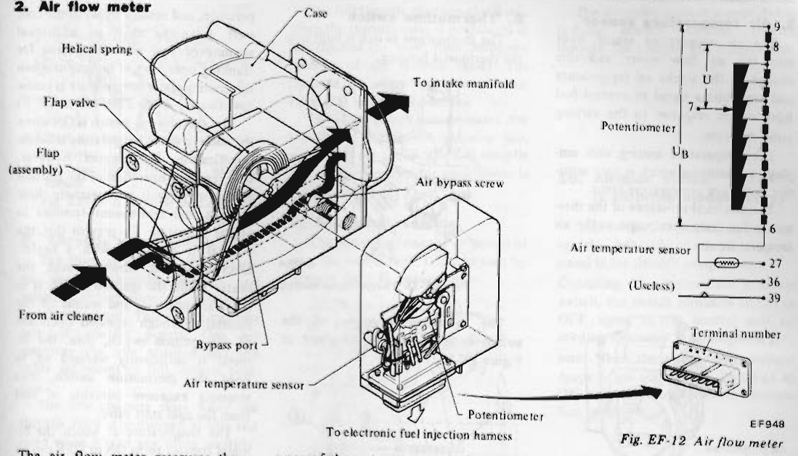
>
> - **Summary:** Cutaway perspective view of the mechanical air flow meter detailing the measuring flap, helical return spring, damping vane and chamber, idle bypass passage with adjust screw, potentiometer wiper, and internal electrical connector.
> - **Components:** Flap valve, Flap (assembly), Helical spring, Case, Bypass port, Air bypass screw, Air temperature sensor, Potentiometer, Connector terminal block
> - **Specs / Measurements:** Terminals 6, 7, 8, 9 (potentiometer), 27 (air temp), 36, 39 (fuel pump contacts)
> - **Wiring / Connections:** Terminal 6: Ground (-); Terminal 7: Wiper voltage signal U; Terminal 8: Output reference; Terminal 9: Battery supply UB (+); Terminal 27: Intake air temp sensor; Terminals 36 & 39: Fuel pump safety microswitch
> - **Mechanic Notes:** Damper chamber dampens flap flutter caused by cylinder intake pulses; bypass screw sets idle mixture.
> - **Tags:** `air flow meter`, `AFM`, `potentiometer`, `flap valve`, `bypass screw`

The air flow meter measures the quantity of intake air, and sends a signal to the control unit so that the base pulse width can be determined for correct fuel injection by the injector. The air flow meter is provided with a flap in the air passage. As the air flows through the passage, the flap rotates and its angle of rotation is electronically monitored to count the air flow rate.

More specifically, the angle of rotation of the flap is monitored by a potentiometer provided inside as a potential difference U. A circuit diagram of the potentiometer is shown in Figure EF-13. When the flap deflects along with a change in the intake air flow rate, the terminal ⑦ mounted to the flap shaft slides on the variable resistor R from R1 to R9, causing the voltage across terminals ⑦ and ⑧ to change.

A constant voltage $U_B$ (battery voltage) is applied across terminals ⑥ and ⑨. Then the air flow rate is converted into the voltage ratio signal $U/U_B$, which in turn is sent to the control unit for computation.

> 🖼️ **Fig. EF-13 Air flow meter potentiometer** `[EF351]` *(Type: `electrical_schematic`)*
>
> 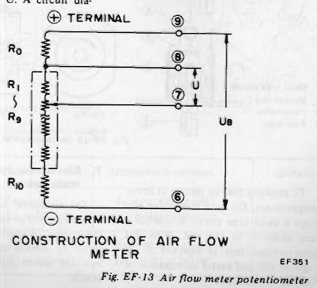
>
> - **Summary:** Internal resistor schematic of the AFM potentiometer depicting the ladder network of tapped resistors R0 through R10 between terminals 6 and 9 with wiper pickoff 7.
> - **Components:** Resistor ladder network (R0, R1 to R9, R10), Sliding wiper arm ⑦, Terminal ⑨ (+), Terminal ⑧, Terminal ⑥ (-)
> - **Specs / Measurements:** Voltage ratio U/UB proportional to flap rotation angle
> - **Wiring / Connections:** (+) Terminal ⑨; Terminal ⑧; Terminal ⑦ (wiper); (-) Terminal ⑥
> - **Mechanic Notes:** Flap rotation slides terminal 7 across tapped resistor track; voltage signal U changes relative to reference UB.
> - **Tags:** `potentiometer`, `resistor ladder`, `AFM`, `electrical schematic`

The flap is able to rotate to an angle where an equilibrium can be maintained between the air flow pressure and the return torque of the coil spring. The damper chamber and compensating plate are provided as a damper for the flap so that the flap will not be disturbed by pulsation in manifold vacuum during operation.

The compensating plate is interlinked with the flap, and as the flap rotates, the compensating plate rotates in the damper chamber keeping a very small clearance between the chamber wall.

During idling operation when the amount of intake air is extremely small, the air flows parallel with the flap through the bypass port so that the specified intake air flow can be provided correctly.

The bypass port has been factory adjusted. It can be adjusted further, if necessary, by turning the air bypass screw.

---

<!-- Page 14 (EF-14) -->
# 3. Air temperature sensor

The air temperature sensor, built into the air flow meter, monitors change in the intake air temperature and transmits a signal to control fuel injection in response to the varying pulse duration.

The temperature sensing unit employs a thermister which is very sensitive in the low temperature range.

The electrical resistance of the thermister decreases in response to the air temperature rise.

> 🖼️ **Fig. EF-14 Air temperature sensor** `[EF354]` *(Type: `component_location`)*
>
> 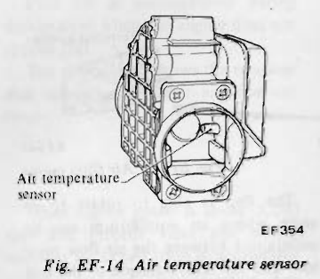
>
> - **Summary:** Illustration of the air flow meter intake mouth showing the physical location of the integrated thermistor air temperature sensor.
> - **Components:** Air temperature sensor thermistor, Air flow meter body
> - **Specs / Measurements:** NTC thermistor (resistance drops with rising temperature)
> - **Wiring / Connections:** Connected internally to AFM terminal 27
> - **Mechanic Notes:** Sensing element is positioned directly in incoming air stream.
> - **Tags:** `air temperature sensor`, `thermistor`, `AFM`, `location`

# 4. Water temperature sensor

The water temperature sensor, built into the thermostat housing, monitors change in cooling water temperature and transmits a signal for the fuel enrichment to change the pulse duration during the warm-up period.

The temperature sensing unit employs a thermister which is very sensitive in the low temperature range.

The electrical resistance of the thermister decreases in response to the water temperature rise.

> 🖼️ **Fig. EF-15 Water temperature sensor** `[EF653]` *(Type: `component_location`)*
>
> 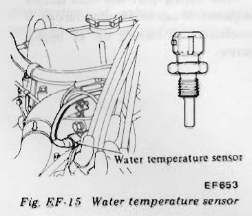
>
> - **Summary:** Location view of the water temperature sensor threaded into the front thermostat housing.
> - **Components:** Water temperature sensor, Thermostat housing, Electrical plug
> - **Specs / Measurements:** NTC thermistor sensor
> - **Wiring / Connections:** Connector terminal connects to ECU pin 13
> - **Mechanic Notes:** Monitors engine coolant temperature to determine enrichment duration.
> - **Tags:** `water temperature sensor`, `coolant sensor`, `thermostat housing`

# 5. Thermotime switch

The thermotime switch is built into the thermostat housing.

> 🖼️ **Fig. EF-16 Thermotime switch** `[EF654]` *(Type: `component_location`)*
>
> 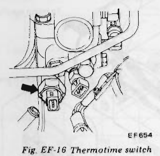
>
> - **Summary:** Component location of the thermotime switch situated beside the water temperature sensor in the thermostat housing.
> - **Components:** Thermotime switch, Thermostat housing
> - **Specs / Measurements:** Switching temperature range: 14 to 22°C (57 to 72°F)
> - **Wiring / Connections:** Electrical harness connected to cold start valve
> - **Mechanic Notes:** Grounds cold start valve circuit during cold cranking.
> - **Tags:** `thermotime switch`, `cold start`, `thermostat housing`, `location`

The operating principle of the switch is as shown in the chart in Figure EF-17.

> 🖼️ **Fig. EF-17 Operating principle of thermotime switch** `[EF312]` *(Type: `electrical_schematic`)*
>
> 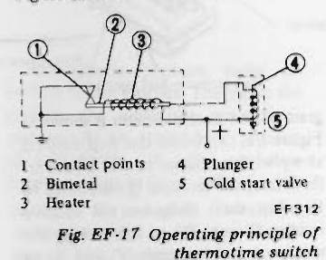
>
> - **Summary:** Functional circuit schematic of the thermotime switch bimetal element, electric heater winding, contact points, and plunger control to the cold start valve.
> - **Components:** Contact points, Bimetal element, Heater winding, Plunger, Cold start valve
> - **Callouts:** **(1)** Contact points; **(2)** Bimetal; **(3)** Heater; **(4)** Plunger; **(5)** Cold start valve
> - **Specs / Measurements:** Operates below 14 to 22°C (57 to 72°F)
> - **Wiring / Connections:** Connected to starter circuit and cold start valve solenoid
> - **Mechanic Notes:** Internal heater heats bimetal to open contacts after several seconds of cranking to prevent engine flooding.
> - **Tags:** `thermotime switch`, `bimetal`, `heater`, `cold start valve`, `circuit`

A harness is connected to the cold start valve from the thermotime switch. The bimetal contact in the thermotime switch opens or closes depending on the cooling water temperature, and sends a signal to the cold start valve so that an additional amount of fuel can be injected for cranking operation of the engine when the cooling water temperature is below specification 14 to 22°C (57 to 72°F).

The thermotime switch is ON when the cooling water temperature is below specification. This implies, however, that repeated operation of the ignition switch may result in excessively thick mixture and consequent troubles in engine operation. To prevent this, the bimetal is equipped with a heater. Electric current flows through the heater while the ignition switch is in the start position, and warms up the bimetal. Through repeated operation of the ignition switch, then, the bimetal is sufficiently warmed up to open the thermotime switch, thus stopping excessive injection of fuel from the cold start valve.

The temperature at which the bimetal contact turns ON or OFF can be changed within the range of 14 to 22°C (57 to 72°F).

# 6. Cold start valve

The cold start valve operates on the electromagnetic principle. It causes fuel to be injected into the intake manifold independently of the injector operation so that the engine can be cranked smoothly during cold weather.

> 🖼️ **Fig. EF-18 Sectional view of cold start valve** `[EF949]` *(Type: `cutaway_flow`)*
>
> 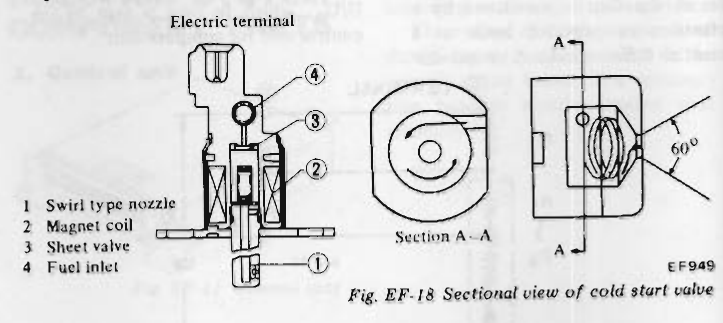
>
> - **Summary:** Cross-sectional drawing and Section A-A nozzle face view of electromagnetic cold start valve showing magnet coil, sheet valve, swirl chamber nozzle, and 60° spray pattern.
> - **Components:** Swirl type nozzle, Magnet coil, Sheet valve, Fuel inlet, Electric terminal
> - **Callouts:** **(1)** Swirl type nozzle; **(2)** Magnet coil; **(3)** Sheet valve; **(4)** Fuel inlet
> - **Specs / Measurements:** Spray cone angle: 60°
> - **Wiring / Connections:** Two-pin terminal connector
> - **Mechanic Notes:** Swirl nozzle creates 60-degree cone for optimal low-temperature fuel atomization.
> - **Tags:** `cold start valve`, `cutaway`, `swirl nozzle`, `magnet coil`, `spray angle`

To improve fuel-air mixing at lower temperatures, the cold start valve employs a swirl type nozzle which has a turn chamber at the end. With this construction, fuel is injected at an angle of 60° and better atomization of fuel can be obtained.

# 7. Electronic fuel injection main relay

The electronic fuel injection main relay is located at the relay bracket in the engine compartment. This relay serves to actuate the electronic fuel injection system through the ignition switch.

---

<!-- Page 15 (EF-15) -->

> 🖼️ **Fig. EF-19 Electronic fuel injection main relay** `[EF003A]` *(Type: `component_location`)*
>
> 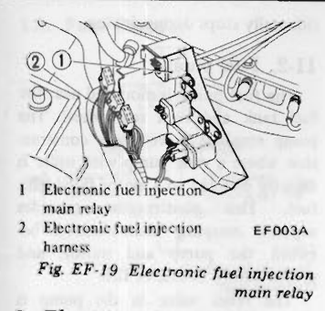
>
> - **Summary:** Component location of the EFI main relay mounted on the engine compartment relay bracket.
> - **Components:** Electronic fuel injection main relay, Electronic fuel injection harness, Relay bracket
> - **Callouts:** **(1)** Electronic fuel injection main relay; **(2)** Electronic fuel injection harness
> - **Wiring / Connections:** EFI harness plug connects to relay base
> - **Mechanic Notes:** Supplies system power when ignition switch is turned ON.
> - **Tags:** `main relay`, `relay bracket`, `engine compartment`, `location`

# 8. Throttle valve switch

The throttle valve switch is attached to the throttle chamber and actuates in response to accelerator pedal movement. This switch has two sets of contact points. One set monitors the idle position and the other set monitors full throttle position.

The idle contacts close when the throttle valve is positioned at idle and open when it is at any other position.

> 🖼️ **Fig. EF-20 Throttle valve switch** `[EF782]` *(Type: `cutaway_flow`)*
>
> 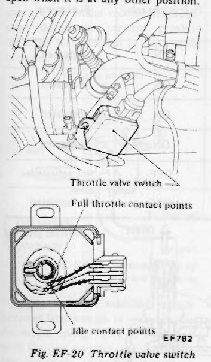
>
> - **Summary:** External view and internal contact mechanism of the throttle valve switch showing idle contact points and full-throttle contact points.
> - **Components:** Throttle valve switch housing, Idle contact points, Full throttle contact points, Rotary cam arm
> - **Specs / Measurements:** Full throttle contacts close at > 34° throttle opening
> - **Wiring / Connections:** Terminals: 2 (idle), 3 (full throttle), 18 (ground)
> - **Mechanic Notes:** Idle contacts close at closed throttle; full throttle contacts close beyond 34 degrees of throttle opening.
> - **Tags:** `throttle valve switch`, `TPS`, `idle contacts`, `full throttle contacts`

The full throttle contacts close only when the throttle valve is positioned at full throttle (or more than 34 degree opening of the throttle valve). The contacts are open while the throttle valve is at any other position.

The idle switch compensates for enrichment during idle and after idle, sends fuel cut signal. The full throttle switch compensates for enrichment in full throttle.

# 9. Dropping resistor

The dropping resistor is mounted near the washer tank. It can be seen by opening the L.H. inspection lid.

> 🖼️ **Fig. EF-21 Dropping resistor** `[EF313]` *(Type: `component_location`)*
>
> 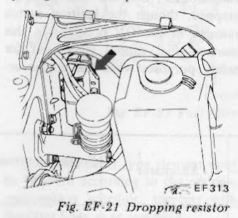
>
> - **Summary:** Location view of the dropping resistor pack near the windshield washer reservoir behind the left-hand inspection lid.
> - **Components:** Dropping resistor block, Washer fluid tank, L.H. inspection lid opening
> - **Specs / Measurements:** Current-limiting series resistance for injectors
> - **Wiring / Connections:** Harness connector to injectors and ECU
> - **Mechanic Notes:** Accessible by opening LH inspection lid; limits current through injector solenoid coils.
> - **Tags:** `dropping resistor`, `ballast resistor`, `inspection lid`, `location`

The dropping resistor is provided to reduce electric current flowing through the injector and control unit.

# 10. Altitude switch (California models only)

This switch is attached to the stay on the left side of the instrument panel in the driver's compartment. Consisting of a bellows and a micro-switch, the switch transmits an ON or OFF signal to the control unit according to change in atmospheric pressure. When the atmospheric pressure drops below 660 mmHg (26 inHg), an ON signal is transmitted to decrease fuel by 6%.

> 🖼️ **Fig. EF-22 Altitude switch** `[EF655]` *(Type: `component_location`)*
>
> 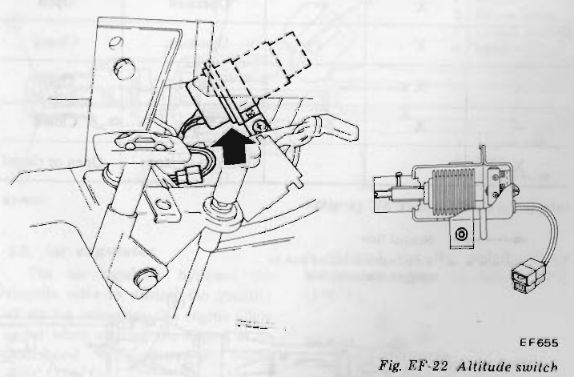
>
> - **Summary:** Mounting position and detail cutaway of the aneroid bellows altitude switch located behind the left instrument panel.
> - **Components:** Aneroid capsule bellows, Microswitch, Mounting bracket stay, Electrical harness connector
> - **Specs / Measurements:** Operating threshold: 660 mmHg (26 inHg) / 1,120 m (3,675 ft); 6% fuel reduction when closed
> - **Wiring / Connections:** Two-wire plug to control unit pins 9 and 12
> - **Mechanic Notes:** California models only; expands at high altitude to trigger microswitch.
> - **Tags:** `altitude switch`, `barometric switch`, `bellows`, `California model`

| Classification | Atmospheric pressure | Altitude switch | Air-fuel mixture ratio |
| :--- | :--- | :---: | :--- |
| "Low" altitude [Approx. 1,120 m (3,675 ft) or lower] | Approx. 660 mmHg (26 inHg) or above | OFF | Standard |
| "High" altitude [Approx. 1,120 m (3,675 ft) or higher] | Approx. 660 mmHg (26 inHg) or below | ON | Compensated by 6% on lean side |

---

<!-- Page 16 (EF-16) -->
# 11. Fuel pump control system

## 11-1. Fuel pump control relay and fuel pump relay

The fuel pump control relay and the fuel pump relay are located at the relay bracket. These relays serve to actuate the fuel pump through the engine oil pressure switch and the alternator.

> 🖼️ **Fig. EF-23 Fuel pump control relay and fuel pump relay** `[EF004A]` *(Type: `component_location`)*
>
> 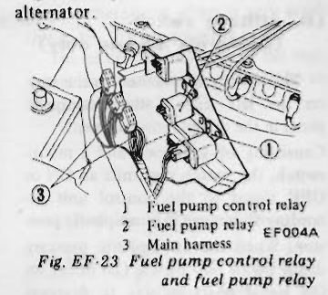
>
> - **Summary:** Component location of the fuel pump control relay and fuel pump relay on the engine bay relay bracket.
> - **Components:** Fuel pump control relay, Fuel pump relay, Main harness, Relay bracket
> - **Callouts:** **(1)** Fuel pump control relay; **(2)** Fuel pump relay; **(3)** Main harness
> - **Wiring / Connections:** Interconnected with ignition switch, alternator L-terminal, and oil pressure switch
> - **Mechanic Notes:** Safety circuit shuts off fuel pump if engine stalls while ignition switch remains ON.
> - **Tags:** `fuel pump relay`, `control relay`, `safety shutoff`, `relay bracket`

When the ignition switch is turned to the START position for cranking operation, the fuel pump is actuated irrespective of the conditions of the alternator and the engine oil pressure switch.

After starting the engine (the ignition switch is ON), the alternator operates and the engine oil pressure switch is open through rotation of the engine, thereby actuating the fuel pump.

If the alternator stops and the engine oil pressure decreases for some reason, the fuel pump relay contact is turned OFF, and the fuel pump is stopped, though the ignition switch remains in the ON position. In this manner, fuel supply is cut off for safety purposes when the engine accidentally stops during driving.

## 11-2. Fuel pump

The fuel pump is mounted near the fuel tank and right rear wheel. The pump employs a wet type construction where a vane pump with roller is directly coupled to a motor filled with fuel. This construction provides superior coupling characteristics between the pump and motor, and greater safety in case of fire.

The relief valve in the pump is designed to open when the pressure in the fuel line rises over 3 to 4.5 kg/cm² (43 to 64 psi) due to trouble in the pressure system.

The check valve prevents abrupt drop of pressure in the fuel pipe when stopping the engine.

### Fuel pump operation chart

| IGN. SW. position: OFF | IGN. SW. position: ON | IGN. SW. position: Start | Alternator | Engine oil pressure switch | Fuel pump relay | Fuel pump |
| :---: | :---: | :---: | :--- | :--- | :---: | :--- |
| — | — | X | Operates or stops | Open or closed | ON | Actuated |
| — | X | — | Operates | Open | ON | Actuated |
| — | X | — | Operates | Closed | ON | Actuated |
| — | X | — | Stops | Open | ON | Actuated |
| — | X | — | Stops | Closed | OFF | Not actuated |
| X | — | — | Operates or stops | Open or closed | OFF | Not actuated |

*X : IGN. SW. position*

> 🖼️ **Fig. EF-24 Sectional view of fuel pump** `[EF656]` *(Type: `cutaway_flow`)*
>
> 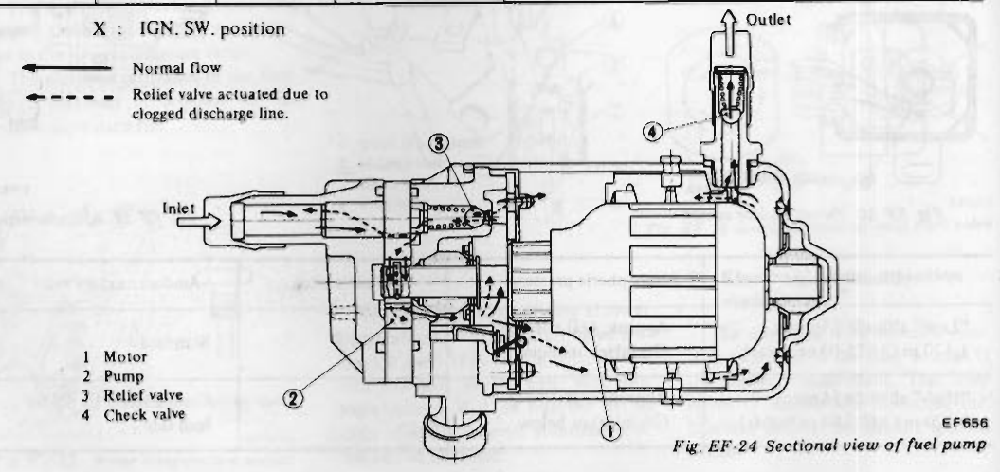
>
> - **Summary:** Longitudinal cutaway cross-section of the submerged wet-motor roller-vane electric fuel pump detailing internal rotor rollers, relief bypass valve, and check valve.
> - **Components:** Electric motor armature, Roller vane pump, Relief valve, Check valve, Inlet connection, Outlet connection
> - **Callouts:** **(1)** Motor; **(2)** Pump; **(3)** Relief valve; **(4)** Check valve
> - **Specs / Measurements:** Relief valve opening pressure: 3 to 4.5 kg/cm² (43 to 64 psi)
> - **Wiring / Connections:** Solid line arrow: Normal flow; Dashed line arrow: Relief valve actuated due to clogged discharge line
> - **Mechanic Notes:** Wet type design immerses motor in fuel; internal check valve retains line pressure after shutdown.
> - **Tags:** `fuel pump`, `roller vane`, `relief valve`, `check valve`, `cutaway`

---

<!-- Page 17 (EF-17) -->
# 12. Fuel damper

> 🖼️ **Fig. EF-25 Sectional view of fuel damper** `[EF952]` *(Type: `cutaway_flow`)*
>
> 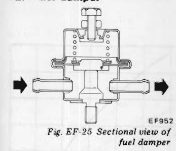
>
> - **Summary:** Cross-sectional drawing of the fuel damper housing, diaphragm, spring, and fuel flow chamber.
> - **Components:** Damper body, Diaphragm, Spring, Fuel inlet/outlet
> - **Specs / Measurements:** No adjustment allowed
> - **Mechanic Notes:** Damps hydraulic pulsations from the fuel pump; sealed unit.
> - **Tags:** `fuel damper`, `pulsation damper`, `cutaway`

The construction of the fuel damper is shown in Figure EF-25. The fuel damper is provided to suppress pulsation in fuel flow discharged from the fuel pump. No adjustment is allowed on this damper.

# 13. Pressure regulator

The pressure regulator controls the pressure of fuel so that a pressure difference of 2.55 kg/cm² (36.3 psi) can be maintained between the fuel pressure and intake vacuum. This constant differential pressure provides optimum fuel injection in every mode of engine operation.

> 🖼️ **Fig. EF-26 Sectional view of pressure regulator** `[EF121A]` *(Type: `cutaway_flow`)*
>
> 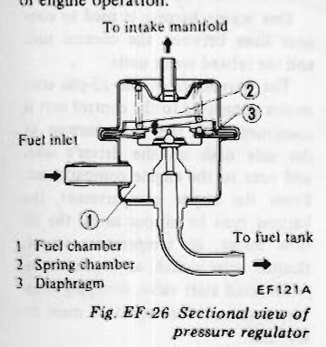
>
> - **Summary:** Sectional view of diaphragm pressure regulator showing vacuum reference chamber, fuel chamber, valve seat, and return tube.
> - **Components:** Fuel chamber, Spring chamber, Diaphragm, Intake manifold vacuum port, Fuel inlet, Return port to fuel tank
> - **Callouts:** **(1)** Fuel chamber; **(2)** Spring chamber; **(3)** Diaphragm
> - **Specs / Measurements:** Differential pressure maintained at 2.55 kg/cm² (36.3 psi)
> - **Wiring / Connections:** Vacuum hose connects to intake manifold; Fuel line returns to fuel tank
> - **Mechanic Notes:** Maintains constant 2.55 kg/cm² differential between fuel line pressure and manifold vacuum.
> - **Tags:** `pressure regulator`, `fuel pressure`, `vacuum reference`, `cutaway`

When the intake manifold vacuum becomes large enough to overcome the diaphragm spring force as combined with the fuel pressure at the pressure line, the diaphragm becomes empty on the intake-side. This opens the return-side port to allow fuel to flow to the tank for reducing fuel pressure.

If fuel pressure is higher than the intake manifold vacuum by 2.55 kg/cm² (36.3 psi), the diaphragm returns to its original position by means of spring force, and closes the return port.

In this manner, the pressure regulator maintains the fuel pressure in the fuel line 2.55 kg/cm² (36.3 psi) higher than the pressure in the intake manifold.

# 14. Fuel filter

The fuel filter is mounted on the right hand side of the engine compartment.

> 🖼️ **Fig. EF-27 Fuel filter** `[EF657]` *(Type: `component_location`)*
>
> 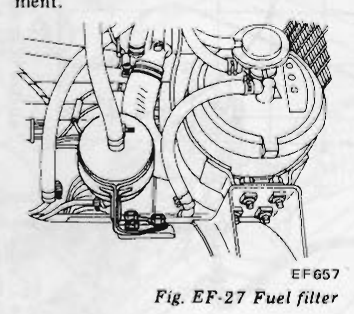
>
> - **Summary:** Location view of the fuel filter canister on the right-hand side of the engine compartment.
> - **Components:** Fuel filter canister, Mounting bracket, Inlet hose, Outlet hose
> - **Specs / Measurements:** Replace filter body as an assembly
> - **Mechanic Notes:** Replace paper element and body as a unit per maintenance schedule.
> - **Tags:** `fuel filter`, `engine compartment`, `maintenance`, `location`

The filter paper type element must be replaced according to the periodic maintenance schedule, together with the filter body as an assembly.

# 15. Injector

The injector is mounted on the branch portion of the intake manifold. It receives the pulse signal from the control unit, and injects the fuel toward the intake valve in the cylinder head.

> 🖼️ **Fig. EF-28 Injector** `[EF122A]` *(Type: `component_location`)*
>
> 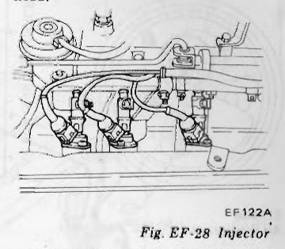
>
> - **Summary:** Mounting detail of an injector in the intake manifold runner branch showing securing plate and fuel hose connection.
> - **Components:** Fuel injector, Intake manifold branch, Fuel feed hose, Retaining bracket
> - **Wiring / Connections:** Harness connector plug
> - **Mechanic Notes:** Directs spray pattern toward the intake valve head.
> - **Tags:** `injector`, `manifold branch`, `mounting`, `location`

The injector operates on the solenoid valve principle. When a driving pulse is applied to the coil built into the injector, the plunger is pulled into the solenoid, thereby opening the needle valve for fuel injection. The quantity of injected fuel is in proportion to the duration of the pulse applied from the control unit.

> 🖼️ **Fig. EF-29 Sectional view of injector** `[EF536]` *(Type: `cutaway_flow`)*
>
> 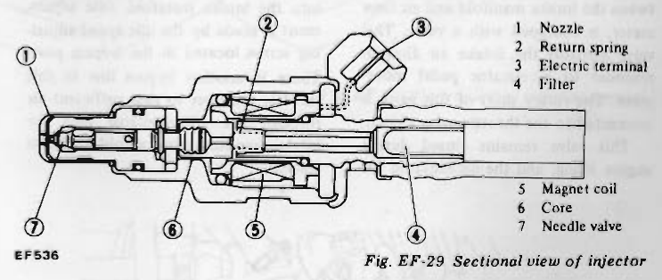
>
> - **Summary:** Cross-sectional cutaway drawing of electromagnetic fuel injector detailing internal strainer filter, solenoid coil, core plunger, return spring, and needle valve seat.
> - **Components:** Nozzle, Return spring, Electric terminal, Filter, Magnet coil, Core, Needle valve
> - **Callouts:** **(1)** Nozzle; **(2)** Return spring; **(3)** Electric terminal; **(4)** Filter; **(5)** Magnet coil; **(6)** Core; **(7)** Needle valve
> - **Specs / Measurements:** Fuel quantity proportional to open-valve pulse duration
> - **Wiring / Connections:** Two electrical terminals
> - **Mechanic Notes:** Solenoid coil lifts needle valve off seat against return spring force.
> - **Tags:** `injector`, `solenoid`, `needle valve`, `magnet coil`, `cutaway`

# 16. Air regulator

The air regulator bypasses the throttle valve to control the quantity of air for increasing the engine idling speed when starting the engine at an underhood temperature of below 80°C (176°F).

A bimetal and a heater are built into the air regulator. When the ignition switch is turned to the START position or engine running, electric current flows through the heater, and the bimetal, as it is heated by the heater, begins to move and closes the air passage in a few minutes. The air passage remains closed until the engine is stopped and the underhood air temperature drops to below 80°C (176°F).

> 🖼️ **Fig. EF-30 Sectional view of air regulator** `[EF320]` *(Type: `cutaway_flow`)*
>
> 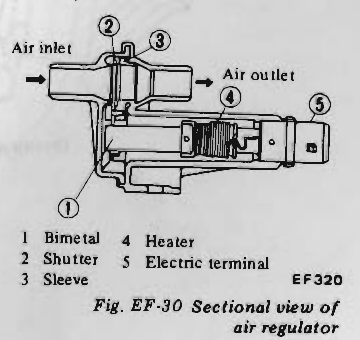
>
> - **Summary:** Cross-sectional cutaway drawing of the auxiliary air regulator showing the bimetal strip, heating element, rotary shutter disc, sleeve, and air flow passages.
> - **Components:** Bimetal strip, Shutter plate, Sleeve, Heater winding, Electric terminal, Air inlet, Air outlet
> - **Callouts:** **(1)** Bimetal; **(2)** Shutter; **(3)** Sleeve; **(4)** Heater; **(5)** Electric terminal
> - **Specs / Measurements:** Closes auxiliary bypass within a few minutes; remains closed until temp drops below 80°C (176°F)
> - **Wiring / Connections:** Terminal connected to fuel pump relay power circuit
> - **Mechanic Notes:** Bimetal is electrically heated while engine runs, rotating shutter plate to shut off fast-idle bypass air.
> - **Tags:** `air regulator`, `fast idle`, `bimetal`, `shutter`, `cutaway`

---

<!-- Page 18 (EF-18) -->

> 🖼️ **Fig. EF-31 Air regulator characteristic curve** `[EF123A, EF124A]` *(Type: `graph_chart`)*
>
> 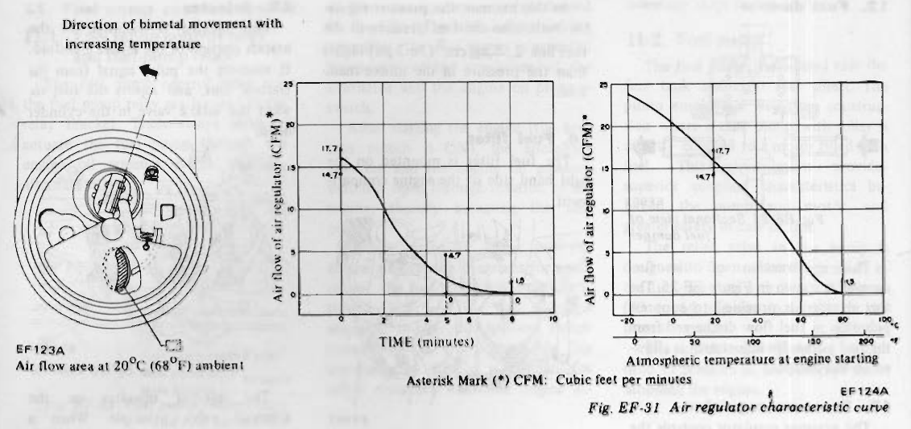
>
> - **Summary:** Characteristic performance curves of auxiliary air regulator displaying rotary shutter opening area at 20°C (68°F), air flow in CFM versus warmup time in minutes, and air flow versus initial ambient temperature.
> - **Components:** Rotary shutter aperture, Bimetal arm, Air flow time graph, Air flow temperature graph
> - **Specs / Measurements:** Air flow at start: ~17.7 CFM at -20°C (-4°F), ~14.7 CFM at 20°C (68°F); Warmup decay: drops to ~1.5 CFM within 6 minutes; CFM: Cubic feet per minute
> - **Mechanic Notes:** Bimetal movement smoothly chokes off auxiliary air as heater warms element over 5-6 minutes.
> - **Tags:** `air regulator`, `characteristic curve`, `CFM`, `warmup`, `graph`

# 17. Throttle chamber

The throttle chamber, located between the intake manifold and air flow meter, is equipped with a valve. This valve controls the intake air flow in response to accelerator pedal movement. The rotary shaft of this valve is connected to the throttle valve switch.

This valve remains closed during engine idling, and the air required for idling passes through the bypass port into the intake manifold. Idle adjustment is made by the idle speed adjusting screw located in the bypass port. There is another bypass line in this throttle chamber to pass sufficient air through the air regulator into the intake manifold when a cold engine is started.

> 🖼️ **Fig. EF-32 Throttle chamber** `[EF787]` *(Type: `component_location`)*
>
> 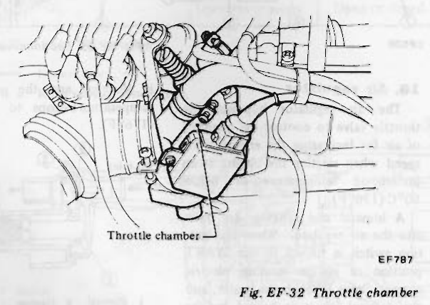
>
> - **Summary:** Perspective illustration of the throttle chamber assembly mounted to intake manifold, depicting throttle shaft linkage, idle bypass screw, and TPS mounting.
> - **Components:** Throttle chamber body, Throttle valve shaft & linkage, Idle speed adjusting screw, Air regulator bypass pipe
> - **Mechanic Notes:** Main throttle valve stays closed during idling; idle speed adjusting screw meters air through bypass passage.
> - **Tags:** `throttle chamber`, `idle adjusting screw`, `bypass port`, `throttle shaft`

# 18. Electronic fuel injection harness

One wiring harness is used to connect lines between the control unit and the related major units.

The harness from the 35-pin connector connected to the control unit is combined with the dash harness at the side dash on the driver's side, and runs to the engine compartment. From the engine compartment, the harness runs to various units; the air flow meter, air temperature sensor, throttle valve switch, air regulator, injector, cold start valve, dropping resistor, electronic fuel injection main relay, etc.

Connectors in the engine compartment are used only in the line between the 35-pin connector and water temperature sensor, and between the cold start valve and thermotime switch.

---

<!-- Page 19 (EF-19) -->

> 🖼️ **Fig. EF-33 Electronic fuel injection harness** `[EF125A]` *(Type: `component_location`)*
>
> 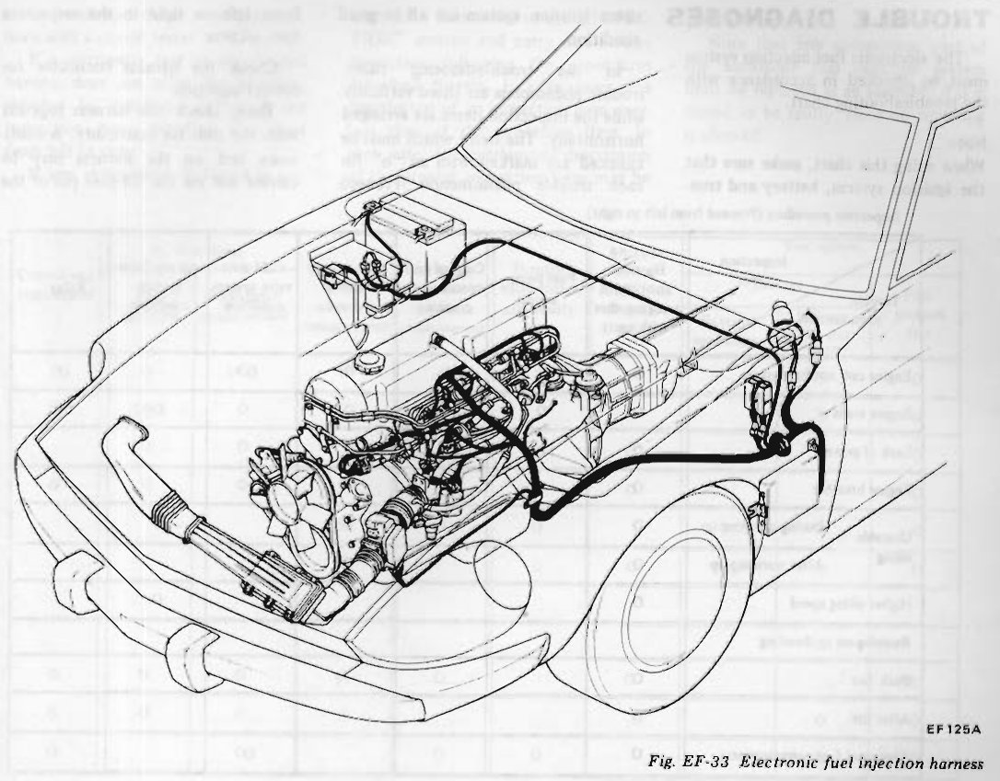
>
> - **Summary:** Chassis perspective cutaway showing the comprehensive layout and routing of the EFI wiring harness from the driver's side cabin ECU through the firewall to engine bay sensors, injectors, and relays.
> - **Components:** Control unit (under dash), Main EFI harness bundle, Battery, Main relay & pump relays, Ignition coil, Dropping resistor pack, Injectors, Cold start valve, Air flow meter, Thermotime switch, Water temp sensor
> - **Specs / Measurements:** 35-pin ECU connector under driver side dash
> - **Wiring / Connections:** Runs along driver side dash through firewall grommet into engine bay
> - **Mechanic Notes:** Ensure harness grommet at firewall is sealed to prevent moisture ingress.
> - **Tags:** `wiring harness`, `harness routing`, `component layout`, `chassis`

---

<!-- Page 20 (EF-20) -->
# TROUBLE DIAGNOSES

The electronic fuel injection system must be checked in accordance with the troubleshooting chart.

> [!NOTE]
> When using this chart, make sure that the ignition system, battery and transistor ignition system are all in good condition.

In the troubleshooting chart, trouble phenomena are listed vertically while the inspection items are arranged horizontally. The items which must be checked are marked with an "o" for each trouble phenomenon. Proceed from left to right in the inspection item section.

Check the harness connector for correct insertion.

Then, check the harness together with the unit for continuity. A continuity test on the harness may be carried out on the 35-pole pin of the control unit and other necessary portions with a circuit tester.

If a continuity test on an affected harness does not solve the problem, proceed to check by following the inspection items listed in the chart from left to right.

If any abnormality is found in any inspection item, refer to the "INSPECTION" section and carry out further inspection following the procedures described therein. In some cases, the description of an inspection item overlaps that of the preceding item. In such case, the overlapping description of the present inspection item may be omitted.

Note that any component part of the electronic fuel injection system must be replaced as an assembly if it is found to be faulty, since no repairing is allowed.

### Trouble Diagnoses Chart (Part 1 - Inspection items at left)

*Inspection procedure (Proceed from left to right)*

| Trouble phenomenon | Harness continuity test (together with unit) | Fuel pump sound | Control unit operation at cranking | Injector sound | Cold start valve system condition | Air regulator system condition | Relay |
| :--- | :---: | :---: | :---: | :---: | :---: | :---: | :---: |
| Engine can not be started | o | o | o | o | o \*1 | | o |
| Engine stalls | o | o | o | o | | o \*2 | o |
| Lack of power | o | | | o | | | |
| Engine breathes | o | | | | | | |
| **Unstable idling**: During warming-up | o | | | o | | o | |
| **Unstable idling**: After warming-up | o | | | o | | | |
| Higher idling speed | o | | | | | o | |
| Running-on or dieseling | | | | | | | |
| Back fire | o | | | | | | |
| After fire | o | | | | | | |
| Abnormal fuel consumption | o | | | | o | | |

\*1 Check this item when trouble occurs in cold weather only.  
\*2 Check this item when trouble occurs during warming-up.

# INSPECTION

## DESCRIPTION

### (1) Checks before inspection

Before attempting any test, check the following items to ensure that nothing has been overlooked.

- All harness connectors (especially the 35-pin coupler and air flow meter connector) are securely in place.  
  Connector terminals are free from corrosion and deformation.
- Since the electronic fuel injection system accurately meters the intake air flow through an air flow meter, even a slight air leak will cause an improper air-fuel ratio, resulting in faulty engine operation due to excessive air.  
  For this reason, a thorough inspection for leaks should be made at the oil filler cap, dipstick, blow-by hoses, air flow meter to throttle chamber air duct, etc.

### (2) Inspection instructions

Before checking the electronic fuel injection system, be sure to observe the instructions below. Failure to do so could result in damage to the control unit or cause fuel line leakage.

(a) Before starting the engine, make sure that all electronic fuel injection harness connectors are firmly in place.

> [!CAUTION]
> When connecting or disconnecting electronic fuel injection harness connector to or from any electronic fuel injection unit, ensure that the ignition switch is in the OFF position or that the negative battery terminal is disconnected. Removing and installing these connectors with the ignition switch left in the ON position will damage control unit.

(b) Replace hoses if they are deformed, scratched or chafed.  
(c) Do not reuse hose clamps after removal.

> [!CAUTION]
> Do not allow unburned fuel to discharge from injectors and cold start valve while the engine is at rest. Doing so will cause a rich air-fuel mixture ratio, which in turn will deteriorate the catalytic converter when the engine is started. <!-- Page 21 (EF-21) --> ### Trouble Diagnoses Chart (Part 2 - Inspection items at right)

*Fig. EF-34 Trouble diagnoses chart*

| Trouble phenomenon (continued) | Control unit replacement | Air flow meter: Flap operation | Air flow meter: Resistance measurement | Water temp. sensor resistance measurement | Air temp. sensor resistance measurement | Throttle valve switch continuity test | Altitude switch (California models only) | Fuel system: Leakage (External appearance) | Fuel system: Leakage (Injector / Cold start valve) | Fuel system: Fuel pressure test |
| :--- | :---: | :---: | :---: | :---: | :---: | :---: | :---: | :---: | :---: | :---: |
| Engine can not be started | o | o | o | o | | | | | o | o |
| Engine stalls | o | o | o | o | | | | | o | o |
| Lack of power | | o | o | | | o | o | | o | o |
| Engine breathes | o | o | o | | | | o | | | o |
| **Unstable idling**: During warming-up | | | | o | o | o | | | o | o |
| **Unstable idling**: After warming-up | | | | o | | o | o | | o | o |
| Higher idling speed | | | | | | | | | o | |
| Running-on or dieseling | o | o | o | o | o | o | | | | o |
| Back fire | o | o | o | o | | | | | o | o |
| After fire | o | | o | | o | o | o | | o | o |
| Abnormal fuel consumption | o | | o | | o | o | | o | o | o |

### (3) Idle adjustment

On engines equipped with the electronic fuel injection system, air-fuel mixture ratio adjustments can be made by turning air bypass screw and engine speed can be adjusted by turning idle speed adjusting screw.

> [!NOTE]
> When measuring CO percentage to check idling operation, make sure that CO percentage is below 1.0 percent for non-California models and 0.5 percent for California models. If CO percentage is over the specifications, adjust air-fuel mixture ratio. Refer to Section ET, "Checking and Adjusting Engine Idle Rpm and Mixture Ratio".  
> When inspecting the catalytic converter for deterioration, HC and CO percentage must also be measured.

# CONTINUITY CHECK

**Circuit tester (Test equipment required)**

## Description

It is not necessary to conduct a harness continuity check on the entire electronic fuel injection system. Simply locate the pertinent trouble source on the left in the following table and conduct an inspection as denoted by the check item number shown on the opposite side.

To find what is denoted by the check item number, refer to the attached table and to the same check item number given in the service manual.

> [!CAUTION]
> Do not touch the circuit tester probe to any unnecessary pin on the 35-pin connector. Doing so could cause damage to the connector terminal.

---

<!-- Page 22 (EF-22) -->
# Connector and harness continuity check

| Condition | Check item number |
| :--- | :--- |
| Engine will not start | 1 - (3), (5), (6), (7), (8) 2 - (1), (2), (3) 3 - (1), (3) |
| Engine stalls | 1 - (3), (5), (6), (7), (8) 2 - (1), (2), (3) |
| Lack of power | 1 - (1), (2), (3), (4), (5), (6), (9) 2 - (1), (2), (3) |
| Engine breathes | 1 - (1), (2), (3), (4), (5), (6), (8), (9) 2 - (1), (2), (3) |
| **Idling unstable**: During warm-up | 1 - (1), (3), (4), (5), (6), (8) 2 - (1), (2), (3) 3 - (2) |
| **Idling unstable**: After warm-up | 1 - (1), (3), (4), (5), (6), (8), (9) 2 - (1), (2), (3) |
| Higher idling speed | 1 - (1), (2), (4), (5), (6) 3 - (2) |
| Running on or dieseling | ————— |
| Backfire | 1 - (1), (2), (3), (4), (5), (9) 2 - (1), (2), (3) |
| Afterfire | 1 - (1), (2), (3), (4), (5) 2 - (3) 3 - (1) |
| Abnormal fuel consumption | 1 - (1), (2), (3), (4), (5), (6) 2 - (3) 3 - (2) |

## 1. Continuity check using an ohmmeter

1. Make sure that each function unit connectors and ground lines are securely connected in place.
2. Turn ignition switch to the OFF position.
3. Disconnect ground cable from battery.
4. Disconnect 35-pin connector of the control unit.

> [!CAUTION]
> Before disconnecting electronic fuel injection harness at 35-pin coupler, ensure that ignition switch is in the OFF position.

5. Set circuit tester in the OHM "R" range.

> 🖼️ **Fig. EF-35 Check at 35-pin connector ("R" range)** `[EF126A]` *(Type: `procedure_step`)*
>
> 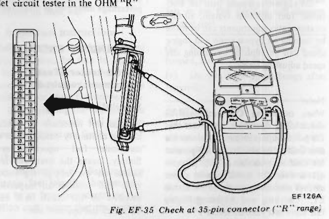
>
> - **Summary:** Terminal pin layout diagram of the 35-pin ECU female harness connector illustrating pin positions 1 through 35 and test probe insertion for resistance checks.
> - **Components:** 35-pin ECU harness connector, Circuit tester probe, Analog ohmmeter
> - **Callouts:** **(1)** Pin 1; **(2)** Pin 2; **(3)** Pin 3; **(4)** Pin 4; **(5)** Pin 5; **(6)** Pin 6; **(7)** Pin 7; **(8)** Pin 8; **(9)** Pin 9; **(10)** Pin 10; **(11)** Pin 11; **(12)** Pin 12; **(13)** Pin 13; **(14)** Pin 14; **(15)** Pin 15; **(16)** Pin 16; **(17)** Pin 17; **(18)** Pin 18; **(19)** Pin 19; **(20)** Pin 20; **(21)** Pin 21; **(22)** Pin 22; **(23)** Pin 23; **(24)** Pin 24; **(25)** Pin 25; **(26)** Pin 26; **(27)** Pin 27; **(28)** Pin 28; **(29)** Pin 29; **(30)** Pin 30; **(31)** Pin 31; **(32)** Pin 32; **(33)** Pin 33; **(34)** Pin 34; **(35)** Pin 35
> - **Specs / Measurements:** Circuit tester set to OHM 'R' range
> - **Wiring / Connections:** Pin arrangement: 1-18 right row, 19-35 left row
> - **Mechanic Notes:** Do not touch test probes to unnecessary connector pins to prevent socket damage.
> - **Tags:** `35-pin connector`, `pinout`, `continuity check`, `ohmmeter`

---

<!-- Page 23 (EF-23) -->
6. Check continuity between terminals Ⓐ and Ⓑ shown in the following chart.
7. If test results are "N.G.", check the circuits in Figure EF-36.

| Check item number | Check points | Check terminals: Ⓐ | Check terminals: Ⓑ | Test results: Continuity exists | Test results: Continuity does not exist | Remarks |
| :---: | :--- | :---: | :---: | :---: | :---: | :--- |
| 1-(1) | Throttle valve switch: Idle switch | ② | ⑱ | OK | N.G. | |
| 1-(2) | Throttle valve switch: Full switch | ③ | ⑱ | OK | N.G. | Accelerator pedal fully depressed. |
| 1-(3) | Air flow meter | ⑥ | ⑧ | OK | N.G. | |
| 1-(3) | Air flow meter | ⑦ | ⑧ | OK | N.G. | |
| 1-(3) | Air flow meter | ⑧ | ⑨ | OK | N.G. | |
| 1-(4) | Air temperature sensor | ⑥ | ㉗ | OK | N.G. | |
| 1-(5) | Water temperature sensor | ⑬ | Body metal | OK | N.G. | |
| 1-(6) | Air regulator | ㉞ | Body metal | OK | N.G. | |
| 1-(7) | Thermotime switch | ④ | Body metal | OK | N.G. | |
| 1-(7) | Thermotime switch | ㉑ | Body metal | OK | N.G. | Disconnect cold start valve connector. Cooling water temperature below 14 to 22°C (57 to 72°F) |
| 1-(7) | Thermotime switch | ㉑ | Body metal | N.G. | OK | Disconnect cold start valve connector. Cooling water temperature above 14 to 22°C (57 to 72°F) |
| 1-(8) | Ground circuit | ⑤ | Body metal | OK | N.G. | |
| 1-(8) | Ground circuit | ⑯ | Body metal | OK | N.G. | |
| 1-(8) | Ground circuit | ⑰ | Body metal | OK | N.G. | |
| 1-(8) | Ground circuit | ㉟ | Body metal | OK | N.G. | |
| 1-(9) | Altitude switch (California Models only) | ⑨ | ⑫ | N.G. | OK | When checked at "low" altitude. [approx. 1,120 m (3,675 ft) or lower, or approx. 660 mmHg (26 inHg) or higher.] |
| 1-(9) | Altitude switch (California Models only) | ⑨ | ⑫ | OK | N.G. | When checked at "high" altitude. [approx. 1,120 m (3,675 ft) or higher, or approx. 660 mmHg (26 inHg) or lower.] |

> [!NOTE]
> Body metal refers to body ground.

---

<!-- Page 24 (EF-24) -->

> 🖼️ **Fig. EF-36 Checking for continuity with an ohmmeter** `[EF006A]` *(Type: `electrical_schematic`)*
>
> 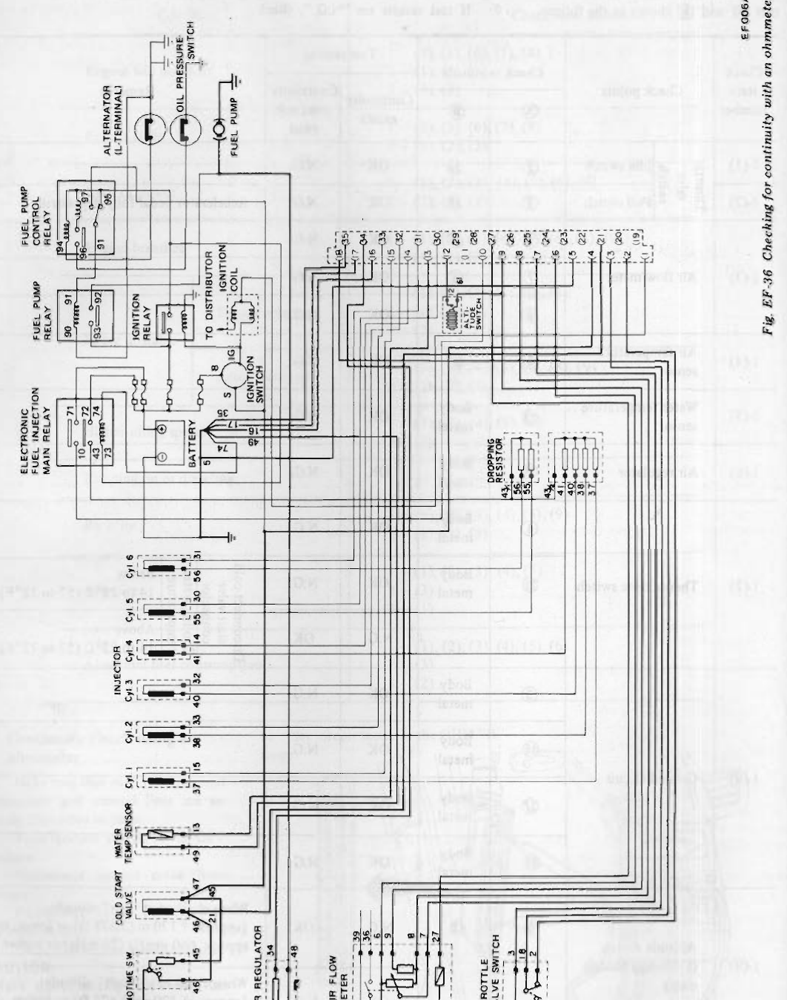
>
> - **Summary:** Complete schematic diagram for harness continuity testing, displaying pin-to-component connections for all 35 ECU connector terminals, dropping resistors, fuel pump relays, ignition relay, injectors, air regulator, and sensors.
> - **Components:** Fuel pump control relay (94, 96, 97, 91, 95), Fuel pump relay (90, 91, 92, 93), EFI main relay (10, 71, 72, 73, 74), Ignition relay, Battery, Ignition switch (5, 74, 49, 35, 8, S, IG), Oil pressure switch, Alternator (L-terminal), Fuel pump, Distributor / Ignition coil, Dropping resistor (43, 56, 55, 41, 40, 38, 37), Injectors Cyl 1-6 (15/37, 33/38, 32/40, 14/41, 30/55, 31/56), Water temp sensor (13, 49), Cold start valve (47, 46), Thermotime switch (45, 46, 21), Air regulator (34, 48), Air flow meter (39, 36, 6, 9, 8, 7, 27), Throttle valve switch (3, 18, 2), Altitude switch (6, 12), 35-pin ECU connector (pins 1 to 35)
> - **Specs / Measurements:** Pins 5, 16, 17, 35: chassis grounds
> - **Wiring / Connections:** Complete harness point-to-point wiring traces
> - **Mechanic Notes:** Refer to this schematic to isolate open or short circuits whenever continuity test between terminals A and B results in N.G.
> - **Tags:** `continuity check`, `schematic`, `wiring harness`, `troubleshooting`, `35-pin connector`

---

<!-- Page 25 (EF-25) -->
## 2. Continuity check using a voltmeter (1)

1. Connect ground cable to battery.
2. Set circuit tester in the DC VOLT (DC "V") range.
3. Turn ignition switch to the "ON" position.
4. Connect negative terminal of voltmeter to body metal with a lead wire.
5. Contact terminal **A** shown in the following chart with positive lead wire of voltmeter.
6. If test results are "N.G.", check the circuit in Figure EF-38.

> [!NOTE]
> If test results check out "N.G.", be sure to turn off ignition switch and to disconnect battery ground cable before tracing the circuit.

> 🖼️ **Fig. EF-37 Check at 35-pin connector ("V" range)** `[EF127A]` *(Type: `procedure_step`)*
>
> 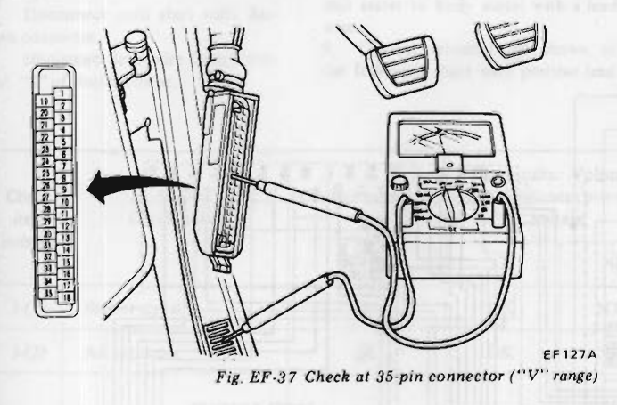
>
> - **Summary:** Procedure for checking voltages at individual terminals of the disconnected 35-pin ECU harness connector using a DC voltmeter connected to body ground under the dash near the pedals.
> - **Components:** 35-pin connector, Circuit tester (voltmeter), Ground lead wire, Pedal assembly
> - **Callouts:** **(1-35)** 35-pin connector terminal arrangement
> - **Specs / Measurements:** Circuit tester set to DC VOLT (DC "V") range
> - **Wiring / Connections:** Positive voltmeter probe to terminal A; Negative voltmeter probe to body metal with lead wire
> - **Mechanic Notes:** Turn ignition switch to 'ON'. If test results check out 'N.G.', turn off ignition switch and disconnect battery ground cable before tracing circuit.
> - **Tags:** `continuity check`, `voltmeter`, `35-pin connector`, `terminal check`, `EF127A`

| Check item number | Check points | Contact terminals Ⓐ | Test results: Voltmeter reading indicates power line voltage Yes | Test results: Voltmeter reading indicates power line voltage No |
| :--- | :--- | :---: | :---: | :---: |
| 2-(1) | Revolution trigger signal | ① | OK | N.G. |
| 2-(2) | Power line circuit | ⑩ | OK | N.G. |
| 2-(3) | Injector and resistor: Cylinder "1" | ⑮ | OK | N.G. |
| 2-(3) | Injector and resistor: Cylinder "2" | ㉝ | OK | N.G. |
| 2-(3) | Injector and resistor: Cylinder "3" | ㉜ | OK | N.G. |
| 2-(3) | Injector and resistor: Cylinder "4" | ⑭ | OK | N.G. |
| 2-(3) | Injector and resistor: Cylinder "5" | ㉚ | OK | N.G. |
| 2-(3) | Injector and resistor: Cylinder "6" | ㉛ | OK | N.G. |

---

<!-- Page 26 (EF-26) -->

> 🖼️ **Fig. EF-38 Checking for continuity with a voltmeter (1)** `[EF007A]` *(Type: `electrical_schematic`)*
>
> 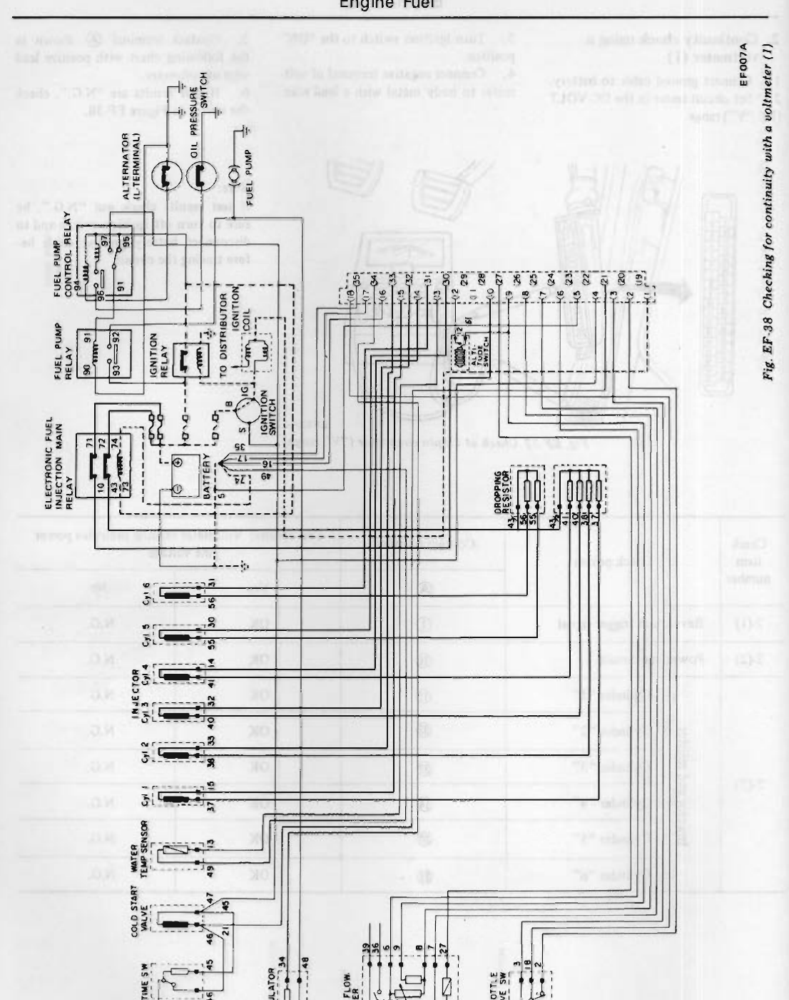
>
> - **Summary:** Full electrical schematic showing power distribution and sensor/actuator circuits to the 35-pin connector for Continuity Check (1) using a voltmeter with ignition switch ON.
> - **Components:** Fuel pump control relay, Fuel pump relay, Electronic fuel injection main relay, Alternator (L-terminal), Oil pressure switch, Fuel pump, Ignition relay, Ignition coil, Ignition switch, Battery, Dropping resistor, Altitude switch (California), Injectors (Cyl 1-6), Water temp sensor, Cold start valve, Thermotime switch, Air regulator, Air flow meter, Throttle valve switch, 35-pin connector terminals
> - **Callouts:** **(1)** Revolution trigger signal; **(10)** Main relay power supply; **(15)** Cylinder 1 injector; **(33)** Cylinder 2 injector; **(32)** Cylinder 3 injector; **(14)** Cylinder 4 injector; **(30)** Cylinder 5 injector; **(31)** Cylinder 6 injector
> - **Specs / Measurements:** Battery voltage check at 35-pin connector terminals: 1, 10, 15, 33, 32, 14, 30, 31
> - **Wiring / Connections:** Fusible link to Main relay; Ignition switch ON contact circuit; Dropping resistor circuit to injectors
> - **Mechanic Notes:** Use to trace open circuits when voltage is absent at check terminals in test 2-(1) through 2-(3).
> - **Tags:** `electrical schematic`, `wiring diagram`, `continuity check 1`, `35-pin connector`, `EF007A`

---

<!-- Page 27 (EF-27) -->
## 3. Continuity check using a voltmeter (2)

1. Turn ignition switch to the "OFF" position.
2. Disconnect ground cable from battery.
3. Disconnect cold start valve harness connector.
4. Disconnect lead wire from terminal "S" of starter motor.
5. Connect ground cable to battery.
6. Set circuit tester in the DC VOLT (DC "V") range.
7. Turn ignition switch to the "START" position.
8. Connect negative terminal of circuit tester to body metal with a lead wire.
9. Contact terminal **A** shown in the following chart with positive lead wire of voltmeter.
10. If test results are "N.G.", check the circuit in Figure EF-40.

> [!NOTE]
> If test results check out "N.G.", be sure to turn off ignition switch and to disconnect battery ground cable before tracing the circuit.

| Check item number | Check point | Contact terminals Ⓐ | Test results: Voltmeter reading indicates power line voltage Yes | Test results: Voltmeter reading indicates power line voltage No | Remarks |
| :--- | :--- | :---: | :---: | :---: | :--- |
| 3-(1) | Starter signal | ④ | OK | N.G. | |
| 3-(2) | Air regulator | ㉞ | OK | N.G. | |
| 3-(3) | Cold start valve and thermotime switch | ㉑ | OK | N.G. | 1. Disconnect thermotime switch connector. 2. Short circuit two pins of thermotime switch harness connector. See Figure EF-39. |

> 🖼️ **Fig. EF-39 Thermotime switch harness connector short circuit** `[EF789]` *(Type: `procedure_step`)*
>
> 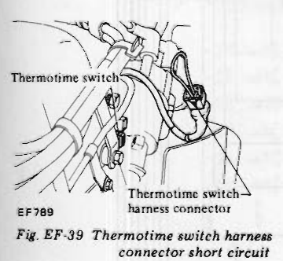
>
> - **Summary:** Short circuiting the two terminals of the thermotime switch harness connector using a jumper wire to test the cold start valve circuit at pin 21 of the ECU connector.
> - **Components:** Thermotime switch, Thermotime switch harness connector, Jumper wire
> - **Callouts:** **(Thermotime switch)** Thermotime switch on thermostat housing; **(Thermotime switch harness connector)** Harness connector disconnected with jumper wire shorting both female terminals
> - **Wiring / Connections:** Short-circuit two pins of thermotime switch harness connector
> - **Mechanic Notes:** Disconnect thermotime switch connector and short circuit the two pins before checking terminal 21 at the 35-pin connector.
> - **Tags:** `thermotime switch`, `short circuit`, `jumper wire`, `cold start valve`, `EF789`

---

<!-- Page 28 (EF-28) -->

> 🖼️ **Fig. EF-40 Checking for continuity with a voltmeter (2)** `[EF008A]` *(Type: `electrical_schematic`)*
>
> 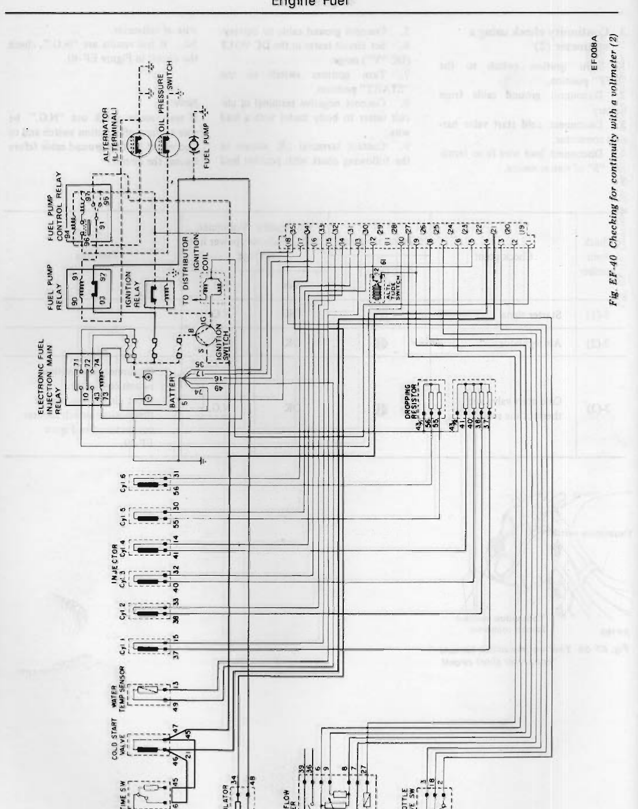
>
> - **Summary:** Full electrical schematic highlighting the starting circuits (terminal 4 starter signal, terminal 34 air regulator, terminal 21 cold start valve/thermotime switch) checked during Continuity Check (2) with ignition in START position.
> - **Components:** Fuel pump control relay, Fuel pump relay, Electronic fuel injection main relay, Alternator (L-terminal), Oil pressure switch, Fuel pump, Ignition relay, Ignition coil, Ignition switch, Battery, Dropping resistor, Altitude switch (California), Injectors 1-6, Water temp sensor, Cold start valve, Thermotime switch, Air regulator, Air flow meter, Throttle valve switch, 35-pin connector terminals
> - **Callouts:** **(4)** Starter signal from ignition switch 'S' terminal; **(21)** Cold start valve and thermotime switch circuit; **(34)** Air regulator circuit from fuel pump relay
> - **Specs / Measurements:** Power line voltage present at terminals 4, 34, and 21 during cranking
> - **Wiring / Connections:** Terminal S of ignition switch to terminal 4 and starter motor; Fuel pump relay contacts to air regulator and terminal 34; Cold start valve to thermotime switch and terminal 21
> - **Mechanic Notes:** Trace circuits according to diagram if voltmeter reading is 'N.G.' during continuity check (2).
> - **Tags:** `electrical schematic`, `wiring diagram`, `continuity check 2`, `starter signal`, `air regulator`, `cold start valve`, `EF008A`

---

<!-- Page 29 (EF-29) -->

> 🖼️ **Fig. EF-41 Electronic fuel injection system wiring diagram** `[EF009A]` *(Type: `electrical_schematic`)*
>
> 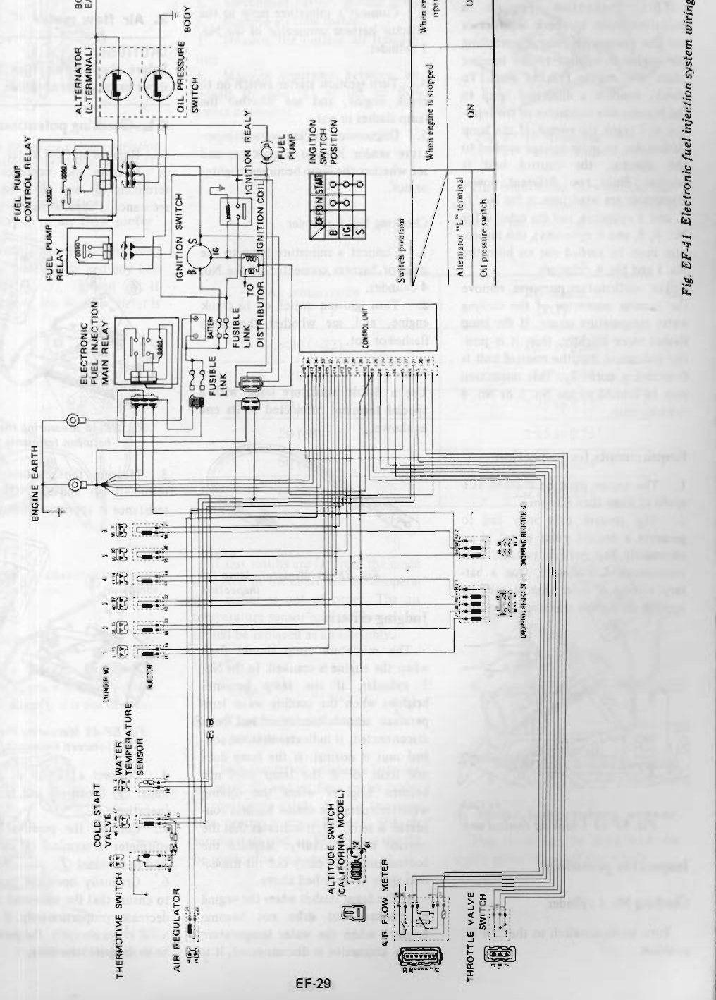
>
> - **Summary:** Complete master electrical wiring diagram for the 1978 Datsun 280Z Electronic Fuel Injection (EFI) system, including fuel pump safety interlocks via alternator L-terminal and oil pressure switch, control unit pinout, relays, sensors, dropping resistor, and injectors.
> - **Components:** Battery, Fusible link, Ignition switch, Ignition relay, Ignition coil, Fuel pump relay, Fuel pump control relay, Fuel pump, Alternator (L-terminal), Oil pressure switch, Electronic fuel injection main relay, Dropping resistors I & II, Injectors 1 to 6, Cold start valve, Thermotime switch, Water temperature sensor, Air regulator, Air flow meter, Throttle valve switch, Altitude switch (California model), Control unit (35 pins), Body earth, Engine earth
> - **Callouts:** **(Control unit)** 35-pin electronic control unit; **(Alternator L-terminal)** Alternator charge warning light terminal; **(Oil pressure switch)** Engine oil pressure switch for fuel pump safety
> - **Specs / Measurements:** Switch state: Alternator 'L' terminal ON (stopped) / OFF (operation); Switch state: Oil pressure switch OFF (stopped) / ON (operation)
> - **Wiring / Connections:** Battery to Fusible link to Main relay terminal 10 & 43; Ignition switch OFF/ON/START contacts B, IG, S; Alternator L terminal and oil pressure switch in parallel to Fuel pump control relay coil
> - **Mechanic Notes:** Primary reference wiring diagram for the complete EFI electrical sub-system on 1978 280Z.
> - **Tags:** `master wiring diagram`, `EFI schematic`, `control unit pinout`, `fuel pump interlock`, `EF009A`

### Switch position

| Switch position | Alternator "L" terminal | Oil pressure switch |
| :--- | :---: | :---: |
| When engine is stopped | ON | OFF |
| When engine is in operation | OFF | ON |

---

<!-- Page 30 (EF-30) -->
# CHECKING FUNCTIONAL PARTS

## 1. Control unit

This inspection employs a miniature lamp to check whether or not the open-valve pulse for cranking the engine is applied to the injector when the engine fails to start. To check, connect a miniature lamp to the harness-side connector of the injector, and crank the engine. If the lamp flashes due to pulse voltage applied to the injector, the control unit is normal. Since two different power transistors are used (one is for No. 1, 2, and 3 cylinders, and the other is for No. 4, 5, and 6 cylinders), this inspection must be carried out on both the No. 1 and No. 4 cylinders.

For confirmation purposes, remove the harness connector of the cooling water temperature sensor. If the lamp flashes more brightly, then it is positive indication that the control unit is functioning normally. This inspection may be limited to the No. 1 or No. 4 cylinder only.

### Requirements for inspection

1. The engine must be cranked at a speed of more than 80 rpm.
2. The control unit may fail to generate a correct pulse signal at an excessively low battery voltage. It is recommended, therefore, that a battery voltage of more than 9 volts be applied during the cranking operation.

> 🖼️ **Fig. EF-42 Checking control unit** `[EF128A]` *(Type: `procedure_step`)*
>
> 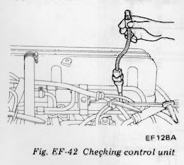
>
> - **Summary:** Connecting a 3V miniature test lamp to the fuel injector harness connector to check for injection pulse signals while cranking.
> - **Components:** Miniature test lamp, Injector harness connector, Fuel injector
> - **Specs / Measurements:** Cranking speed > 80 rpm; Battery voltage during cranking > 9 V
> - **Wiring / Connections:** Miniature lamp pins inserted into injector connector terminals
> - **Mechanic Notes:** Must check both No. 1 and No. 4 cylinders because separate power transistors drive cylinders 1-3 and 4-6.
> - **Tags:** `control unit`, `injector pulse`, `test lamp`, `cranking check`, `EF128A`

### Inspection procedure

#### Checking No. 1 cylinder

Turn ignition switch to the "OFF" position.
1. Disconnect harness connector of injector.
2. Disconnect cold start valve harness connector.
3. Connect a miniature lamp to the injector harness connector of the No. 1 cylinder.
4. Turn ignition starter switch on to crank engine, and see whether the lamp flashes or not.
5. Disconnect cooling water temperature sensor harness connector, and see whether the lamp becomes brighter or not.

#### Checking No. 4 cylinder

1. Connect a miniature lamp to the injector harness connector of the No. 4 cylinder.
2. Turn ignition switch on to crank engine, and see whether the lamp flashes or not.

> [!NOTE]
> Use a 3-volt miniature lamp with a special terminal connected to its end as shown.

> 🖼️ **Fig. EF-43 Miniature lamp for inspection** `[EF353]` *(Type: `special_service_tool`)*
>
> 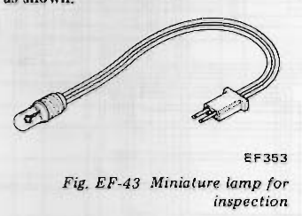
>
> - **Summary:** Custom test tool consisting of a 3-volt miniature lamp soldered to lead wires with male spade terminals sized for injector connector pins.
> - **Components:** 3-volt miniature lamp, Lead wires, Special terminal pins
> - **Specs / Measurements:** Rating: 3-volt miniature lamp
> - **Mechanic Notes:** Use a 3V lamp with terminal pins matching the injector harness connector.
> - **Tags:** `special tool`, `miniature lamp`, `test lamp`, `EF353`

### Judging criteria

The miniature lamp should flash when the engine is cranked. In the No. 1 cylinder, if the lamp becomes brighter when the cooling water temperature sensor connector has been disconnected, it indicates that the control unit is normal. If the lamp does not flash, or if the lamp does not become brighter when the cooling water temperature sensor harness connector is removed, it indicates that the control unit is faulty. Replace the control unit, and carry out the inspection again as described above.

If the lamp flashes when the engine is cranked, but does not become brighter when the water temperature sensor connector is disconnected, it is an indication that the water temperature sensor is faulty. Check the water temperature sensor.

## 2. Air flow meter

> [!CAUTION]
> Before checking air flow meter, remove battery ground cable.

### 2-1. Checking potentiometer

1. Remove air flow meter.
2. Measure the resistance between terminals ⑧ and ⑥. The standard resistance is approximately 180 ohms.

> 🖼️ **Fig. EF-44 Measuring the resistance between terminals ⑧ and ⑥** `[EF742]` *(Type: `inspection_measurement`)*
>
> 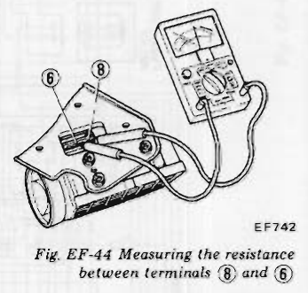
>
> - **Summary:** Ohmmeter test measuring total track resistance across terminals 8 and 6 of the air flow meter connector.
> - **Components:** Air flow meter, Ohmmeter, Terminals 6 and 8
> - **Callouts:** **(6)** Terminal 6; **(8)** Terminal 8
> - **Specs / Measurements:** Standard resistance: approximately 180 Ω
> - **Wiring / Connections:** Ohmmeter across terminals 8 and 6
> - **Mechanic Notes:** Before checking air flow meter, remove battery ground cable.
> - **Tags:** `air flow meter`, `potentiometer resistance`, `terminal 6`, `terminal 8`, `EF742`

3. Measure the resistance between terminals ⑨ and ⑧. The standard resistance is approximately 100 ohms.

> 🖼️ **Fig. EF-45 Measuring the resistance between terminals ⑨ and ⑧** `[EF743]` *(Type: `inspection_measurement`)*
>
> 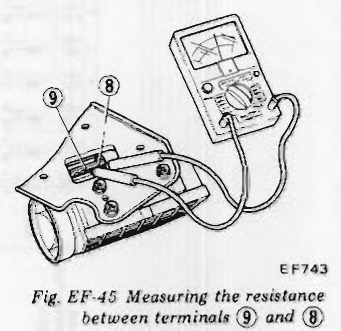
>
> - **Summary:** Ohmmeter test measuring resistance across terminals 9 and 8 of the air flow meter connector.
> - **Components:** Air flow meter, Ohmmeter, Terminals 8 and 9
> - **Callouts:** **(8)** Terminal 8; **(9)** Terminal 9
> - **Specs / Measurements:** Standard resistance: approximately 100 Ω
> - **Wiring / Connections:** Ohmmeter across terminals 9 and 8
> - **Mechanic Notes:** Measure resistance at connector terminals on removed AFM.
> - **Tags:** `air flow meter`, `potentiometer resistance`, `terminal 9`, `terminal 8`, `EF743`

4. Connect a 12-volt dc across terminal ⑨ (positive) and terminal ⑥ (negative).
5. Connect the positive lead of a voltmeter to terminal ⑧ and negative lead to terminal ⑦.
6. Gradually open the flap by hand to ensure that the voltmeter indication decreases proportionately. If the indication varies abruptly, the problem may be in the potentiometer. <!-- Page 31 (EF-31) --> > 🖼️ **Fig. EF-46 Checking voltage variation between terminals ⑧ and ⑦** `[EF398]` *(Type: `inspection_measurement`)*
>
> 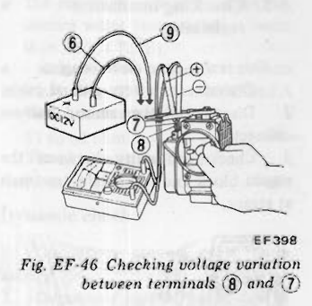
>
> - **Summary:** Dynamic voltage test of the air flow meter flap potentiometer using a 12V DC power source connected to pins 9(+) and 6(-) while monitoring voltage variation on pins 8(+) and 7(-).
> - **Components:** Air flow meter, 12V DC power source, Voltmeter, Terminals 6, 7, 8, 9
> - **Callouts:** **(6)** Terminal 6 (- 12V DC); **(7)** Terminal 7 (- Voltmeter); **(8)** Terminal 8 (+ Voltmeter); **(9)** Terminal 9 (+ 12V DC)
> - **Specs / Measurements:** 12V DC supply voltage; Voltage across 8 and 7 decreases proportionately as flap opens
> - **Wiring / Connections:** 12V (+) to terminal 9; 12V (-) to terminal 6; Voltmeter (+) to terminal 8; Voltmeter (-) to terminal 7
> - **Mechanic Notes:** Gradually open the flap by hand. If indication varies abruptly, the potentiometer is defective.
> - **Tags:** `air flow meter`, `potentiometer check`, `voltage variation`, `EF398`

### 2-2. Checking insulation resistance of air flow meter

Check insulation resistance between the air flow meter body and any one of terminals ⑥, ⑦, ⑧ and ⑨. If continuity exists, the air flow meter is out of order.

> 🖼️ **Fig. EF-47 Checking insulation resistance** `[EF744]` *(Type: `inspection_measurement`)*
>
> 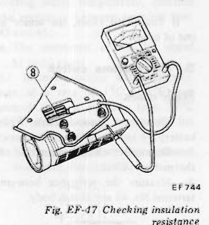
>
> - **Summary:** Checking insulation resistance between the metal body of the air flow meter and terminals 6, 7, 8, and 9.
> - **Components:** Air flow meter body, Ohmmeter, Connector terminals 6, 7, 8, 9
> - **Callouts:** **(8)** Terminal 8
> - **Specs / Measurements:** Insulation resistance: No continuity (infinite resistance)
> - **Wiring / Connections:** Ohmmeter leads between AFM body and terminals 6, 7, 8, 9
> - **Mechanic Notes:** If continuity exists between body and any terminal, air flow meter is faulty.
> - **Tags:** `air flow meter`, `insulation resistance`, `body ground check`, `EF744`

### 2-3. Checking flap

Fully open the flap by hand to check that it opens smoothly without binding. If it doesn't, it is out of order.

> 🖼️ **Fig. EF-48 Checking flap** `[EF400]` *(Type: `procedure_step`)*
>
> 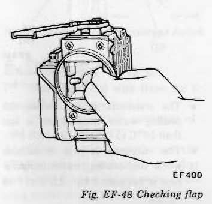
>
> - **Summary:** Hand check of the air flow meter vane flap to confirm smooth operation without binding throughout its range of motion.
> - **Components:** Air flow meter body, Flap vane
> - **Mechanic Notes:** Fully open the flap by hand. If binding occurs, replace the unit.
> - **Tags:** `air flow meter`, `flap test`, `binding check`, `EF400`

## 3. Air temperature

### 3-1. Checking continuity

1. Disconnect battery ground cable.
2. Remove air flow meter.
3. Measure the outside air temperature.
4. Measure resistance between terminals ㉗ and ⑥ of the air flow meter connector.

> 🖼️ **Fig. EF-49 Measuring the resistance of air temperature sensor** `[EF745]` *(Type: `inspection_measurement`)*
>
> 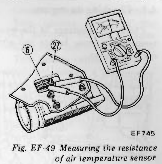
>
> - **Summary:** Measuring resistance between terminals 27 and 6 of the air flow meter connector to test the integral intake air temperature thermistor.
> - **Components:** Air flow meter connector, Ohmmeter, Terminals 6 and 27
> - **Callouts:** **(6)** Terminal 6; **(27)** Terminal 27
> - **Specs / Measurements:** 20°C (68°F): 2.25 to 2.75 kΩ; 80°C (176°F): 0.29 to 0.36 kΩ
> - **Wiring / Connections:** Ohmmeter connected across terminals 27 and 6
> - **Mechanic Notes:** Measure ambient temperature and compare reading to specifications table.
> - **Tags:** `air temperature sensor`, `air flow meter`, `thermistor`, `resistance test`, `EF745`

The relationship between the outside air temperature and resistance is shown in the following chart.

| Air temperature °C (°F) | Resistance (kΩ) |
| :---: | :---: |
| -30 (-22) | 20.3 to 33.0 |
| -10 (14) | 7.6 to 10.8 |
| 10 (50) | 3.25 to 4.15 |
| 20 (68) | 2.25 to 2.75 |
| 50 (122) | 0.74 to 0.94 |
| 80 (176) | 0.29 to 0.36 |

If test results are far from the range indicated in the chart, the air temperature sensor is out of order. The air temperature sensor and air flow meter should be replaced as an assembly.

### 3-2. Checking insulation resistance

Check insulation resistance between terminal ㉗ and air flow meter body. If continuity exists, the air temperature sensor is out of order. The air temperature and air flow meter should be replaced as an assembly.

> 🖼️ **Fig. EF-50 Checking insulation resistance**  *(Type: `inspection_measurement`)*
>
> 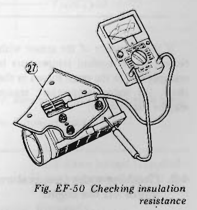
>
> - **Summary:** Checking insulation resistance between terminal 27 of the intake air temperature sensor and the metal air flow meter body.
> - **Components:** Air flow meter body, Ohmmeter, Terminal 27
> - **Callouts:** **(27)** Terminal 27
> - **Specs / Measurements:** Insulation resistance: No continuity (infinite)
> - **Wiring / Connections:** Ohmmeter between terminal 27 and AFM casting body
> - **Mechanic Notes:** If continuity exists, the air temperature sensor and AFM assembly must be replaced.
> - **Tags:** `air temperature sensor`, `insulation resistance`, `body check`

## 4. Water temperature sensor

This check can be done with the sensor either on or off the vehicle. <!-- Page 32 (EF-32) --> ### 4-1. Checking on engine

Check the resistance of the water temperature sensor before and after engine warm-up.

> 🖼️ **Fig. EF-51 Measuring the resistance of water temperature sensor (on the engine)** `[EF688]` *(Type: `inspection_measurement`)*
>
> 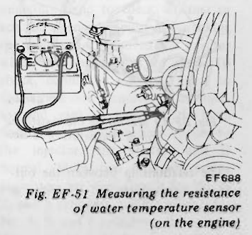
>
> - **Summary:** Measuring resistance of the cylinder head water temperature sensor on the vehicle using an ohmmeter connected to sensor terminals.
> - **Components:** Water temperature sensor, Ohmmeter, Thermostat housing / engine block
> - **Specs / Measurements:** 20°C (68°F): 2.25 to 2.75 kΩ; 80°C (176°F): 0.29 to 0.36 kΩ
> - **Wiring / Connections:** Ohmmeter test probes on water temperature sensor terminals
> - **Mechanic Notes:** Measure before and after engine warm-up. Compare against radiator coolant temperature measured with rod thermometer.
> - **Tags:** `water temperature sensor`, `resistance check`, `on-engine test`, `EF688`

1. Disconnect battery ground cable.
2. Disconnect the water temperature sensor harness connector.
3. Place a thermometer in the radiator coolant when the engine is cold, and read the coolant temperature (which is used as a reference sensor temperature) and sensor resistance.

> [!NOTE]
> When measuring cooling temperature, insert a rod type thermometer into the radiator.

4. Connect the water temperature sensor harness connector.
5. Connect battery ground cable.
6. Warm up the engine sufficiently.
7. Disconnect battery ground cable.
8. Disconnect the water temperature sensor harness connector.
9. Read the sensor resistance in the same manner as described in step (3) above.

| Cooling water temperature °C (°F) | Resistance (kΩ) |
| :---: | :---: |
| -30 (-22) | 20.3 to 33.0 |
| -10 (14) | 7.6 to 10.8 |
| 10 (50) | 3.25 to 4.15 |
| 20 (68) | 2.25 to 2.75 |
| 50 (122) | 0.74 to 0.94 |
| 80 (176) | 0.29 to 0.36 |

If the resistance of the sensor with respect to the coolant temperature is not specified in the range shown in the chart, the water temperature sensor may be out of order.

### 4-2. Checking water temperature sensor off the engine

1. Dip the sensor into water maintained at a temperature of 20°C (68°F) and read its resistance.
2. Then, dip the sensor into water maintained at a temperature of 80°C (176°F), and read its resistance.

> 🖼️ **Fig. EF-52 Measuring the resistance of water temperature sensor (off the engine)** `[EF405]` *(Type: `inspection_measurement`)*
>
> 
>
> - **Summary:** Bench testing the water temperature sensor immersed in a heated water beaker with a thermometer and ohmmeter.
> - **Components:** Water temperature sensor, Water container / beaker, Burner / heat source, Thermometer, Ohmmeter
> - **Specs / Measurements:** 20°C (68°F): 2.25 to 2.75 kΩ; 80°C (176°F): 0.29 to 0.36 kΩ
> - **Wiring / Connections:** Ohmmeter attached to sensor pins while suspended in heated water
> - **Mechanic Notes:** Do not let sensor touch the bottom of the container. Stir water to maintain uniform temperature.
> - **Tags:** `water temperature sensor`, `bench test`, `temperature bath`, `EF405`

If the sensor resistance with respect to the coolant temperature is not held within the range specified in the chart, the water temperature sensor may be out of order.

### 4-3. Checking insulation resistance

This test is done on the engine.
1. Disconnect battery ground cable.
2. Disconnect the sensor harness connector.
3. Check continuity between the engine block and one of the terminals at sensor.

> 🖼️ **Fig. EF-53 Checking insulation resistance** `[EF689]` *(Type: `inspection_measurement`)*
>
> 
>
> - **Summary:** Insulation resistance check between the engine block and water temperature sensor terminals.
> - **Components:** Water temperature sensor, Ohmmeter, Engine block
> - **Specs / Measurements:** Insulation resistance: No continuity (infinite resistance)
> - **Wiring / Connections:** One probe to engine block, second probe to sensor terminal
> - **Mechanic Notes:** If continuity exists between sensor terminal and engine block, sensor is grounded internally and faulty.
> - **Tags:** `water temperature sensor`, `insulation resistance`, `ground fault check`, `EF689`

If continuity exists, the sensor is out of order.

## 5. Thermotime switch

### Static check

1. Disconnect ground cable from battery.
2. Disconnect electric connector of thermotime switch.
3. Measure the resistance between terminal No. 46 and switch body.

> 🖼️ **Fig. EF-54 Thermotime switch terminal number** `[EF335]` *(Type: `component_location`)*
>
> 
>
> - **Summary:** Terminal pin layout of the thermotime switch connector showing terminal 45 (G - Green) and terminal 46 (W - White).
> - **Components:** Thermotime switch connector, Terminal 45 (G), Terminal 46 (W)
> - **Callouts:** **(45)** Terminal 45 (Green wire / heater coil); **(46)** Terminal 46 (White wire / bimetal contact)
> - **Specs / Measurements:** Coolant < 14°C (57°F): Terminal 46 to body = 0 Ω; Coolant > 22°C (72°F): Terminal 46 to body = ∞ Ω
> - **Wiring / Connections:** Terminal 45: Green (G) wire; Terminal 46: White (W) wire
> - **Mechanic Notes:** White terminal (46) is bimetal switch contact to ground; Green terminal (45) is internal heater coil.
> - **Tags:** `thermotime switch`, `connector terminals`, `pinout`, `terminal 45`, `terminal 46`, `EF335`

- The resistance is zero when the cooling water temperature is less than 14°C (57°F).
- The resistance is zero or infinite when the cooling water temperature is between 14 to 22°C (57 to 72°F). <!-- Page 33 (EF-33) --> - The resistance is infinite when the cooling water temperature is more than 22°C (72°F).
4. Measure the resistance between terminal No. 45 and switch body.
   - The ohmmeter reading is 51 to 62 ohms . . . . . . . . . . . . . . OK
   - The ohmmeter reading is not 51 to 62 ohms . . . . . . . . . . . . . . N.G.

### Dynamic check

1. Disconnect ground cable from battery.
2. Disconnect electric connector of thermotime switch.
3. Remove thermotime switch from thermostat housing.
4. Dip heat-sensing portion of thermotime switch into cooling water maintained at 10°C (50°F).
5. When the thermotime switch temperature is just about the same as the cooling water temperature, measure the resistance between terminal Nos. 45 and 46.
   - The resistance should be about 51 to 62 ohms.
6. Increase cooling water temperature at a rate of 1°C (1.8°F) per second until it is more than 25°C (77°F), then check continuity between terminal Nos. 45 and 46.
   - If the ohmmeter reading increases to infinite, circuit is OK.

> 🖼️ **Fig. EF-55 Checking thermotime switch** `[EF336]` *(Type: `inspection_measurement`)*
>
> 
>
> - **Summary:** Dynamic testing of the thermotime switch immersed in a heated water container with thermometer and ohmmeter observing switch opening above 25°C.
> - **Components:** Thermotime switch, Water beaker, Burner / heater, Thermometer, Ohmmeter
> - **Specs / Measurements:** 10°C (50°F): 51 to 62 Ω across terminals 45 and 46; Rate of temp increase: 1°C (1.8°F) per second; > 25°C (77°F): Resistance becomes infinite (∞)
> - **Wiring / Connections:** Ohmmeter across terminals 45 and 46
> - **Mechanic Notes:** Heat sensing portion must be dipped in water. Rate of temperature rise must be controlled to approximately 1°C/sec.
> - **Tags:** `thermotime switch`, `dynamic check`, `bimetal switch`, `heater resistance`, `EF336`

## 6. Cold start valve

1. Disconnect lead wire from the S terminal of starter motor.
2. Disconnect electric connector of cold start valve.
3. Turn ignition switch to the START position, and make sure that fuel pump is operating properly. Operating sound should be heard.
4. Disconnect ground cable from battery.
5. Remove two screws securing cold start valve to intake manifold, and remove cold start valve.
6. Put cold start valve into a transparent glass container of min. 20 cc (1.22 cu in) capacity, plug the transparent glass container opening with a clean rag.

> 🖼️ **Fig. EF-56 Fuel injection from cold start valve** `[EF129A]` *(Type: `procedure_step`)*
>
> 
>
> - **Summary:** Testing cold start valve fuel spray pattern and leakage by discharging into a graduated transparent glass container plugged with a clean rag.
> - **Components:** Cold start valve, Transparent glass container (min. 20 cc), Clean rag
> - **Specs / Measurements:** Container capacity: min. 20 cc (1.22 cu in)
> - **Wiring / Connections:** Jumper wire from battery to cold start valve terminals
> - **Mechanic Notes:** Cold start valve must not inject when ignition is in START with connector disconnected; must inject when energized via jumper wires.
> - **Tags:** `cold start valve`, `spray test`, `glass container`, `leak test`, `EF129A`

7. Connect ground cable to battery.
8. Turn ignition switch to the START position. Cold start valve should not inject fuel.
9. Turn ignition switch to the OFF position, and connect a jumper wire between cold start valve and battery terminals. Leave cold start valve as it is in step 6 above.
   - The fuel injected . . . . . . . . . . . OK
   - The fuel is not injected . . . . . N.G.

## 7. Electronic fuel injection main relay

> [!CAUTION]
> Before applying test voltage to relay, connect a fuse in series with lead wire to prevent damage to the circuit.

1. Disconnect ground cable from battery.
2. Remove relay from car.

> 🖼️ **Fig. EF-57 Electronic fuel injection main relay** `[EF010A]` *(Type: `electrical_schematic`)*
>
> 
>
> - **Summary:** Terminal pin arrangement and internal schematic of the Electronic Fuel Injection Main Relay showing dual switch contacts and coil pins.
> - **Components:** EFI main relay housing, Internal coil (terminals 74-73), Dual relay contacts (10-71 and 43-72)
> - **Callouts:** **(10)** Terminal 10 (Power feed in); **(43)** Terminal 43 (Dropping resistor feed); **(71)** Terminal 71 (Control unit power feed); **(72)** Terminal 72 (Dropping resistor power feed); **(73)** Terminal 73 (Relay coil ground); **(74)** Terminal 74 (Relay coil 12V supply)
> - **Specs / Measurements:** Coil terminals: 74 and 73; Contact pairs: 10-71 and 43-72 closed when energized
> - **Wiring / Connections:** 12V DC across terminals 74 (+) and 73 (-)
> - **Mechanic Notes:** Connect an inline fuse in series with test lead wire before applying 12V to avoid damaging relay coil.
> - **Tags:** `EFI main relay`, `relay schematic`, `pinout`, `bench test`, `EF010A`

3. Test continuity through relay with an ohmmeter in accordance with the following chart.

| Check terminals | Normal condition | 12V direct current is applied between terminals ㉔ and ㉓ |
| :---: | :---: | :---: |
| | **Test results: Continuity** | **Test results: Continuity** |
| 74-73 | Yes | — |
| 43-72 | No | Yes |
| 10-71 | No | Yes |

- **Yes** : Continuity should exist.
- **No**  : Continuity should not exist. <!-- Page 34 (EF-34) --> 4. If test results (steps 1 through 3) are not satisfactory, relay is faulty.

## 8. Throttle valve switch

1. Disconnect ground cable from battery.
2. Remove throttle valve switch connector.

### 8-1. Idle switch check

1. Connect ohmmeter between terminals ② and ⑱.

> 🖼️ **Fig. EF-58 Checking idle switch** `[EF962]` *(Type: `inspection_measurement`)*
>
> 
>
> - **Summary:** Connecting ohmmeter across terminals 2 and 18 of the throttle valve switch to verify continuity at idle and opening at ~4 degrees throttle angle.
> - **Components:** Throttle valve switch, Ohmmeter, Terminals 2 and 18
> - **Callouts:** **(2)** Terminal 2 (Idle switch contact); **(18)** Terminal 18 (Common ground contact)
> - **Specs / Measurements:** Idle position: Continuity exists (0 Ω); Valve open approx. 4°: No continuity (∞ Ω)
> - **Wiring / Connections:** Ohmmeter leads connected to pins 2 and 18
> - **Mechanic Notes:** Continuity should break when the throttle valve cracks open by approximately 4°.
> - **Tags:** `throttle valve switch`, `idle switch`, `continuity check`, `4 degrees`, `EF962`

2. If continuity exists when throttle valve is in the IDLE position, and does not exist when valve opens approximately 4°, idle switch is functioning properly.

### 8-2. Full switch check

1. Connect ohmmeter between terminals ③ and ⑱.

> 🖼️ **Fig. EF-59 Checking full switch** `[EF963]` *(Type: `inspection_measurement`)*
>
> 
>
> - **Summary:** Connecting ohmmeter across terminals 3 and 18 of the throttle valve switch to verify full-throttle contact makes at approximately 34 degrees opening.
> - **Components:** Throttle valve switch, Ohmmeter, Terminals 3 and 18
> - **Callouts:** **(3)** Terminal 3 (Full throttle contact); **(18)** Terminal 18 (Common ground contact)
> - **Specs / Measurements:** Valve opened approx. 34°: Full contact made (continuity / low resistance)
> - **Wiring / Connections:** Ohmmeter leads connected to pins 3 and 18
> - **Mechanic Notes:** Gradually open throttle from closed to full. Ensure contact makes at approximately 34°.
> - **Tags:** `throttle valve switch`, `full switch`, `full throttle`, `34 degrees`, `EF963`

2. Gradually open throttle valve from fully-closed position. Observe ohmmeter reading when valve is opened approximately 34°. If ohmmeter reading at all other valve position is greater than that at 34°, full switch is functioning properly.

### 8-3. Throttle valve switch insulation check

> 🖼️ **Fig. EF-60 Checking throttle valve switch insulation** `[EF964]` *(Type: `inspection_measurement`)*
>
> 
>
> - **Summary:** Checking insulation resistance between the body of the throttle valve switch and terminals 2, 3, and 18 using an ohmmeter.
> - **Components:** Throttle valve switch body, Ohmmeter, Terminals 2, 3, 18
> - **Specs / Measurements:** Insulation resistance: Infinite (∞ Ω)
> - **Wiring / Connections:** One probe to throttle body / switch body metal, other probe to terminals 2, 3, and 18
> - **Mechanic Notes:** Reading should be infinite; any continuity indicates internal short to body ground.
> - **Tags:** `throttle valve switch`, `insulation resistance`, `ground check`, `EF964`

Connect ohmmeter between body metal and terminals ②, ③ and ⑱. Ohmmeter reading should be infinite.

## 9. Dropping resistor

1. Disconnect ground cable from battery.
2. Disconnect 4-pin and 6-pin connectors of dropping resistors from electronic fuel injection harness connectors.
3. Conduct resistance checks on dropping resistor (6-pin connector side) between the following points.
   - 43/1 and terminal No. 41 (Number four cylinder resistor)
   - 43/1 and terminal No. 40 (Number three cylinder resistor)
   - 43/1 and terminal No. 38 (Number two cylinder resistor)
   - 43/1 and terminal No. 37 (Number one cylinder resistor)
   - The resistance should be approximately 6 ohms.

> 🖼️ **Fig. EF-61 Dropping resistor terminal number** `[EF772]` *(Type: `component_location`)*
>
> 
>
> - **Summary:** Terminal pin layout of the dropping resistor 6-pin and 4-pin connectors showing individual cylinder resistor feed pins.
> - **Components:** Dropping resistor assembly, 6-pin connector (terminals 41, 40, 38, 37, 43/1), 4-pin connector (terminals 55, 56, 43/2)
> - **Callouts:** **(37)** Cylinder 1 injector resistor; **(38)** Cylinder 2 injector resistor; **(40)** Cylinder 3 injector resistor; **(41)** Cylinder 4 injector resistor; **(43/1)** Common power feed (6-pin connector); **(43/2)** Common power feed (4-pin connector); **(55)** Cylinder 5 injector resistor; **(56)** Cylinder 6 injector resistor
> - **Specs / Measurements:** Resistance per resistor segment: approximately 6 Ω
> - **Wiring / Connections:** 6-pin: 43/1 to 37, 38, 40, 41; 4-pin: 43/2 to 55, 56
> - **Mechanic Notes:** Disconnect connectors before testing. Standard resistance is ~6 ohms for each of the 6 resistor sections.
> - **Tags:** `dropping resistor`, `connector pinout`, `ballast resistor`, `injector resistor`, `EF772`

4. Conduct resistance checks on dropping resistor (4-pin connector side) between the following points.
   - 43/2 and terminal No. 56 (Number six cylinder resistor)
   - 43/2 and terminal No. 55 (Number five cylinder resistor)
   - The resistance should be approximately 6 ohms.

## 10. Altitude switch (California models only)

This switch contains a microswitch which performs the ON-OFF operation according to change in atmospheric pressure.
1. Disconnect ground cable from battery.
2. Remove altitude switch from car. Refer to "Removal and Installation".
3. With an ohmmeter connected as shown in Figure EF-62, orally blow through discharge port or suck back. Altitude switch is in good order if a "click" is heard and continuity exists on ohmmeter scale.

> [!NOTE]
> This check can also be made by connecting rubber hose to vacuum pump. <!-- Page 35 (EF-35) --> > 🖼️ **Fig. EF-62 Checking altitude switch** `[EF690]` *(Type: `inspection_measurement`)*
>
> 
>
> - **Summary:** Checking altitude switch internal microswitch operation with ohmmeter while orally blowing into or sucking from discharge port.
> - **Components:** Altitude switch, Rubber hose / port, Ohmmeter
> - **Callouts:** **(Hold rubber area with hand to prevent air leak)** Grip rubber seal around port to prevent pressure leakage during oral test
> - **Specs / Measurements:** Click heard and switch continuity changes on ohmmeter scale
> - **Wiring / Connections:** Ohmmeter connected across altitude switch harness terminals
> - **Mechanic Notes:** Hold rubber area with hand to prevent air leak. Switch is pre-set at factory and non-adjustable.
> - **Tags:** `altitude switch`, `California model`, `vacuum check`, `microswitch`, `EF690`

4. Altitude switch is pressure-set at factory and no further adjustment is necessary.
5. If switch is found inoperative, replace.

## 11. Fuel pump control system

> 🖼️ **Fig. EF-63 Wiring diagram of fuel pump control system** `[EF011A]` *(Type: `electrical_schematic`)*
>
> 
>
> - **Summary:** Wiring diagram of the fuel pump safety shutoff circuit including fuel pump relay, fuel pump control relay, ignition relay, oil pressure switch, and alternator L-terminal.
> - **Components:** Battery, Fusible link, Ignition switch, Ignition relay, Fuel pump relay, Fuel pump control relay, Fuel pump, Alternator "L" terminal, Oil pressure switch
> - **Callouts:** **(Alternator 'L' terminal)** Grounds relay coil when alternator is not charging; **(Oil pressure switch)** Closes contact when oil pressure rises to operate fuel pump relay
> - **Specs / Measurements:** Engine at rest: Alternator 'L' = ON, Oil pressure SW = OFF; Engine running: Alternator 'L' = OFF, Oil pressure SW = ON
> - **Wiring / Connections:** Alternator L terminal connected to Fuel pump control relay; Oil pressure switch wired to relay coil circuit
> - **Mechanic Notes:** Safety circuit prevents fuel pump operation if the engine stalls while ignition switch remains ON.
> - **Tags:** `fuel pump control`, `safety circuit`, `alternator L terminal`, `oil pressure switch`, `relays`, `EF011A`

### Switch position

| Switch position | When engine is at rest | When engine is in operation |
| :--- | :---: | :---: |
| Alternator "L" terminal | ON | OFF |
| Oil pressure switch | OFF | ON |

---

<!-- Page 36 (EF-36) -->
### 11-1. Fuel pump control relay and fuel pump relay

> [!CAUTION]
> Before applying test voltage to relay, connect a fuse in series with lead wire to prevent damage to the circuit.

#### • Fuel pump control relay

1. Disconnect ground cable from battery.
2. Remove relay from car.
3. Test continuity through relay with an ohmmeter in accordance with the following chart.

> 🖼️ **Fig. EF-64 Fuel pump control relay** `[EF966]` *(Type: `electrical_schematic`)*
>
> 
>
> - **Summary:** Terminal pinout and internal electrical circuit diagram of the fuel pump control relay showing terminals 91, 94, 95, 96, 97.
> - **Components:** Fuel pump control relay housing, Dual internal relay coils, Relay contacts (terminals 91, 94, 95, 96, 97)
> - **Callouts:** **(91)** Terminal 91; **(94)** Terminal 94 (- Coil feed); **(95)** Terminal 95 (+ Coil and common feed); **(96)** Terminal 96 (Ground interlock via alternator/oil pressure); **(97)** Terminal 97
> - **Specs / Measurements:** Coil input: 12V DC across terminals 95 (+) and 94 (-)
> - **Wiring / Connections:** Inline fuse on 12V supply lead; Terminal 96 grounded or ungrounded during test
> - **Mechanic Notes:** Always install a fuse in series with 12V test voltage lead to prevent burning relay coils.
> - **Tags:** `fuel pump control relay`, `relay schematic`, `bench test`, `pinout`, `EF966`

| Check terminals | Normal condition | 12V direct current is applied between terminals ㉕ and ㉔ * Ground ㉚ | 12V direct current is applied between terminals ㉕ and ㉔ * Not grounded ㉚ |
| :---: | :---: | :---: | :---: |
| | **Test results: Continuity** | **Test results: Continuity** | **Test results: Continuity** |
| 95-91 | Yes | No | Yes |
| 97-91 | No | Yes | No |
| 95-96 | No | Yes | Yes |
| 95-94 | Yes | — | — |

- **Yes** : Continuity should exist.
- **No**  : Continuity should not exist.
- `*` : 95 ............ Connect positive (+) terminal
- ` ` : 94 ............ Connect negative (-) terminal

#### • Fuel pump relay

1. Disconnect ground cable from battery.
2. Remove relay from car.
3. Test continuity through relay with an ohmmeter in accordance with the following chart.

> 🖼️ **Fig. EF-65 Fuel pump relay** `[EF012A]` *(Type: `electrical_schematic`)*
>
> 
>
> - **Summary:** Terminal pin layout and internal circuit schematic of the standard single-pole fuel pump relay showing coil terminals 90, 91 and contact terminals 92, 93.
> - **Components:** Fuel pump relay connector, Internal coil (terminals 90-91), Normally open contacts (terminals 92-93)
> - **Callouts:** **(90)** Terminal 90 (Relay coil); **(91)** Terminal 91 (Relay coil); **(92)** Terminal 92 (Contact switch); **(93)** Terminal 93 (Contact switch)
> - **Specs / Measurements:** Coil terminals: 90 and 91; Contacts: 92 and 93 normally open
> - **Wiring / Connections:** 12V DC applied between terminals 90 and 91
> - **Mechanic Notes:** Check continuity through terminals 90-91 and verify closure across 92-93 when energized.
> - **Tags:** `fuel pump relay`, `relay schematic`, `pinout`, `EF012A` <!-- Page 37 (EF-37) --> | Check terminals | Normal condition | 12V direct current is applied between terminals ㉚ and ㉛ |
| :---: | :---: | :---: |
| | **Test results: Continuity** | **Test results: Continuity** |
| 90-91 | Yes | — |
| 93-92 | No | Yes |

- **Yes** : Continuity should exist.
- **No**  : Continuity should not exist.

### 11-2. Fuel pump

#### Functional test

1. Disconnect lead wire from the S terminal of starter motor.
2. Disconnect cold start valve harness connector.
3. With ignition switch to the START position, ensure that fuel pump sounds while operating. If not, check all fuel pump circuits. If all circuits are checked out OK, replace fuel pump.

#### Discharge pressure check

1. Disconnect ground cable from battery.
2. Disconnect cold start valve harness connector.
3. Using two jumper wires shown in illustration, connect each terminal to battery positive and negative terminals.
4. Release pressure in fuel system by connecting other terminals of jumper wires to cold start valve connector for two or three seconds.

> [!CAUTION]
> Be careful to keep both terminals separate in order to avoid short circuit.

> 🖼️ **Fig. EF-66 Releasing pressure in fuel system** `[EF754]` *(Type: `procedure_step`)*
>
> 
>
> - **Summary:** Depressurizing the fuel injection system prior to servicing by energizing the cold start valve with jumper wires connected to the battery for 2 to 3 seconds.
> - **Components:** Battery, Cold start valve, Jumper wires
> - **Callouts:** **(Cold start valve)** Cold start valve on intake manifold; **(BATTERY)** Car battery 12V terminals
> - **Specs / Measurements:** Energize time: 2 or 3 seconds
> - **Wiring / Connections:** Jumper leads from battery (+) and (-) to cold start valve connector pins
> - **Mechanic Notes:** CAUTION: Keep both terminals separate to avoid short circuit. Do not energize for more than 2-3 seconds.
> - **Tags:** `fuel depressurization`, `cold start valve`, `pressure relief`, `jumper wire`, `EF754`

5. Connect a fuel pressure gauge between fuel tube and fuel hose of fuel filter.

> 🖼️ **Fig. EF-67 Connect fuel pressure gauge** `[EF758]` *(Type: `inspection_measurement`)*
>
> 
>
> - **Summary:** Connecting a fuel pressure gauge in-line between the fuel delivery pipe and the outlet hose of the fuel filter in the engine bay.
> - **Components:** Fuel pressure gauge, Fuel filter outlet hose, Fuel feed pipe
> - **Callouts:** **(Fuel pressure gauge)** 0-5 kg/cm² pressure gauge spliced into line
> - **Specs / Measurements:** Standard discharge pressure: 2.55 kg/cm² (36.3 psi)
> - **Wiring / Connections:** In-line T-fitting between filter hose and metal fuel delivery pipe
> - **Mechanic Notes:** Starter 'S' terminal disconnected; ignition switch placed in START to activate fuel pump and read steady pressure.
> - **Tags:** `fuel pressure gauge`, `discharge pressure`, `fuel pump test`, `EF758`

6. Disconnect lead wire from "S" terminal of starter motor.
7. Connect ground cable to battery.
8. Turn ignition switch to the START position to operate fuel pump.
   - A fuel pressure of approximately 2.55 kg/cm² (36.3 psi) indicates a good fuel discharge pressure.
9. If fuel pressure is not as specified, replace fuel pressure regulator, and repeat pressure discharge tests.
   - If fuel pressure is 2.55 kg/cm² (36.3 psi), fuel pump is OK. If below the specified value, check for clogged or deformed fuel lines, and if necessary, replace fuel pump.

## 12. Fuel damper

Connect a fuel pressure gauge as outlined under Fuel Discharge Pressure Check, and check fuel discharge pressure.
If fuel discharge pressure reading fluctuates excessively, replace fuel damper.

## 13. Pressure regulator

Connect a fuel pressure gauge as outlined under Fuel Discharge Pressure Check, and check fuel discharge pressure. If a fuel discharge of 2.55 kg/cm² (36.3 psi) is not obtained, replace pressure regulator.

## 14. Fuel filter

Replace fuel filter periodically in accordance with recommended Maintenance Schedule.

## 15. Injector

### Continuity check

1. Disconnect ground cable from battery.
2. Disconnect electric connectors from injectors.
3. Check continuity between the two terminals. Continuity should exist. If not, injector(s) are faulty.

### Check injectors for sound as follows:

1. Engine can run
   - 1-1. Start the engine and run it at idle. Attach the tip of a screwdriver to each injector to ensure that it sounds while operating. <!-- Page 38 (EF-38) --> > 🖼️ **Fig. EF-68 Injection operating sound** `[EF130A]` *(Type: `procedure_step`)*
>
> 
>
> - **Summary:** Mechanic using a mechanic's screwdriver as a stethoscope placed against each fuel injector body to listen for operating click sounds.
> - **Components:** Fuel injector, Screwdriver stethoscope, Intake manifold
> - **Mechanic Notes:** A low click or absence of clicking indicates a clogged or electrically open injector.
> - **Tags:** `injector sound`, `screwdriver stethoscope`, `auditory inspection`, `EF130A`

- 1-2. If a low sound is produced from any particular injector, that injector is faulty.

2. Engine cannot run
   - 2-1. If the engine fails to run, disconnect electric connector of cold start valve to protect catalytic converter.
   - 2-2. Crank the engine and check that injectors produce sounds to indicate operation.
   - 2-3. If a low sound is produced from any particular injector, that injector is faulty.
   - 2-4. If no sound is heard from all injectors, check harnesses for discontinuity as outlined in Continuity Check.
   - 2-5. If harnesses are normal, check operation of control unit.
   - 2-6. If sounds are heard from either Nos. 1, 2 and 3 injectors or Nos. 4, 5 and 6, replace control unit.
   - 2-7. When replacing injector, refer to "Removal and Installation".

> 🖼️ **Fig. EF-69 Injector** `[EF131A]` *(Type: `exploded_view`)*
>
> 
>
> - **Summary:** Exploded view of the fuel injector mounting hardware and seal assembly into the intake manifold.
> - **Components:** Injector holder heat insulator, Injector holder, O-ring, Injector
> - **Callouts:** **(1)** Injector holder heat insulator; **(2)** Injector holder; **(3)** O-ring; **(4)** Injector
> - **Wiring / Connections:** 2-pin electrical connector plug
> - **Mechanic Notes:** Always replace O-ring and inspect heat insulator during injector service.
> - **Tags:** `injector exploded view`, `mounting hardware`, `O-ring`, `heat insulator`, `EF131A`

## 16. Air regulator

1. Hold rubber hose in the line between throttle chamber and air regulator with fingers.
   - Engine speed should be reduced.
   - If not, proceed as follows:
2. Disconnect air hoses from both end of air regulator, and visually check to see if air regulator valve opens.
   - The valve opening at a temperature of 20°C (68°F) is as shown in Figure EF-70.

> 🖼️ **Fig. EF-70 Valve opening at a temperature of 20°C (68°F)** `[EF123A]` *(Type: `inspection_measurement`)*
>
> 
>
> - **Summary:** Internal rotary shutter valve opening profile inside the air regulator at 20°C (68°F) ambient temperature.
> - **Components:** Air regulator port, Rotary shutter plate, Bimetal strip
> - **Callouts:** **(Direction of bimetal movement with increasing temperature)** Arrow indicating shutter closing direction as heater warms bimetal; **(Air flow area at 20°C (68°F) ambient)** Shaded crescent opening area
> - **Specs / Measurements:** Ambient temperature: 20°C (68°F)
> - **Mechanic Notes:** Visually inspect aperture through port when cold; should match shaded crescent shape at 20°C.
> - **Tags:** `air regulator`, `valve opening`, `bimetal movement`, `cold fast idle`, `EF123A`

3. Disconnect electric connector of air regulator, and check continuity. Continuity should exist. If not, air regulator is faulty.
4. Pry air regulator valve to open with a flat-bladed screwdriver, then close.

> 🖼️ **Fig. EF-71 Air flow characteristic curve** `[EF124A]` *(Type: `graph_chart`)*
>
> 
>
> - **Summary:** Dual performance graphs showing Air flow of air regulator (CFM) versus warm-up TIME (minutes), and Air flow versus starting Atmospheric temperature (°C/°F).
> - **Components:** CFM vs Time curve, CFM vs Temperature curve
> - **Callouts:** **(TIME (minutes))** 0 to 10 minutes warm-up time axis; **(Atmospheric temperature at engine starting)** -20°C (-4°F) to +100°C (+212°F) axis; **(Air flow of air regulator (CFM*))** 0 to 25 CFM flow rate axis
> - **Specs / Measurements:** Flow at 0 min: ~18 CFM; Flow after ~6 min: drops to near 0 CFM; * Asterisk Mark (*) CFM: Cubic feet per minutes
> - **Mechanic Notes:** Illustrates auxiliary air bypass closing characteristic over elapsed time and starting temperature.
> - **Tags:** `air regulator curve`, `CFM airflow`, `auxiliary air`, `warm up curve`, `EF124A`

### Test results

If valve opens and closes smoothly, it is operating properly. If not, replace.

## 17. Throttle chamber

1. Remove throttle chamber.
2. Make sure that throttle valve moves smoothly when throttle lever is manipulated.
3. Make sure that bypass port is free from obstacles and is clean.

> 🖼️ **Fig. EF-72 Throttle chamber** `[EF415]` *(Type: `inspection_measurement`)*
>
> 
>
> - **Summary:** Manual checking procedures for throttle valve rotation and dashpot diaphragm rod travel on the throttle chamber assembly.
> - **Components:** Throttle valve bore, Throttle shaft lever, Dashpot diaphragm, Dashpot rod
> - **Callouts:** **(Throttle valve)** Checking throttle chamber valve smoothness; **(Dash pot)** Checking dashpot rod smooth stroke
> - **Mechanic Notes:** Ensure throttle plate snaps closed smoothly and dashpot rod compresses without sticking.
> - **Tags:** `throttle chamber`, `throttle plate`, `dashpot`, `inspection`, `EF415` <!-- Page 39 (EF-39) --> 4. Make sure that idle adjust screw moves smoothly.
5. Adjust throttle valve for fully-close position.
6. Push dash pot rod with finger to ensure that it moves smoothly.
7. Check B.C.D.D. For details, refer to section EC.

## 18. Dashpot Adjustment (Manual transmission models only)

Set engine speed to 2,000 rpm under no load. An engine speed of 2,000 rpm under no load corresponds to the clearance of 1.9 mm (0.075 in) between idle setscrew (preset at the factory) and throttle lever.

Check that the dashpot rod end closely touches throttle lever when dashpot rod is fully extended (or when no back pressure is present at diaphragm). If necessary, loosen nut (shown by an arrow) and turn dashpot assembly until correct adjustment is made.

> 🖼️ **Fig. EF-73 Dashpot adjustment** `[EF132A]` *(Type: `alignment_orientation`)*
>
> 
>
> - **Summary:** Adjustment schematic for manual transmission dashpot showing clearance measurement between idle setscrew and throttle lever at 2,000 rpm.
> - **Components:** Dashpot assembly, Throttle lever, Idle setscrew, Lock nut
> - **Callouts:** **(2000 engine rpm under no load)** Engine test condition; **(1.9 mm (0.0748 in))** Gap between idle setscrew and throttle lever at 2,000 rpm
> - **Specs / Measurements:** Engine speed: 2,000 rpm under no load; Clearance: 1.9 mm (0.0748 in / 0.075 in)
> - **Mechanic Notes:** Loosen lock nut (indicated by arrow) and rotate dashpot body so rod tip contacts throttle lever at 1.9 mm clearance point.
> - **Tags:** `dashpot adjustment`, `manual transmission`, `throttle lever`, `2000 rpm`, `EF132A`

## 19. Checking air leakage in air intake system

Since the air flow meter used in the electronic fuel injection system directly measures the quantity of intake air to permit the supply of the optimum fuel quantity for each cylinder, there should not occur even a slight air leak.

When inspecting the electronic fuel injection system, pay particular attention to hose connections, dipstick, oil filler cap, etc. for any indication of air leaks.

> 🖼️ **Fig. EF-74 Checking air leakage in air intake system** `[EF013A]` *(Type: `component_location`)*
>
> 
>
> - **Summary:** Comprehensive cutaway schematic of engine induction, crankcase ventilation, and vacuum plumbing identifying all 26 potential unmetered false-air leak inspection locations.
> - **Components:** Air cleaner filter, Air ducts, Throttle chamber, Intake manifold, Cold start valve mount, EGR valve, Injectors, Rocker cover hoses, Air regulator hoses & pipe, PCV valve & hose, Distributor vacuum line, Canister lines, Master-Vac brake hose, Pressure regulator vacuum hose, Oil filler cap, Dipstick tube, Crankshaft front/rear oil seals, Oil pan gasket
> - **Callouts:** **(1)** Air cleaner filter; **(2)** Air duct (air cleaner to AFM); **(3)** Air duct (AFM to throttle chamber); **(4)** Flange (throttle chamber to intake manifold); **(5)** Cold start valve mounting surface; **(6)** Blind plug (E.G.R.); **(7)** Injector mounting surface in intake manifold; **(8)** Cylinder head mounting surface in intake manifold; **(9)** Hose (air duct to air regulator pipe), both sides; **(10)** Hose (throttle chamber to rocker cover), both sides; **(11)** Hose (air regulator pipe to air regulator), both sides; **(12)** Hose (air regulator to throttle chamber connector), both sides; **(13)** Air regulator pipe; **(14)** Hose (pipe connector to P.C.V. valve), both sides; **(15)** Distributor vacuum line; **(16)** E.G.R. vacuum line; **(17)** Canister vacuum and purge line; **(18)** Automatic transmission vacuum line (Same vacuum hole); **(19)** Cooler vacuum hose (Same vacuum hole); **(20)** Master-Vac hose; **(21)** Pressure regulator vacuum line; **(22)** E.G.R. valve mounting surface; **(23)** Oil filler cap; **(24)** Oil level gauge; **(25)** Oil seal (on front and rear of crankshaft); **(26)** Oil pan gasket mounting surface
> - **Mechanic Notes:** Because AFM measures intake air directly, any false air leak at points 1-26 leans out the air-fuel mixture causing poor idle or stalling.
> - **Tags:** `air leakage`, `false air`, `vacuum leaks`, `intake manifold`, `crankcase ventilation`, `EF013A`

---

<!-- Page 40 (EF-40) -->
## 20. Checking fuel hoses

Check fuel hoses for leakage, loose connections, cracks or deterioration.
Retighten loose connections and replace any damaged or deformed parts. Replace any rubber fuel hose whose inner surface is deformed, scratched or chafed.

For replacement of high pressure fuel rubber hose, refer to item 18 "Fuel Rubber Hose" under heading "Removal and Installation".

# REMOVAL AND INSTALLATION

## 1. Control unit

1. Turn ignition switch to the OFF position.

> [!CAUTION]
> Before disconnecting electronic fuel injection harness at 35-pin coupler, ensure that ignition switch is in the OFF position.

2. Remove bolt securing resin control unit cover to the left dash side panel, and remove cover.

> 🖼️ **Fig. EF-75 Removing control unit cover** `[EF741]` *(Type: `procedure_step`)*
>
> 
>
> - **Summary:** Removing the plastic protective cover over the EFI control unit located on the driver side kick panel near the clutch/brake pedals.
> - **Components:** Resin control unit cover, Left dash side panel, Securing bolt
> - **Mechanic Notes:** Turn ignition OFF before removing cover or touching harness.
> - **Tags:** `control unit cover`, `ECU removal`, `kick panel`, `EF741`

3. Remove three bolts securing control unit to dash side panel bracket, and remove control unit.
4. Disconnect 35-pin coupler from control unit.

> 🖼️ **Fig. EF-76 Removing control unit** `[EF423]` *(Type: `procedure_step`)*
>
> 
>
> - **Summary:** Removing the three bracket bolts securing the metal EFI control unit casing to the left dash side panel.
> - **Components:** EFI control unit, Dash side panel bracket, Three mounting bolts, 35-pin harness coupler
> - **Wiring / Connections:** 35-pin harness multi-coupler
> - **Mechanic Notes:** Note: 35-pin coupler can be disconnected without removing the control unit from the bracket.
> - **Tags:** `control unit removal`, `ECU bolts`, `35-pin coupler`, `EF423`

> [!NOTE]
> 35-pin coupler can be disconnected without removing control unit from dash side panel.

## 2. Air flow meter

1. Disconnect battery ground cable.

> [!CAUTION]
> Be sure to disconnect battery ground cable to prevent control unit from damaging.

2. Disconnect rubber hose from each side of air flow meter.
3. Remove three bolts securing air flow meter bracket.

> 🖼️ **Fig. EF-77 Air flow meter** `[EF694]` *(Type: `exploded_view`)*
>
> 
>
> - **Summary:** Exploded view showing air flow meter removal from inner fender bracket, including rubber air ducts, clamps, bracket mounting bolts, and electrical connector.
> - **Components:** Air flow meter, Mounting bracket, Three bracket bolts, Rubber boots / ducting, Wiring harness connector
> - **Wiring / Connections:** Multi-pin harness connector under AFM
> - **Mechanic Notes:** Always disconnect battery ground cable first. Lift AFM upward to release harness connector underneath.
> - **Tags:** `air flow meter removal`, `AFM bracket`, `intake ducting`, `EF694`

4. Move air flow meter upward, disconnect harness connector, and remove air flow meter.
5. To install air flow meter, reverse the order of removal.

## 3. Air temperature sensor

The air temperature sensor is built into the air flow meter and cannot be removed as a single unit. When replacement of air temperature sensor is necessary, the entire air flow meter assembly should be replaced.

## 4. Water temperature sensor

1. Disconnect battery ground cable.
2. Remove radiator cap.
3. Remove drain plug from radiator to drain coolant of approximately 1.5 liters (1 5/8 US qt, 1 3/8 Imp qt).
4. Disconnect radiator upper hose.
5. Disconnect water temperature sensor harness connector.
6. Remove water temperature sensor.
7. To install water temperature sensor, reverse the order of removal. <!-- Page 41 (EF-41) --> > 🖼️ **Fig. EF-78 Water temperature sensor** `[EF695]` *(Type: `procedure_step`)*
>
> 
>
> - **Summary:** Removing or installing the water temperature sensor on the front thermostat housing using an open-end wrench.
> - **Components:** Water temperature sensor, Thermostat housing, Copper sealing washer, Wrench
> - **Specs / Measurements:** Coolant drain: approx. 1.5 liters (1 5/8 US qt, 1 3/8 Imp qt)
> - **Wiring / Connections:** Keep sensor harness away from ignition high-tension plug wires
> - **Mechanic Notes:** Be sure to install copper washer. Keep wiring harness well clear of high tension spark plug leads.
> - **Tags:** `water temperature sensor`, `thermostat housing`, `copper washer`, `EF695`

> [!CAUTION]
> When connecting water temperature sensor harness, always keep it away from high tension wire.

> [!NOTE]
> a. Be sure to install copper washer when installing water temperature sensor.
> b. After installing water temperature sensor, add cooling water with a proper amount of anti-freeze.

## 5. Thermotime switch

1. Remove radiator filler cap. Drain cooling water by opening drain valve located on the lower side of radiator.

> [!NOTE]
> If cooling water is hot, give it a chance to cool down.

2. Disconnect water hose at thermostat housing.
3. Disconnect ground cable from battery.
4. Disconnect lead wires from thermal transmitter, and remove thermal transmitter.
5. Disconnect electric connector from thermotime switch.
6. Remove thermotime switch by turning it counterclockwise.
7. To install thermotime switch, reverse the order of removal.

> 🖼️ **Fig. EF-79 Thermotime switch** `[EF696]` *(Type: `component_location`)*
>
> 
>
> - **Summary:** Location of the thermotime switch threaded into the thermostat housing next to the water temperature sensor and thermal transmitter.
> - **Components:** Thermotime switch, Thermostat housing, Water bypass hose
> - **Wiring / Connections:** 2-pin locking electrical harness connector
> - **Mechanic Notes:** Turn counterclockwise to remove after draining cooling water.
> - **Tags:** `thermotime switch`, `thermostat housing`, `removal`, `EF696`

## 6. Cold start valve

1. Disconnect ground cable from battery.
2. Disconnect cold start valve harness connector.
3. Using two jumper wires shown in illustration, connect each terminal to battery positive and negative terminals.
4. Release pressure in fuel system by connecting other terminals of jumper wires to cold start valve connector for two or three seconds.

> [!CAUTION]
> Be careful to keep both terminals separate in order to avoid short circuit.

> 🖼️ **Fig. EF-80 Fuel injection from cold start valve** `[EF754]` *(Type: `procedure_step`)*
>
> 
>
> - **Summary:** Depressurizing fuel lines before cold start valve removal by briefly energizing valve terminals with battery jumper leads.
> - **Components:** Battery, Cold start valve, Jumper wires
> - **Specs / Measurements:** 2 to 3 seconds jumper connection
> - **Wiring / Connections:** Battery positive and negative leads to valve terminals
> - **Mechanic Notes:** CAUTION: Keep terminals separated to prevent short circuits.
> - **Tags:** `cold start valve removal`, `pressure release`, `fuel safety`, `EF754`

5. Remove two screws securing cold start valve to intake manifold.
6. Unfasten clamp and disengage cold start valve from fuel hose.

> [!NOTE]
> Place a container to receive fuel left in fuel hose.

7. To install cold start valve, reverse the order of removal.
8. For installation of fuel rubber hose, refer to item 18 "Fuel Rubber Hose".

## 7. Electronic fuel injection main relay

1. Disconnect battery ground cable and remove relay bracket.
2. Disconnect harness connector.
3. Remove two screws securing relay to relay bracket.
4. To install relay, reverse the order of removal.

> 🖼️ **Fig. EF-81 Electronic fuel injection main relay** `[EF003A]` *(Type: `exploded_view`)*
>
> 
>
> - **Summary:** Exploded view of the EFI main relay removal showing relay body, harness plug, mounting bracket, and securing screws.
> - **Components:** Electronic fuel injection main relay, Electronic fuel injection harness, Bracket, Two securing screws
> - **Callouts:** **(1)** Electronic fuel injection main relay; **(2)** Electronic fuel injection harness
> - **Wiring / Connections:** Multi-terminal main relay socket
> - **Mechanic Notes:** Disconnect battery ground cable before unbolting bracket and disconnecting harness connector.
> - **Tags:** `EFI main relay`, `relay bracket`, `relay removal`, `EF003A`

## 8. Throttle valve switch

1. Disconnect battery ground cable.
2. Disconnect throttle valve switch harness connector.
3. Remove two screws securing throttle valve switch to throttle chamber.
4. Slowly pull throttle valve switch forward.
5. To install throttle valve switch, reverse the order of removal.
6. After installation, adjust the position of throttle valve switch so that idle switch may be changed from ON to OFF when engine speed is 1,400 rpm under no load [throttle valve stopper screw-to-throttle valve shaft lever clearance "A" is 1.3 mm (0.051 in)]. <!-- Page 42 (EF-42) --> > 🖼️ **Fig. EF-82 Throttle valve switch** `[EF420]` *(Type: `procedure_step`)*
>
> 
>
> - **Summary:** Removing the throttle valve switch from the throttle chamber shaft after backing out two mounting screws.
> - **Components:** Throttle valve switch, Throttle chamber, Throttle shaft, Two securing screws
> - **Wiring / Connections:** 3-pin harness connector
> - **Mechanic Notes:** Slowly pull switch straight forward off throttle valve shaft to avoid bending drive tangs.
> - **Tags:** `throttle valve switch`, `removal`, `throttle shaft`, `EF420`

> 🖼️ **Fig. EF-83 Adjusting throttle valve switch position** `[EF971 / EF972]` *(Type: `alignment_orientation`)*
>
> 
>
> - **Summary:** Adjustment procedure for throttle valve switch: insert feeler gauge of clearance 'A' (1.3 mm / 0.051 in) between throttle lever and stop screw, rotate switch until continuity between terminals 2 and 18 breaks.
> - **Components:** Throttle valve switch, Ohmmeter, Throttle valve shaft lever, Stopper screw, Feeler gauge
> - **Callouts:** **(2)** Terminal 2 (Idle contact); **(18)** Terminal 18 (Common ground); **(A)** Clearance 'A' = 1.3 mm (0.051 in)
> - **Specs / Measurements:** Clearance 'A': 1.3 mm (0.051 in); Idle switch changes from ON to OFF at 1,400 rpm equivalent gap
> - **Wiring / Connections:** Ohmmeter connected between terminals 2 and 18
> - **Mechanic Notes:** Adjust switch body position so idle circuit switches from ON (0 Ω) to OFF (∞ Ω) exactly as clearance A reaches 1.3 mm.
> - **Tags:** `throttle valve switch adjustment`, `idle contact gap`, `clearance A`, `1.3 mm`, `EF971`, `EF972`

## 9. Dropping resistors

1. Disconnect ground cable from battery.
2. Disconnect two electric connectors from dropping resistor.
3. Remove two screws securing dropping resistor to dashboard.
4. To install dropping resistor, reverse the order of removal.

> 🖼️ **Fig. EF-84 Dropping resistor** `[EF313]` *(Type: `component_location`)*
>
> 
>
> - **Summary:** Location of the fuel injector dropping resistor pack mounted on the passenger/engine compartment bulkhead.
> - **Components:** Dropping resistor assembly, Dashboard / firewall mounting panel, Mounting screws, Two electrical connectors
> - **Wiring / Connections:** 4-pin and 6-pin wiring harness plugs
> - **Mechanic Notes:** Disconnect battery ground cable and unplug both harness connectors before unbolting.
> - **Tags:** `dropping resistor`, `component location`, `firewall mount`, `EF313`

## 10. Altitude switch (California models only)

1. Disconnect ground cable from battery.
2. Remove instrument lower cover on the driver's seat side.
3. Disconnect electric connector from altitude switch.
4. Remove two screws securing altitude switch bracket. The altitude switch can then be removed as bracket assembly.

> 🖼️ **Fig. EF-85 Altitude switch** `[EF756]` *(Type: `component_location`)*
>
> 
>
> - **Summary:** Removal of the California altitude switch bracket under the driver's side instrument panel.
> - **Components:** Altitude switch, Mounting bracket, Two mounting screws, Instrument lower cover
> - **Callouts:** **(Remove two screws)** Bracket mounting screws under driver side dash
> - **Wiring / Connections:** 2-pin electrical connector
> - **Mechanic Notes:** Remove lower dash cover on driver's side to access switch bracket.
> - **Tags:** `altitude switch`, `California model`, `under-dash`, `removal`, `EF756`

5. To install altitude switch, reverse the order of removal.

## 11. Fuel pump Control system

### 11-1. Fuel pump control relay and fuel pump relay

1. Disconnect battery ground cable and remove relay bracket.
2. Disconnect harness connector.
3. Remove two screws securing relay to relay bracket.
4. To install relay, reverse the order of removal.

> 🖼️ **Fig. EF-86 Fuel pump control relay and fuel pump relay** `[EF004A]` *(Type: `exploded_view`)*
>
> 
>
> - **Summary:** Exploded view of the dual fuel pump relay bracket under the dash showing fuel pump control relay, fuel pump relay, and main harness plugs.
> - **Components:** Fuel pump control relay, Fuel pump relay, Main harness, Mounting bracket
> - **Callouts:** **(1)** Fuel pump control relay; **(2)** Fuel pump relay; **(3)** Main harness
> - **Wiring / Connections:** Main harness connectors to relays
> - **Mechanic Notes:** Disconnect battery ground before removing relay bracket.
> - **Tags:** `fuel pump control relay`, `fuel pump relay`, `relay bracket`, `exploded view`, `EF004A`

### 11-2. Fuel pump

1. Disconnect ground cable from battery.
2. Disconnect cold start valve harness connector.
3. Using two jumper wires shown in illustration, connect each terminal to battery positive and negative terminals.
4. Release pressure in fuel system by connecting other terminals of jumper wires to cold start valve connector for two or three seconds.

> [!CAUTION]
> Be careful to keep both terminals separate in order to avoid short circuit.

> 🖼️ **Fig. EF-87 Releasing pressure in fuel system** `[EF754]` *(Type: `procedure_step`)*
>
> 
>
> - **Summary:** Releasing residual fuel line pressure using jumper wires from battery to cold start valve prior to fuel pump removal.
> - **Components:** Battery, Cold start valve, Jumper leads
> - **Callouts:** **(Cold start valve)** Intake manifold cold start valve; **(BATTERY)** Vehicle battery
> - **Specs / Measurements:** 2 to 3 seconds jumper connection
> - **Wiring / Connections:** Battery leads to cold start valve harness socket
> - **Mechanic Notes:** Mandatory safety step before disconnecting any rear underbody fuel pump hoses.
> - **Tags:** `fuel depressurization`, `pressure relief`, `cold start valve`, `EF754` <!-- Page 43 (EF-43) --> 5. Raise the rear portion of vehicle with a jack, and block wheels. Refer to section "GI".
6. Temporarily clamp hose at a suitable location between fuel tank and fuel pump.

> 🖼️ **Fig. EF-88 Fuel hose clamp at fuel pump** `[EF699]` *(Type: `procedure_step`)*
>
> 
>
> - **Summary:** Applying a hose pinch-off clamp to the suction hose between the fuel tank and fuel pump under the rear body.
> - **Components:** Fuel tank suction hose, Pinch-off clamp tool, Fuel pump body
> - **Mechanic Notes:** Temporarily pinch off supply hose to prevent fuel tank from draining when disconnecting pump.
> - **Tags:** `fuel hose clamp`, `suction hose`, `fuel pump removal`, `EF699`

> [!NOTE]
> Be sure to receive fuel into a suitable container.

7. Unfasten clamps at the suction and outlet sides of fuel pump, and disengage fuel hoses.
8. Remove two screws securing fuel pump bracket, and remove bracket.

> 🖼️ **Fig. EF-89 Fuel pump removal** `[EF700]` *(Type: `procedure_step`)*
>
> 
>
> - **Summary:** Unbolting the fuel pump bracket mounting screws from the rear chassis underbody.
> - **Components:** Electric fuel pump, Mounting bracket, Two mounting screws
> - **Wiring / Connections:** Wiring harness through floor pan grommet
> - **Mechanic Notes:** Disconnect fuel pump harness connector inside passenger cabin under carpet/rear seat before pulling through floor grommet.
> - **Tags:** `fuel pump removal`, `pump bracket`, `underbody mount`, `EF700`

9. Disconnect fuel pump harness connector at passenger compartment side.
   - To disconnect harness connector, proceed as follows:
   - **S30 MODEL**: Roll carpet at rear of assistant seat. Take off harness protector, then disconnect harness connector.
   - **GS30 MODEL**: Remove rear seat and take off harness protector. Then disconnect harness connector.
10. Pull out harness through grommet hole in floor and remove fuel pump.
11. To install fuel pump, reverse the order of removal.
12. For installation of fuel rubber hose, refer to item 18 "Fuel Rubber Hose".

## 12. Fuel damper

1. Disconnect ground cable from battery.
2. Disconnect cold start valve harness connector.
3. Using two jumper wires shown in illustration, connect each terminal to battery positive and negative terminals.
4. Release pressure in fuel system by connecting other terminals of jumper wires to cold start valve connector for two or three seconds. Refer to Figure EF-87.

> [!CAUTION]
> Be careful to keep both terminals separate in order to avoid short circuit.

5. Raise the rear portion of vehicle with a jack, and block wheels. Refer to section "GI".
6. Temporarily clamp fuel hose at a suibtable location between fuel tank and suction side of fuel pump. Refer to Figure EF-88.
7. Unfasten fuel hose clamps, and disengage fuel hoses at the inlet and outlet of fuel damper.

> [!NOTE]
> Be sure to receive fuel into a suitable container.

8. Remove nuts securing fuel damper to bracket.

> 🖼️ **Fig. EF-90 Fuel damper removal** `[EF701]` *(Type: `procedure_step`)*
>
> 
>
> - **Summary:** Removing nuts securing the fuel pulsation damper to its chassis mounting bracket near the rear axle.
> - **Components:** Fuel pulsation damper, Mounting bracket, Securing nuts, Hoses and clamps
> - **Mechanic Notes:** Keep drain pan under damper to catch residual fuel when disengaging hoses.
> - **Tags:** `fuel damper removal`, `pulsation damper`, `bracket nuts`, `EF701`

9. To install fuel damper, reverse the order of removal.
10. For installation of fuel rubber hose, refer to item 18 "Fuel Rubber Hose".

## 13. Pressure regulator

1. Disconnect ground cable from battery.
2. Disconnect cold start valve harness connector.
3. Using two jumper wires shown in illustration, connect each terminal to battery positive and negative terminals.
4. Release pressure in fuel system by connecting other terminals of jumper wires to cold start valve connector for two or three seconds. Refer to Figure EF-87.

> [!CAUTION]
> Be careful to keep both terminals separate in order to avoid short circuit.

5. Disengage vacuum tube connecting regulator to manifold from pressure regulator.
6. Remove screws securing pressure regulator.
7. Place a rag under pressure regulator to prevent fuel splash. Unfasten hose clamps, and remove pressure regulator.

> 🖼️ **Fig. EF-91 Pressure regulator removal** `[EF133A]` *(Type: `procedure_step`)*
>
> 
>
> - **Summary:** Removing fuel pressure regulator screws from the intake manifold fuel delivery rail.
> - **Components:** Fuel pressure regulator, Vacuum tube, Fuel return hose, Mounting screws, Fuel rail / intake manifold
> - **Wiring / Connections:** Vacuum line from intake manifold
> - **Mechanic Notes:** Place rag under regulator to absorb fuel spillage. Disconnect vacuum hose and unfasten fuel clamps.
> - **Tags:** `pressure regulator removal`, `fuel rail`, `intake manifold`, `EF133A`

8. To install pressure regulator, reverse the order fo removal.
9. For installation of fuel rubber hose, refer to item 18 "Fuel Rubber Hose".

## 14. Fuel filter

1. Disconnect ground cable from battery. <!-- Page 44 (EF-44) --> 2. Disconnect cold start valve harness connector.
3. Using two jumper wires shown in illustration, connect each terminal to battery positive and negative terminals.
4. Release pressure in fuel system by connecting other terminals of jumper wires to cold start valve connector for two or three seconds. Refer to Figure EF-87.

> [!CAUTION]
> Be careful to keep both terminals separate in order to avoid short circuit.

5. Unfasten clamps securing fuel hoses to the outlet and inlet sides of fuel filter, and disengage fuel hoses.

> [!NOTE]
> Be careful not to spill fuel over engine compartment. Place a rag to absorb fuel.

6. Remove bolt securing fuel filter to bracket, and remove fuel filter.

> 🖼️ **Fig. EF-92 Fuel filter removal** `[EF773]` *(Type: `procedure_step`)*
>
> 
>
> - **Summary:** Removing the fuel filter from its engine bay mounting clamp bracket after loosening clamp bolt and disconnecting inlet/outlet hoses.
> - **Components:** Fuel filter canister, Bracket clamp bolt, Inlet hose, Outlet hose
> - **Mechanic Notes:** Catch fuel spillage with clean rag when disconnecting inlet and outlet rubber hoses.
> - **Tags:** `fuel filter removal`, `bracket clamp`, `fuel hoses`, `EF773`

7. To install fuel filter, reverse the order of removal.
8. For installation of fuel rubber hose, refer to item 18 "Fuel Rubber Hose".

## 15. Injector and fuel pipe

1. Disconnect ground cable from battery.
2. Disconnect cold start valve harness connector.
3. Using two jumper wires shown in illustration, connect each terminal to battery positive and negative terminals.
4. Release pressure in fuel system by connecting other terminals of jumper wires to cold start valve connector for two or three seconds. Refer to Figure EF-87.

> [!CAUTION]
> Be careful to keep both terminals separate in order to avoid short circuit.

5. Disconnect electric connector from injector.
6. Disengage harness from fuel pipe wire clamp.
7. Disengage blow-by hose at rocker cover side.
8. Remove air regulator pipe.
9. Place a rag under fuel pipe to prevent fuel splash and unfasten hose clamps on fuel feed hose and on fuel return hose.
10. Remove bolts securing fuel pipe and bolts securing cold start valve.

> 🖼️ **Fig. EF-93 Fuel pipe securing bolts** `[EF134A]` *(Type: `exploded_view`)*
>
> 
>
> - **Summary:** Identification of mounting bolt locations securing the metal fuel delivery manifold gallery to the intake manifold.
> - **Components:** Fuel delivery pipe assembly, Mounting bolts, Cold start valve flange
> - **Mechanic Notes:** Remove both the fuel pipe securing bolts and the two cold start valve bolts together.
> - **Tags:** `fuel rail bolts`, `fuel gallery`, `intake manifold mount`, `EF134A`

11. Remove all screws securing fuel injectors.

> 🖼️ **Fig. EF-94 Removing fuel injector securing screws** `[EF135A]` *(Type: `procedure_step`)*
>
> 
>
> - **Summary:** Using a screwdriver to remove the two screws securing each fuel injector holder bracket to the intake manifold.
> - **Components:** Fuel injector, Injector holder plate, Two screws per injector, Screwdriver
> - **Mechanic Notes:** Remove all screws on all 6 injector holders before attempting to pull fuel rail assembly.
> - **Tags:** `injector screws`, `injector holder`, `rail removal`, `EF135A`

12. Remove fuel pipe assembly by pulling out fuel pipe, injector, pressure regulator and cold start valve as an assembly.

> 🖼️ **Fig. EF-95 Removing fuel pipe** `[EF136A]` *(Type: `procedure_step`)*
>
> 
>
> - **Summary:** Lifting out the complete fuel rail assembly including delivery pipe, all 6 injectors, fuel pressure regulator, and cold start valve together.
> - **Components:** Fuel pipe assembly, Six fuel injectors, Pressure regulator, Cold start valve, Intake manifold
> - **Mechanic Notes:** Pull assembly straight up to avoid twisting injector nozzles in manifold bosses.
> - **Tags:** `fuel rail removal`, `fuel pipe assembly`, `manifold`, `EF136A`

13. Unfasten hose clamp on fuel injector and remove fuel injector from fuel pipe.

> [!NOTE]
> Place a rag under injector when disconnecting fuel pipe to prevent fuel splash.

14. On injector rubber hose, measure off a point approx. 20 mm (0.79 in) from socket end. Heat soldering iron (150 watt) for 15 minutes. Cut hose into braided reinforcement from mark to socket end. Do not feed soldering iron until it touches injector tail piece.

Then pull rubber hose out with hand.

> [!CAUTION]
> a. Be careful not to damage socket, plastic connector, etc, with soldering iron.
> b. Never place injector in a vise when disconnecting rubber hose.

> 🖼️ **Fig. EF-96 Melting injector rubber hose** `[EF551]` *(Type: `procedure_step`)*
>
> 
>
> - **Summary:** Technique for slitting and removing high-pressure hose from injector tailpiece using a heated 150W soldering iron without damaging metal or plastic parts.
> - **Components:** Fuel injector, Soldering iron (150W), Braided reinforcement hose, Socket
> - **Callouts:** **(Braided reinforcement)** Hose braided inner core; **(Soldering iron)** 150W soldering iron tip; **(Socket)** Injector plastic socket collar; **(20 (0.79))** 20 mm (0.79 in) cut length from socket
> - **Specs / Measurements:** Mark point: approx. 20 mm (0.79 in) from socket end; Soldering iron rating: 150 watt, heated for 15 minutes
> - **Mechanic Notes:** CAUTION: Do not let soldering iron touch metal tailpiece or melt plastic socket. Never place injector body in a vise.
> - **Tags:** `injector hose replacement`, `soldering iron technique`, `hose removal`, `20 mm`, `EF551` <!-- Page 45 (EF-45) --> > 🖼️ **Fig. EF-97 Injector** `[EF131A]` *(Type: `exploded_view`)*
>
> 
>
> - **Summary:** Exploded view of the injector, O-ring, holder, and heat insulator mounting sequence.
> - **Components:** Injector holder heat insulator, Injector holder, O-ring, Injector
> - **Callouts:** **(1)** Injector holder heat insulator; **(2)** Injector holder; **(3)** O-ring; **(4)** Injector
> - **Mechanic Notes:** Push rubber hose and socket onto tailpiece by hand as far as they will go; no clamp is used at the injector tailpiece connection.
> - **Tags:** `injector installation`, `O-ring`, `heat insulator`, `tailpiece hose`, `EF131A`

15. Install injector fuel rubber hose as follows:
    - Clean exterior of injector tail piece.
    - Wet inside of new rubber hose with fuel.
    - Push end of rubber hose with hose socket onto injector tail piece by hand as far as they will go.
    - Clamp is not necessary at this connection.

## 16. Air regulator

1. Disconnect ground cable from battery.
2. Disconnect electric connector from regulator.
3. Unfasten clamp on each side of air hose, and disengage hose.
4. Remove two setscrews.

> 🖼️ **Fig. EF-98 Air regulator removal** `[EF508]` *(Type: `procedure_step`)*
>
> 
>
> - **Summary:** Removal of the air regulator setscrews and auxiliary air hoses beneath the intake manifold.
> - **Components:** Air regulator, Two setscrews, Auxiliary air hoses, Electrical plug
> - **Wiring / Connections:** 2-pin electrical heater connector
> - **Mechanic Notes:** Unfasten hose clamps on each side and back out the two setscrews.
> - **Tags:** `air regulator removal`, `auxiliary air`, `setscrews`, `EF508`

5. To install air regulator, reverse the order of removal.

## 17. Throttle chamber

1. Disconnect battery ground cable.
2. Remove distributor cap.
3. Remove rubber hoses from throttle chamber.

> 🖼️ **Fig. EF-99 Throttle chamber** `[EF421]` *(Type: `procedure_step`)*
>
> 
>
> - **Summary:** Throttle chamber assembly installed on intake manifold with linkage and distributor cap area visible.
> - **Components:** Throttle chamber, B.C.D.D. valve, Distributor cap area, Vacuum hoses
> - **Specs / Measurements:** Securing screw torque: 1.5 to 2.0 kg-m (11 to 14 ft-lb)
> - **Wiring / Connections:** B.C.D.D. connector; Throttle valve switch connector
> - **Mechanic Notes:** Remove distributor cap to gain clearance for throttle chamber removal.
> - **Tags:** `throttle chamber`, `distributor clearance`, `intake manifold`, `EF421`

4. Remove throttle valve switch.
5. Disconnect B.C.D.D. harness connector.
6. Disconnect rod connector at auxiliary throttle shaft.

> 🖼️ **Fig. EF-100 Adjusting throttle valve switch position** `[EF971 / EF972]` *(Type: `alignment_orientation`)*
>
> 
>
> - **Summary:** Setting throttle valve switch idle contact break point using feeler gauge between throttle lever and stop screw (gap A = 1.3 mm / 0.051 in) and ohmmeter on terminals 2 and 18.
> - **Components:** Throttle valve switch, Ohmmeter, Throttle lever, Stopper screw, Feeler gauge
> - **Callouts:** **(2)** Terminal 2; **(18)** Terminal 18; **(A)** Clearance 'A' (1.3 mm / 0.051 in)
> - **Specs / Measurements:** Clearance 'A': 1.3 mm (0.051 in); Engine speed equivalent: 1,400 rpm under no load
> - **Wiring / Connections:** Ohmmeter across pins 2 and 18
> - **Mechanic Notes:** Switch must open (ON to OFF) precisely at 1.3 mm throttle lever gap.
> - **Tags:** `throttle valve switch`, `switch adjustment`, `clearance A`, `idle switch`, `EF971`, `EF972`

> [!NOTE]
> After throttle chamber has been installed, warm up engine sufficiently and adjust engine speed to specified idle rpm with idle speed adjusting screw. Specified idle rpm should be reached if idle speed adjusting screw is turned back about six rotations from the "fully closed" (throttle valve) position. If more than six rotations are required to obtain specified rpm, throttle valve is closed excessively at idle; if less than six rotations are required, throttle valve is opened excessively or working parts are faulty.

7. Remove four screws securing throttle chamber to intake manifold. The throttle chamber can be removed together with B.C.D.D. and dash pot.
8. To install throttle chamber, reverse the order of removal.

**Throttle chamber securing screw tightening torque:**
1.5 to 2.0 kg-m
(11 to 14 ft-lb)

9. After installation, adjust the position of throttle valve switch so that idle switch may be changed from ON to OFF when engine speed is 1,400 rpm under no load [throttle valve stopper screw-to-throttle valve shaft lever clearance "A" is 1.3 mm (0.051 in)].

## 18. Fuel rubber hose

Make sure that all low pressure fuel rubber hoses are fully inserted and are free from undue strain before clamping.

When removing or installing high pressure fuel rubber hose, observe the following. <!-- Page 46 (EF-46) --> > [!CAUTION]
> a. Do not reuse fuel hose clamps after loosening.
> b. Clean dust and dirt from parts with compressed air when assembling.
> c. Tighten high pressure rubber hose clamp so that clamp end is 1 mm (0.04 in) from hose end or screw position (wider than other portions of clamp) is flush with hose end. Tightening torque specifications are the same for all rubber hose clamps.

**Tightening torque of fuel hose clamps:**
0.10 to 0.15 kg-m
(0.7 to 1.1 ft-lb)

> 🖼️ **Fig. EF-101 Fuel hose clamp** `[EF976]` *(Type: `exploded_view`)*
>
> 
>
> - **Summary:** Detailed view of the special EFI rolled-edge screw-type fuel hose clamp.
> - **Components:** Fuel hose clamp band, Clamp tightening screw
> - **Specs / Measurements:** Tightening torque: 0.10 to 0.15 kg-m (0.7 to 1.1 ft-lb)
> - **Mechanic Notes:** CAUTION: Do not reuse fuel hose clamps after loosening. Replace with new clamps.
> - **Tags:** `hose clamp`, `high pressure hose`, `torque spec`, `EF976`

> 🖼️ **Fig. EF-102 Fuel hose clamp position** `[EF137A]` *(Type: `alignment_orientation`)*
>
> 
>
> - **Summary:** Dimensional alignment showing clamp set 1 mm (0.04 in) back from the edge of the rubber fuel hose.
> - **Components:** Rubber fuel hose, Hose clamp, Metal pipe
> - **Callouts:** **(1 (0.04))** 1 mm (0.04 in) margin from hose end
> - **Specs / Measurements:** Clamp position: 1 mm (0.04 in) from hose end
> - **Mechanic Notes:** Ensure screw position does not rub against or contact adjacent chassis or engine components.
> - **Tags:** `clamp position`, `1 mm margin`, `high pressure hose`, `EF137A`

When tightening hose clamp, ensure that screw does not come into contact with adjacent parts.

d. Insertion length of high pressure fuel rubber hoses is not the same for conventional pipes and those for electronic fuel injection unit. For details, refer to items (1) through (22) below. Items with an asterisk mark "*" indicate hoses whose ends should bottom or be pushed until they contact bulges, electronic fuel injection unit, etc.

### Rubber hoses between fuel pump and damper

① *Insert rubber hose until its end contacts pump.
② Push rubber hose onto pump to damper fuel pipe until its end is on black paint on pipe.
③ Push rubber hose onto pump to damper fuel pipe until its end is on black paint on pipe.
④ *Insert rubber hose until its end contacts damper unit.

> 🖼️ **Fig. EF-103 Rubber hoses between pump and damper** `[EF706]` *(Type: `alignment_orientation`)*
>
> 
>
> - **Summary:** Assembly dimensions and insertion depths for fuel hoses 1 through 4 connecting fuel pump, connector pipe, and pulsation damper.
> - **Components:** Fuel pump, Fuel damper, Connector pipe (black painted section), Rubber hoses 1, 2, 3, 4
> - **Callouts:** **(1)** Contact pump; **(2)** On black paint on pipe; **(3)** On black paint on pipe; **(4)** Contact damper unit
> - **Specs / Measurements:** Hose 1: 19 mm (0.75 in) clamp space, 1 mm margin; Hose 2 & 3: 20 mm (0.79 in); Pipe paint: This portion painted black
> - **Mechanic Notes:** Hoses 1 and 4 must bottom against units; hoses 2 and 3 align with black paint marks on intermediate pipe.
> - **Tags:** `fuel pump hose`, `fuel damper hose`, `black paint`, `hose insertion`, `EF706`

### Fuel damper to fuel feed pipe rubber hose

⑤ *Insert rubber hose until its end contacts fuel damper unit.
⑥ *Push end of rubber hose onto fuel feed pipe until it contacts inner bulge.

> 🖼️ **Fig. EF-104 Fuel damper to fuel feed pipe rubber hose** `[EF707]` *(Type: `alignment_orientation`)*
>
> 
>
> - **Summary:** Insertion dimensions for hose connecting damper outlet to underbody fuel feed pipe.
> - **Components:** Fuel damper, Underbody fuel feed pipe, Rubber hose
> - **Callouts:** **(5)** Contacts fuel damper unit; **(6)** Contacts inner bulge on pipe
> - **Specs / Measurements:** Insertion at damper (5): 20 mm (0.79 in); Insertion at pipe (6): 25 mm (0.98 in) to inner bulge; Clamp offset: 1 mm (0.04 in)
> - **Mechanic Notes:** Both ends bottom against unit flange or pipe bead bulge.
> - **Tags:** `fuel damper`, `fuel feed pipe`, `insertion depth`, `EF707`

### Fuel feed pipe to fuel filter inlet pipe rubber hose

⑦ *Push end of rubber hose onto fuel feed pipe until it contacts inner bulge.
⑧ *Push end of rubber hose onto fuel filter inlet pipe until it contacts fuel filter unit.

> 🖼️ **Fig. EF-105 Fuel feed pipe to fuel filter inlet pipe rubber hose** `[EF542]` *(Type: `alignment_orientation`)*
>
> 
>
> - **Summary:** Insertion dimensions for hose connecting underbody fuel feed pipe to fuel filter inlet pipe.
> - **Components:** Fuel feed pipe, Fuel filter, Inlet rubber hose
> - **Callouts:** **(7)** Contacts inner bulge on pipe; **(8)** Contacts fuel filter unit casing
> - **Specs / Measurements:** Pipe insertion (7): 25 mm (0.98 in); Filter inlet insertion (8): 24 mm (0.94 in); Clamp offset: 1 mm (0.04 in)
> - **Mechanic Notes:** Push until hose ends contact inner bulge and filter casing.
> - **Tags:** `fuel feed pipe`, `fuel filter inlet`, `insertion depth`, `EF542`

### Fuel filter outlet to fuel pipe rubber hose

⑨ *Push end of rubber hose onto fuel filter outlet pipe until it contacts fuel filter unit.
⑩ Push end of rubber hose onto fuel pipe until it is 33 mm (1.30 in) from end of pipe.

> 🖼️ **Fig. EF-106 Fuel filter outlet to fuel pipe rubber hose** `[EF138A]` *(Type: `alignment_orientation`)*
>
> 
>
> - **Summary:** Insertion dimensions for hose connecting fuel filter outlet to engine bay fuel delivery rail.
> - **Components:** Fuel filter, Fuel rail inlet pipe, Outlet rubber hose
> - **Callouts:** **(9)** Contacts fuel filter unit casing; **(10)** 33 mm (1.30 in) from end of pipe
> - **Specs / Measurements:** Filter outlet insertion (9): 23 mm (0.91 in); Rail pipe insertion (10): 33 mm (1.30 in) from pipe end; Clamp offset: 1 mm (0.04 in)
> - **Mechanic Notes:** Note: Fuel pipe side must be pushed on exactly 33 mm from end of pipe.
> - **Tags:** `fuel filter outlet`, `fuel delivery pipe`, `33 mm insertion`, `EF138A` <!-- Page 47 (EF-47) --> ### Cold start valve rubber hose

⑪ Push end of rubber hose onto fuel pipe until it is 33 mm (1.30 in) from end of pipe.
⑫ *Push rubber hose onto cold start valve inlet pipe until it contacts cold start valve.

> 🖼️ **Fig. EF-107 Cold start valve rubber hose** `[EF139A]` *(Type: `alignment_orientation`)*
>
> 
>
> - **Summary:** Insertion depth specifications for the rubber hose feeding the cold start valve.
> - **Components:** Cold start valve, Fuel delivery pipe stub, Rubber hose, Clamps
> - **Callouts:** **(11)** 33 mm (1.30 in) from pipe end; **(12)** Contacts cold start valve body
> - **Specs / Measurements:** Pipe insertion (11): 33 mm (1.30 in); Valve insertion (12): contacts valve body; Clamp offset: 1 mm (0.04 in)
> - **Mechanic Notes:** Valve side bottoms against casting; fuel rail side measures 33 mm.
> - **Tags:** `cold start valve hose`, `insertion depth`, `33 mm`, `EF139A`

### Injector rubber hose

⑬ *Push end of rubber hose with hose socket onto injector tail piece until hose socket contacts injector. Clamp is not necessary at this connection.
⑭ Push end of injector rubber hose onto fuel pipe until it is 33 mm (1.30 in) from end of pipe.

> 🖼️ **Fig. EF-108 Injector rubber hose** `[EF140A]` *(Type: `alignment_orientation`)*
>
> 
>
> - **Summary:** Insertion depth specifications for fuel injector rubber hoses to injector tailpiece and fuel delivery pipe spigots.
> - **Components:** Fuel injector, Injector socket collar, Fuel rail spigot, Rubber hose, Clamp
> - **Callouts:** **(13)** Hose socket contacts injector body (no clamp); **(14)** 33 mm (1.30 in) from end of fuel pipe
> - **Specs / Measurements:** Pipe insertion (14): 33 mm (1.30 in); Clamp offset: 1 mm (0.04 in) on fuel pipe side only
> - **Mechanic Notes:** No clamp is used on the injector tailpiece (13); clamp is only used on the fuel rail spigot (14).
> - **Tags:** `injector rubber hose`, `insertion depth`, `hose socket`, `33 mm`, `EF140A`

### Pressure regulator to fuel pipe rubber hose

⑮ Push end of rubber hose onto fuel pipe until it is 33 mm (1.30 in) from end of pipe.
⑯ *Push end of rubber hose onto pressure regulator inlet pipe until it contacts pressure regulator.
⑰ Push end of rubber hose onto pressure regulator outlet pipe until it is 33 mm (1.30 in) from end of pipe.
⑱ *Push end of rubber hose onto fuel pipe until it contacts fuel pipe stay.

> 🖼️ **Fig. EF-109 Pressure regulator to fuel pipe rubber hose** `[EF141A]` *(Type: `alignment_orientation`)*
>
> 
>
> - **Summary:** Insertion specifications for fuel pressure regulator inlet and outlet rubber hose connections to the fuel delivery rail and stay.
> - **Components:** Fuel pressure regulator, Fuel rail supply pipe, Fuel rail return pipe & stay, Rubber hoses 15-18
> - **Callouts:** **(15)** 33 mm (1.30 in) from pipe end; **(16)** Contacts regulator inlet body; **(17)** 33 mm (1.30 in) from pipe end; **(18)** Contacts fuel pipe stay
> - **Specs / Measurements:** Insertion 15, 17: 33 mm (1.30 in); Insertion 16, 18: Bottom against regulator / stay; Clamp offset: 1 mm (0.04 in)
> - **Mechanic Notes:** Ensure hoses 16 and 18 are fully bottomed against their respective stops.
> - **Tags:** `pressure regulator hose`, `fuel rail stay`, `insertion depth`, `EF141A`

### Fuel pipe to fuel return pipe rubber hose

⑲ Push end of rubber hose onto fuel pipe until it is 33 mm (1.30 in) from end of pipe.
⑳ *Push end of rubber hose onto fuel return pipe until it contacts inner bulge.

> 🖼️ **Fig. EF-110 Fuel pipe to fuel return pipe rubber hose** `[EF142A]` *(Type: `alignment_orientation`)*
>
> 
>
> - **Summary:** Insertion specifications for hose connecting engine fuel rail return stub to underbody return line.
> - **Components:** Fuel rail return stub, Underbody fuel return pipe, Rubber hose
> - **Callouts:** **(19)** 33 mm (1.30 in) from end of fuel pipe; **(20)** Contacts inner bulge on return pipe
> - **Specs / Measurements:** Rail stub insertion (19): 33 mm (1.30 in); Return pipe insertion (20): 25 mm (0.98 in) to bulge; Clamp offset: 1 mm (0.04 in)
> - **Mechanic Notes:** Push onto return line until hose contacts inner bulge.
> - **Tags:** `fuel return hose`, `fuel pipe`, `insertion depth`, `EF142A`

### Fuel return pipe to fuel tank rubber hose

㉑ *Push end of rubber hose onto fuel return pipe until it contacts inner bulge.
㉒ Push end of rubber hose onto fuel tank inlet pipe connector until it is 30 mm (1.18 in) from end of pipe. Be careful not to insert rubber hose to bend portion of connector.

> 🖼️ **Fig. EF-111 Fuel return pipe to fuel tank rubber hose** `[EF143A]` *(Type: `alignment_orientation`)*
>
> 
>
> - **Summary:** Insertion specifications for the rear hose connecting the chassis return tube to the fuel tank inlet nipple.
> - **Components:** Fuel return pipe, Fuel tank inlet pipe connector, Fuel tank, Rubber hose
> - **Callouts:** **(21)** Contacts inner bulge on return pipe; **(22)** 30 mm (1.18 in) from end of pipe
> - **Specs / Measurements:** Return pipe insertion (21): 25 mm (0.98 in) to bulge; Tank nipple insertion (22): 30 mm (1.18 in); Clamp offset: 1 mm (0.04 in)
> - **Mechanic Notes:** Be careful not to insert rubber hose into the bent portion of the tank connector pipe.
> - **Tags:** `fuel return tank hose`, `fuel tank connection`, `insertion depth`, `30 mm`, `EF143A` <!-- Page 48 (EF-48) --> > 🖼️ **Fig. EF-112 Fuel rubber hoses** `[EF144A]` *(Type: `component_location`)*
>
> 
>
> - **Summary:** Master vehicle layout diagram of the entire fuel feed and return system on the 280Z EFI showing all 22 high-pressure and low-pressure hose connection points, fuel pump, damper, filter, rail, injectors, cold start valve, pressure regulator, and fuel tank.
> - **Components:** Fuel tank, Fuel pump, Fuel damper, Pump to damper fuel pipe, Fuel feed pipe, Fuel filter, Fuel pipe (rail), Six fuel injectors, Cold start valve, Pressure regulator, Fuel return pipe
> - **Callouts:** **(1)** Fuel pump suction hose (contacts pump); **(2)** Pump to intermediate pipe hose (black paint); **(3)** Intermediate pipe to damper inlet hose (black paint); **(4)** Damper inlet hose (contacts damper); **(5)** Damper outlet hose (contacts damper); **(6)** Feed pipe inlet hose (contacts inner bulge); **(7)** Feed pipe outlet hose (contacts inner bulge); **(8)** Fuel filter inlet hose (contacts filter body); **(9)** Fuel filter outlet hose (contacts filter body); **(10)** Fuel rail inlet hose (33 mm from pipe end); **(11)** Cold start valve feed hose at rail (33 mm); **(12)** Cold start valve inlet hose (contacts valve); **(13)** Injector hose to injector (socket contacts injector); **(14)** Injector hose to rail spigot (33 mm); **(15)** Regulator feed hose at rail (33 mm); **(16)** Regulator inlet hose (contacts regulator); **(17)** Regulator outlet hose (33 mm); **(18)** Rail return hose at stay (contacts stay); **(19)** Rail return hose to return line (33 mm); **(20)** Return line inlet hose (contacts inner bulge); **(21)** Return line outlet hose at tank (contacts inner bulge); **(22)** Fuel tank return nipple hose (30 mm)
> - **Specs / Measurements:** All hose clamps: 0.10 to 0.15 kg-m (0.7 to 1.1 ft-lb); Clamp position: 1 mm (0.04 in) from hose end; Insertion depths: 33 mm (rail), 30 mm (tank return), 25 mm (pipe bulges)
> - **Mechanic Notes:** Comprehensive master routing reference for every fuel hose on 1978 280Z EFI. Starred items (*) must bottom or push against bulges.
> - **Tags:** `fuel hose layout`, `master fuel routing`, `hose connections 1-22`, `EFI fuel lines`, `EF144A`

---

## Segmented Diagrams Index

| Figure | Code | Type | Page | Caption | Key Components / Callouts | File |
| :--- | :--- | :--- | :--- | :--- | :--- | :--- |
| **Fig. EF-1** | `EF647` | `exploded_view` | EF-2 | Fig. EF-1 Air cleaner filter | Air cleaner cover, Wing nuts, Air cleaner filter element, Air cleaner housing body, Air duct horn | [fig_ef_1_air_cleaner_filter.png](diagrams/EF Engine Fuel/fig_ef_1_air_cleaner_filter.png) |
| **Fig. EF-2** | `EF648` | `exploded_view` | EF-2 | Fig. EF-2 Air cleaner and air duct | Radiator core support reinforce, Air duct, Air duct clamp, Clamp, Air cleaner assembly | [fig_ef_2_air_cleaner_and_air_duct.png](diagrams/EF Engine Fuel/fig_ef_2_air_cleaner_and_air_duct.png) |
| **Fig. EF-3** | `EF119A` | `cutaway_flow` | EF-5 | Fig. EF-3 Electronic fuel injection air and fuel flow system | Fuel tank, Fuel damper, Fuel pump, Fuel filter, Pressure regulator | [fig_ef_3_electronic_fuel_injection_air_and_fuel_flow_system.png](diagrams/EF Engine Fuel/fig_ef_3_electronic_fuel_injection_air_and_fuel_flow_system.png) |
| **Fig. EF-4** | `EF120A` | `electrical_schematic` | EF-7 | Fig. EF-4 Electronic control signal | Dropping resistor (1), Dropping resistor (2), Injectors 1-6, Electronic fuel injection main relay, Fuel pump relay | [fig_ef_4_electronic_control_signal.png](diagrams/EF Engine Fuel/fig_ef_4_electronic_control_signal.png) |
| **Fig. EF-5** | `EF651` | `electrical_schematic` | EF-9 | Fig. EF-5 Control unit block diagram | Ignition coil (-) terminal, Air flow meter, Throttle valve switch (idling, full load), Battery voltage, Altitude switch | [fig_ef_5_control_unit_block_diagram.png](diagrams/EF Engine Fuel/fig_ef_5_control_unit_block_diagram.png) |
| **Fig. EF-6** | `EF345` | `graph_chart` | EF-10 | Fig. EF-6 Correction by cooling water temperature | Pulse width index curve, Coolant temperature axis | [fig_ef_6_correction_by_cooling_water_temperature.png](diagrams/EF Engine Fuel/fig_ef_6_correction_by_cooling_water_temperature.png) |
| **Fig. EF-7** | `EF346` | `graph_chart` | EF-10 | Fig. EF-7 Correction by intake air temperature | Pulse width index curve, Intake air temperature axis | [fig_ef_7_correction_by_intake_air_temperature.png](diagrams/EF Engine Fuel/fig_ef_7_correction_by_intake_air_temperature.png) |
| **Fig. EF-8** | `EF946` | `graph_chart` | EF-11 | Fig. EF-8 Correction of fuel enrichment | Cold start valve enrichment, Idle enrichment, Start enrichment, After start enrichment, After idle enrichment | [fig_ef_8_correction_of_fuel_enrichment.png](diagrams/EF Engine Fuel/fig_ef_8_correction_of_fuel_enrichment.png) |
| **Fig. EF-9** | `EF778` | `graph_chart` | EF-12 | Fig. EF-9 Fuel cut | Fuel cut threshold (3,200 rpm), Fuel recovery threshold (2,800 rpm), Idle speed zone | [fig_ef_9_fuel_cut.png](diagrams/EF Engine Fuel/fig_ef_9_fuel_cut.png) |
| **Fig. EF-10** | `EF947` | `graph_chart` | EF-12 | Fig. EF-10 Altitude compensation | Altitude switch status curve, Atmospheric pressure axis | [fig_ef_10_altitude_compensation.png](diagrams/EF Engine Fuel/fig_ef_10_altitude_compensation.png) |
| **Fig. EF-11** | `EF349` | `exploded_view` | EF-12 | Fig. EF-11 Control unit | Control unit metal chassis, Mounting bracket, 35-pin harness socket | [fig_ef_11_control_unit.png](diagrams/EF Engine Fuel/fig_ef_11_control_unit.png) |
| **Fig. EF-12** | `EF948` | `exploded_view` | EF-13 | Fig. EF-12 Air flow meter | Flap valve, Flap (assembly), Helical spring, Case, Bypass port | [fig_ef_12_air_flow_meter.png](diagrams/EF Engine Fuel/fig_ef_12_air_flow_meter.png) |
| **Fig. EF-13** | `EF351` | `electrical_schematic` | EF-13 | Fig. EF-13 Air flow meter potentiometer | Resistor ladder network (R0, R1 to R9, R10), Sliding wiper arm ⑦, Terminal ⑨ (+), Terminal ⑧, Terminal ⑥ (-) | [fig_ef_13_air_flow_meter_potentiometer.png](diagrams/EF Engine Fuel/fig_ef_13_air_flow_meter_potentiometer.png) |
| **Fig. EF-14** | `EF354` | `component_location` | EF-14 | Fig. EF-14 Air temperature sensor | Air temperature sensor thermistor, Air flow meter body | [fig_ef_14_air_temperature_sensor.png](diagrams/EF Engine Fuel/fig_ef_14_air_temperature_sensor.png) |
| **Fig. EF-15** | `EF653` | `component_location` | EF-14 | Fig. EF-15 Water temperature sensor | Water temperature sensor, Thermostat housing, Electrical plug | [fig_ef_15_water_temperature_sensor.png](diagrams/EF Engine Fuel/fig_ef_15_water_temperature_sensor.png) |
| **Fig. EF-16** | `EF654` | `component_location` | EF-14 | Fig. EF-16 Thermotime switch | Thermotime switch, Thermostat housing | [fig_ef_16_thermotime_switch.png](diagrams/EF Engine Fuel/fig_ef_16_thermotime_switch.png) |
| **Fig. EF-17** | `EF312` | `electrical_schematic` | EF-14 | Fig. EF-17 Operating principle of thermotime switch | Contact points, Bimetal element, Heater winding, Plunger, Cold start valve | [fig_ef_17_operating_principle_of_thermotime_switch.png](diagrams/EF Engine Fuel/fig_ef_17_operating_principle_of_thermotime_switch.png) |
| **Fig. EF-18** | `EF949` | `cutaway_flow` | EF-14 | Fig. EF-18 Sectional view of cold start valve | Swirl type nozzle, Magnet coil, Sheet valve, Fuel inlet, Electric terminal | [fig_ef_18_sectional_view_of_cold_start_valve.png](diagrams/EF Engine Fuel/fig_ef_18_sectional_view_of_cold_start_valve.png) |
| **Fig. EF-19** | `EF003A` | `component_location` | EF-15 | Fig. EF-19 Electronic fuel injection main relay | Electronic fuel injection main relay, Electronic fuel injection harness, Relay bracket | [fig_ef_19_electronic_fuel_injection_main_relay.png](diagrams/EF Engine Fuel/fig_ef_19_electronic_fuel_injection_main_relay.png) |
| **Fig. EF-20** | `EF782` | `cutaway_flow` | EF-15 | Fig. EF-20 Throttle valve switch | Throttle valve switch housing, Idle contact points, Full throttle contact points, Rotary cam arm | [fig_ef_20_throttle_valve_switch.png](diagrams/EF Engine Fuel/fig_ef_20_throttle_valve_switch.png) |
| **Fig. EF-21** | `EF313` | `component_location` | EF-15 | Fig. EF-21 Dropping resistor | Dropping resistor block, Washer fluid tank, L.H. inspection lid opening | [fig_ef_21_dropping_resistor.png](diagrams/EF Engine Fuel/fig_ef_21_dropping_resistor.png) |
| **Fig. EF-22** | `EF655` | `component_location` | EF-15 | Fig. EF-22 Altitude switch | Aneroid capsule bellows, Microswitch, Mounting bracket stay, Electrical harness connector | [fig_ef_22_altitude_switch.png](diagrams/EF Engine Fuel/fig_ef_22_altitude_switch.png) |
| **Fig. EF-23** | `EF004A` | `component_location` | EF-16 | Fig. EF-23 Fuel pump control relay and fuel pump relay | Fuel pump control relay, Fuel pump relay, Main harness, Relay bracket | [fig_ef_23_fuel_pump_control_relay_and_fuel_pump_relay.png](diagrams/EF Engine Fuel/fig_ef_23_fuel_pump_control_relay_and_fuel_pump_relay.png) |
| **Fig. EF-24** | `EF656` | `cutaway_flow` | EF-16 | Fig. EF-24 Sectional view of fuel pump | Electric motor armature, Roller vane pump, Relief valve, Check valve, Inlet connection | [fig_ef_24_sectional_view_of_fuel_pump.png](diagrams/EF Engine Fuel/fig_ef_24_sectional_view_of_fuel_pump.png) |
| **Fig. EF-25** | `EF952` | `cutaway_flow` | EF-17 | Fig. EF-25 Sectional view of fuel damper | Damper body, Diaphragm, Spring, Fuel inlet/outlet | [fig_ef_25_sectional_view_of_fuel_damper.png](diagrams/EF Engine Fuel/fig_ef_25_sectional_view_of_fuel_damper.png) |
| **Fig. EF-26** | `EF121A` | `cutaway_flow` | EF-17 | Fig. EF-26 Sectional view of pressure regulator | Fuel chamber, Spring chamber, Diaphragm, Intake manifold vacuum port, Fuel inlet | [fig_ef_26_sectional_view_of_pressure_regulator.png](diagrams/EF Engine Fuel/fig_ef_26_sectional_view_of_pressure_regulator.png) |
| **Fig. EF-27** | `EF657` | `component_location` | EF-17 | Fig. EF-27 Fuel filter | Fuel filter canister, Mounting bracket, Inlet hose, Outlet hose | [fig_ef_27_fuel_filter.png](diagrams/EF Engine Fuel/fig_ef_27_fuel_filter.png) |
| **Fig. EF-28** | `EF122A` | `component_location` | EF-17 | Fig. EF-28 Injector | Fuel injector, Intake manifold branch, Fuel feed hose, Retaining bracket | [fig_ef_28_injector.png](diagrams/EF Engine Fuel/fig_ef_28_injector.png) |
| **Fig. EF-29** | `EF536` | `cutaway_flow` | EF-17 | Fig. EF-29 Sectional view of injector | Nozzle, Return spring, Electric terminal, Filter, Magnet coil | [fig_ef_29_sectional_view_of_injector.png](diagrams/EF Engine Fuel/fig_ef_29_sectional_view_of_injector.png) |
| **Fig. EF-30** | `EF320` | `cutaway_flow` | EF-17 | Fig. EF-30 Sectional view of air regulator | Bimetal strip, Shutter plate, Sleeve, Heater winding, Electric terminal | [fig_ef_30_sectional_view_of_air_regulator.png](diagrams/EF Engine Fuel/fig_ef_30_sectional_view_of_air_regulator.png) |
| **Fig. EF-31** | `EF123A, EF124A` | `graph_chart` | EF-18 | Fig. EF-31 Air regulator characteristic curve | Rotary shutter aperture, Bimetal arm, Air flow time graph, Air flow temperature graph | [fig_ef_31_air_regulator_characteristic_curve.png](diagrams/EF Engine Fuel/fig_ef_31_air_regulator_characteristic_curve.png) |
| **Fig. EF-32** | `EF787` | `component_location` | EF-18 | Fig. EF-32 Throttle chamber | Throttle chamber body, Throttle valve shaft & linkage, Idle speed adjusting screw, Air regulator bypass pipe | [fig_ef_32_throttle_chamber.png](diagrams/EF Engine Fuel/fig_ef_32_throttle_chamber.png) |
| **Fig. EF-33** | `EF125A` | `component_location` | EF-19 | Fig. EF-33 Electronic fuel injection harness | Control unit (under dash), Main EFI harness bundle, Battery, Main relay & pump relays, Ignition coil | [fig_ef_33_electronic_fuel_injection_harness.png](diagrams/EF Engine Fuel/fig_ef_33_electronic_fuel_injection_harness.png) |
| **Fig. EF-35** | `EF126A` | `procedure_step` | EF-22 | Fig. EF-35 Check at 35-pin connector ("R" range) | 35-pin ECU harness connector, Circuit tester probe, Analog ohmmeter | [fig_ef_35_check_at_35_pin_connector_r_range.png](diagrams/EF Engine Fuel/fig_ef_35_check_at_35_pin_connector_r_range.png) |
| **Fig. EF-36** | `EF006A` | `electrical_schematic` | EF-24 | Fig. EF-36 Checking for continuity with an ohmmeter | Fuel pump control relay (94, 96, 97, 91, 95), Fuel pump relay (90, 91, 92, 93), EFI main relay (10, 71, 72, 73, 74), Ignition relay, Battery | [fig_ef_36_checking_for_continuity_with_an_ohmmeter.png](diagrams/EF Engine Fuel/fig_ef_36_checking_for_continuity_with_an_ohmmeter.png) |
| **Fig. EF-37** | `EF127A` | `procedure_step` | EF-25 | Fig. EF-37 Check at 35-pin connector ("V" range) | 35-pin connector, Circuit tester (voltmeter), Ground lead wire, Pedal assembly | [fig_ef_37_check_at_35_pin_connector_v_range.png](diagrams/EF Engine Fuel/fig_ef_37_check_at_35_pin_connector_v_range.png) |
| **Fig. EF-38** | `EF007A` | `electrical_schematic` | EF-26 | Fig. EF-38 Checking for continuity with a voltmeter (1) | Fuel pump control relay, Fuel pump relay, Electronic fuel injection main relay, Alternator (L-terminal), Oil pressure switch | [fig_ef_38_checking_continuity_with_voltmeter_1.png](diagrams/EF Engine Fuel/fig_ef_38_checking_continuity_with_voltmeter_1.png) |
| **Fig. EF-39** | `EF789` | `procedure_step` | EF-27 | Fig. EF-39 Thermotime switch harness connector short circuit | Thermotime switch, Thermotime switch harness connector, Jumper wire | [fig_ef_39_thermotime_switch_harness_connector_short_circuit.png](diagrams/EF Engine Fuel/fig_ef_39_thermotime_switch_harness_connector_short_circuit.png) |
| **Fig. EF-40** | `EF008A` | `electrical_schematic` | EF-28 | Fig. EF-40 Checking for continuity with a voltmeter (2) | Fuel pump control relay, Fuel pump relay, Electronic fuel injection main relay, Alternator (L-terminal), Oil pressure switch | [fig_ef_40_checking_continuity_with_voltmeter_2.png](diagrams/EF Engine Fuel/fig_ef_40_checking_continuity_with_voltmeter_2.png) |
| **Fig. EF-41** | `EF009A` | `electrical_schematic` | EF-29 | Fig. EF-41 Electronic fuel injection system wiring diagram | Battery, Fusible link, Ignition switch, Ignition relay, Ignition coil | [fig_ef_41_electronic_fuel_injection_system_wiring_diagram.png](diagrams/EF Engine Fuel/fig_ef_41_electronic_fuel_injection_system_wiring_diagram.png) |
| **Fig. EF-42** | `EF128A` | `procedure_step` | EF-30 | Fig. EF-42 Checking control unit | Miniature test lamp, Injector harness connector, Fuel injector | [fig_ef_42_checking_control_unit.png](diagrams/EF Engine Fuel/fig_ef_42_checking_control_unit.png) |
| **Fig. EF-43** | `EF353` | `special_service_tool` | EF-30 | Fig. EF-43 Miniature lamp for inspection | 3-volt miniature lamp, Lead wires, Special terminal pins | [fig_ef_43_miniature_lamp_for_inspection.png](diagrams/EF Engine Fuel/fig_ef_43_miniature_lamp_for_inspection.png) |
| **Fig. EF-44** | `EF742` | `inspection_measurement` | EF-30 | Fig. EF-44 Measuring the resistance between terminals ⑧ and ⑥ | Air flow meter, Ohmmeter, Terminals 6 and 8 | [fig_ef_44_measuring_resistance_between_terminals_8_and_6.png](diagrams/EF Engine Fuel/fig_ef_44_measuring_resistance_between_terminals_8_and_6.png) |
| **Fig. EF-45** | `EF743` | `inspection_measurement` | EF-30 | Fig. EF-45 Measuring the resistance between terminals ⑨ and ⑧ | Air flow meter, Ohmmeter, Terminals 8 and 9 | [fig_ef_45_measuring_resistance_between_terminals_9_and_8.png](diagrams/EF Engine Fuel/fig_ef_45_measuring_resistance_between_terminals_9_and_8.png) |
| **Fig. EF-46** | `EF398` | `inspection_measurement` | EF-31 | Fig. EF-46 Checking voltage variation between terminals ⑧ and ⑦ | Air flow meter, 12V DC power source, Voltmeter, Terminals 6, 7, 8, 9 | [fig_ef_46_checking_voltage_variation_between_terminals_8_and_7.png](diagrams/EF Engine Fuel/fig_ef_46_checking_voltage_variation_between_terminals_8_and_7.png) |
| **Fig. EF-47** | `EF744` | `inspection_measurement` | EF-31 | Fig. EF-47 Checking insulation resistance | Air flow meter body, Ohmmeter, Connector terminals 6, 7, 8, 9 | [fig_ef_47_checking_insulation_resistance.png](diagrams/EF Engine Fuel/fig_ef_47_checking_insulation_resistance.png) |
| **Fig. EF-48** | `EF400` | `procedure_step` | EF-31 | Fig. EF-48 Checking flap | Air flow meter body, Flap vane | [fig_ef_48_checking_flap.png](diagrams/EF Engine Fuel/fig_ef_48_checking_flap.png) |
| **Fig. EF-49** | `EF745` | `inspection_measurement` | EF-31 | Fig. EF-49 Measuring the resistance of air temperature sensor | Air flow meter connector, Ohmmeter, Terminals 6 and 27 | [fig_ef_49_measuring_resistance_of_air_temperature_sensor.png](diagrams/EF Engine Fuel/fig_ef_49_measuring_resistance_of_air_temperature_sensor.png) |
| **Fig. EF-50** | `-` | `inspection_measurement` | EF-31 | Fig. EF-50 Checking insulation resistance | Air flow meter body, Ohmmeter, Terminal 27 | [fig_ef_50_checking_insulation_resistance_air_temp.png](diagrams/EF Engine Fuel/fig_ef_50_checking_insulation_resistance_air_temp.png) |
| **Fig. EF-51** | `EF688` | `inspection_measurement` | EF-32 | Fig. EF-51 Measuring the resistance of water temperature sensor (on the engine) | Water temperature sensor, Ohmmeter, Thermostat housing / engine block | [fig_ef_51_measuring_resistance_of_water_temperature_sensor_on_engine.png](diagrams/EF Engine Fuel/fig_ef_51_measuring_resistance_of_water_temperature_sensor_on_engine.png) |
| **Fig. EF-52** | `EF405` | `inspection_measurement` | EF-32 | Fig. EF-52 Measuring the resistance of water temperature sensor (off the engine) | Water temperature sensor, Water container / beaker, Burner / heat source, Thermometer, Ohmmeter | [fig_ef_52_measuring_resistance_of_water_temperature_sensor_off_engine.png](diagrams/EF Engine Fuel/fig_ef_52_measuring_resistance_of_water_temperature_sensor_off_engine.png) |
| **Fig. EF-53** | `EF689` | `inspection_measurement` | EF-32 | Fig. EF-53 Checking insulation resistance | Water temperature sensor, Ohmmeter, Engine block | [fig_ef_53_checking_insulation_resistance_water_temp.png](diagrams/EF Engine Fuel/fig_ef_53_checking_insulation_resistance_water_temp.png) |
| **Fig. EF-54** | `EF335` | `component_location` | EF-32 | Fig. EF-54 Thermotime switch terminal number | Thermotime switch connector, Terminal 45 (G), Terminal 46 (W) | [fig_ef_54_thermotime_switch_terminal_number.png](diagrams/EF Engine Fuel/fig_ef_54_thermotime_switch_terminal_number.png) |
| **Fig. EF-55** | `EF336` | `inspection_measurement` | EF-33 | Fig. EF-55 Checking thermotime switch | Thermotime switch, Water beaker, Burner / heater, Thermometer, Ohmmeter | [fig_ef_55_checking_thermotime_switch.png](diagrams/EF Engine Fuel/fig_ef_55_checking_thermotime_switch.png) |
| **Fig. EF-56** | `EF129A` | `procedure_step` | EF-33 | Fig. EF-56 Fuel injection from cold start valve | Cold start valve, Transparent glass container (min. 20 cc), Clean rag | [fig_ef_56_fuel_injection_from_cold_start_valve.png](diagrams/EF Engine Fuel/fig_ef_56_fuel_injection_from_cold_start_valve.png) |
| **Fig. EF-57** | `EF010A` | `electrical_schematic` | EF-33 | Fig. EF-57 Electronic fuel injection main relay | EFI main relay housing, Internal coil (terminals 74-73), Dual relay contacts (10-71 and 43-72) | [fig_ef_57_electronic_fuel_injection_main_relay.png](diagrams/EF Engine Fuel/fig_ef_57_electronic_fuel_injection_main_relay.png) |
| **Fig. EF-58** | `EF962` | `inspection_measurement` | EF-34 | Fig. EF-58 Checking idle switch | Throttle valve switch, Ohmmeter, Terminals 2 and 18 | [fig_ef_58_checking_idle_switch.png](diagrams/EF Engine Fuel/fig_ef_58_checking_idle_switch.png) |
| **Fig. EF-59** | `EF963` | `inspection_measurement` | EF-34 | Fig. EF-59 Checking full switch | Throttle valve switch, Ohmmeter, Terminals 3 and 18 | [fig_ef_59_checking_full_switch.png](diagrams/EF Engine Fuel/fig_ef_59_checking_full_switch.png) |
| **Fig. EF-60** | `EF964` | `inspection_measurement` | EF-34 | Fig. EF-60 Checking throttle valve switch insulation | Throttle valve switch body, Ohmmeter, Terminals 2, 3, 18 | [fig_ef_60_checking_throttle_valve_switch_insulation.png](diagrams/EF Engine Fuel/fig_ef_60_checking_throttle_valve_switch_insulation.png) |
| **Fig. EF-61** | `EF772` | `component_location` | EF-34 | Fig. EF-61 Dropping resistor terminal number | Dropping resistor assembly, 6-pin connector (terminals 41, 40, 38, 37, 43/1), 4-pin connector (terminals 55, 56, 43/2) | [fig_ef_61_dropping_resistor_terminal_number.png](diagrams/EF Engine Fuel/fig_ef_61_dropping_resistor_terminal_number.png) |
| **Fig. EF-62** | `EF690` | `inspection_measurement` | EF-35 | Fig. EF-62 Checking altitude switch | Altitude switch, Rubber hose / port, Ohmmeter | [fig_ef_62_checking_altitude_switch.png](diagrams/EF Engine Fuel/fig_ef_62_checking_altitude_switch.png) |
| **Fig. EF-63** | `EF011A` | `electrical_schematic` | EF-35 | Fig. EF-63 Wiring diagram of fuel pump control system | Battery, Fusible link, Ignition switch, Ignition relay, Fuel pump relay | [fig_ef_63_wiring_diagram_of_fuel_pump_control_system.png](diagrams/EF Engine Fuel/fig_ef_63_wiring_diagram_of_fuel_pump_control_system.png) |
| **Fig. EF-64** | `EF966` | `electrical_schematic` | EF-36 | Fig. EF-64 Fuel pump control relay | Fuel pump control relay housing, Dual internal relay coils, Relay contacts (terminals 91, 94, 95, 96, 97) | [fig_ef_64_fuel_pump_control_relay.png](diagrams/EF Engine Fuel/fig_ef_64_fuel_pump_control_relay.png) |
| **Fig. EF-65** | `EF012A` | `electrical_schematic` | EF-36 | Fig. EF-65 Fuel pump relay | Fuel pump relay connector, Internal coil (terminals 90-91), Normally open contacts (terminals 92-93) | [fig_ef_65_fuel_pump_relay.png](diagrams/EF Engine Fuel/fig_ef_65_fuel_pump_relay.png) |
| **Fig. EF-66** | `EF754` | `procedure_step` | EF-37 | Fig. EF-66 Releasing pressure in fuel system | Battery, Cold start valve, Jumper wires | [fig_ef_66_releasing_pressure_in_fuel_system.png](diagrams/EF Engine Fuel/fig_ef_66_releasing_pressure_in_fuel_system.png) |
| **Fig. EF-67** | `EF758` | `inspection_measurement` | EF-37 | Fig. EF-67 Connect fuel pressure gauge | Fuel pressure gauge, Fuel filter outlet hose, Fuel feed pipe | [fig_ef_67_connect_fuel_pressure_gauge.png](diagrams/EF Engine Fuel/fig_ef_67_connect_fuel_pressure_gauge.png) |
| **Fig. EF-68** | `EF130A` | `procedure_step` | EF-38 | Fig. EF-68 Injection operating sound | Fuel injector, Screwdriver stethoscope, Intake manifold | [fig_ef_68_injection_operating_sound.png](diagrams/EF Engine Fuel/fig_ef_68_injection_operating_sound.png) |
| **Fig. EF-69** | `EF131A` | `exploded_view` | EF-38 | Fig. EF-69 Injector | Injector holder heat insulator, Injector holder, O-ring, Injector | [fig_ef_69_injector.png](diagrams/EF Engine Fuel/fig_ef_69_injector.png) |
| **Fig. EF-70** | `EF123A` | `inspection_measurement` | EF-38 | Fig. EF-70 Valve opening at a temperature of 20°C (68°F) | Air regulator port, Rotary shutter plate, Bimetal strip | [fig_ef_70_valve_opening_at_a_temperature_of_20_c_68_f.png](diagrams/EF Engine Fuel/fig_ef_70_valve_opening_at_a_temperature_of_20_c_68_f.png) |
| **Fig. EF-71** | `EF124A` | `graph_chart` | EF-38 | Fig. EF-71 Air flow characteristic curve | CFM vs Time curve, CFM vs Temperature curve | [fig_ef_71_air_flow_characteristic_curve.png](diagrams/EF Engine Fuel/fig_ef_71_air_flow_characteristic_curve.png) |
| **Fig. EF-72** | `EF415` | `inspection_measurement` | EF-38 | Fig. EF-72 Throttle chamber | Throttle valve bore, Throttle shaft lever, Dashpot diaphragm, Dashpot rod | [fig_ef_72_throttle_chamber.png](diagrams/EF Engine Fuel/fig_ef_72_throttle_chamber.png) |
| **Fig. EF-73** | `EF132A` | `alignment_orientation` | EF-39 | Fig. EF-73 Dashpot adjustment | Dashpot assembly, Throttle lever, Idle setscrew, Lock nut | [fig_ef_73_dashpot_adjustment.png](diagrams/EF Engine Fuel/fig_ef_73_dashpot_adjustment.png) |
| **Fig. EF-74** | `EF013A` | `component_location` | EF-39 | Fig. EF-74 Checking air leakage in air intake system | Air cleaner filter, Air ducts, Throttle chamber, Intake manifold, Cold start valve mount | [fig_ef_74_checking_air_leakage_in_air_intake_system.png](diagrams/EF Engine Fuel/fig_ef_74_checking_air_leakage_in_air_intake_system.png) |
| **Fig. EF-75** | `EF741` | `procedure_step` | EF-40 | Fig. EF-75 Removing control unit cover | Resin control unit cover, Left dash side panel, Securing bolt | [fig_ef_75_removing_control_unit_cover.png](diagrams/EF Engine Fuel/fig_ef_75_removing_control_unit_cover.png) |
| **Fig. EF-76** | `EF423` | `procedure_step` | EF-40 | Fig. EF-76 Removing control unit | EFI control unit, Dash side panel bracket, Three mounting bolts, 35-pin harness coupler | [fig_ef_76_removing_control_unit.png](diagrams/EF Engine Fuel/fig_ef_76_removing_control_unit.png) |
| **Fig. EF-77** | `EF694` | `exploded_view` | EF-40 | Fig. EF-77 Air flow meter | Air flow meter, Mounting bracket, Three bracket bolts, Rubber boots / ducting, Wiring harness connector | [fig_ef_77_air_flow_meter.png](diagrams/EF Engine Fuel/fig_ef_77_air_flow_meter.png) |
| **Fig. EF-78** | `EF695` | `procedure_step` | EF-41 | Fig. EF-78 Water temperature sensor | Water temperature sensor, Thermostat housing, Copper sealing washer, Wrench | [fig_ef_78_water_temperature_sensor.png](diagrams/EF Engine Fuel/fig_ef_78_water_temperature_sensor.png) |
| **Fig. EF-79** | `EF696` | `component_location` | EF-41 | Fig. EF-79 Thermotime switch | Thermotime switch, Thermostat housing, Water bypass hose | [fig_ef_79_thermotime_switch.png](diagrams/EF Engine Fuel/fig_ef_79_thermotime_switch.png) |
| **Fig. EF-80** | `EF754` | `procedure_step` | EF-41 | Fig. EF-80 Fuel injection from cold start valve | Battery, Cold start valve, Jumper wires | [fig_ef_80_fuel_injection_from_cold_start_valve.png](diagrams/EF Engine Fuel/fig_ef_80_fuel_injection_from_cold_start_valve.png) |
| **Fig. EF-81** | `EF003A` | `exploded_view` | EF-41 | Fig. EF-81 Electronic fuel injection main relay | Electronic fuel injection main relay, Electronic fuel injection harness, Bracket, Two securing screws | [fig_ef_81_electronic_fuel_injection_main_relay.png](diagrams/EF Engine Fuel/fig_ef_81_electronic_fuel_injection_main_relay.png) |
| **Fig. EF-82** | `EF420` | `procedure_step` | EF-42 | Fig. EF-82 Throttle valve switch | Throttle valve switch, Throttle chamber, Throttle shaft, Two securing screws | [fig_ef_82_throttle_valve_switch.png](diagrams/EF Engine Fuel/fig_ef_82_throttle_valve_switch.png) |
| **Fig. EF-83** | `EF971 / EF972` | `alignment_orientation` | EF-42 | Fig. EF-83 Adjusting throttle valve switch position | Throttle valve switch, Ohmmeter, Throttle valve shaft lever, Stopper screw, Feeler gauge | [fig_ef_83_adjusting_throttle_valve_switch_position.png](diagrams/EF Engine Fuel/fig_ef_83_adjusting_throttle_valve_switch_position.png) |
| **Fig. EF-84** | `EF313` | `component_location` | EF-42 | Fig. EF-84 Dropping resistor | Dropping resistor assembly, Dashboard / firewall mounting panel, Mounting screws, Two electrical connectors | [fig_ef_84_dropping_resistor.png](diagrams/EF Engine Fuel/fig_ef_84_dropping_resistor.png) |
| **Fig. EF-85** | `EF756` | `component_location` | EF-42 | Fig. EF-85 Altitude switch | Altitude switch, Mounting bracket, Two mounting screws, Instrument lower cover | [fig_ef_85_altitude_switch.png](diagrams/EF Engine Fuel/fig_ef_85_altitude_switch.png) |
| **Fig. EF-86** | `EF004A` | `exploded_view` | EF-42 | Fig. EF-86 Fuel pump control relay and fuel pump relay | Fuel pump control relay, Fuel pump relay, Main harness, Mounting bracket | [fig_ef_86_fuel_pump_control_relay_and_fuel_pump_relay.png](diagrams/EF Engine Fuel/fig_ef_86_fuel_pump_control_relay_and_fuel_pump_relay.png) |
| **Fig. EF-87** | `EF754` | `procedure_step` | EF-42 | Fig. EF-87 Releasing pressure in fuel system | Battery, Cold start valve, Jumper leads | [fig_ef_87_releasing_pressure_in_fuel_system.png](diagrams/EF Engine Fuel/fig_ef_87_releasing_pressure_in_fuel_system.png) |
| **Fig. EF-88** | `EF699` | `procedure_step` | EF-43 | Fig. EF-88 Fuel hose clamp at fuel pump | Fuel tank suction hose, Pinch-off clamp tool, Fuel pump body | [fig_ef_88_fuel_hose_clamp_at_fuel_pump.png](diagrams/EF Engine Fuel/fig_ef_88_fuel_hose_clamp_at_fuel_pump.png) |
| **Fig. EF-89** | `EF700` | `procedure_step` | EF-43 | Fig. EF-89 Fuel pump removal | Electric fuel pump, Mounting bracket, Two mounting screws | [fig_ef_89_fuel_pump_removal.png](diagrams/EF Engine Fuel/fig_ef_89_fuel_pump_removal.png) |
| **Fig. EF-90** | `EF701` | `procedure_step` | EF-43 | Fig. EF-90 Fuel damper removal | Fuel pulsation damper, Mounting bracket, Securing nuts, Hoses and clamps | [fig_ef_90_fuel_damper_removal.png](diagrams/EF Engine Fuel/fig_ef_90_fuel_damper_removal.png) |
| **Fig. EF-91** | `EF133A` | `procedure_step` | EF-43 | Fig. EF-91 Pressure regulator removal | Fuel pressure regulator, Vacuum tube, Fuel return hose, Mounting screws, Fuel rail / intake manifold | [fig_ef_91_pressure_regulator_removal.png](diagrams/EF Engine Fuel/fig_ef_91_pressure_regulator_removal.png) |
| **Fig. EF-92** | `EF773` | `procedure_step` | EF-44 | Fig. EF-92 Fuel filter removal | Fuel filter canister, Bracket clamp bolt, Inlet hose, Outlet hose | [fig_ef_92_fuel_filter_removal.png](diagrams/EF Engine Fuel/fig_ef_92_fuel_filter_removal.png) |
| **Fig. EF-93** | `EF134A` | `exploded_view` | EF-44 | Fig. EF-93 Fuel pipe securing bolts | Fuel delivery pipe assembly, Mounting bolts, Cold start valve flange | [fig_ef_93_fuel_pipe_securing_bolts.png](diagrams/EF Engine Fuel/fig_ef_93_fuel_pipe_securing_bolts.png) |
| **Fig. EF-94** | `EF135A` | `procedure_step` | EF-44 | Fig. EF-94 Removing fuel injector securing screws | Fuel injector, Injector holder plate, Two screws per injector, Screwdriver | [fig_ef_94_removing_fuel_injector_securing_screws.png](diagrams/EF Engine Fuel/fig_ef_94_removing_fuel_injector_securing_screws.png) |
| **Fig. EF-95** | `EF136A` | `procedure_step` | EF-44 | Fig. EF-95 Removing fuel pipe | Fuel pipe assembly, Six fuel injectors, Pressure regulator, Cold start valve, Intake manifold | [fig_ef_95_removing_fuel_pipe.png](diagrams/EF Engine Fuel/fig_ef_95_removing_fuel_pipe.png) |
| **Fig. EF-96** | `EF551` | `procedure_step` | EF-44 | Fig. EF-96 Melting injector rubber hose | Fuel injector, Soldering iron (150W), Braided reinforcement hose, Socket | [fig_ef_96_melting_injector_rubber_hose.png](diagrams/EF Engine Fuel/fig_ef_96_melting_injector_rubber_hose.png) |
| **Fig. EF-97** | `EF131A` | `exploded_view` | EF-45 | Fig. EF-97 Injector | Injector holder heat insulator, Injector holder, O-ring, Injector | [fig_ef_97_injector.png](diagrams/EF Engine Fuel/fig_ef_97_injector.png) |
| **Fig. EF-98** | `EF508` | `procedure_step` | EF-45 | Fig. EF-98 Air regulator removal | Air regulator, Two setscrews, Auxiliary air hoses, Electrical plug | [fig_ef_98_air_regulator_removal.png](diagrams/EF Engine Fuel/fig_ef_98_air_regulator_removal.png) |
| **Fig. EF-99** | `EF421` | `procedure_step` | EF-45 | Fig. EF-99 Throttle chamber | Throttle chamber, B.C.D.D. valve, Distributor cap area, Vacuum hoses | [fig_ef_99_throttle_chamber.png](diagrams/EF Engine Fuel/fig_ef_99_throttle_chamber.png) |
| **Fig. EF-100** | `EF971 / EF972` | `alignment_orientation` | EF-45 | Fig. EF-100 Adjusting throttle valve switch position | Throttle valve switch, Ohmmeter, Throttle lever, Stopper screw, Feeler gauge | [fig_ef_100_adjusting_throttle_valve_switch_position.png](diagrams/EF Engine Fuel/fig_ef_100_adjusting_throttle_valve_switch_position.png) |
| **Fig. EF-101** | `EF976` | `exploded_view` | EF-46 | Fig. EF-101 Fuel hose clamp | Fuel hose clamp band, Clamp tightening screw | [fig_ef_101_fuel_hose_clamp.png](diagrams/EF Engine Fuel/fig_ef_101_fuel_hose_clamp.png) |
| **Fig. EF-102** | `EF137A` | `alignment_orientation` | EF-46 | Fig. EF-102 Fuel hose clamp position | Rubber fuel hose, Hose clamp, Metal pipe | [fig_ef_102_fuel_hose_clamp_position.png](diagrams/EF Engine Fuel/fig_ef_102_fuel_hose_clamp_position.png) |
| **Fig. EF-103** | `EF706` | `alignment_orientation` | EF-46 | Fig. EF-103 Rubber hoses between pump and damper | Fuel pump, Fuel damper, Connector pipe (black painted section), Rubber hoses 1, 2, 3, 4 | [fig_ef_103_rubber_hoses_between_pump_and_damper.png](diagrams/EF Engine Fuel/fig_ef_103_rubber_hoses_between_pump_and_damper.png) |
| **Fig. EF-104** | `EF707` | `alignment_orientation` | EF-46 | Fig. EF-104 Fuel damper to fuel feed pipe rubber hose | Fuel damper, Underbody fuel feed pipe, Rubber hose | [fig_ef_104_fuel_damper_to_fuel_feed_pipe_rubber_hose.png](diagrams/EF Engine Fuel/fig_ef_104_fuel_damper_to_fuel_feed_pipe_rubber_hose.png) |
| **Fig. EF-105** | `EF542` | `alignment_orientation` | EF-46 | Fig. EF-105 Fuel feed pipe to fuel filter inlet pipe rubber hose | Fuel feed pipe, Fuel filter, Inlet rubber hose | [fig_ef_105_fuel_feed_pipe_to_fuel_filter_inlet_pipe_rubber_hose.png](diagrams/EF Engine Fuel/fig_ef_105_fuel_feed_pipe_to_fuel_filter_inlet_pipe_rubber_hose.png) |
| **Fig. EF-106** | `EF138A` | `alignment_orientation` | EF-46 | Fig. EF-106 Fuel filter outlet to fuel pipe rubber hose | Fuel filter, Fuel rail inlet pipe, Outlet rubber hose | [fig_ef_106_fuel_filter_outlet_to_fuel_pipe_rubber_hose.png](diagrams/EF Engine Fuel/fig_ef_106_fuel_filter_outlet_to_fuel_pipe_rubber_hose.png) |
| **Fig. EF-107** | `EF139A` | `alignment_orientation` | EF-47 | Fig. EF-107 Cold start valve rubber hose | Cold start valve, Fuel delivery pipe stub, Rubber hose, Clamps | [fig_ef_107_cold_start_valve_rubber_hose.png](diagrams/EF Engine Fuel/fig_ef_107_cold_start_valve_rubber_hose.png) |
| **Fig. EF-108** | `EF140A` | `alignment_orientation` | EF-47 | Fig. EF-108 Injector rubber hose | Fuel injector, Injector socket collar, Fuel rail spigot, Rubber hose, Clamp | [fig_ef_108_injector_rubber_hose.png](diagrams/EF Engine Fuel/fig_ef_108_injector_rubber_hose.png) |
| **Fig. EF-109** | `EF141A` | `alignment_orientation` | EF-47 | Fig. EF-109 Pressure regulator to fuel pipe rubber hose | Fuel pressure regulator, Fuel rail supply pipe, Fuel rail return pipe & stay, Rubber hoses 15-18 | [fig_ef_109_pressure_regulator_to_fuel_pipe_rubber_hose.png](diagrams/EF Engine Fuel/fig_ef_109_pressure_regulator_to_fuel_pipe_rubber_hose.png) |
| **Fig. EF-110** | `EF142A` | `alignment_orientation` | EF-47 | Fig. EF-110 Fuel pipe to fuel return pipe rubber hose | Fuel rail return stub, Underbody fuel return pipe, Rubber hose | [fig_ef_110_fuel_pipe_to_fuel_return_pipe_rubber_hose.png](diagrams/EF Engine Fuel/fig_ef_110_fuel_pipe_to_fuel_return_pipe_rubber_hose.png) |
| **Fig. EF-111** | `EF143A` | `alignment_orientation` | EF-47 | Fig. EF-111 Fuel return pipe to fuel tank rubber hose | Fuel return pipe, Fuel tank inlet pipe connector, Fuel tank, Rubber hose | [fig_ef_111_fuel_return_pipe_to_fuel_tank_rubber_hose.png](diagrams/EF Engine Fuel/fig_ef_111_fuel_return_pipe_to_fuel_tank_rubber_hose.png) |
| **Fig. EF-112** | `EF144A` | `component_location` | EF-48 | Fig. EF-112 Fuel rubber hoses | Fuel tank, Fuel pump, Fuel damper, Pump to damper fuel pipe, Fuel feed pipe | [fig_ef_112_fuel_rubber_hoses.png](diagrams/EF Engine Fuel/fig_ef_112_fuel_rubber_hoses.png) |
