# SECTION EL - ENGINE LUBRICATION SYSTEM

<!-- Page 1 (EL-1) -->
# SERVICE MANUAL

## DATSUN 280Z
### MODEL S30 SERIES

---

# SECTION EL

# ENGINE LUBRICATION SYSTEM

| Section | Page |
| :--- | :--- |
| ENGINE LUBRICATION SYSTEM | EL-2 |
| SERVICE DATA AND SPECIFICATIONS | EL-4 |
| TROUBLE DIAGNOSES AND CORRECTIONS | EL-5 |
| SPECIAL SERVICE TOOL | EL-5 |

NISSAN MOTOR CO., LTD.
TOKYO, JAPAN <!-- Page 2 (EL-2) --> # ENGINE LUBRICATION SYSTEM

## CONTENTS

| Contents | Page | Contents | Page |
| :--- | :--- | :--- | :--- |
| LUBRICATION CIRCUIT | EL-2 | INSPECTION | EL-3 |
| OIL PUMP | EL-2 | OIL PRESSURE REGULATOR VALVE | EL-3 |
| &nbsp;&nbsp;REMOVAL | EL-2 | OIL FILTER | EL-4 |
| &nbsp;&nbsp;INSTALLATION | EL-2 | OIL PRESSURE RELIEF VALVE | EL-4 |
| &nbsp;&nbsp;DISASSEMBLY AND ASSEMBLY | EL-3 | | |

## LUBRICATION CIRCUIT

> 🖼️ **Fig. EL-1 Lubricating circuit** `[EL072]` *(Type: `cutaway_flow`)*
>
> 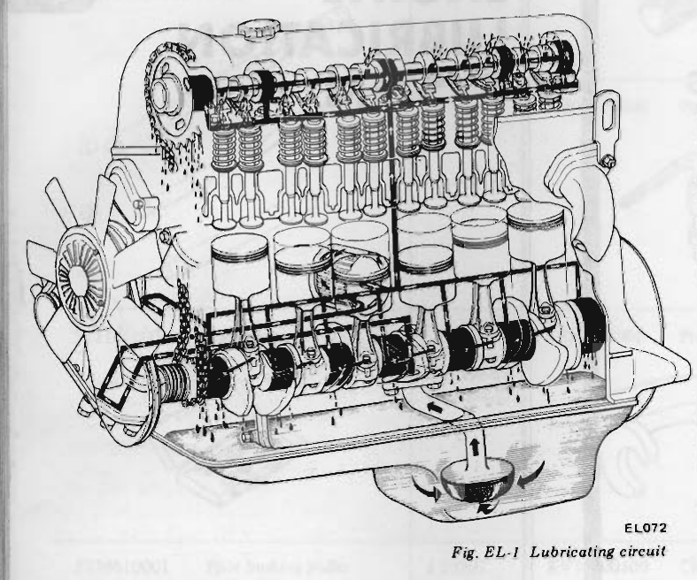
>
> - **Summary:** Perspective cutaway of the Nissan L28 engine showing the pressurized oil circulation path from sump strainer through the trochoid oil pump, full-flow filter, main oil gallery, crankshaft/connecting rod bearings, timing chain tensioner, and cylinder head camshaft gallery.
> - **Components:** oil strainer, oil pan, trochoid oil pump, full-flow oil filter, main oil gallery, crankshaft bearings, connecting rod jet holes, timing chain tensioner, cylinder head oil gallery, camshaft
> - **Specs / Measurements:** Max oil pressure: 5.6 kg/cm² (80 psi) at 3,000 rpm
> - **Mechanic Notes:** Connecting rod jet holes spray oil directly onto cylinder walls and piston pins.
> - **Tags:** `lubrication circuit`, `oil gallery`, `oil pump`, `crankshaft`, `camshaft`, `oil strainer`, `oil pan`, `piston`

The pressure lubrication of the engine is accomplished by a trochoid-type oil pump. This pump draws the oil through the oil strainer into the pump housing and then forces it through the full flow type oil filter into the main oil gallery. Part of the oil is supplied to all crankshaft bearings, the chain tensioner and the timing chain. Oil supplied to the crankshaft bearings is fed to the connecting rod bearings through the drilled passages in the crankshaft. Oil injected from jet holes on the connecting rods lubricates the cylinder walls and piston pins. The other part of the oil is brought to the oil gallery in the cylinder head to provide lubrication of the valve mechanism and timing chain as shown in Figure EL-2.

> 🖼️ **Fig. EL-2 Lubricating cylinder head** `[EL069]` *(Type: `cutaway_flow`)*
>
> 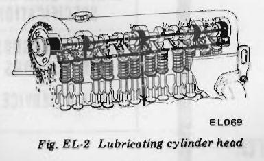
>
> - **Summary:** Cutaway diagram of the OHC cylinder head valve train lubrication showing oil rising into the cylinder head gallery, feeding all cam brackets, and entering the hollow camshaft via No. 2 and No. 4 bearings to exit through base-circle spray holes onto rocker arms and cam lobes.
> - **Components:** cylinder head oil gallery, camshaft brackets, No. 2 camshaft bearing, No. 4 camshaft bearing, hollow camshaft, cam lobe base-circle oil holes, rocker arms, valves
> - **Mechanic Notes:** Camshaft internal gallery is fed specifically via No. 2 and No. 4 camshaft bearings; ensure bracket oil holes are aligned and unobstructed.
> - **Tags:** `lubricating cylinder head`, `camshaft`, `cam brackets`, `rocker arms`, `valve mechanism`, `cam lobes`

From this gallery, oil holes go directly to all camshaft bearings through cam brackets.

Oil supplied through the No. 2 and No. 4 camshaft bearings is then fed to the rocker arm, valve and cam lobe through the oil gallery in the camshaft and the small hole at the base circle portion of each cam.

## OIL PUMP

The oil pump is located in the bottom of the front cover attached by four bolts and driven by the oil pump drive spindle assembly which is driven by the helical gear on the crankshaft.

The oil pump assembly consists of an oil pressure regulator valve and outer and inner rotors.

The spring-loaded oil pressure regulator valve limits the oil pressure to a maximum of 5.6 kg/cm² (80 psi) at 3,000 rpm.

### REMOVAL

1. Remove distributor.
2. Remove splash shield board.
3. Remove oil pump body with drive spindle assembly.

### INSTALLATION

1. Before installing oil pump in engine, turn crankshaft so that No. 1 piston is at T.D.C.
2. Fill pump housing with engine oil, then align punch mark of drive spindle with hole in oil pump as shown in Figure EL-3.

---

<!-- Page 3 (EL-3) -->

> 🖼️ **Fig. EL-3 Aligning punch mark and oil hole** `[EL009]` *(Type: `alignment_orientation`)*
>
> 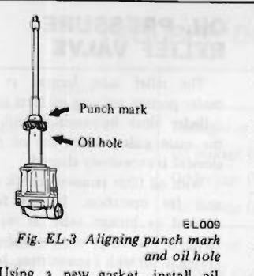
>
> - **Summary:** Oil pump and distributor drive spindle shaft assembly showing the alignment of the punch mark on the drive gear collar with the oil hole in the oil pump housing.
> - **Components:** oil pump body, drive spindle assembly, drive gear collar
> - **Callouts:** **(Punch mark)** Alignment mark on spindle collar; **(Oil hole)** Hole in oil pump neck
> - **Specs / Measurements:** No. 1 piston at T.D.C. prior to installation
> - **Mechanic Notes:** Fill pump housing with engine oil, then align punch mark of drive spindle with hole in oil pump before inserting with No. 1 piston at TDC.
> - **Tags:** `drive spindle`, `oil pump`, `punch mark`, `oil hole`, `alignment mark`, `distributor drive`, `TDC`

3. Using a new gasket, install oil pump and drive spindle assembly so that the projection on its top is located in an 11 : 25 a.m. position. At this time, the smaller bow-shape will be placed toward the front as shown in Figure EL-4.

> 🖼️ **Fig. EL-4 Setting drive spindle** `[EL010]` *(Type: `alignment_orientation`)*
>
> 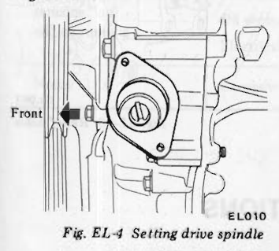
>
> - **Summary:** Top view looking down into the distributor mounting opening on the engine front cover, showing the installed distributor drive spindle slot orientation.
> - **Components:** distributor drive spindle, front cover distributor mount
> - **Callouts:** **(Front)** Forward direction of engine
> - **Specs / Measurements:** 11:25 a.m. clock position
> - **Mechanic Notes:** Top projection must sit at the 11:25 a.m. position with the smaller offset crescent/bow-shape facing toward the front of the engine.
> - **Tags:** `setting drive spindle`, `front cover`, `distributor drive`, `11:25 position`, `spindle orientation`

> 🖼️ **Fig. EL-5 Installing oil pump** `[EL011]` *(Type: `procedure_step`)*
>
> 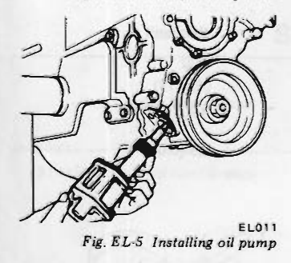
>
> - **Summary:** Installing the oil pump assembly onto the lower face of the engine front cover below the crankshaft damper pulley and tightening the four mounting bolts.
> - **Components:** oil pump assembly, front cover, crankshaft pulley, mounting bolts
> - **Specs / Measurements:** Mounting bolt torque: 1.1 to 1.5 kg-m (8 to 11 ft-lb)
> - **Mechanic Notes:** Use a new gasket and verify spindle engagement through the distributor fitting hole before torquing mounting bolts.
> - **Tags:** `installing oil pump`, `crankshaft pulley`, `front cover`, `oil pump installation`

Ascertain whether the engagement is in order or not by checking the top of spindle through distributor fitting hole.

4. Tighten bolts securing oil pump to front cover.

## DISASSEMBLY AND ASSEMBLY

1. Remove pump cover attaching bolts, pump cover and oil pump gasket, and slide out pump rotors.
2. Remove regulator cap, regulator valve and spring.
3. Assemble oil pump in reverse order of disassembly.

**Note:**  
The mark dotted on outer and inner rotor should face to oil pump body.

> 🖼️ **Fig. EL-6 Oil pump** `[EL032]` *(Type: `exploded_view`)*
>
> 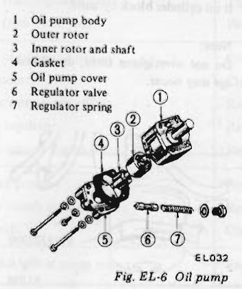
>
> - **Summary:** Exploded view of the trochoid oil pump assembly showing housing, inner and outer rotors, gasket, cover, and pressure regulator valve assembly.
> - **Components:** oil pump body, outer rotor, inner rotor and shaft, gasket, oil pump cover, regulator valve, regulator spring, regulator cap nut
> - **Callouts:** **(1)** Oil pump body; **(2)** Outer rotor; **(3)** Inner rotor and shaft; **(4)** Gasket; **(5)** Oil pump cover; **(6)** Regulator valve; **(7)** Regulator spring
> - **Specs / Measurements:** Cover bolts torque: 0.7 to 1.0 kg-m (5.1 to 7.2 ft-lb); Regulator valve cap nut torque: 4 to 5 kg-m (29 to 36 ft-lb)
> - **Mechanic Notes:** Punch/dot marks on both the outer and inner rotor must face toward the oil pump body during assembly.
> - **Tags:** `oil pump`, `exploded view`, `outer rotor`, `inner rotor`, `regulator valve`, `regulator spring`, `pump cover`

1 Oil pump body  
2 Outer rotor  
3 Inner rotor and shaft  
4 Gasket  
5 Oil pump cover  
6 Regulator valve  
7 Regulator spring  

## INSPECTION

Wash all parts in cleaning solvent and dry with compressed air.

Use a brush to clean the inside of pump housing and pressure regulator valve chamber. Be sure all dirt and metal particles are removed.

1. Inspect pump body and cover for cracks or excessive wear.
2. Inspect pump rotors for damage or excessive wear.
3. Check inner rotor shaft for looseness in pump body.
4. Inspect regulator valve for wear or scoring.
5. Check regulator spring to see that it is not worn on its side or collapsed.
6. Using a feeler gauge, check tip clearance ② and outer rotor-to-body clearance ① shown in Figure EL-7.

> 🖼️ **Fig. EL-7 Checking rotor clearances** `[EL059]` *(Type: `inspection_measurement`)*
>
> 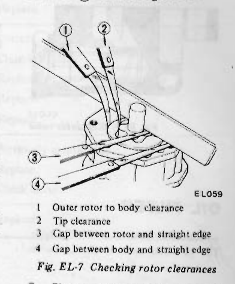
>
> - **Summary:** Measuring oil pump rotor clearances using feeler gauges and a precision straight edge across the pump housing face.
> - **Components:** oil pump body, inner rotor, outer rotor, feeler gauge, straight edge
> - **Callouts:** **(1)** Outer rotor to body clearance; **(2)** Tip clearance; **(3)** Gap between rotor and straight edge; **(4)** Gap between body and straight edge
> - **Specs / Measurements:** ① Outer rotor to body clearance: Standard 0.15 to 0.21 mm (0.0059 to 0.0083 in), Wear limit 0.5 mm (0.0197 in); ② Rotor tip clearance: Standard < 0.12 mm (0.0047 in), Wear limit 0.20 mm (0.0079 in); ③/④ Gap between rotor/body and straight edge: -0.03 to 0.06 mm (-0.0012 to 0.0024 in); Rotor side clearance (with gasket): Standard 0.04 to 0.08 mm (0.0016 to 0.0031 in), Wear limit 0.20 mm (0.0079 in)
> - **Mechanic Notes:** Pump rotors and body are not serviced separately; if clearances exceed wear limits, replace the entire oil pump assembly.
> - **Tags:** `checking rotor clearances`, `feeler gauge`, `straight edge`, `tip clearance`, `outer rotor to body clearance`, `side clearance`

1 Outer rotor to body clearance  
2 Tip clearance  
3 Gap between rotor and straight edge  
4 Gap between body and straight edge  

7. Place a straight edge across the face of pump and depress it slightly as shown in Figure EL-7. Check gap ④ between body and straight edge or gap ③ between rotor and straight edge.

The gap should be -0.03 to 0.06 mm (-0.0012 to 0.0024 in), then rotor side clearance (rotor to bottom cover clearance) with gasket should satisfy the specifications.

| Item | Standard | Wear limit |
| :--- | :--- | :--- |
| Rotor side clearance (rotor to bottom cover) mm (in) | 0.04 to 0.08 (0.0016 to 0.0031) | 0.20 (0.0079) |
| Rotor tip clearance ② mm (in) | Less than 0.12 (0.0047) | 0.20 (0.0079) |
| Outer rotor to body clearance ① mm (in) | 0.15 to 0.21 (0.0059 to 0.0083) | 0.5 (0.0197) |

**Note:**  
Pump rotors and body are not serviced separately. If the oil pump body is damaged or worn, replace the entire oil pump assembly.

## OIL PRESSURE REGULATOR VALVE

The oil pressure regulator valve is <!-- Page 4 (EL-4) --> not adjustable. At the released position, the valve permits the oil to by-pass through the passage in the pump cover to the inlet side of the pump. Check regulator valve spring to ensure that spring tension is correct.

> 🖼️ **Fig. EL-8 Regulator valve** `[EL014]` *(Type: `cutaway_flow`)*
>
> 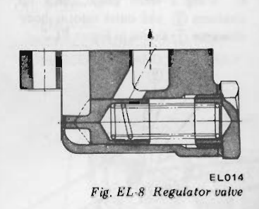
>
> - **Summary:** Cross-sectional diagram of the non-adjustable spring-loaded oil pressure regulator valve in the pump cover showing the bypass flow path to the pump inlet when open.
> - **Components:** regulator valve plunger, regulator spring, cap nut, pump cover bypass passage
> - **Specs / Measurements:** Spring free length: 52.5 mm (2.067 in); Installed length / load: 34.8 mm / 7.9 to 8.7 kg (1.370 in / 17.4 to 19.2 lb); Opening pressure: 5.6 kg/cm² (80 psi) at 3,000 rpm
> - **Mechanic Notes:** Regulator valve is non-adjustable; inspect plunger for scoring and check spring free length/tension.
> - **Tags:** `regulator valve`, `oil pressure regulator`, `valve plunger`, `spring`, `bypass passage`

## OIL FILTER

The oil filter is of a cartridge type. The oil filter element should be replaced periodically with the use of Oil Filter Wrench ST19320000. See Figure EL-9.

When removing an oil filter, loosen it after stopping engine about several minutes to drain out the oil from oil filter to oil pan.

When installing an oil filter, fasten it on cylinder block by hand.

**Note:**  
Do not overtighten filter, or oil leakage may occur.

> 🖼️ **Fig. EL-9 Removing oil filter** `[EL015]` *(Type: `procedure_step`)*
>
> 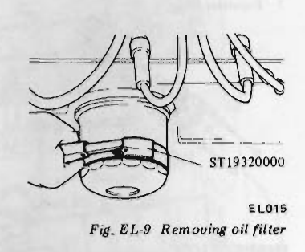
>
> - **Summary:** Removing the spin-on cartridge oil filter from the right side of the cylinder block using Special Service Tool ST19320000.
> - **Components:** oil filter cartridge, oil filter wrench ST19320000
> - **Callouts:** **(ST19320000)** Oil filter wrench
> - **Specs / Measurements:** Tool: ST19320000 (Kent-Moore J 25664)
> - **Mechanic Notes:** Wait several minutes after stopping engine before loosening filter; install new filter by hand only—do not overtighten.
> - **Tags:** `removing oil filter`, `oil filter wrench`, `ST19320000`, `cartridge oil filter`

## OIL PRESSURE RELIEF VALVE

The relief valve located at the center portion securing oil filter in the cylinder block by-passes the oil into the main gallery when the oil filter element is excessively clogged.

With oil filter removed, check valve unit for operation. Inspect for a cracked or broken valve. If replacement is necessary, remove valve by prying it out with a screwdriver. Install a new valve in place by tapping it in.

> 🖼️ **Fig. EL-10 Relief valve** `[EL061]` *(Type: `component_location`)*
>
> 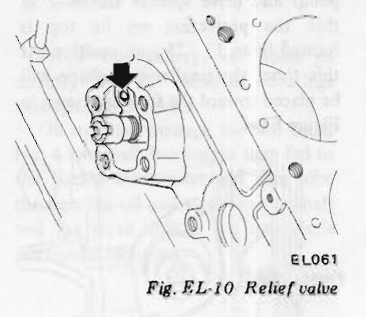
>
> - **Summary:** Location of the oil filter bypass relief valve pressed into the cylinder block oil filter mounting boss.
> - **Components:** oil pressure relief valve, cylinder block oil filter mounting pad
> - **Mechanic Notes:** Bypasses oil directly into main gallery if filter is clogged. Remove by prying out with a screwdriver; install new valve by tapping in.
> - **Tags:** `relief valve`, `oil filter mounting pad`, `bypass valve`, `cylinder block`

# SERVICE DATA AND SPECIFICATIONS

### Oil pump

| Item | Unit | Standard | Wear limit |
| :--- | :--- | :--- | :--- |
| Rotor side clearance (rotor to bottom cover) | mm (in) | 0.04 to 0.08 (0.0016 to 0.0031) | 0.20 (0.0079) |
| Rotor tip clearance | mm (in) | less than 0.12 (0.0047) | 0.20 (0.0079) |
| Outer rotor to body clearance | mm (in) | 0.15 to 0.21 (0.0059 to 0.0083) | 0.5 (0.0197) |

### Oil pressure regulator valve

| Regulator valve spring | Unit | Value |
| :--- | :--- | :--- |
| Free length | mm (in) | 52.5 (2.067) |
| Installed length / load | mm/kg (in/lb) | 34.8/7.9 to 8.7 (1.370/17.4 to 19.2) |

### Tightening torque

| Item | Unit | Value |
| :--- | :--- | :--- |
| Oil pump mounting bolts | kg-m (ft-lb) | 1.1 to 1.5 (8 to 11) |
| Oil pump cover bolts | kg-m (ft-lb) | 0.7 to 1.0 (5.1 to 7.2) |
| Regulator valve cap nut | kg-m (ft-lb) | 4 to 5 (29 to 36) |

---

<!-- Page 5 (EL-5) -->
# TROUBLE DIAGNOSES AND CORRECTIONS

| Condition | Probable causes | Corrective actions |
| :--- | :--- | :--- |
| Oil leakage | Damaged or cracked body cover. | Replace. |
| | Oil leakage from gasket. | Replace. |
| | Oil leakage from regulator valve. | Tighten or replace. |
| | Oil leakage from blind plug. | Replace. |
| Decreased oil pressure | Leak of oil in engine oil pan. | Correct. |
| | Dirty oil strainer. | Clean or replace. |
| | Damaged or worn pump rotors. | Replace. |
| | Inoperative regulator. | Replace. |
| | Use of poor quality engine oil. | Replace. |
| Warning light remains "on" - engine running | Decreased oil pressure. | Previously mentioned. |
| | Oil pressure switch unserviceable. | Replace. |
| | Electrical fault. | Check circuit. |
| Noise | Excessive backlash in pump rotors. | Replace. |

# SPECIAL SERVICE TOOL

| Tool number & tool name | Kent-Moore No. | Reference page or Fig. No. |
| :--- | :--- | :--- |
| ST19320000 Oil filter wrench | J 25664 | Fig. EL-9 |

> 🖼️ **ST19320000 Oil filter wrench (Kent-Moore J 25664, Ref. Fig. EL-9)** `[ST19320000]` *(Type: `special_service_tool`)*
>
> 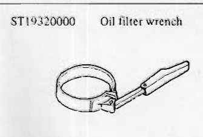
>
> - **Summary:** Nissan Special Service Tool ST19320000 (Kent-Moore J 25664) band-type oil filter wrench.
> - **Components:** ST19320000 oil filter wrench
> - **Specs / Measurements:** Nissan No.: ST19320000; Kent-Moore No.: J 25664
> - **Mechanic Notes:** Used for removing spin-on cartridge oil filter (Ref. Fig. EL-9).
> - **Tags:** `special service tool`, `oil filter wrench`, `ST19320000`, `J 25664`, `Kent-Moore`

---

## Segmented Diagrams Index

| Figure | Code | Type | Page | Caption | Key Components / Callouts | File |
| :--- | :--- | :--- | :--- | :--- | :--- | :--- |
| **Fig. EL-1** | `EL072` | `cutaway_flow` | EL-2 | Fig. EL-1 Lubricating circuit | oil strainer, oil pan, trochoid oil pump, full-flow oil filter, main oil gallery | [fig_el_1_lubricating_circuit.png](diagrams/EL Engine Lubrication/fig_el_1_lubricating_circuit.png) |
| **Fig. EL-2** | `EL069` | `cutaway_flow` | EL-2 | Fig. EL-2 Lubricating cylinder head | cylinder head oil gallery, camshaft brackets, No. 2 camshaft bearing, No. 4 camshaft bearing, hollow camshaft | [fig_el_2_lubricating_cylinder_head.png](diagrams/EL Engine Lubrication/fig_el_2_lubricating_cylinder_head.png) |
| **Fig. EL-3** | `EL009` | `alignment_orientation` | EL-3 | Fig. EL-3 Aligning punch mark and oil hole | oil pump body, drive spindle assembly, drive gear collar | [fig_el_3_aligning_punch_mark_and_oil_hole.png](diagrams/EL Engine Lubrication/fig_el_3_aligning_punch_mark_and_oil_hole.png) |
| **Fig. EL-4** | `EL010` | `alignment_orientation` | EL-3 | Fig. EL-4 Setting drive spindle | distributor drive spindle, front cover distributor mount | [fig_el_4_setting_drive_spindle.png](diagrams/EL Engine Lubrication/fig_el_4_setting_drive_spindle.png) |
| **Fig. EL-5** | `EL011` | `procedure_step` | EL-3 | Fig. EL-5 Installing oil pump | oil pump assembly, front cover, crankshaft pulley, mounting bolts | [fig_el_5_installing_oil_pump.png](diagrams/EL Engine Lubrication/fig_el_5_installing_oil_pump.png) |
| **Fig. EL-6** | `EL032` | `exploded_view` | EL-3 | Fig. EL-6 Oil pump | oil pump body, outer rotor, inner rotor and shaft, gasket, oil pump cover | [fig_el_6_oil_pump.png](diagrams/EL Engine Lubrication/fig_el_6_oil_pump.png) |
| **Fig. EL-7** | `EL059` | `inspection_measurement` | EL-3 | Fig. EL-7 Checking rotor clearances | oil pump body, inner rotor, outer rotor, feeler gauge, straight edge | [fig_el_7_checking_rotor_clearances.png](diagrams/EL Engine Lubrication/fig_el_7_checking_rotor_clearances.png) |
| **Fig. EL-8** | `EL014` | `cutaway_flow` | EL-4 | Fig. EL-8 Regulator valve | regulator valve plunger, regulator spring, cap nut, pump cover bypass passage | [fig_el_8_regulator_valve.png](diagrams/EL Engine Lubrication/fig_el_8_regulator_valve.png) |
| **Fig. EL-9** | `EL015` | `procedure_step` | EL-4 | Fig. EL-9 Removing oil filter | oil filter cartridge, oil filter wrench ST19320000 | [fig_el_9_removing_oil_filter.png](diagrams/EL Engine Lubrication/fig_el_9_removing_oil_filter.png) |
| **Fig. EL-10** | `EL061` | `component_location` | EL-4 | Fig. EL-10 Relief valve | oil pressure relief valve, cylinder block oil filter mounting pad | [fig_el_10_relief_valve.png](diagrams/EL Engine Lubrication/fig_el_10_relief_valve.png) |
| **ST19320000** | `ST19320000` | `special_service_tool` | EL-5 | ST19320000 Oil filter wrench (Kent-Moore J 25664, Ref. Fig. EL-9) | ST19320000 oil filter wrench | [tool_st19320000_oil_filter_wrench.png](diagrams/EL Engine Lubrication/tool_st19320000_oil_filter_wrench.png) |
