# ENGINE MECHANICAL

<!-- Page 1 (EM-1) -->
# SECTION EM: ENGINE MECHANICAL

## CONTENTS

| Section | Page |
| :--- | :--- |
| GENERAL DESCRIPTION | EM-2 |
| ENGINE DISASSEMBLY | EM-3 |
| INSPECTION AND REPAIR | EM-7 |
| ENGINE ASSEMBLY | EM-21 |
| SERVICE DATA AND SPECIFICATIONS | EM-27 |
| TROUBLE DIAGNOSES AND CORRECTIONS | EM-33 |
| SPECIAL SERVICE TOOLS | EM-35 |

NISSAN MOTOR CO., LTD. TOKYO, JAPAN

---

<!-- Page 2 (EM-2) -->
# GENERAL DESCRIPTION

## CONTENTS

| Section | Page | Section | Page |
| :--- | :--- | :--- | :--- |
| L28 ENGINE | EM-2 | CAMSHAFT | EM-2 |
| CYLINDER BLOCK | EM-2 | VALVE MECHANISM | EM-3 |
| CRANKSHAFT | EM-2 | CAMSHAFT DRIVE | EM-3 |
| PISTONS AND CONNECTING RODS | EM-2 | MANIFOLDS | EM-3 |
| CYLINDER HEAD | EM-2 | | |

### L28 ENGINE
The L28 engine is a 2,753 cc (168.0 cu in) in-line, overhead camshaft, six-cylinder engine. It has an 86 mm (3.39 in) bore and 79 mm (3.11 in) stroke with a compression ratio of 8.3 : 1. The engine features a wedge-shaped combustion chamber, aluminum head, and a fully balanced 7-bearing crankshaft to turn out smooth, dependable power.

The cylinder block is cast in a single unit, and features deep skirting.

### CYLINDER BLOCK
The cylinder block, a monoblock specially cast structure, employs the seven bearing-support system for quietness and higher durability. Of a highly rigid deep-skirt design, it requires no complicated tappet chamber because of the OHC engine system, and is thus light-weight.

> 🖼️ **Fig. EM-1 Cylinder block** `[EM271]` *(Type: `exploded_view`)*
>
> 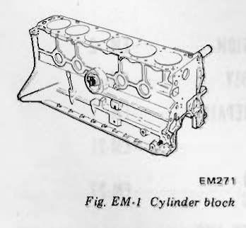
>
> - **Summary:** Isometric technical drawing of the L28 monoblock cast cylinder block showing deep skirt structure and 7-bearing support locations.
> - **Components:** Cylinder block, Main bearing journals, Cylinder bores
> - **Specs / Measurements:** Bore: 86 mm (3.39 in); Stroke: 79 mm (3.11 in)
> - **Mechanic Notes:** Monoblock deep-skirt design with 7 main bearing support journals.
> - **Tags:** `cylinder block`, `monoblock`, `L28`, `skirt`

### CRANKSHAFT
The crankshaft is made of a special forged steel. Provided with a high capacity balance weight, it is characterized by quietness and high durability at high speed operation. Main bearings are lubricated from oil holes which intersect the main oil gallery which runs parallel to the cylinder bores.

> 🖼️ **Fig. EM-2 Crankshaft** `[EM272]` *(Type: `exploded_view`)*
>
> 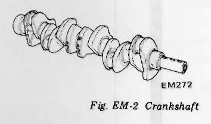
>
> - **Summary:** Forged steel 7-bearing crankshaft with integrated balance counterweights.
> - **Components:** Crankshaft, Main journals, Crank pins, Counterweights
> - **Specs / Measurements:** 7-bearing design; Stroke: 79 mm (3.11 in)
> - **Mechanic Notes:** Main bearings lubricated via oil holes intersecting main oil gallery.
> - **Tags:** `crankshaft`, `counterweights`, `journals`, `crank pins`

### PISTONS AND CONNECTING RODS
New-design light-weight pistons are cast aluminum slipper-skirt type with invar-strut. The piston pin, a special hollow steel type is connected to the piston in a full floating fit, and is press-fitted onto the connecting rod.

Connecting rods are made of forged steel. Full pressure lubrication is directed to the connecting rods by drilled oil passages from the adjacent main bearing journal. Oil holes at the connecting rod journals are located so that oil is supplied to give maximum lubrication at full bearing load.

> 🖼️ **Fig. EM-3 Piston and connecting rod** `[EM273]` *(Type: `exploded_view`)*
>
> 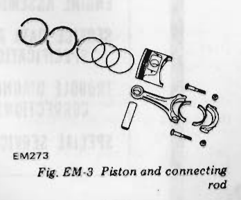
>
> - **Summary:** Exploded view of piston assembly, rings, piston pin, connecting rod, and rod bearing shells.
> - **Components:** Piston, Top compression ring, Second compression ring, Oil ring, Piston pin, Connecting rod, Rod bearing shells, Rod cap, Rod bolts and nuts
> - **Specs / Measurements:** Full floating pin fit in piston; Press fit in connecting rod
> - **Mechanic Notes:** Cast aluminum slipper-skirt with invar-strut; full pressure lubrication from adjacent main journal.
> - **Tags:** `piston`, `connecting rod`, `piston rings`, `piston pin`

### CYLINDER HEAD

> 🖼️ **Fig. EM-4 Cylinder head** `[EM598]` *(Type: `exploded_view`)*
>
> 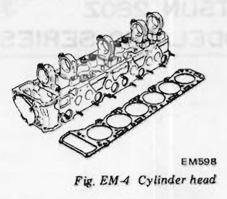
>
> - **Summary:** Aluminum cylinder head casting with 5 camshaft bearing brackets, valve train assembly, and cylinder head gasket.
> - **Components:** Cylinder head, Camshaft bearing brackets, Cylinder head gasket, Valves, Rocker assembly
> - **Specs / Measurements:** Hot press-fitted brass intake and heat resistant steel exhaust valve seats
> - **Mechanic Notes:** Lightweight aluminum alloy head with wedge-shaped combustion chambers.
> - **Tags:** `cylinder head`, `valve seat`, `combustion chamber`

The cylinder head is made of a light, strong aluminum alloy with good cooling efficiency. A brass cast valve seat is used on the intake valve, while a heat resistant steel valve seat is installed on the exhaust valve.

These parts are all hot press-fitted.

### CAMSHAFT
The camshaft is made of a special cast iron and is located inside the rocker cover. Five aluminum alloy brackets support it. Camshaft bearings are lubricated from oil holes which lead to the main oil gallery of the cylinder head.

Concentric passages are drilled in the front and rear parts of the camshaft.

Oil to each cam lobe is supplied through an oil hole drilled in the base circle of each lobe. Lubricant is supplied to the front oil gallery from the 2nd camshaft bearing and to the rear oil gallery from the 4th camshaft bearing. These holes on the base circle of the lobe supply lubricant to the cam pad surface of the rocker arm and to the valve tip end. The cams feature a long-overlap profile to reduce NOx emission.

---

<!-- Page 3 (EM-3) -->

> 🖼️ **Fig. EM-5 Camshaft** `[EM669]` *(Type: `exploded_view`)*
>
> 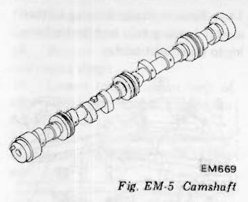
>
> - **Summary:** Six-cylinder camshaft showing journals, lobes with lubrication holes, and drive sprocket mounting flange.
> - **Components:** Camshaft, Cam lobes, Camshaft journals
> - **Specs / Measurements:** Oil hole drilled in base circle of each lobe
> - **Mechanic Notes:** Concentric oil passages drilled in front and rear; long-overlap profile to reduce NOx emissions.
> - **Tags:** `camshaft`, `lobes`, `oil holes`

### VALVE MECHANISM
The valve system has a pivot type rocker arm that is activated directly by the cam mechanism; this has made its moving parts considerably lighter and provides ideal high-speed performance.

> 🖼️ **Fig. EM-6 Valve mechanism** `[EM276]` *(Type: `exploded_view`)*
>
> 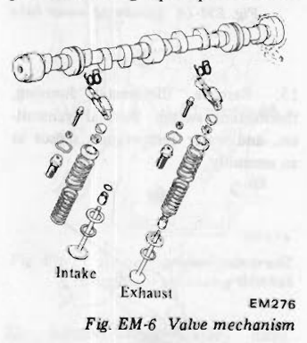
>
> - **Summary:** Detailed view of intake and exhaust valve train assemblies including rocker arms, pivots, retainers, inner and outer valve springs, valve guides, and valves.
> - **Components:** Rocker arm, Pivot, Lock nut, Valve collet, Spring retainer, Outer valve spring, Inner valve spring, Valve spring seat, Valve stem oil seal, Valve guide, Intake valve, Exhaust valve
> - **Callouts:** **(Intake)** Intake valve assembly; **(Exhaust)** Exhaust valve assembly
> - **Specs / Measurements:** Dual concentric valve springs (inner and outer)
> - **Mechanic Notes:** Pivot-type rocker arm actuated directly by camshaft lobes.
> - **Tags:** `valve mechanism`, `rocker arm`, `valve spring`, `intake valve`, `exhaust valve`

### CAMSHAFT DRIVE
The camshaft is driven by a double row roller chain driven by crankshaft.

The tension of the chain is controlled by a chain tensioner which is operated by spring and oil pressure.

> 🖼️ **Fig. EM-7 Camshaft driving chain** `[EM277]` *(Type: `cutaway_flow`)*
>
> 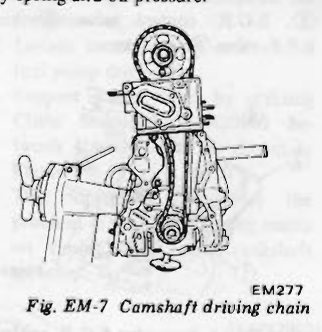
>
> - **Summary:** Front view of timing chain arrangement showing double row roller chain, crankshaft sprocket, camshaft sprocket, tensioner, and guide shoes.
> - **Components:** Double row timing chain, Camshaft sprocket, Crankshaft sprocket, Hydraulic/spring chain tensioner, Chain guides
> - **Specs / Measurements:** Double row roller chain
> - **Mechanic Notes:** Tension controlled by spring tension and engine oil pressure.
> - **Tags:** `timing chain`, `camshaft drive`, `chain tensioner`

### MANIFOLDS
The intake manifold is cast aluminum.

The exhaust manifold is a dual exhaust system designed to prevent a decline in output due to exhaust interference and to increase output through inertia scavenging action. It is connected to exhaust pipes by flanges, which completely eliminate possibility of exhaust leaks.

> 🖼️ **Fig. EM-8 Exhaust and intake manifold** `[EM691]` *(Type: `exploded_view`)*
>
> 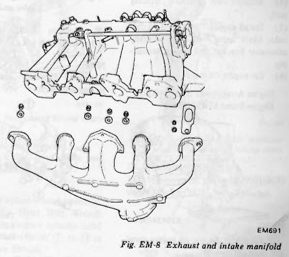
>
> - **Summary:** Cast aluminum intake manifold and dual-exhaust cast manifold layout with mounting flanges and hardware.
> - **Components:** Intake manifold, Dual exhaust manifold, Gaskets, Fasteners
> - **Specs / Measurements:** Dual exhaust inertia scavenging design
> - **Mechanic Notes:** Connected to exhaust downpipes by flanges to prevent exhaust leaks.
> - **Tags:** `intake manifold`, `exhaust manifold`, `scavenging`

# ENGINE DISASSEMBLY

## CONTENTS

| Section | Page | Section | Page |
| :--- | :--- | :--- | :--- |
| PRELIMINARY CLEANING AND INSPECTING | EM-3 | PISTON AND CONNECTING ROD | EM-6 |
| DISASSEMBLY | EM-4 | CYLINDER HEAD | EM-6 |

### PRELIMINARY CLEANING AND INSPECTING
Before disassembling engine, note the following:
1. Fuel, oil or water may leak past cylinder head and block. Prior to disassembling, check cylinder head, front chain cover, oil pan and oil filter gaskets and crankshaft and water pump seals for signs of leakage past their gasketed surfaces.
2. Check fuel hoses for deterioration, cracks or leakage of fuel past their jointed or connected surfaces.
3. Remove alternator, distributor and starter, and plug up distributor hole to prevent entry of foreign matter.
4. Wipe dust and mud off engine.
5. Inspect block, rocker cover, front chain cover, oil pan and all other outer parts for visual damage and broken or missing parts such as bolts and nuts.
6. Test all pipings and electrical circuits for discontinuity or broken or damaged insulation.

---

<!-- Page 4 (EM-4) -->
### DISASSEMBLY
To remove engine from car, refer to related topic under "Engine Removal and Installation" in Chassis and Body Service Manual, Section ER.

1. Remove transmission from engine.
2. Thoroughly drain engine oil and coolant by removing drain plugs.
3. Place engine assembly on engine stand.
   (1) Remove fan and fan pulley.
   (2) Remove engine mounting R.H.
   (3) Remove oil filter using Oil Filter Wrench ST19320000.
   (4) Remove oil pressure sending unit.
   (5) Install engine attachment to cylinder block using bolt holes securing alternator bracket and engine mounting.
   (6) Set engine on stand.
       * Engine Attachment ST05340001
       * Engine Stand ST0501S000

> 🖼️ **Fig. EM-9 Engine on engine stand** `[EM600]` *(Type: `special_service_tool`)*
>
> 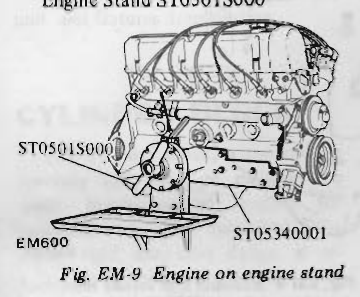
>
> - **Summary:** Engine mounted on overhaul stand using dedicated engine attachment bracket.
> - **Components:** Engine assembly, Engine attachment ST05340001, Engine stand ST0501S000
> - **Callouts:** **(ST0501S000)** Engine Stand; **(ST05340001)** Engine Attachment
> - **Mechanic Notes:** Attach to cylinder block using alternator bracket and engine mount bolt holes.
> - **Tags:** `engine stand`, `attachment`, `ST05340001`, `ST0501S000`

4. Remove oil level gauge.
5. Remove clutch assembly.
6. Remove high tension cables.
7. Remove spark plugs.
8. Remove distributor.
9. Remove air regulator ①, rocker cover to throttle chamber hose ②, air regulator-to-connector hose ③ and throttle chamber to regulator hose and pipe ④ as an assembly.

> 🖼️ **Fig. EM-10 Removing air regulator** `[EM692]` *(Type: `procedure_step`)*
>
> 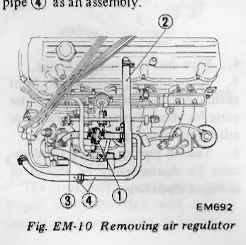
>
> - **Summary:** Removal of air regulator, connecting hoses, and pipe assembly from intake.
> - **Components:** Air regulator, Rocker cover to throttle chamber hose, Air regulator-to-connector hose, Throttle chamber to regulator hose and pipe
> - **Callouts:** **(1)** Air regulator; **(2)** Rocker cover to throttle chamber hose; **(3)** Air regulator-to-connector hose; **(4)** Throttle chamber to regulator hose and pipe
> - **Mechanic Notes:** Remove parts 1 through 4 as an assembly.
> - **Tags:** `air regulator`, `hoses`, `disassembly`

10. Remove B.P.T. valve control tube ① from intake manifold.
11. Remove E.G.R. heat shield plate ②, E.G.R. control valve ③ and B.P.T. valve ④ and hoses.

> 🖼️ **Fig. EM-11 Removing E.G.R. control valve and B.P.T. valve** `[EM694]` *(Type: `procedure_step`)*
>
> 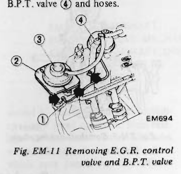
>
> - **Summary:** Removal of EGR and BPT control valves and heat shield plate.
> - **Components:** B.P.T. valve control tube, E.G.R. heat shield plate, E.G.R. control valve, B.P.T. valve
> - **Callouts:** **(1)** B.P.T. valve control tube; **(2)** E.G.R. heat shield plate; **(3)** E.G.R. control valve; **(4)** B.P.T. valve
> - **Mechanic Notes:** Disconnect control tube from intake manifold first.
> - **Tags:** `EGR valve`, `BPT valve`, `heat shield`

12. Remove throttle chamber together with dash pot and B.C.D.D.

> [!NOTE]
> Remove throttle chamber with hexagon wrench.

> 🖼️ **Fig. EM-12 Removing throttle chamber** `[EM551]` *(Type: `procedure_step`)*
>
> 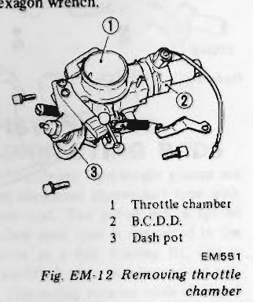
>
> - **Summary:** Removal of throttle chamber with B.C.D.D. and dashpot.
> - **Components:** Throttle chamber, B.C.D.D., Dash pot
> - **Callouts:** **(1)** Throttle chamber; **(2)** B.C.D.D.; **(3)** Dash pot
> - **Mechanic Notes:** Remove throttle chamber mounting bolts with hexagon wrench.
> - **Tags:** `throttle chamber`, `BCDD`, `dash pot`

13. Remove fuel pipe, pressure regulator, cold start valve, injector, canister control vacuum tube and canister purge hose as an assembly. Refer to E.F.I. system construction and function (Section EF) for removal and installation.

> 🖼️ **Fig. EM-13 Removing fuel pipe assembly** `[EM697]` *(Type: `procedure_step`)*
>
> 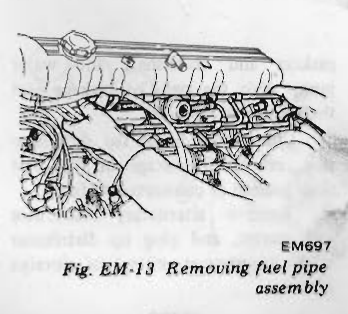
>
> - **Summary:** Removal of EFI fuel rail assembly with injectors, pressure regulator, and cold start valve.
> - **Components:** Fuel pipe, Pressure regulator, Cold start valve, Fuel injectors, Canister control vacuum tube, Purge hose
> - **Mechanic Notes:** Refer to Section EF for detailed EFI component servicing.
> - **Tags:** `fuel rail`, `injectors`, `pressure regulator`

14. Remove heater housing to thermostat housing tube and heater housing to water inlet tube.

> 🖼️ **Fig. EM-14 Removing water tube** `[EM698]` *(Type: `procedure_step`)*
>
> 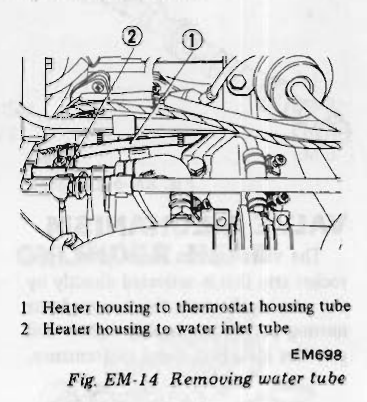
>
> - **Summary:** Heater housing water tubes removal.
> - **Components:** Heater housing to thermostat housing tube, Heater housing to water inlet tube
> - **Callouts:** **(1)** Heater housing to thermostat housing tube; **(2)** Heater housing to water inlet tube
> - **Mechanic Notes:** Disconnect tubes before thermostat housing removal.
> - **Tags:** `cooling system`, `heater tube`, `water tube`

15. Remove thermostat housing, thermotime switch, thermal transmitter, and water temperature sensor as an assembly.

> 🖼️ **Fig. EM-15 Removing thermostat housing** `[EM701]` *(Type: `procedure_step`)*
>
> 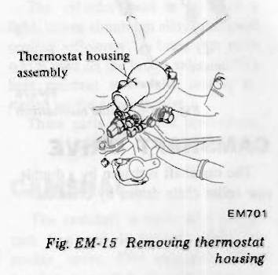
>
> - **Summary:** Removing thermostat housing with mounted sensors as an assembly.
> - **Components:** Thermostat housing, Thermotime switch, Thermal transmitter, Water temperature sensor
> - **Callouts:** **(Thermostat housing assembly)** Thermostat housing assembly
> - **Mechanic Notes:** Remove housing with sensors attached to prevent damage.
> - **Tags:** `thermostat housing`, `thermotime switch`, `temperature sensor`

16. Remove P.C.V. valve hose, sub heat shield plate and E.G.R. tube.

> 🖼️ **Fig. EM-16 Removing hose and sub heat shield plate** `[EM615]` *(Type: `procedure_step`)*
>
> 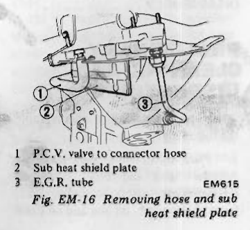
>
> - **Summary:** Removal of PCV hose, sub heat shield plate, and EGR tube.
> - **Components:** P.C.V. valve to connector hose, Sub heat shield plate, E.G.R. tube
> - **Callouts:** **(1)** P.C.V. valve to connector hose; **(2)** Sub heat shield plate; **(3)** E.G.R. tube
> - **Mechanic Notes:** Detach PCV hose and EGR tube fasteners from manifold area.
> - **Tags:** `PCV`, `heat shield`, `EGR tube`

---

<!-- Page 5 (EM-5) -->
17. Remove intake manifold and heat shield plate as an assembly.
18. Remove exhaust manifold and rear engine slinger.
19. Loosen tension adjust bolt of idler pulley and remove compressor drive belt.
20. Remove two bolts fastening air conditioning compressor on lower side. Then remove two bolts fastening compressor on upper side. While doing this, hold compressor by hand to prevent it from falling.
21. Remove idler pulley and air conditioning compressor mounting bracket.

> 🖼️ **Fig. EM-17 Removing idler pulley and compressor mounting bracket** `[EM574]` *(Type: `procedure_step`)*
>
> 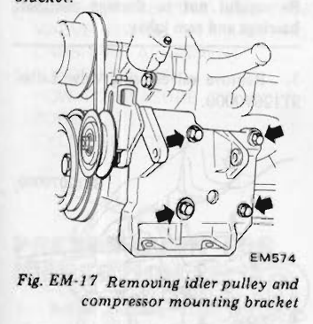
>
> - **Summary:** Removal of A/C compressor mounting bracket and belt idler pulley.
> - **Components:** Idler pulley, A/C compressor bracket, Mounting bolts
> - **Mechanic Notes:** Support compressor by hand when removing last upper bolts to prevent falling.
> - **Tags:** `idler pulley`, `air conditioning`, `bracket`

22. Remove crank pulley using Puller Crank Pulley ST16540000.

> 🖼️ **Fig. EM-18 Removing crank pulley**  *(Type: `special_service_tool`)*
>
> 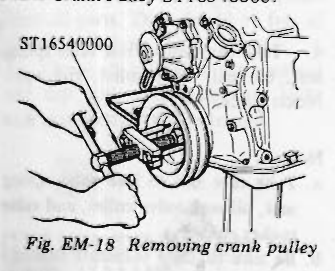
>
> - **Summary:** Using puller ST16540000 to extract crankshaft pulley/damper from crankshaft snout.
> - **Components:** Crank pulley, Crankshaft, Crank pulley puller ST16540000
> - **Callouts:** **(ST16540000)** Puller Crank Pulley ST16540000
> - **Mechanic Notes:** Use dedicated puller ST16540000 to avoid damaging pulley damper rubber.
> - **Tags:** `crank pulley`, `pulley puller`, `ST16540000`

23. Remove water pump.
24. Remove camshaft sprocket.

> [!NOTE]
> When removing cylinder head from engine installed on car, follow the instructions below:
> a. Turn crankshaft until No. 1 piston is at T.D.C. on its compression stroke.
> b. Remove rocker cover and fuel pump.
> c. To facilitate assembling operation, scribe a mark on timing chain and camshaft sprocket with paint before removal.
> d. Loosen camshaft bolt and remove fuel pump drive cam.
> e. Support timing chain by utilizing Chain Stopper ST17420001 between timing chains as shown in Figure EM-19.
> This operation eliminates the problem of realigning timing marks on timing chain and crankshaft sprocket.

> 🖼️ **Fig. EM-19 Supporting timing chain** `[EM538]` *(Type: `procedure_step`)*
>
> 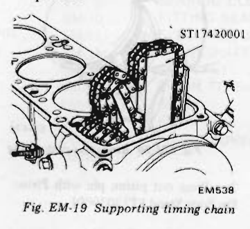
>
> - **Summary:** Timing chain wedge/stopper ST17420001 inserted between chain runs to hold timing position during head removal on car.
> - **Components:** Timing chain, Chain stopper ST17420001, Cylinder head
> - **Callouts:** **(ST17420001)** Chain Stopper ST17420001
> - **Specs / Measurements:** No. 1 at TDC compression
> - **Mechanic Notes:** Prevents chain tensioner piston from popping out and maintains chain/sprocket timing alignment.
> - **Tags:** `timing chain`, `chain stopper`, `ST17420001`, `TDC`

> f. Remove camshaft sprocket.
> g. Loosen cylinder head bolts and remove cylinder head.

25. Remove cylinder head assembly. Use Cylinder Head Bolt Wrench ST10120000 to remove cylinder head bolts. Loosen bolts from ① to ⑭ as shown in Figure EM-20.

> 🖼️ **Fig. EM-20 Cylinder head bolt loosening sequence** `[EM606]` *(Type: `procedure_step`)*
>
> 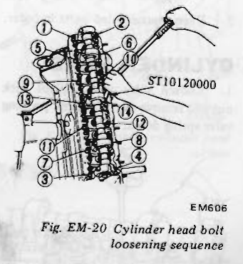
>
> - **Summary:** Numbered loosening sequence (1 to 14) for cylinder head bolts using special wrench ST10120000.
> - **Components:** Cylinder head bolts (1-14), Cylinder head, Cylinder head bolt wrench ST10120000
> - **Callouts:** **(ST10120000)** Cylinder Head Bolt Wrench; **(1-14)** Bolt loosening order (outer to inner cross pattern)
> - **Specs / Measurements:** 14 bolts
> - **Mechanic Notes:** Follow exact reverse spiral loosening sequence (1 to 14) to prevent cylinder head warpage.
> - **Tags:** `cylinder head bolts`, `loosening sequence`, `ST10120000`

26. Invert engine.
27. Remove oil pan and oil strainer.
28. Remove oil pump and its drive spindle.
29. Remove front cover.

> 🖼️ **Fig. EM-21 Removing front cover** `[EM284]` *(Type: `procedure_step`)*
>
> 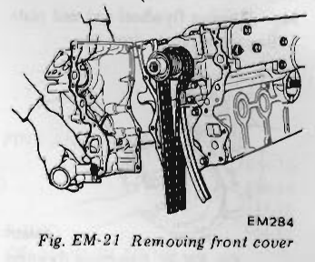
>
> - **Summary:** Removing engine front timing cover from cylinder block.
> - **Components:** Front cover, Cylinder block, Gaskets
> - **Mechanic Notes:** Invert engine before removing oil pan and front cover.
> - **Tags:** `front cover`, `timing cover`, `disassembly`

30. Remove chain tensioner and chain guides.

> 🖼️ **Fig. EM-22 Removing chain tensioner and timing chain** `[EM095]` *(Type: `procedure_step`)*
>
> 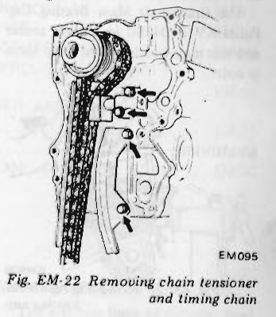
>
> - **Summary:** Removal of hydraulic chain tensioner, tensioner spindle, and timing chain guides.
> - **Components:** Chain tensioner, Slack-side guide, Tension-side guide, Timing chain
> - **Mechanic Notes:** Inspect tensioner shoe and guide surfaces for groove wear.
> - **Tags:** `chain tensioner`, `timing chain`, `chain guides`

31. Remove timing chain.
32. Remove oil thrower, crankshaft worm gear and chain drive sprocket.

> 🖼️ **Fig. EM-23 Removing chain drive sprocket** `[EM286]` *(Type: `procedure_step`)*
>
> 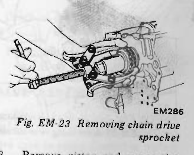
>
> - **Summary:** Pulling crankshaft timing sprocket, oil thrower, and distributor drive worm gear off front of crankshaft.
> - **Components:** Crankshaft sprocket, Oil thrower, Worm gear, Crankshaft puller
> - **Mechanic Notes:** Note orientation of oil thrower and worm gear relative to woodruff key.
> - **Tags:** `sprocket`, `crankshaft sprocket`, `oil thrower`, `worm gear`

33. Remove piston and connecting rod assembly. Extract connecting rod bearings and keep them in order.

> 🖼️ **Fig. EM-24 Removing piston and connecting rod assembly** `[EM287]` *(Type: `procedure_step`)*
>
> 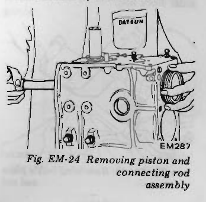
>
> - **Summary:** Pushing piston and connecting rod assembly out through top of cylinder block.
> - **Components:** Piston, Connecting rod, Cylinder block, Rod bearing shells
> - **Mechanic Notes:** Extract connecting rod bearings and keep them in cylinder sequence order.
> - **Tags:** `piston removal`, `connecting rod`, `cylinder bore`

---

<!-- Page 6 (EM-6) -->
34. Remove flywheel and end plate. Be careful not to drop it.

> 🖼️ **Fig. EM-25 Removing flywheel** `[EM607]` *(Type: `procedure_step`)*
>
> 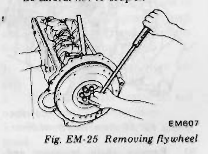
>
> - **Summary:** Loosening flywheel bolts while preventing crankshaft rotation.
> - **Components:** Flywheel, Crankshaft, Flywheel bolts, End plate
> - **Mechanic Notes:** Flywheel is heavy; take care not to drop it upon removing the last bolt.
> - **Tags:** `flywheel`, `end plate`, `disassembly`

35. Remove main bearing caps. Use Crankshaft Main Bearing Cap Puller KV101041S0 to remove center and rear main bearing caps. Keep them in order.

> 🖼️ **Fig. EM-26 Removing rear main bearing cap** `[EM608]` *(Type: `special_service_tool`)*
>
> 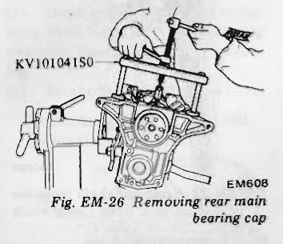
>
> - **Summary:** Extracting center and rear main bearing caps using bridge puller KV101041S0.
> - **Components:** Main bearing caps, Crankshaft main bearing cap puller KV101041S0, Cylinder block
> - **Callouts:** **(KV101041S0)** Crankshaft Main Bearing Cap Puller KV101041S0
> - **Mechanic Notes:** Keep main bearing caps in strict numbered and directional order.
> - **Tags:** `main bearing cap`, `puller`, `KV101041S0`

36. Remove rear oil seal.

> 🖼️ **Fig. EM-27 Removing rear oil seal** `[EM290]` *(Type: `procedure_step`)*
>
> 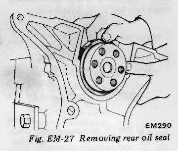
>
> - **Summary:** Removing rear crankshaft oil seal retainer from block rear face.
> - **Components:** Rear oil seal, Rear oil seal retainer, Cylinder block
> - **Mechanic Notes:** Inspect crankshaft sealing surface for grooving.
> - **Tags:** `rear oil seal`, `oil seal retainer`

37. Remove crankshaft.
38. Remove baffle plate and cylinder block net.

> 🖼️ **Fig. EM-28 Removing baffle plate and net** `[EM291]` *(Type: `procedure_step`)*
>
> 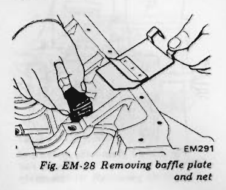
>
> - **Summary:** Removing crankcase oil baffle plate and cylinder block net.
> - **Components:** Baffle plate, Cylinder block net, Cylinder block
> - **Mechanic Notes:** Ensure cylinder block net is completely clear of debris during cleaning.
> - **Tags:** `baffle plate`, `block net`, `crankcase`

### PISTON AND CONNECTING ROD
1. Remove piston rings with a ring remover.

> [!NOTE]
> Avoid damaging piston rings by spreading excessively; excessive spreading makes them unfit for further service as a result of breakage or weakened tension.

> 🖼️ **Fig. EM-29 Removing piston ring** `[EM434]` *(Type: `procedure_step`)*
>
> 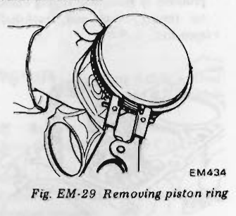
>
> - **Summary:** Using ring expander tool to remove compression and oil rings from piston grooves.
> - **Components:** Piston, Piston ring, Piston ring remover
> - **Mechanic Notes:** Avoid excessive spreading to prevent permanent deformation or fracture.
> - **Tags:** `piston rings`, `ring remover`, `expander`

2. Press out piston pin with Piston Pin Press Stand ST13030001.

> 🖼️ **Fig. EM-30 Removing piston pin** `[EM156]` *(Type: `special_service_tool`)*
>
> 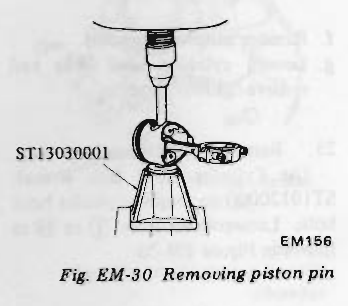
>
> - **Summary:** Pressing piston pin from connecting rod small end on press fixture ST13030001.
> - **Components:** Piston, Connecting rod, Piston pin, Piston pin press stand ST13030001
> - **Callouts:** **(ST13030001)** Piston Pin Press Stand ST13030001
> - **Mechanic Notes:** Piston pin is an interference press-fit in connecting rod small end.
> - **Tags:** `piston pin`, `press stand`, `ST13030001`

3. Keep disassembled parts in order.

### CYLINDER HEAD
1. Loosen valve rocker pivot lock nut and remove rocker arm by pressing valve spring down.

> 🖼️ **Fig. EM-31 Removing rocker arm** `[EM293]` *(Type: `procedure_step`)*
>
> 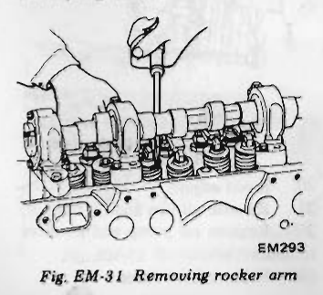
>
> - **Summary:** Depressing valve spring to slip rocker arm free from pivot ball and valve stem tip.
> - **Components:** Rocker arm, Pivot lock nut, Valve spring, Valve rocker guide
> - **Mechanic Notes:** Do not misplace small rocker guides seated on valve stem tips.
> - **Tags:** `rocker arm`, `valve pivot`, `rocker guide`

> [!NOTE]
> Take care not to lose valve rocker guide.

2. Remove camshaft.

> 🖼️ **Fig. EM-32 Removing camshaft** `[EM673]` *(Type: `procedure_step`)*
>
> 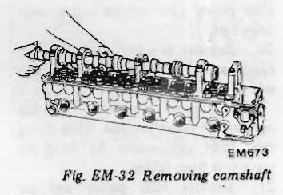
>
> - **Summary:** Sliding camshaft axially forward out of five cylinder head bearing towers.
> - **Components:** Camshaft, Camshaft bearing towers, Cylinder head
> - **Mechanic Notes:** CAUTION: Slide out carefully; do not nick or scratch cam lobes or aluminum bearing bores.
> - **Tags:** `camshaft removal`, `cam lobes`, `bearing towers`

> [!CAUTION]
> Be careful not to damage camshaft bearings and cam lobes.

3. Remove valves using Valve Lifter ST12070000.

> 🖼️ **Fig. EM-33 Removing valve** `[EM106]` *(Type: `special_service_tool`)*
>
> 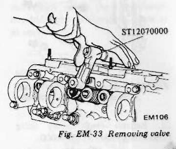
>
> - **Summary:** Compressing valve springs with C-clamp valve spring compressor ST12070000 to remove split collets.
> - **Components:** Valve lifter ST12070000, Valve collet, Spring retainer, Valve spring, Cylinder head
> - **Callouts:** **(ST12070000)** Valve Lifter ST12070000
> - **Mechanic Notes:** Collect split collets carefully as spring is compressed.
> - **Tags:** `valve removal`, `valve lifter`, `ST12070000`, `collet`

4. Take care not to lose valve spring seat, oil seal, valve collet, and valve rocker guide.

> [!NOTE]
> a. Take care not to lose valve spring seat, oil seal, valve collet, and valve rocker guide.
> b. Be sure to keep camshaft bearings intact, or the bearing center is liable to come out of alignment.

> 🖼️ **Fig. EM-34 Valve components** `[EM107]` *(Type: `exploded_view`)*
>
> 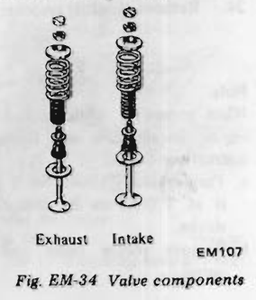
>
> - **Summary:** Exploded stack of exhaust and intake valve train parts.
> - **Components:** Rocker guide, Valve collets, Spring retainer, Outer spring, Inner spring, Stem oil seal, Spring seat, Intake valve, Exhaust valve
> - **Callouts:** **(Exhaust)** Exhaust valve assembly; **(Intake)** Intake valve assembly
> - **Mechanic Notes:** Do not misplace spring seat, oil seal, valve collet, or rocker guide. Keep bearing towers intact to maintain bore line.
> - **Tags:** `valve components`, `spring seat`, `stem seal`, `valve collet`

---

<!-- Page 7 (EM-7) -->
# INSPECTION AND REPAIR

## CONTENTS

| Section | Page | Section | Page |
| :--- | :--- | :--- | :--- |
| PREPARATION FOR INSPECTION | EM-7 | PISTONS, PISTON PINS AND PISTON RINGS | EM-15 |
| CYLINDER HEAD AND VALVE | EM-7 | CONNECTING ROD | EM-16 |
| CHECKING CYLINDER HEAD MATING FACE | EM-7 | CRANKSHAFT | EM-16 |
| VALVE ASSEMBLY | EM-7 | BUSHING AND BEARING | EM-17 |
| VALVE SPRING | EM-8 | MEASUREMENT OF MAIN BEARING CLEARANCE | EM-17 |
| ROCKER ARM AND VALVE ROCKER PIVOT | EM-9 | MEASUREMENT OF CONNECTING ROD BEARING CLEARANCE | EM-17 |
| VALVE GUIDE | EM-9 | FITTING BEARINGS | EM-18 |
| VALVE SEAT | EM-10 | MISCELLANEOUS COMPONENTS | EM-19 |
| CAMSHAFT AND CAMSHAFT BEARING | EM-11 | CRANKSHAFT SPROCKET, CAMSHAFT SPROCKET | EM-19 |
| CAMSHAFT BEARING CLEARANCE | EM-11 | CHAIN TENSIONER AND CHAIN GUIDE | EM-20 |
| VALVE TIMING | EM-11 | FLYWHEEL | EM-20 |
| CAMSHAFT ALIGNMENT | EM-12 | FRONT COVER AND REAR OIL SEAL | EM-20 |
| CYLINDER BLOCK | EM-12 | | |
| HOW TO MEASURE CYLINDER BORE | EM-13 | | |
| CYLINDER BORING | EM-13 | | |

### PREPARATION FOR INSPECTION
1. Before cleaning, check for signs of water or oil leaks in cylinder block and head.
2. Clean oil and carbon deposits from all parts. They should be free of gaskets or sealant.
3. Clean all oil holes with solvent and dry with compressed air. Make sure that they are not restricted.

### CYLINDER HEAD AND VALVE

#### CHECKING CYLINDER HEAD MATING FACE

> [!CAUTION]
> Never remove camshaft bearings unless you have a suitable machine for boring camshaft bearing in line. If you once remove camshaft bearings, bearing centers will come out of alignment; reconditioning is very difficult without center borings.

1. Make a visual check for cracks and flaws.
2. Measure the surface of cylinder head (on cylinder block side) for warpage. If it is found to be beyond the limit designated below, regrind the affected surface with a surface grinder.

> 🖼️ **Fig. EM-35 Checking cylinder head surface** `[EM435]` *(Type: `inspection_measurement`)*
>
> 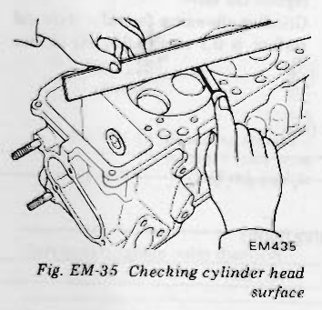
>
> - **Summary:** Checking cylinder head mating deck warpage using a precision straightedge and feeler gauge.
> - **Components:** Cylinder head, Straight edge, Feeler gauge
> - **Specs / Measurements:** Flatness standard: < 0.05 mm (0.0020 in); Flatness maximum: 0.1 mm (0.004 in)
> - **Mechanic Notes:** Measure along length, width, and diagonals of head deck surface.
> - **Tags:** `cylinder head`, `surface flatness`, `warpage`, `straightedge`

**Head surface flatness**

| Standard | Maximum |
| :--- | :--- |
| less than 0.05 mm (0.0020 in) | 0.1 mm (0.004 in) |

**Surface grinding limit**
The grinding limit of cylinder head can be determined from the cylinder block grinding.
* Depth of cylinder head grinding is "A".
* Depth of cylinder block grinding is "B".

The limit is as follows:
$$\text{A} + \text{B} = 0.2\text{ mm (0.008 in)}$$

#### VALVE ASSEMBLY
1. Check each intake and exhaust valve for worn, damaged or deformed valve caps or stems. Correct or replace any valve that is faulty.
2. Valve face or valve stem end surface should be refaced with a valve grinder.

> 🖼️ **Fig. EM-36 Intake and exhaust valve dimensions** `[EM295]` *(Type: `inspection_measurement`)*
>
> 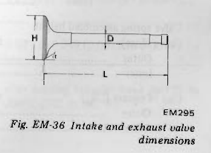
>
> - **Summary:** Dimensional diagram of poppet valve denoting head diameter H, stem diameter D, overall length L, and face angle α.
> - **Components:** Valve head, Valve stem, Valve face
> - **Callouts:** **(H)** Valve head diameter; **(D)** Valve stem diameter; **(L)** Valve length; **(α)** Valve seat angle
> - **Specs / Measurements:** H: Head diameter; D: Stem diameter; L: Length; α: 45°30'
> - **Mechanic Notes:** Reface valve face and stem tip with valve grinder within specifications.
> - **Tags:** `valve dimensions`, `valve head`, `valve stem`, `seat angle` <!-- Page 8 (EM-8) --> ### VALVE ASSEMBLY (CONTINUED)

| Dimension | Valve | Dimension mm (in) |
| :--- | :--- | :--- |
| H (Valve head diameter mm (in)) | In. | 44.0 to 44.2 (1.732 to 1.740) |
| H | Ex. | 35.0 to 35.2 (1.378 to 1.386) |
| L (Valve length mm (in)) | In. | 114.9 to 115.2 (4.52 to 4.54) |
| L | Ex. | 115.7 to 116.0 (4.56 to 4.57) |
| D (Valve stem diameter mm (in)) | In. | 7.965 to 7.980 (0.3136 to 0.3142) |
| D | Ex. | 7.945 to 7.960 (0.3128 to 0.3134) |
| α (Valve seat angle) | In. & Ex. | 45°30' |

> 🖼️ **Fig. EM-37 Checking valve stem diameter** `[EM030]` *(Type: `inspection_measurement`)*
>
> 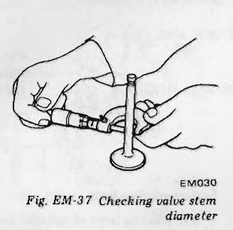
>
> - **Summary:** Measuring valve stem diameter with an outside micrometer.
> - **Components:** Valve stem, Outside micrometer
> - **Specs / Measurements:** Intake: 7.965 to 7.980 mm; Exhaust: 7.945 to 7.960 mm
> - **Mechanic Notes:** Measure at top, center, and bottom of stem travel zone.
> - **Tags:** `valve stem`, `micrometer`, `measurement`

> 🖼️ **Fig. EM-38 Regrinding valve face** `[EM111]` *(Type: `procedure_step`)*
>
> 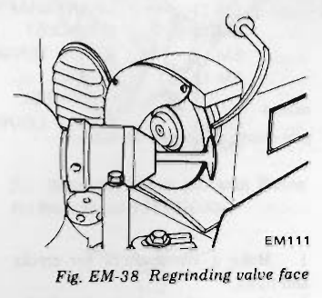
>
> - **Summary:** Grinding poppet valve face on a specialized valve refacing machine.
> - **Components:** Valve, Grinding wheel, Valve chuck
> - **Specs / Measurements:** Valve face angle: 45°30'; Min margin thickness: 0.5 mm (0.020 in)
> - **Mechanic Notes:** Replace valve if margin thickness drops to 0.5 mm (0.020 in) or less.
> - **Tags:** `valve grinding`, `refacing`, `seat angle`

> [!NOTE]
> * When valve head has been worn down to 0.5 mm (0.020 in) in thickness, replace the valve.
> * Grinding allowance for valve stem end surface is 0.5 mm (0.020 in) or less.

### VALVE SPRING
1. Check valve spring for squareness using a steel square and surface plate. If spring is out of square ("S" in Figure EM-39) beyond specified limit, replace.
2. Measure the free length and tension of each spring. If the measured value exceeds specified limit, replace spring.

> 🖼️ **Fig. EM-39 Measuring spring squareness** `[EM296]` *(Type: `inspection_measurement`)*
>
> 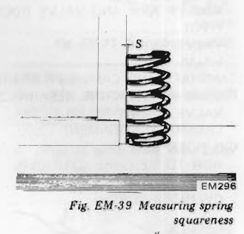
>
> - **Summary:** Checking valve spring squareness against a machinist square on a flat surface plate.
> - **Components:** Valve spring, Machinist steel square, Surface plate
> - **Callouts:** **(S)** Out of square gap S
> - **Specs / Measurements:** Outer spring limit S: 2.2 mm (0.087 in); Inner spring limit S: 1.2 mm (0.047 in)
> - **Mechanic Notes:** Rotate spring along square to find maximum gap S.
> - **Tags:** `valve spring`, `squareness`, `machinist square`

> 🖼️ **Fig. EM-40 Measuring spring tension** `[EM113]` *(Type: `inspection_measurement`)*
>
> 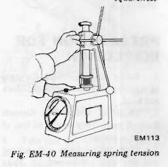
>
> - **Summary:** Testing valve spring load at specified compressed lengths on a spring tester.
> - **Components:** Valve spring tester, Valve spring, Dial load indicator
> - **Specs / Measurements:** Outer open load: 49.0 kg @ 29.5 mm; Inner open load: 25.5 kg @ 24.5 mm; Outer closed load: 21.3 kg @ 40.0 mm; Inner closed load: 12.3 kg @ 35.0 mm
> - **Mechanic Notes:** Replace springs not meeting load specifications at installed and open heights.
> - **Tags:** `valve spring tester`, `spring load`, `tension`

**Valve spring specifications**

| Item | Unit | Value |
| :--- | :--- | :--- |
| Valve spring free length: Outer | mm (in) | 49.98 (1.9677) |
| Valve spring free length: Inner | mm (in) | 44.85 (1.7657) |
| Valve spring pressured length (valve open): Intake Outer | mm/kg (in/lb) | 29.5/49.0 (1.161/108.0) |
| Valve spring pressured length (valve open): Intake Inner | mm/kg (in/lb) | 24.5/25.5 (0.965/56.2) |
| Valve spring pressured length (valve open): Exhaust Outer | mm/kg (in/lb) | 29.5/49.0 (1.161/108.0) |
| Valve spring pressured length (valve open): Exhaust Inner | mm/kg (in/lb) | 24.5/25.5 (0.965/56.2) |
| Valve spring assembled height (valve close): Outer | mm/kg (in/lb) | 40.0/21.3 (1.575/47.0) |
| Valve spring assembled height (valve close): Inner | mm/kg (in/lb) | 35.0/12.3 (1.378/27.1) |
| Out of square ("S"): Outer | mm (in) | 2.2 (0.087) |
| Out of square ("S"): Inner | mm (in) | 1.2 (0.047) |

---

<!-- Page 9 (EM-9) -->
### ROCKER ARM AND VALVE ROCKER PIVOT
Check pivot head and cam contact and pivot contact surfaces of rocker arm for damage or wear. If damage is found, replace them. A faulty pivot must be replaced together with its corresponding rocker arm.

### VALVE GUIDE
Measure clearance between valve guide and valve stem. If clearance exceeds designated limit, replace worn parts or both valve and valve guide. In this case, it is essential to determine if such a clearance has been caused by a worn or bent valve stem or by a worn valve guide.

> 🖼️ **Fig. EM-41 Valve guide dimensions** `[EM297]` *(Type: `inspection_measurement`)*
>
> 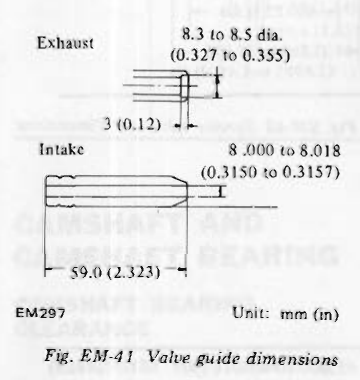
>
> - **Summary:** Dimensional diagrams of intake and exhaust valve guides.
> - **Components:** Intake valve guide, Exhaust valve guide
> - **Callouts:** **(Exhaust)** 8.3 to 8.5 dia. (0.327 to 0.355), 3 (0.12); **(Intake)** 8.000 to 8.018 (0.3150 to 0.3157), 59.0 (2.323)
> - **Specs / Measurements:** Inner dia: 8.000 to 8.018 mm (0.3150 to 0.3157 in); Intake length: 59.0 mm (2.323 in)
> - **Mechanic Notes:** Note difference between intake and exhaust guide snap ring groove / outer step.
> - **Tags:** `valve guide`, `dimensions`, `intake`, `exhaust`

**Determining clearance**
Precise measurement of clearance between valve stem and valve guide requires the aid of a micrometer and a telescope hole gauge. Using these gauges, check the diameter of valve stem in three places; top, center and bottom. Insert telescope hole gauge in valve guide bore, measuring at center. Subtract the highest reading of valve stem diameter from valve guide bore to obtain the stem-to-guide clearance.

**Valve guide specifications**

| Item | Intake valve | Exhaust valve | Wear limit |
| :--- | :--- | :--- | :--- |
| Valve guide inner diameter mm (in) | 8.000 to 8.018 (0.3150 to 0.3157) | 8.000 to 8.018 (0.3150 to 0.3157) | — |
| Valve stem diameter mm (in) | 7.965 to 7.980 (0.3136 to 0.3142) | 7.945 to 7.960 (0.3128 to 0.3134) | — |
| Guide to stem clearance mm (in) | 0.020 to 0.053 (0.0008 to 0.0021) | 0.040 to 0.073 (0.0016 to 0.0029) | 0.1 (0.004) |

As an emergency expedient, a valve can be pushed into valve guide and moved to the left and right. If its tip deflects about 0.2 mm (0.008 in) or more, it indicates that the clearance between stem and guide exceeds the maximum limit of 0.1 mm (0.004 in).

> [!NOTE]
> Valve should be moved in parallel with rocker arm. (Generally, a large amount of wear occurs in this direction.)

> 🖼️ **Fig. EM-42 Measuring clearance between valve stem and valve guide** `[EM115]` *(Type: `inspection_measurement`)*
>
> 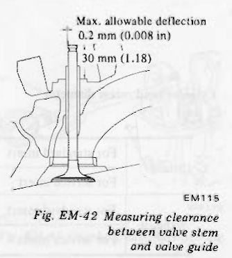
>
> - **Summary:** Emergency deflection check of valve head/stem play within the valve guide.
> - **Components:** Valve, Valve guide, Cylinder head
> - **Callouts:** **(Max. allowable deflection)** 0.2 mm (0.008 in); **(Stem extension)** 30 mm (1.18 in)
> - **Specs / Measurements:** Max allowable deflection: 0.2 mm (0.008 in) at 30 mm (1.18 in) extension
> - **Mechanic Notes:** Deflection should be rocked parallel to the rocker arm sweep direction.
> - **Tags:** `valve guide clearance`, `deflection`, `emergency check`

### Replacement of valve guide
Valve guide of 0.2 mm (0.008 in) oversize diameter is available.
1. To remove old guides, use a drift and a press (under a 2-ton pressure) or a hammer. Drive them out from combustion chamber side toward rocker cover. Heated cylinder head will facilitate the operation.
2. Ream cylinder head side guide hole at room temperature.

> 🖼️ **Fig. EM-43 Valve guide hole for service** `[EM116]` *(Type: `inspection_measurement`)*
>
> 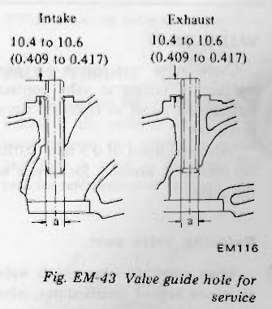
>
> - **Summary:** Cylinder head valve guide boss machining dimensions for oversize service guide installation.
> - **Components:** Cylinder head guide boss, Service guide hole
> - **Callouts:** **(Intake)** 10.4 to 10.6 (0.409 to 0.417); **(Exhaust)** 10.4 to 10.6 (0.409 to 0.417); **(a)** Service valve guide hole inner diameter
> - **Specs / Measurements:** Intake/Exhaust protrusion: 10.4 to 10.6 mm (0.409 to 0.417 in); Hole diameter (a): 12.185 to 12.196 mm
> - **Mechanic Notes:** Maintain 10.4 to 10.6 mm installed height above spring seat.
> - **Tags:** `valve guide boss`, `installed height`, `service guide`

**Service valve guide dimensions**

| Item | Intake | Exhaust |
| :--- | :--- | :--- |
| Service valve guide outer diameter mm (in) | 12.223 to 12.234 (0.4812 to 0.4817) | 12.223 to 12.234 (0.4812 to 0.4817) |
| Service valve guide hole inner diameter (a) mm (in) | 12.185 to 12.196 (0.4797 to 0.4802) | 12.185 to 12.196 (0.4797 to 0.4802) |
| Interference fit of valve guide hole mm (in) | 0.027 to 0.049 (0.0011 to 0.0019) | 0.027 to 0.049 (0.0011 to 0.0019) |

3. Carefully press new valve guide into head so that it will fit smoothly after heating cylinder head to 150 to 200°C (302 to 392°F). <!-- Page 10 (EM-10) --> 4. Ream bore with valve guide pressed in, using Valve Guide Reamer Set KV101039S0.
   * Reaming bore: 8.000 to 8.018 mm (0.3150 to 0.3157 in)
5. Correct valve seat surface with new valve guide as the axis.

> 🖼️ **Fig. EM-44 Reaming valve guide** `[EM609]` *(Type: `special_service_tool`)*
>
> 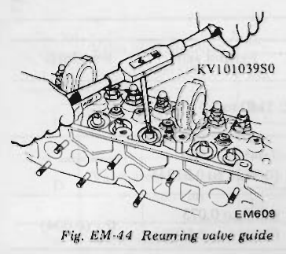
>
> - **Summary:** Hand reaming installed valve guide bore using KV101039S0 reamer set.
> - **Components:** Valve guide, Valve guide reamer set KV101039S0, Cylinder head
> - **Callouts:** **(KV101039S0)** Valve Guide Reamer Set KV101039S0
> - **Specs / Measurements:** Finished bore: 8.000 to 8.018 mm (0.3150 to 0.3157 in)
> - **Mechanic Notes:** Ream after guide is fully pressed into head and cooled.
> - **Tags:** `valve guide reamer`, `KV101039S0`, `bore sizing`

### VALVE SEAT
Check valve seat inserts for any evidence of pitting at valve contact surface, and reseat or replace if worn excessively.

Valve seat insert of 0.5 mm (0.020 in) oversize is available for service in this engine.

#### Refacing valve seat
When width of valve seat is wide or narrow beyond specifications, valve seat should be refaced with cutter or grinding stone.

> 🖼️ **Fig. EM-45 Correcting valve seat** `[EM436]` *(Type: `special_service_tool`)*
>
> 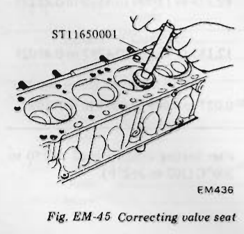
>
> - **Summary:** Refacing valve seat using seat cutter ST11650001 with pilot arbor centered in guide.
> - **Components:** Valve seat cutter ST11650001, Pilot arbor, Valve seat, Cylinder head
> - **Callouts:** **(ST11650001)** Cutter Set Valve Seat ST11650001
> - **Mechanic Notes:** Use newly installed valve guide bore as center axis.
> - **Tags:** `valve seat cutter`, `ST11650001`, `refacing`

> 🖼️ **Fig. EM-46 Service valve seat dimensions** `[EM300]` *(Type: `inspection_measurement`)*
>
> 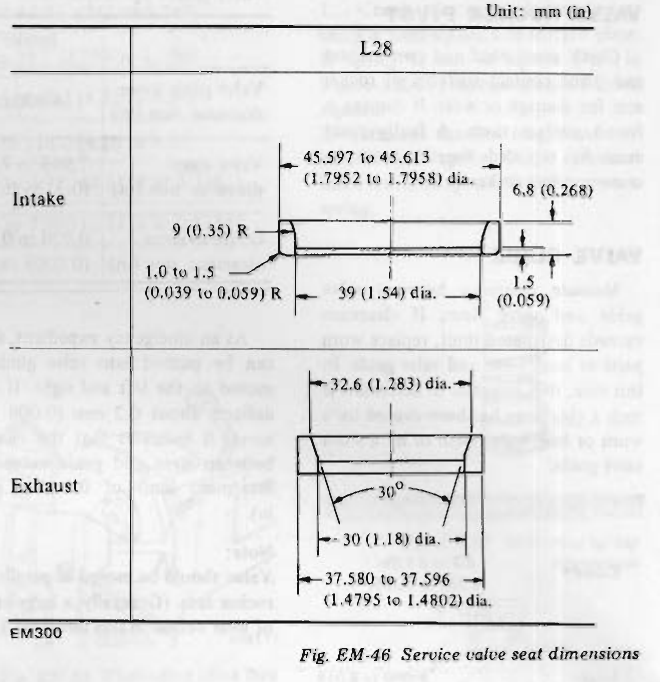
>
> - **Summary:** Sectional profile and service insert dimensions for L28 intake and exhaust valve seats.
> - **Components:** Service intake valve seat, Service exhaust valve seat
> - **Specs / Measurements:** Intake outer dia: 45.597 to 45.613 mm (1.7952 to 1.7958 in); Intake thickness: 6.8 mm (0.268 in); Intake inner dia: 39 mm (1.54 in); Exhaust outer dia: 37.580 to 37.596 mm (1.4795 to 1.4802 in); Exhaust inner dia: 30 mm (1.18 in); Exhaust angle: 30°
> - **Mechanic Notes:** Ensure counterbore depth stop is set accurately to prevent cutting into aluminum head base.
> - **Tags:** `service valve seat`, `oversize seat`, `dimensions`

**Cylinder head recess diameter**

| Item | Type | Dimension mm (in) |
| :--- | :--- | :--- |
| Intake | For standard insert | 45.000 to 45.016 (1.7717 to 1.7723) |
| Intake | For service insert | 45.500 to 45.516 (1.7913 to 1.7920) |
| Exhaust | For standard insert | 37.000 to 37.016 (1.4567 to 1.4573) |
| Exhaust | For service insert | 37.500 to 37.516 (1.4764 to 1.4770) |

**Interference fit mm (in)**

| Item | Intake | Exhaust |
| :--- | :--- | :--- |
| Interference fit mm (in) | 0.081 to 0.113 (0.0032 to 0.0044) | 0.064 to 0.096 (0.0025 to 0.0038) |

#### Replacing valve seat insert
1. Old insert can be removed by boring it out until it collapses. The machine depth stop should be set so that boring cannot continue beyond the bottom face of the insert recess in cylinder head.
2. Select a suitable valve seat insert and check its outside diameter. <!-- Page 11 (EM-11) --> 3. Machine cylinder head recess to the concentric circles in valve guide center so that insert will have the correct fit.
4. Ream the cylinder head recess at room temperature.
5. Heat cylinder head to a temperature of 150 to 200°C (302 to 392°F).
6. Fit insert ensuring that it beds on the bottom face of its recess, and caulk more than 4 points.
7. Valve seats newly fitted should be cut or ground using Cutter Set Valve Seat ST11650001 at the specified dimensions as shown in Figure EM-47.
8. Apply small amount of fine grinding compound to valve contacting face and put valve into guide. Lap valve against its seat until proper valve seating is obtained. Remove valve and then clean valve and valve seat.

> 🖼️ **Fig. EM-47 Standard valve seat dimensions**  *(Type: `inspection_measurement`)*
>
> 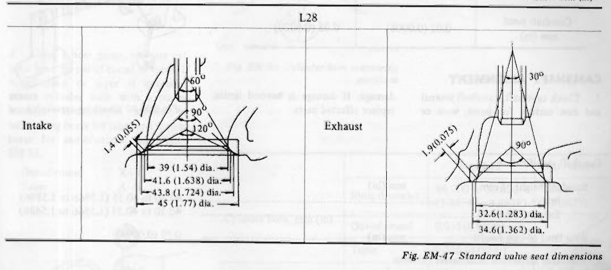
>
> - **Summary:** Standard valve seat cut angles and contact widths for L28 intake and exhaust valves.
> - **Components:** Intake valve seat, Exhaust valve seat
> - **Specs / Measurements:** Intake angles: 60°, 90°, 120°; Intake contact width: 1.4 mm (0.055 in); Intake seat diameters: 39 mm, 41.6 mm, 43.8 mm, 45 mm; Exhaust angles: 30°, 90°; Exhaust contact width: 1.9 mm (0.075 in); Exhaust seat diameters: 32.6 mm, 34.6 mm
> - **Mechanic Notes:** Use 3-angle cut to position contact width centered on valve face.
> - **Tags:** `valve seat dimensions`, `seat angles`, `seat width`

### CAMSHAFT AND CAMSHAFT BEARING

#### CAMSHAFT BEARING CLEARANCE
Measure the inside diameter of camshaft bearing with an inside dial gauge and the outside diameter of camshaft journal with a micrometer. If wear is found inside bracket, replace cylinder head assembly.

> 🖼️ **Fig. EM-48 Checking camshaft bearing** `[EM119]` *(Type: `inspection_measurement`)*
>
> 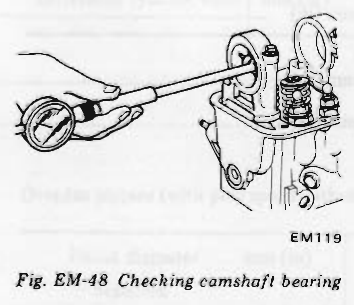
>
> - **Summary:** Checking camshaft bearing tower internal bore with a cylinder bore/dial indicator gauge.
> - **Components:** Camshaft bearing tower, Inside dial indicator gauge, Cylinder head
> - **Specs / Measurements:** Bearing ID standard: 48.000 to 48.016 mm (1.8898 to 1.8904 in); Oil clearance limit: 0.1 mm (0.004 in)
> - **Mechanic Notes:** If bearing tower is worn beyond limit, replace cylinder head assembly (towers are integral).
> - **Tags:** `camshaft bearing`, `bore gauge`, `clearance`

**Camshaft journal to bearing clearance**

| L28 | Standard | Wear limit |
| :--- | :--- | :--- |
| Oil clearance mm (in) | 0.038 to 0.067 (0.0015 to 0.0026) | 0.1 (0.004) |
| Inner diameter of camshaft bearing mm (in) | 48.000 to 48.016 (1.8898 to 1.8904) | — |

### VALVE TIMING
This diagram will apply to all cylinders. If any valve is found out of specifications, one possibility is that cam lobe is worn or damaged. This calls for replacement of camshaft.

> 🖼️ **Fig. EM-49 Valve timing diagram** `[EM120]` *(Type: `graph_chart`)*
>
> 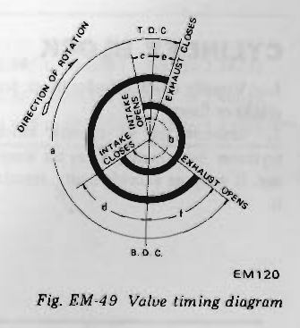
>
> - **Summary:** Polar circular timing diagram depicting intake open/close and exhaust open/close events relative to TDC and BDC.
> - **Components:** Intake duration arc, Exhaust duration arc, TDC mark, BDC mark
> - **Callouts:** **(a)** Intake open duration; **(b)** Exhaust open duration; **(c)** Intake opens BTDC; **(d)** Intake closes ABDC; **(e)** Exhaust closes ATDC; **(f)** Exhaust opens BBDC
> - **Specs / Measurements:** See timing angle specifications table on EM-12
> - **Mechanic Notes:** Rotation is clockwise; applies to all six cylinders.
> - **Tags:** `valve timing`, `cam timing`, `diagram`, `overlap` <!-- Page 12 (EM-12) --> ### VALVE TIMING (CONTINUED)

**Unit: degree**

| a | b | c | d | e | f |
| :--- | :--- | :--- | :--- | :--- | :--- |
| 248 | 248 | 16 | 52 | 14 | 54 |

* a: Intake duration: 248°
* b: Exhaust duration: 248°
* c: Intake opens: 16° BTDC
* d: Intake closes: 52° ABDC
* e: Exhaust closes: 14° ATDC
* f: Exhaust opens: 54° BBDC

**Camshaft bend (L28)**

| L28 | Standard | Bend limit |
| :--- | :--- | :--- |
| Camshaft bend mm (in) | 0.02 (0.0008) | 0.05 (0.0020) |

### CAMSHAFT ALIGNMENT
1. Check camshaft, camshaft journal and cam surface for bend, wear or damage. If damage is beyond limits, replace affected parts.
2. A bend value is one-half of the reading obtained when camshaft is turned one full revolution with a dial gauge applied to the center journal.

> 🖼️ **Fig. EM-50 Checking camshaft bend** `[EM302]` *(Type: `inspection_measurement`)*
>
> 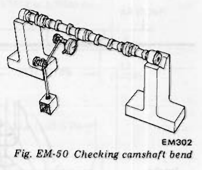
>
> - **Summary:** Camshaft supported in V-blocks at front and rear journals while measuring runout on center journal with dial indicator.
> - **Components:** Camshaft, V-blocks, Dial indicator stand
> - **Specs / Measurements:** Bend standard: 0.02 mm (0.0008 in); Bend limit: 0.05 mm (0.0020 in)
> - **Mechanic Notes:** Bend value is 1/2 of Total Indicator Reading (TIR) over one 360-degree rotation.
> - **Tags:** `camshaft bend`, `runout`, `V-blocks`, `dial gauge`

**Camshaft specifications**

| Item | Unit | Value |
| :--- | :--- | :--- |
| Standard height of cam: Intake | mm (in) | 40.30 to 40.35 (1.5866 to 1.5886) |
| Standard height of cam: Exhaust | mm (in) | 40.30 to 40.35 (1.5866 to 1.5886) |
| Wear limit of cam height | mm (in) | 0.25 (0.0098) |
| Allowable difference in diameter between max. worn and min. worn parts of camshaft journal | mm (in) | 0.05 (0.0020) |
| Maximum tolerance in journal diameter | mm (in) | 0.1 (0.004) |
| Camshaft end play | mm (in) | 0.08 to 0.38 (0.0031 to 0.0150) |

### CYLINDER BLOCK
1. Visually check cylinder block for cracks or flaws.
2. Measure top of cylinder block (cylinder head mating face) for warpage. If warpage exceeds limits, correct it.

**Surface flatness (L28)**

| L28 | Standard | Maximum tolerance |
| :--- | :--- | :--- |
| Surface flatness mm (in) | less than 0.05 (0.0020) | 0.10 (0.0039) |

> [!NOTE]
> **Surface grinding limit**
> Grinding limit of cylinder block can be determined by cylinder head grinding in an engine.
> * Depth of cylinder head grinding is "Hh".
> * Depth of cylinder block grinding is "Hb".
> 
> The limit is as follows:
> $$\text{Hh} + \text{Hb} = 0.20\text{ mm (0.0079 in)}$$

> 🖼️ **Fig. EM-51 Checking cylinder block surface** `[EM303]` *(Type: `inspection_measurement`)*
>
> 
>
> - **Summary:** Checking cylinder block deck flatness using precision straightedge and feeler gauge.
> - **Components:** Cylinder block deck, Precision straightedge, Feeler gauge
> - **Specs / Measurements:** Flatness standard: < 0.05 mm (0.0020 in); Tolerance limit: 0.10 mm (0.0039 in)
> - **Mechanic Notes:** Combined head and block deck resurfacing must not exceed 0.20 mm (0.0079 in).
> - **Tags:** `cylinder block deck`, `warpage`, `straightedge`, `surface flatness` <!-- Page 13 (EM-13) --> ### CYLINDER BLOCK (CONTINUED)

**Surface grinding limit:**
The grinding limit of cylinder block can be determined by the cylinder head grinding in an engine.
* Depth of cylinder head grinding is "A".
* Depth of cylinder block grinding is "B".

The limit is as follows:
$$\text{A} + \text{B} = 0.20\text{ mm (0.0079 in)}$$

3. Using a bore gauge, measure cylinder bore for out-of-round or taper. If out-of-round or taper is excessive, rebore cylinder walls with a boring machine. Measurement should be taken along bores for taper and around bores for out-of-round. See Figure EM-53.
   * Out-of-round: $\text{X} - \text{Y}$
   * Taper: $\text{A} - \text{B}$

> 🖼️ **Fig. EM-52 Measuring cylinder bore diameter** `[EM304]` *(Type: `inspection_measurement`)*
>
> 
>
> - **Summary:** Measuring cylinder bore internal diameter using a precision dial bore indicator gauge.
> - **Components:** Cylinder block, Dial bore gauge
> - **Specs / Measurements:** Standard bore: 86.000 to 86.050 mm (3.3858 to 3.3878 in)
> - **Mechanic Notes:** Check bore diameter at 3 depth levels in both thrust and axial directions.
> - **Tags:** `cylinder bore`, `bore gauge`, `diameter`

> 🖼️ **Fig. EM-53 Cylinder bore measuring positions** `[EM125]` *(Type: `alignment_orientation`)*
>
> 
>
> - **Summary:** Diagram of cylinder bore measuring depths (20 mm, 60 mm, 100 mm from top deck) and axes (X thrust vs Y axial).
> - **Components:** Cylinder bore, Depth positions, Measurement axes
> - **Callouts:** **(A)** 20 mm (0.79 in) from top deck; **(B)** 60 mm (2.36 in) from top deck; **(100)** 100 mm (3.94 in) from top deck; **(X)** Thrust direction; **(Y)** Longitudinal/axial direction; **(Front)** Engine front
> - **Specs / Measurements:** Depths: 20 mm, 60 mm, 100 mm (0.79 in, 2.36 in, 3.94 in)
> - **Mechanic Notes:** Out-of-round = X - Y; Taper = A - B.
> - **Tags:** `measuring positions`, `cylinder bore`, `taper`, `out-of-round`

**Cylinder bore mm (in)**

| Cylinder bore mm (in) | Standard | Wear limit |
| :--- | :--- | :--- |
| Inner diameter | 86.000 to 86.050 (3.3858 to 3.3878) | 0.20 (0.0079) |
| Out-of-round | 0.015 (0.0006) | — |
| Taper | 0.015 (0.0006) | — |
| Difference cylinder bore | 0.05 (0.0020) | 0.20 (0.0079) |

**Oversize pistons (with pin) specifications**

| Piston diameter mm (in) | Type | Value mm (in) |
| :--- | :--- | :--- |
| Standard | Standard | 85.985 to 86.035 (3.3852 to 3.3872) |
| 0.50 (0.0197) | Oversize | 86.465 to 86.515 (3.4041 to 3.4061) |
| 1.00 (0.0394) | Oversize | 86.965 to 87.015 (3.4238 to 3.4258) |

4. When wear, taper or out-of-round is minor and within limits, remove step at topmost portion of cylinder using a ridge reamer or other similar tool.

### HOW TO MEASURE CYLINDER BORE
A bore gauge is used. Measure cylinder bore at top, middle and bottom positions toward A and B directions as shown in Figure EM-53 and record the measured values.

### CYLINDER BORING
1. When any cylinder needs boring, all other cylinders must also be bored at the same time.
2. Determine piston oversize according to amount of wear of cylinder.
3. The size to which cylinders must be honed is determined by adding piston-to-cylinder clearance to the largest piston diameter (at piston skirt in thrust direction). <!-- Page 14 (EM-14) --> ### CYLINDER BORING (CONTINUED)

**Rebored size calculation**
$$\text{D} = \text{A} + \text{B} - \text{C} = \text{A} + [0.005\text{ to }0.025\text{ mm (0.0002 to 0.0010 in)}]$$
where,
* $\text{D}$: Honed diameter
* $\text{A}$: Skirt diameter as measured
* $\text{B}$: Piston-to-wall clearance
* $\text{C}$: Machine allowance $[0.02\text{ mm (0.0008 in)}]$

> 🖼️ **Fig. EM-54 Measuring piston diameter** `[EM126]` *(Type: `inspection_measurement`)*
>
> 
>
> - **Summary:** Measuring piston outside skirt diameter with an outside micrometer.
> - **Components:** Piston, Outside micrometer
> - **Specs / Measurements:** Measure perpendicular to pin axis
> - **Mechanic Notes:** Measure at specified skirt height to determine true size A.
> - **Tags:** `piston diameter`, `skirt measurement`, `micrometer`

> 🖼️ **Fig. EM-55 Measuring piston skirt diameter** `[EM127]` *(Type: `inspection_measurement`)*
>
> 
>
> - **Summary:** Location schematic showing the 21 mm height position on the piston skirt for measuring diameter.
> - **Components:** Piston skirt, Piston pin centerline
> - **Callouts:** **(about 21 mm (0.83 in))** Measurement point 21 mm from bottom of skirt
> - **Specs / Measurements:** about 21 mm (0.83 in) above bottom edge
> - **Mechanic Notes:** Always measure skirt diameter at exactly 21 mm from the bottom edge in thrust direction.
> - **Tags:** `piston skirt`, `measuring point`, `skirt height`

> [!CAUTION]
> a. To prevent strain due to cutting heat, bore cylinders in this order: 1-5-3-6-2-4.
> b. Before boring any cylinder, install main bearing caps in place and tighten to the specification so that the crankshaft bearing bores will not become distorted from the boring operation.

4. Do not cut too much out of cylinder bore at a time. Cut only 0.05 mm (0.0020 in) or so at a time.
5. Measurement of just machined cylinder bore requires utmost care since it is expanded by cutting heat.
6. As a final step, cylinders should be honed to size.
7. Measure the finished cylinder bore for out-of-round or tapered part.
8. Measure piston-to-cylinder clearance. This clearance can be checked easily by using a feeler gauge and a spring balance hooked on feeler gauge, measuring the amount of force required to pull gauge out from between piston and cylinder.

> [!NOTE]
> a. When measuring clearance, slowly pull feeler gauge straight upward.
> b. It is recommended that piston and cylinder be heated to 20°C (68°F).

> 🖼️ **Fig. EM-56 Measuring piston fit in cylinder** `[EM305]` *(Type: `inspection_measurement`)*
>
> 
>
> - **Summary:** Checking piston-to-bore clearance using 0.04 mm feeler gauge strip attached to spring balance scale.
> - **Components:** Piston, Cylinder block, Feeler gauge strip, Spring tension scale
> - **Specs / Measurements:** Feeler gauge thickness: 0.04 mm (0.0016 in); Extracting pull force: 0.2 to 1.5 kg (0.4 to 3.3 lb)
> - **Mechanic Notes:** Slowly pull feeler gauge straight upward; test at 20°C (68°F).
> - **Tags:** `piston fit`, `feeler gauge`, `spring scale`, `pull force`

**Piston-to-cylinder clearance (L28)**

| Item | Unit | L28 |
| :--- | :--- | :--- |
| Standard clearance | mm (in) | 0.025 to 0.045 (0.0010 to 0.0018) |
| Feeler gauge | mm (in) | 0.04 (0.0016) |
| Extracting force | kg (lb) | 0.2 to 1.5 (0.4 to 3.3) |

> [!NOTE]
> If cylinder bore is worn beyond limits, use cylinder liner.
> Oversize cylinder liners are available for service.
> Interference fit of cylinder liner in cylinder block should be 0.08 to 0.09 mm (0.0031 to 0.0035 in).

**Cylinder liner for service (Unit: mm (in))**

| Type | Outside diameter | Inner diameter |
| :--- | :--- | :--- |
| 4.0 (0.157) Oversize | 90.00 to 90.05 (3.5433 to 3.5453) | — |
| 4.5 (0.177) Oversize | 90.50 to 90.55 (3.5630 to 3.5650) | 85.50 to 85.60 (3.3661 to 3.3701) |
| 5.0 (0.197) Oversize | 91.00 to 91.05 (3.5827 to 3.5846) | — |

---

<!-- Page 15 (EM-15) -->
### PISTONS, PISTON PINS AND PISTON RINGS
1. Remove carbon from piston and ring grooves with a carbon scraper and a curved steel wire. Clean out oil slots in bottom land of oil ring groove.
2. Check for damage, scratches and wear. Replace if necessary.
3. Measure side clearance of rings in ring grooves as each ring is installed. Clearance with new pistons and rings should be as follows.

**Side clearance (Unit: mm (in))**

| Ring | Standard L28 | Wear limit |
| :--- | :--- | :--- |
| Top ring | 0.040 to 0.073 (0.0016 to 0.0029) | 0.1 (0.004) |
| Second ring | 0.030 to 0.070 (0.0012 to 0.0028) | 0.1 (0.004) |

> 🖼️ **Fig. EM-57 Measuring piston ring side clearance** `[EM129]` *(Type: `inspection_measurement`)*
>
> 
>
> - **Summary:** Measuring side clearance between piston ring and ring land using a feeler gauge.
> - **Components:** Piston, Piston ring, Feeler gauge
> - **Specs / Measurements:** Top ring standard: 0.040 to 0.073 mm; Second ring standard: 0.030 to 0.070 mm; Wear limit: 0.1 mm
> - **Mechanic Notes:** Measure around entire circumference of groove.
> - **Tags:** `ring side clearance`, `piston rings`, `feeler gauge`

**Ring gap (Unit: mm (in))**

| Ring | Standard L28 | Wear limit |
| :--- | :--- | :--- |
| Top ring | 0.25 to 0.40 (0.0098 to 0.0157) | 1.0 (0.039) |
| Second ring | 0.30 to 0.50 (0.0118 to 0.0197) | 1.0 (0.039) |
| Oil ring | 0.30 to 0.90 (0.0118 to 0.0354) | 1.0 (0.039) |

4. Push ring into cylinder with a piston so as to place it squarely in cylinder; measure ring gap with a feeler gauge. Ring should be placed to diameter at upper or lower limit of ring travel.

> 🖼️ **Fig. EM-58 Measuring ring gap** `[EM130]` *(Type: `inspection_measurement`)*
>
> 
>
> - **Summary:** Checking piston ring end gap in cylinder bore using feeler gauge after squaring ring with inverted piston.
> - **Components:** Cylinder bore, Piston ring, Feeler gauge
> - **Specs / Measurements:** Top ring gap: 0.25 to 0.40 mm; Second ring gap: 0.30 to 0.50 mm; Oil ring gap: 0.30 to 0.90 mm; Wear limit: 1.0 mm
> - **Mechanic Notes:** Square ring inside bore using piston crown before taking measurement.
> - **Tags:** `ring gap`, `end gap`, `feeler gauge`

> [!NOTE]
> a. When piston ring only is to be replaced, without cylinder bore being corrected, measure gap at bottom of cylinder where wear is minor.
> b. Oversize piston rings are available for service. [0.5 mm (0.020 in), 1.0 mm (0.039 in) oversize]

5. Measure piston pin hole in relation to outer diameter of pin. If wear exceeds limit, replace each piston pin together with piston on which it is installed.
6. Determine the fitting of piston pin into piston pin hole to such an extent that it can be finger pressed at room temperature. This piston pin must be a tight press fit into connecting rod.

> 🖼️ **Fig. EM-59 Piston pin fitting** `[EM131]` *(Type: `procedure_step`)*
>
> 
>
> - **Summary:** Manual thumb-push check of piston pin fit in piston bosses at room temperature.
> - **Components:** Piston, Piston pin
> - **Specs / Measurements:** Pin to piston clearance: 0.006 to 0.013 mm (0.0002 to 0.00051 in)
> - **Mechanic Notes:** Pin should be a snug finger-push fit at room temperature (20°C / 68°F).
> - **Tags:** `piston pin`, `pin fit`, `inspection`

> 🖼️ **Fig. EM-60 Measuring piston pin diameter** `[EM132]` *(Type: `inspection_measurement`)*
>
> 
>
> - **Summary:** Measuring piston pin outside diameter using micrometer.
> - **Components:** Piston pin, Outside micrometer
> - **Specs / Measurements:** OD standard: 20.993 to 20.998 mm (0.8265 to 0.8267 in)
> - **Mechanic Notes:** Measure at center and both ends.
> - **Tags:** `piston pin`, `pin OD`, `micrometer`

**Piston pin specifications (Unit: mm (in))**

| Item | L28 |
| :--- | :--- |
| Piston pin outside diameter | 20.993 to 20.998 (0.8265 to 0.8267) |
| Piston pin hole diameter | 21.001 to 21.008 (0.8268 to 0.8271) |
| Piston pin to piston clearance | 0.006 to 0.013 (0.0002 to 0.00051) |
| Interference fit of piston pin to connecting rod | 0.015 to 0.033 (0.00059 to 0.00130) |

---

<!-- Page 16 (EM-16) -->
### CONNECTING ROD

**Connecting rod bend or torsion (per 100 mm or 3.94 in length)**

| Item | Standard | Maximum |
| :--- | :--- | :--- |
| Connecting rod bend or torsion mm (in) | 0.03 (0.0012) | 0.05 (0.0020) |

**Big end play mm (in)**

| L28 | Standard | Maximum |
| :--- | :--- | :--- |
| Big end play mm (in) | 0.2 to 0.3 (0.008 to 0.012) | 0.6 (0.024) |

1. If a connecting rod has any flaw on either side of the thrust face or the large end, correct or replace it.

> 🖼️ **Fig. EM-61 Checking rod alignment** `[EM133]` *(Type: `special_service_tool`)*
>
> 
>
> - **Summary:** Checking connecting rod bend and twist on an alignment arbor fixture with feeler feelers.
> - **Components:** Connecting rod, Alignment fixture arbor, Feeler gauge
> - **Specs / Measurements:** Bend/torsion limit: 0.05 mm per 100 mm (0.0020 in per 3.94 in)
> - **Mechanic Notes:** Check both bend and twist on dedicated aligner fixture.
> - **Tags:** `connecting rod`, `rod aligner`, `bend`, `twist`

> 🖼️ **Fig. EM-62 Checking big end play** `[EM134]` *(Type: `inspection_measurement`)*
>
> 
>
> - **Summary:** Measuring connecting rod big end side thrust clearance on crank journal using feeler gauge.
> - **Components:** Connecting rod big end, Crankshaft journal, Feeler gauge
> - **Specs / Measurements:** Big end play standard: 0.2 to 0.3 mm (0.008 to 0.012 in); Maximum: 0.6 mm (0.024 in)
> - **Mechanic Notes:** Measure between connecting rod thrust cheek and crank journal shoulder.
> - **Tags:** `big end play`, `side clearance`, `thrust clearance`

2. Check connecting rod for bend or torsion using a connecting rod aligner. If bend or torsion exceeds the limit, correct or replace.
3. When replacing connecting rod, select rod so that weight difference between new and old ones is within 7 gr (0.25 oz).
4. Install connecting rods with bearings on to corresponding crank pins and measure thrust clearance. If measured value exceeds the limit, replace.

### CRANKSHAFT
1. Whenever crankshaft is removed from engine, it should be cleaned thoroughly in a suitable solvent. After cleaning, check crankshaft journal and crank pin for score, bias wear or cracks. Repair or replace as required. If damage is minor, dress with fine crocus cloth.
2. Check journals and crank pins for taper and out-of-round with a micrometer. Measurement should be taken along journals for taper and around journals for out-of-round. See Figure EM-63 for detailed information.

> 🖼️ **Fig. EM-63 Crankshaft and journal dimensions** `[EM306]` *(Type: `inspection_measurement`)*
>
> 
>
> - **Summary:** Crankshaft schematic showing main journal and rod pin diameters, journal widths, and measuring axes.
> - **Components:** Crankshaft, Main journals, Crank pins
> - **Callouts:** **(All main journal)** 54.942 to 54.955 (2.1631 to 2.1636); **(All crank pin)** 49.961 to 49.974 (1.9670 to 1.9683); **(Out-of-round)** X - Y; **(Taper)** A - B
> - **Specs / Measurements:** Main journal dia: 54.942 to 54.955 mm (2.1631 to 2.1636 in); Crank pin dia: 49.961 to 49.974 mm (1.9670 to 1.9683 in); Main journal widths: 30.5 mm, 19.5 mm, 27 mm, 19.5 mm; Crank pin width: 39.5 mm (1.555 in)
> - **Mechanic Notes:** Out-of-round: X-Y; Taper: A-B. Standard limit < 0.01 mm.
> - **Tags:** `crankshaft dimensions`, `main journal`, `crank pin`

If journals or crank pins are tapered or out-of-round beyond limits, replace with a new shaft.

3. Crankshaft bend can be checked by placing it on V-blocks and using a dial gauge with its indicating finger resting on center journal.

> 🖼️ **Fig. EM-64 Checking crankshaft bend** `[EM137]` *(Type: `inspection_measurement`)*
>
> 
>
> - **Summary:** Checking crankshaft runout on V-blocks with a dial indicator resting on center main journal.
> - **Components:** Crankshaft, V-blocks, Dial indicator
> - **Specs / Measurements:** Bend standard: < 0.05 mm (0.0020 in); Max limit: 0.10 mm (0.0039 in)
> - **Mechanic Notes:** Bend is half total dial reading over 360 degree revolution.
> - **Tags:** `crankshaft bend`, `runout`, `dial indicator`

**Taper and out-of-round of journal and crank pin mm (in)**

| L28 | Standard | Maximum |
| :--- | :--- | :--- |
| Taper and out-of-round of journal and crank pin mm (in) | less than 0.01 (0.0004) | 0.03 (0.0012) | <!-- Page 17 (EM-17) --> ### CRANKSHAFT (CONTINUED)

**Crankshaft bend mm (in)**

| L28 | Standard | Maximum |
| :--- | :--- | :--- |
| Crankshaft bend mm (in) | less than 0.05 (0.0020) | 0.10 (0.0039) |

> [!NOTE]
> When measuring bend, use a dial gauge. Bend value is half of the reading obtained when crankshaft is turned one full revolution with a dial gauge attached to its center journal.

4. After regrinding crankshaft, finish it to the necessary size indicated on pages EM-18 and 19 by using an adequate undersize bearing according to the extent of required repair.
5. Install crankshaft in cylinder block and measure crankshaft free end play.

> 🖼️ **Fig. EM-65 Checking crankshaft end play** `[EM307]` *(Type: `inspection_measurement`)*
>
> 
>
> - **Summary:** Measuring crankshaft axial thrust end play using feeler gauge at center thrust main bearing.
> - **Components:** Crankshaft, Center main bearing, Feeler gauge
> - **Specs / Measurements:** End play standard: 0.05 to 0.18 mm (0.0020 to 0.0071 in); Wear limit: 0.3 mm (0.012 in)
> - **Mechanic Notes:** Pry crankshaft back and forth and check clearance with feeler gauge at thrust bearing flange.
> - **Tags:** `crankshaft end play`, `thrust clearance`, `feeler gauge`

**Crankshaft free end play mm (in)**

| L28 | Standard | Wear limit |
| :--- | :--- | :--- |
| Crankshaft free end play mm (in) | 0.05 to 0.18 (0.0020 to 0.0071) | 0.3 (0.012) |

6. At the rear end of crankshaft, check crankshaft pilot bushing for wear or damage. Replace it if damage is detected.

To replace crankshaft rear pilot bushing proceed as follows:
(1) Pull out bushing using Pilot Bushing Puller ST16610001.

> 🖼️ **Fig. EM-66 Pulling out pilot bushing** `[CL088]` *(Type: `special_service_tool`)*
>
> 
>
> - **Summary:** Removing transmission pilot bushing from crankshaft tail with puller ST16610001.
> - **Components:** Pilot bushing, Crankshaft tail, Pilot bushing puller ST16610001
> - **Callouts:** **(ST16610001)** Pilot Bushing Puller ST16610001
> - **Mechanic Notes:** Insert collet fingers behind bushing inside crankshaft rear bore.
> - **Tags:** `pilot bushing`, `bushing puller`, `ST16610001`

(2) Before installing a new bushing, thoroughly clean bushing hole. Press fit bushing so its height above flange end is 6.5 to 7.0 mm (0.256 to 0.276 in). Do not oil bushing.

> 🖼️ **Fig. EM-67 Press-fitting new pilot bushing** `[EM702]` *(Type: `procedure_step`)*
>
> 
>
> - **Summary:** Pressing new pilot bushing into crankshaft flange to specified protrusion depth.
> - **Components:** Pilot bushing, Crankshaft flange, Driver drift
> - **Callouts:** **(Pilot bushing)** Pilot bushing; **(9.5 mm (0.374 in))** Bushing depth / length dimension; **(Protrusion)** 6.5 to 7.0 mm (0.256 to 0.276 in)
> - **Specs / Measurements:** Protrusion height above flange: 6.5 to 7.0 mm (0.256 to 0.276 in); Do not oil bushing
> - **Mechanic Notes:** Do not oil pilot bushing; it is oil-impregnated bronze.
> - **Tags:** `pilot bushing`, `press fit`, `protrusion height`

### BUSHING AND BEARING

#### MEASUREMENT OF MAIN BEARING CLEARANCE
1. Thoroughly clean all bearings, check for scratches, melting, score or wear. Replace bearings if any damage is detected.
2. Crankshaft journals and bearings should be clean and free from dust and dirt before oil clearance is measured.

> 🖼️ **Fig. EM-68 Plastigage** `[EM141]` *(Type: `inspection_measurement`)*
>
> 
>
> - **Summary:** Plastigage wax strip and measurement scale envelope.
> - **Components:** Plastigage strip, Scale envelope
> - **Callouts:** **(Scale)** Comparison envelope scale; **(Plastigage)** Wax gauge strip
> - **Mechanic Notes:** Do not rotate crankshaft while plastigage strip is in place.
> - **Tags:** `plastigage`, `bearing clearance`, `measuring tool`

3. Set main bearing on cap block.
4. Cut a plastigage to width of bearing and place it in parallel with crank pin, getting clear of the oil hole. Install cap on the assembly and tighten them together to the specified torque.
   * Tightening torque: 4.5 to 5.5 kg-m (33 to 40 ft-lb)

> [!NOTE]
> Do not turn crankshaft while plastigage is being inserted.

5. Remove cap, and compare width of the plastigage at its widest part with the scale printed in plastigage envelope.

> 🖼️ **Fig. EM-69 Measuring bearing clearance** `[EM142]` *(Type: `inspection_measurement`)*
>
> 
>
> - **Summary:** Comparing compressed plastigage width against scale envelope to read oil clearance.
> - **Components:** Bearing shell, Compressed plastigage, Paper scale envelope
> - **Specs / Measurements:** Torque cap to 4.5 to 5.5 kg-m (33 to 40 ft-lb)
> - **Mechanic Notes:** Measure at widest part of squashed wax strip.
> - **Tags:** `bearing clearance`, `plastigage`, `measurement`

#### MEASUREMENT OF CONNECTING ROD BEARING CLEARANCE
1. Measure connecting rod bearing clearance in the same manner as above.
   * Tightening torque: 4.5 to 5.5 kg-m (33 to 40 ft-lb) <!-- Page 18 (EM-18) --> ### BUSHING AND BEARING (CONTINUED)

**Bearing oil clearance**

| L28 | Standard | Wear limit |
| :--- | :--- | :--- |
| Main bearing clearance mm (in) | 0.020 to 0.072 (0.0008 to 0.0028) | 0.12 (0.0047) |
| Connecting rod bearing clearance mm (in) | 0.025 to 0.055 (0.0010 to 0.0022) | 0.12 (0.0047) |

2. If clearance exceeds specified value, replace bearing with an undersize bearing and grind crankshaft journal adequately.

### FITTING BEARINGS
Bearings are manufactured with crush to make bearing snug down into its bore. To measure this, proceed as follows:

> 🖼️ **Fig. EM-70 Checking bearing crush** `[EM143]` *(Type: `inspection_measurement`)*
>
> 
>
> - **Summary:** Schematic of bearing shell crush height 'H' protruding above parting face when seated under test weight.
> - **Components:** Bearing shell, Bearing cap / block saddle, Parting line
> - **Callouts:** **(Weight)** Applied test load; **(Bearing)** Bearing shell; **(H Bearing crush)** Crush protrusion height H
> - **Specs / Measurements:** Main bearing crush: 0 to 0.03 mm (0 to 0.0012 in); Connecting rod crush: 0.015 to 0.045 mm (0.0006 to 0.0018 in)
> - **Mechanic Notes:** Lock one side flush and measure protrusion H at opposite parting face with feeler gauge.
> - **Tags:** `bearing crush`, `feeler gauge`, `fitting bearings`

**Bearing crush**

| Item | Unit | L28 |
| :--- | :--- | :--- |
| All main bearing | mm (in) | 0 to 0.03 (0 to 0.0012) |
| All connecting rod bearing | mm (in) | 0.015 to 0.045 (0.0006 to 0.0018) |

1. Set main bearing in main bearing cap recess or cylinder block bearing recess correctly.
2. Lock one side end of bearing and press other side until bearing back surface touches the recess.
3. Then, measure bearing crush "H" with a feeler gauge. See Figure EM-70. The standard bearing crush value is listed above.
4. Handle connecting rod bearing in the same manner as above.

**Main bearing undersize (Unit: mm (in))**

| L28 | Bearing top thickness | Crank journal diameter |
| :--- | :--- | :--- |
| STD | 1.822 to 1.835 (0.0717 to 0.0722) | 54.942 to 54.955 (2.1631 to 2.1636) |
| 0.25 (0.0098) Undersize | 1.947 to 1.960 (0.0767 to 0.0772) | 54.692 to 54.705 (2.1532 to 2.1537) |
| 0.50 (0.0197) Undersize | 2.072 to 2.085 (0.0816 to 0.0821) | 54.442 to 54.455 (2.1434 to 2.1439) |
| 0.75 (0.0295) Undersize | 2.197 to 2.210 (0.0865 to 0.0870) | 54.192 to 54.205 (2.1335 to 2.1341) |
| 1.00 (0.0394) Undersize | 2.322 to 2.335 (0.0914 to 0.0919) | 53.942 to 53.955 (2.1237 to 2.1242) |

---

<!-- Page 19 (EM-19) -->
# Engine Mechanical

### Connecting rod bearing undersize
*Unit: mm (in)*

| L28 | Bearing top thickness | Crank pin diameter |
| :--- | :--- | :--- |
| STD | 1.493 to 1.506 (0.0588 to 0.0593) | 49.961 to 49.974 (1.9670 to 1.9675) |
| 0.06 (0.0024) Undersize | 1.523 to 1.536 (0.0600 to 0.0605) | 49.901 to 49.914 (1.9646 to 1.9651) |
| 0.12 (0.0047) Undersize | 1.553 to 1.566 (0.0611 to 0.0617) | 49.841 to 49.854 (1.9622 to 1.9628) |
| 0.25 (0.0098) Undersize | 1.618 to 1.631 (0.0637 to 0.0642) | 49.711 to 49.724 (1.9571 to 1.9576) |
| 0.50 (0.0197) Undersize | 1.743 to 1.756 (0.0686 to 0.0691) | 49.461 to 49.474 (1.9473 to 1.9478) |
| 0.75 (0.0295) Undersize | 1.868 to 1.881 (0.0735 to 0.0741) | 49.211 to 49.224 (1.9374 to 1.9379) |
| 1.00 (0.0394) Undersize | 1.993 to 2.006 (0.0785 to 0.0790) | 48.961 to 48.974 (1.9276 to 1.9281) |

## MISCELLANEOUS COMPONENTS

### CRANKSHAFT SPROCKET, CAMSHAFT SPROCKET

1. Check tooth surface for flaws or wear. Replace sprocket if damage is found.
2. Install camshaft sprocket in position and check for runout. If it exceeds 0.1 mm (0.004 in) total indicator reading, replace camshaft sprocket. Also check for end play.

Camshaft end play: 0.08 to 0.38 mm (0.0031 to 0.0150 in)

> 🖼️ **Fig. EM-71 Checking camshaft sprocket runout** `[EM309]` *(Type: `inspection_measurement`)*
>
> 
>
> - **Summary:** Dial indicator setup measuring runout of camshaft sprocket mounted on camshaft supported on V-blocks.
> - **Components:** Camshaft sprocket, Camshaft, Dial indicator, V-block stand
> - **Specs / Measurements:** Runout limit: 0.1 mm (0.004 in) total indicator reading
> - **Mechanic Notes:** If runout exceeds 0.1 mm (0.004 in), replace camshaft sprocket.
> - **Tags:** `camshaft sprocket`, `runout`, `dial indicator`, `EM309`

> 🖼️ **Fig. EM-72 Checking camshaft end play** `[EM310]` *(Type: `inspection_measurement`)*
>
> 
>
> - **Summary:** Measuring camshaft end play with a feeler gauge inserted between locating plate and camshaft journal front shoulder.
> - **Components:** Camshaft, Locating plate, Feeler gauge
> - **Specs / Measurements:** Camshaft end play: 0.08 to 0.38 mm (0.0031 to 0.0150 in)
> - **Mechanic Notes:** Check end play clearance using feeler gauge between locating plate and camshaft.
> - **Tags:** `camshaft`, `end play`, `feeler gauge`, `EM310`

3. Check chain for damage, excessive wear or stretch at roller links. Replace if faulty.
4. When chain stretches excessively, the valve timing goes out of order. Two location (camshaft set) holes are provided in camshaft sprocket to correct valve timing.
Adjust camshaft sprocket location. If the stretch of chain roller links is excessive, adjust camshaft sprocket location by transferring the camshaft set position of camshaft sprocket to No. 2 or No. 3 holes.
(1) Turn engine until No. 1 piston is at T.D.C. on its compression stroke. Determine whether camshaft sprocket location notch comes off the left end of the oblong groove on camshaft locator plate. (If the location notch is off the left end of the oblong groove, chain stretch is beyond limits.)

> 🖼️ **Fig. EM-73 Camshaft locate plate** `[EM146]` *(Type: `alignment_orientation`)*
>
> 
>
> - **Summary:** Camshaft locate plate showing oblong groove angular range (4° 15') and lower locator notch angle (10°).
> - **Components:** Camshaft locate plate, Oblong groove
> - **Specs / Measurements:** Oblong groove angle: 4° 15'; Lower reference angle: 10°
> - **Mechanic Notes:** If camshaft sprocket location notch comes off the left end of the oblong groove at TDC compression No. 1, chain stretch is beyond limits.
> - **Tags:** `camshaft locate plate`, `timing marks`, `oblong groove`, `EM146` <!-- Page 20 (EM-20) --> # Engine Mechanical

> 🖼️ **Fig. EM-74 Adjusting camshaft sprocket location** `[EM311]` *(Type: `alignment_orientation`)*
>
> 
>
> - **Summary:** Comparison diagram showing camshaft sprocket location holes 1 to 3 and timing marks (1) to (3) before and after adjustment.
> - **Components:** Camshaft sprocket, Oblong groove, Location notch, Location holes 1, 2, 3, Timing marks (1), (2), (3)
> - **Callouts:** **((1) to (3))** Timing mark; **(1 to 3)** Location hole
> - **Specs / Measurements:** No. 2 hole adjustment: 4° crankshaft rotation; No. 3 hole adjustment: 8° crankshaft rotation
> - **Mechanic Notes:** When No. 2 hole is used, No. 2 timing mark must also be used. If chain stretch exceeds No. 3 hole capability, replace chain assembly.
> - **Tags:** `camshaft sprocket`, `timing adjustment`, `timing marks`, `EM311`

(2) Turn engine until No. 1 piston is at T.D.C. on its compression stroke, setting camshaft on No. 2 location hole in camshaft sprocket. This No. 2 notch should then be on the right end of the oblong groove. When No. 2 hole is used, No. 2 timing mark must also be used. The amount of the modification is a 4° rotation of crankshaft.
(3) If the valve timing cannot be corrected by using No. 2 hole, use No. 3 hole in the same procedure as above. The amount of modification by using No. 3 hole is an 8° rotation of crankshaft.
(4) When modification becomes impossible even by transferring camshaft location hole, replace chain assembly.

## CHAIN TENSIONER AND CHAIN GUIDE

Check for wear and breakage. Replace if necessary.

> 🖼️ **Fig. EM-75 Camshaft drive mechanism** `[EM147]` *(Type: `exploded_view`)*
>
> 
>
> - **Summary:** Exploded view of the timing chain drive system showing sprockets, chain, guides, and tensioner.
> - **Components:** Camshaft sprocket, Timing chain, Chain tensioner, Chain guide, Crankshaft sprocket
> - **Mechanic Notes:** Inspect tensioner shoe and chain guides for wear or grooves.
> - **Tags:** `camshaft drive mechanism`, `timing chain`, `tensioner`, `chain guide`, `EM147`

## FLYWHEEL

1. Check clutch disc contact surface with flywheel for damage or wear. Repair or replace if necessary.
2. Measure runout of clutch disc contact surface with a dial gauge. If it exceeds 0.15 mm (0.0059 in) total indicator reading, replace it.

> 🖼️ **Fig. EM-76 Checking flywheel deviation** `[EM312]` *(Type: `inspection_measurement`)*
>
> 
>
> - **Summary:** Measuring flywheel clutch friction face runout using a dial indicator mounted on engine block.
> - **Components:** Flywheel, Clutch friction surface, Dial indicator
> - **Specs / Measurements:** Runout limit: 0.15 mm (0.0059 in) total indicator reading; Ring gear heating temp: 180 to 220°C (356 to 428°F)
> - **Mechanic Notes:** Replace flywheel if surface runout exceeds 0.15 mm (0.0059 in).
> - **Tags:** `flywheel`, `runout`, `dial gauge`, `ring gear`, `EM312`

3. Check tooth surfaces of ring gear for flaws or wear. Replace if necessary.

> [!NOTE]
> Replace ring gear at about 180 to 220°C (356 to 428°F).

## FRONT COVER AND REAR OIL SEAL

First check front cover and rear oil seal for worn or folded over sealing lip or oil leakage. If necessary, install a new seal. When installing a new seal, pay attention to mounting direction.

> [!NOTE]
> It is good practice to renew oil seal whenever engine is overhauled.

> 🖼️ **Fig. EM-77 Oil seal of crankshaft** `[EM150]` *(Type: `alignment_orientation`)*
>
> 
>
> - **Summary:** Cross-sectional orientation diagram for front cover and rear crankshaft oil seals showing front direction.
> - **Components:** Front oil seal, Rear oil seal, Sealing lip
> - **Mechanic Notes:** Pay attention to mounting direction. Install new seals during engine overhaul.
> - **Tags:** `crankshaft oil seal`, `front seal`, `rear seal`, `mounting direction`, `EM150`

---

<!-- Page 21 (EM-21) -->
# Engine Mechanical

# ENGINE ASSEMBLY

## CONTENTS

| Section | Page |
| :--- | :--- |
| PRECAUTIONS | EM-21 |
| CYLINDER HEAD | EM-21 |
| PISTON AND CONNECTING ROD | EM-22 |
| ENGINE ASSEMBLY | EM-22 |

## PRECAUTIONS

1. Use thoroughly cleaned parts. Especially, make sure that oil holes are clear of foreign matter.
2. When installing sliding parts such as bearings, be sure to apply engine oil to them.
3. Use new packings and oil seals.
4. Do not reuse lock washers.
5. Keep tools and work benches clean.
6. Keep necessary parts and tools near at hand.
7. Be sure to follow specified tightening torque and order.
8. Applying sealant
Use sealant to eliminate water and oil leaks. Parts requiring sealant are:
(1) Front cover and corners of cylinder block: See Figure EM-78.
(2) Main bearing cap and cylinder block: Each side of rear main bearing cap and each corner of cylinder block. See Figure EM-79.
(3) Cylinder block: Step portions at four mating surfaces (cylinder block to rear main bearing cap). See Figure EM-80.

> [!NOTE]
> Do not apply too much sealant.

> 🖼️ **Fig. EM-78 Applying sealant (Front cover and gasket)** `[EM153]` *(Type: `procedure_step`)*
>
> 
>
> - **Summary:** Front of cylinder block showing sealant application points at front cover gasket corners.
> - **Components:** Cylinder block, Front cover gasket, Mating surface corners
> - **Mechanic Notes:** Apply sealant at corners of front cover and cylinder block.
> - **Tags:** `sealant`, `front cover`, `gasket`, `cylinder block`, `EM153`

> 🖼️ **Fig. EM-79 Applying sealant (Main bearing cap and cylinder block)** `[EM314]` *(Type: `procedure_step`)*
>
> 
>
> - **Summary:** Rear main bearing cap showing sealant bead of 20 to 25 mm applied to each side where it mates with cylinder block.
> - **Components:** Cylinder block, Rear main bearing cap, Sealant bead
> - **Specs / Measurements:** Sealant bead length: 20 to 25 mm (0.79 to 0.98 in)
> - **Mechanic Notes:** Apply sealant along sides of rear main bearing cap across 20 to 25 mm (0.79 to 0.98 in).
> - **Tags:** `sealant`, `rear main bearing cap`, `cylinder block`, `EM314`

> 🖼️ **Fig. EM-80 Applying sealant (Cylinder block)** `[EM315]` *(Type: `procedure_step`)*
>
> 
>
> - **Summary:** Oil pan mounting face of cylinder block highlighting four step portions where sealant must be applied.
> - **Components:** Cylinder block, Oil pan mating face, Step portions
> - **Mechanic Notes:** Apply sealant to step portions at four mating surfaces (block to rear main bearing cap and front cover).
> - **Tags:** `sealant`, `cylinder block`, `oil pan mating surface`, `EM315`

## CYLINDER HEAD

1. Valve assembly and valve spring
Using Valve Lifter ST12070000, set valve spring seat in position, and fit valve guide with oil seal.
Assemble valve in the order: valve, inner and outer valve springs, spring retainer, valve collet and valve rocker guide.

> [!NOTE]
> a. Ensure that valve face is free from foreign matter.
> b. Outer valve spring is of an uneven pitch type. Install spring facing painted side to cylinder head surface.
> Painted color; Red

> 🖼️ **Fig. EM-81 Installing valve** `[EM153]` *(Type: `procedure_step`)*
>
> 
>
> - **Summary:** Compressing valve springs on cylinder head using Valve Lifter ST12070000 to insert valve collets.
> - **Components:** Valve, Valve spring, Retainer, Collets, Valve Lifter ST12070000
> - **Specs / Measurements:** Special tool: Valve Lifter ST12070000
> - **Mechanic Notes:** Assemble valve, inner and outer springs, retainer, collets, and rocker guide.
> - **Tags:** `valve assembly`, `valve lifter`, `ST12070000`, `EM153`

> 🖼️ **Fig. EM-82 Installing valve spring** `[EM316]` *(Type: `alignment_orientation`)*
>
> 
>
> - **Summary:** Uneven pitch valve spring showing red painted narrow-pitch side installed toward cylinder head.
> - **Components:** Outer valve spring, Narrow pitch, Wide pitch, Painted end
> - **Specs / Measurements:** Painted color: Red
> - **Mechanic Notes:** Install outer valve spring facing red painted side (narrow pitch) to cylinder head surface.
> - **Tags:** `valve spring`, `uneven pitch`, `narrow pitch`, `painted color red`, `EM316`

2. Valve rocker pivot assembly
Screw valve rocker pivots joined with lock nuts into pivot bushing.
3. Camshaft assembly
Set locating plate and carefully install camshaft in cylinder head. Do not damage the bearing inside. Oblong groove of locating plate must be directed toward front side of engine.

> 🖼️ **Fig. EM-83 Installing camshaft locating plate** `[EM317]` *(Type: `alignment_orientation`)*
>
> 
>
> - **Summary:** Installing camshaft and locating plate into front of cylinder head.
> - **Components:** Camshaft, Locating plate, Oblong groove, Cylinder head
> - **Mechanic Notes:** Oblong groove of locating plate must be directed toward front side of engine. Do not damage bearings.
> - **Tags:** `camshaft`, `locating plate`, `oblong groove`, `EM317` <!-- Page 22 (EM-22) --> # Engine Mechanical

4. Install camshaft sprocket on camshaft and tighten it to specified torque.

Tightening torque: 13 to 15 kg-m (94 to 108 ft-lb)

At this time, check camshaft end play.

> 🖼️ **Fig. EM-84 Installing camshaft sprocket** `[EM318]` *(Type: `procedure_step`)*
>
> 
>
> - **Summary:** Tightening camshaft sprocket retaining bolt on front of cylinder head.
> - **Components:** Camshaft sprocket, Camshaft, Retaining bolt
> - **Specs / Measurements:** Tightening torque: 13 to 15 kg-m (94 to 108 ft-lb)
> - **Mechanic Notes:** Tighten sprocket bolt to 13 to 15 kg-m. Check camshaft end play.
> - **Tags:** `camshaft sprocket`, `torque`, `camshaft end play`, `EM318`

5. Install rocker arms by pressing valve springs down with a screwdriver.

> 🖼️ **Fig. EM-85 Installing rocker arm** `[EM319]` *(Type: `procedure_step`)*
>
> 
>
> - **Summary:** Depressing valve spring with a screwdriver to install rocker arm beneath camshaft lobe.
> - **Components:** Rocker arm, Valve spring, Screwdriver, Camshaft lobe
> - **Mechanic Notes:** Press valve spring down using a screwdriver to seat rocker arm on pivot.
> - **Tags:** `rocker arm`, `valve spring`, `screwdriver`, `EM319`

6. Install valve rocker springs.
7. After assembling cylinder head, turn camshaft until No. 1 piston is at T.D.C. on its compression stroke.

> 🖼️ **Fig. EM-86 Assembling cylinder head** `[EM674]` *(Type: `procedure_step`)*
>
> 
>
> - **Summary:** Assembled cylinder head showing valve train and camshaft rotated so No. 1 is at TDC compression.
> - **Components:** Cylinder head, Camshaft, Camshaft sprocket, Rocker arms
> - **Mechanic Notes:** Turn camshaft until No. 1 piston is at TDC on its compression stroke.
> - **Tags:** `cylinder head assembly`, `TDC`, `timing`, `EM674`

## PISTON AND CONNECTING ROD

1. Assemble pistons, piston pins and connecting rods on the designated cylinder.

> 🖼️ **Fig. EM-87 Installing piston pin** `[EM156]` *(Type: `procedure_step`)*
>
> 
>
> - **Summary:** Pressing piston pin into connecting rod and piston using Pin Press Stand ST13030001.
> - **Components:** Piston, Piston pin, Connecting rod, Pin Press Stand ST13030001
> - **Specs / Measurements:** Fitting force: 0.5 to 1.5 tons; Special tool: ST13030001
> - **Mechanic Notes:** Apply engine oil to pin and small end of rod. Pressing force must be 0.5 to 1.5 tons.
> - **Tags:** `piston pin`, `press stand`, `ST13030001`, `EM156`

> 🖼️ **Fig. EM-88 Assembling piston and connecting rod** `[EM438]` *(Type: `alignment_orientation`)*
>
> 
>
> - **Summary:** Assembly orientation of piston and connecting rod showing front mark notch and connecting rod oil hole.
> - **Components:** Piston, Connecting rod, Front mark, Oil hole
> - **Mechanic Notes:** Oil jet hole must be directed toward right side of cylinder block; notch on piston head toward front of engine.
> - **Tags:** `piston orientation`, `connecting rod`, `front mark`, `oil hole`, `EM438`

> [!NOTE]
> a. Piston is pressed into connecting rod with fitting force of from 0.5 to 1.5 tons; aid of Pin Press Stand ST13030001 is necessary. When pressing piston pin into connecting rod, apply engine oil to pin and small end of connecting rod.
> b. Arrange so that oil jet of connecting rod big end is directed toward right side of cylinder block.
> c. Be sure to install piston in cylinders with notch mark of piston head toward front of engine.

2. Install piston rings
Install top and second rings in right position, with marked side up.

> [!NOTE]
> a. Top ring is chromium-plated on liner contacting face.
> b. Second ring has larger taper surface than top ring.
> c. In the combined oil ring, upper rail is same as lower one.

> 🖼️ **Fig. EM-89 Installing piston ring** `[EM158]` *(Type: `procedure_step`)*
>
> 
>
> - **Summary:** Installing top, second, and oil rings onto piston ring lands using ring expander.
> - **Components:** Piston, Top ring, Second ring, Oil ring, Ring expander
> - **Mechanic Notes:** Install rings with marked side up. Top ring is chrome-plated; second ring has larger taper.
> - **Tags:** `piston rings`, `top ring`, `second ring`, `EM158`

3. Fix bearings on connecting rod and connecting rod cap.

> [!NOTE]
> Clean back side of bearing carefully.

## ENGINE ASSEMBLY

1. The first step in engine assembly is to bolt Engine Attachment ST05340001 to right hand side of cylinder block. Next, install block on Engine Stand ST0501S000 with engine bottom up.
2. Set main bearings at the proper portion of cylinder block.

> 🖼️ **Fig. EM-90 Main bearings** `[EM322]` *(Type: `exploded_view`)*
>
> 
>
> - **Summary:** Arrangement of #1 through #7 main bearings and bearing caps from front to rear.
> - **Components:** Main bearings #1 to #7, Main bearing caps #1 to #7, Center bearing (#4 flanged)
> - **Specs / Measurements:** Only center bearing (No. 4) is flanged type
> - **Mechanic Notes:** All inter-bearings (#2, 3, 5, 6) are same type. Front (#1) and rear (#7) are same type. Upper and lower bearings are interchangeable.
> - **Tags:** `main bearings`, `flanged bearing`, `bearing caps`, `EM322`

3. Install baffle plate including cylinder block net.

> [!NOTE]
> a. Only center bearing (No. 4) is a flanged type.
> b. All inter-bearings are the same type.
> c. Front bearing (No. 1) is also the same type as rear bearing (No. 7).
> d. All upper and lower bearings are interchangeable.

4. Apply engine oil to main bearing surfaces on both sides of cylinder block and cap and then install crankshaft. <!-- Page 23 (EM-23) --> # Engine Mechanical

5. Install main bearing cap and tighten bolts to specified torque.

Tightening torque: 4.5 to 5.5 kg-m (33 to 40 ft-lb)

> [!NOTE]
> a. Apply sealant to each side of rear main bearing cap and each corner of cylinder block as shown in Figure EM-79.
> b. Arrange parts so arrow mark on bearing cap faces toward front of engine.
> c. Prior to tightening bearing cap bolts, place bearing cap in proper position by shifting crankshaft in the axial direction.
> d. Tighten bearing cap bolts gradually in two to three stages outwardly from center bearing in the sequence as shown in Figure EM-91.
> e. After securing bearing cap bolts, ascertain that crankshaft turns smoothly.

> 🖼️ **Fig. EM-91 Torque sequence of cap bolts** `[EM323]` *(Type: `alignment_orientation`)*
>
> 
>
> - **Summary:** Tightening sequence (1 to 14) for the 7 main bearing caps, starting from center bearing #4 and alternating outwards.
> - **Components:** Main bearing caps, Cap bolts (1 to 14), Cylinder block
> - **Specs / Measurements:** Tightening torque: 4.5 to 5.5 kg-m (33 to 40 ft-lb)
> - **Mechanic Notes:** Tighten in 2 to 3 stages outwardly from center bearing in sequence 1 to 14. Arrow marks point forward.
> - **Tags:** `main bearing cap bolts`, `torque sequence`, `EM323`

6. Make sure crankshaft has proper end play.

Crankshaft end play: 0.05 to 0.18 mm (0.0020 to 0.0071 in)

> 🖼️ **Fig. EM-92 Checking crankshaft end play** `[EM324]` *(Type: `inspection_measurement`)*
>
> 
>
> - **Summary:** Checking crankshaft axial end play with a dial indicator positioned at crankshaft nose.
> - **Components:** Crankshaft, Dial indicator, Cylinder block
> - **Specs / Measurements:** Crankshaft end play: 0.05 to 0.18 mm (0.0020 to 0.0071 in)
> - **Mechanic Notes:** Check that crankshaft end play is 0.05 to 0.18 mm and turns smoothly.
> - **Tags:** `crankshaft end play`, `dial indicator`, `EM324`

7. Install side oil seals in rear main bearing cap. Prior to installing, apply sealant to seals.

> 🖼️ **Fig. EM-93 Driving side oil seal** `[EM325]` *(Type: `procedure_step`)*
>
> 
>
> - **Summary:** Driving side oil seals into side slots of rear main bearing cap.
> - **Components:** Rear main bearing cap, Side oil seals, Drift
> - **Mechanic Notes:** Apply sealant to side oil seals prior to driving them into rear main bearing cap.
> - **Tags:** `side oil seal`, `rear main bearing cap`, `sealant`, `EM325`

8. Install rear oil seal using Crankshaft Rear Oil Seal Drift ST15310000. Apply lithium grease to sealing lip of oil seal.

> 🖼️ **Fig. EM-94 Installing rear oil seal** `[EM326]` *(Type: `procedure_step`)*
>
> 
>
> - **Summary:** Driving rear oil seal into block using Rear Oil Seal Drift ST15310000.
> - **Components:** Rear oil seal, Rear Oil Seal Drift ST15310000, Crankshaft
> - **Specs / Measurements:** Special tool: ST15310000
> - **Mechanic Notes:** Apply lithium grease to sealing lip; coat shaft and periphery with engine oil.
> - **Tags:** `rear oil seal`, `drift`, `ST15310000`, `lithium grease`, `EM326`

> [!NOTE]
> When installing oil seal, give coating of engine oil to mating shaft to prevent scratches and folded lip. Also give coating of oil to periphery of oil seal.

9. Install rear end plate.
10. Install flywheel securely, and tighten bolts to specified torque.

Tightening torque: 13 to 15 kg-m (94 to 108 ft-lb)

> 🖼️ **Fig. EM-95 Installing flywheel** `[EM327]` *(Type: `procedure_step`)*
>
> 
>
> - **Summary:** Tightening flywheel fixing bolts on rear crankshaft flange.
> - **Components:** Flywheel, Flywheel fixing bolts, Rear end plate
> - **Specs / Measurements:** Tightening torque: 13 to 15 kg-m (94 to 108 ft-lb)
> - **Mechanic Notes:** Tighten flywheel bolts securely to 13 to 15 kg-m.
> - **Tags:** `flywheel`, `flywheel bolts`, `tightening torque`, `EM327`

11. Insert pistons in corresponding cylinder using Piston Ring Compressor EM03470000.

> 🖼️ **Fig. EM-96 Installing piston-rod assembly** `[EM328]` *(Type: `procedure_step`)*
>
> 
>
> - **Summary:** Installing piston and connecting rod into cylinder using Piston Ring Compressor EM03470000.
> - **Components:** Piston, Connecting rod, Piston Ring Compressor EM03470000, Cylinder bore
> - **Specs / Measurements:** Special tool: EM03470000
> - **Mechanic Notes:** Apply oil to sliding parts; align front notch on piston head toward front of engine.
> - **Tags:** `piston installation`, `ring compressor`, `EM03470000`, `EM328`

> [!NOTE]
> a. Apply engine oil to sliding parts.
> b. Arrange so that notch mark on piston head faces to front of engine.
> c. Install piston rings at 180° to each other, avoiding their fit in the thrust and piston pin directions.

> 🖼️ **Fig. EM-97 Piston ring direction** `[EM165]` *(Type: `alignment_orientation`)*
>
> 
>
> - **Summary:** Orientation of top ring, second ring, and oil ring gaps positioned 180° apart, avoiding thrust and pin directions.
> - **Components:** Top ring gap, Second ring gap, Oil ring gap, Thrust direction, Piston pin direction
> - **Specs / Measurements:** Ring gaps spaced 180° apart
> - **Mechanic Notes:** Stagger ring gaps at 180° to each other, avoiding thrust and pin directions.
> - **Tags:** `piston ring gaps`, `ring orientation`, `180 degrees`, `EM165`

12. Install connecting rod caps.

Tightening torque: 4.5 to 5.5 kg-m (33 to 40 ft-lb)

> 🖼️ **Fig. EM-98 Installing connecting rod cap** `[EM329]` *(Type: `procedure_step`)*
>
> 
>
> - **Summary:** Torquing connecting rod cap nuts onto connecting rod big end.
> - **Components:** Connecting rod cap, Rod cap nuts, Torque wrench
> - **Specs / Measurements:** Tightening torque: 4.5 to 5.5 kg-m (33 to 40 ft-lb)
> - **Mechanic Notes:** Arrange connecting rods and caps so cylinder numbers face in same direction. Torque to 4.5 to 5.5 kg-m.
> - **Tags:** `connecting rod cap`, `torque`, `rod nuts`, `EM329`

> [!NOTE]
> Arrange connecting rods and connecting rod caps so that the cylinder numbers face in the same direction.

13. Make sure that connecting rod big end has proper end play. <!-- Page 24 (EM-24) --> # Engine Mechanical

> 🖼️ **Fig. EM-99 Checking big end play** `[EM167]` *(Type: `inspection_measurement`)*
>
> 
>
> - **Summary:** Measuring connecting rod big end side play with feeler gauge between connecting rod thrust shoulder and crankpin web.
> - **Components:** Connecting rod big end, Crankshaft crankpin, Feeler gauge
> - **Specs / Measurements:** Big end play: 0.2 to 0.3 mm (0.008 to 0.012 in)
> - **Mechanic Notes:** Measure big end side play with feeler gauge. Standard is 0.2 to 0.3 mm.
> - **Tags:** `connecting rod`, `big end play`, `feeler gauge`, `EM167`

Big end play: 0.2 to 0.3 mm (0.008 to 0.012 in)

14. Install cylinder head assembly.

> 🖼️ **Fig. EM-100 Cylinder head bolts** `[EM330]` *(Type: `alignment_orientation`)*
>
> 
>
> - **Summary:** Top view of cylinder head identifying positions of long bolts (A) and short bolts (B).
> - **Components:** Cylinder head, Bolts type A, Bolts type B
> - **Callouts:** **(A)** Head bolt type A (long); **(B)** Head bolt type B (short)
> - **Mechanic Notes:** Ensure type A and type B head bolts are installed in their correct designated positions.
> - **Tags:** `cylinder head bolts`, `bolt types`, `bolt positions`, `EM330`

(1) Thoroughly clean cylinder block and head surface. Do not apply sealant to any other part of cylinder block and head surface.
(2) Turn crankshaft until No. 1 piston is at T.D.C. on its compression stroke.
(3) Make sure that camshaft sprocket location notch and plate oblong groove are aligned at their correct positions.
(4) When installing cylinder head, make sure that all valves are apart from head of pistons.
(5) Do not rotate crankshaft and camshaft separately, or valves will hit head of pistons.
(6) Temporarily tighten two bolts ①, ② shown in Figure EM-106.

Tightening torque: 2 kg-m (14 ft-lb)

15. Install crankshaft sprocket and distributor drive gear and fit oil thrower.

> [!NOTE]
> Make sure that mating marks of crankshaft sprocket face to front.

16. Install timing chain.

> [!NOTE]
> a. Make sure that crankshaft and camshaft keys point upwards.

> 🖼️ **Fig. EM-101 Installing timing chain** `[EM169]` *(Type: `alignment_orientation`)*
>
> 
>
> - **Summary:** Timing chain routing diagram showing sprocket mating marks and 42 chain links between timing marks.
> - **Components:** Chain guide (1), Chain tensioner (2), Crank sprocket (3), Cam sprocket (4), Chain guide (5), Timing chain
> - **Callouts:** **(1)** Chain guide; **(2)** Chain tensioner; **(3)** Crank sprocket; **(4)** Cam sprocket; **(5)** Chain guide
> - **Specs / Measurements:** 42 links between sprocket mating marks
> - **Mechanic Notes:** Align mating marks on timing chain with crankshaft sprocket and camshaft sprocket on the right-hand side. 42 links between marks.
> - **Tags:** `timing chain`, `42 links`, `timing marks`, `chain tensioner`, `EM169`

b. Set timing chain by aligning its mating marks with those of crankshaft sprocket and camshaft sprocket the right hand side. There are forty-two chain links between two mating marks of timing chain.
c. No. 1 hole is factory adjusted. When chain stretches excessively, adjust camshaft sprocket at No. 2 or No. 3 hole.
d. Use a set of timing marks and location hole numbers.
17. Install chain guide to cylinder block.
18. Install chain tensioner.

> [!NOTE]
> Adjust protrusion of chain tensioner spindle to 0 mm (0 in).

> 🖼️ **Fig. EM-102 Installing chain tensioner** `[EM170]` *(Type: `procedure_step`)*
>
> 
>
> - **Summary:** Installing chain tensioner assembly into cylinder block with spindle protrusion adjusted to 0 mm.
> - **Components:** Chain tensioner assembly, Spindle, Cylinder block
> - **Specs / Measurements:** Spindle protrusion: 0 mm (0 in)
> - **Mechanic Notes:** Adjust protrusion of chain tensioner spindle to 0 mm before installing.
> - **Tags:** `chain tensioner`, `spindle protrusion`, `EM170`

19. Press new oil seal in front cover.

> [!NOTE]
> a. Front cover oil seal should be replaced when front cover is disassembled.
> b. Before pressing oil seal into front cover, give coating of engine oil to periphery of oil seal.
> c. This oil seal is a threaded seal type which has improved sealing characteristics. Do not apply grease to sealing lip.

20. Install front cover with gasket in place.

> 🖼️ **Fig. EM-103 Installing front cover** `[EM331]` *(Type: `procedure_step`)*
>
> 
>
> - **Summary:** Front cover mounted on cylinder block showing timing indicator scale.
> - **Components:** Front cover, Timing marks, Cylinder block, Gasket
> - **Specs / Measurements:** Height difference limit: less than 0.15 mm (0.0059 in)
> - **Mechanic Notes:** Check height difference between cylinder block upper face and front cover upper face (must be less than 0.15 mm). Apply sealant as shown in Fig. EM-78.
> - **Tags:** `front cover`, `timing mark`, `height difference`, `EM331`

> [!NOTE]
> a. Apply sealant to front cover and corners of upper section of cylinder block as shown in Figure EM-78.
> b. Install front cover with head gasket in place.
> c. Check the height difference between cylinder block upper face and front cover upper face. Difference must be less than 0.15 mm (0.0059 in).
> d. Note that different types of bolts are used.
> e. Apply lithium grease to sealing lip of oil seal.

> 🖼️ **Fig. EM-104 Front cover bolts** `[EM332]` *(Type: `alignment_orientation`)*
>
> 
>
> - **Summary:** Front cover bolt positions showing different lengths and sizes.
> - **Components:** Front cover, M6 bolts, M8 bolts
> - **Specs / Measurements:** M8 torque: 1.0 to 1.6 kg-m (7 to 12 ft-lb); M6 torque: 0.4 to 0.8 kg-m (2.9 to 5.8 ft-lb)
> - **Mechanic Notes:** Note that different types of bolts are used. Torque M8 to 1.0-1.6 kg-m, M6 to 0.4-0.8 kg-m.
> - **Tags:** `front cover bolts`, `bolt sizes`, `torque`, `EM332`

Tightening torque:
- Size M8: 1.0 to 1.6 kg-m (7 to 12 ft-lb)
- Size M6: 0.4 to 0.8 kg-m (2.9 to 5.8 ft-lb)

---

<!-- Page 25 (EM-25) -->
# Engine Mechanical

21. Install crankshaft pulley and water pump, then set No. 1 piston at T.D.C. on its compression stroke.

Crankshaft pulley nut tightening torque: 12 to 16 kg-m (87 to 116 ft-lb)

> 🖼️ **Fig. EM-105 Installing crankshaft pulley**  *(Type: `procedure_step`)*
>
> 
>
> - **Summary:** Installing crankshaft pulley and water pump on front cover and tightening pulley nut.
> - **Components:** Crankshaft pulley, Pulley nut, Water pump, Front cover
> - **Specs / Measurements:** Crankshaft pulley nut torque: 12 to 16 kg-m (87 to 116 ft-lb)
> - **Mechanic Notes:** Set No. 1 piston at TDC on compression stroke when installing crankshaft pulley and water pump.
> - **Tags:** `crankshaft pulley`, `water pump`, `pulley nut`, `EM105`

22. Finally tighten head bolts several steps according to the tightening sequence shown in Figure EM-106.

Note that two types of bolts are used.

Special tool Cylinder Head Bolt Wrench ST10120000

Tightening torque: 7.0 to 8.5 kg-m (51 to 61 ft-lb)

> 🖼️ **Fig. EM-106 Tightening sequence** `[EM610]` *(Type: `alignment_orientation`)*
>
> 
>
> - **Summary:** Cylinder head bolt tightening sequence diagram showing numbers 1 to 14, using special wrench ST10120000.
> - **Components:** Cylinder head bolts (1 to 14), Cylinder Head Bolt Wrench ST10120000
> - **Specs / Measurements:** Tightening torque: 7.0 to 8.5 kg-m (51 to 61 ft-lb); Special tool: ST10120000
> - **Mechanic Notes:** Tighten head bolts in sequence from center outward. Remember to tighten two small bolts.
> - **Tags:** `cylinder head bolts`, `tightening sequence`, `ST10120000`, `torque sequence`, `EM610`

> [!NOTE]
> a. Be sure to tighten two small bolts.
> b. After engine has been operated for several minutes retighten if necessary.

23. Install oil pump and distributor driving spindle in front cover.

Tightening torque: 1.1 to 1.5 kg-m (8 to 11 ft-lb)

> [!NOTE]
> a. Assemble oil pump and drive spindle, aligning driving spindle mark face with oil pump hole.
> b. Install oil pump together with drive spindle so that the projection on its top is located at the 11:25 a.m. position, at this point, the smaller bow-shape will be faced toward the front.
> c. Do not forget to install gasket.

> 🖼️ **Fig. EM-107 Setting distributor driving spindle** `[EL009]` *(Type: `alignment_orientation`)*
>
> 
>
> - **Summary:** Aligning punch mark on distributor driving spindle with oil hole on oil pump shaft.
> - **Components:** Distributor driving spindle, Oil pump shaft, Punch mark, Oil hole
> - **Mechanic Notes:** Assemble oil pump and drive spindle, aligning driving spindle punch mark face with oil pump hole.
> - **Tags:** `distributor driving spindle`, `punch mark`, `oil hole`, `oil pump`, `EL009`

> 🖼️ **Fig. EM-108 Installing oil pump** `[EL011]` *(Type: `procedure_step`)*
>
> 
>
> - **Summary:** Inserting oil pump and spindle assembly into bottom of front cover.
> - **Components:** Oil pump, Distributor drive spindle, Front cover, Gasket
> - **Specs / Measurements:** Tightening torque: 1.1 to 1.5 kg-m (8 to 11 ft-lb)
> - **Mechanic Notes:** Do not forget gasket. Tighten bolts to 1.1 to 1.5 kg-m.
> - **Tags:** `oil pump`, `installation`, `front cover`, `EL011`

> 🖼️ **Fig. EM 109 Setting distributor drive spindle** `[EL010]` *(Type: `alignment_orientation`)*
>
> 
>
> - **Summary:** Top view of distributor spindle drive slot oriented at 11:25 a.m. position with smaller bow-shape facing front.
> - **Components:** Distributor drive spindle slot, Drive projection, Front arrow mark
> - **Specs / Measurements:** Clock position: 11:25 a.m.
> - **Mechanic Notes:** Projection on top must be located at 11:25 a.m. position with smaller bow-shape facing toward front.
> - **Tags:** `distributor spindle`, `11:25 am`, `alignment`, `EL010`

24. Install water inlet elbow in its position.
25. Install oil strainer, oil pan gasket and oil pan.

> [!NOTE]
> a. Apply sealant to the step portions at four mating surfaces as shown in Figure EM-80.
> b. Oil pan should tightened in criss-cross pattern to a final torque of 0.6 to 1.0 kg-m (4.3 to 7.2 ft-lb).

26. Adjust valve clearance to the specified dimensions.

Special tool Pivot Adjuster ST10640001

Tightening torque: 5.0 to 6.0 kg-m (36 to 43 ft-lb)

> [!NOTE]
> a. First set clearance to the cold specifications.

> 🖼️ **Fig. EM-110 Adjusting valve clearance** `[EM338]` *(Type: `procedure_step`)*
>
> 
>
> - **Summary:** Adjusting valve clearance at rocker pivot using special Pivot Adjuster ST10640001 and feeler gauge.
> - **Components:** Pivot Adjuster ST10640001, Feeler gauge, Rocker pivot, Pivot lock nut
> - **Specs / Measurements:** Tightening torque: 5.0 to 6.0 kg-m (36 to 43 ft-lb); Special tool: ST10640001
> - **Mechanic Notes:** First adjust cold, then re-check hot after warming up engine. Torque lock nut to 5.0-6.0 kg-m.
> - **Tags:** `valve clearance`, `pivot adjuster`, `ST10640001`, `feeler gauge`, `EM338`

> [!NOTE]
> b. After engine has been assembled, warm up engine until water temperature indicator points to middle of gauge and finally adjust clearance to hot specifications.

27. Install rocker cover.
28. Install rear engine slinger, exhaust manifold and intake manifold with heat shield plate, and E.G.R. tube.

Intake, exhaust manifold nut tightening torque:
- Size 8M: 1.4 to 1.8 kg-m (10 to 13 ft-lb)
- Size 10M: 3.5 to 5.0 kg-m (25 to 36 ft-lb)

There are two types of 10M bolts as shown in Figure EM-111. When installing, do not confuse them.

---

<!-- Page 26 (EM-26) -->
# Engine Mechanical

> 🖼️ **Fig. EM-111 Location of intake manifold securing bolts** `[EM696]` *(Type: `alignment_orientation`)*
>
> 
>
> - **Summary:** Locations of long bolts (40 mm / 1.57 in) and short bolts (32 mm / 1.26 in) on intake manifold.
> - **Components:** Intake manifold, Long bolts (40 mm), Short bolts (32 mm)
> - **Callouts:** **(Long bolt (black arrow))** 40 mm (1.57 in); **(Short bolt (white arrow))** 32 mm (1.26 in)
> - **Specs / Measurements:** Long bolt length: 40 mm (1.57 in); Short bolt length: 32 mm (1.26 in)
> - **Mechanic Notes:** There are two types of 10M bolts. When installing, do not confuse them.
> - **Tags:** `intake manifold`, `manifold bolts`, `bolt length`, `EM696`

### Valve clearance
*Unit: mm (in)*

| Condition | Valve | L28 |
| :--- | :--- | :--- |
| Cold | Intake | 0.20 (0.008) |
| Cold | Exhaust | 0.25 (0.010) |
| Hot | Intake | 0.25 (0.010) |
| Hot | Exhaust | 0.30 (0.012) |

29. Install P.C.V. valve hose and sub heat shield plate.
30. Install thermostat housing, thermo-time switch, thermal transmitter and water temperature sensor as an assembly.
31. Install water hose.
32. Install fuel pipe, pressure regulator, cold start valve, injector, canister control vacuum tube and canister purge hose as an assembly.

> [!NOTE]
> Replace hoses which are deformed, scratched or chafed.

Hose clamp tightening torque: 0.10 to 0.15 kg-m (0.7 to 1.1 ft-lb)

33. Install throttle chamber together with dash pot and B.C.D.D.

Throttle chamber tightening torque: 1.5 to 2.0 kg-m (11 to 14 ft-lb)

34. Install E.G.R. control valve, B.P.T. valve and hoses. Install B.P.T. valve control tube to intake manifold.
35. Install air regulator, rocker cover to throttle chamber hose, air regulator-to-connector hose and throttle chamber to regulator hose and pipe as an assembly.
36. Install distributor.
37. Install spark plug.

Tightening torque: 1.5 to 2.0 kg-m (11 to 14 ft-lb)

38. Connect distributor to high tension cables.

> [!NOTE]
> All pipes and hoses should be clamped securely, being careful not to allow them to interfere with adjacent or surrounding parts.

39. Install the left engine mount bracket.
40. Install clutch assembly.

Special tool Clutch Aligning Bar KV30100100

Tightening torque: 1.2 to 2.2 kg-m (9 to 16 ft-lb)

> 🖼️ **Fig. EM-112 Installing clutch assembly** `[EM611]` *(Type: `procedure_step`)*
>
> 
>
> - **Summary:** Aligning clutch disc using Clutch Aligning Bar KV30100100 while securing clutch cover to flywheel.
> - **Components:** Clutch cover, Clutch disc, Flywheel, Clutch Aligning Bar KV30100100
> - **Specs / Measurements:** Tightening torque: 1.2 to 2.2 kg-m (9 to 16 ft-lb); Special tool: KV30100100
> - **Mechanic Notes:** Use Clutch Aligning Bar KV30100100 to center disc. Torque clutch cover bolts to 1.2 to 2.2 kg-m.
> - **Tags:** `clutch assembly`, `clutch aligning bar`, `KV30100100`, `torque`, `EM611`

41. Using an overhead hoist and lifting cable, hoist engine up away from engine stand and then down onto engine carrier.
Install air conditioner compressor bracket, idler pulley, compressor and compressor drive belt in that order.
Then, adjust air conditioner compressor belt tension by turning idler pulley bolt in or out. It is correct if deflection is 8 to 12 mm (0.31 to 0.47 in) thumb pressure [10 kg (22 lb)] is applied midway between idler pulley and air conditioner compressor pulley.

---

<!-- Page 27 (EM-27) -->
# Engine Mechanical

> 🖼️ **Fig. EM-113 Installing compressor** `[EM617]` *(Type: `exploded_view`)*
>
> 
>
> - **Summary:** Exploded view of air conditioning compressor, mounting bracket, idler pulley, and fasteners.
> - **Components:** A/C compressor, Mounting bracket, Idler pulley, Adjuster bolt, Compressor bolts
> - **Callouts:** **(*)** Tightening torque: 4.5 to 5.5 kg-m (33 to 40 ft-lb)
> - **Specs / Measurements:** Compressor mounting bolts (*): 4.5 to 5.5 kg-m (33 to 40 ft-lb)
> - **Mechanic Notes:** Tighten bolts marked with asterisk to 4.5 to 5.5 kg-m.
> - **Tags:** `air conditioner compressor`, `compressor bracket`, `idler pulley`, `EM617`

> 🖼️ **Fig. EM-114 Air conditioning compressor belt tension** `[ET194]` *(Type: `inspection_measurement`)*
>
> 
>
> - **Summary:** Checking A/C compressor belt tension with thumb pressure applied midway between idler pulley and compressor pulley.
> - **Components:** A/C compressor belt, Idler pulley, Compressor pulley
> - **Specs / Measurements:** Deflection: 8 to 12 mm (0.31 to 0.47 in); Applied force: 10 kg (22 lb)
> - **Mechanic Notes:** Adjust idler pulley bolt so belt deflection is 8 to 12 mm under 10 kg thumb pressure.
> - **Tags:** `AC belt`, `belt tension`, `deflection`, `ET194`

> 🖼️ **Fig. EM-115 Fan belt tension** `[EM612]` *(Type: `inspection_measurement`)*
>
> 
>
> - **Summary:** Checking fan/alternator drive belt deflection with thumb pressure applied midway between pulleys.
> - **Components:** Fan belt, Alternator pulley, Water pump / fan pulley, Crankshaft pulley
> - **Specs / Measurements:** Deflection: 8 to 12 mm (0.31 to 0.47 in); Applied force: about 10 kg (22 lb)
> - **Mechanic Notes:** Deflection should be held within 8 to 12 mm under 10 kg thumb pressure applied midway between pulleys.
> - **Tags:** `fan belt`, `alternator belt`, `belt tension`, `EM612`

42. Install alternator bracket, adjusting bar, alternator, fan pulley, fan and fan belt in that order. Then, check to be sure that deflection of fan belt is held within 8 to 12 mm (0.31 to 0.47 in) when thumb pressure is applied midway between pulleys [A pressed force is about 10 kg (22 lb).].
43. Install engine mount bracket (right hand), oil filter, oil pressure switch, oil level gauge and water drain plug. When installing oil filter, fasten it to cylinder block by hand.

> [!NOTE]
> Do not overtighten filter, or oil leakage may occur.

44. Fill engine oil up to specified level.

# SERVICE DATA AND SPECIFICATIONS

## GENERAL SPECIFICATIONS

| Item | Unit | Specification |
| :--- | :--- | :--- |
| Engine model | | L28 |
| Cylinder arrangement | | 6, in-line |
| Displacement | cc (cu in) | 2,753 (168.0) |
| Bore x Stroke | mm (in) | 86 x 79 (3.39 x 3.11) |
| Valve arrangement | | O.H.C. |
| Firing order | | 1-5-3-6-2-4 |
| Engine idle (Manual transmission) | rpm | 800 |
| Engine idle (Automatic transmission, in "D" position) | rpm | 700 |
| Compression ratio | | 8.3 : 1 |
| Oil pressure (Warm at 2,000 rpm) | kg/cm² (psi) | 3.5 to 4.2 (50 to 60) |

---

<!-- Page 28 (EM-28) -->
# Engine Mechanical

# TIGHTENING TORQUE

| Model | Unit | L28 |
| :--- | :--- | :--- |
| Cylinder head bolts | kg-m (ft-lb) | 7.0 to 8.5 (51 to 61) |
| Connecting rod big end nuts | kg-m (ft-lb) | 4.5 to 5.5 (33 to 40) |
| Flywheel fixing bolts | kg-m (ft-lb) | 13 to 15 (94 to 108) |
| Main bearing cap bolts | kg-m (ft-lb) | 4.5 to 5.5 (33 to 40) |
| Camshaft sprocket bolt | kg-m (ft-lb) | 13 to 15 (94 to 108) |
| Oil pan bolts | kg-m (ft-lb) | 0.6 to 1.0 (4.3 to 7.2) |
| Oil pump bolts | kg-m (ft-lb) | 1.1 to 1.5 (8 to 11) |
| Oil pan drain plug | kg-m (ft-lb) | 2.0 to 3.0 (14 to 22) |
| Rocker pivot lock nuts | kg-m (ft-lb) | 5.0 to 6.0 (36 to 43) |
| Camshaft locating plate bolts | kg-m (ft-lb) | 0.5 to 0.8 (3.6 to 5.8) |
| Manifold bolts or nuts (Size 8M) | kg-m (ft-lb) | 1.4 to 1.8 (10 to 13) |
| Manifold bolts or nuts (Size 10M) | kg-m (ft-lb) | 3.5 to 5.0 (25 to 36) |
| Throttle chamber securing bolts | kg-m (ft-lb) | 1.5 to 2.0 (11 to 14) |
| Crank pulley bolts | kg-m (ft-lb) | 12 to 16 (87 to 116) |
| Front cover bolts (6M) | kg-m (ft-lb) | 0.4 to 0.8 (2.9 to 5.8) |
| Front cover bolts (8M) | kg-m (ft-lb) | 1.0 to 1.6 (7 to 12) |
| Oil strainer | kg-m (ft-lb) | 0.8 to 1.1 (5.8 to 8.0) |

---

<!-- Page 29 (EM-29) -->
# Engine Mechanical

# SPECIFICATIONS

Model: L28

### a) Valve mechanism

| Item | Unit | L28 Specification |
| :--- | :--- | :--- |
| Valve clearance (Hot): Intake | mm (in) | 0.25 (0.010) |
| Valve clearance (Hot): Exhaust | mm (in) | 0.30 (0.012) |
| Valve clearance (Cold): Intake | mm (in) | 0.20 (0.008) |
| Valve clearance (Cold): Exhaust | mm (in) | 0.25 (0.010) |
| Valve head diameter: Intake | mm (in) | 44 (1.73) |
| Valve head diameter: Exhaust | mm (in) | 35 (1.38) |
| Valve stem diameter: Intake | mm (in) | 7.965 to 7.980 (0.3136 to 0.3142) |
| Valve stem diameter: Exhaust | mm (in) | 7.945 to 7.960 (0.3128 to 0.3134) |
| Valve length: Intake | mm (in) | 114.9 to 115.2 (4.52 to 4.54) |
| Valve length: Exhaust | mm (in) | 115.7 to 116.0 (4.56 to 4.57) |
| Valve lift: Intake | mm (in) | 10.5 (0.413) |
| Valve lift: Exhaust | mm (in) | 10.5 (0.413) |
| Valve spring free length: Outer | mm (in) | 49.98 (1.9677) |
| Valve spring free length: Inner | mm (in) | 44.85 (1.7657) |
| Valve spring pressured length (valve open): Intake Outer | mm/kg (in/lb) | 29.5/49.0 (1.161/108.0) |
| Valve spring pressured length (valve open): Intake Inner | mm/kg (in/lb) | 24.5/25.5 (0.965/56.2) |
| Valve spring pressured length (valve open): Exhaust Outer | mm/kg (in/lb) | 29.5/49.0 (1.161/108.0) |
| Valve spring pressured length (valve open): Exhaust Inner | mm/kg (in/lb) | 24.5/25.5 (0.965/56.2) |
| Valve spring assembled height (valve close): Outer | mm/kg (in/lb) | 40.0/21.3 (1.575/47.0) |
| Valve spring assembled height (valve close): Inner | mm/kg (in/lb) | 35.0/12.3 (1.378/27.1) |
| Valve guide length: Intake | mm (in) | 59.0 (2.323) |
| Valve guide length: Exhaust | mm (in) | 59.0 (2.323) |
| Valve guide height from head surface | mm (in) | 10.4 to 10.6 (0.409 to 0.417) |
| Valve guide inner diameter: Intake | mm (in) | 8.000 to 8.018 (0.3150 to 0.3157) |
| Valve guide inner diameter: Exhaust | mm (in) | 8.000 to 8.018 (0.3150 to 0.3157) | <!-- Page 30 (EM-30) --> # Engine Mechanical

### a) Valve mechanism (Continued)

| Item | Unit | L28 Specification |
| :--- | :--- | :--- |
| Valve guide outer diameter (standard): Intake | mm (in) | 12.023 to 12.034 (0.4733 to 0.4738) |
| Valve guide outer diameter (standard): Exhaust | mm (in) | 12.023 to 12.034 (0.4733 to 0.4738) |
| Valve guide to stem clearance: Intake | mm (in) | 0.020 to 0.053 (0.0008 to 0.0021) |
| Valve guide to stem clearance: Exhaust | mm (in) | 0.040 to 0.073 (0.0016 to 0.0029) |
| Valve seat width: Intake | mm (in) | 1.4 to 1.6 (0.055 to 0.063) |
| Valve seat width: Exhaust | mm (in) | 1.8 to 2.2 (0.071 to 0.087) |
| Valve seat angle: Intake | degree | 45° |
| Valve seat angle: Exhaust | degree | 45° |
| Valve seat interference fit: Intake | mm (in) | 0.081 to 0.113 (0.0032 to 0.0044) |
| Valve seat interference fit: Exhaust | mm (in) | 0.064 to 0.096 (0.0025 to 0.0038) |
| Valve guide interference fit | mm (in) | 0.027 to 0.049 (0.0011 to 0.0019) |

### b) Camshaft and timing chain

| Item | Unit | L28 Specification |
| :--- | :--- | :--- |
| Camshaft end play | mm (in) | 0.08 to 0.38 (0.0031 to 0.0150) |
| Camshaft lobe lift (Effective lift): Intake | mm (in) | 7.00 (0.2756) |
| Camshaft lobe lift (Effective lift): Exhaust | mm (in) | 7.00 (0.2756) |
| Standard height of cam "A": Intake | mm (in) | 40.30 to 40.35 (1.5866 to 1.5886) |
| Standard height of cam "A": Exhaust | mm (in) | 40.30 to 40.35 (1.5866 to 1.5886) |
| Camshaft journal diameter: 1st | mm (in) | 47.949 to 47.962 (1.8878 to 1.8883) |
| Camshaft journal diameter: 2nd | mm (in) | 47.949 to 47.962 (1.8878 to 1.8883) |
| Camshaft journal diameter: 3rd | mm (in) | 47.949 to 47.962 (1.8878 to 1.8883) |
| Camshaft journal diameter: 4th | mm (in) | 47.949 to 47.962 (1.8878 to 1.8883) |
| Camshaft journal diameter: 5th | mm (in) | 47.949 to 47.962 (1.8878 to 1.8883) |
| Camshaft bend | mm (in) | 0.02 (0.0008) |
| Camshaft journal to bearing clearance | mm (in) | 0.038 to 0.067 (0.0015 to 0.0026) |
| Camshaft bearing inner diameter: 1st | mm (in) | 48.000 to 48.016 (1.8898 to 1.8904) |
| Camshaft bearing inner diameter: 2nd | mm (in) | 48.000 to 48.016 (1.8898 to 1.8904) |
| Camshaft bearing inner diameter: 3rd | mm (in) | 48.000 to 48.016 (1.8898 to 1.8904) |
| Camshaft bearing inner diameter: 4th | mm (in) | 48.000 to 48.016 (1.8898 to 1.8904) |
| Camshaft bearing inner diameter: 5th | mm (in) | 48.000 to 48.016 (1.8898 to 1.8904) |

> 🖼️ **Cam lobe height dimension "A"** `[EM671]` *(Type: `inspection_measurement`)*
>
> 
>
> - **Summary:** Camshaft profile showing total lobe height dimension "A" from base circle to cam peak.
> - **Components:** Camshaft lobe, Dimension A
> - **Callouts:** **(A)** Standard height of cam
> - **Specs / Measurements:** Standard height of cam "A": 40.30 to 40.35 mm (1.5866 to 1.5886 in)
> - **Mechanic Notes:** Measure total cam lobe height across dimension A. Standard specification is 40.30 to 40.35 mm.
> - **Tags:** `cam lobe height`, `dimension A`, `camshaft profile`, `EM671` <!-- Page 31 (EM-31) --> # Engine Mechanical

### c) Connecting rod

| Item | Unit | L28 Specification |
| :--- | :--- | :--- |
| Center distance | mm (in) | 130.35 (5.13) |
| Bearing thickness (S.T.D.) | mm (in) | 1.493 to 1.506 (0.0588 to 0.0593) |
| Big end play | mm (in) | 0.20 to 0.30 (0.0079 to 0.0118) |
| Connecting rod bearing clearance | mm (in) | 0.025 to 0.055 (0.0010 to 0.0022) |
| Connecting rod bend or torsion (per 100 mm or 2.937 in) | mm (in) | less than 0.03 (0.0012) |

### d) Crankshaft and main bearing

| Item | Unit | L28 Specification |
| :--- | :--- | :--- |
| Journal diameter | mm (in) | 54.942 to 54.955 (2.1631 to 2.1636) |
| Journal taper & out-of-round | mm (in) | less than 0.01 (0.0004) |
| Crankshaft free end play | mm (in) | 0.05 to 0.18 (0.0020 to 0.0071) |
| Wear limit of dittoed play | mm (in) | 0.3 (0.012) |
| Crank pin diameter | mm (in) | 49.961 to 49.974 (1.9670 to 1.9675) |
| Crank pin taper & out-of round | mm (in) | less than 0.01 (0.0004) |
| Main bearing thickness (S.T.D.) | mm (in) | 1.822 to 1.835 (0.0717 to 0.0722) |
| Main bearing clearance | mm (in) | 0.020 to 0.072 (0.0008 to 0.0028) |
| Wear limit of dittoed clearance | mm (in) | 0.12 (0.0047) |
| Crankshaft bend | mm (in) | 0.05 (0.0020) |

### e) Piston

| Item | Unit | L28 Specification |
| :--- | :--- | :--- |
| Piston diameter (S.T.D.) | mm (in) | 85.985 to 86.035 (3.3852 to 3.3872) |
| Piston diameter 0.50 (0.0197) Oversize | mm (in) | 86.465 to 86.515 (3.4041 to 3.4061) |
| Piston diameter 1.00 (0.0394) Oversize | mm (in) | 86.965 to 87.015 (3.4238 to 3.4258) |
| Ellipse difference | mm (in) | 0.32 to 0.35 (0.0126 to 0.0138) |
| Ring groove width: Top | mm (in) | 2.030 to 2.050 (0.0799 to 0.0807) |
| Ring groove width: Second | mm (in) | 2.020 to 2.040 (0.0795 to 0.0803) |
| Ring groove width: Oil | mm (in) | 4.015 to 4.040 (0.1581 to 0.1591) |
| Piston to bore clearance | mm (in) | 0.025 to 0.045 (0.0010 to 0.0018) |
| Piston pin hole off-set | mm (in) | 0.95 to 1.05 (0.0374 to 0.0413) |
| Piston pin hole diameter | mm (in) | 21.001 to 21.008 (0.8268 to 0.8271) | <!-- Page 32 (EM-32) --> # Engine Mechanical

### f) Piston pin

| Item | Unit | L28 Specification |
| :--- | :--- | :--- |
| Pin diameter | mm (in) | 20.993 to 20.998 (0.8265 to 0.8267) |
| Pin length | mm (in) | 72.00 to 72.25 (2.8346 to 2.8445) |
| Piston pin to piston clearance | mm (in) | 0.006 to 0.013 (0.0002 to 0.0005) |
| Interference fit of piston pin to connecting rod bushing | mm (in) | 0.015 to 0.033 (0.0006 to 0.0013) |

### g) Piston ring

| Item | Unit | L28 Specification |
| :--- | :--- | :--- |
| Ring height: Top | mm (in) | 1.977 to 1.990 (0.0778 to 0.0783) |
| Ring height: Second | mm (in) | 1.970 to 1.990 (0.0776 to 0.0783) |
| Side clearance: Top | mm (in) | 0.040 to 0.073 (0.0016 to 0.0029) |
| Side clearance: Second | mm (in) | 0.030 to 0.070 (0.0012 to 0.0028) |
| Ring gap: Top | mm (in) | 0.25 to 0.40 (0.0098 to 0.0157) |
| Ring gap: Second | mm (in) | 0.30 to 0.50 (0.0118 to 0.0197) |
| Ring gap: Oil | mm (in) | 0.30 to 0.90 (0.0118 to 0.0354) |

### h) Cylinder block

| Item | Unit | L28 Specification |
| :--- | :--- | :--- |
| Bore: Inner diameter | mm (in) | 86.000 to 86.050 (3.3858 to 3.3878) |
| Bore: Wear limit | mm (in) | 0.20 (0.0079) |
| Bore: Out-of-round | mm (in) | 0.015 (0.0006) |
| Bore: Taper | mm (in) | 0.015 (0.0006) |
| Bore: Difference between cylinders | mm (in) | 0.05 (0.0020) |
| Surface flatness | mm (in) | less than 0.05 (0.0020) |

### i) Cylinder head

| Item | Unit | L28 Specification |
| :--- | :--- | :--- |
| Flatness | mm (in) | less than 0.05 (0.0020) |

---

<!-- Page 33 (EM-33) -->
# Engine Mechanical

# TROUBLE DIAGNOSES AND CORRECTIONS

| Condition | Probable cause | Corrective action |
| :--- | :--- | :--- |
| **I. Noisy engine** Knocking of crankshaft and bearing. | Loose main bearing. | Replace. |
| | Seized bearing. | Replace. |
| | Bent crankshaft. | Repair or replace. |
| | Uneven wear of journal. | Correct. |
| | Excessive crankshaft end play. | Replace center bearing. |
| Piston and connecting rod knocking. | Loose bearing. | Replace. |
| | Seized bearing. | Replace. |
| | Loose piston pin. | Replace pin or bushing. |
| | Loose piston in cylinder. | Recondition cylinder. |
| | Broken piston ring. | Replace. |
| | Improper connecting rod alignment. | Realign. |
| Camshaft knocking. | Loose bearing. | Replace. |
| | Excessive axial play. | Replace bearing thrust plate. |
| | Rough gear teeth. | Repair. |
| | Broken cam gear. | Replace. |
| Timing chain noise. | Improper chain tension. | Adjust. |
| | Worn and/or damaged chain. | Replace. |
| | Worn sprocket. | Replace. |
| | Worn and/or broken tension adjusting mechanism. | Replace. |
| | Excessive camshaft and bearing clearance. | Replace. |
| Camshaft and valve mechanism knocking. | Improper valve clearance. | Adjust. |
| | Worn adjusting screw. | Replace. |
| | Worn rocker face. | Replace. |
| | Loose valve stem in guide. | Replace guide. |
| | Weakened valve spring. | Replace. |
| | Seized valve. | Repair or replace. |
| Water pump knocking. | Improper shaft end play. | Replace. |
| | Broken impeller. | Replace. |
| **II. Other mechanical troubles** Stuck valve. | Improper valve clearance. | Adjust. |
| | Insufficient clearance between valve stem and guide. | Clean stem or ream guide. |
| | Weakened or broken valve spring. | Replace. |
| | Seized or damage of valve stem. | Replace or clean. |
| | Poor quality fuel. | Use good fuel. | <!-- Page 34 (EM-34) --> # Engine Mechanical

# TROUBLE DIAGNOSES AND CORRECTIONS (Continued)

| Condition | Probable cause | Corrective action |
| :--- | :--- | :--- |
| Seized valve seat. | Improper valve clearance. | Adjust. |
| | Weakened valve spring. | Replace. |
| | Thin valve head edge. | Replace valve. |
| | Narrow valve seat. | Reface. |
| | Overheating. | Repair or replace. |
| | Over speeding. | Drive at proper speed. |
| | Stuck valve guide. | Repair. |
| Excessively worn cylinder and piston. | Shortage of engine oil. | Add or replace oil. |
| | Dirty engine oil. | Clean crankcase, replace oil and oil filter element. |
| | Poor quality of oil. | Use proper oil. |
| | Overheating | Repair or replace. |
| | Wrong assembly of piston with connecting rod. | Repair or replace. |
| | Improper piston ring clearance. | Adjust. |
| | Broken piston ring. | Replace. |
| | Dirty air cleaner. | Clean. |
| | Mixture too rich. | Adjust. |
| | Engine over run. | Drive at proper speeds. |
| | Stuck choke valve. | Clean and adjust. |
| | Overchoking. | Start correct way. |
| Faulty connecting rod. | Shortage of engine oil. | Add oil. |
| | Low oil pressure. | Correct. |
| | Poor quality engine oil. | Use proper oil. |
| | Rough surface of crankshaft. | Grind and replace bearing. |
| | Clogged oil passage. | Clean. |
| | Bearing worn or eccentric. | Replace. |
| | Bearing improperly assembled. | Correct. |
| | Loose bearing. | Replace. |
| | Incorrect connecting rod alignment. | Repair or replace. |
| Faulty crankshaft bearing. | Shortage of engine oil. | Add or replace. |
| | Low oil pressure. | Correct. |
| | Poor quality engine oil. | Use specified oil. |
| | Crankshaft journal worn or out-of-round. | Repair. |
| | Clogged oil passage in crankshaft. | Clean. |
| | Bearing worn or eccentric. | Replace. |
| | Bearing improperly assembled. | Correct. |
| | Eccentric crankshaft or bearing. | Replace. |

---

<!-- Page 35 (EM-35) -->
# Engine Mechanical

# SPECIAL SERVICE TOOLS

| Tool number & tool name | Kent-Moore No. | Reference page or Fig. No. |
| :--- | :--- | :--- |
| **ST19320000** Oil filter wrench 

> 🖼️ **ST19320000 Oil filter wrench**  *(Type: `special_service_tool`)*
>
> 
>
> - **Summary:** Band type oil filter wrench tool.
> - **Components:** Oil filter wrench, Band, Handle
> - **Specs / Measurements:** Kent-Moore No.: J 25664
> - **Mechanic Notes:** Used to remove spin-on oil filter.
> - **Tags:** `special service tool`, `oil filter wrench`, `ST19320000`, `J 25664`

 | J 25664 | Page EM-4 |
| **ST05340001** Engine attachment 

> 🖼️ **ST05340001 Engine attachment**  *(Type: `special_service_tool`)*
>
> 
>
> - **Summary:** Engine mounting adapter plate with mounting bolts for attaching block to overhaul stand.
> - **Components:** Engine attachment adapter, Mounting spindle, Bolts
> - **Specs / Measurements:** Kent-Moore No.: J 26032
> - **Mechanic Notes:** Bolts to right-hand side of cylinder block to mount engine onto engine stand.
> - **Tags:** `special service tool`, `engine attachment`, `ST05340001`, `J 26032`

 | J 26032 | Fig. EM-9 Page EM-22 |
| **ST0501S000** Engine stand assembly ① ST05011000 Engine stand ② ST05012000 Base 

> 🖼️ **ST0501S000 Engine stand assembly**  *(Type: `special_service_tool`)*
>
> 
>
> - **Summary:** Mobile engine stand assembly with rolling caster base and rotating mount head.
> - **Components:** Engine stand (ST05011000), Base (ST05012000)
> - **Callouts:** **(1)** Engine stand (ST05011000); **(2)** Base (ST05012000)
> - **Specs / Measurements:** Kent-Moore No.: J 26023 (1: J 26023-2, 2: J 26023-1)
> - **Mechanic Notes:** Used to support engine during overhaul.
> - **Tags:** `special service tool`, `engine stand`, `ST0501S000`, `J 26023`

 | J 26023 ① J 26023-2 ② J 26023-1 | Fig. EM-9 Page EM-22 |
| **ST16540000** Puller crank pulley 

> 🖼️ **ST16540000 Puller crank pulley**  *(Type: `special_service_tool`)*
>
> 
>
> - **Summary:** Two-bolt mechanical puller crossbar for removing crankshaft pulley / damper.
> - **Components:** Puller crossbar, Center forcing bolt, Side puller bolts
> - **Mechanic Notes:** Used to pull crankshaft pulley from crankshaft nose.
> - **Tags:** `special service tool`, `crank pulley puller`, `ST16540000`

 | — | Fig. EM-18 |
| **ST17420001** Chain stopper 

> 🖼️ **ST17420001 Chain stopper**  *(Type: `special_service_tool`)*
>
> 
>
> - **Summary:** Wedge-shaped chain stopper block to retain timing chain when cylinder head is removed.
> - **Components:** Chain stopper wedge
> - **Specs / Measurements:** Kent-Moore No.: J 25660-01
> - **Mechanic Notes:** Holds timing chain in position to prevent tensioner spindle from extending.
> - **Tags:** `special service tool`, `chain stopper`, `ST17420001`, `J 25660-01`

 | J 25660-01 | Fig. EM-19 |
| **ST10120000** Cylinder head bolt wrench 

> 🖼️ **ST10120000 Cylinder head bolt wrench**  *(Type: `special_service_tool`)*
>
> 
>
> - **Summary:** Deep reach socket adapter wrench for tightening cylinder head bolts.
> - **Components:** Cylinder head bolt wrench socket tool
> - **Specs / Measurements:** Kent-Moore No.: J 25613
> - **Mechanic Notes:** Special deep socket extension for reaching cylinder head bolts between rocker gear.
> - **Tags:** `special service tool`, `head bolt wrench`, `ST10120000`, `J 25613`

 | J 25613 | Fig. EM-20 Fig. EM-106 |
| **KV101041S0** Crankshaft main bearing cap puller ① ST16511000 Crankshaft main bearing puller ② ST16512001 Adapter ③ ST16701001 Adapter 

> 🖼️ **KV101041S0 Crankshaft main bearing cap puller**  *(Type: `special_service_tool`)*
>
> 
>
> - **Summary:** Bridge-type puller with threaded adapters for extracting main bearing caps from cylinder block.
> - **Components:** Puller (ST16511000), Adapter (ST16512001), Adapter (ST16701001)
> - **Callouts:** **(1)** Crankshaft main bearing puller (ST16511000); **(2)** Adapter (ST16512001); **(3)** Adapter (ST16701001)
> - **Specs / Measurements:** Kent-Moore No.: J 25647
> - **Mechanic Notes:** Pulls main bearing caps evenly without distorting block dowels.
> - **Tags:** `special service tool`, `main bearing cap puller`, `KV101041S0`, `J 25647`

 | J 25647 | Fig. EM-26 |
| **ST13030001** Piston pin press stand 

> 🖼️ **ST13030001 Piston pin press stand**  *(Type: `special_service_tool`)*
>
> 
>
> - **Summary:** Support fixture and pilot drift for pressing piston pins into connecting rods under hydraulic press.
> - **Components:** Piston pin press stand, Drift pin
> - **Specs / Measurements:** Kent-Moore No.: J 25634
> - **Mechanic Notes:** Used with press (0.5 to 1.5 tons) for installing piston pins.
> - **Tags:** `special service tool`, `piston pin press stand`, `ST13030001`, `J 25634`

 | J 25634 | Fig. EM-30 Fig. EM-87 |
| **ST12070000** Valve lifter 

> 🖼️ **ST12070000 Valve lifter**  *(Type: `special_service_tool`)*
>
> 
>
> - **Summary:** C-frame valve spring compressor tool for removing and installing valve springs and collets.
> - **Components:** Valve lifter compressor frame, Lever, Spring cup
> - **Specs / Measurements:** Kent-Moore No.: J 25631
> - **Mechanic Notes:** Compresses inner and outer valve springs to install or remove collets.
> - **Tags:** `special service tool`, `valve lifter`, `ST12070000`, `J 25631`

 | J 25631 | Fig. EM-33 Fig. EM-81 | <!-- Page 36 (EM-36) --> # Engine Mechanical

# SPECIAL SERVICE TOOLS (Continued)

| Tool number & tool name | Kent-Moore No. | Reference page or Fig. No. |
| :--- | :--- | :--- |
| **KV101039S0** Valve guide reamer set ① ST11081000 Reamer [12.2 mm (0.480 in) dia.] ② ST11032000 Reamer [8.0 mm (0.31 in) dia.] ③ ST11320000 Drift 

> 🖼️ **KV101039S0 Valve guide reamer set**  *(Type: `special_service_tool`)*
>
> 
>
> - **Summary:** Valve guide reamers and drift set including 12.2 mm reamer, 8.0 mm reamer, and replacement drift.
> - **Components:** Reamer 12.2 mm (ST11081000), Reamer 8.0 mm (ST11032000), Drift (ST11320000)
> - **Callouts:** **(1)** Reamer [12.2 mm (0.480 in) dia.] (ST11081000); **(2)** Reamer [8.0 mm (0.31 in) dia.] (ST11032000); **(3)** Drift (ST11320000)
> - **Specs / Measurements:** Kent-Moore No.: J 25618 (1: J 25618-3, 2: J 24618-2, 3: J 25618-1)
> - **Mechanic Notes:** Used for reaming valve guide holes in cylinder head and finishing valve guide bore.
> - **Tags:** `special service tool`, `valve guide reamer set`, `KV101039S0`, `J 25618`

 | J 25618 ① J 25618-3 ② J 24618-2 ③ J 25618-1 | Fig. EM-44 |
| **ST11650001** Cutter set valve seat 

> 🖼️ **ST11650001 Cutter set valve seat**  *(Type: `special_service_tool`)*
>
> 
>
> - **Summary:** Case containing valve seat cutter set for refacing intake and exhaust valve seats.
> - **Components:** Valve seat cutter set box, Cutters
> - **Mechanic Notes:** Used for refacing valve seats to 45 degree angle.
> - **Tags:** `special service tool`, `cutter set valve seat`, `ST11650001`

 | — | Fig. EM-45 Page EM-11 |
| **ST16610001** Pilot bushing puller 

> 🖼️ **ST16610001 Pilot bushing puller**  *(Type: `special_service_tool`)*
>
> 
>
> - **Summary:** Internal expanding collet puller for removing pilot bushing from rear of crankshaft.
> - **Components:** Pilot bushing puller body, Collet, Forcing screw
> - **Specs / Measurements:** Kent-Moore No.: J 23907
> - **Mechanic Notes:** Used to pull pilot bushing out of crankshaft flange.
> - **Tags:** `special service tool`, `pilot bushing puller`, `ST16610001`, `J 23907`

 | J 23907 | Fig. EM-66 |
| **ST15310000** Crankshaft rear oil seal drift 

> 🖼️ **ST15310000 Crankshaft rear oil seal drift**  *(Type: `special_service_tool`)*
>
> 
>
> - **Summary:** Knurled circular drift tool for installing crankshaft rear main oil seal.
> - **Components:** Rear oil seal drift, Knurled handle
> - **Specs / Measurements:** Kent-Moore No.: J 25640-01
> - **Mechanic Notes:** Drives rear crankshaft oil seal squarely into position.
> - **Tags:** `special service tool`, `rear oil seal drift`, `ST15310000`, `J 25640-01`

 | J 25640-01 | Fig. EM-94 |
| **EM03470000** Piston ring compressor 

> 🖼️ **EM03470000 Piston ring compressor**  *(Type: `special_service_tool`)*
>
> 
>
> - **Summary:** Adjustable spring band piston ring compressor with friction brake lock.
> - **Components:** Band compressor, Ratcheting band mechanism
> - **Mechanic Notes:** Compresses piston rings flush with skirt during installation into cylinder bore.
> - **Tags:** `special service tool`, `piston ring compressor`, `EM03470000`

 | — | Fig. EM-96 |
| **ST10640001** Pivot adjuster 

> 🖼️ **ST10640001 Pivot adjuster**  *(Type: `special_service_tool`)*
>
> 
>
> - **Summary:** Curved offset open wrench for adjusting valve rocker pivots and tightening lock nuts.
> - **Components:** Pivot adjuster offset wrench
> - **Specs / Measurements:** Kent-Moore No.: J 25615-01
> - **Mechanic Notes:** Specially shaped to clear valve train components when setting valve lash.
> - **Tags:** `special service tool`, `pivot adjuster`, `ST10640001`, `J 25615-01`

 | J 25615-01 | Fig. EM-110 |
| **KV30100100** Clutch aligning bar 

> 🖼️ **KV30100100 Clutch aligning bar**  *(Type: `special_service_tool`)*
>
> 
>
> - **Summary:** Stepped clutch alignment arbor matching transmission input shaft splines and pilot bushing bore.
> - **Components:** Clutch aligning mandrel arbor, Knurled grip
> - **Mechanic Notes:** Centers clutch friction disc relative to flywheel pilot bushing during pressure plate torquing.
> - **Tags:** `special service tool`, `clutch aligning bar`, `KV30100100`

 | — | Fig. EM-112 |

---

## Segmented Diagrams Index

| Figure | Code | Type | Page | Caption | Key Components / Callouts | File |
| :--- | :--- | :--- | :--- | :--- | :--- | :--- |
| **Fig. EM-1** | `EM271` | `exploded_view` | EM-2 | Fig. EM-1 Cylinder block | Cylinder block, Main bearing journals, Cylinder bores | [fig_em_1_cylinder_block.png](diagrams/EM Engine Mechanical/fig_em_1_cylinder_block.png) |
| **Fig. EM-2** | `EM272` | `exploded_view` | EM-2 | Fig. EM-2 Crankshaft | Crankshaft, Main journals, Crank pins, Counterweights | [fig_em_2_crankshaft.png](diagrams/EM Engine Mechanical/fig_em_2_crankshaft.png) |
| **Fig. EM-3** | `EM273` | `exploded_view` | EM-2 | Fig. EM-3 Piston and connecting rod | Piston, Top compression ring, Second compression ring, Oil ring, Piston pin | [fig_em_3_piston_and_connecting_rod.png](diagrams/EM Engine Mechanical/fig_em_3_piston_and_connecting_rod.png) |
| **Fig. EM-4** | `EM598` | `exploded_view` | EM-2 | Fig. EM-4 Cylinder head | Cylinder head, Camshaft bearing brackets, Cylinder head gasket, Valves, Rocker assembly | [fig_em_4_cylinder_head.png](diagrams/EM Engine Mechanical/fig_em_4_cylinder_head.png) |
| **Fig. EM-5** | `EM669` | `exploded_view` | EM-3 | Fig. EM-5 Camshaft | Camshaft, Cam lobes, Camshaft journals | [fig_em_5_camshaft.png](diagrams/EM Engine Mechanical/fig_em_5_camshaft.png) |
| **Fig. EM-6** | `EM276` | `exploded_view` | EM-3 | Fig. EM-6 Valve mechanism | Rocker arm, Pivot, Lock nut, Valve collet, Spring retainer | [fig_em_6_valve_mechanism.png](diagrams/EM Engine Mechanical/fig_em_6_valve_mechanism.png) |
| **Fig. EM-7** | `EM277` | `cutaway_flow` | EM-3 | Fig. EM-7 Camshaft driving chain | Double row timing chain, Camshaft sprocket, Crankshaft sprocket, Hydraulic/spring chain tensioner, Chain guides | [fig_em_7_camshaft_driving_chain.png](diagrams/EM Engine Mechanical/fig_em_7_camshaft_driving_chain.png) |
| **Fig. EM-8** | `EM691` | `exploded_view` | EM-3 | Fig. EM-8 Exhaust and intake manifold | Intake manifold, Dual exhaust manifold, Gaskets, Fasteners | [fig_em_8_exhaust_and_intake_manifold.png](diagrams/EM Engine Mechanical/fig_em_8_exhaust_and_intake_manifold.png) |
| **Fig. EM-9** | `EM600` | `special_service_tool` | EM-4 | Fig. EM-9 Engine on engine stand | Engine assembly, Engine attachment ST05340001, Engine stand ST0501S000 | [fig_em_9_engine_on_engine_stand.png](diagrams/EM Engine Mechanical/fig_em_9_engine_on_engine_stand.png) |
| **Fig. EM-10** | `EM692` | `procedure_step` | EM-4 | Fig. EM-10 Removing air regulator | Air regulator, Rocker cover to throttle chamber hose, Air regulator-to-connector hose, Throttle chamber to regulator hose and pipe | [fig_em_10_removing_air_regulator.png](diagrams/EM Engine Mechanical/fig_em_10_removing_air_regulator.png) |
| **Fig. EM-11** | `EM694` | `procedure_step` | EM-4 | Fig. EM-11 Removing E.G.R. control valve and B.P.T. valve | B.P.T. valve control tube, E.G.R. heat shield plate, E.G.R. control valve, B.P.T. valve | [fig_em_11_removing_egr_control_valve_and_bpt_valve.png](diagrams/EM Engine Mechanical/fig_em_11_removing_egr_control_valve_and_bpt_valve.png) |
| **Fig. EM-12** | `EM551` | `procedure_step` | EM-4 | Fig. EM-12 Removing throttle chamber | Throttle chamber, B.C.D.D., Dash pot | [fig_em_12_removing_throttle_chamber.png](diagrams/EM Engine Mechanical/fig_em_12_removing_throttle_chamber.png) |
| **Fig. EM-13** | `EM697` | `procedure_step` | EM-4 | Fig. EM-13 Removing fuel pipe assembly | Fuel pipe, Pressure regulator, Cold start valve, Fuel injectors, Canister control vacuum tube | [fig_em_13_removing_fuel_pipe_assembly.png](diagrams/EM Engine Mechanical/fig_em_13_removing_fuel_pipe_assembly.png) |
| **Fig. EM-14** | `EM698` | `procedure_step` | EM-4 | Fig. EM-14 Removing water tube | Heater housing to thermostat housing tube, Heater housing to water inlet tube | [fig_em_14_removing_water_tube.png](diagrams/EM Engine Mechanical/fig_em_14_removing_water_tube.png) |
| **Fig. EM-15** | `EM701` | `procedure_step` | EM-4 | Fig. EM-15 Removing thermostat housing | Thermostat housing, Thermotime switch, Thermal transmitter, Water temperature sensor | [fig_em_15_removing_thermostat_housing.png](diagrams/EM Engine Mechanical/fig_em_15_removing_thermostat_housing.png) |
| **Fig. EM-16** | `EM615` | `procedure_step` | EM-4 | Fig. EM-16 Removing hose and sub heat shield plate | P.C.V. valve to connector hose, Sub heat shield plate, E.G.R. tube | [fig_em_16_removing_hose_and_sub_heat_shield_plate.png](diagrams/EM Engine Mechanical/fig_em_16_removing_hose_and_sub_heat_shield_plate.png) |
| **Fig. EM-17** | `EM574` | `procedure_step` | EM-5 | Fig. EM-17 Removing idler pulley and compressor mounting bracket | Idler pulley, A/C compressor bracket, Mounting bolts | [fig_em_17_removing_idler_pulley_and_compressor_mounting_bracket.png](diagrams/EM Engine Mechanical/fig_em_17_removing_idler_pulley_and_compressor_mounting_bracket.png) |
| **Fig. EM-18** | `-` | `special_service_tool` | EM-5 | Fig. EM-18 Removing crank pulley | Crank pulley, Crankshaft, Crank pulley puller ST16540000 | [fig_em_18_removing_crank_pulley.png](diagrams/EM Engine Mechanical/fig_em_18_removing_crank_pulley.png) |
| **Fig. EM-19** | `EM538` | `procedure_step` | EM-5 | Fig. EM-19 Supporting timing chain | Timing chain, Chain stopper ST17420001, Cylinder head | [fig_em_19_supporting_timing_chain.png](diagrams/EM Engine Mechanical/fig_em_19_supporting_timing_chain.png) |
| **Fig. EM-20** | `EM606` | `procedure_step` | EM-5 | Fig. EM-20 Cylinder head bolt loosening sequence | Cylinder head bolts (1-14), Cylinder head, Cylinder head bolt wrench ST10120000 | [fig_em_20_cylinder_head_bolt_loosening_sequence.png](diagrams/EM Engine Mechanical/fig_em_20_cylinder_head_bolt_loosening_sequence.png) |
| **Fig. EM-21** | `EM284` | `procedure_step` | EM-5 | Fig. EM-21 Removing front cover | Front cover, Cylinder block, Gaskets | [fig_em_21_removing_front_cover.png](diagrams/EM Engine Mechanical/fig_em_21_removing_front_cover.png) |
| **Fig. EM-22** | `EM095` | `procedure_step` | EM-5 | Fig. EM-22 Removing chain tensioner and timing chain | Chain tensioner, Slack-side guide, Tension-side guide, Timing chain | [fig_em_22_removing_chain_tensioner_and_timing_chain.png](diagrams/EM Engine Mechanical/fig_em_22_removing_chain_tensioner_and_timing_chain.png) |
| **Fig. EM-23** | `EM286` | `procedure_step` | EM-5 | Fig. EM-23 Removing chain drive sprocket | Crankshaft sprocket, Oil thrower, Worm gear, Crankshaft puller | [fig_em_23_removing_chain_drive_sprocket.png](diagrams/EM Engine Mechanical/fig_em_23_removing_chain_drive_sprocket.png) |
| **Fig. EM-24** | `EM287` | `procedure_step` | EM-5 | Fig. EM-24 Removing piston and connecting rod assembly | Piston, Connecting rod, Cylinder block, Rod bearing shells | [fig_em_24_removing_piston_and_connecting_rod_assembly.png](diagrams/EM Engine Mechanical/fig_em_24_removing_piston_and_connecting_rod_assembly.png) |
| **Fig. EM-25** | `EM607` | `procedure_step` | EM-6 | Fig. EM-25 Removing flywheel | Flywheel, Crankshaft, Flywheel bolts, End plate | [fig_em_25_removing_flywheel.png](diagrams/EM Engine Mechanical/fig_em_25_removing_flywheel.png) |
| **Fig. EM-26** | `EM608` | `special_service_tool` | EM-6 | Fig. EM-26 Removing rear main bearing cap | Main bearing caps, Crankshaft main bearing cap puller KV101041S0, Cylinder block | [fig_em_26_removing_rear_main_bearing_cap.png](diagrams/EM Engine Mechanical/fig_em_26_removing_rear_main_bearing_cap.png) |
| **Fig. EM-27** | `EM290` | `procedure_step` | EM-6 | Fig. EM-27 Removing rear oil seal | Rear oil seal, Rear oil seal retainer, Cylinder block | [fig_em_27_removing_rear_oil_seal.png](diagrams/EM Engine Mechanical/fig_em_27_removing_rear_oil_seal.png) |
| **Fig. EM-28** | `EM291` | `procedure_step` | EM-6 | Fig. EM-28 Removing baffle plate and net | Baffle plate, Cylinder block net, Cylinder block | [fig_em_28_removing_baffle_plate_and_net.png](diagrams/EM Engine Mechanical/fig_em_28_removing_baffle_plate_and_net.png) |
| **Fig. EM-29** | `EM434` | `procedure_step` | EM-6 | Fig. EM-29 Removing piston ring | Piston, Piston ring, Piston ring remover | [fig_em_29_removing_piston_ring.png](diagrams/EM Engine Mechanical/fig_em_29_removing_piston_ring.png) |
| **Fig. EM-30** | `EM156` | `special_service_tool` | EM-6 | Fig. EM-30 Removing piston pin | Piston, Connecting rod, Piston pin, Piston pin press stand ST13030001 | [fig_em_30_removing_piston_pin.png](diagrams/EM Engine Mechanical/fig_em_30_removing_piston_pin.png) |
| **Fig. EM-31** | `EM293` | `procedure_step` | EM-6 | Fig. EM-31 Removing rocker arm | Rocker arm, Pivot lock nut, Valve spring, Valve rocker guide | [fig_em_31_removing_rocker_arm.png](diagrams/EM Engine Mechanical/fig_em_31_removing_rocker_arm.png) |
| **Fig. EM-32** | `EM673` | `procedure_step` | EM-6 | Fig. EM-32 Removing camshaft | Camshaft, Camshaft bearing towers, Cylinder head | [fig_em_32_removing_camshaft.png](diagrams/EM Engine Mechanical/fig_em_32_removing_camshaft.png) |
| **Fig. EM-33** | `EM106` | `special_service_tool` | EM-6 | Fig. EM-33 Removing valve | Valve lifter ST12070000, Valve collet, Spring retainer, Valve spring, Cylinder head | [fig_em_33_removing_valve.png](diagrams/EM Engine Mechanical/fig_em_33_removing_valve.png) |
| **Fig. EM-34** | `EM107` | `exploded_view` | EM-6 | Fig. EM-34 Valve components | Rocker guide, Valve collets, Spring retainer, Outer spring, Inner spring | [fig_em_34_valve_components.png](diagrams/EM Engine Mechanical/fig_em_34_valve_components.png) |
| **Fig. EM-35** | `EM435` | `inspection_measurement` | EM-7 | Fig. EM-35 Checking cylinder head surface | Cylinder head, Straight edge, Feeler gauge | [fig_em_35_checking_cylinder_head_surface.png](diagrams/EM Engine Mechanical/fig_em_35_checking_cylinder_head_surface.png) |
| **Fig. EM-36** | `EM295` | `inspection_measurement` | EM-7 | Fig. EM-36 Intake and exhaust valve dimensions | Valve head, Valve stem, Valve face | [fig_em_36_intake_and_exhaust_valve_dimensions.png](diagrams/EM Engine Mechanical/fig_em_36_intake_and_exhaust_valve_dimensions.png) |
| **Fig. EM-37** | `EM030` | `inspection_measurement` | EM-8 | Fig. EM-37 Checking valve stem diameter | Valve stem, Outside micrometer | [fig_em_37_checking_valve_stem_diameter.png](diagrams/EM Engine Mechanical/fig_em_37_checking_valve_stem_diameter.png) |
| **Fig. EM-38** | `EM111` | `procedure_step` | EM-8 | Fig. EM-38 Regrinding valve face | Valve, Grinding wheel, Valve chuck | [fig_em_38_regrinding_valve_face.png](diagrams/EM Engine Mechanical/fig_em_38_regrinding_valve_face.png) |
| **Fig. EM-39** | `EM296` | `inspection_measurement` | EM-8 | Fig. EM-39 Measuring spring squareness | Valve spring, Machinist steel square, Surface plate | [fig_em_39_measuring_spring_squareness.png](diagrams/EM Engine Mechanical/fig_em_39_measuring_spring_squareness.png) |
| **Fig. EM-40** | `EM113` | `inspection_measurement` | EM-8 | Fig. EM-40 Measuring spring tension | Valve spring tester, Valve spring, Dial load indicator | [fig_em_40_measuring_spring_tension.png](diagrams/EM Engine Mechanical/fig_em_40_measuring_spring_tension.png) |
| **Fig. EM-41** | `EM297` | `inspection_measurement` | EM-9 | Fig. EM-41 Valve guide dimensions | Intake valve guide, Exhaust valve guide | [fig_em_41_valve_guide_dimensions.png](diagrams/EM Engine Mechanical/fig_em_41_valve_guide_dimensions.png) |
| **Fig. EM-42** | `EM115` | `inspection_measurement` | EM-9 | Fig. EM-42 Measuring clearance between valve stem and valve guide | Valve, Valve guide, Cylinder head | [fig_em_42_measuring_clearance_between_valve_stem_and_valve_guide.png](diagrams/EM Engine Mechanical/fig_em_42_measuring_clearance_between_valve_stem_and_valve_guide.png) |
| **Fig. EM-43** | `EM116` | `inspection_measurement` | EM-9 | Fig. EM-43 Valve guide hole for service | Cylinder head guide boss, Service guide hole | [fig_em_43_valve_guide_hole_for_service.png](diagrams/EM Engine Mechanical/fig_em_43_valve_guide_hole_for_service.png) |
| **Fig. EM-44** | `EM609` | `special_service_tool` | EM-10 | Fig. EM-44 Reaming valve guide | Valve guide, Valve guide reamer set KV101039S0, Cylinder head | [fig_em_44_reaming_valve_guide.png](diagrams/EM Engine Mechanical/fig_em_44_reaming_valve_guide.png) |
| **Fig. EM-45** | `EM436` | `special_service_tool` | EM-10 | Fig. EM-45 Correcting valve seat | Valve seat cutter ST11650001, Pilot arbor, Valve seat, Cylinder head | [fig_em_45_correcting_valve_seat.png](diagrams/EM Engine Mechanical/fig_em_45_correcting_valve_seat.png) |
| **Fig. EM-46** | `EM300` | `inspection_measurement` | EM-10 | Fig. EM-46 Service valve seat dimensions | Service intake valve seat, Service exhaust valve seat | [fig_em_46_service_valve_seat_dimensions.png](diagrams/EM Engine Mechanical/fig_em_46_service_valve_seat_dimensions.png) |
| **Fig. EM-47** | `-` | `inspection_measurement` | EM-11 | Fig. EM-47 Standard valve seat dimensions | Intake valve seat, Exhaust valve seat | [fig_em_47_standard_valve_seat_dimensions.png](diagrams/EM Engine Mechanical/fig_em_47_standard_valve_seat_dimensions.png) |
| **Fig. EM-48** | `EM119` | `inspection_measurement` | EM-11 | Fig. EM-48 Checking camshaft bearing | Camshaft bearing tower, Inside dial indicator gauge, Cylinder head | [fig_em_48_checking_camshaft_bearing.png](diagrams/EM Engine Mechanical/fig_em_48_checking_camshaft_bearing.png) |
| **Fig. EM-49** | `EM120` | `graph_chart` | EM-11 | Fig. EM-49 Valve timing diagram | Intake duration arc, Exhaust duration arc, TDC mark, BDC mark | [fig_em_49_valve_timing_diagram.png](diagrams/EM Engine Mechanical/fig_em_49_valve_timing_diagram.png) |
| **Fig. EM-50** | `EM302` | `inspection_measurement` | EM-12 | Fig. EM-50 Checking camshaft bend | Camshaft, V-blocks, Dial indicator stand | [fig_em_50_checking_camshaft_bend.png](diagrams/EM Engine Mechanical/fig_em_50_checking_camshaft_bend.png) |
| **Fig. EM-51** | `EM303` | `inspection_measurement` | EM-12 | Fig. EM-51 Checking cylinder block surface | Cylinder block deck, Precision straightedge, Feeler gauge | [fig_em_51_checking_cylinder_block_surface.png](diagrams/EM Engine Mechanical/fig_em_51_checking_cylinder_block_surface.png) |
| **Fig. EM-52** | `EM304` | `inspection_measurement` | EM-13 | Fig. EM-52 Measuring cylinder bore diameter | Cylinder block, Dial bore gauge | [fig_em_52_measuring_cylinder_bore_diameter.png](diagrams/EM Engine Mechanical/fig_em_52_measuring_cylinder_bore_diameter.png) |
| **Fig. EM-53** | `EM125` | `alignment_orientation` | EM-13 | Fig. EM-53 Cylinder bore measuring positions | Cylinder bore, Depth positions, Measurement axes | [fig_em_53_cylinder_bore_measuring_positions.png](diagrams/EM Engine Mechanical/fig_em_53_cylinder_bore_measuring_positions.png) |
| **Fig. EM-54** | `EM126` | `inspection_measurement` | EM-14 | Fig. EM-54 Measuring piston diameter | Piston, Outside micrometer | [fig_em_54_measuring_piston_diameter.png](diagrams/EM Engine Mechanical/fig_em_54_measuring_piston_diameter.png) |
| **Fig. EM-55** | `EM127` | `inspection_measurement` | EM-14 | Fig. EM-55 Measuring piston skirt diameter | Piston skirt, Piston pin centerline | [fig_em_55_measuring_piston_skirt_diameter.png](diagrams/EM Engine Mechanical/fig_em_55_measuring_piston_skirt_diameter.png) |
| **Fig. EM-56** | `EM305` | `inspection_measurement` | EM-14 | Fig. EM-56 Measuring piston fit in cylinder | Piston, Cylinder block, Feeler gauge strip, Spring tension scale | [fig_em_56_measuring_piston_fit_in_cylinder.png](diagrams/EM Engine Mechanical/fig_em_56_measuring_piston_fit_in_cylinder.png) |
| **Fig. EM-57** | `EM129` | `inspection_measurement` | EM-15 | Fig. EM-57 Measuring piston ring side clearance | Piston, Piston ring, Feeler gauge | [fig_em_57_measuring_piston_ring_side_clearance.png](diagrams/EM Engine Mechanical/fig_em_57_measuring_piston_ring_side_clearance.png) |
| **Fig. EM-58** | `EM130` | `inspection_measurement` | EM-15 | Fig. EM-58 Measuring ring gap | Cylinder bore, Piston ring, Feeler gauge | [fig_em_58_measuring_ring_gap.png](diagrams/EM Engine Mechanical/fig_em_58_measuring_ring_gap.png) |
| **Fig. EM-59** | `EM131` | `procedure_step` | EM-15 | Fig. EM-59 Piston pin fitting | Piston, Piston pin | [fig_em_59_piston_pin_fitting.png](diagrams/EM Engine Mechanical/fig_em_59_piston_pin_fitting.png) |
| **Fig. EM-60** | `EM132` | `inspection_measurement` | EM-15 | Fig. EM-60 Measuring piston pin diameter | Piston pin, Outside micrometer | [fig_em_60_measuring_piston_pin_diameter.png](diagrams/EM Engine Mechanical/fig_em_60_measuring_piston_pin_diameter.png) |
| **Fig. EM-61** | `EM133` | `special_service_tool` | EM-16 | Fig. EM-61 Checking rod alignment | Connecting rod, Alignment fixture arbor, Feeler gauge | [fig_em_61_checking_rod_alignment.png](diagrams/EM Engine Mechanical/fig_em_61_checking_rod_alignment.png) |
| **Fig. EM-62** | `EM134` | `inspection_measurement` | EM-16 | Fig. EM-62 Checking big end play | Connecting rod big end, Crankshaft journal, Feeler gauge | [fig_em_62_checking_big_end_play.png](diagrams/EM Engine Mechanical/fig_em_62_checking_big_end_play.png) |
| **Fig. EM-63** | `EM306` | `inspection_measurement` | EM-16 | Fig. EM-63 Crankshaft and journal dimensions | Crankshaft, Main journals, Crank pins | [fig_em_63_crankshaft_and_journal_dimensions.png](diagrams/EM Engine Mechanical/fig_em_63_crankshaft_and_journal_dimensions.png) |
| **Fig. EM-64** | `EM137` | `inspection_measurement` | EM-16 | Fig. EM-64 Checking crankshaft bend | Crankshaft, V-blocks, Dial indicator | [fig_em_64_checking_crankshaft_bend.png](diagrams/EM Engine Mechanical/fig_em_64_checking_crankshaft_bend.png) |
| **Fig. EM-65** | `EM307` | `inspection_measurement` | EM-17 | Fig. EM-65 Checking crankshaft end play | Crankshaft, Center main bearing, Feeler gauge | [fig_em_65_checking_crankshaft_end_play.png](diagrams/EM Engine Mechanical/fig_em_65_checking_crankshaft_end_play.png) |
| **Fig. EM-66** | `CL088` | `special_service_tool` | EM-17 | Fig. EM-66 Pulling out pilot bushing | Pilot bushing, Crankshaft tail, Pilot bushing puller ST16610001 | [fig_em_66_pulling_out_pilot_bushing.png](diagrams/EM Engine Mechanical/fig_em_66_pulling_out_pilot_bushing.png) |
| **Fig. EM-67** | `EM702` | `procedure_step` | EM-17 | Fig. EM-67 Press-fitting new pilot bushing | Pilot bushing, Crankshaft flange, Driver drift | [fig_em_67_press_fitting_new_pilot_bushing.png](diagrams/EM Engine Mechanical/fig_em_67_press_fitting_new_pilot_bushing.png) |
| **Fig. EM-68** | `EM141` | `inspection_measurement` | EM-17 | Fig. EM-68 Plastigage | Plastigage strip, Scale envelope | [fig_em_68_plastigage.png](diagrams/EM Engine Mechanical/fig_em_68_plastigage.png) |
| **Fig. EM-69** | `EM142` | `inspection_measurement` | EM-17 | Fig. EM-69 Measuring bearing clearance | Bearing shell, Compressed plastigage, Paper scale envelope | [fig_em_69_measuring_bearing_clearance.png](diagrams/EM Engine Mechanical/fig_em_69_measuring_bearing_clearance.png) |
| **Fig. EM-70** | `EM143` | `inspection_measurement` | EM-18 | Fig. EM-70 Checking bearing crush | Bearing shell, Bearing cap / block saddle, Parting line | [fig_em_70_checking_bearing_crush.png](diagrams/EM Engine Mechanical/fig_em_70_checking_bearing_crush.png) |
| **Fig. EM-71** | `EM309` | `inspection_measurement` | EM-19 | Fig. EM-71 Checking camshaft sprocket runout | Camshaft sprocket, Camshaft, Dial indicator, V-block stand | [fig_em_71_checking_camshaft_sprocket_runout.png](diagrams/EM Engine Mechanical/fig_em_71_checking_camshaft_sprocket_runout.png) |
| **Fig. EM-72** | `EM310` | `inspection_measurement` | EM-19 | Fig. EM-72 Checking camshaft end play | Camshaft, Locating plate, Feeler gauge | [fig_em_72_checking_camshaft_end_play.png](diagrams/EM Engine Mechanical/fig_em_72_checking_camshaft_end_play.png) |
| **Fig. EM-73** | `EM146` | `alignment_orientation` | EM-19 | Fig. EM-73 Camshaft locate plate | Camshaft locate plate, Oblong groove | [fig_em_73_camshaft_locate_plate.png](diagrams/EM Engine Mechanical/fig_em_73_camshaft_locate_plate.png) |
| **Fig. EM-74** | `EM311` | `alignment_orientation` | EM-20 | Fig. EM-74 Adjusting camshaft sprocket location | Camshaft sprocket, Oblong groove, Location notch, Location holes 1, 2, 3, Timing marks (1), (2), (3) | [fig_em_74_adjusting_camshaft_sprocket_location.png](diagrams/EM Engine Mechanical/fig_em_74_adjusting_camshaft_sprocket_location.png) |
| **Fig. EM-75** | `EM147` | `exploded_view` | EM-20 | Fig. EM-75 Camshaft drive mechanism | Camshaft sprocket, Timing chain, Chain tensioner, Chain guide, Crankshaft sprocket | [fig_em_75_camshaft_drive_mechanism.png](diagrams/EM Engine Mechanical/fig_em_75_camshaft_drive_mechanism.png) |
| **Fig. EM-76** | `EM312` | `inspection_measurement` | EM-20 | Fig. EM-76 Checking flywheel deviation | Flywheel, Clutch friction surface, Dial indicator | [fig_em_76_checking_flywheel_deviation.png](diagrams/EM Engine Mechanical/fig_em_76_checking_flywheel_deviation.png) |
| **Fig. EM-77** | `EM150` | `alignment_orientation` | EM-20 | Fig. EM-77 Oil seal of crankshaft | Front oil seal, Rear oil seal, Sealing lip | [fig_em_77_oil_seal_of_crankshaft.png](diagrams/EM Engine Mechanical/fig_em_77_oil_seal_of_crankshaft.png) |
| **Fig. EM-78** | `EM153` | `procedure_step` | EM-21 | Fig. EM-78 Applying sealant (Front cover and gasket) | Cylinder block, Front cover gasket, Mating surface corners | [fig_em_78_applying_sealant_front_cover.png](diagrams/EM Engine Mechanical/fig_em_78_applying_sealant_front_cover.png) |
| **Fig. EM-79** | `EM314` | `procedure_step` | EM-21 | Fig. EM-79 Applying sealant (Main bearing cap and cylinder block) | Cylinder block, Rear main bearing cap, Sealant bead | [fig_em_79_applying_sealant_main_bearing_cap.png](diagrams/EM Engine Mechanical/fig_em_79_applying_sealant_main_bearing_cap.png) |
| **Fig. EM-80** | `EM315` | `procedure_step` | EM-21 | Fig. EM-80 Applying sealant (Cylinder block) | Cylinder block, Oil pan mating face, Step portions | [fig_em_80_applying_sealant_cylinder_block.png](diagrams/EM Engine Mechanical/fig_em_80_applying_sealant_cylinder_block.png) |
| **Fig. EM-81** | `EM153` | `procedure_step` | EM-21 | Fig. EM-81 Installing valve | Valve, Valve spring, Retainer, Collets, Valve Lifter ST12070000 | [fig_em_81_installing_valve.png](diagrams/EM Engine Mechanical/fig_em_81_installing_valve.png) |
| **Fig. EM-82** | `EM316` | `alignment_orientation` | EM-21 | Fig. EM-82 Installing valve spring | Outer valve spring, Narrow pitch, Wide pitch, Painted end | [fig_em_82_installing_valve_spring.png](diagrams/EM Engine Mechanical/fig_em_82_installing_valve_spring.png) |
| **Fig. EM-83** | `EM317` | `alignment_orientation` | EM-21 | Fig. EM-83 Installing camshaft locating plate | Camshaft, Locating plate, Oblong groove, Cylinder head | [fig_em_83_installing_camshaft_locating_plate.png](diagrams/EM Engine Mechanical/fig_em_83_installing_camshaft_locating_plate.png) |
| **Fig. EM-84** | `EM318` | `procedure_step` | EM-22 | Fig. EM-84 Installing camshaft sprocket | Camshaft sprocket, Camshaft, Retaining bolt | [fig_em_84_installing_camshaft_sprocket.png](diagrams/EM Engine Mechanical/fig_em_84_installing_camshaft_sprocket.png) |
| **Fig. EM-85** | `EM319` | `procedure_step` | EM-22 | Fig. EM-85 Installing rocker arm | Rocker arm, Valve spring, Screwdriver, Camshaft lobe | [fig_em_85_installing_rocker_arm.png](diagrams/EM Engine Mechanical/fig_em_85_installing_rocker_arm.png) |
| **Fig. EM-86** | `EM674` | `procedure_step` | EM-22 | Fig. EM-86 Assembling cylinder head | Cylinder head, Camshaft, Camshaft sprocket, Rocker arms | [fig_em_86_assembling_cylinder_head.png](diagrams/EM Engine Mechanical/fig_em_86_assembling_cylinder_head.png) |
| **Fig. EM-87** | `EM156` | `procedure_step` | EM-22 | Fig. EM-87 Installing piston pin | Piston, Piston pin, Connecting rod, Pin Press Stand ST13030001 | [fig_em_87_installing_piston_pin.png](diagrams/EM Engine Mechanical/fig_em_87_installing_piston_pin.png) |
| **Fig. EM-88** | `EM438` | `alignment_orientation` | EM-22 | Fig. EM-88 Assembling piston and connecting rod | Piston, Connecting rod, Front mark, Oil hole | [fig_em_88_assembling_piston_and_connecting_rod.png](diagrams/EM Engine Mechanical/fig_em_88_assembling_piston_and_connecting_rod.png) |
| **Fig. EM-89** | `EM158` | `procedure_step` | EM-22 | Fig. EM-89 Installing piston ring | Piston, Top ring, Second ring, Oil ring, Ring expander | [fig_em_89_installing_piston_ring.png](diagrams/EM Engine Mechanical/fig_em_89_installing_piston_ring.png) |
| **Fig. EM-90** | `EM322` | `exploded_view` | EM-22 | Fig. EM-90 Main bearings | Main bearings #1 to #7, Main bearing caps #1 to #7, Center bearing (#4 flanged) | [fig_em_90_main_bearings.png](diagrams/EM Engine Mechanical/fig_em_90_main_bearings.png) |
| **Fig. EM-91** | `EM323` | `alignment_orientation` | EM-23 | Fig. EM-91 Torque sequence of cap bolts | Main bearing caps, Cap bolts (1 to 14), Cylinder block | [fig_em_91_torque_sequence_of_cap_bolts.png](diagrams/EM Engine Mechanical/fig_em_91_torque_sequence_of_cap_bolts.png) |
| **Fig. EM-92** | `EM324` | `inspection_measurement` | EM-23 | Fig. EM-92 Checking crankshaft end play | Crankshaft, Dial indicator, Cylinder block | [fig_em_92_checking_crankshaft_end_play.png](diagrams/EM Engine Mechanical/fig_em_92_checking_crankshaft_end_play.png) |
| **Fig. EM-93** | `EM325` | `procedure_step` | EM-23 | Fig. EM-93 Driving side oil seal | Rear main bearing cap, Side oil seals, Drift | [fig_em_93_driving_side_oil_seal.png](diagrams/EM Engine Mechanical/fig_em_93_driving_side_oil_seal.png) |
| **Fig. EM-94** | `EM326` | `procedure_step` | EM-23 | Fig. EM-94 Installing rear oil seal | Rear oil seal, Rear Oil Seal Drift ST15310000, Crankshaft | [fig_em_94_installing_rear_oil_seal.png](diagrams/EM Engine Mechanical/fig_em_94_installing_rear_oil_seal.png) |
| **Fig. EM-95** | `EM327` | `procedure_step` | EM-23 | Fig. EM-95 Installing flywheel | Flywheel, Flywheel fixing bolts, Rear end plate | [fig_em_95_installing_flywheel.png](diagrams/EM Engine Mechanical/fig_em_95_installing_flywheel.png) |
| **Fig. EM-96** | `EM328` | `procedure_step` | EM-23 | Fig. EM-96 Installing piston-rod assembly | Piston, Connecting rod, Piston Ring Compressor EM03470000, Cylinder bore | [fig_em_96_installing_piston_rod_assembly.png](diagrams/EM Engine Mechanical/fig_em_96_installing_piston_rod_assembly.png) |
| **Fig. EM-97** | `EM165` | `alignment_orientation` | EM-23 | Fig. EM-97 Piston ring direction | Top ring gap, Second ring gap, Oil ring gap, Thrust direction, Piston pin direction | [fig_em_97_piston_ring_direction.png](diagrams/EM Engine Mechanical/fig_em_97_piston_ring_direction.png) |
| **Fig. EM-98** | `EM329` | `procedure_step` | EM-23 | Fig. EM-98 Installing connecting rod cap | Connecting rod cap, Rod cap nuts, Torque wrench | [fig_em_98_installing_connecting_rod_cap.png](diagrams/EM Engine Mechanical/fig_em_98_installing_connecting_rod_cap.png) |
| **Fig. EM-99** | `EM167` | `inspection_measurement` | EM-24 | Fig. EM-99 Checking big end play | Connecting rod big end, Crankshaft crankpin, Feeler gauge | [fig_em_99_checking_big_end_play.png](diagrams/EM Engine Mechanical/fig_em_99_checking_big_end_play.png) |
| **Fig. EM-100** | `EM330` | `alignment_orientation` | EM-24 | Fig. EM-100 Cylinder head bolts | Cylinder head, Bolts type A, Bolts type B | [fig_em_100_cylinder_head_bolts.png](diagrams/EM Engine Mechanical/fig_em_100_cylinder_head_bolts.png) |
| **Fig. EM-101** | `EM169` | `alignment_orientation` | EM-24 | Fig. EM-101 Installing timing chain | Chain guide (1), Chain tensioner (2), Crank sprocket (3), Cam sprocket (4), Chain guide (5) | [fig_em_101_installing_timing_chain.png](diagrams/EM Engine Mechanical/fig_em_101_installing_timing_chain.png) |
| **Fig. EM-102** | `EM170` | `procedure_step` | EM-24 | Fig. EM-102 Installing chain tensioner | Chain tensioner assembly, Spindle, Cylinder block | [fig_em_102_installing_chain_tensioner.png](diagrams/EM Engine Mechanical/fig_em_102_installing_chain_tensioner.png) |
| **Fig. EM-103** | `EM331` | `procedure_step` | EM-24 | Fig. EM-103 Installing front cover | Front cover, Timing marks, Cylinder block, Gasket | [fig_em_103_installing_front_cover.png](diagrams/EM Engine Mechanical/fig_em_103_installing_front_cover.png) |
| **Fig. EM-104** | `EM332` | `alignment_orientation` | EM-24 | Fig. EM-104 Front cover bolts | Front cover, M6 bolts, M8 bolts | [fig_em_104_front_cover_bolts.png](diagrams/EM Engine Mechanical/fig_em_104_front_cover_bolts.png) |
| **Fig. EM-105** | `-` | `procedure_step` | EM-25 | Fig. EM-105 Installing crankshaft pulley | Crankshaft pulley, Pulley nut, Water pump, Front cover | [fig_em_105_installing_crankshaft_pulley.png](diagrams/EM Engine Mechanical/fig_em_105_installing_crankshaft_pulley.png) |
| **Fig. EM-106** | `EM610` | `alignment_orientation` | EM-25 | Fig. EM-106 Tightening sequence | Cylinder head bolts (1 to 14), Cylinder Head Bolt Wrench ST10120000 | [fig_em_106_tightening_sequence.png](diagrams/EM Engine Mechanical/fig_em_106_tightening_sequence.png) |
| **Fig. EM-107** | `EL009` | `alignment_orientation` | EM-25 | Fig. EM-107 Setting distributor driving spindle | Distributor driving spindle, Oil pump shaft, Punch mark, Oil hole | [fig_em_107_setting_distributor_driving_spindle.png](diagrams/EM Engine Mechanical/fig_em_107_setting_distributor_driving_spindle.png) |
| **Fig. EM-108** | `EL011` | `procedure_step` | EM-25 | Fig. EM-108 Installing oil pump | Oil pump, Distributor drive spindle, Front cover, Gasket | [fig_em_108_installing_oil_pump.png](diagrams/EM Engine Mechanical/fig_em_108_installing_oil_pump.png) |
| **Fig. EM 109** | `EL010` | `alignment_orientation` | EM-25 | Fig. EM 109 Setting distributor drive spindle | Distributor drive spindle slot, Drive projection, Front arrow mark | [fig_em_109_setting_distributor_drive_spindle.png](diagrams/EM Engine Mechanical/fig_em_109_setting_distributor_drive_spindle.png) |
| **Fig. EM-110** | `EM338` | `procedure_step` | EM-25 | Fig. EM-110 Adjusting valve clearance | Pivot Adjuster ST10640001, Feeler gauge, Rocker pivot, Pivot lock nut | [fig_em_110_adjusting_valve_clearance.png](diagrams/EM Engine Mechanical/fig_em_110_adjusting_valve_clearance.png) |
| **Fig. EM-111** | `EM696` | `alignment_orientation` | EM-26 | Fig. EM-111 Location of intake manifold securing bolts | Intake manifold, Long bolts (40 mm), Short bolts (32 mm) | [fig_em_111_location_of_intake_manifold_securing_bolts.png](diagrams/EM Engine Mechanical/fig_em_111_location_of_intake_manifold_securing_bolts.png) |
| **Fig. EM-112** | `EM611` | `procedure_step` | EM-26 | Fig. EM-112 Installing clutch assembly | Clutch cover, Clutch disc, Flywheel, Clutch Aligning Bar KV30100100 | [fig_em_112_installing_clutch_assembly.png](diagrams/EM Engine Mechanical/fig_em_112_installing_clutch_assembly.png) |
| **Fig. EM-113** | `EM617` | `exploded_view` | EM-27 | Fig. EM-113 Installing compressor | A/C compressor, Mounting bracket, Idler pulley, Adjuster bolt, Compressor bolts | [fig_em_113_installing_compressor.png](diagrams/EM Engine Mechanical/fig_em_113_installing_compressor.png) |
| **Fig. EM-114** | `ET194` | `inspection_measurement` | EM-27 | Fig. EM-114 Air conditioning compressor belt tension | A/C compressor belt, Idler pulley, Compressor pulley | [fig_em_114_air_conditioning_compressor_belt_tension.png](diagrams/EM Engine Mechanical/fig_em_114_air_conditioning_compressor_belt_tension.png) |
| **Fig. EM-115** | `EM612` | `inspection_measurement` | EM-27 | Fig. EM-115 Fan belt tension | Fan belt, Alternator pulley, Water pump / fan pulley, Crankshaft pulley | [fig_em_115_fan_belt_tension.png](diagrams/EM Engine Mechanical/fig_em_115_fan_belt_tension.png) |
| **EM671** | `EM671` | `inspection_measurement` | EM-30 | Cam lobe height dimension "A" | Camshaft lobe, Dimension A | [fig_em_cam_height.png](diagrams/EM Engine Mechanical/fig_em_cam_height.png) |
| **ST19320000** | `-` | `special_service_tool` | EM-35 | ST19320000 Oil filter wrench | Oil filter wrench, Band, Handle | [sst_st19320000_oil_filter_wrench.png](diagrams/EM Engine Mechanical/sst_st19320000_oil_filter_wrench.png) |
| **ST05340001** | `-` | `special_service_tool` | EM-35 | ST05340001 Engine attachment | Engine attachment adapter, Mounting spindle, Bolts | [sst_st05340001_engine_attachment.png](diagrams/EM Engine Mechanical/sst_st05340001_engine_attachment.png) |
| **ST0501S000** | `-` | `special_service_tool` | EM-35 | ST0501S000 Engine stand assembly | Engine stand (ST05011000), Base (ST05012000) | [sst_st0501s000_engine_stand_assembly.png](diagrams/EM Engine Mechanical/sst_st0501s000_engine_stand_assembly.png) |
| **ST16540000** | `-` | `special_service_tool` | EM-35 | ST16540000 Puller crank pulley | Puller crossbar, Center forcing bolt, Side puller bolts | [sst_st16540000_puller_crank_pulley.png](diagrams/EM Engine Mechanical/sst_st16540000_puller_crank_pulley.png) |
| **ST17420001** | `-` | `special_service_tool` | EM-35 | ST17420001 Chain stopper | Chain stopper wedge | [sst_st17420001_chain_stopper.png](diagrams/EM Engine Mechanical/sst_st17420001_chain_stopper.png) |
| **ST10120000** | `-` | `special_service_tool` | EM-35 | ST10120000 Cylinder head bolt wrench | Cylinder head bolt wrench socket tool | [sst_st10120000_cylinder_head_bolt_wrench.png](diagrams/EM Engine Mechanical/sst_st10120000_cylinder_head_bolt_wrench.png) |
| **KV101041S0** | `-` | `special_service_tool` | EM-35 | KV101041S0 Crankshaft main bearing cap puller | Puller (ST16511000), Adapter (ST16512001), Adapter (ST16701001) | [sst_kv101041s0_crankshaft_main_bearing_cap_puller.png](diagrams/EM Engine Mechanical/sst_kv101041s0_crankshaft_main_bearing_cap_puller.png) |
| **ST13030001** | `-` | `special_service_tool` | EM-35 | ST13030001 Piston pin press stand | Piston pin press stand, Drift pin | [sst_st13030001_piston_pin_press_stand.png](diagrams/EM Engine Mechanical/sst_st13030001_piston_pin_press_stand.png) |
| **ST12070000** | `-` | `special_service_tool` | EM-35 | ST12070000 Valve lifter | Valve lifter compressor frame, Lever, Spring cup | [sst_st12070000_valve_lifter.png](diagrams/EM Engine Mechanical/sst_st12070000_valve_lifter.png) |
| **KV101039S0** | `-` | `special_service_tool` | EM-36 | KV101039S0 Valve guide reamer set | Reamer 12.2 mm (ST11081000), Reamer 8.0 mm (ST11032000), Drift (ST11320000) | [sst_kv101039s0_valve_guide_reamer_set.png](diagrams/EM Engine Mechanical/sst_kv101039s0_valve_guide_reamer_set.png) |
| **ST11650001** | `-` | `special_service_tool` | EM-36 | ST11650001 Cutter set valve seat | Valve seat cutter set box, Cutters | [sst_st11650001_cutter_set_valve_seat.png](diagrams/EM Engine Mechanical/sst_st11650001_cutter_set_valve_seat.png) |
| **ST16610001** | `-` | `special_service_tool` | EM-36 | ST16610001 Pilot bushing puller | Pilot bushing puller body, Collet, Forcing screw | [sst_st16610001_pilot_bushing_puller.png](diagrams/EM Engine Mechanical/sst_st16610001_pilot_bushing_puller.png) |
| **ST15310000** | `-` | `special_service_tool` | EM-36 | ST15310000 Crankshaft rear oil seal drift | Rear oil seal drift, Knurled handle | [sst_st15310000_crankshaft_rear_oil_seal_drift.png](diagrams/EM Engine Mechanical/sst_st15310000_crankshaft_rear_oil_seal_drift.png) |
| **EM03470000** | `-` | `special_service_tool` | EM-36 | EM03470000 Piston ring compressor | Band compressor, Ratcheting band mechanism | [sst_em03470000_piston_ring_compressor.png](diagrams/EM Engine Mechanical/sst_em03470000_piston_ring_compressor.png) |
| **ST10640001** | `-` | `special_service_tool` | EM-36 | ST10640001 Pivot adjuster | Pivot adjuster offset wrench | [sst_st10640001_pivot_adjuster.png](diagrams/EM Engine Mechanical/sst_st10640001_pivot_adjuster.png) |
| **KV30100100** | `-` | `special_service_tool` | EM-36 | KV30100100 Clutch aligning bar | Clutch aligning mandrel arbor, Knurled grip | [sst_kv30100100_clutch_aligning_bar.png](diagrams/EM Engine Mechanical/sst_kv30100100_clutch_aligning_bar.png) |
