# ENGINE REMOVAL & INSTALLATION

<!-- Page 1 (ER-1) -->
# SERVICE MANUAL

## DATSUN 280Z
## MODEL S30 SERIES

# SECTION ER

# ENGINE REMOVAL & INSTALLATION

### CONTENTS

| Section | Page |
| :--- | :--- |
| ENGINE REMOVAL AND INSTALLATION | ER-2 |
| SERVICE DATA AND SPECIFICATIONS | ER-6 |

NISSAN MOTOR CO., LTD.
TOKYO, JAPAN

---

<!-- Page 2 (ER-2) -->
# ENGINE REMOVAL AND INSTALLATION

### CONTENTS

| Section | Page | Section | Page |
| :--- | :--- | :--- | :--- |
| REMOVAL | ER-2 | ENGINE MOUNTING INSULATORS | ER-5 |
| INSTALLATION | ER-5 | FRONT INSULATOR | ER-5 |
| | | REAR INSULATOR | ER-6 |

## REMOVAL

It is much easier to remove engine and transmission as a single unit than to remove them separately. After removal, engine can be separated from transmission assembly.

> [!WARNING]
> a. Place wheel chocks in front of front wheels and in rear of rear wheel.
> b. Be sure to hoist engine and jack up transmission in a safe manner.
> c. You should not remove the engine until the exhaust system has completely cooled off. Otherwise, you may burn yourself and/or fire may break out in fuel line.

1. Follow the procedure below to decrease pressure in fuel hose to zero. (This is the same operation as the removal of cold start valve described in Section EF.)
(1) Disconnect ground cable from battery.
(2) Disconnect cold start valve harness connector.
(3) Using two jumper wires shown in illustration, connect each terminal to battery positive and negative terminals.
(4) Release pressure in fuel system by connecting other terminals of jumper wires to cold start valve connector for two or three seconds.

> [!CAUTION]
> Be careful to keep both terminals separate in order to avoid short circuit.

> 🖼️ **Fig. ER-1 Releasing pressure in fuel system** `[EF754]` *(Type: `procedure_step`)*
>
> 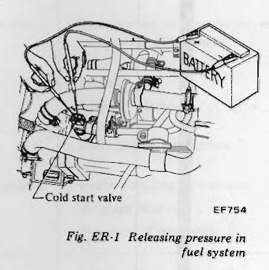
>
> - **Summary:** Depressurization of the electronic fuel injection system using two jumper wires connected from the battery terminals to the cold start valve connector for 2-3 seconds.
> - **Components:** Battery, Cold start valve, Jumper wires, Harness connector
> - **Callouts:** **(Cold start valve)** Cold start valve
> - **Specs / Measurements:** Actuation duration: 2 to 3 seconds
> - **Wiring / Connections:** Jumper wire between battery (+) terminal and cold start valve connector terminal; Jumper wire between battery (-) terminal and cold start valve connector terminal
> - **Mechanic Notes:** Be careful to keep both terminals separate in order to avoid short circuit.
> - **Tags:** `fuel pressure relief`, `cold start valve`, `battery`, `jumper wire`, `EFI`

Note: Fender covers should be used to prevent damaging car body.

2. Disconnect battery ground cable.
3. Remove hood as follows:

> [!CAUTION]
> Have an assistant help you so as to prevent damage to body.

(1) Mark hood hinge locations on hood to facilitate proper reinstallation.
(2) Support hood by hand and remove bolts securing it to hood hinge, taking care not to let hood slip when bolts are removed.
(3) Remove hood from hood hinge with the help of an assistant. See Figure ER-2.

> 🖼️ **Fig. ER-2 Removing hood** `[ER365]` *(Type: `procedure_step`)*
>
> 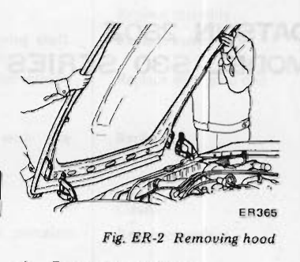
>
> - **Summary:** Two mechanics supporting and removing the engine hood from the body hinge mounts.
> - **Components:** Hood, Hood hinge, Fender covers
> - **Mechanic Notes:** Mark hood hinge locations on hood prior to bolt removal to facilitate proper reinstallation; have an assistant help lift the hood.
> - **Tags:** `hood removal`, `bodywork`, `hood hinge`

4. Drain engine coolant.
5. Disconnect upper and lower hoses from radiator.
• On automatic transmission models:
1) Remove splashboard.
2) Disconnect oil cooler hoses from oil cooler installed at lower end of radiator.

6. Remove air duct clamps and remove air flow meter. See Figure ER-3.

> 🖼️ **Fig. ER-3 Removing air flow meter** `[ER428]` *(Type: `procedure_step`)*
>
> 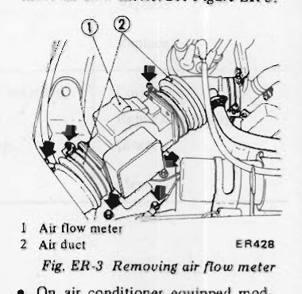
>
> - **Summary:** Removal of the air flow meter and loosening clamps from the air duct boot.
> - **Components:** Air flow meter, Air duct, Hose clamps, Electrical connector
> - **Callouts:** **(1)** Air flow meter; **(2)** Air duct
> - **Wiring / Connections:** Air flow meter wire harness connector
> - **Mechanic Notes:** Loosen clamps securing duct to air flow meter and body before removal.
> - **Tags:** `air flow meter`, `air duct`, `AFM`, `intake system`

• On air conditioner equipped models:
Note: Never discharge gas from compressor while work is being performed. <!-- Page 3 (ER-3) --> 1) Remove compressor belt.
To remove, loosen idler pulley nut and adjusting bolt.
2) Remove compressor retaining bolts and move compressor toward fender to facilitate removal of engine.
3) Disconnect hoses to vacuum connector and fast idle actuator.

7. Remove air cleaner.
8. Disconnect hoses ① from canister and remove canister. See Figure ER-4.
9. Disconnect fuel return hose ② and fuel charge hose ③. See Figure ER-4.

> 🖼️ **Fig. ER-4 Removing canister and disconnecting fuel hoses** `[ER357]` *(Type: `procedure_step`)*
>
> 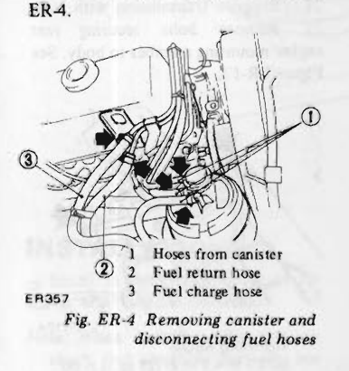
>
> - **Summary:** Removal of the carbon canister and disconnecting fuel return hose and fuel charge hose.
> - **Components:** Carbon canister, Hoses from canister, Fuel return hose, Fuel charge hose
> - **Callouts:** **(1)** Hoses from canister; **(2)** Fuel return hose; **(3)** Fuel charge hose
> - **Wiring / Connections:** Hoses from carbon canister; Fuel return hose; Fuel charge (feed) hose
> - **Mechanic Notes:** Disconnect canister vapor lines and fuel supply/return lines before lifting engine.
> - **Tags:** `carbon canister`, `fuel hose`, `fuel return`, `fuel charge`, `emissions`

10. Remove radiator and shroud (if so equipped).
11. Disconnect accelerator linkage and wire for electric fuel injector. See Figure ER-5.

> 🖼️ **Fig. ER-5 Disconnecting accelerator linkage** `[ER358]` *(Type: `procedure_step`)*
>
> 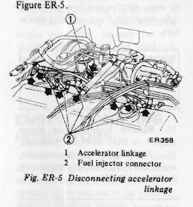
>
> - **Summary:** Disconnecting the mechanical accelerator linkage rod and electrical harness plug for the fuel injectors.
> - **Components:** Accelerator linkage, Fuel injector connector, Intake manifold, Fuel rail
> - **Callouts:** **(1)** Accelerator linkage; **(2)** Fuel injector connector
> - **Wiring / Connections:** Fuel injector harness connector
> - **Mechanic Notes:** Disconnect mechanical throttle rod linkage and injector sub-harness connector.
> - **Tags:** `accelerator linkage`, `fuel injector connector`, `EFI harness`, `throttle`

12. Disconnect the following cables, connectors, wires and hoses:
• Engine ground cable at engine connection end
• Wires to starter motor and alternator
• Wire to throttle valve switch, B.C.D.D. solenoid valve connector, and distributor condenser connector.

> 🖼️ **Fig. ER-6 Disconnecting wire for throttle valve switch and B.C.D.D. solenoid valve** `[ER429]` *(Type: `procedure_step`)*
>
> 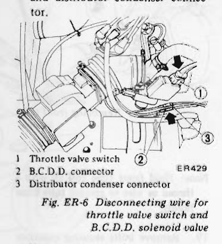
>
> - **Summary:** Disconnecting wire connectors for throttle valve switch, B.C.D.D. solenoid valve, and distributor condenser.
> - **Components:** Throttle valve switch, B.C.D.D. connector, Distributor condenser connector, Distributor
> - **Callouts:** **(1)** Throttle valve switch; **(2)** B.C.D.D. connector; **(3)** Distributor condenser connector
> - **Wiring / Connections:** Throttle valve switch wiring connector; B.C.D.D. solenoid valve connector; Distributor condenser connector
> - **Mechanic Notes:** Unplug the three connectors near the throttle chamber and distributor.
> - **Tags:** `throttle valve switch`, `BCDD`, `distributor condenser`, `wiring harness`

• High tension wire (between ignition coil and distributor). See Figure ER-7.
• Wire to block terminal distributor harness. See Figure ER-7.

> 🖼️ **Fig. ER-7 Disconnecting wire for block terminal** `[ER359]` *(Type: `procedure_step`)*
>
> 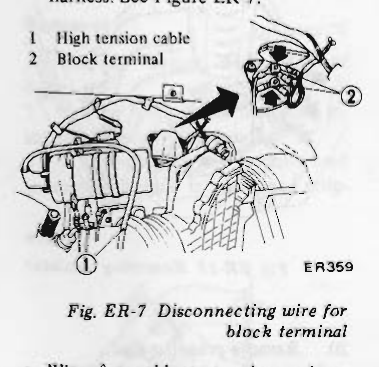
>
> - **Summary:** Disconnecting high tension spark wire between coil and distributor and the distributor harness block terminal.
> - **Components:** High tension cable, Block terminal, Ignition coil, Distributor
> - **Callouts:** **(1)** High tension cable; **(2)** Block terminal
> - **Wiring / Connections:** High tension ignition coil lead; Distributor harness block terminal connector
> - **Mechanic Notes:** Disconnect high-tension lead at distributor cap and disconnect harness block terminal connector.
> - **Tags:** `high tension wire`, `block terminal`, `distributor`, `ignition coil`

• Wire for cold start valve and air regulator. See Figure ER-8.

> 🖼️ **Fig. ER-8 Disconnecting wire for cold start valve and air regulator** `[ER360]` *(Type: `procedure_step`)*
>
> 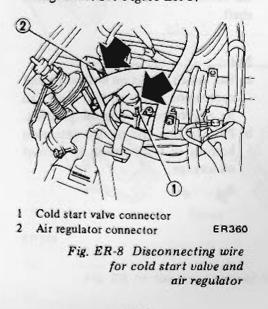
>
> - **Summary:** Disconnecting electrical connectors for cold start valve and auxiliary air regulator.
> - **Components:** Cold start valve, Air regulator, Intake manifold
> - **Callouts:** **(1)** Cold start valve connector; **(2)** Air regulator connector
> - **Wiring / Connections:** Cold start valve electrical harness connector; Air regulator electrical harness connector
> - **Mechanic Notes:** Release wire retaining clips on electrical plugs before pulling connectors.
> - **Tags:** `cold start valve`, `air regulator`, `connectors`, `intake manifold`

• Wire to thermostat housing. See Figure ER-9.

> 🖼️ **Fig. ER-9 Disconnecting wire for thermostat housing** `[ER361]` *(Type: `procedure_step`)*
>
> 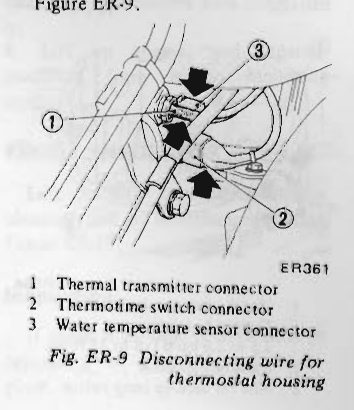
>
> - **Summary:** Disconnecting electrical sensors and switches located on the front thermostat housing.
> - **Components:** Thermostat housing, Thermal transmitter connector, Thermotime switch connector, Water temperature sensor connector
> - **Callouts:** **(1)** Thermal transmitter connector; **(2)** Thermotime switch connector; **(3)** Water temperature sensor connector
> - **Wiring / Connections:** Thermal transmitter wire connector; Thermotime switch harness connector; Water temperature sensor harness connector
> - **Mechanic Notes:** Note wire harness connector positions: thermal transmitter (1), thermotime switch (2), water temperature sensor (3).
> - **Tags:** `thermostat housing`, `thermal transmitter`, `thermotime switch`, `water temperature sensor`

• Heater inlet and outlet hoses. See Figure ER-10.

> 🖼️ **Fig. ER-10 Disconnecting heater inlet and outlet hoses** `[ER430]` *(Type: `procedure_step`)*
>
> 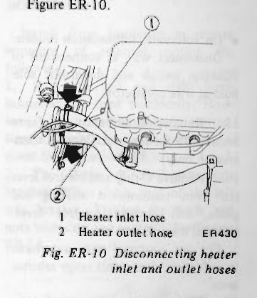
>
> - **Summary:** Disconnecting heater core coolant inlet and outlet hoses from engine fittings.
> - **Components:** Heater inlet hose, Heater outlet hose, Hose clamps
> - **Callouts:** **(1)** Heater inlet hose; **(2)** Heater outlet hose
> - **Wiring / Connections:** Heater core inlet coolant hose; Heater core outlet coolant hose
> - **Mechanic Notes:** Loosen hose clamps and slide heater hoses off metal pipe nipples.
> - **Tags:** `heater hose`, `cooling system`, `heater inlet`, `heater outlet`

• Vacuum hose to Master-Vac at intake manifold.
• Wires for oil pressure sending unit.

> 🖼️ **Fig. ER-11 Disconnecting wire for oil pressure sending unit** `[ER431]` *(Type: `procedure_step`)*
>
> 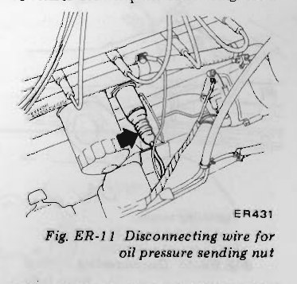
>
> - **Summary:** Disconnecting terminal lead wire from the oil pressure sending unit on the engine block.
> - **Components:** Oil pressure sending unit, Engine block, Lead wire
> - **Wiring / Connections:** Oil pressure sending unit electrical terminal wire
> - **Mechanic Notes:** Pull off terminal wire connection from gauge sending unit under the distributor.
> - **Tags:** `oil pressure sending unit`, `oil sender`, `gauge sender`, `engine block`

13. Remove clutch operating cylinder (Manual transmission models). See Figure ER-12.
14. Disconnect speedometer cable from rear extension housing and wire <!-- Page 4 (ER-4) --> for back-up lamp switch. See Figure ER-12.

> 🖼️ **Fig. ER-12 Removing clutch operating cylinder** `[ER364]` *(Type: `procedure_step`)*
>
> 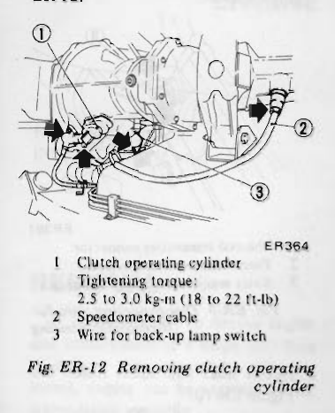
>
> - **Summary:** Removal of clutch operating cylinder from clutch housing, speedometer cable disconnection, and back-up lamp switch wiring disconnection.
> - **Components:** Clutch operating cylinder, Speedometer cable, Wire for back-up lamp switch, Clutch housing, Transmission rear extension
> - **Callouts:** **(1)** Clutch operating cylinder (Tightening torque: 2.5 to 3.0 kg-m / 18 to 22 ft-lb); **(2)** Speedometer cable; **(3)** Wire for back-up lamp switch
> - **Specs / Measurements:** Clutch operating cylinder tightening torque: 2.5 to 3.0 kg-m (18 to 22 ft-lb)
> - **Wiring / Connections:** Back-up lamp switch electrical wire connector; Speedometer mechanical cable
> - **Mechanic Notes:** Unbolt clutch operating slave cylinder without disconnecting hydraulic line to avoid bleeding; disconnect speedometer cable and back-up lamp switch harness.
> - **Tags:** `clutch slave cylinder`, `operating cylinder`, `speedometer cable`, `back-up lamp switch`, `transmission`

• On automatic transmission models:
Disconnect wire at connections of inhibitor switch and downshift solenoid at wire connector.

15. Remove center console. Refer to Section BF for removal. (Manual transmission only)
16. Remove C-ring and control lever pin from transmission striking rod guide, and remove control lever. (Manual transmission only)
For car equipped with automatic transmission, disconnect range selector lever.

17. Disconnect exhaust front tube from exhaust manifold. See Figure ER-13.

> 🖼️ **Fig. ER-13 Disconnecting exhaust front tube** `[ER192]` *(Type: `procedure_step`)*
>
> 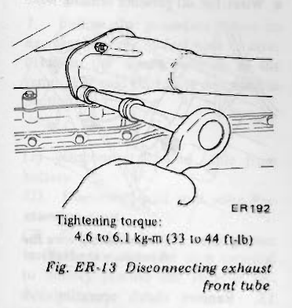
>
> - **Summary:** Unbolting exhaust front pipe flange nuts from the exhaust manifold with a wrench.
> - **Components:** Exhaust front tube, Exhaust manifold flange, Flange nuts
> - **Specs / Measurements:** Tightening torque: 4.6 to 6.1 kg-m (33 to 44 ft-lb)
> - **Mechanic Notes:** Tightening torque: 4.6 to 6.1 kg-m (33 to 44 ft-lb). Allow exhaust to cool completely before removal.
> - **Tags:** `exhaust manifold`, `front tube`, `exhaust flange`, `torque spec`

18. Remove front tube bracket from rear extension housing. See Figure ER-14.

> 🖼️ **Fig. ER-14 Removing front tube bracket** `[ER253]` *(Type: `procedure_step`)*
>
> 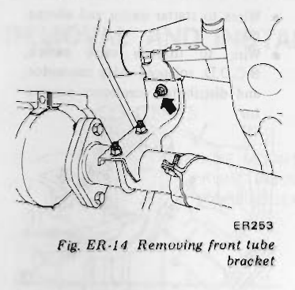
>
> - **Summary:** Removing the bracket securing the exhaust front tube to the transmission rear extension housing.
> - **Components:** Front tube bracket, Exhaust front tube, Rear extension housing, Mounting bolts
> - **Mechanic Notes:** Hold front tube end up with a thread or wire to prevent tube from falling after bracket removal.
> - **Tags:** `front tube bracket`, `exhaust support`, `rear extension housing`

Note: Hold front tube end up with a thread or wire to prevent tube from falling.

19. Remove bolts securing insulator and put it on exhaust tube. See Figure ER-15.

> 🖼️ **Fig. ER-15 Removing insulator** `[ER276]` *(Type: `procedure_step`)*
>
> 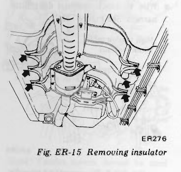
>
> - **Summary:** Unbolting floor tunnel heat insulator shield and resting it onto the exhaust tube.
> - **Components:** Heat insulator, Exhaust tube, Floor tunnel underside, Fastening bolts
> - **Mechanic Notes:** Remove insulator securing bolts and let heat shield rest on exhaust pipe to clear transmission crossmember.
> - **Tags:** `heat insulator`, `exhaust shield`, `transmission tunnel`

20. Remove propeller shaft.
Remove four bolts on the differential carrier side and withdraw propeller shaft.

Note:
a. Put match marks on both shaft and companion flange so that shaft can be reinstalled in original position.
b. Plug up rear end of rear extension housing of transmission to prevent oil leakage.

> 🖼️ **Fig. ER-16 Removing propeller shaft** `[ER193]` *(Type: `procedure_step`)*
>
> 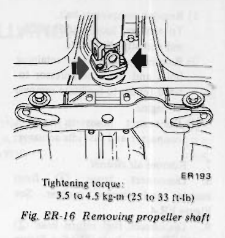
>
> - **Summary:** Unbolting the four propeller shaft companion flange bolts at the differential carrier.
> - **Components:** Propeller shaft, Companion flange, Differential carrier, Flange bolts and nuts
> - **Specs / Measurements:** Tightening torque: 3.5 to 4.5 kg-m (25 to 33 ft-lb)
> - **Mechanic Notes:** Put match marks on both shaft and companion flange so shaft can be reinstalled in original balance position. Plug rear extension housing to prevent oil leakage. Tightening torque: 3.5 to 4.5 kg-m (25 to 33 ft-lb).
> - **Tags:** `propeller shaft`, `driveshaft`, `companion flange`, `differential`, `torque spec`

21. Support transmission with jack.
22. Remove bolts securing rear engine mounting member to body. See Figure ER-17.

> 🖼️ **Fig. ER-17 Removing rear engine mounting member** `[ER194]` *(Type: `procedure_step`)*
>
> 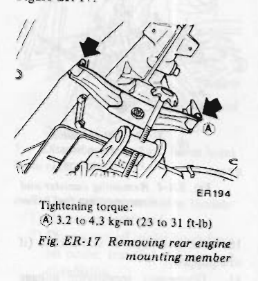
>
> - **Summary:** Unbolting the rear engine mounting crossmember bolts from the vehicle body frame rails.
> - **Components:** Rear engine mounting member, Body frame rails, Mounting bolts, Transmission jack
> - **Callouts:** **(A)** Rear engine mounting member to body bolts
> - **Specs / Measurements:** Tightening torque Ⓐ: 3.2 to 4.3 kg-m (23 to 31 ft-lb)
> - **Mechanic Notes:** Support transmission with jack before loosening crossmember bolts. Tightening torque Ⓐ: 3.2 to 4.3 kg-m (23 to 31 ft-lb).
> - **Tags:** `rear engine mounting member`, `transmission crossmember`, `body bolts`, `torque spec`

23. Connect suitable wire or chain to engine slingers and raise engine to take weight off front mounting insulators.

> [!WARNING]
> For safety in subsequent steps, tension of wire or chain should be slackened against engine.

24. Remove bolts securing engine support to front mounting insulators.
25. Raise engine and transmission, and remove from car as a single unit. See Figure ER-18.

> [!CAUTION]
> When raising engine, be especially careful not to knock it against adjacent parts.

---

<!-- Page 5 (ER-5) -->

> 🖼️ **Fig. ER-18 Removing engine** `[ER255]` *(Type: `procedure_step`)*
>
> 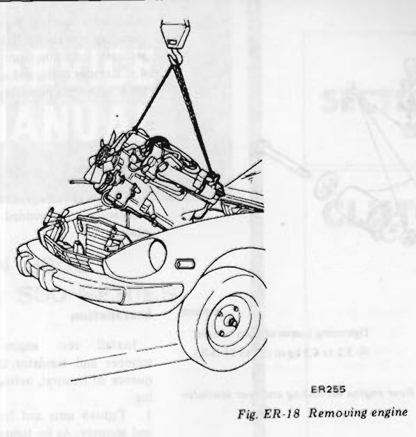
>
> - **Summary:** Engine and transmission assembly hoisted out of the engine compartment as a single unit using an overhead crane and sling chains.
> - **Components:** Engine assembly, Transmission assembly, Engine slingers, Hoist chain and hook, Engine compartment
> - **Mechanic Notes:** Raise engine and transmission together at an angle to clear front body and radiator core support. Be careful not to knock against adjacent body parts.
> - **Tags:** `engine removal`, `engine hoist`, `engine slinger`, `crane`, `powertrain`

## INSTALLATION

Install in the reverse order of removal, observing the following:

Note: When installing, be sure to check that electrical harnesses are connected correctly.

1. When installing, first secure rear engine mounting member to body.
2. Refer to applicable section when installing and adjusting any parts.
3. When installing hood following engine installation, be sure that it is properly centered and that hood lock operates securely. Refer to Section BF for Adjustment.

## ENGINE MOUNTING INSULATORS

Three insulators are used to mount the engine and transmission; two located at left and right front ends of the cylinder block and one at the transmission rear extension housing.
Replace insulator if it shows signs of separation or deterioration.
Be sure to keep insulator free from oil or grease.

### Removal

1. Suspend engine with wire or chain.
2. Loosen front engine mounting insulator upper nuts (both sides).
3. Make sure that wire or chain used to suspend engine is positioned properly so that no load is applied to insulators, and remove nuts completely.
4. Lift up engine, and separate insulators from engine mounting brackets.

### FRONT INSULATOR

Left and right front insulators are identical, and are interchangeable. See Figure ER-19.

### Inspection

If there is damage, deterioration or separation of bounded surface, replace.

### Installation

Install front insulators in reverse sequence of removal, noting the following:
1. Both the left and right front insulators are used commonly. However, when installing them, pay attention to their upper and lower directions. See Figure ER-19.
2. The shape of the right side bracket differs from that of the left side bracket. Tighten the bolts and nuts correctly and securely. See Figure ER-19.

> 🖼️ **Fig. ER-19 Sectional view of front engine mounting, and front insulator** `[ER196]` *(Type: `alignment_orientation`)*
>
> 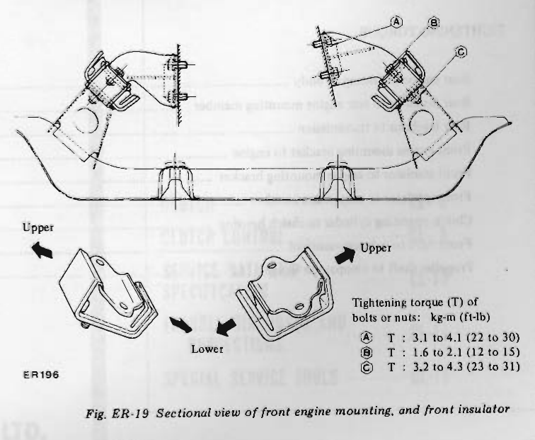
>
> - **Summary:** Sectional view of front engine mounting brackets and suspension member, showing torque specifications and top/bottom orientation of rubber insulators.
> - **Components:** Left front engine mounting bracket, Right front engine mounting bracket, Front engine mounting insulator, Suspension member crossmember, Insulator mounting studs and nuts
> - **Callouts:** **(A)** Front engine mounting bracket to engine bolt (T: 3.1 to 4.1 kg-m / 22 to 30 ft-lb); **(B)** Front insulator to engine mounting bracket nut (T: 1.6 to 2.1 kg-m / 12 to 15 ft-lb); **(C)** Front insulator to suspension member nut (T: 3.2 to 4.3 kg-m / 23 to 31 ft-lb); **(Upper)** Upper direction of insulator; **(Lower)** Lower direction of insulator
> - **Specs / Measurements:** Tightening torque Ⓐ (bracket to engine): 3.1 to 4.1 kg-m (22 to 30 ft-lb); Tightening torque Ⓑ (insulator to bracket): 1.6 to 2.1 kg-m (12 to 15 ft-lb); Tightening torque Ⓒ (insulator to suspension member): 3.2 to 4.3 kg-m (23 to 31 ft-lb)
> - **Mechanic Notes:** Left and right front insulators are interchangeable, but pay careful attention to their upper and lower orientation. Right side bracket shape differs from left side bracket.
> - **Tags:** `front engine mount`, `motor mount`, `front insulator`, `suspension crossmember`, `torque specs`, `orientation`

---

<!-- Page 6 (ER-6) -->
### REAR INSULATOR

> 🖼️ **Fig. ER-20 Rear engine mounting and rear insulator** `[ER366]` *(Type: `exploded_view`)*
>
> 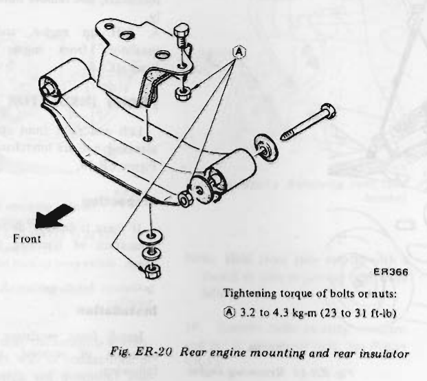
>
> - **Summary:** Exploded view of the transmission rear extension mount, rubber insulator, crossmember member, bushings, and attachment hardware.
> - **Components:** Rear engine mounting insulator, Rear engine mounting member, Insulator attachment bolts, Through bolt, Rubber bushings and washers, Lock washers and nuts
> - **Callouts:** **(A)** Tightening torque of bolts or nuts: 3.2 to 4.3 kg-m (23 to 31 ft-lb); **(Front)** Forward direction arrow
> - **Specs / Measurements:** Tightening torque Ⓐ of bolts or nuts: 3.2 to 4.3 kg-m (23 to 31 ft-lb)
> - **Mechanic Notes:** Note forward orientation arrow for rear engine mounting member and insulator. Tighten bolts and nuts to 3.2 to 4.3 kg-m (23 to 31 ft-lb).
> - **Tags:** `rear engine mount`, `transmission mount`, `rear insulator`, `crossmember`, `torque spec`, `exploded view`

### Removal

1. Support transmission with a jack or suitable stand so that engine does not drop down.
2. Remove rear engine mounting member installation bolts.
3. Engine mounting member is provided with openings for removing and installing operations. Remove nuts and separate insulator from transmission.
4. Remove bolts, and separate insulator from engine mounting member.

### Inspection

If there is damage, deterioration or separation of bounded surface, replace.

### Installation

Install rear engine mounting member and insulator in reverse sequence of removal, noting the following:
1. Tighten nuts and bolts correctly and securely. As for tightening torque, see Figure ER-20.
2. Carefully arrange the front and rear directions of rear engine mounting member and insulator when installing. See Figure ER-20.

## SERVICE DATA AND SPECIFICATIONS

### TIGHTENING TORQUE

| Item / Component | Tightening Torque kg-m | Tightening Torque (ft-lb) |
| :--- | :--- | :--- |
| Rear engine mounting to body | 3.2 to 4.3 | (23 to 31) |
| Rear insulator to rear engine mounting member | 3.2 to 4.3 | (23 to 31) |
| Rear insulator to transmission | 3.2 to 4.3 | (23 to 31) |
| Front engine mounting bracket to engine | 3.1 to 4.1 | (22 to 30) |
| Front insulator to engine mounting bracket | 1.6 to 2.1 | (12 to 15) |
| Front insulator to suspension member | 3.2 to 4.3 | (23 to 31) |
| Clutch operating cylinder to clutch housing | 2.5 to 3.0 | (18 to 22) |
| Front tube to exhaust manifold | 4.6 to 6.1 | (33 to 44) |
| Propeller shaft to companion flange | 3.5 to 4.5 | (25 to 33) |

---

## Segmented Diagrams Index

| Figure | Code | Type | Page | Caption | Key Components / Callouts | File |
| :--- | :--- | :--- | :--- | :--- | :--- | :--- |
| **Fig. ER-1** | `EF754` | `procedure_step` | ER-2 | Fig. ER-1 Releasing pressure in fuel system | Battery, Cold start valve, Jumper wires, Harness connector | [fig_er_1_releasing_pressure_in_fuel_system.png](diagrams/ER Engine removal/fig_er_1_releasing_pressure_in_fuel_system.png) |
| **Fig. ER-2** | `ER365` | `procedure_step` | ER-2 | Fig. ER-2 Removing hood | Hood, Hood hinge, Fender covers | [fig_er_2_removing_hood.png](diagrams/ER Engine removal/fig_er_2_removing_hood.png) |
| **Fig. ER-3** | `ER428` | `procedure_step` | ER-2 | Fig. ER-3 Removing air flow meter | Air flow meter, Air duct, Hose clamps, Electrical connector | [fig_er_3_removing_air_flow_meter.png](diagrams/ER Engine removal/fig_er_3_removing_air_flow_meter.png) |
| **Fig. ER-4** | `ER357` | `procedure_step` | ER-3 | Fig. ER-4 Removing canister and disconnecting fuel hoses | Carbon canister, Hoses from canister, Fuel return hose, Fuel charge hose | [fig_er_4_removing_canister_and_disconnecting_fuel_hoses.png](diagrams/ER Engine removal/fig_er_4_removing_canister_and_disconnecting_fuel_hoses.png) |
| **Fig. ER-5** | `ER358` | `procedure_step` | ER-3 | Fig. ER-5 Disconnecting accelerator linkage | Accelerator linkage, Fuel injector connector, Intake manifold, Fuel rail | [fig_er_5_disconnecting_accelerator_linkage.png](diagrams/ER Engine removal/fig_er_5_disconnecting_accelerator_linkage.png) |
| **Fig. ER-6** | `ER429` | `procedure_step` | ER-3 | Fig. ER-6 Disconnecting wire for throttle valve switch and B.C.D.D. solenoid valve | Throttle valve switch, B.C.D.D. connector, Distributor condenser connector, Distributor | [fig_er_6_disconnecting_wire_for_throttle_valve_switch_and_bcdd.png](diagrams/ER Engine removal/fig_er_6_disconnecting_wire_for_throttle_valve_switch_and_bcdd.png) |
| **Fig. ER-7** | `ER359` | `procedure_step` | ER-3 | Fig. ER-7 Disconnecting wire for block terminal | High tension cable, Block terminal, Ignition coil, Distributor | [fig_er_7_disconnecting_wire_for_block_terminal.png](diagrams/ER Engine removal/fig_er_7_disconnecting_wire_for_block_terminal.png) |
| **Fig. ER-8** | `ER360` | `procedure_step` | ER-3 | Fig. ER-8 Disconnecting wire for cold start valve and air regulator | Cold start valve, Air regulator, Intake manifold | [fig_er_8_disconnecting_wire_for_cold_start_valve_and_air_regulator.png](diagrams/ER Engine removal/fig_er_8_disconnecting_wire_for_cold_start_valve_and_air_regulator.png) |
| **Fig. ER-9** | `ER361` | `procedure_step` | ER-3 | Fig. ER-9 Disconnecting wire for thermostat housing | Thermostat housing, Thermal transmitter connector, Thermotime switch connector, Water temperature sensor connector | [fig_er_9_disconnecting_wire_for_thermostat_housing.png](diagrams/ER Engine removal/fig_er_9_disconnecting_wire_for_thermostat_housing.png) |
| **Fig. ER-10** | `ER430` | `procedure_step` | ER-3 | Fig. ER-10 Disconnecting heater inlet and outlet hoses | Heater inlet hose, Heater outlet hose, Hose clamps | [fig_er_10_disconnecting_heater_inlet_and_outlet_hoses.png](diagrams/ER Engine removal/fig_er_10_disconnecting_heater_inlet_and_outlet_hoses.png) |
| **Fig. ER-11** | `ER431` | `procedure_step` | ER-3 | Fig. ER-11 Disconnecting wire for oil pressure sending unit | Oil pressure sending unit, Engine block, Lead wire | [fig_er_11_disconnecting_wire_for_oil_pressure_sending_unit.png](diagrams/ER Engine removal/fig_er_11_disconnecting_wire_for_oil_pressure_sending_unit.png) |
| **Fig. ER-12** | `ER364` | `procedure_step` | ER-4 | Fig. ER-12 Removing clutch operating cylinder | Clutch operating cylinder, Speedometer cable, Wire for back-up lamp switch, Clutch housing, Transmission rear extension | [fig_er_12_removing_clutch_operating_cylinder.png](diagrams/ER Engine removal/fig_er_12_removing_clutch_operating_cylinder.png) |
| **Fig. ER-13** | `ER192` | `procedure_step` | ER-4 | Fig. ER-13 Disconnecting exhaust front tube | Exhaust front tube, Exhaust manifold flange, Flange nuts | [fig_er_13_disconnecting_exhaust_front_tube.png](diagrams/ER Engine removal/fig_er_13_disconnecting_exhaust_front_tube.png) |
| **Fig. ER-14** | `ER253` | `procedure_step` | ER-4 | Fig. ER-14 Removing front tube bracket | Front tube bracket, Exhaust front tube, Rear extension housing, Mounting bolts | [fig_er_14_removing_front_tube_bracket.png](diagrams/ER Engine removal/fig_er_14_removing_front_tube_bracket.png) |
| **Fig. ER-15** | `ER276` | `procedure_step` | ER-4 | Fig. ER-15 Removing insulator | Heat insulator, Exhaust tube, Floor tunnel underside, Fastening bolts | [fig_er_15_removing_insulator.png](diagrams/ER Engine removal/fig_er_15_removing_insulator.png) |
| **Fig. ER-16** | `ER193` | `procedure_step` | ER-4 | Fig. ER-16 Removing propeller shaft | Propeller shaft, Companion flange, Differential carrier, Flange bolts and nuts | [fig_er_16_removing_propeller_shaft.png](diagrams/ER Engine removal/fig_er_16_removing_propeller_shaft.png) |
| **Fig. ER-17** | `ER194` | `procedure_step` | ER-4 | Fig. ER-17 Removing rear engine mounting member | Rear engine mounting member, Body frame rails, Mounting bolts, Transmission jack | [fig_er_17_removing_rear_engine_mounting_member.png](diagrams/ER Engine removal/fig_er_17_removing_rear_engine_mounting_member.png) |
| **Fig. ER-18** | `ER255` | `procedure_step` | ER-5 | Fig. ER-18 Removing engine | Engine assembly, Transmission assembly, Engine slingers, Hoist chain and hook, Engine compartment | [fig_er_18_removing_engine.png](diagrams/ER Engine removal/fig_er_18_removing_engine.png) |
| **Fig. ER-19** | `ER196` | `alignment_orientation` | ER-5 | Fig. ER-19 Sectional view of front engine mounting, and front insulator | Left front engine mounting bracket, Right front engine mounting bracket, Front engine mounting insulator, Suspension member crossmember, Insulator mounting studs and nuts | [fig_er_19_sectional_view_of_front_engine_mounting_and_front_insulator.png](diagrams/ER Engine removal/fig_er_19_sectional_view_of_front_engine_mounting_and_front_insulator.png) |
| **Fig. ER-20** | `ER366` | `exploded_view` | ER-6 | Fig. ER-20 Rear engine mounting and rear insulator | Rear engine mounting insulator, Rear engine mounting member, Insulator attachment bolts, Through bolt, Rubber bushings and washers | [fig_er_20_rear_engine_mounting_and_rear_insulator.png](diagrams/ER Engine removal/fig_er_20_rear_engine_mounting_and_rear_insulator.png) |
