# ENGINE TUNE-UP

<!-- Page 1 (ET-1) -->
# SECTION ET - ENGINE TUNE-UP

## DATSUN 280Z MODEL S30 SERIES
### SERVICE MANUAL

| CONTENTS | PAGE |
| :--- | :--- |
| EMISSION CONTROL DEVICES | ET-2 |
| BASIC MECHANICAL SYSTEM | ET-4 |
| IGNITION AND FUEL SYSTEM | ET-6 |
| EMISSION CONTROL SYSTEM | ET-11 |
| SERVICE DATA AND SPECIFICATIONS | ET-13 |
| TROUBLE DIAGNOSES AND CORRECTIONS | ET-14 |
| SPECIAL SERVICE TOOLS | ET-22 |

NISSAN MOTOR CO., LTD.  
TOKYO, JAPAN

---

<!-- Page 2 (ET-2) -->
# EMISSION CONTROL DEVICES

| System name | Device | L24 (810) California M/T | L24 (810) California A/T | L24 (810) Non-California M/T | L24 (810) Non-California A/T | L28 (280Z) California M/T | L28 (280Z) California A/T | L28 (280Z) Non-California M/T | L28 (280Z) Non-California A/T |
| :--- | :--- | :---: | :---: | :---: | :---: | :---: | :---: | :---: | :---: |
| **Engine proper** | Cylinder head exhaust port liner | X | X | X | X | X | X | X | X |
| **B.C.D.D.** | With altitude corrector | X | X | — | — | X | X | — | — |
| | Without altitude corrector | — | — | X | X | — | — | X | X |
| **Altitude compensator (automatic)** | | X | X | — | — | X | X | — | — |
| **Ignition system** | Ignition transistor unit, Distributor | X | X | X | X | X | X | X | X |
| | T.C.S. (Top detecting switch) | X | — | X | — | — | — | — | — |
| **E.G.R. system** | E.G.R. valve (B.P.T. system) | X | X | X | X | X | X | X | X |
| | T.V.V. (Thermal vacuum valve-E.G.R.) | X | X | X | X | X | X | X | X |
| | V.D.V. (Vacuum delay valve) | X | X | — | — | X | X | — | — |
| **Catalyzer** | Catalytic converter | X | X | — | — | X | X | — | — |
| | Floor temperature warning system (with floor sensor) | X | X | — | — | X | X | — | — |
| **Others** | Carbon canister | X | X | X | X | X | X | X | X |
| | Fuel filler cap with vacuum relief valve | X | X | X | X | X | X | X | X |
| | P.C.V. valve | X | X | X | X | X | X | X | X |
| | Inhibitor switch | — | X | — | X | — | X | — | X |
| | Speed detecting switch | X | — | X | — | X | — | X | — |

**Remarks:**
- **©**: California model
- **Ⓝ**: Non-California model
- **X**: Available
- **—**: Not available
- **B.C.D.D.**: Boost controlled deceleration device
- **T.C.S.**: Transmission controlled vacuum advance system
- **V.D.V.**: Vacuum delay valve
- **E.G.R.**: Exhaust gas recirculation
- **B.P.T.**: Back pressure transducer
- **T.V.V.**: Thermal vacuum valve
- **P.C.V.**: Positive crankcase ventilation

---

<!-- Page 3 (ET-3) -->
# L28 ENGINE SYSTEM PIPING

> 🖼️ **Fig. ET-1 L28 engine system piping** `[ET431]` *(Type: `vacuum_routing`)*
>
> 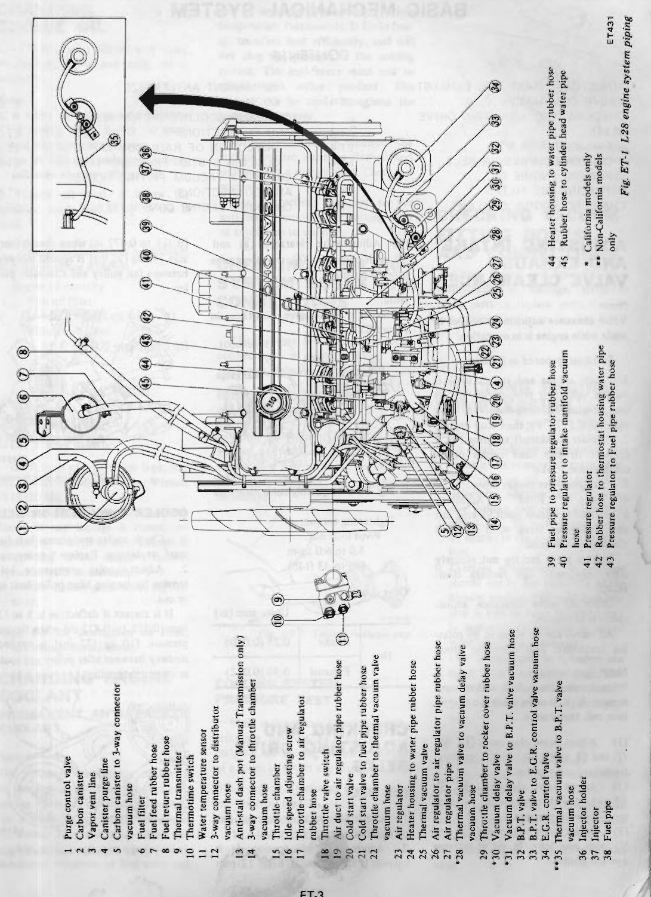
>
> - **Summary:** Comprehensive schematic of the L28 engine system piping, detailing the routing of vacuum lines, fuel feed/return hoses, emission hoses, and coolant lines around the engine, intake manifold, throttle chamber, EGR/BPT valves, carbon canister, and pressure regulator.
> - **Components:** Purge control valve, Carbon canister, Vapor vent line, Canister purge line, Carbon canister to 3-way connector vacuum hose, Fuel filter, Fuel feed rubber hose, Fuel return rubber hose, Thermal transmitter, Thermotime switch, Water temperature sensor, 3-way connector to distributor vacuum hose, Anti-stall dash pot (Manual Transmission only), 3-way connector to throttle chamber vacuum hose, Throttle chamber, Idle speed adjusting screw, Throttle chamber to air regulator rubber hose, Throttle valve switch, Air duct to air regulator pipe rubber hose, Cold start valve, Cold start valve to fuel pipe rubber hose, Throttle chamber to thermal vacuum valve vacuum hose, Air regulator, Heater housing to water pipe rubber hose, Thermal vacuum valve, Air regulator to air regulator pipe rubber hose, Air regulator pipe, Thermal vacuum valve to vacuum delay valve vacuum hose, Throttle chamber to rocker cover rubber hose, Vacuum delay valve, Vacuum delay valve to B.P.T. valve vacuum hose, B.P.T. valve, B.P.T. valve to E.G.R. control valve vacuum hose, E.G.R. control valve, Thermal vacuum valve to B.P.T. valve vacuum hose, Injector holder, Injector, Fuel pipe, Fuel pipe to pressure regulator rubber hose, Pressure regulator to intake manifold vacuum hose, Pressure regulator, Rubber hose to thermostat housing water pipe, Pressure regulator to Fuel pipe rubber hose, Heater housing to water pipe rubber hose, Rubber hose to cylinder head water pipe
> - **Callouts:** **(1)** Purge control valve; **(2)** Carbon canister; **(3)** Vapor vent line; **(4)** Canister purge line; **(5)** Carbon canister to 3-way connector vacuum hose; **(6)** Fuel filter; **(7)** Fuel feed rubber hose; **(8)** Fuel return rubber hose; **(9)** Thermal transmitter; **(10)** Thermotime switch; **(11)** Water temperature sensor; **(12)** 3-way connector to distributor vacuum hose; **(13)** Anti-stall dash pot (Manual Transmission only); **(14)** 3-way connector to throttle chamber vacuum hose; **(15)** Throttle chamber; **(16)** Idle speed adjusting screw; **(17)** Throttle chamber to air regulator rubber hose; **(18)** Throttle valve switch; **(19)** Air duct to air regulator pipe rubber hose; **(20)** Cold start valve; **(21)** Cold start valve to fuel pipe rubber hose; **(22)** Throttle chamber to thermal vacuum valve vacuum hose; **(23)** Air regulator; **(24)** Heater housing to water pipe rubber hose; **(25)** Thermal vacuum valve; **(26)** Air regulator to air regulator pipe rubber hose; **(27)** Air regulator pipe; **(28)** Thermal vacuum valve to vacuum delay valve vacuum hose (* California models only); **(29)** Throttle chamber to rocker cover rubber hose; **(30)** Vacuum delay valve (* California models only); **(31)** Vacuum delay valve to B.P.T. valve vacuum hose (* California models only); **(32)** B.P.T. valve; **(33)** B.P.T. valve to E.G.R. control valve vacuum hose; **(34)** E.G.R. control valve; **(35)** Thermal vacuum valve to B.P.T. valve vacuum hose (** Non-California models only); **(36)** Injector holder; **(37)** Injector; **(38)** Fuel pipe; **(39)** Fuel pipe to pressure regulator rubber hose; **(40)** Pressure regulator to intake manifold vacuum hose; **(41)** Pressure regulator; **(42)** Rubber hose to thermostat housing water pipe; **(43)** Pressure regulator to Fuel pipe rubber hose; **(44)** Heater housing to water pipe rubber hose; **(45)** Rubber hose to cylinder head water pipe
> - **Wiring / Connections:** Carbon canister purge line to throttle chamber; Distributor vacuum line via 3-way connector; EGR control vacuum lines via TVV and VDV (California) or TVV (Non-California); Fuel rail feed and return plumbing; Coolant piping from heater housing and thermostat housing
> - **Mechanic Notes:** California models incorporate Vacuum Delay Valve (30) between Thermal Vacuum Valve (25) and B.P.T. Valve (32); Non-California models connect directly via hose (35).
> - **Tags:** `L28`, `piping`, `vacuum routing`, `emission system`, `EGR`, `BPT valve`, `canister`, `fuel piping`

### Diagram Legend
1. Purge control valve
2. Carbon canister
3. Vapor vent line
4. Canister purge line
5. Carbon canister to 3-way connector vacuum hose
6. Fuel filter
7. Fuel feed rubber hose
8. Fuel return rubber hose
9. Thermal transmitter
10. Thermotime switch
11. Water temperature sensor
12. 3-way connector to distributor vacuum hose
13. Anti-stall dash pot (Manual Transmission only)
14. 3-way connector to throttle chamber vacuum hose
15. Throttle chamber
16. Idle speed adjusting screw
17. Throttle chamber to air regulator rubber hose
18. Throttle valve switch
19. Air duct to air regulator pipe rubber hose
20. Cold start valve
21. Cold start valve to fuel pipe rubber hose
22. Throttle chamber to thermal vacuum valve vacuum hose
23. Air regulator
24. Heater housing to water pipe rubber hose
25. Thermal vacuum valve
26. Air regulator to air regulator pipe rubber hose
27. Air regulator pipe
*28. Thermal vacuum valve to vacuum delay valve vacuum hose
29. Throttle chamber to rocker cover rubber hose
*30. Vacuum delay valve
*31. Vacuum delay valve to B.P.T. valve vacuum hose
32. B.P.T. valve
33. B.P.T. valve to E.G.R. control valve vacuum hose
34. E.G.R. control valve
**35. Thermal vacuum valve to B.P.T. valve vacuum hose
36. Injector holder
37. Injector
38. Fuel pipe
39. Fuel pipe to pressure regulator rubber hose
40. Pressure regulator to intake manifold vacuum hose
41. Pressure regulator
42. Rubber hose to thermostat housing water pipe
43. Pressure regulator to Fuel pipe rubber hose
44. Heater housing to water pipe rubber hose
45. Rubber hose to cylinder head water pipe

\* California models only  
\*\* Non-California models only

---

<!-- Page 4 (ET-4) -->
# BASIC MECHANICAL SYSTEM

## CONTENTS
| Section | Page |
| :--- | :--- |
| ADJUSTING INTAKE AND EXHAUST VALVE CLEARANCE | ET-4 |
| CHECKING AND ADJUSTING DRIVE BELTS | ET-4 |
| FAN BELT | ET-4 |
| COOLER COMPRESSOR BELT | ET-4 |
| CHANGING ENGINE OIL | ET-5 |
| REPLACING OIL FILTER | ET-5 |
| CHANGING ENGINE COOLANT | ET-5 |
| PERMANENT ANTI-FREEZE COOLANT | ET-5 |
| CHECKING COOLING SYSTEM HOSES AND CONNECTIONS | ET-5 |
| INSPECTION OF RADIATOR CAP | ET-5 |
| COOLING SYSTEM PRESSURE TEST | ET-5 |
| CHECKING VACUUM FITTING HOSES AND CONNECTIONS | ET-5 |
| CHECKING ENGINE COMPRESSION | ET-5 |

## ADJUSTING INTAKE AND EXHAUST VALVE CLEARANCE

> [!NOTE]
> Valve clearance adjustment cannot be made while engine is in operation.

To adjust, proceed as follows:
1. Start engine and run it until it reaches operating temperature or, at least, engine oil temperature is more than 80°C (176°F); then stop engine.
2. Rotate crankshaft to bring No. 1 cylinder to top dead center of its compression stroke.
3. Remove valve rocker cover.
4. Using Pivot Adjuster ST10640001, loosen pivot locking nut and turn pivot screw until specified clearance is obtained.  
   Tighten pivot locking nut securely after adjustment, and recheck clearance.

Order of valve clearance adjustments is as follows:  
All valves can be adjusted by rotating crankshaft four complete turns.

> [!NOTE]
> When turning crankshaft with starter, remove high tension cable from ignition coil, then turn it.

(1) Adjust valve clearances ①, ③, ⑦ and ⑪ with cam lobe ① set at extreme upward position.  
(2) Adjust valve clearances ④, ⑤, ⑩ and ⑫ with cam lobe ④ set at extreme upward position.  
(3) Adjust valve clearances ② and ⑥ with cam lobe ② set at extreme upward position.  
(4) Adjust valve clearances ⑧ and ⑨ with cam lobe ⑧ set at extreme upward position.

> [!NOTE]
> Numbers in circle agree with those in Figure ET-2.

> 🖼️ **Fig. ET-2 Adjusting valve clearance** `[ET420]` *(Type: `procedure_step`)*
>
> 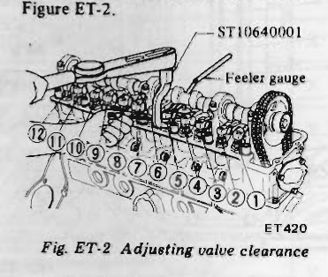
>
> - **Summary:** Illustration showing valve clearance adjustment using Pivot Adjuster ST10640001 and feeler gauge on an OHC L-series cylinder head, with valve positions numbered 1 through 12 from front to rear.
> - **Components:** ST10640001 Pivot adjuster, Feeler gauge, Rocker arm pivot lock nut, Rocker arm pivot screw, Camshaft lobes 1-12
> - **Callouts:** **(1)** Exhaust valve No. 1; **(2)** Intake valve No. 1; **(3)** Intake valve No. 2; **(4)** Exhaust valve No. 2; **(5)** Intake valve No. 3; **(6)** Exhaust valve No. 3; **(7)** Exhaust valve No. 4; **(8)** Intake valve No. 4; **(9)** Intake valve No. 5; **(10)** Exhaust valve No. 5; **(11)** Intake valve No. 6; **(12)** Exhaust valve No. 6
> - **Specs / Measurements:** Intake (Hot): 0.25 mm (0.010 in); Exhaust (Hot): 0.30 mm (0.012 in); Pivot lock nut torque: 5.0 to 6.0 kg-m (36 to 43 ft-lb)
> - **Mechanic Notes:** Engine oil temperature must be above 80°C (176°F). Never adjust with engine running. Rotate crankshaft four complete turns to complete all four adjustment steps.
> - **Tags:** `valve clearance`, `ST10640001`, `feeler gauge`, `rocker arm`, `cam lobe`, `lash adjustment`

### Tightening torque:
- Pivot lock nut: 5.0 to 6.0 kg-m (36 to 43 ft-lb)

### Valve clearance:
| Temperature | Intake | Exhaust |
| :--- | :--- | :--- |
| Hot | 0.25 mm (0.010 in) | 0.30 mm (0.012 in) |

## CHECKING AND ADJUSTING DRIVE BELTS

### FAN BELT
1. Check for cracks or damage. Replace if necessary.
2. Adjust fan belt tension. It is correct if deflection is 8 to 12 mm (0.315 to 0.472 in) when thumb pressure [10 kg (22 lb)] is applied midway between fan pulley and alternator pulley.

> 🖼️ **Fig. ET-3 Fan belt tension** `[EM612]` *(Type: `inspection_measurement`)*
>
> 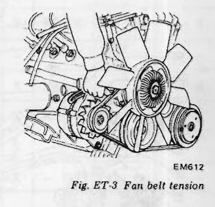
>
> - **Summary:** Illustration demonstrating fan belt tension measurement using thumb pressure midway between alternator pulley and fan pulley.
> - **Components:** Fan belt, Alternator pulley, Fan pulley, Cooling fan
> - **Specs / Measurements:** Deflection: 8 to 12 mm (0.315 to 0.472 in); Thumb pressure: 10 kg (22 lb)
> - **Mechanic Notes:** Check for cracks or damage prior to tension measurement.
> - **Tags:** `fan belt`, `belt tension`, `deflection`, `alternator pulley`

### COOLER COMPRESSOR BELT
1. Check cooler compressor belt for crack or damage. Replace if necessary.
2. Adjust cooler compressor belt tension by turning idler pulley bolt in or out.  
   It is correct if deflection is 8 to 12 mm (0.315 to 0.472 in) when thumb pressure [10 kg (22 lb)] is applied midway between idler pulley and cooler compressor pulley.

> 🖼️ **Fig. ET-4 Cooler compressor belt tension** `[ET194]` *(Type: `inspection_measurement`)*
>
> 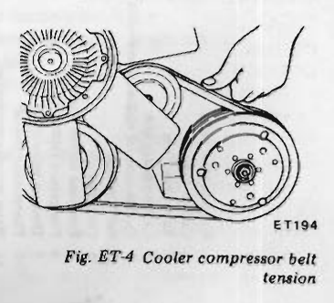
>
> - **Summary:** Illustration of cooler (air conditioning) compressor belt tension check and idler pulley adjustment bolt.
> - **Components:** Cooler compressor belt, Idler pulley, Idler pulley bolt, Compressor pulley
> - **Specs / Measurements:** Deflection: 8 to 12 mm (0.315 to 0.472 in); Thumb pressure: 10 kg (22 lb)
> - **Mechanic Notes:** Adjust tension by turning idler pulley bolt in or out.
> - **Tags:** `air conditioning`, `compressor belt`, `idler pulley`, `belt tension`

---

<!-- Page 5 (ET-5) -->
# CHANGING ENGINE OIL

1. Check if oil is diluted with water or gasoline. Drain and refill oil if necessary.

> [!NOTE]
> a. A milky oil indicates the presence of cooling water. Isolate the cause and take corrective measure.  
> b. An oil with extremely low viscosity indicates dilution with gasoline.

2. Check oil level. If below the specified level, raise it up to the H level.
3. Change engine oil in accordance with maintenance schedule.

### Engine oil capacity:
- With oil filter: 4.5 l (4 3/4 US qt, 4 Imp qt)
- Without oil filter: 4.0 l (4 1/4 US qt, 3 1/2 Imp qt)

# REPLACING OIL FILTER

Oil filter is of a cartridge type, and can be removed with Oil Filter Wrench ST19320000.
1. Check for oil leaks past gasketed flange. If any leakage is found, retighten just enough to stop leakage. If retightening is no longer effective, replace filter as an assembly.
2. When installing oil filter, tighten by hand.

> [!NOTE]
> Do not overtighten oil filter, lest leakage should occur.

# CHANGING ENGINE COOLANT

## PERMANENT ANTI-FREEZE COOLANT

> [!NOTE]
> The permanent anti-freeze coolant is an ethylene glycol base product containing chemical inhibitors to protect the cooling system from rusting and corrosion. The anti-freeze does not contain any glycerine or ethyl alcohol. It will not evaporate or boil away and can be used with either high or low temperature thermostats. It flows freely, transfers heat efficiently, and will not clog the passages in the cooling system. The anti-freeze must not be mixed with other product. This coolant can be used throughout the seasons of the year.

Whenever coolant is changed, the cooling system must be flushed and refilled with a new coolant. Check the coolant level.  
See instructions attached to the anti-freeze container for mixing ratio of anti-freeze to water.

# CHECKING COOLING SYSTEM HOSES AND CONNECTIONS

Check hoses and fittings for loose connections or deterioration. Retighten or replace if necessary.

# INSPECTION OF RADIATOR CAP

Apply reference pressure [0.9 kg/cm² (13 psi)] to radiator cap by means of a cap tester to see if it is satisfactory. Replace cap assembly if necessary.

> 🖼️ **Fig. ET-5 Testing radiator cap** `[ET012]` *(Type: `inspection_measurement`)*
>
> 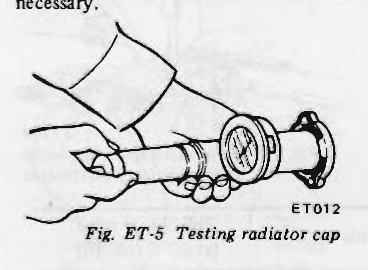
>
> - **Summary:** Testing radiator pressure cap relief valve pressure using a hand pump cap tester and adapter.
> - **Components:** Radiator cap, Cap tester pump, Pressure gauge
> - **Specs / Measurements:** Reference pressure: 0.9 kg/cm² (13 psi)
> - **Mechanic Notes:** Replace cap assembly if pressure is not maintained within specification.
> - **Tags:** `radiator cap`, `cooling system`, `pressure test`, `cap tester`

# COOLING SYSTEM PRESSURE TEST

With radiator cap removed, apply reference pressure [1.6 kg/cm² (23 psi)] to the cooling system by means of a tester to detect any leakage.

> 🖼️ **Fig. ET-6 Cooling system pressure test** `[ET237]` *(Type: `inspection_measurement`)*
>
> 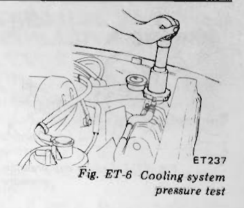
>
> - **Summary:** Testing engine cooling system for leaks by applying pressure with radiator tester attached to filler neck.
> - **Components:** Radiator filler neck, Pressure tester pump, Pressure gauge, Radiator
> - **Specs / Measurements:** Testing pressure: 1.6 kg/cm² (23 psi)
> - **Mechanic Notes:** Radiator cap must be removed. Inspect all hoses and joints while pressurized.
> - **Tags:** `cooling system`, `leak test`, `pressure tester`, `radiator`

### Water capacity (including heater and reservoir tank):
- Manual transmission model: 10.3 liter (10 7/8 U.S. qt, 9 1/8 Imp. qt)
- Automatic transmission model: 10.1 liter (10 5/8 U.S. qt, 8 7/8 Imp. qt)

# CHECKING VACUUM FITTING HOSES AND CONNECTIONS

Check fittings and hoses for loose connections or damage. Retighten loose parts or replace parts that are not suitable for further use. See Figure ET-1.

# CHECKING ENGINE COMPRESSION

> [!NOTE]
> a. To check cylinder compression, it is essential to remove all spark plugs. The purpose of this test is to determine whether there is excessive leakage past piston rings, head gasket, etc. To test, engine should be heated to the operating temperature.  
> b. Cylinder compression in cylinders should not be less than 80% of the highest reading. Different compression in two or more cylinder usually indicates an improperly seated valve or broken piston ring.  
> c. Low compression in cylinders can result from worn piston rings. This problem may usually be accompanied by excessive fuel consumption.

1. Warm up engine sufficiently.
2. Disconnect all spark plugs.
3. Disconnect cold start valve and all injector connectors.
4. Properly attach a compression tester to spark plug hole in cylinder being tested.
5. Start engine as quickly as possible. <!-- Page 6 (ET-6) --> > 🖼️ **Fig. ET-7 Testing compression pressure** `[ET010]` *(Type: `inspection_measurement`)*
>
> 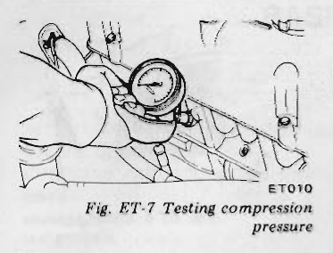
>
> - **Summary:** Connecting compression tester gauge to spark plug port to measure cranking cylinder compression.
> - **Components:** Compression tester gauge, Flexible adapter hose, Cylinder head spark plug port
> - **Specs / Measurements:** Standard: 12.5 kg/cm² (178 psi); Minimum: 11.5 kg/cm² (164 psi) at 300 to 400 rpm
> - **Mechanic Notes:** Disconnect cold start valve and all fuel injector connectors before cranking engine.
> - **Tags:** `compression test`, `cylinder pressure`, `piston rings`, `valves`

If cylinder compression in one or more cylinders is low, pour a small quantity of engine oil into cylinders through the spark plug holes and retest compression.
1. If adding oil helps the compression pressure, the chances are that piston rings are worn or damaged.
2. If pressure stays low, the likelihood is that valve is sticking or seating improperly.
3. If cylinder compression in any two adjacent cylinders is low, and if adding oil does not help the compression, there is leakage past the gasketed surface.  
   Oil and water in combustion chambers can result from this trouble.

### Compression pressure kg/cm² (psi)/at rpm:
- 11.5 to 12.5 (164 to 178)/300 to 400

# IGNITION AND FUEL SYSTEM

## CONTENTS
| Section | Page |
| :--- | :--- |
| CHECKING BATTERY | ET-6 |
| CHECKING AND ADJUSTING IGNITION TIMING | ET-6 |
| CHECKING AND REPLACING SPARK PLUGS | ET-7 |
| CHECKING IGNITION WIRING | ET-7 |
| CHECKING AND ADJUSTING ENGINE IDLE RPM AND MIXTURE RATIO | ET-8 |
| CHECKING FUEL LINES (HOSES, PIPING CONNECTIONS, ETC.) | ET-9 |
| REPLACING FUEL FILTER | ET-10 |
| CHECKING AIR REGULATOR HOSES | ET-10 |
| REPLACING AIR CLEANER FILTER | ET-10 |
| CHECKING CABLE HARNESS AND CONNECTORS | ET-11 |

## CHECKING BATTERY

1. Remove six vent plugs and check electrolyte level in each battery cell. If necessary, pour distilled water.

> 🖼️ **Fig. ET-8 Checking electrolyte level** `[EE358]` *(Type: `inspection_measurement`)*
>
> 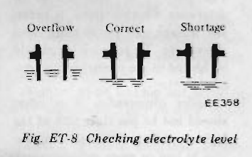
>
> - **Summary:** Visual guide for checking battery cell electrolyte levels showing Overflow, Correct, and Shortage conditions.
> - **Components:** Battery cell indicator tube, Electrolyte meniscus
> - **Callouts:** **(Overflow)** Electrolyte level too high; **(Correct)** Proper electrolyte level; **(Shortage)** Electrolyte level too low (needs distilled water)
> - **Mechanic Notes:** Pour distilled water if shortage is indicated.
> - **Tags:** `battery`, `electrolyte level`, `distilled water`, `maintenance`

2. Measure the specific gravity of battery electrolyte.

> 🖼️ **Fig. ET-9 Checking specific gravity of battery electrolyte** `[ET238]` *(Type: `inspection_measurement`)*
>
> 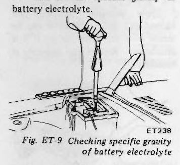
>
> - **Summary:** Measuring battery electrolyte specific gravity with a glass hydrometer inserted into battery cell vent.
> - **Components:** Battery, Hydrometer, Suction bulb, Float scale
> - **Specs / Measurements:** Frigid climates: 1.28 full charge (permissible over 1.22); Other climates: 1.26 full charge (permissible over 1.20) at 20°C (68°F)
> - **Mechanic Notes:** Hold hydrometer vertical at eye level to read specific gravity scale.
> - **Tags:** `battery`, `hydrometer`, `specific gravity`, `electrolyte`

| Climate | Permissible value | Full charge value [at 20°C (68°F)] |
| :--- | :--- | :--- |
| Frigid climates | Over 1.22 | 1.28 |
| Other climates | Over 1.20 | 1.26 |

> [!CAUTION]
> a. If it becomes necessary to start the engine with a booster battery and jumper cables, the booster battery voltage must not exceed 12 volts, or the control unit of the fuel injection system and other electric components will be damaged.  
> b. If the battery cables are disconnected, they should be tightly clamped to the battery terminals to secure a good contact.

> [!NOTE]
> a. Clean top of battery and terminals with a solution of baking soda and water. Rinse off and dry with compressed air. Top of battery must be clean to prevent current leakage between terminals and from positive terminal to hold-down clamp.  
> b. In addition to current leakage, prolonged accumulation of acid and dirt on top of battery may cause blistering of the material covering connector straps and corrosion of straps.  
> c. After tightening terminals, coat them with petrolatum (vaseline) to protect them from corrosion.

## CHECKING AND ADJUSTING IGNITION TIMING

1. Check spark plugs for condition.
2. Thoroughly remove dirt and dust from crank pulley at timing mark location and front cover at timing indicator.
3. Warm up engine sufficiently.
4. Connect engine tachometer and timing light in their proper positions.
5. Adjust idling speed to 800 rpm by turning idle speed adjusting screw on manual transmission models. <!-- Page 7 (ET-7) --> On automatic transmission models, adjust it to about 700 rpm with selector lever in "D" position.

> [!WARNING]
> When selector lever is shifted to "D" position, apply parking brake and block both front and rear wheels with chocks.

6. Check ignition timing with a timing light to ensure that it is adjusted to specifications indicated in the following chart.

| Transmission | Ignition timing |
| :--- | :--- |
| Manual transmission | 10° B.T.D.C./800 rpm |
| Automatic transmission (in "D" position) | 10° B.T.D.C./700 rpm |

If necessary, adjust it as follows:
(1) Loosen set screw until distributor can be moved by hand.
(2) Adjust ignition timing to specifications.
(3) Lock distributor set screw, and make sure that timing is correct.

> 🖼️ **Fig. ET-10 Adjusting ignition timing** `[ET294]` *(Type: `procedure_step`)*
>
> 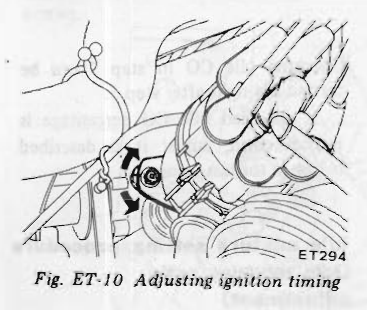
>
> - **Summary:** Adjusting ignition timing by loosening distributor set screw and rotating distributor housing while checking timing mark with timing light.
> - **Components:** Distributor, Distributor set screw, Vacuum advance canister, Mounting bracket
> - **Specs / Measurements:** Manual: 10° B.T.D.C./800 rpm; Automatic: 10° B.T.D.C./700 rpm
> - **Mechanic Notes:** Loosen set screw just enough to turn distributor by hand, align timing mark, then retighten securely.
> - **Tags:** `ignition timing`, `distributor`, `advance`, `timing light`

> 🖼️ **Fig. ET-11 Ignition timing indicator** `[ET240]` *(Type: `alignment_orientation`)*
>
> 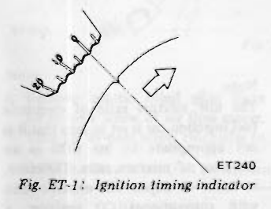
>
> - **Summary:** Diagram of crankshaft pulley notch aligned with timing indicator pointer at 10 degrees BTDC.
> - **Components:** Crankshaft pulley, Timing notch, Timing indicator tab
> - **Specs / Measurements:** 10° B.T.D.C.
> - **Mechanic Notes:** Ensure dirt and dust are cleaned off pulley and indicator prior to reading with timing light.
> - **Tags:** `timing mark`, `crank pulley`, `indicator`, `10 deg BTDC`

## CHECKING AND REPLACING SPARK PLUGS

1. Remove and clean plugs in a sand blast cleaner. Inspect each spark plug. Make sure that they are of the specified heat range.
2. Inspect insulator for cracks or chips. Check both center and ground electrodes.
3. If they are excessively worn, replace with new spark plugs.
4. Replace spark plugs in accordance with maintenance schedule.

| Item | Standard | Hot type | Cold type |
| :--- | :--- | :--- | :--- |
| **TYPE** | B6ES-11, L45W-11 BR6ES* | B5ES-11, L46W-11 BR5ES* | B7ES-11, L44W-11 BR7ES* |
| **Plug gap** | 1.0 to 1.1 mm (0.039 to 0.043 in) 0.7 to 0.8 mm (0.028 to 0.031 in)* | | |
| **Tightening torque** | 1.5 to 2.0 kg-m (11 to 14 ft-lb) | | |

*\*For Canada*

> 🖼️ **Fig. ET-12 Checking spark plug gap** `[EE080]` *(Type: `inspection_measurement`)*
>
> 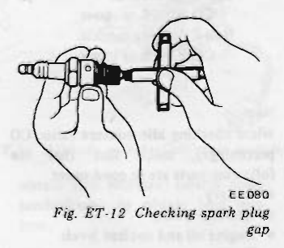
>
> - **Summary:** Checking spark plug electrode gap using a round wire feeler gauge.
> - **Components:** Spark plug, Center electrode, Ground electrode, Wire feeler gauge
> - **Specs / Measurements:** Standard gap: 1.0 to 1.1 mm (0.039 to 0.043 in); Canada gap: 0.7 to 0.8 mm (0.028 to 0.031 in); Tightening torque: 1.5 to 2.0 kg-m (11 to 14 ft-lb)
> - **Mechanic Notes:** Adjust gap by bending ground electrode only; do not bend center electrode.
> - **Tags:** `spark plug`, `plug gap`, `feeler gauge`, `electrodes`

## CHECKING IGNITION WIRING

Use an ohmmeter to check resistance on high tension cables.
1. Disconnect cables from spark plugs and remove distributor together with high tension cables.

> [!NOTE]
> Do not remove cables from cap.

2. Connect the ohmmeter between cable terminal on the spark plug side and the corresponding electrode inside cap.
3. If the resistance is more than 30,000 ohms, remove cable from cap and check the cable resistance only. If resistance is still more than 30,000 ohms, replace cable assembly.

> 🖼️ **Fig. ET-13 Checking high tension cable** `[EF125]` *(Type: `inspection_measurement`)*
>
> 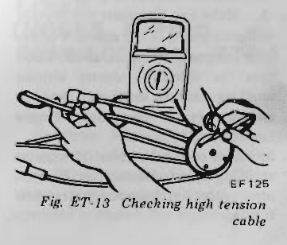
>
> - **Summary:** Testing high tension ignition cable resistance using an ohmmeter connected between plug boot terminal and distributor cap internal terminal.
> - **Components:** High tension ignition cable, Distributor cap, Ohmmeter, Test probes
> - **Specs / Measurements:** Maximum resistance: 30,000 Ω
> - **Wiring / Connections:** Ohmmeter connected between spark plug terminal and distributor cap electrode
> - **Mechanic Notes:** Do not remove cables from cap initially. If resistance exceeds 30,000 ohms, test cable alone before replacing.
> - **Tags:** `high tension cables`, `ohmmeter`, `ignition wire`, `resistance`

---

<!-- Page 8 (ET-8) -->
# CHECKING AND ADJUSTING ENGINE IDLE RPM AND MIXTURE RATIO

> [!WARNING]
> a. On automatic transmission models, checks should be performed with the lever shifted to the "D" position. Be sure to engage parking brake and to lock both front and rear wheels with wheel chocks.  
> b. Depress brake pedal while accelerating the engine to prevent forward surge of car.  
> c. After idle adjustment has been made, shift the lever to the "N" or "P" position and remove wheel chocks.

> [!NOTE]
> In air conditioner equipped models, idle inspection should be carried out while the air conditioner is "OFF".

## Idle rpm adjusting and mixture ratio checking

Checking idle mixture requires the use of a CO-meter. When preparing to inspect idle mixture, it is essential to have the meter thoroughly warmed up and calibrated.

1. Warm up engine until water temperature indicator points to the middle of gauge. The procedure to warm up engine is not specifically recommended. Either driving car or operating engine at no load will be good.
2. Make sure that water temperature indicator points to the middle. Further keep engine running at about 2,000 rpm for about 5 minutes without applying load to engine in order to stabilize engine condition. Engine hood should be open.
3. Run engine for about 10 minutes at idling speed. During this 10 minutes, proceed as described in steps 4 to 6 below.
4. Race engine (1,500 to 2,000 rpm) two or three times under no load, then run engine for one minute at idling speed.
5. Check idle speed. If necessary, adjust it to specifications.
   - **Engine speed:**
     - Manual transmission: 800 rpm
     - Automatic transmission (in "D" position): 700 rpm

> 🖼️ **Fig. ET-14 Adjusting idling speed** `[ET295]` *(Type: `procedure_step`)*
>
> 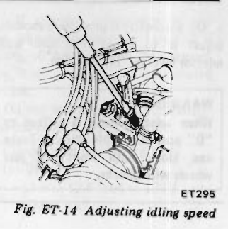
>
> - **Summary:** Adjusting idle speed using screwdriver on idle speed adjusting screw located on throttle chamber.
> - **Components:** Throttle chamber, Idle speed adjusting screw, Screwdriver
> - **Specs / Measurements:** Manual: 800 rpm; Automatic: 700 rpm (in 'D' position)
> - **Mechanic Notes:** Air conditioner must be OFF during idle speed inspection and adjustment.
> - **Tags:** `idle speed`, `adjusting screw`, `throttle chamber`, `carburetor idle`, `EFI`

6. Check ignition timing. If necessary, adjust it to specifications.  
   This operation need not be carried out at 1,600 km (1,000 miles) service.

| Transmission | Ignition timing |
| :--- | :--- |
| Manual transmission | 10° B.T.D.C./800 rpm |
| Automatic transmission (in "D" position) | 10° B.T.D.C./700 rpm |

7. At about 10 minutes after engine is run, check CO percentage with CO meter. Specified CO percentage is as follows:
   - **Idle mixture ratio (CO percentage):**
     - California models: CO = 0.5% or lower
     - Non-California models: CO = 1.0% or lower

> [!NOTE]
> When checking idle mixture ratio (CO percentage), make sure that the following parts are in good order:
> - Battery
> - Ignition system
> - Engine oil and coolant levels
> - Fuses
> - Electronic fuel injection units
> - Electronic fuel injection harness connectors
> - Hoses
> - Oil filler cap and oil level gauge
> - Valve clearance, engine compression

8. If specified idle CO percentage is not obtained, repeat procedures as described in steps 4, 5 and 7 above.  
   Checking idle CO in step 7 can be carried out right after step 5.  
   If specified idle CO percentage is not obtained, adjust it as described below in the last resort.

## Idle mixture setting procedure (Idle mixture ratio adjustment)

> [!NOTE]
> The idle mixture ratio of electronic fuel injection car is set so lean that it is not appropriate to use CO% as an indicator of mixture ratio. Therefore, in order to adjust idle mixture ratio with conventional CO analyzer, a certain amount of enrichment must be temporarily given to idle mixture setting to make it richer.  
> To enrich the idle mixture, the full load enrichment is forced to function by making a short circuit in that enrichment circuit. The actual procedure to be followed is illustrated below. <!-- Page 9 (ET-9) --> > 🖼️ **Fig. ET-15 Idle mixture ratio adjustment** `[ET362]` *(Type: `procedure_step`)*
>
> 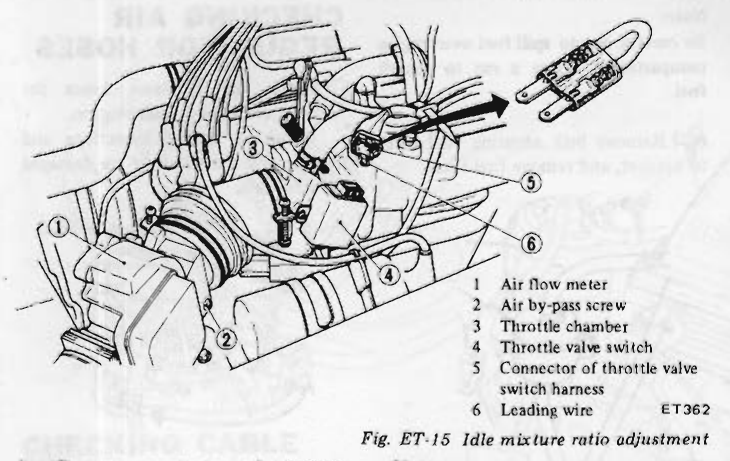
>
> - **Summary:** Procedure for forcing full-load enrichment during idle CO adjustment by shorting terminals 3 and 18 of throttle valve switch connector with a jumper wire, and adjusting air flow meter bypass screw.
> - **Components:** Air flow meter, Air by-pass screw, Throttle chamber, Throttle valve switch, Connector of throttle valve switch harness, Leading wire
> - **Callouts:** **(1)** Air flow meter; **(2)** Air by-pass screw; **(3)** Throttle chamber; **(4)** Throttle valve switch; **(5)** Connector of throttle valve switch harness; **(6)** Leading wire
> - **Wiring / Connections:** Jumper wire between terminal No. 3 and No. 18 on throttle valve switch harness connector
> - **Mechanic Notes:** Turn bypass screw clockwise for rich mixture, counterclockwise for lean mixture.
> - **Tags:** `idle mixture`, `CO adjustment`, `air bypass screw`, `throttle valve switch`, `AFM`

1. Remove connector of throttle valve switch harness.
2. Insert a leading wire ⑥ to the No. 3 and No. 18 terminals of connector ⑤.
3. Adjust idle CO to the altitude specifications by turning air by-pass screws.

> 🖼️ **Fig. ET-16 Altitude switch (California models)** `[EF655]` *(Type: `component_location`)*
>
> 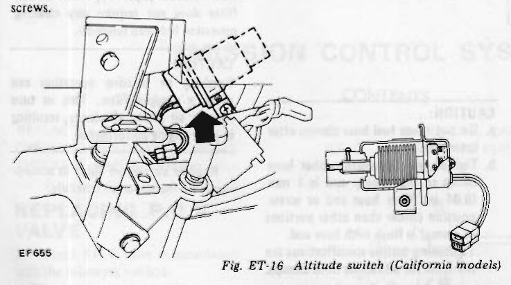
>
> - **Summary:** Location and harness disconnection point for the altitude switch on California models, situated near steering column / pedal support.
> - **Components:** Altitude switch, Harness connector, Bellows mechanism
> - **Specs / Measurements:** Threshold: 750 m (2,500 ft)
> - **Wiring / Connections:** Altitude switch harness connector
> - **Mechanic Notes:** Disconnect connector when adjusting idle CO above 750 m (2,500 ft) on California models; reconnect after adjustment.
> - **Tags:** `altitude switch`, `California model`, `CO adjustment`, `emission control`

> [!NOTE]
> When adjusting idle CO percentage at altitudes 750 m (2,500 ft) or more for California models, be sure to disconnect altitude switch connector.

> [!NOTE]
> a. Remove plastic blind plug from air by-pass screw of air flow meter.  
> b. Turn air by-pass screw clockwise to obtain rich mixture; turn it counterclockwise to obtain lean mixture.

### Idle CO specifications: (full enrichment)
| Altitude | Idle CO % (full enrichment) |
| :--- | :--- |
| 0 to 600 m (0 to 2,000 ft) | 3.3% |
| 600 to 1,200 m (2,000 to 4,000 ft) | 4.7% |
| 1,200 to 1,800 m (4,000 to 6,000 ft) | 5.7% |
| Above 1,800 m (6,000 ft) | 6.7% |

4. Race engine (1,500 to 2,000 rpm) two or three times under no load and make sure that specified CO percentage is obtained.
5. Remove the leading wire and connect the harness back to the throttle valve switch.

> [!NOTE]
> After adjusting idle CO percentage for California models, replace altitude switch connector in its original position.

6. Install a new rubber plug (furnished as a service part) on air flow meter.

> 🖼️ **Fig. ET-17 Rubber plug** `[ET363]` *(Type: `procedure_step`)*
>
> 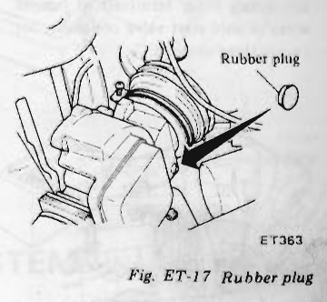
>
> - **Summary:** Installing replacement rubber sealing plug into air flow meter bypass screw recess after mixture adjustment.
> - **Components:** Air flow meter, Rubber plug, Bypass screw cavity
> - **Mechanic Notes:** Install a new rubber plug (furnished as a service part) to seal air bypass screw cavity against moisture and unmetered air.
> - **Tags:** `rubber plug`, `air flow meter`, `air bypass screw`, `tamper plug`

7. Check idle speed. If necessary, adjust it to specifications.
8. Check CO percentage if it is within specifications.
   - **Idle mixture ratio (CO percentage):**
     - California models: CO = 0.5% or lower
     - Non-California models: CO = 1.0% or lower

# CHECKING FUEL LINES (HOSES, PIPING CONNECTIONS, ETC.)

Check fuel hoses for leakage, loose connections, cracks or deterioration.  
Retighten loose connections and replace any damaged or deformed parts. Replace any rubber fuel hose whose inner surface is deformed, scratched or chafed. See Figure ET-1.

---

<!-- Page 10 (ET-10) -->
# REPLACING FUEL FILTER

The fuel filter is designed especially for use with the electronic fuel injection system. It should be replaced as an assembly in accordance with maintenance schedule.

1. Disconnect ground cable from battery.
2. Disconnect cold start valve harness connector.
3. Using two jumper wires shown in illustration, connect each terminal to battery positive and negative terminals.
4. Release pressure in fuel system by connecting other terminals of jumper wires to cold start valve connector for two or three seconds.

> 🖼️ **Fig. ET-18 Releasing pressure in fuel system** `[EF754]` *(Type: `procedure_step`)*
>
> 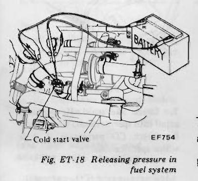
>
> - **Summary:** Relieving residual fuel rail line pressure before filter replacement using jumper wires connected to battery and cold start valve for 2-3 seconds.
> - **Components:** Battery, Cold start valve, Jumper wires
> - **Specs / Measurements:** Activation duration: 2 to 3 seconds
> - **Wiring / Connections:** Jumper wires from 12V battery to cold start valve harness terminals
> - **Mechanic Notes:** Prevent short circuits by keeping jumper clips separate.
> - **Tags:** `fuel pressure relief`, `cold start valve`, `jumper wire`, `safety`

> [!CAUTION]
> Be careful to keep both terminals separate in order to avoid short circuit.

5. Unfasten clamps securing fuel hoses to the outlet and inlet sides of fuel filter, and disengage fuel hoses.

> [!NOTE]
> Be careful not to spill fuel over engine compartment. Place a rag to absorb fuel.

6. Remove bolt securing fuel filter to bracket, and remove fuel filter.

> 🖼️ **Fig. ET-19 Fuel filter** `[EF773]` *(Type: `component_location`)*
>
> 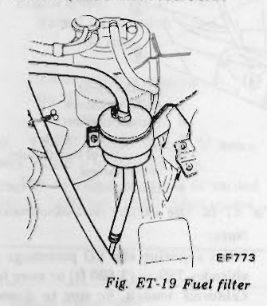
>
> - **Summary:** Fuel filter mounting bracket, fuel inlet/outlet hose orientation, and securing bolt location.
> - **Components:** Fuel filter, Mounting bracket, Inlet hose, Outlet hose, Securing bolt
> - **Specs / Measurements:** Clamp torque: 0.10 to 0.15 kg-m (0.7 to 1.1 ft-lb)
> - **Mechanic Notes:** Do not reuse hose clamps after loosening. Ensure clamp is positioned 1 mm from hose end.
> - **Tags:** `fuel filter`, `hose clamp`, `bracket`, `EFI fuel filter`

7. To install fuel filter, reverse the order of removal.

> [!CAUTION]
> a. Do not reuse fuel hose clamps after loosening.  
> b. Tighten high pressure rubber hose clamp so that clamp end is 1 mm (0.04 in) from hose end or screw position (wider than other portions of clamp) is flush with hose end. Tightening torque specifications are the same for all rubber hose clamps.

### Tightening torque of fuel hose clamps:
- 0.10 to 0.15 kg-m (0.7 to 1.1 ft-lb)

# CHECKING AIR REGULATOR HOSES

Check air regulator hoses for leakage, cracks and deterioration.  
Retighten loose connections and replace any parts if they are damaged or deformed.

> 🖼️ **Fig. ET-20 Air regulator hoses** `[ET415]` *(Type: `component_location`)*
>
> 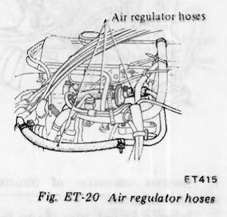
>
> - **Summary:** Routing of air regulator bypass hoses connecting air duct, air regulator, and intake manifold.
> - **Components:** Air regulator hoses, Air regulator, Throttle chamber, Intake manifold
> - **Mechanic Notes:** Check for hardening, cracks, or loose clamps which introduce unmetered false air.
> - **Tags:** `air regulator`, `hoses`, `idle auxiliary air`, `vacuum leak`

# REPLACING AIR CLEANER FILTER

> [!NOTE]
> The viscous paper type air cleaner filter does not require any cleaning operation between renewals.

> [!CAUTION]
> Brushing or blasting operation can cause a clogged filter. This in turn reduces air intake efficiency, resulting in poor engine performance.

Replace air cleaner filter in accordance with maintenance schedule.

---

<!-- Page 11 (ET-11) -->
# CHECKING CABLE HARNESS AND CONNECTORS

Check harness connectors for correct insertion and harness connector terminals for deformation or rust. Replace faulty parts.

> 🖼️ **Fig. ET-21 Air cleaner filter** `[EF647]` *(Type: `exploded_view`)*
>
> 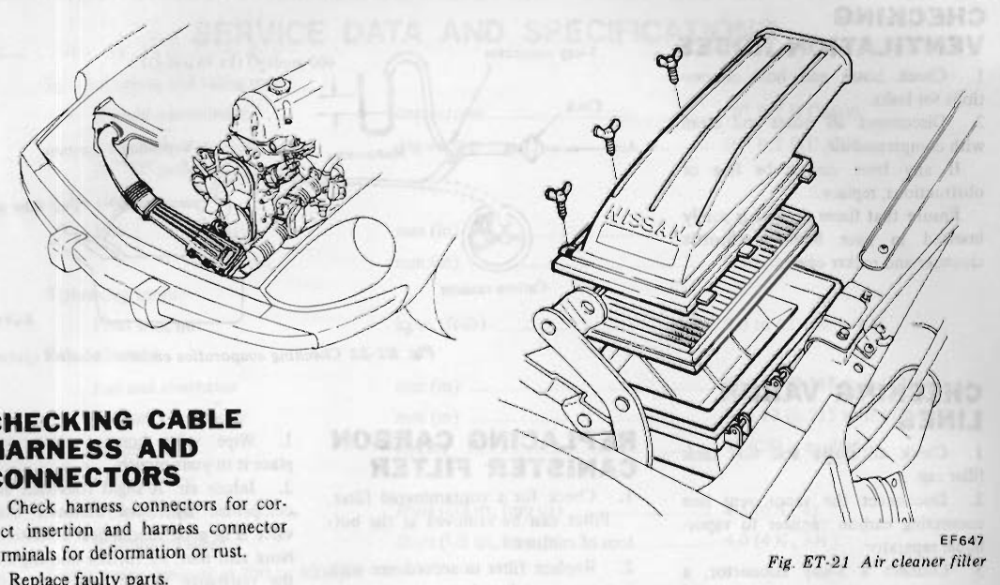
>
> - **Summary:** Exploded view of the air cleaner assembly showing housing, filter element, cover, ducting, and wing nuts.
> - **Components:** Air cleaner cover, Viscous paper filter element, Air cleaner case, Wing nuts, Air intake duct
> - **Mechanic Notes:** Do not brush or blow compressed air on viscous paper filter; replace according to maintenance schedule.
> - **Tags:** `air cleaner`, `air filter`, `intake duct`, `exploded view`

# EMISSION CONTROL SYSTEM

## CONTENTS
| Section | Page |
| :--- | :--- |
| REPLACING P.C.V. VALVE | ET-11 |
| CHECKING VENTILATION HOSES | ET-12 |
| CHECKING VAPOR LINES | ET-12 |
| REPLACING CARBON CANISTER FILTER | ET-12 |
| CHECKING FUEL TANK VACUUM RELIEF VALVE | ET-12 |

## REPLACING P.C.V. VALVE

1. Check P.C.V. valve in accordance with the following method.  
   With engine running at idle, remove the ventilator hose from P.C.V. valve. If the valve is working, a hissing noise will be heard as air passes through the valve and a strong vacuum should be felt immediately when a finger is placed over valve inlet.
2. Replace P.C.V. valve in accordance with the maintenance schedule.

> 🖼️ **Fig. ET-22 Crankcase emission control system** `[EC805]` *(Type: `cutaway_flow`)*
>
> 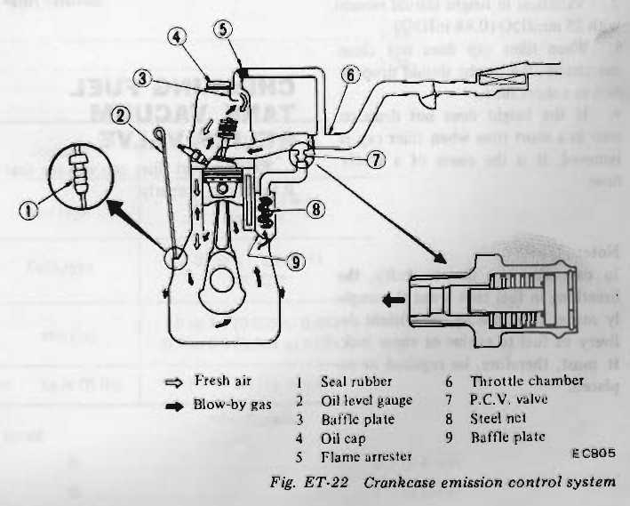
>
> - **Summary:** Cutaway diagram of positive crankcase ventilation (PCV) flow, showing fresh air intake pathway and blow-by gas extraction through PCV valve into intake manifold.
> - **Components:** Seal rubber, Oil level gauge, Baffle plate, Oil cap, Flame arrester, Throttle chamber, P.C.V. valve, Steel net, Baffle plate
> - **Callouts:** **(1)** Seal rubber; **(2)** Oil level gauge; **(3)** Baffle plate; **(4)** Oil cap; **(5)** Flame arrester; **(6)** Throttle chamber; **(7)** P.C.V. valve; **(8)** Steel net; **(9)** Baffle plate
> - **Wiring / Connections:** Ventilator hose between crankcase baffle and PCV valve; Ventilation hose with flame arrester between rocker cover and throttle chamber
> - **Mechanic Notes:** White open arrows indicate fresh air intake; solid black arrows indicate blow-by gas flow through internal engine passages.
> - **Tags:** `PCV valve`, `crankcase ventilation`, `blow-by`, `flame arrester`, `baffle`

---

<!-- Page 12 (ET-12) -->
# CHECKING VENTILATION HOSES

1. Check hoses and hose connections for leaks.
2. Disconnect all hoses and clean with compressed air.  
   If any hose cannot be free of obstructions, replace.  
   Ensure that flame arrester is surely inserted in hose between throttle chamber and rocker cover.

# CHECKING VAPOR LINES

1. Check all hoses and fuel tank filler cap.
2. Disconnect the vapor vent line connecting carbon canister to vapor-liquid separator.
3. Connect a 3-way connector, a manometer and a cock (or an equivalent 3-way charge cock) to the end of the vent line.
4. Supply fresh air into the vapor vent line through the cock little by little until pressure becomes 400 mmH2O (15.75 inH2O).
5. Shut the cock completely and leave it unattended.
6. After 2.5 minutes, measure the height of the liquid in the manometer.
7. Variation in height should remain with 25 mmH2O (0.98 inH2O).
8. When filler cap does not close completely, the height should drop to zero in a short time.
9. If the height does not drop to zero in a short time when filler cap is removed, it is the cause of a stuffy hose.

> [!NOTE]
> In case the vent line is stuffy, the breathing in fuel tank is not thoroughly made, thus causing insufficient delivery of fuel to engine or vapor lock. It must, therefore, be repaired or replaced.

> 🖼️ **Fig. ET-23 Checking evaporative emission control system** `[EC715]` *(Type: `inspection_measurement`)*
>
> 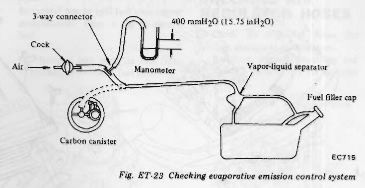
>
> - **Summary:** Test setup schematic for evaporative vapor line pressure leak check using 3-way cock, compressed air source, manometer, and connections to vapor-liquid separator and carbon canister.
> - **Components:** 3-way connector, Cock, Manometer, Carbon canister, Vapor-liquid separator, Fuel filler cap
> - **Specs / Measurements:** Test pressure: 400 mmH2O (15.75 inH2O); Allowable drop after 2.5 minutes: within 25 mmH2O (0.98 inH2O)
> - **Wiring / Connections:** Vapor line between carbon canister and vapor-liquid separator
> - **Mechanic Notes:** Removing filler cap should cause manometer reading to drop quickly to zero; failure to drop indicates clogged vent line.
> - **Tags:** `evaporative emission`, `vapor line`, `manometer`, `leak test`, `vapor separator`

# REPLACING CARBON CANISTER FILTER

1. Check for a contaminated filter. Filter can be removed at the bottom of canister.
2. Replace filter in accordance with maintenance schedule.

> 🖼️ **Fig. ET-24 Replacing carbon canister filter** `[EF201]` *(Type: `procedure_step`)*
>
> 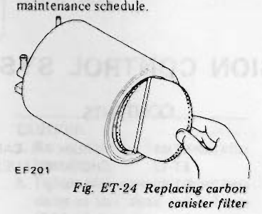
>
> - **Summary:** Removal and replacement of bottom filter element from charcoal carbon canister body.
> - **Components:** Carbon canister, Filter element, Bottom retainer
> - **Mechanic Notes:** Check for saturated or contaminated filter element and replace periodically.
> - **Tags:** `carbon canister`, `canister filter`, `evaporative emission`

# CHECKING FUEL TANK VACUUM RELIEF VALVE

Remove fuel filler cap and see that it functions properly.
1. Wipe valve housing clean and place it in your mouth.
2. Inhale air. A slight resistance accompanied by valve indicates that valve is in good mechanical condition. Note also that, by further inhaling air, the resistance should disappear with valve clicks.
3. If valve is clogged, or if no resistance is felt, replace cap as an assembly.

> 🖼️ **Fig. ET-25 Fuel filler cap** `[EC089A]` *(Type: `cutaway_flow`)*
>
> 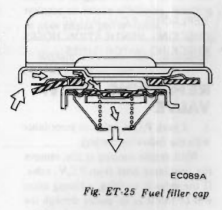
>
> - **Summary:** Sectional view of fuel tank filler cap showing internal vacuum relief valve and spring mechanism.
> - **Components:** Fuel filler cap housing, Vacuum relief valve disc, Valve return spring, Cap gasket
> - **Mechanic Notes:** Clean housing and test by inhaling; slight initial resistance should be felt followed by audible valve clicking and opening.
> - **Tags:** `fuel filler cap`, `vacuum relief valve`, `fuel tank venting`

---

<!-- Page 13 (ET-13) -->
# SERVICE DATA AND SPECIFICATIONS

## Ignition timing and idling speed
| Parameter | Unit | Specification |
| :--- | :--- | :--- |
| Manual transmission | degree/rpm | 10° B.T.D.C./800 |
| Automatic transmission (in "D" position) | degree/rpm | 10° B.T.D.C./700 |

## Valve clearance
| Temperature | Valve | Unit | Specification |
| :--- | :--- | :--- | :--- |
| Hot | Intake | mm (in) | 0.25 (0.010) |
| Hot | Exhaust | mm (in) | 0.30 (0.012) |

## Tightening torque
| Component | Unit | Specification |
| :--- | :--- | :--- |
| Pivot lock nut | kg-m (ft-lb) | 5.0 to 6.0 (36 to 43) |

## Belt deflection
| Belt | Unit | Deflection | Applied Force |
| :--- | :--- | :--- | :--- |
| Fan and alternator | mm (in) | 8 to 12 (0.315 to 0.472) | 10 kg (22 lb) is applied |
| Air con. compressor | mm (in) | 8 to 12 (0.315 to 0.472) | 10 kg (22 lb) is applied |

## Engine oil capacity
| Condition | Unit | Capacity |
| :--- | :--- | :--- |
| With oil filter | liters (US qt, Imp qt) | 4.5 (4 3/4, 4) |
| Without oil filter | liters (US qt, Imp qt) | 4.0 (4 1/4, 3 1/2) |

## Compression pressure at 300 to 400 rpm
| Parameter | Unit | Pressure |
| :--- | :--- | :--- |
| Standard | kg/cm² (psi) | 12.5 (178) |
| Minimum | kg/cm² (psi) | 11.5 (164) |

## Cooling system
| Item | Unit | Specification |
| :--- | :--- | :--- |
| Radiator cap relief pressure | kg/cm² (psi) | 0.9 (13) |
| Leakage testing pressure | kg/cm² (psi) | 1.6 (23) |
| **Engine coolant capacity (including heater and reservoir tank)** | | |
| Manual transmission model | liters (US qt, Imp qt) | 10.3 (10 7/8, 9 1/8) |
| Automatic transmission model | liters (US qt, Imp qt) | 10.1 (10 5/8, 8 7/8) |

## Battery specific gravity at 20°C (68°F)
| Climate | Value |
| :--- | :--- |
| Frigid climates | 1.28 |
| Other climates | 1.26 |

## Spark plug
| Item | Standard | Hot type | Cold type |
| :--- | :--- | :--- | :--- |
| **TYPE** | B6ES-11, L45W-11 BR6ES* | B5ES-11, L46W-11 BR5ES* | B7ES-11, L44W-11 BR7ES* |
| **Plug gap** | 1.0 to 1.1 mm (0.039 to 0.043 in) 0.7 to 0.8 mm (0.028 to 0.031 in)* | | |
| **Tightening torque** | 1.5 to 2.0 kg-m (11 to 14 ft-lb) | | |

*\*For Canada*

## Checking "CO" percentage at idling speed
| Model | Unit | Specification |
| :--- | :--- | :--- |
| California models | % | 0.5 or lower |
| Non-California models | % | 1.0 or lower |

---

<!-- Page 14 (ET-14) -->
# TROUBLE DIAGNOSES AND CORRECTIONS

| Condition | Probable cause | Corrective action |
| :--- | :--- | :--- |
| **CANNOT CRANK ENGINE OR SLOW CRANKING** | Improper grade oil. | Replace with proper grade oil. |
| | Partially discharged battery. | Charge battery. |
| | Malfunctioning battery. | Replace. |
| | Loose fan belt. | Adjust. |
| | Trouble in charging system. | Inspect. |
| | Wiring connection trouble in starting circuit. | Correct. |
| | Malfunctioning ignition switch. | Repair or replace. |
| | Malfunctioning starting motor. | Repair or replace. |

### (Trouble-shooting procedure on starting circuit)
Switch on the starting motor with head lights "ON".
- **When head lights go off or dim considerably:**
  a. Check battery.  
  b. Check connection and cable.  
  c. Check starting motor.  
- **When head lights stay bright:**
  a. Check wiring connection between battery and starting motor.  
  b. Check ignition switch.  
  c. Check starting motor.  

| Condition | Probable cause | Corrective action |
| :--- | :--- | :--- |
| **ENGINE WILL CRANK NORMALLY BUT WILL NOT START** | In this case, the following trouble causes may exist, but in many cases ignition system or fuel system is in trouble: • Ignition system in trouble • Fuel system in trouble • Valve mechanism does not work properly • Low compression | |

### (Trouble-shooting procedure)
Check spark plug firstly by following procedure:  
Disconnect high tension cable from one spark plug and hold it about 10 mm (0.39 in) from the engine metal part and crank the engine.
- **Good spark occurs:**
  a. Check spark plug.  
  b. Check ignition timing.  
  c. Check fuel system.  
  d. Check revolution trigger signal.  
  e. Check cylinder compression.  
- **No spark occurs:**

| Condition | Probable cause | Corrective action |
| :--- | :--- | :--- |
| *(No spark occurs)* | Very high current. | Check the current flow in primary circuit. Inspect primary circuit for short. Check distributor pick-up coil operation. Check transistor ignition system. | <!-- Page 15 (ET-15) --> | Condition | Probable cause | Corrective action |
| :--- | :--- | :--- |
| *(No spark occurs - continued)* | Low or no current. | Check for loose terminal or disconnection in primary circuit. Check for burned points. |
| **Ignition system in trouble** | Malfunctioning distributor pick-up coil. | Inspect and replace if defective. |
| | Improper air gap. | Adjust. |
| | Leak at rotor cap and rotor. | Clean or replace. |
| | Malfunctioning spark plug. | Clean, adjust plug gap or replace. |
| | Improper ignition timing. | Adjust. |
| | Malfunctioning ignition coil. | Replace. |
| | Disconnection of high tension cable. | Replace. |
| | Loose connection or disconnection in primary circuit. | Repair or replace. |
| | Irregular revolution trigger pulse. | Replace transistor ignition control unit. |
| | Malfunctioning full transistor ignition unit. | Replace. |
| **ENGINE CRANKS NORMALLY BUT WILL NOT START** *(Fuel system malfunction)* | Lack of fuel. | Supply. *(For inspection procedures for electronic fuel injection system components, refer to engine fuel section.)* |
| | Damaged electronic fuel injection harness or relay. | Replace. |
| | Malfunctioning fuel pump (Listen to operating sound). | Replace. |
| | Damaged control unit. | Replace. |
| | Seized injector (Listen to operating sound). | Replace. |
| | Seized cold start valve. | Replace. |
| | Malfunctioning air flow meter. | Replace. |
| | Damaged water temp. sensor. | Replace. |
| | Malfunctioning pressure regulator. | Replace. |
| | Dirty fuel filter. | Replace. |
| | Dirty or clogged fuel pipe. | Clean. |
| | Clogged fuel tank breather pipe. | Repair and clean. |
| **Low compression** | Incorrect spark plug tightening or damaged gasket. | Tighten to normal torque or replace gasket. |
| | Improper grade engine oil or low viscosity. | Replace with proper grade oil. |
| | Incorrect valve clearance. | Adjust. |
| | Compression leak from valve seat. | Remove cylinder head and lap valves. |
| | Sticky valve stem. | Correct or replace valve and valve guide. |
| | Weak or damaged valve springs. | Replace valve springs. |
| | Compression leak at cylinder head gasket. | Replace gasket. | <!-- Page 16 (ET-16) --> | Condition | Probable cause | Corrective action |
| :--- | :--- | :--- |
| **Low compression** *(continued)* | Sticking or defective piston ring. | Replace piston rings. |
| | Worn piston ring or cylinder. | Overhaul engine. |

### (Trouble shooting procedure)
Pour the engine oil from plug hole, and then measure cylinder compression:
- **Compression increases:** Trouble in cylinder or piston ring.
- **Compression does not change:** Compression leaks from valve, cylinder head or head gasket.

| Condition | Probable cause | Corrective action |
| :--- | :--- | :--- |
| **UNSTABLE ENGINE IDLING** *Ignition system* | Incorrect idle adjustment | Adjust. |
| | Malfunctioning ignition system (spark plug, high tension cable, air gap, full transistor ignition unit, ignition coil, etc.) | Replace. |
| | Incorrect basic ignition timing. | Adjust. |
| *Engine mechanical system in trouble* | Loose manifold and cylinder head bolts. | Retighten bolts. |
| | Incorrect valve clearance. | Adjust. |
| *Fuel system malfunction* | Clogged air cleaner filter. | Replace filter. *(For inspection procedures for electronic fuel injection system components, refer to Engine Fuel Section.)* |
| | Damaged manifold gaskets. | Replace gasket. |
| | Intake air leakage at following points: • Dipstick • Oil filler cap • Blow-by hoses • Intake air duct—air flow meter to throttle chamber. | Repair or replace. |
| | Damaged electronic fuel injection harness. | Replace. |
| | Seized injector (Listen to operating sound). | Replace. |
| | Malfunctioning air regulator (During warm-up driving only). | Replace. |
| | Damaged control unit. | Replace. |
| | Damaged water and air temp. sensor. | Replace. |
| | Malfunctioning throttle valve switch. | Repair or replace. |
| | Damaged altitude switch. | Replace. |
| | Irregular fuel pressure. | Replace pressure regulator. |
| *Others* | Malfunctioning E.G.R. control valve. | Clean or replace. |
| **HIGH ENGINE IDLE SPEED** | Dragged accelerator linkage. | Check and correct accelerator linkage. |
| | Malfunctioning B.C.D.D. system. | If engine idling speed rises above 1,800 to 2,000 rpm, the cause may be a malfunctioning B.C.D.D. system. Check B.C.D.D. system. Repair or replace if necessary. |
| | Malfunctioning air regulator. | Replace. For inspection procedures for air regulator, refer to engine fuel section. | <!-- Page 17 (ET-17) --> | Condition | Probable cause | Corrective action |
| :--- | :--- | :--- |
| **HIGH ENGINE IDLE SPEED** *(continued)* | Incorrect adjustment of idle speed adjusting screw. | Correct. For inspection procedures, refer to throttle chamber section. |
| **ENGINE POWER NOT UP TO NORMAL / BELOW NORMAL** *Low compression* | Low compression causes | Previously mentioned. |
| *Ignition system in trouble* | Incorrect ignition timing. | Adjust. |
| | Malfunctioning spark plugs. | Clean, adjust or replace plugs. |
| | Malfunctioning distributor pick-up coil. | Dress, or replace points. Also check condenser. |
| *Fuel system malfunction* | Throttle valve does not open fully. | Adjust. *(For inspection procedures for electronic fuel injection system components, refer to Engine Fuel Section.)* |
| | Damaged electronic fuel injection harness. | Replace. |
| | Seized injector (Listen to operating sound). | Replace. |
| | Malfunctioning air flow meter. | Replace. |
| | Malfunctioning throttle valve switch. | Repair or replace. |
| | Irregular fuel pressure. | Replace pressure regulator if necessary. |
| | Clogged fuel pipe. | Replace if necessary. |
| | Dirty or clogged fuel filter. | Replace. |
| | Fuel pump will not work properly. | Replace. |
| *Air intake system malfunction* | Clogged air cleaner filter. | Replace filter. |
| | Air leaking from manifold gasket. | Replace gasket. |
| | Intake air leakage at following points: • Dipstick • Oil filler cap • Blow-by hoses • Intake air duct—air flow meter to throttle chamber, etc. | Repair or replace. |
| *Overheating* | Insufficient coolant. | Replenish. |
| | Loose fan belt. | Adjust fan belt. |
| | Worn or damaged fan belt. | Replace. |
| | Malfunctioning thermostat. | Replace. |
| | Malfunctioning water pump. | Replace. |
| | Clogged or leaky radiator. | Flush, repair or replace. |
| | Malfunctioning radiator filler cap. | Replace. |
| | Air in cooling system. | Retighten each part of cooling system. |
| | Improper engine oil grade. | Replace with proper grade oil. |
| | Incorrect ignition timing. | Adjust. | <!-- Page 18 (ET-18) --> | Condition | Probable cause | Corrective action |
| :--- | :--- | :--- |
| **ENGINE POWER NOT UP TO NORMAL / BELOW NORMAL** *(continued)* *Overcooling* | Malfunctioning thermostat. | Replace. |
| *Others* | Improper octane fuel. | Replace with specified octane fuel. |
| | Improper tire pressure. | Inflate to specified pressure. |
| | Dragging brake. | Adjust. |
| | Clutch slipping. | Adjust. |
| **NOISY ENGINE** *Car knocking* | Overloaded engine. | Use right gear in driving. |
| | Carbon knocking. | Disassemble cylinder head and remove carbon. |
| | Timing knocking. | Adjust ignition timing. |
| | Fuel knocking. | Use specified octane fuel. |
| | Preignition (misusing of spark plug). | Use specified spark plug. |
| *Mechanical knocking* | Crankshaft bearing knocking. *(This strong dull noise increases when engine is accelerated. To locate the place, cause a misfire on each cylinder. If the noise stops by the misfire, this cylinder generates the noise.)* | This is caused by worn or damaged bearings, or unevenly worn crankshaft. Renew bearings and adjust or change crankshaft. Check lubrication system. |
| | Connecting rod bearing knocking. *(This is a little higher-pitched noise than the crankshaft knocking, and also increases when engine is accelerated. Cause a misfire on each cylinder and if the noise diminishes almost completely, this crankshaft bearing generates the noise.)* | Same as the case of crankshaft bearings. |
| | Piston and cylinder noise. *(When you hear an overlapping metallic noise which increases its magnitude with the revolution of engine and which decreases as engine is warmed up, this noise is caused by piston and cylinder. To locate the place, cause a misfire on each cylinder.)* | This may cause an abnormal wearing of cylinder and lower compression which in turn will cause a lower out-put power and excessive consumption of oil. Overhaul engine. |
| | Piston pin noise. *(This noise is heared at each highest and lowest dead end of piston. To locate the place, cause a misfire on each cylinder.)* | This may cause a wear on piston pin, or piston pin hole. Renew piston and piston pin assembly. |
| | Water pump noise. *(This noise may be caused by worn or damaged bearings, or by the uneven surface of sliding parts.)* | Replace water pump with a new one. |
| *Others.* | An improper adjustment of valve clearance. | Adjust. |
| | Noise of timing chain. | Adjust the tension of chain. |
| | An excessive end-play on crankshaft. | Disassemble engine and renew main bearing. | <!-- Page 19 (ET-19) --> | Condition | Probable cause | Corrective action |
| :--- | :--- | :--- |
| **NOISY ENGINE** *(Others continued)* *(Note: This noise will be heared when clutch is disengaged.)* | Wear on clutch pilot bushing. | Renew bushing and adjust drive shaft. |
| **ABNORMAL COMBUSTION (backfire, after fire run-on etc.)** *Improper ignition timing* | Improper ignition timing. | Adjust ignition timing. |
| | Improper heat range of spark plugs. | Use specified spark plugs. |
| *Fuel system malfunction* *(in original: Fuel stem malfunction)* | Intake air leakage at following points: • Dipstick • Oil filler cap • Blow-by hoses • Intake air duct—air flow meter to throttle chamber, etc. | Repair or replace. *(For inspection procedures for electronic fuel injection system components, refer to Engine Fuel Section.)* |
| | Damaged electronic fuel injection harness. | Replace. |
| | Damaged control unit. | Replace. |
| | Malfunctioning air flow meter. | Replace. |
| | Damaged water temp. sensor. | Replace. |
| | Damaged altitude switch. | Replace. |
| *Defective cylinder head, etc.* | Improperly adjusted valve clearance. | Adjust. |
| | Excess carbon in combustion chamber. | Remove head and get rid of carbon. |
| | Damaged valve spring (backfire, after fire). | Replace it with a new one. |
| *Others* | Loose vacuum hoses. | Check for loose vacuum hoses. Replace if necessary. |
| | Malfunctioning E.G.R. control valve. | Replace. |
| **EXCESSIVE OIL CONSUMPTION** *Oil leakage* | Loose oil drain plug. | Tighten it. |
| | Loose or damaged oil pan gasket. | Renew gasket or tighten it. |
| | Loose or damaged chain cover gasket. | Renew gasket or tighten it. |
| | Damaged oil seal in front and rear of crankshaft. | Renew oil seal. |
| | Loose or damaged rocker cover gasket *(in table: locker cover gasket)*. | Renew gasket or tighten it (but not too much). |
| | Improper tightening of oil filter. | Renew gasket and tighten it with the proper torque. |
| | Loose or damaged oil pressure switch. | Renew oil pressure switch or tighten it. | <!-- Page 20 (ET-20) --> | Condition | Probable cause | Corrective action |
| :--- | :--- | :--- |
| **EXCESSIVE OIL CONSUMPTION** *(continued)* | Cylinder and piston wear. | Overhaul cylinder and renew piston. |
| | Improper location of piston ring or reversely assembled piston ring. | Remount piston rings. |
| | Damaged piston rings. | Renew rings. Repair or renew piston and cylinder. |
| | Worn piston ring groove and ring. | Renew piston and piston ring. |
| | Fatigue of valve oil seal lip. | Replace seal lip with a new one. |
| | Worn valve stem. | Renew valve or guide. |
| *Others* | Inadequate quality of engine oil. | Use the designated oil. |
| | Engine overheat. | Previously mentioned. |
| **POOR FUEL ECONOMY** *Ignition system* | See the explanation of the power decrease | |
| *Others* | Exceeding idling revolution. | Adjust it to the designated rpm. |
| | Loose fuel pipe connection. | Repair or tighten the connection of fuel pipes. |
| *Emission control system* | Malfunctioning E.G.R. system. | Replace. |
| *Fuel system malfunction* | Fuel leakage. | Repair or replace. *(For inspection procedures for electronic fuel injection system components, refer to Engine Fuel Section.)* |
| | Damaged electronic fuel injection harness. | Replace. |
| | Damaged control unit. | Replace. |
| | Malfunctioning air flow meter. | Replace. |
| | Damaged air temperature sensor. | Replace. |
| | Malfunctioning throttle valve switch. | Replace. |
| | Fuel leakage at injector or cold start valve. | Replace damaged part. |
| | Fuel leakage at rubber fuel hose. | Repair or replace. |
| | Irregular fuel pressure. | Replace pressure regulator if necessary. |
| **TROUBLE IN OTHER FUNCTIONS** *Decreased oil pressure* | Inadequate oil quality. | Use the designated oil. |
| | Overheat. | Previously mentioned. |
| | Malfunctioning oil pump regulator valve. | Disassemble oil pump and repair or renew it. |
| | Functional deterioration of oil pump. | Repair or replace it with a new one. |
| | Blocked oil filter. | Renew it. | <!-- Page 21 (ET-21) --> | Condition | Probable cause | Corrective action |
| :--- | :--- | :--- |
| **TROUBLE IN OTHER FUNCTIONS** *(Decreased oil pressure - continued)* | Increased clearance in various sliding parts. | Disassemble and replace the worn parts with new ones. |
| | Blocked oil strainer. | Clean it. |
| | Malfunctioning oil gauge pressure switch. | Replace it with a new one. |
| **Excessive wear on the sliding parts** | Oil pressure decreases. | Previously mentioned. |
| | Damaged quality or contamination of oil. | Exchange the oil with proper one and change element. |
| | Air leakage from air intake duct. | Repair or replace. |
| | Damaged air cleaner. | Change element. |
| | Overheat or overcool. | Previously mentioned. |
| | Improper fuel mixture. | Check the fuel system. |
| **Scuffing of sliding parts** | Decrease of oil pressure. | Previously mentioned. |
| | Insufficient clearances. | Readjust to the designated clearances. |
| | Overheat. | Previously mentioned. |
| | Improper fuel mixture. | Check the fuel system. |

---

<!-- Page 22 (ET-22) -->
# SPECIAL SERVICE TOOLS

| Tool number & tool name | Kent-Moore No. | Reference page or Fig. No. | Tool drawing |
| :--- | :--- | :--- | :--- |
| **ST10640001** Pivot adjuster | J 25615-01 | Fig. ET-2 | 

> 🖼️ **ST10640001 Pivot adjuster**  *(Type: `special_service_tool`)*
>
> 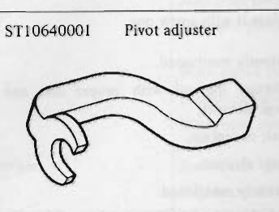
>
> - **Summary:** Special service tool ST10640001 (Kent-Moore J 25615-01) curved pivot adjuster offset wrench used for valve lash adjustment on L-series OHC engines.
> - **Components:** ST10640001 Pivot adjuster wrench
> - **Specs / Measurements:** Kent-Moore No. J 25615-01
> - **Mechanic Notes:** Enables loosening and tightening of rocker pivot lock nut while adjusting pivot screw.
> - **Tags:** `special tool`, `SST`, `ST10640001`, `J 25615-01`, `pivot adjuster`, `valve clearance`

 |
| **ST19320000** Oil filter wrench | J 25664 | Page ET-5 | 

> 🖼️ **ST19320000 Oil filter wrench**  *(Type: `special_service_tool`)*
>
> 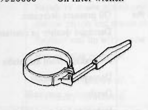
>
> - **Summary:** Special service tool ST19320000 (Kent-Moore J 25664) band-type oil filter removal wrench.
> - **Components:** ST19320000 Oil filter wrench band and handle
> - **Specs / Measurements:** Kent-Moore No. J 25664
> - **Mechanic Notes:** Use only for filter removal; replacement oil filter should be hand tightened.
> - **Tags:** `special tool`, `SST`, `ST19320000`, `J 25664`, `oil filter wrench`

 |

---

## Segmented Diagrams Index

| Figure | Code | Type | Page | Caption | Key Components / Callouts | File |
| :--- | :--- | :--- | :--- | :--- | :--- | :--- |
| **Fig. ET-1** | `ET431` | `vacuum_routing` | ET-3 | Fig. ET-1 L28 engine system piping | Purge control valve, Carbon canister, Vapor vent line, Canister purge line, Carbon canister to 3-way connector vacuum hose | [fig_et_1_l28_engine_system_piping.png](diagrams/ET Engine Tune-up/fig_et_1_l28_engine_system_piping.png) |
| **Fig. ET-2** | `ET420` | `procedure_step` | ET-4 | Fig. ET-2 Adjusting valve clearance | ST10640001 Pivot adjuster, Feeler gauge, Rocker arm pivot lock nut, Rocker arm pivot screw, Camshaft lobes 1-12 | [fig_et_2_adjusting_valve_clearance.png](diagrams/ET Engine Tune-up/fig_et_2_adjusting_valve_clearance.png) |
| **Fig. ET-3** | `EM612` | `inspection_measurement` | ET-4 | Fig. ET-3 Fan belt tension | Fan belt, Alternator pulley, Fan pulley, Cooling fan | [fig_et_3_fan_belt_tension.png](diagrams/ET Engine Tune-up/fig_et_3_fan_belt_tension.png) |
| **Fig. ET-4** | `ET194` | `inspection_measurement` | ET-4 | Fig. ET-4 Cooler compressor belt tension | Cooler compressor belt, Idler pulley, Idler pulley bolt, Compressor pulley | [fig_et_4_cooler_compressor_belt_tension.png](diagrams/ET Engine Tune-up/fig_et_4_cooler_compressor_belt_tension.png) |
| **Fig. ET-5** | `ET012` | `inspection_measurement` | ET-5 | Fig. ET-5 Testing radiator cap | Radiator cap, Cap tester pump, Pressure gauge | [fig_et_5_testing_radiator_cap.png](diagrams/ET Engine Tune-up/fig_et_5_testing_radiator_cap.png) |
| **Fig. ET-6** | `ET237` | `inspection_measurement` | ET-5 | Fig. ET-6 Cooling system pressure test | Radiator filler neck, Pressure tester pump, Pressure gauge, Radiator | [fig_et_6_cooling_system_pressure_test.png](diagrams/ET Engine Tune-up/fig_et_6_cooling_system_pressure_test.png) |
| **Fig. ET-7** | `ET010` | `inspection_measurement` | ET-6 | Fig. ET-7 Testing compression pressure | Compression tester gauge, Flexible adapter hose, Cylinder head spark plug port | [fig_et_7_testing_compression_pressure.png](diagrams/ET Engine Tune-up/fig_et_7_testing_compression_pressure.png) |
| **Fig. ET-8** | `EE358` | `inspection_measurement` | ET-6 | Fig. ET-8 Checking electrolyte level | Battery cell indicator tube, Electrolyte meniscus | [fig_et_8_checking_electrolyte_level.png](diagrams/ET Engine Tune-up/fig_et_8_checking_electrolyte_level.png) |
| **Fig. ET-9** | `ET238` | `inspection_measurement` | ET-6 | Fig. ET-9 Checking specific gravity of battery electrolyte | Battery, Hydrometer, Suction bulb, Float scale | [fig_et_9_checking_specific_gravity_of_battery_electrolyte.png](diagrams/ET Engine Tune-up/fig_et_9_checking_specific_gravity_of_battery_electrolyte.png) |
| **Fig. ET-10** | `ET294` | `procedure_step` | ET-7 | Fig. ET-10 Adjusting ignition timing | Distributor, Distributor set screw, Vacuum advance canister, Mounting bracket | [fig_et_10_adjusting_ignition_timing.png](diagrams/ET Engine Tune-up/fig_et_10_adjusting_ignition_timing.png) |
| **Fig. ET-11** | `ET240` | `alignment_orientation` | ET-7 | Fig. ET-11 Ignition timing indicator | Crankshaft pulley, Timing notch, Timing indicator tab | [fig_et_11_ignition_timing_indicator.png](diagrams/ET Engine Tune-up/fig_et_11_ignition_timing_indicator.png) |
| **Fig. ET-12** | `EE080` | `inspection_measurement` | ET-7 | Fig. ET-12 Checking spark plug gap | Spark plug, Center electrode, Ground electrode, Wire feeler gauge | [fig_et_12_checking_spark_plug_gap.png](diagrams/ET Engine Tune-up/fig_et_12_checking_spark_plug_gap.png) |
| **Fig. ET-13** | `EF125` | `inspection_measurement` | ET-7 | Fig. ET-13 Checking high tension cable | High tension ignition cable, Distributor cap, Ohmmeter, Test probes | [fig_et_13_checking_high_tension_cable.png](diagrams/ET Engine Tune-up/fig_et_13_checking_high_tension_cable.png) |
| **Fig. ET-14** | `ET295` | `procedure_step` | ET-8 | Fig. ET-14 Adjusting idling speed | Throttle chamber, Idle speed adjusting screw, Screwdriver | [fig_et_14_adjusting_idling_speed.png](diagrams/ET Engine Tune-up/fig_et_14_adjusting_idling_speed.png) |
| **Fig. ET-15** | `ET362` | `procedure_step` | ET-9 | Fig. ET-15 Idle mixture ratio adjustment | Air flow meter, Air by-pass screw, Throttle chamber, Throttle valve switch, Connector of throttle valve switch harness | [fig_et_15_idle_mixture_ratio_adjustment.png](diagrams/ET Engine Tune-up/fig_et_15_idle_mixture_ratio_adjustment.png) |
| **Fig. ET-16** | `EF655` | `component_location` | ET-9 | Fig. ET-16 Altitude switch (California models) | Altitude switch, Harness connector, Bellows mechanism | [fig_et_16_altitude_switch_california_models.png](diagrams/ET Engine Tune-up/fig_et_16_altitude_switch_california_models.png) |
| **Fig. ET-17** | `ET363` | `procedure_step` | ET-9 | Fig. ET-17 Rubber plug | Air flow meter, Rubber plug, Bypass screw cavity | [fig_et_17_rubber_plug.png](diagrams/ET Engine Tune-up/fig_et_17_rubber_plug.png) |
| **Fig. ET-18** | `EF754` | `procedure_step` | ET-10 | Fig. ET-18 Releasing pressure in fuel system | Battery, Cold start valve, Jumper wires | [fig_et_18_releasing_pressure_in_fuel_system.png](diagrams/ET Engine Tune-up/fig_et_18_releasing_pressure_in_fuel_system.png) |
| **Fig. ET-19** | `EF773` | `component_location` | ET-10 | Fig. ET-19 Fuel filter | Fuel filter, Mounting bracket, Inlet hose, Outlet hose, Securing bolt | [fig_et_19_fuel_filter.png](diagrams/ET Engine Tune-up/fig_et_19_fuel_filter.png) |
| **Fig. ET-20** | `ET415` | `component_location` | ET-10 | Fig. ET-20 Air regulator hoses | Air regulator hoses, Air regulator, Throttle chamber, Intake manifold | [fig_et_20_air_regulator_hoses.png](diagrams/ET Engine Tune-up/fig_et_20_air_regulator_hoses.png) |
| **Fig. ET-21** | `EF647` | `exploded_view` | ET-11 | Fig. ET-21 Air cleaner filter | Air cleaner cover, Viscous paper filter element, Air cleaner case, Wing nuts, Air intake duct | [fig_et_21_air_cleaner_filter.png](diagrams/ET Engine Tune-up/fig_et_21_air_cleaner_filter.png) |
| **Fig. ET-22** | `EC805` | `cutaway_flow` | ET-11 | Fig. ET-22 Crankcase emission control system | Seal rubber, Oil level gauge, Baffle plate, Oil cap, Flame arrester | [fig_et_22_crankcase_emission_control_system.png](diagrams/ET Engine Tune-up/fig_et_22_crankcase_emission_control_system.png) |
| **Fig. ET-23** | `EC715` | `inspection_measurement` | ET-12 | Fig. ET-23 Checking evaporative emission control system | 3-way connector, Cock, Manometer, Carbon canister, Vapor-liquid separator | [fig_et_23_checking_evaporative_emission_control_system.png](diagrams/ET Engine Tune-up/fig_et_23_checking_evaporative_emission_control_system.png) |
| **Fig. ET-24** | `EF201` | `procedure_step` | ET-12 | Fig. ET-24 Replacing carbon canister filter | Carbon canister, Filter element, Bottom retainer | [fig_et_24_replacing_carbon_canister_filter.png](diagrams/ET Engine Tune-up/fig_et_24_replacing_carbon_canister_filter.png) |
| **Fig. ET-25** | `EC089A` | `cutaway_flow` | ET-12 | Fig. ET-25 Fuel filler cap | Fuel filler cap housing, Vacuum relief valve disc, Valve return spring, Cap gasket | [fig_et_25_fuel_filler_cap.png](diagrams/ET Engine Tune-up/fig_et_25_fuel_filler_cap.png) |
| **ST10640001** | `-` | `special_service_tool` | ET-22 | ST10640001 Pivot adjuster | ST10640001 Pivot adjuster wrench | [sst_st10640001_pivot_adjuster.png](diagrams/ET Engine Tune-up/sst_st10640001_pivot_adjuster.png) |
| **ST19320000** | `-` | `special_service_tool` | ET-22 | ST19320000 Oil filter wrench | ST19320000 Oil filter wrench band and handle | [sst_st19320000_oil_filter_wrench.png](diagrams/ET Engine Tune-up/sst_st19320000_oil_filter_wrench.png) |
