# FRONT AXLE & FRONT SUSPENSION

<!-- Page 1 (FA-1) -->
# SECTION FA

# FRONT AXLE & FRONT SUSPENSION

## CONTENTS

| Section | Page |
| :--- | :--- |
| DESCRIPTION | FA-2 |
| INSPECTION AND ADJUSTMENT | FA-3 |
| FRONT AXLE | FA-5 |
| FRONT SUSPENSION | FA-7 |
| SERVICE DATA AND SPECIFICATIONS | FA-13 |
| TROUBLE DIAGNOSES AND CORRECTIONS | FA-16 |
| SPECIAL SERVICE TOOLS | FA-19 |

**DATSUN 280Z MODEL S30 SERIES**

**NISSAN MOTOR CO., LTD. TOKYO, JAPAN**

---

<!-- Page 2 (FA-2) -->
## Front Axle & Front Suspension

# DESCRIPTION

All models employ a strut type front suspension in which the shock absorber and spindle are assembled into a single unit. It is supported by a coil spring at the top and by the transverse link at the bottom.

The spindle and outer casing are of an integral design. The ball joint, located at the outer end of the transverse link, serves as a pivot for the movement of the spindle.

These are assembled on the suspension member through a rubber bushing to avoid metal to metal contact.

The shock absorber is basically a double-acting hydraulic ram consisting, mainly of an outer casing, an inner casing, a piston and a piston rod.

The gland packing and piston guide keep the rod in place and prevent leakage, and dust cover keeps out mud and water.

The coil spring is placed on the piston rod with its seat on the bottom.

The seat is welded to the outer casing. These are mounted on the hood ledge through the thrust bearing at the top. The transverse link, compression rod and rubber bushing take thrusts from front and rear.

The stabilizer uses a torsion bar; it takes thrusts from either side of the car. Thus, the entire suspension handles thrusts from any angle: i.e. those from front and rear by the compression rod, those in a vertical direction with the strut, and those from either side of the car by means of the transverse link.

> 🖼️ **Fig. FA-1 Front axle and suspension assembly** `[FA455]` *(Type: `cutaway_flow`)*
>
> 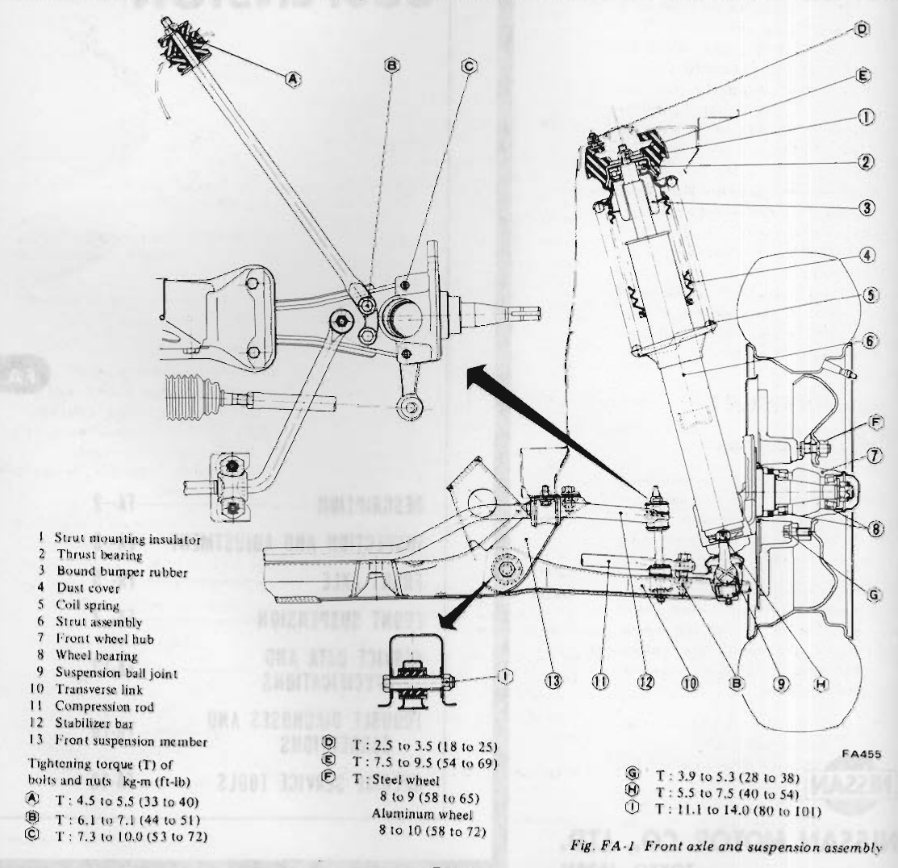
>
> - **Summary:** Cross-sectional and component assembly diagram of the front axle and front suspension system, showing strut assembly, transverse link, compression rod, stabilizer bar, front hub, and tightening torques for all primary fasteners.
> - **Components:** Strut mounting insulator, Thrust bearing, Bound bumper rubber, Dust cover, Coil spring, Strut assembly, Front wheel hub, Wheel bearing, Suspension ball joint, Transverse link, Compression rod, Stabilizer bar, Front suspension member, Spindle
> - **Callouts:** **(1)** Strut mounting insulator; **(2)** Thrust bearing; **(3)** Bound bumper rubber; **(4)** Dust cover; **(5)** Coil spring; **(6)** Strut assembly; **(7)** Front wheel hub; **(8)** Wheel bearing; **(9)** Suspension ball joint; **(10)** Transverse link; **(11)** Compression rod; **(12)** Stabilizer bar; **(13)** Front suspension member; **(A)** T: 4.5 to 5.5 kg-m (33 to 40 ft-lb); **(B)** T: 6.1 to 7.1 kg-m (44 to 51 ft-lb); **(C)** T: 7.3 to 10.0 kg-m (53 to 72 ft-lb); **(D)** T: 2.5 to 3.5 kg-m (18 to 25 ft-lb); **(E)** T: 7.5 to 9.5 kg-m (54 to 69 ft-lb); **(F)** Steel wheel: 8 to 9 kg-m (58 to 65 ft-lb); Aluminum wheel: 8 to 10 kg-m (58 to 72 ft-lb); **(G)** T: 3.9 to 5.3 kg-m (28 to 38 ft-lb); **(H)** T: 5.5 to 7.5 kg-m (40 to 54 ft-lb); **(I)** T: 11.1 to 14.0 kg-m (80 to 101 ft-lb)
> - **Specs / Measurements:** A: 4.5 to 5.5 kg-m (33 to 40 ft-lb); B: 6.1 to 7.1 kg-m (44 to 51 ft-lb); C: 7.3 to 10.0 kg-m (53 to 72 ft-lb); D: 2.5 to 3.5 kg-m (18 to 25 ft-lb); E: 7.5 to 9.5 kg-m (54 to 69 ft-lb); F: Steel wheel 8 to 9 kg-m (58 to 65 ft-lb), Aluminum wheel 8 to 10 kg-m (58 to 72 ft-lb); G: 3.9 to 5.3 kg-m (28 to 38 ft-lb); H: 5.5 to 7.5 kg-m (40 to 54 ft-lb); I: 11.1 to 14.0 kg-m (80 to 101 ft-lb)
> - **Mechanic Notes:** All suspension bolts and nuts should be torqued to specified values. Transverse link, compression rod, and stabilizer bar interact to absorb braking, cornering, and vertical forces.
> - **Tags:** `front suspension`, `strut assembly`, `transverse link`, `stabilizer bar`, `compression rod`, `tightening torque`

---

<!-- Page 3 (FA-3) -->
## Front Axle & Front Suspension

# INSPECTION AND ADJUSTMENT

### CONTENTS

| Item | Page | Item | Page |
| :--- | :--- | :--- | :--- |
| INSPECTION | FA-3 | WHEEL BEARING | FA-3 |
| SUSPENSION PARTS | FA-3 | WHEEL ALIGNMENT | FA-4 |
| ADJUSTMENT | FA-3 | CAR LEVEL | FA-4 |

## INSPECTION

Periodically inspect in accordance with the specified maintenance schedule.

### SUSPENSION PARTS

1. Jack up the front of car until front wheels clear the floor.
2. Shaking each front wheel by grasping the upper and lower surfaces of tire, check suspension parts for looseness, wear, or damage. Tighten all loose bolts and nuts to the specified torque. Replace all worn parts as described under "Front Suspension".
3. Check wheel bearings. If any axial end-play is present, adjust bearings to specifications. Replace worn or damaged bearings as described under "Front Axle".
4. Check shock absorbers assembled into strut. If these are not in good condition, car posture and wheel alignment may be affected.

## ADJUSTMENT

### WHEEL BEARING

Improper adjustment of wheel bearings causes abnormal wear and score on the bearings and knuckle spindle.

To obtain proper preload on wheel bearings, proceed as follows:

> [!NOTE]
> In order to assure correct bearing preload and to extend service life of wheel bearings, be sure to prevent dirt and foreign particles from getting in bearings, grease seal and spindle nut.

1. Jack up and support car with stands. See the section GI.
2. Remove pad. Refer to section BR for "Pad Replacement".
3. Tighten wheel bearing lock nut to 2.5 to 3.0 kg-m (18 to 22 ft-lb) torque. See Figure FA-2.

> 🖼️ **Fig. FA-2 Tightening wheel bearing lock nut** `[FA263]` *(Type: `procedure_step`)*
>
> 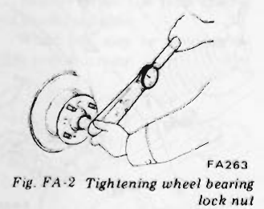
>
> - **Summary:** Torquing the front wheel bearing lock nut using a torque wrench and socket to seat the bearings.
> - **Components:** Torque wrench, Wheel hub, Wheel bearing lock nut, Spindle
> - **Specs / Measurements:** Tightening torque: 2.5 to 3.0 kg-m (18 to 22 ft-lb)
> - **Mechanic Notes:** Tighten lock nut to 2.5 to 3.0 kg-m to seat the bearings prior to backing off.
> - **Tags:** `wheel bearing`, `lock nut`, `torque wrench`, `bearing preload`

4. Rotate wheel hub a few turns in both directions to seat wheel bearing correctly. Then, retighten spindle nut to the above torque.
5. Loosen wheel bearing lock nut 60 degrees. Install adjusting cap and align groove of nut with hole in spindle. If groove does not align with hole, re-locate adjusting cap. If the hole and groove still do not come into alignment, loosen wheel bearing lock nut as much as 15 degrees more.

> 🖼️ **Fig. FA-3 Loosen wheel bearing lock nut 60°** `[FA456]` *(Type: `procedure_step`)*
>
> 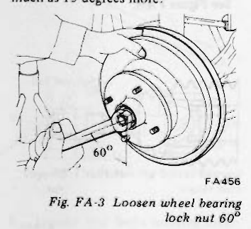
>
> - **Summary:** Loosening the wheel bearing lock nut by 60 degrees using a wrench to achieve initial running clearance.
> - **Components:** Wrench, Wheel bearing lock nut, Wheel hub
> - **Callouts:** **(60°)** Loosen angle
> - **Specs / Measurements:** Loosen angle: 60 degrees (up to 15 degrees additional if needed to align hole)
> - **Mechanic Notes:** After seating, back off 60 degrees. Align adjusting cap slot with spindle hole; may loosen up to 15 degrees more if necessary.
> - **Tags:** `wheel bearing`, `lock nut`, `adjusting cap`, `bearing preload`

> [!CAUTION]
> Do not overtighten wheel bearing nuts, as this can cause wheel bearing seizure.

6. Again spin wheel hub several turns in both directions to see if it rotates freely. Then, measure bearing preload using a spring balance as follows:

**Wheel bearing rotation starting torque:**
- **New parts:** 4.0 to 8.5 kg-cm (3.5 to 7.4 in-lb)
- **As measured at wheel hub bolt:** 0.7 to 1.5 kg (1.5 to 3.3 lb)
- **Adjustment with old parts:** 1.0 to 4.5 kg-cm (0.9 to 3.9 in-lb)
- **As measured at wheel hub bolt with old parts:** 0.2 to 0.8 kg (0.4 to 1.8 lb)

> 🖼️ **Fig. FA-4 Measuring wheel bearing rotation starting torque** `[FA264]` *(Type: `inspection_measurement`)*
>
> 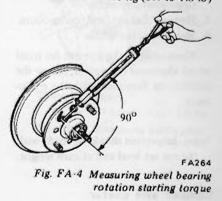
>
> - **Summary:** Measuring front wheel bearing preload using a spring scale attached to a wheel hub stud at a 90-degree angle.
> - **Components:** Spring balance / scale, Wheel hub bolt / stud, Wheel hub
> - **Callouts:** **(90°)** Angle of pull relative to center line
> - **Specs / Measurements:** Pull angle: 90 degrees; Starting torque (new parts): 4.0 to 8.5 kg-cm (3.5 to 7.4 in-lb); Starting force at bolt (new parts): 0.7 to 1.5 kg (1.5 to 3.3 lb); Starting torque (used parts): 1.0 to 4.5 kg-cm (0.9 to 3.9 in-lb); Starting force at bolt (used parts): 0.2 to 0.8 kg (0.4 to 1.8 lb)
> - **Mechanic Notes:** Attach spring balance to hub bolt and pull at right angle to a line drawn through center of bearing and hub bolt.
> - **Tags:** `wheel bearing`, `preload`, `starting torque`, `spring balance`

Repeat above procedures until correct preload is obtained.

> [!NOTE]
> a. To measure bearing preload, attach a spring balance to hub bolt and pull it at right angle to a line drawn through center of bearing and hub bolt to which it is attached.
> b. The slightest shaft play cannot be tolerated here.

7. Insert a new cotter pin with the legs through adjusting cap and spindle, and spread legs away from each other against sides of adjusting cap to secure the installation. See Figure FA-5.

> 🖼️ **Fig. FA-5 Installing cotter pin** `[FA457]` *(Type: `procedure_step`)*
>
> 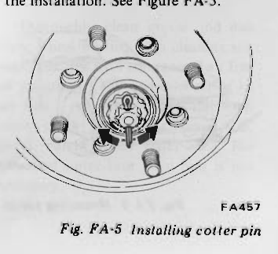
>
> - **Summary:** Installation and bending of cotter pin through the adjusting cap and spindle hole to lock the wheel bearing adjustment.
> - **Components:** Cotter pin, Adjusting cap, Spindle hole, Wheel hub
> - **Mechanic Notes:** Spread cotter pin legs away from each other against the sides of the adjusting cap.
> - **Tags:** `cotter pin`, `adjusting cap`, `locking nut` <!-- Page 4 (FA-4) --> ## Front Axle & Front Suspension

8. Install hub cap.

## WHEEL ALIGNMENT

Correct front wheel alignment assures proper vehicle handling characteristics and minimum steering effort with the least amount of tire wear.

Before adjusting front wheel alignment, be sure to carry out a preliminary inspection of the front end parts as follows:

1. Tire pressure
2. Wheel bearings and spindle nuts
3. Steering gear play
4. Steering gear housing (loose at suspension member.)
5. Steering linkage and connections
6. Shock absorber action

When using the equipment for front wheel alignment inspection, follow the instructions furnished with the equipment.

> [!NOTE]
> Inspection should be made with the car set level and at curb weight.

### Camber and caster

Camber and caster are preset at factory and cannot be adjusted.

Car requires only toe-in and leveling adjustments.

> [!NOTE]
> If camber or caster alignment is not within specifications, check associated parts. Repair or replace as necessary.

### Toe-in

1. Measure toe-in with a toe-in gauge. See Figure FA-6.

> 🖼️ **Fig. FA-6 Measuring toe-in** `[FA467]` *(Type: `inspection_measurement`)*
>
> 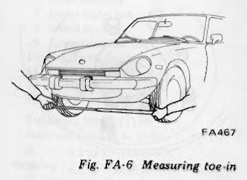
>
> - **Summary:** Measuring front wheel toe-in across the front wheels using a drive-on/trammel toe-in gauge.
> - **Components:** Vehicle front end, Toe-in gauge, Front road wheels
> - **Specs / Measurements:** Toe-in: 0 to 3 mm (0 to 0.12 in)
> - **Mechanic Notes:** Car must be at curb weight on level ground when measuring toe-in.
> - **Tags:** `toe-in`, `wheel alignment`, `toe gauge`

2. Loosen side rod lock nut ①, and adjust length of side rod ② properly to the standard value. See Figure FA-7.

> 🖼️ **Fig. FA-7 Adjusting toe-in** `[FA452]` *(Type: `procedure_step`)*
>
> 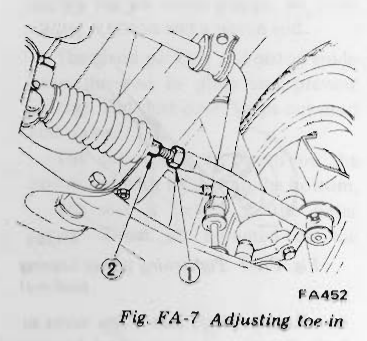
>
> - **Summary:** Adjusting front wheel toe-in by loosening side rod lock nut and rotating side rod.
> - **Components:** Side rod lock nut, Side rod, Steering rack boot, Tie rod ball socket
> - **Callouts:** **(1)** Side rod lock nut; **(2)** Side rod
> - **Mechanic Notes:** Loosen lock nut 1 and rotate side rod 2. Left and right side rods must be adjusted equally.
> - **Tags:** `toe-in adjustment`, `side rod`, `lock nut`, `steering linkage`

> [!NOTE]
> a. Distance between centers of side rods at any point should be equal.
> 
> **Standard length of side rod:**
> **37.9 mm (1.492 in)**
> 
> See Figure FA-8.

> 🖼️ **Fig. FA-8 Standard length of side rod** `[ST447]` *(Type: `inspection_measurement`)*
>
> 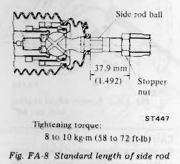
>
> - **Summary:** Dimensional cross section of the steering rack side rod ball socket and stopper nut showing standard length dimension.
> - **Components:** Side rod ball, Stopper nut, Side rod
> - **Callouts:** **(37.9 mm (1.492 in))** Standard side rod length; **(Side rod ball)** Ball socket; **(Stopper nut)** Lock nut / stopper
> - **Specs / Measurements:** Standard length: 37.9 mm (1.492 in); Tightening torque: 8 to 10 kg-m (58 to 72 ft-lb)
> - **Mechanic Notes:** Distance between centers of side rods should be equal on both sides. Stopper nut end surface forms the steering stopper against rack housing.
> - **Tags:** `side rod`, `standard length`, `stopper nut`, `steering gear`

> [!NOTE]
> b. When steering gear housing is removed, be sure to adjust the steering angle at side rod unit with a turning radius gauge after installation.
> c. Adjust toe-in after steering angle adjustment.
> d. When adjusting toe-in, be sure to move the left and right side rods equally.
> e. When steering angle is incorrect, disassemble rack and pinion because incorrectly assembled rack and pinion cause improper steering angle.
> f. Side rod lock nut end surface comes into contact with steering gear housing end forming a steering stopper.

> 🖼️ **Fig. FA-9 Measuring steering angle, camber and caster** `[FA032]` *(Type: `inspection_measurement`)*
>
> 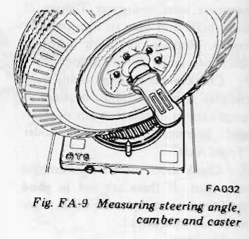
>
> - **Summary:** Front wheel positioned on turning radius gauge turntable with alignment gauge attached to wheel hub to measure steering angle, camber, and caster.
> - **Components:** Turning radius gauge, Camber/caster alignment gauge, Front wheel
> - **Mechanic Notes:** Adjust steering angle using turning radius gauge before performing final toe-in adjustment.
> - **Tags:** `steering angle`, `camber`, `caster`, `turning radius gauge`

## CAR LEVEL

Adjustment can be made by selecting spring which will keep car in a normal, level position.

### Wheel Alignment Specifications - Toe-in

| Item | Unit | S30 | GS30 (2 + 2 seater) |
| :--- | :--- | :--- | :--- |
| Toe-in | mm (in) | 0 to 3 (0 to 0.12) | 0 to 3 (0 to 0.12) |

---

<!-- Page 5 (FA-5) -->
## Front Axle & Front Suspension

# FRONT AXLE

### CONTENTS

| Item | Page |
| :--- | :--- |
| FRONT AXLE | FA-5 |
| REMOVAL | FA-5 |
| INSPECTION | FA-5 |
| INSTALLATION | FA-6 |

## REMOVAL

1. Jack up car until wheel drops to full down position.
Remove wheels and disconnect brake tube. See Figure FA-10.
2. Remove bolts retaining brake caliper and take out caliper assembly. See Figure FA-10.

> 🖼️ **Fig. FA-10 Removing brake tube and caliper fixing bolts** `[FA458]` *(Type: `procedure_step`)*
>
> 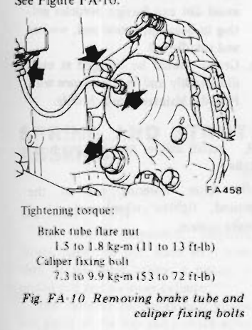
>
> - **Summary:** Disconnecting the brake tube flare nut and removing the caliper fixing bolts on the front strut assembly.
> - **Components:** Brake tube flare nut, Brake caliper, Caliper fixing bolts, Strut assembly
> - **Specs / Measurements:** Brake tube flare nut tightening torque: 1.5 to 1.8 kg-m (11 to 13 ft-lb); Caliper fixing bolt tightening torque: 7.3 to 9.9 kg-m (53 to 72 ft-lb)
> - **Wiring / Connections:** Hydraulic brake tube line connection
> - **Mechanic Notes:** Disconnect brake hydraulic tube flare nut before removing caliper bolts.
> - **Tags:** `brake caliper`, `brake tube`, `caliper fixing bolt`, `torque`

3. Work off hub cap from end of spindle using two screwdrivers or any other suitable tool as shown in Figure FA-11. If necessary, tap around it with a soft hammer while removing cap.

> 🖼️ **Fig. FA-11 Removing hub cap** `[FA038]` *(Type: `procedure_step`)*
>
> 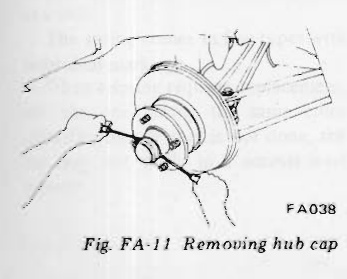
>
> - **Summary:** Prying off front wheel hub grease cap using two screwdrivers prying equally from opposite sides.
> - **Components:** Hub cap, Screwdrivers, Front wheel hub
> - **Mechanic Notes:** Use caution to avoid damaging O-ring under hub cap. Tap lightly with soft hammer if needed.
> - **Tags:** `hub cap`, `grease cap`, `wheel hub`, `O-ring`

> [!NOTE]
> During this operation, use caution to avoid damaging O-ring.

4. Pry off cotter pin; take out adjusting cap and wheel bearing lock nut.
5. Remove wheel hub from spindle with bearing installed.
6. Wheel hub may be removed together with disc rotor.

> 🖼️ **Fig. FA-12 Removing wheel hub** `[FA459]` *(Type: `procedure_step`)*
>
> 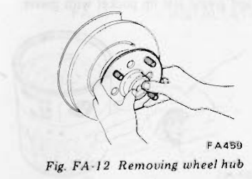
>
> - **Summary:** Sliding the front wheel hub assembly off the spindle with bearing installed.
> - **Components:** Wheel hub, Spindle, Wheel bearing
> - **Mechanic Notes:** Wheel hub may be removed together with disc rotor.
> - **Tags:** `wheel hub`, `spindle`, `removal`

7. Utilizing two grooves inside hub, drive out wheel bearing outer race from hub with a brass drift.

> 🖼️ **Fig. FA-13 Removing wheel bearing outer race** `[FA259]` *(Type: `procedure_step`)*
>
> 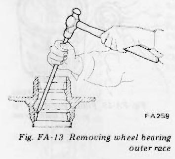
>
> - **Summary:** Driving out the wheel bearing outer race from the wheel hub using a hammer and brass drift through hub internal grooves.
> - **Components:** Brass drift, Hammer, Wheel hub, Bearing outer race
> - **Mechanic Notes:** Utilize two grooves inside hub to alternate drift hits around race perimeter.
> - **Tags:** `bearing outer race`, `brass drift`, `hub overhaul`

8. Loosen four bolts securing brake disc in position; remove disc brake rotor from wheel hub assembly.

> 🖼️ **Fig. FA-14 Removing disc brake rotor** `[FA260]` *(Type: `procedure_step`)*
>
> 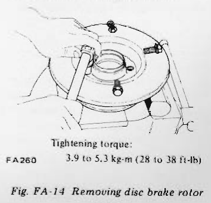
>
> - **Summary:** Loosening the four disc brake rotor mounting bolts to separate rotor from wheel hub.
> - **Components:** Disc brake rotor, Wheel hub, Rotor mounting bolts, Wrench
> - **Specs / Measurements:** Tightening torque: 3.9 to 5.3 kg-m (28 to 38 ft-lb)
> - **Mechanic Notes:** Loosen four bolts securing brake disc; torque to 3.9 to 5.3 kg-m upon reassembly.
> - **Tags:** `brake rotor`, `wheel hub`, `mounting bolts`, `torque`

9. Loosen screws securing baffle plate in position; take out baffle plate.

> 🖼️ **Fig. FA-15 Removing baffle plate screws** `[FA443]` *(Type: `procedure_step`)*
>
> 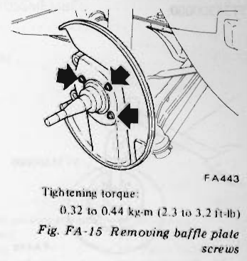
>
> - **Summary:** Removing screws securing splash baffle / dust shield plate to knuckle spindle.
> - **Components:** Baffle plate, Knuckle spindle, Baffle plate screws
> - **Specs / Measurements:** Tightening torque: 0.32 to 0.44 kg-m (2.3 to 3.2 ft-lb)
> - **Mechanic Notes:** Loosen screws securing baffle plate in position; tighten to 0.32 to 0.44 kg-m upon assembly.
> - **Tags:** `baffle plate`, `dust shield`, `knuckle spindle`, `torque`

## INSPECTION

### Wheel hub
Check hub for cracks by means of a magnetic exploration or dyeing test, and replace if cracked.

### Grease seal
Replace grease seal every disassembly even if it appears good.

### Wheel bearing
Thoroughly clean grease and dirt from wheel bearing with cleaning solvent, and dry with compressed air free of moisture. Check wheel bearing to see that it rolls freely and is free from noise, crack, pitting, or wear. Also, check condition of outer race. Removal of outer race from hub is not necessary.

---

<!-- Page 6 (FA-6) -->
## Front Axle & Front Suspension

# INSTALLATION

Install front axle in the reverse order of removal, noting the following:

1. Install baffle plate to knuckle spindle, tighten screws to 0.32 to 0.44 kg-m (2.3 to 3.2 ft-lb).
2. Install disc brake rotor to wheel hub, tighten to 3.9 to 5.3 kg-m (28 to 38 ft-lb).
3. Install bearing outer race with Front Wheel Bearing Drift ST35300000.

> 🖼️ **Fig. FA-16 Installing wheel bearing outer race** `[FA445]` *(Type: `procedure_step`)*
>
> 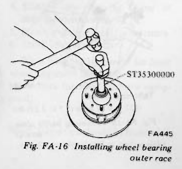
>
> - **Summary:** Pressing or driving wheel bearing outer race into wheel hub using drift ST35300000.
> - **Components:** Front Wheel Bearing Drift ST35300000, Wheel hub, Bearing outer race
> - **Callouts:** **(ST35300000)** Front Wheel Bearing Drift
> - **Specs / Measurements:** Special tool: ST35300000
> - **Mechanic Notes:** Drive outer race squarely into hub until fully seated against shoulder using tool ST35300000.
> - **Tags:** `bearing outer race`, `drift`, `ST35300000`, `hub assembly`

4. Pack the inside of hub and hub cap with recommended multi-purpose grease to the specified level. See Figure FA-17.

> 🖼️ **Fig. FA-17 Lubricating points of wheel hub** `[FA460]` *(Type: `cutaway_flow`)*
>
> 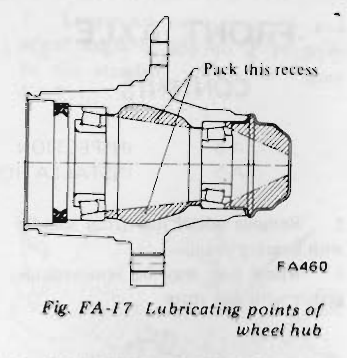
>
> - **Summary:** Cross section of wheel hub showing cavity areas and recesses to be packed with multi-purpose grease.
> - **Components:** Wheel hub, Inner bearing cavity, Outer bearing cavity, Center grease recess
> - **Callouts:** **(Pack this recess)** Hub interior grease cavity
> - **Mechanic Notes:** Pack inner cavity recess of hub and hub cap with recommended multi-purpose grease to specified level.
> - **Tags:** `lubrication`, `wheel hub`, `grease packing`, `recess`

5. Pack cavities of each bearing cone and grease seal lip pocket with grease.

> 🖼️ **Fig. FA-18 Filling bearing cone with grease** `[FA262]` *(Type: `procedure_step`)*
>
> 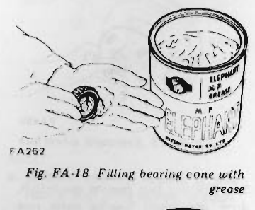
>
> - **Summary:** Hand packing bearing cone cavities with multi-purpose grease from grease container.
> - **Components:** Bearing cone, Multi-purpose grease can (Elephant brand)
> - **Mechanic Notes:** Pack cavities between rollers of each bearing cone thoroughly with grease.
> - **Tags:** `bearing cone`, `grease packing`, `lubrication`

> 🖼️ **Fig. FA-19 Filling grease seal lip pocket with grease** `[FA064]` *(Type: `procedure_step`)*
>
> 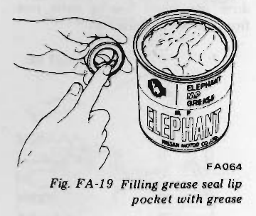
>
> - **Summary:** Applying grease to the seal lip pocket of a new grease seal prior to installation.
> - **Components:** Grease seal, Grease can
> - **Mechanic Notes:** Lubricate sealing lips and fill lip pocket with multi-purpose grease before pressing seal into hub.
> - **Tags:** `grease seal`, `seal lip`, `lubrication`

6. Put inner bearing cone in hub and install a new grease seal. Be sure to lubricate sealing lips of the grease seal before installation.
7. Put hub assembly on spindle and then install outer bearing cone.
8. Apply sparingly grease to washer and threaded parts of spindle and spindle nut. Then, install washer and spindle nut. Adjust the installation as outlined under "Wheel Bearing Adjustment".

> [!NOTE]
> a. In order to assure correct bearing preload and to extend service life of wheel bearings, be sure to avoid dirt and foreign particles getting in bearings, grease seal, washer and spindle nut.
> b. Grease should be changed at each disassembly and in accordance with Periodic Maintenance Schedule.

9. Install caliper and connect brake tube.
10. After lowering car to the ground, tighten wheel nut, bleed brake system.

---

<!-- Page 7 (FA-7) -->
## Front Axle & Front Suspension

# FRONT SUSPENSION

### CONTENTS

| Item | Page | Item | Page |
| :--- | :--- | :--- | :--- |
| SPRING AND STRUT ASSEMBLY | FA-7 | INSTALLATION | FA-11 |
| DESCRIPTION | FA-7 | TRANSVERSE LINK AND LOWER BALL JOINT | FA-11 |
| REMOVAL | FA-8 | REMOVAL | FA-11 |
| DISASSEMBLY | FA-8 | INSPECTION | FA-12 |
| INSPECTION | FA-9 | INSTALLATION | FA-12 |
| ASSEMBLY | FA-9 | SUSPENSION CROSSMEMBER | FA-12 |
| INSTALLATION | FA-10 | REMOVAL | FA-12 |
| COMPRESSION ROD AND STABILIZER BAR | FA-11 | INSPECTION | FA-13 |
| REMOVAL | FA-11 | INSTALLATION | FA-13 |
| INSPECTION | FA-11 | | |

## SPRING AND STRUT ASSEMBLY

### DESCRIPTION

The front suspension employs struts, right and left. Each strut consists of an outer casing, a piston, a piston rod and an inner cylinder.

The cylinder incorporates a piston rod guide at the top and a check valve at the bottom.

The piston rod, piston rod guide, cylinder and bottom valve should be handled as a matched set.

If any of these parts becomes faulty, all the parts must be replaced as a unit.

The spring comes in few types with individual markings.

When a spring requires replacement, use the one having the same color identification. If this is not done, the car may not settle in a normal level posture.

> 🖼️ **Fig. FA-20 Sectional view of strut assembly** `[FA268]` *(Type: `cutaway_flow`)*
>
> 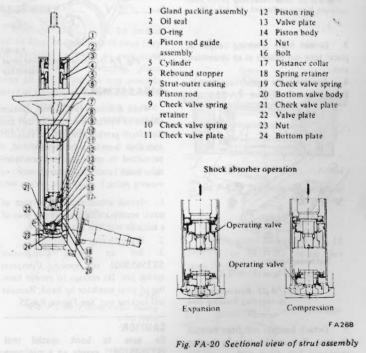
>
> - **Summary:** Cross-sectional detail view of front strut cartridge assembly including internal valving, check valves, piston, cylinder, and shock absorber expansion/compression flow operation.
> - **Components:** Gland packing assembly, Oil seal, O-ring, Piston rod guide assembly, Cylinder, Rebound stopper, Strut-outer casing, Piston rod, Check valve spring retainer, Check valve spring, Check valve plate, Piston ring, Valve plate, Piston body, Nut, Bolt, Distance collar, Spring retainer, Bottom valve body, Bottom plate
> - **Callouts:** **(1)** Gland packing assembly; **(2)** Oil seal; **(3)** O-ring; **(4)** Piston rod guide assembly; **(5)** Cylinder; **(6)** Rebound stopper; **(7)** Strut-outer casing; **(8)** Piston rod; **(9)** Check valve spring retainer; **(10)** Check valve spring; **(11)** Check valve plate; **(12)** Piston ring; **(13)** Valve plate; **(14)** Piston body; **(15)** Nut; **(16)** Bolt; **(17)** Distance collar; **(18)** Spring retainer; **(19)** Check valve spring; **(20)** Bottom valve body; **(21)** Check valve plate; **(22)** Valve plate; **(23)** Nut; **(24)** Bottom plate
> - **Mechanic Notes:** The piston rod, piston rod guide, cylinder, and bottom valve are precision matched parts and must be replaced as a set if faulty.
> - **Tags:** `strut assembly`, `hydraulic shock absorber`, `piston rod`, `valving`, `cylinder`, `cross section`

---

<!-- Page 8 (FA-8) -->
## Front Axle & Front Suspension

## REMOVAL

1. Jack up car and support it with safety stands. Remove wheel.
2. Loosen brake tube, remove brake hose locking spring, withdraw plate, and remove brake hose from strut assembly bracket.

> 🖼️ **Fig. FA-21 Disconnecting brake hose** `[FA461]` *(Type: `procedure_step`)*
>
> 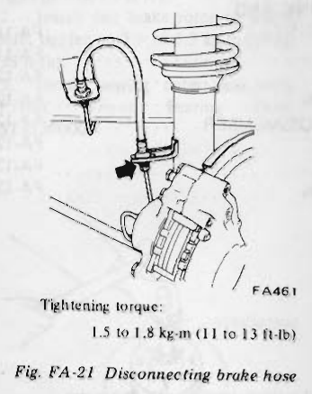
>
> - **Summary:** Disconnecting the brake hose flare nut from strut bracket and removing retaining U-clip/locking spring.
> - **Components:** Brake hose, Brake tube, Strut mounting bracket, Locking spring
> - **Specs / Measurements:** Tightening torque: 1.5 to 1.8 kg-m (11 to 13 ft-lb)
> - **Wiring / Connections:** Brake hydraulic flexible hose and hard tube
> - **Mechanic Notes:** Tighten flare nut to 1.5 to 1.8 kg-m upon reinstallation.
> - **Tags:** `brake hose`, `flare nut`, `locking spring`, `strut bracket`

3. Loosen bolts retaining caliper in place; take out caliper as an assembled unit.
4. Remove bolts connecting strut to knuckle arm. See Figure FA-22.

> 🖼️ **Fig. FA-22 Removing bolts connecting knuckle arm** `[FA462]` *(Type: `procedure_step`)*
>
> 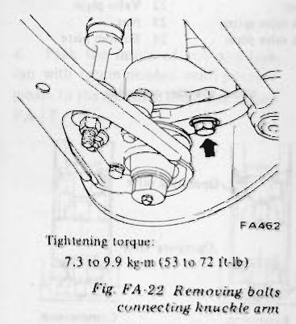
>
> - **Summary:** Loosening the two bolts securing the knuckle arm to the bottom flange of the front strut assembly.
> - **Components:** Knuckle arm, Knuckle arm bolts, Strut bottom flange
> - **Specs / Measurements:** Tightening torque: 7.3 to 9.9 kg-m (53 to 72 ft-lb)
> - **Mechanic Notes:** Force transverse link downward with pry bar after bolt removal to detach knuckle arm.
> - **Tags:** `knuckle arm`, `strut lower mount`, `connecting bolts`

5. Detach knuckle arm from bottom of strut. This can be done by forcing transverse link down with a suitable bar.
6. Place jack under strut to receive its weight when nuts are removed.
7. Lift engine hood to gain access to nuts holding strut in place on car body. See Figure FA-23.

> 🖼️ **Fig. FA-23 [Upper strut mounting nuts under hood]** `[FA206]` *(Type: `procedure_step`)*
>
> ![Fig. FA-23 [Upper strut mounting nuts under hood]](diagrams/FA Front Axle and Suspension/fig_fa_23_strut_mounting_nuts.png)
>
> - **Summary:** Location of the three upper strut mounting nuts in the engine compartment / hood ledge tower.
> - **Components:** Strut tower / hood ledge, Strut insulator mounting nuts (3)
> - **Specs / Measurements:** Tightening torque: 2.5 to 3.5 kg-m (18 to 25 ft-lb)
> - **Mechanic Notes:** Support strut with jack underneath before removing the 3 tower mounting nuts.
> - **Tags:** `strut tower`, `mounting nuts`, `hood ledge`

8. With springs attached, lower jack slowly while holding strut by hand; take out strut.

> 🖼️ **Fig. FA-24 Removing front strut Assembly** `[FA057]` *(Type: `procedure_step`)*
>
> 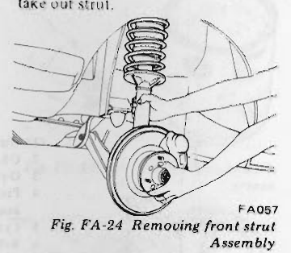
>
> - **Summary:** Lowering the jack and removing the front strut assembly with coil spring from vehicle wheel well.
> - **Components:** Strut assembly, Coil spring, Floor jack, Wheel well
> - **Mechanic Notes:** Hold strut by hand while lowering jack to prevent falling.
> - **Tags:** `strut removal`, `front strut`

## DISASSEMBLY

When disassembling a strut, caution should be exercised to prevent dirt and dust from getting inside strut. This dirt and dust is extremely abrasive and, if permitted to enter strut, causes internal leaks and premature wear of moving parts.

1. Install attachment on bottom of strut; secure above assembly in jaws of a suitable vise. See Figure FA-26.
2. Pry snap ring off dust cover.
3. Set up Spring Compressor ST3565S001 on spring. Compress spring just far enough to permit turning of strut insulator by hand. Remove self-locking nut. See Figure FA-25.

> 🖼️ **Fig. FA-25 Removing self-locking nut** `[FA059]` *(Type: `procedure_step`)*
>
> 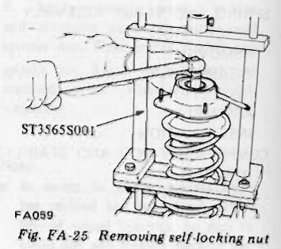
>
> - **Summary:** Compressing the coil spring with compressor tool ST3565S001 and unscrewing the top self-locking nut from piston rod.
> - **Components:** Coil spring compressor ST3565S001, Self-locking nut, Piston rod, Strut insulator
> - **Callouts:** **(ST3565S001)** Coil spring compressor
> - **Specs / Measurements:** Special tool: ST3565S001
> - **Mechanic Notes:** Hook tool evenly over minimum of 3 coils. Protect body stud threads when leveraging screwdriver.
> - **Tags:** `spring compressor`, `self-locking nut`, `ST3565S001`, `disassembly`

> [!CAUTION]
> Be sure to hook special tool (ST35651001) evenly on a minimum of three coils, paying attention not to damage piston rod.

> [!NOTE]
> When loosening self-locking nut, use a screwdriver as a shifter. Moreover, when loosening self-locking nut (used to hold down spring), install a nut on bolt (used to install strut on the body) and apply screwdriver to nut so that the thread of bolt is not damaged.

4. Take out strut insulator, strut bearing, oil seal, upper spring seat and bound bumper rubber in the order listed.
5. Remove spring from strut with Spring Compressor ST3565S001 left on spring.
6. Retract piston rod by pushing it down until it bottoms. Without disturbing the above setting, remove gland packing with Gland Packing Wrench KV40100800. See Figure FA-26.

> 🖼️ **Fig. FA-26 Removing gland packing** `[FA274]` *(Type: `procedure_step`)*
>
> 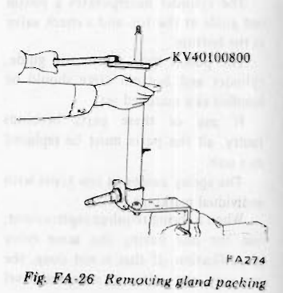
>
> - **Summary:** Unscrewing gland packing nut from top of strut casing using special gland packing wrench KV40100800 while bottom is held in vise.
> - **Components:** Gland Packing Wrench KV40100800, Gland packing, Strut outer casing, Vise attachment
> - **Callouts:** **(KV40100800)** Gland Packing Wrench
> - **Specs / Measurements:** Special tool: KV40100800
> - **Mechanic Notes:** Retract piston rod completely down before loosening gland packing.
> - **Tags:** `gland packing wrench`, `KV40100800`, `strut casing`, `disassembly`

> [!NOTE]
> Clean gland packing of mud and other accumulated foreign particles.

7. Remove O-ring from top of piston rod guide.
8. Lift out piston rod together with cylinder. See Figure FA-27. <!-- Page 9 (FA-9) --> ## Front Axle & Front Suspension

> 🖼️ **Fig. FA-27 Removing piston rod and cylinder** `[FA275]` *(Type: `procedure_step`)*
>
> 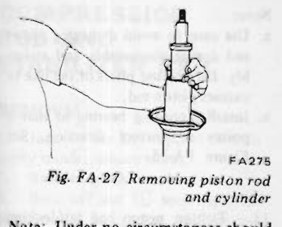
>
> - **Summary:** Lifting the shock absorber cylinder and piston rod together as a matched assembly out of the strut outer casing.
> - **Components:** Piston rod, Cylinder, Strut outer casing
> - **Mechanic Notes:** Do not disassemble piston rod guide from cylinder; handle as matched set.
> - **Tags:** `piston rod`, `inner cylinder`, `strut casing`, `removal`

> [!NOTE]
> Under no circumstances should piston and piston rod guide be removed from cylinder since these are adjusted to each other to provide precision mating surfaces and should be handled as a matched set.

9. Drain fluid thoroughly from inner cylinder. Use a suitable container to receive fluid drained.
10. Wash all parts in cleaning solvent.
11. Drain fluid which collects inside outer casing thoroughly.

> [!NOTE]
> This operation is very important since performance of strut varies with amount of fluid initially filled.

## INSPECTION

1. Replace gland packing, O-ring and fluid with new ones or fresh oil whenever strut is disassembled.
2. Wash all parts, except for non-metallic parts, with solvent and dry with compressed air.
3. Blow dirt and dust off of non-metallic parts using compressed air.

- **Outer casing:** Check outer casing for evidence of deformation, cracking or other damage. If necessary, replace.
- **Spindle:** Check spindle for hair cracks on base and damaged threads. Replace strut if any of above conditions exceed limits.
- **Strut mounting insulator:** Replace if rubber and metal joints are melted or cracked. Rubber parts should be replaced if deteriorated.
- **Thrust bearing:** Replace if inspection reveals abnormal noise or excessive rattle in axial direction.
- **Front coil spring:** Replace if weakened or cracked.

> 🖼️ **Fig. FA-28 Exploded view of strut assembly** `[FA463]` *(Type: `exploded_view`)*
>
> 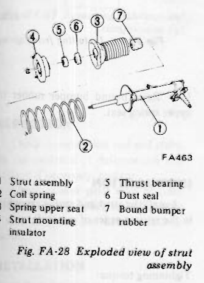
>
> - **Summary:** Exploded component view of front strut, coil spring, upper seat, insulator, thrust bearing, dust seal, and bound bumper rubber.
> - **Components:** Strut assembly, Coil spring, Spring upper seat, Strut mounting insulator, Thrust bearing, Dust seal, Bound bumper rubber
> - **Callouts:** **(1)** Strut assembly; **(2)** Coil spring; **(3)** Spring upper seat; **(4)** Strut mounting insulator; **(5)** Thrust bearing; **(6)** Dust seal; **(7)** Bound bumper rubber
> - **Mechanic Notes:** Assemble components in strict numbered sequence. Check rubber insulator and thrust bearing for wear.
> - **Tags:** `exploded view`, `strut assembly`, `thrust bearing`, `coil spring`, `insulator`

## ASSEMBLY

When assembling strut, be careful not to drop or scratch parts since they are precisely machined to very close tolerances. Before assembly, clean away all dirt to prevent any possible entry of dirt into strut.

1. Set attachment in place on bottom of strut and place attachment in jaws of a suitable vise.
2. Install piston rod and cylinder into place in outer casing.
3. Pour correct amount of fluid into outer casing. See Figure FA-29.

> 🖼️ **Fig. FA-29 Filling outer casing with fluid** `[FA330]` *(Type: `procedure_step`)*
>
> 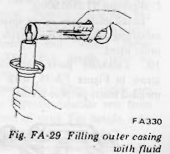
>
> - **Summary:** Pouring genuine shock absorber oil into the outer casing of the strut assembly.
> - **Components:** Strut outer casing, Fluid container
> - **Specs / Measurements:** Fluid capacity: 340 cc (20.7 cu in); Fluid type: NISSAN GENUINE STRUT OIL or equivalent
> - **Mechanic Notes:** Strictly pour 340 cc of genuine strut oil into outer casing to maintain correct shock absorber damping force.
> - **Tags:** `strut oil`, `fluid capacity`, `shock absorber`, `damping`

> [!NOTE]
> a. It is important that correct amount of fluid be poured into strut to assure correct damping force of shock absorber.
> 
> **Amount of oil: 340 cc (20.7 cu in)**
> 
> b. Use Nissan genuine shock absorber oil "NISSAN GENUINE STRUT OIL" or equivalent.

4. Place rod guide on top of piston rod guide; install gland packing using Gland Packing Guide ST35540000. See Figure FA-30.

Lubricate sealing lip, asterisked in Figure FA-31, with recommended multi-purpose grease.

> 🖼️ **Fig. FA-30 Installing gland packing** `[FA276]` *(Type: `procedure_step`)*
>
> 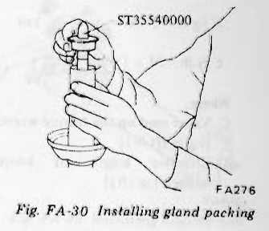
>
> - **Summary:** Sliding gland packing over piston rod guide using special gland packing guide tool ST35540000.
> - **Components:** Gland packing guide ST35540000, Gland packing, Piston rod, Strut casing
> - **Callouts:** **(ST35540000)** Gland packing guide
> - **Specs / Measurements:** Special tool: ST35540000
> - **Mechanic Notes:** Guide protects seal lip during installation over rod threads.
> - **Tags:** `gland packing`, `guide`, `ST35540000`, `piston rod`

> 🖼️ **Fig. FA-31 Sectional view of gland packing** `[FA464]` *(Type: `cutaway_flow`)*
>
> 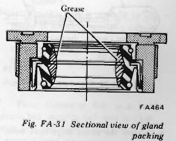
>
> - **Summary:** Cross-sectional view of gland packing assembly highlighting grease lubrication point on internal sealing lip.
> - **Components:** Gland packing nut, Oil seal lip, Grease cavity, Scraper / wiper
> - **Callouts:** **(Grease)** Lubricate sealing lip with multi-purpose grease
> - **Mechanic Notes:** Lubricate sealing lip marked with grease before sliding onto rod guide.
> - **Tags:** `gland packing`, `seal lip`, `lubrication`, `cross section`

5. Tighten gland packing to 7 to 13 kg-m (51 to 94 ft-lb) torque. See Figure FA-32.

> 🖼️ **Fig. FA-32 Tightening gland packing** `[FA274]` *(Type: `procedure_step`)*
>
> 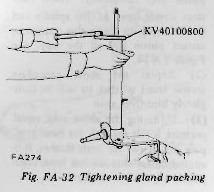
>
> - **Summary:** Torquing gland packing with wrench KV40100800 attached to a torque wrench.
> - **Components:** Gland packing wrench KV40100800, Torque wrench, Strut outer casing
> - **Callouts:** **(KV40100800)** Gland packing wrench
> - **Specs / Measurements:** Gland packing tightening torque: 7 to 13 kg-m (51 to 94 ft-lb); Special tool: KV40100800
> - **Mechanic Notes:** Apply torque formula adjustment when using wrench adapter KV40100800.
> - **Tags:** `gland packing`, `KV40100800`, `torque wrench`, `tightening` <!-- Page 10 (FA-10) --> ## Front Axle & Front Suspension

> [!NOTE]
> a. When tightening gland packing, it is important that piston rod be extended approximately 120 mm (4.72 in) from end of outer casing to expel most of air out of strut.
> 
> b. Gland packing should be tightened to 7.0 to 13.0 kg-m (51 to 94 ft-lb) torque with the aid of Gland Packing Wrench KV40100800. When doing so, the amount of torque to be read beneath wrench needle should be modified according to the following formula:
> 
> $$C\text{ kg-m} = 7 \times \left( \frac{\ell}{\ell + 0.10} \right) \quad\text{or}\quad C\text{ ft-lb} = 51 \times \left( \frac{\ell}{\ell + 0.33} \right)$$
> 
> Where,
> - $C$: Value read on the torque wrench [kg-m (ft-lb)]
> - $\ell$: Effective length of torque wrench [m (ft)]

> 🖼️ **Fig. FA-33 Gland packing wrench** `[FA278]` *(Type: `special_service_tool`)*
>
> 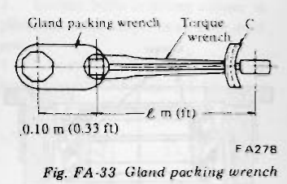
>
> - **Summary:** Dimensional diagram showing gland packing wrench KV40100800 with effective torque adapter offset length 0.10 m (0.33 ft) and torque wrench length l.
> - **Components:** Gland packing wrench adapter, Torque wrench
> - **Callouts:** **(0.10 m (0.33 ft))** Adapter offset length; **(l m (ft))** Effective length of torque wrench; **(Gland packing wrench)** KV40100800; **(Torque wrench)** Torque wrench body
> - **Specs / Measurements:** Adapter offset: 0.10 m (0.33 ft)
> - **Mechanic Notes:** Use formula C = 7 * (l / (l + 0.10)) kg-m to compensate for the 0.10 m offset.
> - **Tags:** `KV40100800`, `gland packing wrench`, `torque calculation`, `offset`

6. After the above steps have been completed, air should be removed from shock absorber system in the following manner:
   (1) Hold strut by hand with its spindle end facing down; without disturbing the above setting, pull out piston rod completely. Then, turn strut upside down so that spindle end is now facing up. Under this condition, retract piston rod all the way. See Figure FA-34.
   (2) Repeat the above procedure several times so that air will be completely bled from strut.
   (3) If, during the above step, equal pressure is felt through the hand gripping piston rod on both strokes, it is an indication that air has been completely expelled from strut.

> 🖼️ **Fig. FA-34 Bleeding air from strut** `[FA280]` *(Type: `procedure_step`)*
>
> 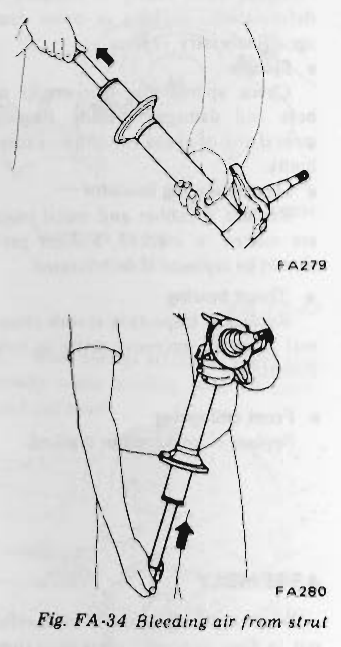
>
> - **Summary:** Technician bleeding trapped air from shock absorber by cycling piston rod in inverted and upright positions.
> - **Components:** Strut shock absorber, Piston rod, Spindle
> - **Specs / Measurements:** Rod extension before tightening: approx 120 mm (4.72 in)
> - **Mechanic Notes:** Extend rod with spindle down, then invert and retract rod fully. Repeat until stroke resistance is equal and smooth.
> - **Tags:** `air bleeding`, `strut shock absorber`, `damping`

7. Place attachment in jaws of a vise.
8. Before proceeding any further, pull piston rod all the way out to the limit of its stroke; install bound bumper rubber to prevent piston rod from falling by its own weight.
9. Place front spring on lower spring seat and compress spring with Spring Compressor ST3565S000.
Install dust cover, upper spring seat, mounting bearing and insulator in the order listed.
10. Lubricate parts, indicated by arrow in Figure FA-35, with recommended multi-purpose grease.

> 🖼️ **Fig. FA-35 Strut mounting bearing greasing point** `[FA281]` *(Type: `component_location`)*
>
> 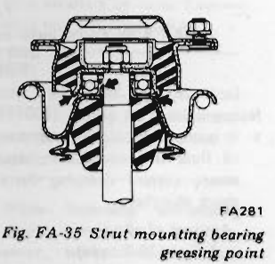
>
> - **Summary:** Cutaway illustration of strut upper mount indicating grease application points and orientation of thrust bearing.
> - **Components:** Strut mounting insulator, Thrust bearing, Upper spring seat, Piston rod
> - **Mechanic Notes:** Install mounting bearing so that it points in correct direction. Lubricate indicated bearing races with multi-purpose grease.
> - **Tags:** `thrust bearing`, `insulator`, `lubrication`, `orientation`

> [!NOTE]
> a. Use care to avoid damaging piston rod during disassembly and assembly. Do not use pliers or the like to extract piston rod.
> b. Install mounting bearing so that it points in correct direction. See Figure FA-35.

11. Tighten piston rod self-locking nut to 7.5 to 9.5 kg-m (54 to 69 ft-lb) torque.

> [!NOTE]
> Use new self-locking nuts whenever strut assembly is reassembled.

12. After placing spring in position (Figure FA-36) between upper and lower spring seats, release compressor gradually.

> 🖼️ **Fig. FA-36 Installing front spring** `[FA282]` *(Type: `alignment_orientation`)*
>
> 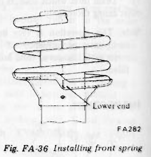
>
> - **Summary:** Orientation of front coil spring bottom end seated into the contour groove of the strut lower spring seat.
> - **Components:** Coil spring, Lower spring seat, Lower end of spring
> - **Callouts:** **(Lower end)** Bottom coil end seated against step
> - **Mechanic Notes:** Align the lower coil tail cleanly against the seat stop before releasing spring compressor.
> - **Tags:** `coil spring`, `lower spring seat`, `spring alignment`

13. Raise bound bumper rubber to upper spring seat.

## INSTALLATION

Install the strut and spring assembly in the reverse order of removal.

**Tightening torque:**
- Nuts used to install the strut assembly on the body: 2.5 to 3.5 kg-m (18 to 25 ft-lb)
- Bolts used to install the knuckle arm to strut: 7.3 to 10.0 kg-m (53 to 72 ft-lb)

---

<!-- Page 11 (FA-11) -->
## Front Axle & Front Suspension

# COMPRESSION ROD AND STABILIZER BAR

## REMOVAL

1. Jack up car and support it with safety stands; remove wheel.
2. Remove splash board.
3. Back off nut ① securing compression rod to bracket, and remove bolts ② which secure compression rod to transverse link. Compression rod can then be taken out.
4. Remove nut ③ connecting stabilizer connecting rod to transverse link.
5. Take out bolts ④ securing stabilizer bracket in position. Remove stabilizer from car frame. See Figure FA-37.

> 🖼️ **Fig. FA-37 Removing stabilizer and compression rod** `[FA465]` *(Type: `component_location`)*
>
> 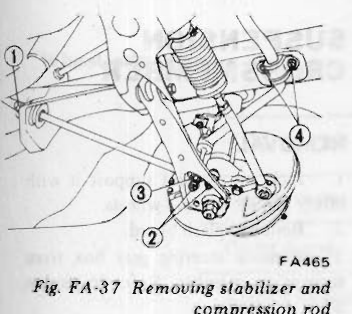
>
> - **Summary:** Underbody diagram indicating fastener locations for compression rod bracket nut 1, transverse link bolts 2, stabilizer connecting link nut 3, and stabilizer bar chassis bracket bolts 4.
> - **Components:** Compression rod, Stabilizer bar, Transverse link, Chassis bracket, Connecting link
> - **Callouts:** **(1)** Nut securing compression rod to bracket; **(2)** Bolts securing compression rod to transverse link; **(3)** Nut connecting stabilizer connecting rod to transverse link; **(4)** Bolts securing stabilizer bracket in position
> - **Mechanic Notes:** Remove nuts and bolts in sequence 1 to 4 to detach stabilizer bar and compression rod.
> - **Tags:** `stabilizer bar`, `compression rod`, `transverse link`, `chassis bracket`

## INSPECTION

1. Check compression rod and stabilizer for evidence of deformation and cracking; if necessary, replace.
2. Check rubber parts such as compression rod and stabilizer bushings to be sure they are not deteriorated or cracked.

## INSTALLATION

Install compression rod and stabilizer bar in the reverse order of removal, noting the following:

1. Ensure that stabilizer is correctly installed to the portion of the left and right sides.
2. Check to be sure that compression rod bushing is properly centered in its seat.

**Tightening torque:**
- Nut used to install compression rod on transverse link: 6.1 to 7.1 kg-m (44 to 51 ft-lb)
- Stabilizer installation bolts:
  - Transverse link side: 1.2 to 2.7 kg-m (9 to 20 ft-lb)
  - Frame bracket side: 1.9 to 2.5 kg-m (14 to 18 ft-lb)
  - Connecting rod side: 1.2 to 2.7 kg-m (9 to 20 ft-lb)

# TRANSVERSE LINK AND LOWER BALL JOINT

The transverse link is connected to the suspension member through a rubber bushing and to the strut through a ball joint.

The lower ball joint is assembled at the factory and cannot be disassembled. Lubricate ball joints with recommended multi-purpose grease at specified intervals.

## REMOVAL

1. Jack up car and support it with safety stands; remove wheel.
2. Remove splash board.
3. Pry cotter pin off side rod ball joint socket. Remove castle nut and separate side rod socket from knuckle arm, using Ball Joint Puller HT72520000. For details, refer to ST section.
4. Loosen bolts holding knuckle arm in place. Separate knuckle arm from bottom end of strut. For details, refer to "Spring and Strut Assembly".
5. Remove compression rod and stabilizer bar. For details, refer to "Compression Rod and Stabilizer Bar" section.
6. Loosen transverse link mounting bar and separate transverse link from suspension member.

Remove transverse link with suspension ball joint and knuckle arm. See Figures FA-38 and FA-39.

> 🖼️ **Fig. FA-38 Removing transverse link** `[FA466]` *(Type: `procedure_step`)*
>
> 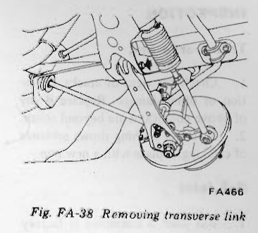
>
> - **Summary:** Detaching the transverse link pivot pin from the front suspension crossmember.
> - **Components:** Transverse link, Suspension crossmember, Mounting pin / bushing
> - **Mechanic Notes:** Loosen transverse link mounting bar and separate link from suspension member.
> - **Tags:** `transverse link`, `suspension crossmember`, `removal`

> 🖼️ **Fig. FA-39 Removing knuckle arm** `[FA448]` *(Type: `procedure_step`)*
>
> 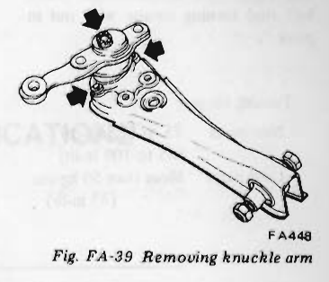
>
> - **Summary:** Separating the steering knuckle arm from the lower ball joint taper stud on the transverse link.
> - **Components:** Knuckle arm, Ball joint stud, Transverse link
> - **Mechanic Notes:** Knuckle arm is taper fit to ball joint stud. If stuck, screw nut onto stud and strike nut with hammer.
> - **Tags:** `knuckle arm`, `ball joint taper`, `transverse link`

> [!NOTE]
> Knuckle arm is taper-fit to ball joint. If knuckle arm can not be easily removed, screw nut onto threaded portion of ball stud and hammer on top of nut.

7. Place transverse link in a vise, loosen bolt securing ball joint to transverse link and remove ball joint from transverse link.
8. Withdraw transverse link bushing from transverse link using Front Transverse Link Bushing Replacer Set ST36710000 and a press.

> 🖼️ **Fig. FA-40 Removing transverse link bushing** `[FA214]` *(Type: `procedure_step`)*
>
> 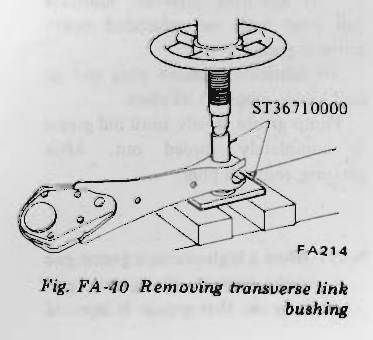
>
> - **Summary:** Pressing the rubber bushing out of the transverse link eye using press replacer set ST36710000.
> - **Components:** Transverse link bushing replacer set ST36710000, Transverse link, Hydraulic press, Support base
> - **Callouts:** **(ST36710000)** Front Transverse Link Bushing Replacer Set
> - **Specs / Measurements:** Special tool: ST36710000
> - **Mechanic Notes:** Support eye squarely on replacer base and press bushing straight through using drift.
> - **Tags:** `transverse link bushing`, `ST36710000`, `hydraulic press`, `bushing removal`

---

<!-- Page 12 (FA-12) -->
## Front Axle & Front Suspension

## INSPECTION

### Transverse link
1. Check for signs of cracks, distortion or other damage. Replace if any of above conditions are beyond repair.
2. If rubber bushing shows evidence of cracking, replace with a new one.

### Ball joint
1. Ball joint is assembled at factory and cannot be disassembled. Check ball stud turning torque with nut in place.

**Turning torque:**
- **New parts:** 75 to 125 kg-cm (65 to 109 in-lb)
- **Used parts:** More than 50 kg-cm (43 in-lb)

> 🖼️ **Fig. FA-41 Sectional view of lower ball joint** `[FA217]` *(Type: `cutaway_flow`)*
>
> 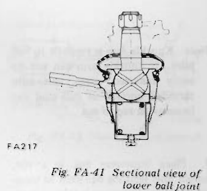
>
> - **Summary:** Cross-sectional view of the lower ball joint assembly showing ball stud, seat, grease plug/nipple location, and dust boot.
> - **Components:** Ball stud, Ball seat, Dust cover boot, Lubrication plug
> - **Specs / Measurements:** Turning torque (new parts): 75 to 125 kg-cm (65 to 109 in-lb); Turning torque (used parts): More than 50 kg-cm (43 in-lb)
> - **Mechanic Notes:** Lubricate ball joint by replacing plug with nipple and pumping multi-purpose grease until old grease purges.
> - **Tags:** `ball joint`, `lower ball joint`, `turning torque`, `cross section`

2. Check condition of dust cover. If found to be cracked excessively beyond use, replace ball joint with a new one.
3. At specified intervals, lubricate ball joint with recommended multi-purpose grease.
To lubricate, remove plug and install grease nipple in its place.
Pump grease slowly until old grease is completely forced out. After greasing, reinstall plug.

> [!NOTE]
> When a high-pressure grease gun is used, operate the grease gun carefully so that grease is injected slowly and new grease does not come out from the clamp portion.

## INSTALLATION

Install transverse link and lower ball joint in reverse sequence of removal, noting the following:

1. When installing transverse link bushing, use the special tool ST36710000, and fit it until transverse link bushing outer tube end surface is made flush with the transverse link end surface. Carefully align bushing direction correctly (front and rear). See Figure FA-42.

> 🖼️ **Fig. FA-42 Sectional view of transverse link bushing** `[FA447]` *(Type: `alignment_orientation`)*
>
> 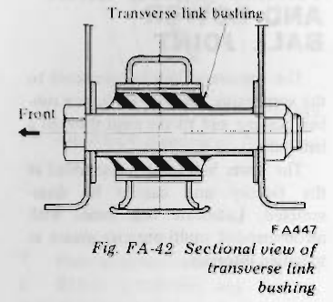
>
> - **Summary:** Cross section showing transverse link rubber bushing installed flush into transverse link eye, noting front-to-rear orientation.
> - **Components:** Transverse link bushing, Transverse link eye, Outer tube
> - **Callouts:** **(Front)** Forward vehicle direction arrow; **(Transverse link bushing)** Inner/outer bushing sleeve
> - **Mechanic Notes:** Press bushing until outer tube is flush with transverse link eye surface. Pay careful attention to front/rear orientation.
> - **Tags:** `transverse link bushing`, `alignment`, `flush fit`, `orientation`

2. When installing knuckle arm to ball joint, wipe off any grease on the tapered and threaded portions. Tighten nut to 5.5 to 7.5 kg-m (40 to 54 ft-lb) torque.
Align cotter pin hole with nut groove by retightening nut within the range of 60 degrees. Insert new cotter pin in hole and spread pin legs to secure the installation. See Figure FA-43.

> 🖼️ **Fig. FA-43 Tightening knuckle arm castle nut** `[FA450]` *(Type: `procedure_step`)*
>
> 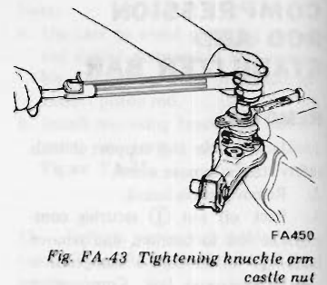
>
> - **Summary:** Torquing the castle nut on the knuckle arm ball joint taper stud with socket wrench.
> - **Components:** Knuckle arm castle nut, Knuckle arm, Ball joint stud, Wrench
> - **Specs / Measurements:** Tightening torque: 5.5 to 7.5 kg-m (40 to 54 ft-lb)
> - **Mechanic Notes:** Torque castle nut to 5.5 to 7.5 kg-m, then advance up to 60 degrees to align slot with cotter pin hole.
> - **Tags:** `castle nut`, `knuckle arm`, `torque`, `cotter pin`

**Tightening torque:**
- Ball joint bolt: 1.9 to 2.5 kg-m (14 to 18 ft-lb)
- Ball joint castle nut: 5.5 to 7.6 kg-m (40 to 55 ft-lb)
- Transverse link mounting bolt: 11.1 to 14.0 kg-m (80 to 101 ft-lb)

3. First, tighten transverse link mounting bolt temporarily, and then tighten to the rated torque with the car under the standard load.

# SUSPENSION CROSSMEMBER

## REMOVAL

1. Jack up car and support it with safety stands; remove wheels.
2. Remove splash board.
3. Remove steering gear box from suspension member. Refer to section ST.
4. Remove transverse link. For details, refer to "Transverse Link and Lower Ball Joint".
5. With an overhead hoist and lifting cable, support weight of engine to remove load from mountings.
6. Remove engine mounting bolts and nuts indicated by arrows in the sketch below. Separate suspension crossmember from engine.

> 🖼️ **Fig. FA-44 Removing engine mounting bolts** `[FA440]` *(Type: `procedure_step`)*
>
> 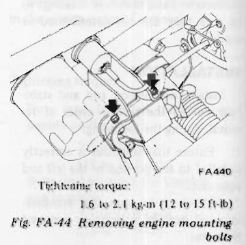
>
> - **Summary:** Location of engine mounting bolts connecting engine insulator brackets to the front suspension crossmember.
> - **Components:** Engine mounting bolts, Suspension crossmember, Engine insulator bracket
> - **Specs / Measurements:** Tightening torque: 1.6 to 2.1 kg-m (12 to 15 ft-lb)
> - **Mechanic Notes:** Support engine weight with hoist before removing engine mounting bolts. Tighten to 1.6 to 2.1 kg-m.
> - **Tags:** `engine mount`, `mounting bolts`, `suspension crossmember`

---

<!-- Page 13 (FA-13) -->
## Front Axle & Front Suspension

> 🖼️ **Fig. FA-45 Removing suspension crossmember** `[FA408]` *(Type: `procedure_step`)*
>
> 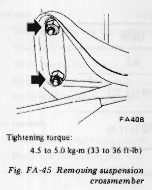
>
> - **Summary:** Location of frame mounting bolts securing front suspension crossmember to chassis side rails.
> - **Components:** Suspension crossmember, Frame rail, Mounting bolts
> - **Specs / Measurements:** Tightening torque: 4.5 to 5.0 kg-m (33 to 36 ft-lb)
> - **Mechanic Notes:** Tighten crossmember to frame bolts to 4.5 to 5.0 kg-m.
> - **Tags:** `suspension crossmember`, `frame bolts`, `torque`

## INSPECTION

Check suspension crossmember for evidence of deformation and crack; if necessary, replace.

## INSTALLATION

Install suspension crossmember in the reverse order of removal.

**Tightening torque:**
- Suspension member to frame: 4.5 to 5.0 kg-m (33 to 36 ft-lb)

# SERVICE DATA AND SPECIFICATIONS

### Wheel alignment

| Item | S30 | GS30 (2 + 2 seater) |
| :--- | :--- | :--- |
| Camber degree | 0°18' to 1°48' | 0°21' to 1°51' |
| Caster degree | 2°3' to 3°33' | 2°3' to 3°33' |
| Kingpin inclination degree | 11°14' to 12°44' | 11°14' to 12°44' |
| Toe-in mm (in) | 0 to 3 (0 to 0.12) | 0 to 3 (0 to 0.12) |
| *Steering angle degree - In | 33°54' to 34°54' | 36°18' to 37°18' |
| *Steering angle degree - Out | 32°6' to 34°6' | 34°24' to 36°24' |

\*With the exception of steering angle, all chart specifications are based upon unloaded condition.
Steering angle is based upon loaded condition.

---

<!-- Page 14 (FA-14) -->
## Front Axle & Front Suspension

### Coil spring

| Item | S30 | GS30 |
| :--- | :--- | :--- |
| Active turns of coil | 9.5 | 8.5 |
| Free length mm (in) | 406 (15.98) | 399 (15.71) |
| Spring constant kg/mm (lb/in) | 1.84 (103.0) | 2.06 (115.4) |

### Strut assembly

**Damping force at piston speed 0.3 m (1.0 ft)/sec.:**
- Expansion/Compression: 55 (121)/30 (66) kg (lb)/kg (lb)

**Front wheel bearing rotation starting torque:**
- New parts: 4.0 to 8.5 kg-cm (3.5 to 7.4 in-lb)
  - As measured at wheel hub bolt: 0.7 to 1.5 kg (1.5 to 3.3 lb)
- Adjustment with old parts: 1.0 to 4.5 kg-cm (0.9 to 3.9 in-lb)
  - As measured at wheel hub bolt: 0.2 to 0.8 kg (0.4 to 1.8 lb)

**Ball joint turning torque:**
- New parts: 75 to 125 kg-cm (65 to 109 in-lb)
- Used parts: More than 50 kg-cm (43 in-lb)

---

<!-- Page 15 (FA-15) -->
## Front Axle & Front Suspension

### Tightening torque

| Component / Fastener | Tightening Torque kg-m (ft-lb) |
| :--- | :--- |
| **Front axle** | |
| Brake disc rotor and hub assembly tightening bolt | 3.9 to 5.3 (28 to 38) |
| Brake tube installation nut | 1.5 to 1.8 (11 to 13) |
| Wheel bearing lock nut | 2.5 to 3.0 (18 to 22) |
| Disc brake caliper fixing bolt | 7.3 to 9.9 (53 to 72) |
| Baffle plate installation screw | 0.32 to 0.44 (2.3 to 3.2) |
| **Strut assembly** | |
| Gland packing tightening torque | 7 to 13 (51 to 94) |
| Piston rod self-locking nut | 7.5 to 9.5 (54 to 69) |
| Nut used to install the strut assembly on the body | 2.5 to 3.5 (18 to 25) |
| **Transverse link and ball joint** | |
| Bolts used to install the knuckle arm to strut | 7.3 to 9.9 (53 to 72) |
| Ball joint castle nut | 5.5 to 7.5 (40 to 54) |
| Bolts used to install the transverse link to ball joint | 1.9 to 2.5 (14 to 18) |
| Transverse link mounting bolt | 11.1 to 14.0 (80 to 101) |
| **Compression rod** | |
| Transverse link side | 6.1 to 7.1 (44 to 51) |
| Body side | 4.5 to 5.5 (33 to 40) |
| **Stabilizer bar** | |
| Connecting rod and transverse link installation nut | 1.2 to 2.7 (9 to 20) |
| Connecting rod and stabilizer bar installation nut | 1.2 to 2.7 (9 to 20) |
| Stabilizer bar and body installation bolt | 1.9 to 2.5 (14 to 18) |
| **Suspension member** | |
| Body side | 4.5 to 5.0 (33 to 36) |
| Engine mounting bolt | 1.6 to 2.1 (12 to 15) |
| **Steering mounting bolt** | |
| Bolt to welded nut | 2.6 to 3.0 (19 to 22) |
| Lock nut | 3.1 to 3.5 (22 to 25) |
| **Side rod socket and knuckle arm** | 5.5 to 7.6 (40 to 55) |
| **Wheel nut** | |
| Steel wheel | 8.0 to 9.0 (58 to 65) |
| Aluminum wheel | 8.0 to 10.0 (58 to 72) |

---

<!-- Page 16 (FA-16) -->
## Front Axle & Front Suspension

# TROUBLE DIAGNOSES AND CORRECTIONS

| Condition | Probable cause | Corrective action |
| :--- | :--- | :--- |
| **Vibration, shock and shimmying of steering wheel**  *Vibration:* Loose connection of the serration parts and wear of each part of linkage cause vibration of front wheels, which in turn is transmitted to the steering wheel. This is very noticeable when travelling over rough roads.  *Shock:* When the front wheels are travelling over bumpy roads, the play of the steering linkage is transmitted to the steering wheel. This is especially noticeable when travelling on rough roads.  *Shimmying:* Abnormal vibration of the front suspension group and the whole steering linkage, which occur when a specific speed is attained. | Improper tire pressure. | Adjust. |
| | Imbalance and deformation of roadwheel. | Correct the imbalance or replace. |
| | Unevenly worn tire or insufficient tightening. | Replace or tighten. |
| | Improperly adjusted or worn front wheel bearing. | Adjust or tighten. |
| | Faulty wheel alignment. | Adjust. |
| | Worn fitting transverse link bushings. | Replace. |
| | Insufficiently tightened steering gear housing. | Retighten. |
| | Wear of steering linkage. | Replace faulty parts. |
| | Worn suspension ball joint. | Replace. |
| | Excessive backlash due to improper adjustment of the retainer parts. | Adjust correctly. |
| | Damaged idler arm. | Replace. |
| | Worn column bearing, weakened column bearing spring, or loose clamp. | Replace or retighten. |
| | Malfunction of shock absorber (inside the strut) or loose installation bolts. | Replace or retighten. |
| | Imbalance of vehicle level. | Correct the imbalance. |
| **Vehicle pulls to right or left**  When driving with hands off the steering wheel over a flat road, the car gently swerves to right or left.  *Note:* A faulty rear suspension may also be the cause of this trouble, therefore, see also the chapter dealing with the rear suspension. | Improper tire pressure or insufficient tightening of wheel nuts. | Adjust or tighten. |
| | Difference in height of right and left tire treads. | Replace tires. |
| | Incorrect adjustment or abrasion of front wheel bearing. | Adjust or replace. |
| | Collapsed or twisted front spring. | Replace. |
| | Incorrect wheel alignment. | Adjust. |
| | Incorrect brake adjustment (binding). | Adjust. |
| | Worn rubber bushings for transverse link and compression rod. | Replace. |
| | Deformed steering linkage and suspension link. | Replace. |
| | Imbalance of car level. | Correct the imbalance. |
| **Instability of car** | Improper tire pressure. | Adjust. |
| | Worn rubber bushings for transverse link and tension rod. | Replace. |
| | Incorrect wheel alignment. | Adjust. | <!-- Page 17 (FA-17) --> ## Front Axle & Front Suspension

| Condition | Probable cause | Corrective action |
| :--- | :--- | :--- |
| **Instability of car** *(continued)* | Worn or deformed steering linkage and suspension link. | Replace. |
| | Incorrect adjustment of steering gear. | Adjust. |
| | Deformed or imbalanced wheel. | Correct or replace. |
| **Stiff steering wheel (check-up procedure)**  Jack up front wheels, detach the steering gear and operate the steering wheel, and: - If it is light, check steering linkage, and suspension groups. - If it is heavy, check steering gear and steering column groups. | Improper tire pressure. | Adjust. |
| | Insufficient lubricants or mixing impurities in steering linkage or excessively worn steering linkage. | Replenish grease or replace the part. |
| | Stiff or damaged suspension ball-joint, or lack of grease. | Replace. |
| | Worn or incorrectly adjusted wheel bearing. | Replace or adjust. |
| | Worn damaged steering gear and bearing. | Replace. |
| | Incorrectly adjusted steering gear. | Adjust. |
| | Deformed steering linkage. | Replace. |
| | Incorrect wheel alignment. | Adjust. |
| | Worn strut upper end bearing. | Replace. |
| | Damaged or stiff piston or shock absorber rod (in the strut). | Replace. |
| | Interference of steering column with turn signal switch. | Adjust. |
| **Excessive steering wheel play** | Incorrectly adjusted steering gear housing. | Adjust. |
| | Worn steering linkage. | Replace. |
| | Improperly fitted gear box. | Retighten. |
| | Incorrectly adjusted wheel bearing. | Adjust. |
| | Worn transverse link and tension rod fitting bushings. | Replace. |
| **Noises** | Improper tire pressure. | Adjust. |
| | Insufficient lubricating oil and grease for suspension ball joint and steering linkage, or their breakage. | Replenish lubricating oil and grease, or replace. |
| | Loose steering gear bolts, linkage and suspension groups. | Retighten. |
| | Damaged shock absorber (inside the strut). | Replace. |
| | Worn wheel bearing. | Replace. |
| | Worn steering linkage and steering gear. | Replace. |
| | Worn transverse link and tension rod fitting bushings. | Replace. |
| | Broken or collapsed coil spring. | Replace. |
| | Loose strut mounting insulator tightening nuts. | Retighten. |
| | Loose stabilizer bolt. | Retighten. |

---

<!-- Page 18 (FA-18) -->
## Front Axle & Front Suspension

| Condition | Probable cause | Corrective action |
| :--- | :--- | :--- |
| **Grating tire noise** | Improper tire pressure. | Adjust. |
| | Incorrect wheel alignment. | Adjust. |
| | Deformed knuckle spindle and suspension linkage. | Replace. |
| **Jumping of disc wheel** | Improper tire pressure. | Adjust. |
| | Imbalance wheels. | Adjust. |
| | Damaged shock absorber. | Replace. |
| | Faulty tire. | Replace. |
| | Deformed wheel rim. | Replace. |
| **Excessively or partially worn tire.** | Improper tire pressure. | Adjust. |
| | Incorrect wheel alignment. | Adjust. |
| | Worn wheel bearing. | Replace. |
| | Incorrect brake adjustment. | Adjust. |
| | Improper tire shifting (rotation). | Adjust. |
| | Rough and improper driving manner. | Drive more gently. |

---

<!-- Page 19 (FA-19) -->
## Front Axle & Front Suspension

# SPECIAL SERVICE TOOLS

| Tool number & tool name | Kent-Moore No. | Reference page or Fig. No. |
| :--- | :--- | :--- |
| **ST35300000** Drift | — | Fig. FA-16 |
| 

> 🖼️ **ST35300000 Drift**  *(Type: `special_service_tool`)*
>
> 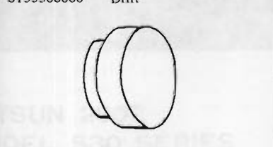
>
> - **Summary:** Front wheel bearing outer race installing drift tool.
> - **Components:** ST35300000 Drift
> - **Specs / Measurements:** Tool number: ST35300000; Ref: Fig. FA-16
> - **Mechanic Notes:** Used to press or drive outer bearing races squarely into front wheel hub.
> - **Tags:** `ST35300000`, `drift`, `wheel bearing`, `special tool`

 | | |
| **ST35540000** Gland packing guide | J 25829 | Fig. FA-30 |
| 

> 🖼️ **ST35540000 Gland packing guide**  *(Type: `special_service_tool`)*
>
> 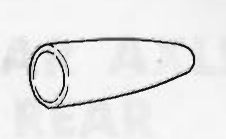
>
> - **Summary:** Tapered guide sleeve for installing gland packing oil seal over piston rod.
> - **Components:** ST35540000 Gland packing guide
> - **Specs / Measurements:** Tool number: ST35540000; Kent-Moore No.: J 25829; Ref: Fig. FA-30
> - **Mechanic Notes:** Prevents damage to gland packing inner oil seal lips when sliding over piston rod threads and shoulders.
> - **Tags:** `ST35540000`, `J 25829`, `gland packing guide`, `special tool`

 | | |
| **ST3565S001** Coil spring compressor set ① ST35651001 Coil spring compressor ② ST35652000 Clamp | J 25833 | Fig. FA-25 |
| 

> 🖼️ **ST3565S001 Coil spring compressor set**  *(Type: `special_service_tool`)*
>
> 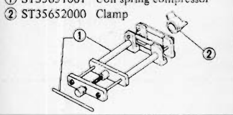
>
> - **Summary:** Coil spring compressor fixture with threaded spindle and safety hooks.
> - **Components:** ST35651001 Coil spring compressor, ST35652000 Clamp
> - **Callouts:** **(1)** ST35651001 Coil spring compressor; **(2)** ST35652000 Clamp
> - **Specs / Measurements:** Tool number: ST3565S001; Kent-Moore No.: J 25833; Ref: Fig. FA-25
> - **Mechanic Notes:** Must engage at least three active spring coils securely before compressing.
> - **Tags:** `ST3565S001`, `J 25833`, `spring compressor`, `special tool`

 | | |
| **HT72520000** Ball joint remover | — | Fig. FA-11 |
| 

> 🖼️ **HT72520000 Ball joint remover**  *(Type: `special_service_tool`)*
>
> 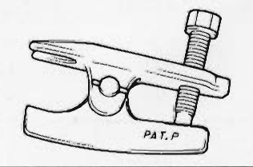
>
> - **Summary:** Scissor-type mechanical ball joint puller/separator tool.
> - **Components:** HT72520000 Ball joint remover
> - **Callouts:** **(PAT. P)** Patent pending mark
> - **Specs / Measurements:** Tool number: HT72520000; Ref: Fig. FA-11
> - **Mechanic Notes:** Separates tie rod and ball joint tapered pins without damaging rubber dust boots.
> - **Tags:** `HT72520000`, `ball joint remover`, `puller`, `special tool`

 | | |
| **KV40100800** Gland packing wrench | J 26803 | Fig. FA-26 Fig. FA-32 |
| 

> 🖼️ **KV40100800 Gland packing wrench**  *(Type: `special_service_tool`)*
>
> 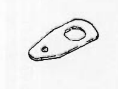
>
> - **Summary:** Special two-pin spanner wrench adapter for strut cartridge gland nut.
> - **Components:** KV40100800 Gland packing wrench
> - **Specs / Measurements:** Tool number: KV40100800; Kent-Moore No.: J 26803; Ref: Fig. FA-26, Fig. FA-32
> - **Mechanic Notes:** Has a 0.10 m (0.33 ft) offset length; apply torque correction formula when tightening.
> - **Tags:** `KV40100800`, `J 26803`, `gland packing wrench`, `special tool`

 | | |
| **ST36710000** Transverse link bushing replacer (FR) ① ST36710010 Drift ② ST36710020 Support base | J 25844 | Fig. FA-40 |
| 

> 🖼️ **ST36710000 Transverse link bushing replacer (FR)**  *(Type: `special_service_tool`)*
>
> 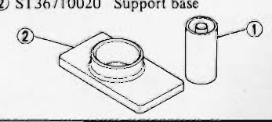
>
> - **Summary:** Press driver and receiver set for transverse link rubber bushing replacement.
> - **Components:** ST36710010 Drift, ST36710020 Support base
> - **Callouts:** **(1)** ST36710010 Drift; **(2)** ST36710020 Support base
> - **Specs / Measurements:** Tool number: ST36710000; Kent-Moore No.: J 25844; Ref: Fig. FA-40
> - **Mechanic Notes:** Use with hydraulic press to remove and install transverse link eye bushings flush.
> - **Tags:** `ST36710000`, `J 25844`, `bushing replacer`, `transverse link`, `special tool`

 | | |

---

## Segmented Diagrams Index

| Figure | Code | Type | Page | Caption | Key Components / Callouts | File |
| :--- | :--- | :--- | :--- | :--- | :--- | :--- |
| **Fig. FA-1** | `FA455` | `cutaway_flow` | FA-2 | Fig. FA-1 Front axle and suspension assembly | Strut mounting insulator, Thrust bearing, Bound bumper rubber, Dust cover, Coil spring | [fig_fa_1_front_axle_and_suspension_assembly.png](diagrams/FA Front Axle and Suspension/fig_fa_1_front_axle_and_suspension_assembly.png) |
| **Fig. FA-2** | `FA263` | `procedure_step` | FA-3 | Fig. FA-2 Tightening wheel bearing lock nut | Torque wrench, Wheel hub, Wheel bearing lock nut, Spindle | [fig_fa_2_tightening_wheel_bearing_lock_nut.png](diagrams/FA Front Axle and Suspension/fig_fa_2_tightening_wheel_bearing_lock_nut.png) |
| **Fig. FA-3** | `FA456` | `procedure_step` | FA-3 | Fig. FA-3 Loosen wheel bearing lock nut 60° | Wrench, Wheel bearing lock nut, Wheel hub | [fig_fa_3_loosen_wheel_bearing_lock_nut_60.png](diagrams/FA Front Axle and Suspension/fig_fa_3_loosen_wheel_bearing_lock_nut_60.png) |
| **Fig. FA-4** | `FA264` | `inspection_measurement` | FA-3 | Fig. FA-4 Measuring wheel bearing rotation starting torque | Spring balance / scale, Wheel hub bolt / stud, Wheel hub | [fig_fa_4_measuring_wheel_bearing_rotation_starting_torque.png](diagrams/FA Front Axle and Suspension/fig_fa_4_measuring_wheel_bearing_rotation_starting_torque.png) |
| **Fig. FA-5** | `FA457` | `procedure_step` | FA-3 | Fig. FA-5 Installing cotter pin | Cotter pin, Adjusting cap, Spindle hole, Wheel hub | [fig_fa_5_installing_cotter_pin.png](diagrams/FA Front Axle and Suspension/fig_fa_5_installing_cotter_pin.png) |
| **Fig. FA-6** | `FA467` | `inspection_measurement` | FA-4 | Fig. FA-6 Measuring toe-in | Vehicle front end, Toe-in gauge, Front road wheels | [fig_fa_6_measuring_toe_in.png](diagrams/FA Front Axle and Suspension/fig_fa_6_measuring_toe_in.png) |
| **Fig. FA-7** | `FA452` | `procedure_step` | FA-4 | Fig. FA-7 Adjusting toe-in | Side rod lock nut, Side rod, Steering rack boot, Tie rod ball socket | [fig_fa_7_adjusting_toe_in.png](diagrams/FA Front Axle and Suspension/fig_fa_7_adjusting_toe_in.png) |
| **Fig. FA-8** | `ST447` | `inspection_measurement` | FA-4 | Fig. FA-8 Standard length of side rod | Side rod ball, Stopper nut, Side rod | [fig_fa_8_standard_length_of_side_rod.png](diagrams/FA Front Axle and Suspension/fig_fa_8_standard_length_of_side_rod.png) |
| **Fig. FA-9** | `FA032` | `inspection_measurement` | FA-4 | Fig. FA-9 Measuring steering angle, camber and caster | Turning radius gauge, Camber/caster alignment gauge, Front wheel | [fig_fa_9_measuring_steering_angle_camber_and_caster.png](diagrams/FA Front Axle and Suspension/fig_fa_9_measuring_steering_angle_camber_and_caster.png) |
| **Fig. FA-10** | `FA458` | `procedure_step` | FA-5 | Fig. FA-10 Removing brake tube and caliper fixing bolts | Brake tube flare nut, Brake caliper, Caliper fixing bolts, Strut assembly | [fig_fa_10_removing_brake_tube_and_caliper_fixing_bolts.png](diagrams/FA Front Axle and Suspension/fig_fa_10_removing_brake_tube_and_caliper_fixing_bolts.png) |
| **Fig. FA-11** | `FA038` | `procedure_step` | FA-5 | Fig. FA-11 Removing hub cap | Hub cap, Screwdrivers, Front wheel hub | [fig_fa_11_removing_hub_cap.png](diagrams/FA Front Axle and Suspension/fig_fa_11_removing_hub_cap.png) |
| **Fig. FA-12** | `FA459` | `procedure_step` | FA-5 | Fig. FA-12 Removing wheel hub | Wheel hub, Spindle, Wheel bearing | [fig_fa_12_removing_wheel_hub.png](diagrams/FA Front Axle and Suspension/fig_fa_12_removing_wheel_hub.png) |
| **Fig. FA-13** | `FA259` | `procedure_step` | FA-5 | Fig. FA-13 Removing wheel bearing outer race | Brass drift, Hammer, Wheel hub, Bearing outer race | [fig_fa_13_removing_wheel_bearing_outer_race.png](diagrams/FA Front Axle and Suspension/fig_fa_13_removing_wheel_bearing_outer_race.png) |
| **Fig. FA-14** | `FA260` | `procedure_step` | FA-5 | Fig. FA-14 Removing disc brake rotor | Disc brake rotor, Wheel hub, Rotor mounting bolts, Wrench | [fig_fa_14_removing_disc_brake_rotor.png](diagrams/FA Front Axle and Suspension/fig_fa_14_removing_disc_brake_rotor.png) |
| **Fig. FA-15** | `FA443` | `procedure_step` | FA-5 | Fig. FA-15 Removing baffle plate screws | Baffle plate, Knuckle spindle, Baffle plate screws | [fig_fa_15_removing_baffle_plate_screws.png](diagrams/FA Front Axle and Suspension/fig_fa_15_removing_baffle_plate_screws.png) |
| **Fig. FA-16** | `FA445` | `procedure_step` | FA-6 | Fig. FA-16 Installing wheel bearing outer race | Front Wheel Bearing Drift ST35300000, Wheel hub, Bearing outer race | [fig_fa_16_installing_wheel_bearing_outer_race.png](diagrams/FA Front Axle and Suspension/fig_fa_16_installing_wheel_bearing_outer_race.png) |
| **Fig. FA-17** | `FA460` | `cutaway_flow` | FA-6 | Fig. FA-17 Lubricating points of wheel hub | Wheel hub, Inner bearing cavity, Outer bearing cavity, Center grease recess | [fig_fa_17_lubricating_points_of_wheel_hub.png](diagrams/FA Front Axle and Suspension/fig_fa_17_lubricating_points_of_wheel_hub.png) |
| **Fig. FA-18** | `FA262` | `procedure_step` | FA-6 | Fig. FA-18 Filling bearing cone with grease | Bearing cone, Multi-purpose grease can (Elephant brand) | [fig_fa_18_filling_bearing_cone_with_grease.png](diagrams/FA Front Axle and Suspension/fig_fa_18_filling_bearing_cone_with_grease.png) |
| **Fig. FA-19** | `FA064` | `procedure_step` | FA-6 | Fig. FA-19 Filling grease seal lip pocket with grease | Grease seal, Grease can | [fig_fa_19_filling_grease_seal_lip_pocket_with_grease.png](diagrams/FA Front Axle and Suspension/fig_fa_19_filling_grease_seal_lip_pocket_with_grease.png) |
| **Fig. FA-20** | `FA268` | `cutaway_flow` | FA-7 | Fig. FA-20 Sectional view of strut assembly | Gland packing assembly, Oil seal, O-ring, Piston rod guide assembly, Cylinder | [fig_fa_20_sectional_view_of_strut_assembly.png](diagrams/FA Front Axle and Suspension/fig_fa_20_sectional_view_of_strut_assembly.png) |
| **Fig. FA-21** | `FA461` | `procedure_step` | FA-8 | Fig. FA-21 Disconnecting brake hose | Brake hose, Brake tube, Strut mounting bracket, Locking spring | [fig_fa_21_disconnecting_brake_hose.png](diagrams/FA Front Axle and Suspension/fig_fa_21_disconnecting_brake_hose.png) |
| **Fig. FA-22** | `FA462` | `procedure_step` | FA-8 | Fig. FA-22 Removing bolts connecting knuckle arm | Knuckle arm, Knuckle arm bolts, Strut bottom flange | [fig_fa_22_removing_bolts_connecting_knuckle_arm.png](diagrams/FA Front Axle and Suspension/fig_fa_22_removing_bolts_connecting_knuckle_arm.png) |
| **Fig. FA-23** | `FA206` | `procedure_step` | FA-8 | Fig. FA-23 [Upper strut mounting nuts under hood] | Strut tower / hood ledge, Strut insulator mounting nuts (3) | [fig_fa_23_strut_mounting_nuts.png](diagrams/FA Front Axle and Suspension/fig_fa_23_strut_mounting_nuts.png) |
| **Fig. FA-24** | `FA057` | `procedure_step` | FA-8 | Fig. FA-24 Removing front strut Assembly | Strut assembly, Coil spring, Floor jack, Wheel well | [fig_fa_24_removing_front_strut_assembly.png](diagrams/FA Front Axle and Suspension/fig_fa_24_removing_front_strut_assembly.png) |
| **Fig. FA-25** | `FA059` | `procedure_step` | FA-8 | Fig. FA-25 Removing self-locking nut | Coil spring compressor ST3565S001, Self-locking nut, Piston rod, Strut insulator | [fig_fa_25_removing_self_locking_nut.png](diagrams/FA Front Axle and Suspension/fig_fa_25_removing_self_locking_nut.png) |
| **Fig. FA-26** | `FA274` | `procedure_step` | FA-8 | Fig. FA-26 Removing gland packing | Gland Packing Wrench KV40100800, Gland packing, Strut outer casing, Vise attachment | [fig_fa_26_removing_gland_packing.png](diagrams/FA Front Axle and Suspension/fig_fa_26_removing_gland_packing.png) |
| **Fig. FA-27** | `FA275` | `procedure_step` | FA-9 | Fig. FA-27 Removing piston rod and cylinder | Piston rod, Cylinder, Strut outer casing | [fig_fa_27_removing_piston_rod_and_cylinder.png](diagrams/FA Front Axle and Suspension/fig_fa_27_removing_piston_rod_and_cylinder.png) |
| **Fig. FA-28** | `FA463` | `exploded_view` | FA-9 | Fig. FA-28 Exploded view of strut assembly | Strut assembly, Coil spring, Spring upper seat, Strut mounting insulator, Thrust bearing | [fig_fa_28_exploded_view_of_strut_assembly.png](diagrams/FA Front Axle and Suspension/fig_fa_28_exploded_view_of_strut_assembly.png) |
| **Fig. FA-29** | `FA330` | `procedure_step` | FA-9 | Fig. FA-29 Filling outer casing with fluid | Strut outer casing, Fluid container | [fig_fa_29_filling_outer_casing_with_fluid.png](diagrams/FA Front Axle and Suspension/fig_fa_29_filling_outer_casing_with_fluid.png) |
| **Fig. FA-30** | `FA276` | `procedure_step` | FA-9 | Fig. FA-30 Installing gland packing | Gland packing guide ST35540000, Gland packing, Piston rod, Strut casing | [fig_fa_30_installing_gland_packing.png](diagrams/FA Front Axle and Suspension/fig_fa_30_installing_gland_packing.png) |
| **Fig. FA-31** | `FA464` | `cutaway_flow` | FA-9 | Fig. FA-31 Sectional view of gland packing | Gland packing nut, Oil seal lip, Grease cavity, Scraper / wiper | [fig_fa_31_sectional_view_of_gland_packing.png](diagrams/FA Front Axle and Suspension/fig_fa_31_sectional_view_of_gland_packing.png) |
| **Fig. FA-32** | `FA274` | `procedure_step` | FA-9 | Fig. FA-32 Tightening gland packing | Gland packing wrench KV40100800, Torque wrench, Strut outer casing | [fig_fa_32_tightening_gland_packing.png](diagrams/FA Front Axle and Suspension/fig_fa_32_tightening_gland_packing.png) |
| **Fig. FA-33** | `FA278` | `special_service_tool` | FA-10 | Fig. FA-33 Gland packing wrench | Gland packing wrench adapter, Torque wrench | [fig_fa_33_gland_packing_wrench.png](diagrams/FA Front Axle and Suspension/fig_fa_33_gland_packing_wrench.png) |
| **Fig. FA-34** | `FA280` | `procedure_step` | FA-10 | Fig. FA-34 Bleeding air from strut | Strut shock absorber, Piston rod, Spindle | [fig_fa_34_bleeding_air_from_strut.png](diagrams/FA Front Axle and Suspension/fig_fa_34_bleeding_air_from_strut.png) |
| **Fig. FA-35** | `FA281` | `component_location` | FA-10 | Fig. FA-35 Strut mounting bearing greasing point | Strut mounting insulator, Thrust bearing, Upper spring seat, Piston rod | [fig_fa_35_strut_mounting_bearing_greasing_point.png](diagrams/FA Front Axle and Suspension/fig_fa_35_strut_mounting_bearing_greasing_point.png) |
| **Fig. FA-36** | `FA282` | `alignment_orientation` | FA-10 | Fig. FA-36 Installing front spring | Coil spring, Lower spring seat, Lower end of spring | [fig_fa_36_installing_front_spring.png](diagrams/FA Front Axle and Suspension/fig_fa_36_installing_front_spring.png) |
| **Fig. FA-37** | `FA465` | `component_location` | FA-11 | Fig. FA-37 Removing stabilizer and compression rod | Compression rod, Stabilizer bar, Transverse link, Chassis bracket, Connecting link | [fig_fa_37_removing_stabilizer_and_compression_rod.png](diagrams/FA Front Axle and Suspension/fig_fa_37_removing_stabilizer_and_compression_rod.png) |
| **Fig. FA-38** | `FA466` | `procedure_step` | FA-11 | Fig. FA-38 Removing transverse link | Transverse link, Suspension crossmember, Mounting pin / bushing | [fig_fa_38_removing_transverse_link.png](diagrams/FA Front Axle and Suspension/fig_fa_38_removing_transverse_link.png) |
| **Fig. FA-39** | `FA448` | `procedure_step` | FA-11 | Fig. FA-39 Removing knuckle arm | Knuckle arm, Ball joint stud, Transverse link | [fig_fa_39_removing_knuckle_arm.png](diagrams/FA Front Axle and Suspension/fig_fa_39_removing_knuckle_arm.png) |
| **Fig. FA-40** | `FA214` | `procedure_step` | FA-11 | Fig. FA-40 Removing transverse link bushing | Transverse link bushing replacer set ST36710000, Transverse link, Hydraulic press, Support base | [fig_fa_40_removing_transverse_link_bushing.png](diagrams/FA Front Axle and Suspension/fig_fa_40_removing_transverse_link_bushing.png) |
| **Fig. FA-41** | `FA217` | `cutaway_flow` | FA-12 | Fig. FA-41 Sectional view of lower ball joint | Ball stud, Ball seat, Dust cover boot, Lubrication plug | [fig_fa_41_sectional_view_of_lower_ball_joint.png](diagrams/FA Front Axle and Suspension/fig_fa_41_sectional_view_of_lower_ball_joint.png) |
| **Fig. FA-42** | `FA447` | `alignment_orientation` | FA-12 | Fig. FA-42 Sectional view of transverse link bushing | Transverse link bushing, Transverse link eye, Outer tube | [fig_fa_42_sectional_view_of_transverse_link_bushing.png](diagrams/FA Front Axle and Suspension/fig_fa_42_sectional_view_of_transverse_link_bushing.png) |
| **Fig. FA-43** | `FA450` | `procedure_step` | FA-12 | Fig. FA-43 Tightening knuckle arm castle nut | Knuckle arm castle nut, Knuckle arm, Ball joint stud, Wrench | [fig_fa_43_tightening_knuckle_arm_castle_nut.png](diagrams/FA Front Axle and Suspension/fig_fa_43_tightening_knuckle_arm_castle_nut.png) |
| **Fig. FA-44** | `FA440` | `procedure_step` | FA-12 | Fig. FA-44 Removing engine mounting bolts | Engine mounting bolts, Suspension crossmember, Engine insulator bracket | [fig_fa_44_removing_engine_mounting_bolts.png](diagrams/FA Front Axle and Suspension/fig_fa_44_removing_engine_mounting_bolts.png) |
| **Fig. FA-45** | `FA408` | `procedure_step` | FA-13 | Fig. FA-45 Removing suspension crossmember | Suspension crossmember, Frame rail, Mounting bolts | [fig_fa_45_removing_suspension_crossmember.png](diagrams/FA Front Axle and Suspension/fig_fa_45_removing_suspension_crossmember.png) |
| **ST35300000** | `-` | `special_service_tool` | FA-19 | ST35300000 Drift | ST35300000 Drift | [fig_fa_sst_drift_st35300000.png](diagrams/FA Front Axle and Suspension/fig_fa_sst_drift_st35300000.png) |
| **ST35540000** | `-` | `special_service_tool` | FA-19 | ST35540000 Gland packing guide | ST35540000 Gland packing guide | [fig_fa_sst_gland_packing_guide_st35540000.png](diagrams/FA Front Axle and Suspension/fig_fa_sst_gland_packing_guide_st35540000.png) |
| **ST3565S001** | `-` | `special_service_tool` | FA-19 | ST3565S001 Coil spring compressor set | ST35651001 Coil spring compressor, ST35652000 Clamp | [fig_fa_sst_spring_compressor_st3565s001.png](diagrams/FA Front Axle and Suspension/fig_fa_sst_spring_compressor_st3565s001.png) |
| **HT72520000** | `-` | `special_service_tool` | FA-19 | HT72520000 Ball joint remover | HT72520000 Ball joint remover | [fig_fa_sst_ball_joint_remover_ht72520000.png](diagrams/FA Front Axle and Suspension/fig_fa_sst_ball_joint_remover_ht72520000.png) |
| **KV40100800** | `-` | `special_service_tool` | FA-19 | KV40100800 Gland packing wrench | KV40100800 Gland packing wrench | [fig_fa_sst_gland_packing_wrench_kv40100800.png](diagrams/FA Front Axle and Suspension/fig_fa_sst_gland_packing_wrench_kv40100800.png) |
| **ST36710000** | `-` | `special_service_tool` | FA-19 | ST36710000 Transverse link bushing replacer (FR) | ST36710010 Drift, ST36710020 Support base | [fig_fa_sst_bushing_replacer_st36710000.png](diagrams/FA Front Axle and Suspension/fig_fa_sst_bushing_replacer_st36710000.png) |
