# ENGINE CONTROL, FUEL & EXHAUST SYSTEMS

<!-- Page 1 (FE-1) -->
# SECTION FE

# ENGINE CONTROL, FUEL & EXHAUST SYSTEMS

| Section | Page |
| :--- | :--- |
| ENGINE CONTROL SYSTEM | FE- 2 |
| FUEL SYSTEM | FE- 4 |
| EXHAUST SYSTEM | FE- 7 |

---

<!-- Page 2 (FE-2) -->
# ENGINE CONTROL SYSTEM

## CONTENTS

| Item | Page |
| :--- | :--- |
| ACCELERATOR SYSTEM | FE-2 |
| DESCRIPTION | FE-2 |
| REMOVAL AND INSTALLATION | FE-2 |
| INSPECTION | FE-3 |
| ADJUSTMENT | FE-3 |

## ACCELERATOR SYSTEM

### DESCRIPTION

The accelerator linkage has been constructed with minimized weight so that it will not be affected by engine vibration and will operate smoothly at all times.

> 🖼️ **Fig. FE-1 Accelerator linkage** `[FE222]` *(Type: `exploded_view`)*
>
> 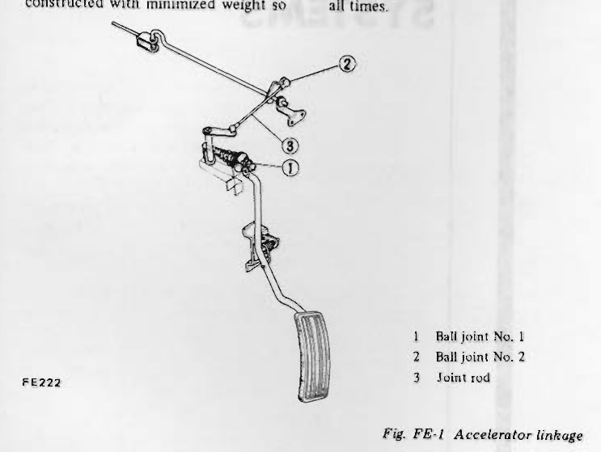
>
> - **Summary:** Exploded overview diagram of the accelerator pedal, linkage rods, and ball joint connections leading to the engine compartment.
> - **Components:** Accelerator pedal, Ball joint No. 1, Ball joint No. 2, Joint rod, Torsion shaft, Pedal arm
> - **Callouts:** **(1)** Ball joint No. 1; **(2)** Ball joint No. 2; **(3)** Joint rod
> - **Mechanic Notes:** Separate accelerator rod from pedal arm at ball joint during disassembly.
> - **Tags:** `accelerator linkage`, `pedal arm`, `ball joint`, `joint rod`

> 🖼️ **Fig. FE-2 Removing accelerator pedal arm** `[FE164]` *(Type: `procedure_step`)*
>
> 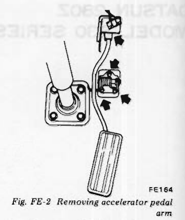
>
> - **Summary:** Illustration showing removal of accelerator pedal arm and bracket securing screws from floor/firewall.
> - **Components:** Accelerator pedal, Pedal arm, Bracket screws, Mounting bracket, Ball joint
> - **Mechanic Notes:** Remove three screws from accelerator pedal bracket to detach assembly.
> - **Tags:** `accelerator pedal`, `removal`, `bracket`, `screws`

### REMOVAL AND INSTALLATION

1. Remove three screws from accelerator pedal bracket.
2. Separate accelerator rod from pedal arm at ball joint. See Figure FE-1.
3. Disconnect ball joints of each rod at torsion shaft support and bell crank bracket in the engine compartment.
Joint rods can then be taken out.

> 🖼️ **Fig. FE-3 Disconnecting ball joints and joint rods** `[FE385]` *(Type: `procedure_step`)*
>
> 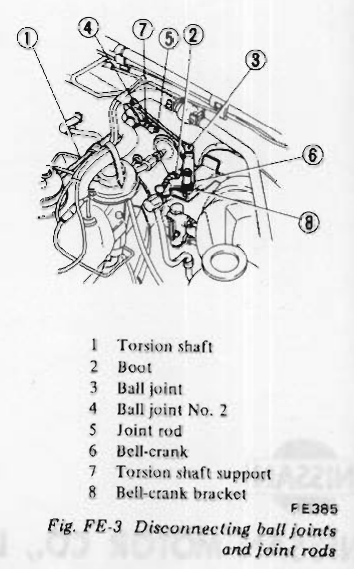
>
> - **Summary:** Engine bay perspective showing disconnection of ball joints and joint rods from the torsion shaft and bell-crank.
> - **Components:** Torsion shaft, Boot, Ball joint, Ball joint No. 2, Joint rod, Bell-crank, Torsion shaft support, Bell-crank bracket
> - **Callouts:** **(1)** Torsion shaft; **(2)** Boot; **(3)** Ball joint; **(4)** Ball joint No. 2; **(5)** Joint rod; **(6)** Bell-crank; **(7)** Torsion shaft support; **(8)** Bell-crank bracket
> - **Mechanic Notes:** Disconnect ball joints of each rod at torsion shaft support and bell crank bracket to remove joint rods.
> - **Tags:** `torsion shaft`, `bell crank`, `ball joint`, `joint rod`, `engine compartment` <!-- Page 3 (FE-3) --> 4. Installation is in the reverse sequence of removal.

## INSPECTION

1. Check accelerator pedal return spring for rust, fatigue or damage.
Replace if necessary.
2. Check accelerator linkage for rust, damage or looseness.
Repair or replace if necessary.

## ADJUSTMENT

### LINKAGE

> 🖼️ **Fig. FE-4 Accelerator linkage setting** `[FE165]` *(Type: `alignment_orientation`)*
>
> 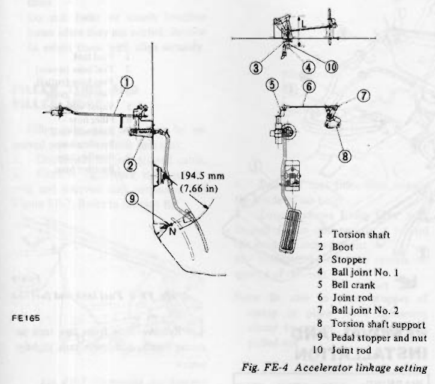
>
> - **Summary:** Dimensional and schematic diagram showing accelerator linkage adjustments including rod lengths L and 6, stopper bolt height N, and pedal height.
> - **Components:** Torsion shaft, Boot, Stopper, Ball joint No. 1, Bell crank, Joint rod, Ball joint No. 2, Torsion shaft support, Pedal stopper and nut, Joint rod, Accelerator pedal
> - **Callouts:** **(1)** Torsion shaft; **(2)** Boot; **(3)** Stopper; **(4)** Ball joint No. 1; **(5)** Bell crank; **(6)** Joint rod; **(7)** Ball joint No. 2; **(8)** Torsion shaft support; **(9)** Pedal stopper and nut; **(10)** Joint rod
> - **Specs / Measurements:** Stopper bolt height 'N': 22.5 mm (0.886 in) from toe board; Dashboard joint rod length 'L': 117 mm (4.61 in); Joint rod (6) length: 123 mm (4.84 in); Pedal height: 194.5 mm (7.66 in); Stopper bolt contact: contact pedal at throttle 'Fully Open', then turn clockwise one full turn and lock
> - **Mechanic Notes:** Lock stopper bolt securely with lock nut after one full turn clockwise beyond initial contact at full throttle.
> - **Tags:** `accelerator linkage`, `adjustment`, `stopper bolt`, `pedal height`, `rod length`

1. Adjust the stopper bolt height "N" to 22.5 mm (0.886 in) from toe board.
2. Adjust the joint rod running through dashboard to L = 117 mm (4.61 in).
Adjust the other joint rod ⑥ to 123 mm (4.84 in).
3. Upon completion of the above adjustment, depress accelerator pedal, and adjust stopper bolt properly so that it comes into contact with pedal when throttle shaft is in "Fully Open" position. Now, turn stopper bolt clockwise one full turn and lock stopper bolt with lock nut.

### Kickdown switch

On automatic transmission models, it is necessary to adjust kickdown switch. Kickdown switch adjustment is correct if switch is actuated by kickdown switch striker when accelerator pedal is fully depressed.
Always tighten stopper nut securely after proper adjustment is obtained.

---

<!-- Page 4 (FE-4) -->
# FUEL SYSTEM

## CONTENTS

| Item | Page |
| :--- | :--- |
| DESCRIPTION | FE-4 |
| REMOVAL AND INSTALLATION | FE-4 |
| FUEL TANK | FE-4 |
| FILLER TUBE AND FILLER HOSE | FE-5 |
| FUEL PIPE AND RUBBER HOSE | FE-5 |
| FUEL TANK GAUGE | FE-5 |
| INSPECTION | FE-5 |
| FUEL TANK | FE-5 |
| FUEL RUBBER HOSE | FE-6 |
| FUEL PIPES | FE-6 |
| FUEL TANK GAUGE | FE-6 |

> 🖼️ **Fig. FE-5 Fuel tank and fuel line** `[FE379]` *(Type: `exploded_view`)*
>
> 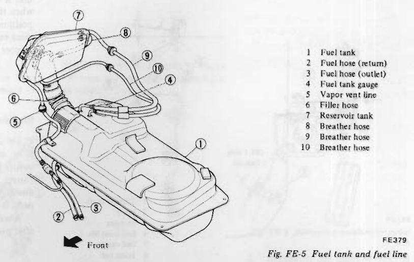
>
> - **Summary:** Perspective layout of the fuel tank, vapor reservoir tank, filler hose, breather hoses, and fuel feed/return lines.
> - **Components:** Fuel tank, Fuel hose (return), Fuel hose (outlet), Fuel tank gauge, Vapor vent line, Filler hose, Reservoir tank, Breather hose
> - **Callouts:** **(1)** Fuel tank; **(2)** Fuel hose (return); **(3)** Fuel hose (outlet); **(4)** Fuel tank gauge; **(5)** Vapor vent line; **(6)** Filler hose; **(7)** Reservoir tank; **(8)** Breather hose; **(9)** Breather hose; **(10)** Breather hose
> - **Specs / Measurements:** Fuel warning lamp activation level: below 10 liters (10-5/8 U.S. qt., 8-3/4 Imper. qt.)
> - **Wiring / Connections:** Ventilation hoses to reservoir tank; Fuel return hose; Fuel outlet hose
> - **Mechanic Notes:** Pay close attention to fuel line due to high operating pressure of the EFI system. Note orientation arrow pointing toward front.
> - **Tags:** `fuel tank`, `fuel lines`, `reservoir tank`, `breather hose`, `filler hose`

## DESCRIPTION

The fuel tank is installed beneath the spare tire compartment. The fuel pump is installed in front of the fuel tank. The electronic fuel injection system requires high fuel pressure in the fuel line.
Thus, pay close attention to the fuel line. The fuel tank is equipped with a thermistor for fuel warning. When the fuel level drops below 10 liters (10-5/8 U.S. qt., 8-3/4 Imper. qt.) the thermistor is activated and the warning lamp goes on.
A large capacity fuel strainer is also installed midway in the fuel line in the engine compartment.
For evaporative emission control, a reservoir tank and a carbon canister are also equipped. The reservoir tank is located at the right-hand rear quarter and the carbon canister in the engine compartment.
For fuel pump, fuel damper and fuel strainer, refer to Section EF.

## REMOVAL AND INSTALLATION

> [!WARNING]
> When replacing fuel line parts, be sure to observe the following:
> a. Put a "CAUTION: INFLAMMABLE" sign in workshop.
> b. Be sure to furnish workshop with an asphyxiator.
> c. Be sure to disconnect battery ground cable before conducting operations.
> d. Put drained fuel in an explosion-proof container and put on lid securely.

### FUEL TANK

1. Disconnect battery ground cable.
2. Remove drain plug from tank bottom, and drain fuel completely.
3. Disconnect fuel tank gauge cable through inspection hole, outlet hose and return hose from tank.
4. Remove nuts from two tank securing bands, and lower tank slightly.

> 🖼️ **Fig. FE-6 Removing nuts from tank securing bands** `[FE180]` *(Type: `procedure_step`)*
>
> 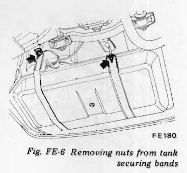
>
> - **Summary:** Underbody view showing removal of the nuts from the two fuel tank securing strap bands.
> - **Components:** Fuel tank, Tank securing bands, Securing band nuts, Rear underbody
> - **Mechanic Notes:** Lower tank slightly after removing nuts from two securing bands to access top hose connections.
> - **Tags:** `fuel tank removal`, `securing bands`, `mounting nuts`

5. Disconnect three ventilation hoses (used to connect reservoir to tank) and filler hose from tank, and dismount tank.
6. Disconnect breather hose (used to connect filler hose to reservoir), remove reservoir installation bolts, and remove reservoir. <!-- Page 5 (FE-5) --> > [!NOTE]
> Plug hose and pipe openings to prevent entry of dust or dirt during removal.

7. Installation is in the reverse sequence of removal.

> [!NOTE]
> Install fuel filler hose after fuel tank has been mounted in place.
> Failure to do so could result in leakage from around hose connections.
> Do not twist or smash breather hoses when they are routed. Be sure to retain them with clips securely.

### FILLER TUBE AND FILLER HOSE

Filler tube and hose can be removed without lowering fuel tank.
1. Disconnect battery ground cable.
2. Remove right-hand rear quarter trim and reservoir tank protector. See Figure FE-7. Refer to Section BF.

> 🖼️ **Fig. FE-7 Removing rear quarter trim** `[FE380]` *(Type: `procedure_step`)*
>
> 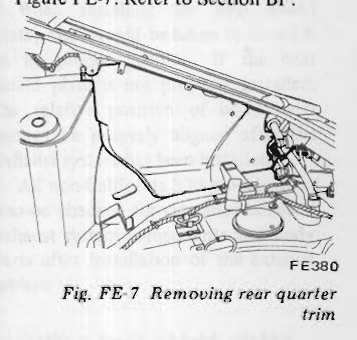
>
> - **Summary:** View of the right-hand rear interior quarter compartment showing removal of quarter trim to expose fuel reservoir and hoses.
> - **Components:** Rear quarter trim, Reservoir tank protector, Rear deck
> - **Mechanic Notes:** Refer to Section BF for detailed interior trim fastener removal.
> - **Tags:** `quarter trim`, `reservoir protector`, `interior removal`

3. Loosen screws attaching fuel filler hose protector and remove it.

> 🖼️ **Fig. FE-8 Removing fuel filler hose protector** `[FE381]` *(Type: `procedure_step`)*
>
> 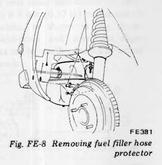
>
> - **Summary:** Wheel well view showing screws securing the metal protective cover around the fuel filler hose.
> - **Components:** Fuel filler hose protector, Mounting screws, Wheelhouse
> - **Mechanic Notes:** Loosen screws attaching fuel filler hose protector and remove it before attempting hose detachment.
> - **Tags:** `filler hose protector`, `wheel arch`, `fuel filler`

4. Loosen hose clamp and detach hose from fuel tank.
5. Loosen clamp ① tightening hose with tube and rubber grommet attaching nuts ② from the inside of rear compartment.

> 🖼️ **Fig. FE-9 Cross-sectional view of fuel hose** `[FE382]` *(Type: `cutaway_flow`)*
>
> 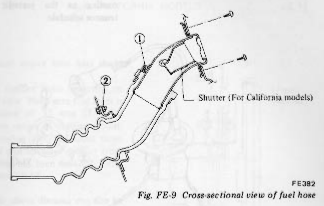
>
> - **Summary:** Cross-sectional cutaway detailing the fuel filler neck, hose, clamp, rubber grommet attachment, and California shutter valve.
> - **Components:** Hose clamp, Filler hose, Filler tube neck, Rubber grommet attaching nuts, Shutter (For California models)
> - **Callouts:** **(1)** Clamp tightening hose with tube; **(2)** Rubber grommet attaching nuts
> - **Mechanic Notes:** Be sure to place stopper of clamp in place when tightening clamp to prevent hose from being pulled out.
> - **Tags:** `filler hose`, `cross section`, `grommet`, `shutter`, `california model`

> [!NOTE]
> Plug pipe opening of fuel tank to prevent entry of dust or dirt.

6. Pull out fuel filler hose toward the inside of car body.
7. Loosen screws fixing filler neck to rear fender and remove it toward the inside of compartment.
8. Installation is in the reverse sequence of removal.

> [!NOTE]
> Be sure to place stopper of clamp in place when tightening clamp to prevent hose from being pulled out.

### FUEL PIPE AND RUBBER HOSE

The fuel line between fuel pump and fuel strainer is a single molded unit construction which completely eliminate fuel leakage. Fuel pipes are serviced as an assembly.
Do not disconnect any fuel line unless absolutely necessary.
1. Drain fuel from fuel tank.
2. Loosen fuel hose clamps and disconnect fuel pipe at each end.

> [!NOTE]
> Plug hose and pipe openings to prevent entry of dust or dirt during removal.

3. Unfasten clips that hold pipe on underbody and remove pipe from car.
4. For installation of fuel hoses and clamps, refer to section "EF".

### FUEL TANK GAUGE

1. Drain fuel from fuel tank.
2. Disconnect battery ground cable.
3. Loosen screws and remove inspection hole lid.
4. Disconnect wires from fuel tank gauge through inspection hole.
5. Turn fuel tank gauge counter-clockwise with a screwdriver.

> [!NOTE]
> Tank gauge is a bayonet type; To remove, turn it counterclockwise.

6. Installation is in the reverse sequence of removal.

> [!NOTE]
> When installing fuel tank gauge, align projection of fuel tank gauge with notch in fuel tank and tighten it securely. Be sure to install fuel tank gauge with O-ring in place.

## INSPECTION

### FUEL TANK

Check fuel tank for cracks or deformation. If necessary, replace.

---

<!-- Page 6 (FE-6) -->
### FUEL RUBBER HOSE

Inspect all hoses for cracks, fatigue, sweating or deterioration.
Replace any hose that is damaged.

### FUEL PIPES

Replace any fuel pipe that is cracked, rusted, collapsed or deformed.

> [!NOTE]
> Inspect hoses and pipes according to the periodic maintenance schedule.

### FUEL TANK GAUGE

> 🖼️ **Fig. FE-10 Fuel tank gauge** `[FE241]` *(Type: `electrical_schematic`)*
>
> 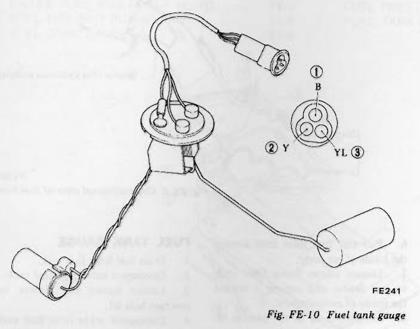
>
> - **Summary:** Electrical inspection diagram of the fuel sending unit showing terminal pins (1=B, 2=Y, 3=YL), float arm, rheostat, and low-fuel warning thermistor.
> - **Components:** Fuel sender body, Float arm, Float, Thermistor, Electrical connector
> - **Callouts:** **(1)** Terminal B (Black); **(2)** Terminal Y (Yellow); **(3)** Terminal YL (Yellow/Blue)
> - **Specs / Measurements:** Resistance between terminals 1 and 2: 10 to 80 Ω; Thermistor terminal 1-3 resistance changes between submerged and drained state
> - **Wiring / Connections:** B: Black wire (terminal 1); Y: Yellow wire (terminal 2); YL: Yellow/Blue wire (terminal 3)
> - **Mechanic Notes:** Use a low-reading ohmmeter. Bayonet twist-lock mounting; replace O-ring whenever removed.
> - **Tags:** `fuel tank gauge`, `sending unit`, `thermistor`, `wiring`, `resistance test`

1. Test resistance between ①-② terminals with a low reading ohmmeter. Resistance should be between approximately 10 to 80Ω.
2. Check resistance between ①-③ terminals when thermistor is submerged in fuel.
3. Then remove it from fuel, and drain fuel. At this step, resistance between ①-③ terminals should be different than that in step 2.
4. If anything is distorted, replace fuel tank gauge as an assembly.

---

<!-- Page 7 (FE-7) -->
# EXHAUST SYSTEM

## CONTENTS

| Item | Page |
| :--- | :--- |
| CALIFORNIA MODELS | FE- 7 |
| NON-CALIFORNIA MODELS | FE-12 |

## CALIFORNIA MODELS

Because all S30 California models are equipped with catalytic converters, it is necessary to maintain a proper clearance between the exhaust system components and adjacent parts on the car body.
The exhaust system consists essentially of a front tube, catalytic converter and center tube with a muffler. When it becomes necessary to replace any of these parts, heat shield plates should be installed before the replacement part is installed on the car body.
When installing the heat shield plate, care should be taken to install it in its proper position. If the heat shield plate is not properly installed, the relative position of body parts cannot be properly aligned after the exhaust system has been installed.
All non-California S30 models must also be checked for clearance between exhaust system components and body parts after installation of the exhaust system.

### Installing heat shield plates

#### 1. Muffler heat shield plate
Install muffler heat shield plate so that heat shield plate-to-muffler clearance is 3 mm (0.12 in) in fore-and-aft direction, as shown in the figure. Up-and-down and in-and-out alignment can be readily adjusted by means of seats.

> 🖼️ **Fig. FE-11 Heat shield plate-to-muffler clearance** `[FE508]` *(Type: `inspection_measurement`)*
>
> 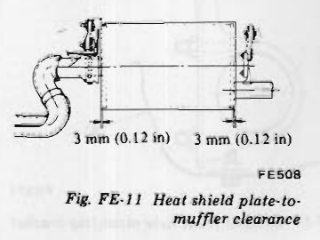
>
> - **Summary:** Dimensional check of clearance between muffler body and outer heat shield plate.
> - **Components:** Muffler body, Heat shield plate, Mounting seats
> - **Specs / Measurements:** Fore-and-aft clearance: 3 mm (0.12 in)
> - **Mechanic Notes:** Up-and-down and in-and-out alignment can be readily adjusted by means of seats.
> - **Tags:** `muffler`, `heat shield plate`, `clearance`, `adjustment`

#### 2. Exhaust center tube heat shield plate.
- Install muffler front mounting on center tube. Make sure that there is a distance of 38 mm (1.50 in) between center of muffler mounting securing bolt and front outer face of muffler when muffler front mounting has been installed. Refer to Figure FE-12.

> [!NOTE]
> The above distance can also be obtained when distance between front outer face of muffler heat shield plate and rear end face of mounting rubber is 17 mm (0.67 in).

> 🖼️ **Fig. FE-12 Installing muffler front mounting** `[FE255]` *(Type: `inspection_measurement`)*
>
> 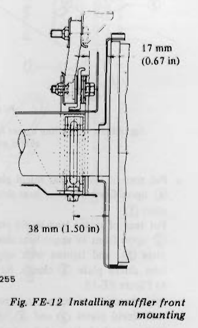
>
> - **Summary:** Dimensioning diagram showing mounting bracket location relative to the front outer face of muffler.
> - **Components:** Muffler front mounting bracket, Center tube, Muffler front face, Mounting rubber, Securing bolt
> - **Specs / Measurements:** Distance between center of securing bolt and front outer face of muffler: 38 mm (1.50 in); Distance between front outer face of muffler heat shield plate and rear end face of mounting rubber: 17 mm (0.67 in)
> - **Mechanic Notes:** Ensure 38 mm distance is accurately maintained before tightening mounting.
> - **Tags:** `muffler front mounting`, `center tube`, `spacing`, `measurement`

- Install lower heat shield plate ① on lower face of muffler front bracket, and secure with bolt. Refer to Figure FE-13.

> 🖼️ **Fig. FE-13 Installing lower heat shield plate** `[FE266]` *(Type: `procedure_step`)*
>
> 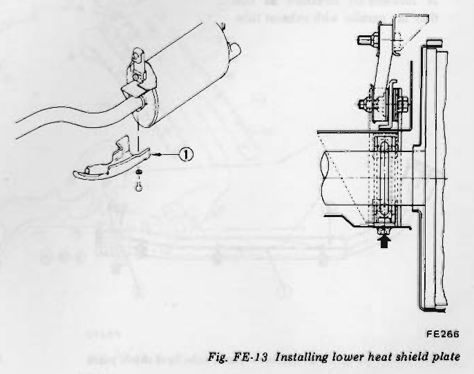
>
> - **Summary:** 3D perspective and cross-sectional view showing attachment of lower heat shield plate 1 to muffler front bracket using securing bolt.
> - **Components:** Muffler front bracket, Lower heat shield plate, Securing bolt, Center tube
> - **Callouts:** **(1)** Lower heat shield plate
> - **Mechanic Notes:** Install plate 1 on lower face of muffler front bracket and secure with bolt.
> - **Tags:** `heat shield plate`, `muffler bracket`, `installation`

---

<!-- Page 8 (FE-8) -->
- Tighten upper heat shield plate ② together with lower heat shield plate ① by means of clamp at position indicated by arrow, and secure to exhaust tube.

> 🖼️ **Fig. FE-14 Installing upper heat shield plate** `[FE267]` *(Type: `procedure_step`)*
>
> 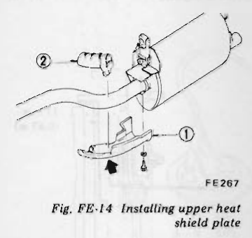
>
> - **Summary:** Procedure diagram showing clamping of upper heat shield plate 2 to lower plate 1 around the exhaust pipe.
> - **Components:** Upper heat shield plate, Lower heat shield plate, Clamp, Exhaust tube
> - **Callouts:** **(1)** Lower heat shield plate; **(2)** Upper heat shield plate
> - **Mechanic Notes:** Tighten upper and lower plates together by clamp at arrow position.
> - **Tags:** `upper heat shield`, `lower heat shield`, `clamp`, `muffler pipe`

- Put rear of lower heat shield plate ④ upon front of lower heat shield plate ①.
Put rear of upper heat shield plate ③ upon front of upper heat shield plate ②, and tighten with upper heat shield plate ③ clamp. Refer to Figure FE-15.
Align brackets of upper and lower heat shield plates ③ and ④, and tighten with bolts evenly. Install lower heat shield plate ⑤ to assembly.

> 🖼️ **Fig. FE-15 Installing upper and lower heat shield plates** `[FE268]` *(Type: `exploded_view`)*
>
> 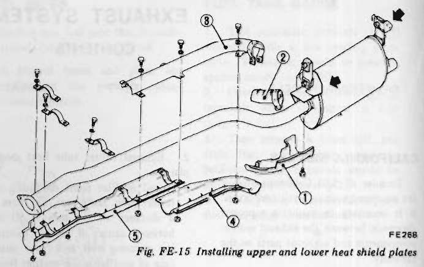
>
> - **Summary:** Exploded perspective view showing center tube heat shield plates 1, 2, 3, 4, 5 and clamps.
> - **Components:** Exhaust center tube, Lower heat shield plate (1), Upper heat shield plate (2), Upper heat shield plate (3), Lower heat shield plate (4), Lower heat shield plate (5), Securing clamps and bolts
> - **Callouts:** **(1)** Lower heat shield plate; **(2)** Upper heat shield plate; **(3)** Upper heat shield plate; **(4)** Lower heat shield plate; **(5)** Lower heat shield plate; **(8)** Lower heat shield plate
> - **Mechanic Notes:** Plates 3 and 4 must be adjusted in fore-and-aft direction so they remain strictly parallel with exhaust tube.
> - **Tags:** `center tube`, `heat shield plates`, `assembly`, `exhaust pipe`

> [!NOTE]
> Upper and lower heat shield plates ③ and ④ must be adjusted in fore-and-aft direction so that they are parallel with exhaust tube.

#### 3. Upper and lower catalytic converter heat shield plates.
These shield plates can be installed in accordance with standard shop practice.

#### 4. Exhaust front tube heat shield plate.
- Install upper and lower heat shield plates ⑥ and ⑦ on their brackets, and tighten securely with bolts. Make sure that distance between rear face of exhaust front tube and rear end of heat shield plate is 108 mm (4.25 in). If necessary, adjust until correct distance is obtained. Refer to Figure FE-16.

> 🖼️ **Fig. FE-16 Mounting position of exhaust front tube heat shield plate** `[FE269]` *(Type: `inspection_measurement`)*
>
> 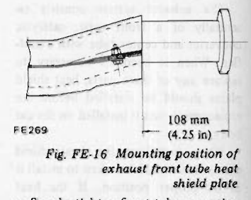
>
> - **Summary:** Measurement setup showing the 108 mm (4.25 in) offset from the rear flange face of the front tube to the heat shield plate edge.
> - **Components:** Exhaust front tube, Heat shield plate, Mounting bracket
> - **Specs / Measurements:** Distance between rear face of exhaust front tube and rear end of heat shield plate: 108 mm (4.25 in)
> - **Mechanic Notes:** Adjust position on brackets until exact 108 mm (4.25 in) spacing is achieved before final tightening.
> - **Tags:** `front tube`, `heat shield position`, `measurement`, `spacing`

- Snugly tighten front tube mounting bracket and U-bolt on front tube. Align and install exhaust front tube on car body, and tighten securely.
- Install lower heat shield plate ⑧ on lower face of exhaust tube mounting bracket, and tighten with bolt at weld nut hole.
Note that front end of plate ⑧ is secured at two places together with rear bracket of heat shield plates ⑥ and ⑦.

> 🖼️ **Fig. FE-17 Exhaust front tube heat shield plate** `[FE270]` *(Type: `exploded_view`)*
>
> 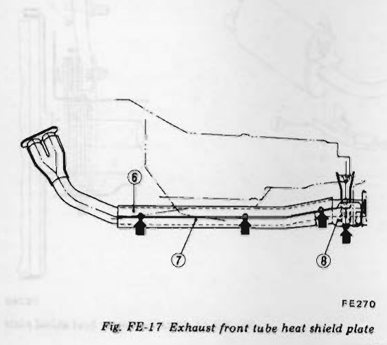
>
> - **Summary:** Side assembly view of exhaust front tube showing upper plate 6, lower plate 7, and rear lower plate 8.
> - **Components:** Exhaust front tube, Upper heat shield plate, Lower heat shield plate, Rear bracket, Mounting bolts
> - **Callouts:** **(6)** Upper heat shield plate; **(7)** Lower heat shield plate; **(8)** Lower heat shield plate
> - **Mechanic Notes:** Plate 8 is secured at two places together with rear bracket of heat shield plates 6 and 7.
> - **Tags:** `front tube`, `heat shield plates`, `mounting bolts`

> 🖼️ **Fig. FE-18 Exhaust front tube mounting bracket** `[FE271]` *(Type: `procedure_step`)*
>
> 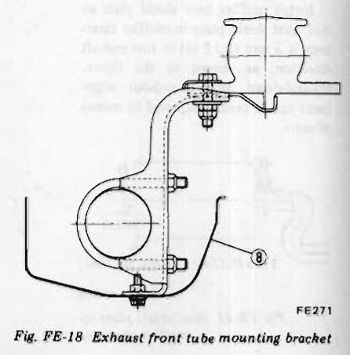
>
> - **Summary:** Cross-sectional detail of front tube mounting bracket, U-bolt clamp, and attachment of lower heat shield plate 8 at weld nut hole.
> - **Components:** Exhaust front tube, Mounting bracket, U-bolt clamp, Lower heat shield plate, Weld nut
> - **Callouts:** **(8)** Lower heat shield plate
> - **Mechanic Notes:** Snugly tighten mounting bracket and U-bolt on front tube. Attach plate 8 at weld nut hole.
> - **Tags:** `front tube`, `mounting bracket`, `U-bolt`, `weld nut`

---

<!-- Page 9 (FE-9) -->

> 🖼️ **Fig. FE-19 Exploded view of exhaust system (California models)** `[FE509]` *(Type: `exploded_view`)*
>
> 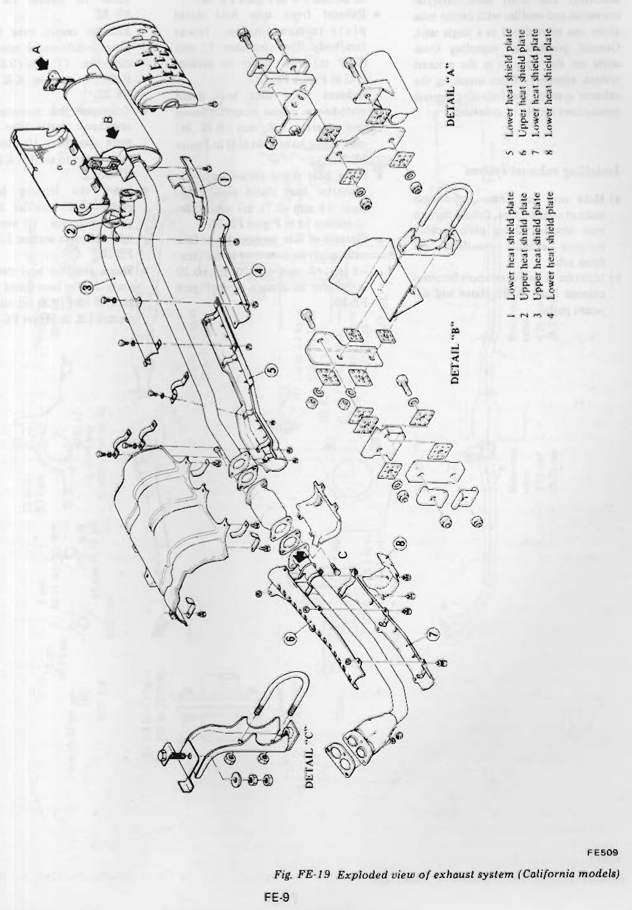
>
> - **Summary:** Comprehensive exploded view of the complete exhaust system for California models, featuring front tube, catalytic converter, center tube, muffler, all 8 heat shield plates, and rubber mounting details A, B, and C.
> - **Components:** Exhaust front tube, Catalytic converter, Center tube, Main muffler, Lower heat shield plate (1), Upper heat shield plate (2), Upper heat shield plate (3), Lower heat shield plate (4), Lower heat shield plate (5), Upper heat shield plate (6), Lower heat shield plate (7), Lower heat shield plate (8), Mounting Detail A (muffler hanger), Mounting Detail B (center hanger), Mounting Detail C (transmission bracket)
> - **Callouts:** **(1)** Lower heat shield plate; **(2)** Upper heat shield plate; **(3)** Upper heat shield plate; **(4)** Lower heat shield plate; **(5)** Lower heat shield plate; **(6)** Upper heat shield plate; **(7)** Lower heat shield plate; **(8)** Lower heat shield plate
> - **Mechanic Notes:** California models incorporate catalytic converter and extensive dual-layer heat shielding. Use new gaskets and bolts at all joints.
> - **Tags:** `california model`, `catalytic converter`, `exhaust system`, `exploded view`, `heat shield plates`

---

<!-- Page 10 (FE-10) -->
### Installing exhaust system

This section deals with installation procedures for the exhaust system assembly. The front tube, catalytic converter and muffler with center tube alone can be replaced as a single unit. General precautions regarding these units are the same as in the exhaust system assembly. When installing the exhaust system, the following general precautions should be observed:

#### Installing exhaust system
a) Make sure that there are no gas leaks at connections. Evenly tighten nuts securing fixing plate located between exhaust manifold and front tube.
b) Maintain proper clearances between exhaust heat shield plates and adjacent parts.
- Exhaust front tube-to-compression rod rubber heat shield plate clearance: 7 mm (0.28 in) min. Refer to section F-F in Figure FE-20.
- Exhaust front tube heat shield plate-to-transmission lower face/body floor clearance: 15 mm (0.59 in) min. Refer to section G-G in Figure FE-20.
- Exhaust front tube heat shield plate-to-rear engine mounting lower face clearance: 8 mm (0.31 in) min. Refer to section H-H in Figure FE-20.
- Floor heat shield plate-to-catalytic converter heat shield plate clearance: 18 mm (0.71 in) min. Refer to section I-I in Figure FE-20.
- Flatness of side member lower face with catalytic converter lower face: -5 to +5 mm (-0.20 to +0.20 in). Refer to section I-I in Figure FE-20.
- Front differential mounting member-to-exhaust center tube clearance: 10 mm (0.39 in) min. Refer to section J-J in Figure FE-20.
- Exhaust center tube heat shield plate-to-differential case lower face clearance: 17 mm (0.67 in) min. Refer to section K-K in Figure FE-20.
- Transverse link mounting bracket-to-exhaust center tube heat shield plate clearance: 10 mm (0.39 in) min. Refer to section K-K in Figure FE-20.
- Spare tire housing heat shield plate-to-main muffler heat shield plate clearance: 10 mm (0.39 in) min. Refer to section L-L in Figure FE-20.
- Shock absorber heat shield plate-to-main muffler heat shield plate clearance: 8 mm (0.31 in) min. Refer to section L-L in Figure FE-20.

---

<!-- Page 11 (FE-11) -->

> 🖼️ **Fig. FE-20 Exhaust system (California models)** `[FE510]` *(Type: `alignment_orientation`)*
>
> 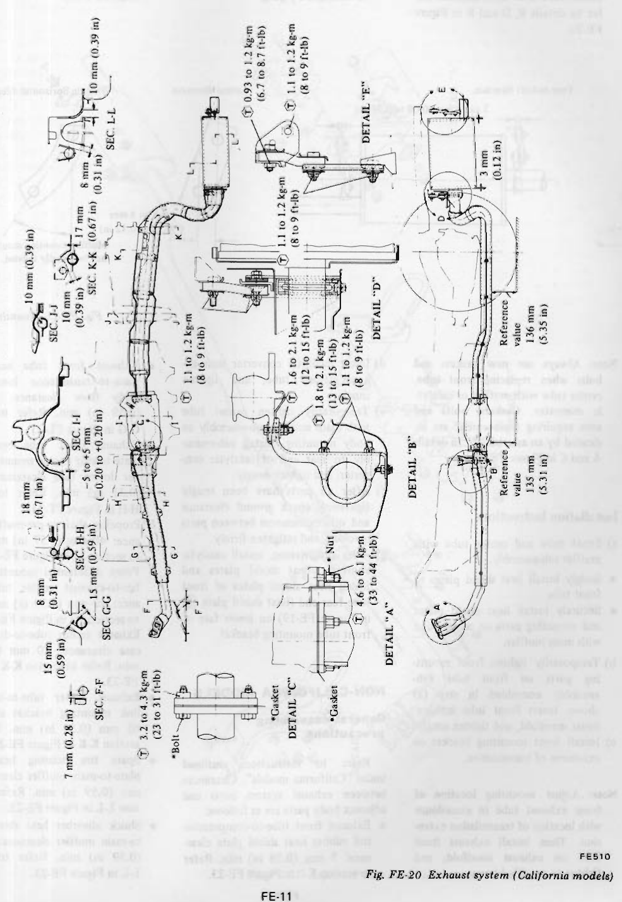
>
> - **Summary:** Full-vehicle underbody exhaust clearance schematic and section drawings (F-F through L-L) and torque specification details (A through E) for California models.
> - **Components:** Exhaust front tube, Catalytic converter, Exhaust center tube, Main muffler, Heat shield plates, Compression rod rubber heat shield plate, Transmission extension bracket, Differential mounting member, Transverse link bracket, Spare tire housing
> - **Specs / Measurements:** SEC. F-F: 7 mm (0.28 in) min.; SEC. G-G: 15 mm (0.59 in) min.; SEC. H-H: 8 mm (0.31 in) min., 15 mm (0.59 in) min.; SEC. I-I: 18 mm (0.71 in) min., flatness -5 to +5 mm (-0.20 to +0.20 in); SEC. J-J: 10 mm (0.39 in) min.; SEC. K-K: 10 mm (0.39 in) min., 17 mm (0.67 in) min.; SEC. L-L: 8 mm (0.31 in) min., 10 mm (0.39 in) min.; DETAIL A torque: 4.6 to 6.1 kg-m (33 to 44 ft-lb); DETAIL B torques: 1.6 to 2.1 kg-m (12 to 15 ft-lb), 1.8 to 2.1 kg-m (13 to 15 ft-lb), 1.1 to 1.2 kg-m (8 to 9 ft-lb); DETAIL B reference distance: 135 mm (5.31 in); DETAIL C torque: 3.2 to 4.3 kg-m (23 to 31 ft-lb); Catalytic converter rear flange torque: 1.1 to 1.2 kg-m (8 to 9 ft-lb); DETAIL D torques: 1.1 to 1.2 kg-m (8 to 9 ft-lb), 1.1 to 1.2 kg-m (8 to 9 ft-lb); DETAIL D reference distance: 136 mm (5.35 in); DETAIL E clearance: 3 mm (0.12 in); DETAIL E torques: 0.93 to 1.2 kg-m (6.7 to 8.7 ft-lb), 1.1 to 1.2 kg-m (8 to 9 ft-lb)
> - **Mechanic Notes:** Always replace gaskets and bolts/nuts marked with asterisk '*'. Maintain all specified section clearances to prevent body contact or overheating.
> - **Tags:** `california models`, `exhaust clearances`, `tightening torques`, `chassis cross sections`, `installation dimensions`

---

<!-- Page 12 (FE-12) -->
c) Before mounting tubes, install all associated parts on front tube and center tube with main muffler. Refer to details B, D and E in Figure FE-20.
- Be sure that mounting insulators are not subject to undue stress due to misaligned piping.
- Muffler mounting should be installed within specified limit in Figure FE-21.

> 🖼️ **Fig. FE-21 Mounting rubbers** `[FE274]` *(Type: `alignment_orientation`)*
>
> 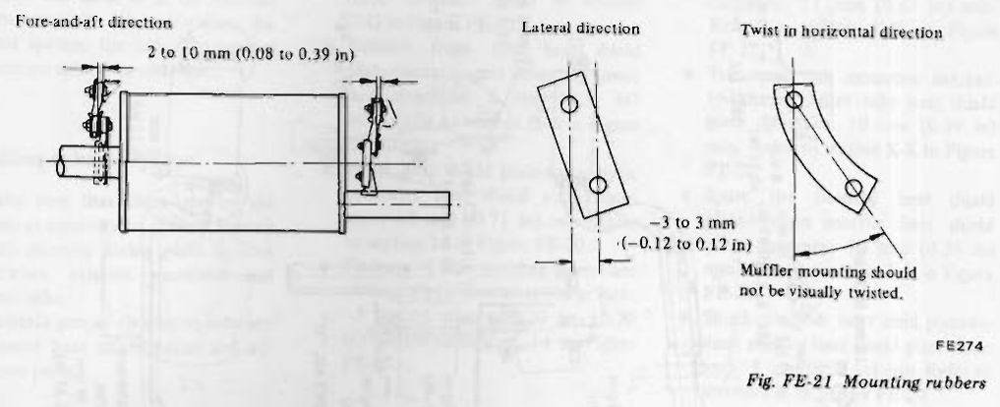
>
> - **Summary:** Inspection and alignment tolerance diagram for exhaust rubber mounting insulators in fore-and-aft, lateral, and rotational twist directions.
> - **Components:** Mounting rubber insulators, Muffler hangers, Chassis mounting brackets
> - **Specs / Measurements:** Fore-and-aft direction tolerance: 2 to 10 mm (0.08 to 0.39 in); Lateral direction tolerance: -3 to 3 mm (-0.12 to 0.12 in); Twist in horizontal direction: Muffler mounting should not be visually twisted.
> - **Mechanic Notes:** Ensure mounting insulators are not under undue preload or twisting stress due to misaligned piping.
> - **Tags:** `mounting rubbers`, `hangers`, `exhaust alignment`, `tolerances`

> [!NOTE]
> Always use new gaskets and bolts when replacing front tube, center tube with muffler or catalytic converter. Gaskets, bolts and nuts requiring replacement are indicated by an asterisk "*" in details A and C in Figure FE-20.

#### Installation instructions
a) Front tube and center tube with muffler sub-assembly.
- Snugly install heat shield plates to front tube.
- Securely install heat shield plates and mounting parts on center tube with main muffler.
b) Temporarily tighten front mounting parts on front tube sub-assembly assembled in step (a) above. Insert front tube into exhaust manifold, and tighten snugly.
c) Install front mounting bracket on extension of transmission.

> [!NOTE]
> Adjust mounting location of front exhaust tube in accordance with location of transmission extension. Then install exhaust front tube on exhaust manifold, and tighten to specified torque.

d) Insert catalytic converter into exhaust front tube, and tighten snugly.
e) Temporarily tighten center tube with main muffler sub-assembly on body mounting. Install sub-assembly to rear end of catalytic converter, and tighten snugly.
f) After all parts have been snugly tightened, check ground clearance and other clearances between parts involved, and retighten firmly.
g) After retightening, install catalytic converter heat shield plates and install heat shield plates of front tube rear end (heat shield plate ⑧ in Figure FE-19) on lower face of front tube mounting bracket.

## NON-CALIFORNIA MODELS

### General assembling precautions

Refer to instructions outlined under "California models". Clearances between exhaust system parts and adjacent body parts are as follows:
- Exhaust front tube-to-compression rod rubber heat shield plate clearance: 7 mm (0.28 in) min. Refer to section F-F in Figure FE-23.
- Exhaust front tube heat shield plate-to-transmission lower face/body floor clearance: 15 mm (0.59 in) min. Refer to section G-G in Figure FE-23.
- Exhaust front tube heat shield plate-to-rear engine mounting member lower face clearance: 8 mm (0.31 in) min. Refer to section H-H in Figure FE-23.
- Propeller shaft-to-pre-muffler clearance: 40 mm (1.57 in) min. Refer to section I-I in Figure FE-23.
- Front differential mounting member-to-exhaust center tube clearance: 10 mm (0.39 in) min. Refer to section J-J in Figure FE-23.
- Exhaust center tube-to-differential case clearance: 10 mm (0.39 in) min. Refer to section K-K in Figure FE-23.
- Exhaust center tube-to-transverse link mounting bracket clearance: 10 mm (0.39 in) min. Refer to section K-K in Figure FE-23.
- Spare tire housing heat shield plate-to-main muffler clearance: 15 mm (0.59 in) min. Refer to section L-L in Figure FE-23.
- Shock absorber heat shield plate-to-main muffler clearance: 15 mm (0.59 in) min. Refer to section L-L in Figure FE-23.

---

<!-- Page 13 (FE-13) -->

> 🖼️ **Fig. FE-22 Exploded view of exhaust system (Non-California models)** `[FE275]` *(Type: `exploded_view`)*
>
> 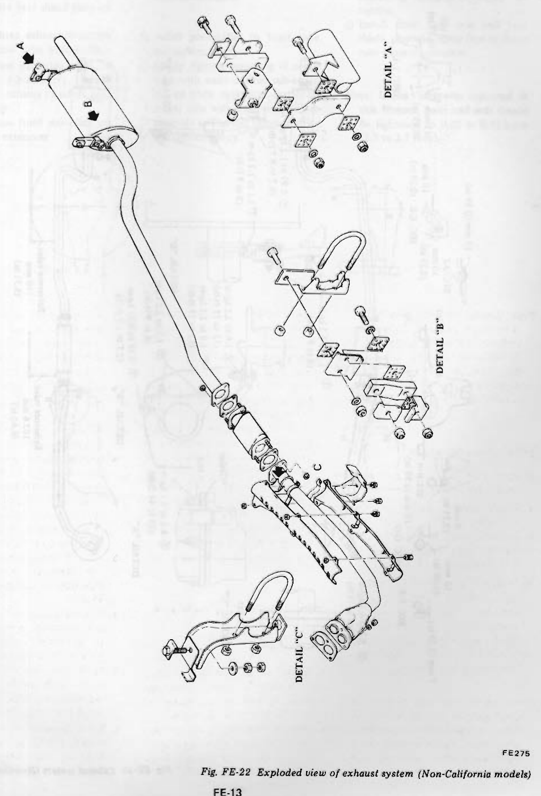
>
> - **Summary:** Exploded view of the Non-California exhaust system showing front tube, pre-muffler, center tube, main muffler, and mounting details A, B, and C.
> - **Components:** Exhaust front tube, Pre-muffler, Center tube, Main muffler, Front tube heat shield plates, Mounting Detail A (muffler rear hanger), Mounting Detail B (center hanger), Mounting Detail C (transmission extension bracket)
> - **Mechanic Notes:** Non-California models utilize a pre-muffler (resonator) instead of a catalytic converter, and do not use the extensive center tube heat shields.
> - **Tags:** `non-california models`, `pre-muffler`, `exhaust exploded view`, `center tube`, `main muffler`

---

<!-- Page 14 (FE-14) -->

> 🖼️ **Fig. FE-23 Exhaust system (Non-California models)** `[FE276]` *(Type: `alignment_orientation`)*
>
> 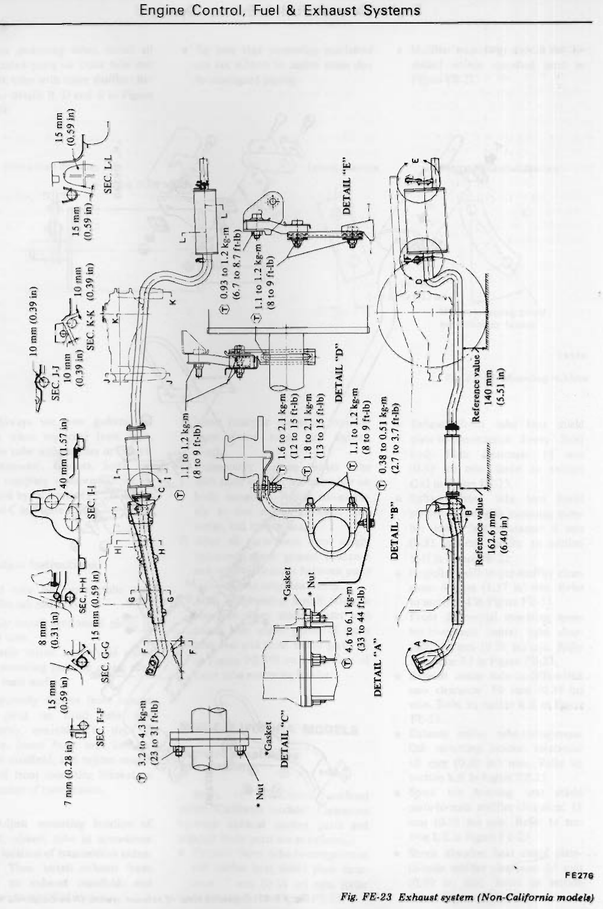
>
> - **Summary:** Underbody layout, cross-sectional clearance checks (F-F through L-L), and tightening torque details (A through E) for Non-California models.
> - **Components:** Exhaust front tube, Pre-muffler, Center tube, Main muffler, Transmission extension mounting bracket, Propeller shaft, Front differential mounting member, Differential case, Transverse link mounting bracket, Spare tire housing
> - **Specs / Measurements:** SEC. F-F: 7 mm (0.28 in) min.; SEC. G-G: 15 mm (0.59 in) min.; SEC. H-H: 8 mm (0.31 in) min., 15 mm (0.59 in) min.; SEC. I-I (propeller shaft to pre-muffler): 40 mm (1.57 in) min.; SEC. J-J: 10 mm (0.39 in) min.; SEC. K-K: 10 mm (0.39 in) min., 10 mm (0.39 in) min.; SEC. L-L: 15 mm (0.59 in) min., 15 mm (0.59 in) min.; DETAIL A torque: 4.6 to 6.1 kg-m (33 to 44 ft-lb); DETAIL B torques: 1.6 to 2.1 kg-m (12 to 15 ft-lb), 1.8 to 2.1 kg-m (13 to 15 ft-lb), 1.1 to 1.2 kg-m (8 to 9 ft-lb), 0.38 to 0.51 kg-m (2.7 to 3.7 ft-lb); DETAIL B reference distance: 162.6 mm (6.40 in); DETAIL C torque: 3.2 to 4.3 kg-m (23 to 31 ft-lb); Pre-muffler to center tube connection torque: 1.1 to 1.2 kg-m (8 to 9 ft-lb); DETAIL D torque: 1.1 to 1.2 kg-m (8 to 9 ft-lb); DETAIL D reference distance: 140 mm (5.51 in); DETAIL E torques: 0.93 to 1.2 kg-m (6.7 to 8.7 ft-lb), 1.1 to 1.2 kg-m (8 to 9 ft-lb)
> - **Mechanic Notes:** Note difference in clearance specs compared to California models (e.g. 40 mm propeller shaft clearance, 15 mm spare tire housing and shock absorber clearance). Always replace gaskets and fasteners marked '*'.
> - **Tags:** `non-california models`, `exhaust clearances`, `tightening torques`, `pre-muffler`, `cross sections`

---

<!-- Page 15 (FE-15) -->
### Installing exhaust system

a) Front tube and center tube with muffler sub-assembly.
- Snugly tighten heat shield plate on front tube.
- Securely tighten exhaust mounting parts on center tube with muffler.
b) Snugly tighten mounting parts on front tube sub-assembly. Install front tube to exhaust manifold, and tighten snugly.
c) Install exhaust front mounting on transmission extension.

> [!NOTE]
> Adjust mounting location of exhaust front tube as required in accordance with location of transmission extension.

d) Install pre-muffler to front tube, and tighten snugly.
e) Snugly tighten mounting of center tube with main muffler sub-assembly on body mounting. Install the center tube with main muffler sub-assembly to rear end of pre-muffler, and tighten snugly.
f) After all parts have been snugly tightened, check ground clearance and clearances between parts involved. If nothing is wrong, retighten.
g) Install front tube rear end heat shield plates to lower face of front tube mounting bracket.

> [!NOTE]
> Unless otherwise indicated in this Manual, bolts and nuts should be tightened to 0.38 to 0.51 kg-m (2.7 to 3.7 ft-lb).

---

## Segmented Diagrams Index

| Figure | Code | Type | Page | Caption | Key Components / Callouts | File |
| :--- | :--- | :--- | :--- | :--- | :--- | :--- |
| **Fig. FE-1** | `FE222` | `exploded_view` | FE-2 | Fig. FE-1 Accelerator linkage | Accelerator pedal, Ball joint No. 1, Ball joint No. 2, Joint rod, Torsion shaft | [fig_fe_1_accelerator_linkage.png](diagrams/FE Engine Control fuel and Exhaust/fig_fe_1_accelerator_linkage.png) |
| **Fig. FE-2** | `FE164` | `procedure_step` | FE-2 | Fig. FE-2 Removing accelerator pedal arm | Accelerator pedal, Pedal arm, Bracket screws, Mounting bracket, Ball joint | [fig_fe_2_removing_accelerator_pedal_arm.png](diagrams/FE Engine Control fuel and Exhaust/fig_fe_2_removing_accelerator_pedal_arm.png) |
| **Fig. FE-3** | `FE385` | `procedure_step` | FE-2 | Fig. FE-3 Disconnecting ball joints and joint rods | Torsion shaft, Boot, Ball joint, Ball joint No. 2, Joint rod | [fig_fe_3_disconnecting_ball_joints_and_joint_rods.png](diagrams/FE Engine Control fuel and Exhaust/fig_fe_3_disconnecting_ball_joints_and_joint_rods.png) |
| **Fig. FE-4** | `FE165` | `alignment_orientation` | FE-3 | Fig. FE-4 Accelerator linkage setting | Torsion shaft, Boot, Stopper, Ball joint No. 1, Bell crank | [fig_fe_4_accelerator_linkage_setting.png](diagrams/FE Engine Control fuel and Exhaust/fig_fe_4_accelerator_linkage_setting.png) |
| **Fig. FE-5** | `FE379` | `exploded_view` | FE-4 | Fig. FE-5 Fuel tank and fuel line | Fuel tank, Fuel hose (return), Fuel hose (outlet), Fuel tank gauge, Vapor vent line | [fig_fe_5_fuel_tank_and_fuel_line.png](diagrams/FE Engine Control fuel and Exhaust/fig_fe_5_fuel_tank_and_fuel_line.png) |
| **Fig. FE-6** | `FE180` | `procedure_step` | FE-4 | Fig. FE-6 Removing nuts from tank securing bands | Fuel tank, Tank securing bands, Securing band nuts, Rear underbody | [fig_fe_6_removing_nuts_from_tank_securing_bands.png](diagrams/FE Engine Control fuel and Exhaust/fig_fe_6_removing_nuts_from_tank_securing_bands.png) |
| **Fig. FE-7** | `FE380` | `procedure_step` | FE-5 | Fig. FE-7 Removing rear quarter trim | Rear quarter trim, Reservoir tank protector, Rear deck | [fig_fe_7_removing_rear_quarter_trim.png](diagrams/FE Engine Control fuel and Exhaust/fig_fe_7_removing_rear_quarter_trim.png) |
| **Fig. FE-8** | `FE381` | `procedure_step` | FE-5 | Fig. FE-8 Removing fuel filler hose protector | Fuel filler hose protector, Mounting screws, Wheelhouse | [fig_fe_8_removing_fuel_filler_hose_protector.png](diagrams/FE Engine Control fuel and Exhaust/fig_fe_8_removing_fuel_filler_hose_protector.png) |
| **Fig. FE-9** | `FE382` | `cutaway_flow` | FE-5 | Fig. FE-9 Cross-sectional view of fuel hose | Hose clamp, Filler hose, Filler tube neck, Rubber grommet attaching nuts, Shutter (For California models) | [fig_fe_9_cross_sectional_view_of_fuel_hose.png](diagrams/FE Engine Control fuel and Exhaust/fig_fe_9_cross_sectional_view_of_fuel_hose.png) |
| **Fig. FE-10** | `FE241` | `electrical_schematic` | FE-6 | Fig. FE-10 Fuel tank gauge | Fuel sender body, Float arm, Float, Thermistor, Electrical connector | [fig_fe_10_fuel_tank_gauge.png](diagrams/FE Engine Control fuel and Exhaust/fig_fe_10_fuel_tank_gauge.png) |
| **Fig. FE-11** | `FE508` | `inspection_measurement` | FE-7 | Fig. FE-11 Heat shield plate-to-muffler clearance | Muffler body, Heat shield plate, Mounting seats | [fig_fe_11_heat_shield_plate_to_muffler_clearance.png](diagrams/FE Engine Control fuel and Exhaust/fig_fe_11_heat_shield_plate_to_muffler_clearance.png) |
| **Fig. FE-12** | `FE255` | `inspection_measurement` | FE-7 | Fig. FE-12 Installing muffler front mounting | Muffler front mounting bracket, Center tube, Muffler front face, Mounting rubber, Securing bolt | [fig_fe_12_installing_muffler_front_mounting.png](diagrams/FE Engine Control fuel and Exhaust/fig_fe_12_installing_muffler_front_mounting.png) |
| **Fig. FE-13** | `FE266` | `procedure_step` | FE-7 | Fig. FE-13 Installing lower heat shield plate | Muffler front bracket, Lower heat shield plate, Securing bolt, Center tube | [fig_fe_13_installing_lower_heat_shield_plate.png](diagrams/FE Engine Control fuel and Exhaust/fig_fe_13_installing_lower_heat_shield_plate.png) |
| **Fig. FE-14** | `FE267` | `procedure_step` | FE-8 | Fig. FE-14 Installing upper heat shield plate | Upper heat shield plate, Lower heat shield plate, Clamp, Exhaust tube | [fig_fe_14_installing_upper_heat_shield_plate.png](diagrams/FE Engine Control fuel and Exhaust/fig_fe_14_installing_upper_heat_shield_plate.png) |
| **Fig. FE-15** | `FE268` | `exploded_view` | FE-8 | Fig. FE-15 Installing upper and lower heat shield plates | Exhaust center tube, Lower heat shield plate (1), Upper heat shield plate (2), Upper heat shield plate (3), Lower heat shield plate (4) | [fig_fe_15_installing_upper_and_lower_heat_shield_plates.png](diagrams/FE Engine Control fuel and Exhaust/fig_fe_15_installing_upper_and_lower_heat_shield_plates.png) |
| **Fig. FE-16** | `FE269` | `inspection_measurement` | FE-8 | Fig. FE-16 Mounting position of exhaust front tube heat shield plate | Exhaust front tube, Heat shield plate, Mounting bracket | [fig_fe_16_mounting_position_of_exhaust_front_tube_heat_shield_plate.png](diagrams/FE Engine Control fuel and Exhaust/fig_fe_16_mounting_position_of_exhaust_front_tube_heat_shield_plate.png) |
| **Fig. FE-17** | `FE270` | `exploded_view` | FE-8 | Fig. FE-17 Exhaust front tube heat shield plate | Exhaust front tube, Upper heat shield plate, Lower heat shield plate, Rear bracket, Mounting bolts | [fig_fe_17_exhaust_front_tube_heat_shield_plate.png](diagrams/FE Engine Control fuel and Exhaust/fig_fe_17_exhaust_front_tube_heat_shield_plate.png) |
| **Fig. FE-18** | `FE271` | `procedure_step` | FE-8 | Fig. FE-18 Exhaust front tube mounting bracket | Exhaust front tube, Mounting bracket, U-bolt clamp, Lower heat shield plate, Weld nut | [fig_fe_18_exhaust_front_tube_mounting_bracket.png](diagrams/FE Engine Control fuel and Exhaust/fig_fe_18_exhaust_front_tube_mounting_bracket.png) |
| **Fig. FE-19** | `FE509` | `exploded_view` | FE-9 | Fig. FE-19 Exploded view of exhaust system (California models) | Exhaust front tube, Catalytic converter, Center tube, Main muffler, Lower heat shield plate (1) | [fig_fe_19_exploded_view_of_exhaust_system_california_models.png](diagrams/FE Engine Control fuel and Exhaust/fig_fe_19_exploded_view_of_exhaust_system_california_models.png) |
| **Fig. FE-20** | `FE510` | `alignment_orientation` | FE-11 | Fig. FE-20 Exhaust system (California models) | Exhaust front tube, Catalytic converter, Exhaust center tube, Main muffler, Heat shield plates | [fig_fe_20_exhaust_system_california_models.png](diagrams/FE Engine Control fuel and Exhaust/fig_fe_20_exhaust_system_california_models.png) |
| **Fig. FE-21** | `FE274` | `alignment_orientation` | FE-12 | Fig. FE-21 Mounting rubbers | Mounting rubber insulators, Muffler hangers, Chassis mounting brackets | [fig_fe_21_mounting_rubbers.png](diagrams/FE Engine Control fuel and Exhaust/fig_fe_21_mounting_rubbers.png) |
| **Fig. FE-22** | `FE275` | `exploded_view` | FE-13 | Fig. FE-22 Exploded view of exhaust system (Non-California models) | Exhaust front tube, Pre-muffler, Center tube, Main muffler, Front tube heat shield plates | [fig_fe_22_exploded_view_of_exhaust_system_non_california_models.png](diagrams/FE Engine Control fuel and Exhaust/fig_fe_22_exploded_view_of_exhaust_system_non_california_models.png) |
| **Fig. FE-23** | `FE276` | `alignment_orientation` | FE-14 | Fig. FE-23 Exhaust system (Non-California models) | Exhaust front tube, Pre-muffler, Center tube, Main muffler, Transmission extension mounting bracket | [fig_fe_23_exhaust_system_non_california_models.png](diagrams/FE Engine Control fuel and Exhaust/fig_fe_23_exhaust_system_non_california_models.png) |
