# GENERAL INFORMATION

<!-- Page 1 (GI-1) -->
# SECTION GI: GENERAL INFORMATION

## DATSUN 280Z MODEL S30 SERIES SERVICE MANUAL

### CONTENTS

| Section | Page |
| :--- | :--- |
| MODEL VARIATION | GI-2 |
| IDENTIFICATION NUMBERS | GI-3 |
| APPROXIMATE REFILL CAPACITIES | GI-4 |
| RECOMMENDED PETROL (FUEL) | GI-4 |
| RECOMMENDED LUBRICANTS | GI-5 |
| LIFTING POINTS AND TOWING | GI-5 |
| SPECIAL SERVICE TOOLS | GI-7 |

NISSAN MOTOR CO., LTD.  
TOKYO, JAPAN

---

<!-- Page 2 (GI-2) -->
# MODEL VARIATION

| Destination | Class | Model | Engine | Transmission | Differential Carrier Model | Differential Carrier Gear Ratio |
| :--- | :--- | :--- | :--- | :--- | :--- | :--- |
| U.S.A. | California and high altitude counties* (2-seater, California models) | HLS30UV | L28 | F4W71B (4-speed manual) | R200 | 3.545 |
| U.S.A. | California and high altitude counties* (2-seater, California models) | HLS30FUV | L28 | FS5W71B (5-speed manual) | R200 | 3.545 |
| U.S.A. | California and high altitude counties* (2-seater, California models) | HLS30AUV | L28 | 3N71B (3-speed automatic) | R180 | 3.545 |
| U.S.A. | California and high altitude counties* (2+2-seater, California models) | GHLS30UV | L28 | F4W71B (4-speed manual) | R200 | 3.545 |
| U.S.A. | California and high altitude counties* (2+2-seater, California models) | GHLS30FUV | L28 | FS5W71B (5-speed manual) | R200 | 3.545 |
| U.S.A. | California and high altitude counties* (2+2-seater, California models) | GHLS30AUV | L28 | 3N71B (3-speed automatic) | R180 | 3.545 |
| U.S.A. | All low altitude counties except California (2-seater, Non-California models) | HLS30U | L28 | F4W71B (4-speed manual) | R200 | 3.545 |
| U.S.A. | All low altitude counties except California (2-seater, Non-California models) | HLS30FU | L28 | FS5W71B (5-speed manual) | R200 | 3.545 |
| U.S.A. | All low altitude counties except California (2-seater, Non-California models) | HLS30AU | L28 | 3N71B (3-speed automatic) | R180 | 3.545 |
| U.S.A. | All low altitude counties except California (2+2-seater, Non-California models) | GHLS30U | L28 | F4W71B (4-speed manual) | R200 | 3.545 |
| U.S.A. | All low altitude counties except California (2+2-seater, Non-California models) | GHLS30FU | L28 | FS5W71B (5-speed manual) | R200 | 3.545 |
| U.S.A. | All low altitude counties except California (2+2-seater, Non-California models) | GHLS30AU | L28 | 3N71B (3-speed automatic) | R180 | 3.545 |
| Canada | Non-California models (2-seater) | HLS30UN | L28 | F4W71B (4-speed manual) | R200 | 3.545 |
| Canada | Non-California models (2-seater) | HLS30FUN | L28 | FS5W71B (5-speed manual) | R200 | 3.545 |
| Canada | Non-California models (2-seater) | HLS30AUN | L28 | 3N71B (3-speed automatic) | R180 | 3.545 |
| Canada | Non-California models (2+2-seater) | GHLS30UN | L28 | F4W71B (4-speed manual) | R200 | 3.545 |
| Canada | Non-California models (2+2-seater) | GHLS30FUN | L28 | FS5W71B (5-speed manual) | R200 | 3.545 |
| Canada | Non-California models (2+2-seater) | GHLS30AUN | L28 | 3N71B (3-speed automatic) | R180 | 3.545 |

\*Specified by Emission regulations.

> 🖼️ **Model code designation breakdown**  *(Type: `graph_chart`)*
>
> 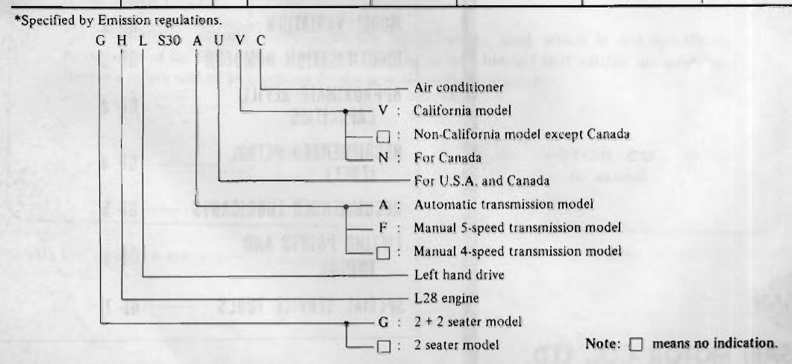
>
> - **Summary:** Model code breakdown tree showing the meaning of each letter and blank position in the Datsun 280Z model designation (GHLS30AUVC).
> - **Components:** Model designation prefix/suffix, Air conditioner code (C), California/Canada code (V/N), Destination code (U), Transmission code (A/F), Left hand drive (L), Engine/Series code (S30/H), 2+2 seating code (G)
> - **Callouts:** **(G)** 2+2 seater model (blank: 2 seater model); **(H)** L28 engine; **(L)** Left hand drive; **(S30)** Model series; **(A)** Automatic transmission model; **(F)** Manual 5-speed transmission model; **([ ] (transmission))** Manual 4-speed transmission model; **(U)** For U.S.A. and Canada; **(V)** California model; **(N)** For Canada; **([ ] (emission/region))** Non-California model except Canada; **(C)** Air conditioner
> - **Specs / Measurements:** Differential gear ratio: 3.545 for all models; Differential model: R200 for manual transmissions (F4W71B, FS5W71B), R180 for automatic transmission (3N71B)
> - **Mechanic Notes:** California models and high altitude counties are specifically designated by 'V'. Canadian models are designated by 'N'.
> - **Tags:** `model variation`, `model code`, `VIN breakdown`, `GHLS30`, `HLS30`, `specifications`

### Model Code Breakdown: `[G] [H] [L] [S30] [A/F] [U] [V/N] [C]`

- **G**: 2+2 seater model (Blank: 2 seater model)
- **H**: L28 engine
- **L**: Left hand drive
- **S30**: Model series (L28 engine)
- **A / F**: Transmission type
  - **A**: Automatic transmission model (3N71B)
  - **F**: Manual 5-speed transmission model (FS5W71B)
  - **[ ]** (Blank): Manual 4-speed transmission model (F4W71B)
- **U**: For U.S.A. and Canada
- **V / N**: Regional destination / emission specification
  - **V**: California model
  - **N**: For Canada
  - **[ ]** (Blank): Non-California model except Canada
- **C**: Air conditioner

*Note: [ ] means no indication.*

---

<!-- Page 3 (GI-3) -->
# IDENTIFICATION NUMBERS

The unit and car numbers are stamped and registered at the factory.
The engine and car identification numbers are used on legal documents.
These numbers are used for factory communication such as Technical Report, Warranty Claim, Service Journal and other information.

## CAR IDENTIFICATION PLATE

The car identification plate is located on the left hoodledge panel at the back of strut housing.
The plate contains the car type, engine capacity, maximum horsepower, wheelbase, engine type and car serial number.

> 🖼️ **Fig. GI-1 Car identification plate location** `[SP053]` *(Type: `component_location`)*
>
> 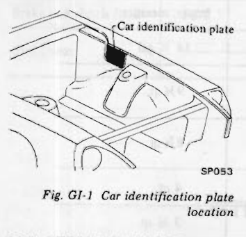
>
> - **Summary:** Location of the car identification plate on the left hoodledge panel behind the strut housing.
> - **Components:** Car identification plate, Left hoodledge panel, Strut housing
> - **Callouts:** **(Car identification plate)** Car identification plate on left hoodledge panel
> - **Mechanic Notes:** Contains car type, engine capacity, maximum horsepower, wheelbase, engine type, and car serial number.
> - **Tags:** `car identification plate`, `hoodledge`, `strut housing`, `VIN`, `serial number`

## CAR SERIAL NUMBER

The car serial number is stamped on the upper face of the left dash panel and is broken down as shown in the following figure.
**HLS30-XXXXXX**

> 🖼️ **Fig. GI-2 Car serial number location** `[SP057]` *(Type: `component_location`)*
>
> 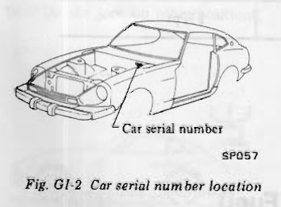
>
> - **Summary:** Location of the car serial number stamped on the upper face of the left dash panel cowl.
> - **Components:** Car serial number, Left dash panel cowl, Vehicle body
> - **Callouts:** **(Car serial number)** Stamped car serial number on upper face of left dash panel
> - **Specs / Measurements:** Serial number format: HLS30-XXXXXX
> - **Mechanic Notes:** Stamped on the upper face of the left dash panel.
> - **Tags:** `car serial number`, `dash panel`, `firewall`, `cowl`, `chassis number`

## IDENTIFICATION NUMBER PLATE

The identification number plate is located on the upper surface of the instrument panel and can be seen from outside through the windshield glass.
The identification number consists of the car model and the serial number.
**(HLS30-XXXXXX)**

> 🖼️ **Fig. GI-3 Identification number plate location** `[GI303]` *(Type: `component_location`)*
>
> 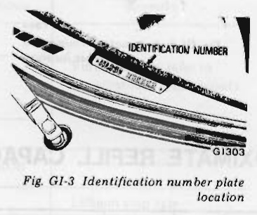
>
> - **Summary:** Location of the vehicle identification number plate mounted on the driver side instrument panel, viewable from outside through the windshield.
> - **Components:** Identification number plate, Instrument panel, Windshield glass, A-pillar
> - **Callouts:** **(IDENTIFICATION NUMBER)** Plate attached to instrument panel top surface
> - **Specs / Measurements:** Identification number format: HLS30-XXXXXX
> - **Mechanic Notes:** Legible from outside the vehicle through the lower driver's side windshield glass.
> - **Tags:** `VIN plate`, `identification number`, `instrument panel`, `windshield`

## ENGINE SERIAL NUMBER

The engine serial number is stamped on the right side of the cylinder block.
The number is broken down as shown in the following Figure GI-4.

> 🖼️ **Fig. GI-4 Engine serial number location** `[GI199]` *(Type: `component_location`)*
>
> 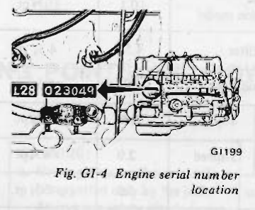
>
> - **Summary:** Location of the engine serial number stamped on the right-hand side rear block pad of the cylinder block.
> - **Components:** Cylinder block, Engine serial number pad, Distributor boss
> - **Callouts:** **(L28 023049)** Stamped engine block designation and 6-digit serial number
> - **Specs / Measurements:** Engine type: L28
> - **Mechanic Notes:** Stamped on the machined pad on the right side of the cylinder block behind the distributor/oil pump mount.
> - **Tags:** `engine serial number`, `engine block`, `cylinder block`, `L28`, `stamping`

## COLOR CODE NUMBER LABEL

The body color code number label is attached to the top face of the radiator core support.

> 🖼️ **Fig. GI-5 Body color code number label location** `[GI300]` *(Type: `component_location`)*
>
> 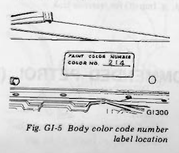
>
> - **Summary:** Location of the body color code number label attached to the top face of the radiator core support.
> - **Components:** Radiator core support, Body color code label
> - **Callouts:** **(PAINT COLOR NUMBER / COLOR NO. 214)** Body paint color number label detail
> - **Specs / Measurements:** Example color number: 214
> - **Mechanic Notes:** Attached to the top surface of the radiator core support.
> - **Tags:** `paint code`, `color code`, `radiator core support`, `body color`

## M.V. S.S. CERTIFICATION LABEL

The M.V.S.S. certification label is affixed to the upper portion of the left lock pillar.

> 🖼️ **Fig. GI-6 M.V.S.S. certification label location** `[GI304]` *(Type: `component_location`)*
>
> 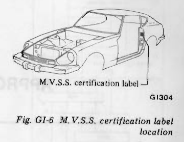
>
> - **Summary:** Location of the Motor Vehicle Safety Standard (M.V.S.S.) certification label affixed to the upper portion of the left lock pillar.
> - **Components:** Left lock pillar (B-pillar), M.V.S.S. certification label
> - **Callouts:** **(M.V.S.S. certification label)** Certification label affixed to left door lock pillar
> - **Mechanic Notes:** Affixed to the upper portion of the left lock pillar / B-pillar.
> - **Tags:** `MVSS label`, `safety certification`, `lock pillar`, `B-pillar`

## EMISSION CONTROL INFORMATION LABEL

The emission control information label is stuck on the inside panel of the hood.

> 🖼️ **Fig. GI-7 Emission control information label location** `[GI305]` *(Type: `component_location`)*
>
> 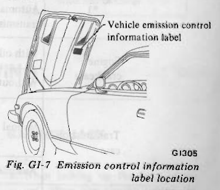
>
> - **Summary:** Location of the vehicle emission control information label on the underside panel of the hood.
> - **Components:** Hood inner panel, Vehicle emission control information label
> - **Callouts:** **(Vehicle emission control information label)** Label stuck to underside panel of hood
> - **Mechanic Notes:** Stuck on the underside inner reinforcement panel of the hood.
> - **Tags:** `emission label`, `VECI`, `hood underside`, `tune-up specs`

## MANUAL TRANSMISSION NUMBER

The transmission serial number is stamped on the front upper face of the transmission case.

> 🖼️ **Fig. GI-8 Manual transmission number location** `[TM235]` *(Type: `component_location`)*
>
> 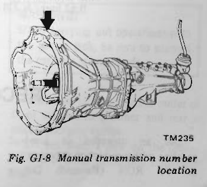
>
> - **Summary:** Location of the manual transmission serial number stamped on the front upper face of the transmission bellhousing.
> - **Components:** Manual transmission case, Bellhousing upper face, Clutch fork boot
> - **Callouts:** **(Stamped pad)** Top front flange of transmission case
> - **Mechanic Notes:** Stamped on the front upper face of the transmission case near the engine block flange.
> - **Tags:** `manual transmission`, `transmission number`, `serial number`, `bellhousing`, `F4W71B`, `FS5W71B`

---

<!-- Page 4 (GI-4) -->
## AUTOMATIC TRANSMISSION NUMBER

The transmission serial number is stamped on the right-hand side of the transmission case.

> 🖼️ **Fig. GI-9 Automatic transmission number location** `[AT344]` *(Type: `component_location`)*
>
> 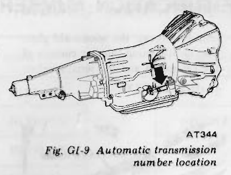
>
> - **Summary:** Location of the automatic transmission serial number stamped on the right-hand side of the 3N71B transmission case.
> - **Components:** Automatic transmission case (3N71B), Right-hand side serial number pad, Torque converter housing
> - **Callouts:** **(Arrow)** Stamped pad on right-hand side of transmission case
> - **Mechanic Notes:** Stamped on the right-hand side of the transmission case.
> - **Tags:** `automatic transmission`, `transmission number`, `serial number`, `3N71B`

# APPROXIMATE REFILL CAPACITIES

| Unit / System | Variation | Liters | US measure | Imper. measure |
| :--- | :--- | :--- | :--- | :--- |
| Fuel tank | — | 65 | 17 1/8 gal | 14 1/4 gal |
| Engine cooling system *1 | Manual transmission model | 10.3 | 10 7/8 qt | 9 1/8 qt |
| Engine cooling system *1 | Automatic transmission model | 10.1 | 10 5/8 qt | 8 7/8 qt |
| Engine crankcase | With oil filter | 4.5 | 4 3/4 qt | 4 qt |
| Engine crankcase | Without oil filter | 4.0 | 4 1/4 qt | 3 1/2 qt |
| Transmission case (Manual) | 4-speed | 1.7 | 3 5/8 pt | 3 pt |
| Transmission case (Manual) | 5-speed | 2.0 | 4 1/4 pt | 3 1/2 pt |
| Transmission case (Automatic) | — | 5.5 | 5 7/8 qt | 4 7/8 qt |
| Differential case | R200 | 1.3 | 2 3/4 pt | 2 1/4 pt |
| Differential case | R180 | 1.0 | 2 1/8 pt | 1 3/4 pt |

*1: Includes 0.8 liter (7/8 US qt, 3/4 Imp qt) for heater and 0.62 liter (5/8 US qt, 1/2 Imp qt) for reservoir tank.

# RECOMMENDED PETROL (Fuel)

Use an unleaded or low-lead gasoline with a minimum octane rating of 91 RON (Research Octane Number).

On California models, use only unleaded gasoline to protect the catalytic converter from contamination.

---

<!-- Page 5 (GI-5) -->
# RECOMMENDED LUBRICANTS

| Lubricant | Specifications | Remarks |
| :--- | :--- | :--- |
| Gasoline engine oil | API SE | Further details, refer to recommended SAE viscosity chart. |
| Gear oil: Transmission and steering | API GL-4 | Further details, refer to recommended SAE viscosity chart. |
| Gear oil: Differential | API GL-5 | Further details, refer to recommended SAE viscosity chart. |
| Automatic T/M fluid and power steering fluid | Type DEXRON | — |
| Multi-purpose grease | NLGI 2 | Lithium soap base |
| Brake and clutch fluid | DOT 3 | — |
| Anti-freeze | — | Permanent anti-freeze (Ethylene glycol base) |

## RECOMMENDED SAE VISCOSITY NUMBER

> 🖼️ **RECOMMENDED SAE VISCOSITY NUMBER**  *(Type: `graph_chart`)*
>
> 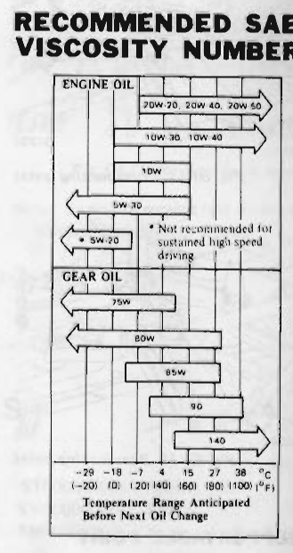
>
> - **Summary:** Recommended SAE viscosity numbers for engine oil and gear oil based on anticipated ambient temperature range before next oil change.
> - **Components:** Engine oil viscosity ranges, Gear oil viscosity ranges, Temperature scale in Celsius and Fahrenheit
> - **Callouts:** **(ENGINE OIL)** 20W-20, 20W-40, 20W-50 (-10°C to >38°C); 10W-30, 10W-40 (-20°C to 38°C); 10W (-20°C to 15°C); 5W-30 (-29°C to 0°C); 5W-20 (-29°C to -10°C); **(GEAR OIL)** 75W (-29°C to -10°C); 80W (-29°C to 15°C); 85W (-10°C to 27°C); 90 (-10°C to 38°C); 140 (15°C to >38°C)
> - **Specs / Measurements:** Engine oil 20W-20, 20W-40, 20W-50: -10°C to above 38°C (14°F to >100°F); Engine oil 10W-30, 10W-40: -20°C to 38°C (-4°F to 100°F); Engine oil 10W: -20°C to 15°C (-4°F to 60°F); Engine oil 5W-30: -29°C to 0°C (-20°F to 32°F); Engine oil 5W-20: -29°C to -10°C (-20°F to 14°F) (*Not recommended for sustained high speed driving); Gear oil 75W: -29°C to -10°C (-20°F to 14°F); Gear oil 80W: -29°C to 15°C (-20°F to 60°F); Gear oil 85W: -10°C to 27°C (14°F to 80°F); Gear oil 90: -10°C to 38°C (14°F to 100°F); Gear oil 140: 15°C to above 38°C (60°F to >100°F)
> - **Mechanic Notes:** 5W-20 is not recommended for sustained high speed driving. Select viscosity based on anticipated temperature range before next oil change.
> - **Tags:** `SAE viscosity`, `engine oil`, `gear oil`, `lubrication chart`, `ambient temperature`

# LIFTING POINTS AND TOWING

## JACK UP

### PANTOGRAPH JACK

Place a jack under the position where sill flange is cut for identification. Do not jack up other positions.

> 🖼️ **Fig. GI-10 Jacking point** `[GI201]` *(Type: `component_location`)*
>
> 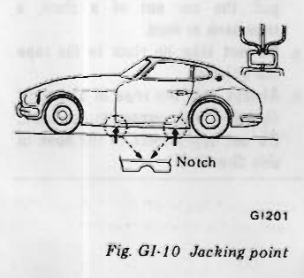
>
> - **Summary:** Side elevation of car illustrating the locations of the rocker panel sill flange notches designated for the factory pantograph jack.
> - **Components:** Rocker panel sill flange, Notch, Pantograph jack head
> - **Callouts:** **(Notch)** Cutout in rocker panel sill flange for pantograph jack engagement
> - **Mechanic Notes:** Place jack under the position where sill flange is cut for identification. Do not jack up other positions.
> - **Tags:** `jacking point`, `pantograph jack`, `sill notch`, `rocker flange`

> [!WARNING]
> a. Never get under the car while it is supported only by the jack. Always use safety stands to support frame when you have to get under the car.  
> b. Block the wheels diagonally with wheel chocks.

> 🖼️ **Fig. GI-11 Wheel chocks and jack** `[GI085, GI086]` *(Type: `procedure_step`)*
>
> 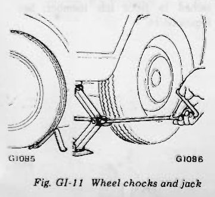
>
> - **Summary:** Illustration of proper wheel chock placement diagonally opposite the lifted wheel and engagement of the pantograph jack into the sill flange.
> - **Components:** Wheel chock, Tire, Pantograph jack, Rocker sill flange
> - **Callouts:** **(GI085)** Wheel chock placed behind diagonally opposite tire; **(GI086)** Pantograph jack engaged in sill flange notch
> - **Mechanic Notes:** Never get under the car while supported only by the jack. Always use safety stands to support frame. Block wheels diagonally with wheel chocks.
> - **Tags:** `wheel chocks`, `pantograph jack`, `jacking safety`, `safety stands`

### GARAGE JACK

> [!NOTE]
> a. When jacking up the front of the car, place the chocks behind the rear wheels to hold them.  
> b. When jacking up the rear of the car, place the chocks at the front side of the front wheels to hold them.

> [!WARNING]
> When carrying out operations with the garage jack, be sure to support the car with safety stands.

The front jacking point is center of front suspension member and rear is differential gear carrier.  
Do not place a jack on the center portion of front suspension transverse link.

---

<!-- Page 6 (GI-6) -->

> 🖼️ **Fig. GI-12 Front jacking point** `[GI202]` *(Type: `procedure_step`)*
>
> 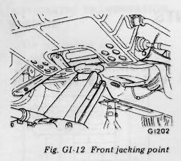
>
> - **Summary:** Front jacking point for garage jack located at the center of the front suspension crossmember.
> - **Components:** Front suspension member (crossmember), Garage jack pad, Front tension rods, Transverse links
> - **Mechanic Notes:** Front jacking point is center of front suspension member. Do NOT place jack on center portion of front suspension transverse link.
> - **Tags:** `front jacking point`, `garage jack`, `front suspension crossmember`

> 🖼️ **Fig. GI-15 Rear supportable points** `[GI205]` *(Type: `procedure_step`)*
>
> 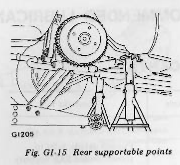
>
> - **Summary:** Rear supportable points for safety stands located on both sides of the front differential mounting crossmember.
> - **Components:** Front differential mounting crossmember, Safety stands (jack stands), Rear differential carrier
> - **Mechanic Notes:** Place safety stands on both sides of the front differential mounting crossmember.
> - **Tags:** `rear supportable points`, `safety stands`, `differential crossmember`, `jack stands`

> 🖼️ **Fig. GI-16 Front towing point** `[GI306]` *(Type: `procedure_step`)*
>
> 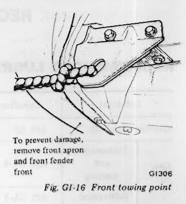
>
> - **Summary:** Front towing hook on the front side member showing rope connection and clearance with front bodywork.
> - **Components:** Front side member, Front towing hook, Towing rope, Front apron area
> - **Callouts:** **(Warning note)** To prevent damage, remove front apron and front fender front
> - **Mechanic Notes:** To prevent damage, remove front apron and front fender front before towing. Always pull rope in a straight direction with respect to hook; do not apply lateral force.
> - **Tags:** `front towing point`, `towing hook`, `towing rope`, `apron removal`

> 🖼️ **Fig. GI-13 Rear jacking point** `[GI203]` *(Type: `procedure_step`)*
>
> 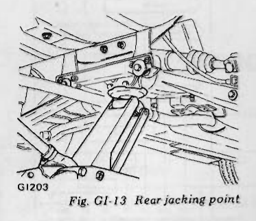
>
> - **Summary:** Rear jacking point for garage jack located directly under the differential gear carrier.
> - **Components:** Differential gear carrier, Garage jack pad, Rear lower transverse links
> - **Mechanic Notes:** Position garage floor jack under center of the differential gear carrier. Place chocks in front of front wheels before lifting.
> - **Tags:** `rear jacking point`, `garage jack`, `differential carrier`

## SUPPORTABLE POINT

Front supportable points for stand are both front side members. Rear supportable points are on both sides of front differential mounting crossmember.

> 🖼️ **Fig. GI-14 Front supportable points** `[GI204]` *(Type: `procedure_step`)*
>
> 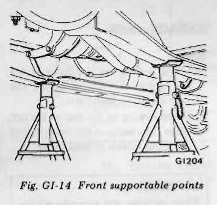
>
> - **Summary:** Front supportable points for safety stands located under both front side members (frame rails).
> - **Components:** Front side members (frame rails), Safety stands, Front suspension crossmember
> - **Mechanic Notes:** Support the front of the vehicle with safety stands placed under both front side members.
> - **Tags:** `front supportable points`, `safety stands`, `jack stands`, `front side members`, `frame rails`

# TOWING

> [!CAUTION]
> a. It is necessary to use proper towing equipment, to avoid possible damage to the car during a towing operation. Towing is in accordance with Towing Procedure Manual at dealer side.  
> b. All applicable State or Provincial (in Canada) laws and local laws regarding the towing operation must be obeyed.  
> c. Only front hooks may be used for towing purposes. When front hooks are used for towing, remove front apron and front fender front to prevent possible interference with towing rope.

> [!NOTE]
> Be sure to remove rear hooks before delivery of car.

When car is to be towed forward, connect a rope securely to hook attached to front side member. See Figure GI-16.

> [!CAUTION]
> a. Before towing, make sure that the transmission, axles, steering system and power train are in good order. If any unit is damaged, a dolley must be used.  
> b. If the transmission is inoperative, tow the car with the rear wheels off the ground, or with the propeller shaft removed.  
> c. When the car is towed with its front wheels on the ground, secure the steering wheel in a straight ahead position with the ignition key turned in "OFF" position.  
> d. When towing an automatic transmission model on its rear wheels, do not exceed 30 km/h (20 MPH) and a distance of 10 km (6 miles).  
> e. Release the parking brake and set the gearshift lever in "Neutral" position before starting to tow the car.  
> f. The car is equipped with a front towing hook as illustrated. However, this hook should be used only in an emergency situation, e.g., to pull the car out of a ditch, a snowbank or mud.  
> g. Do not take up slack in the rope too quickly.  
> h. Always pull the rope in a straight direction with respect to the hook. Do not apply force to the hook in side direction.

---

<!-- Page 7 (GI-7) -->
# TIE-DOWN HOOK

There are four tie-down hooks. Two of them are located on front side members, and the other two on rear panel.  
Front tie-down hook attached to either side member is also used as a towing hook.

> [!NOTE]
> When fastening chains to rear transverse link, wrap them around link to avoid interfering with any adjacent parts.

> 🖼️ **Fig. GI-17 Front tie-down hook** `[GI307]` *(Type: `component_location`)*
>
> 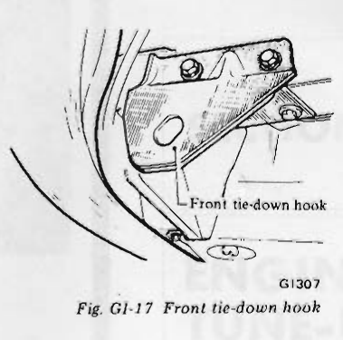
>
> - **Summary:** Front tie-down hook attached to the underside of the front side member.
> - **Components:** Front side member, Front tie-down hook bracket, Mounting bolts
> - **Callouts:** **(Front tie-down hook)** Tie-down hook bracket bolted to front side member
> - **Mechanic Notes:** Front tie-down hook attached to either side member is also used as a towing hook.
> - **Tags:** `front tie-down hook`, `towing hook`, `front side member`, `shipping tie-down`

> 🖼️ **Fig. GI-18 Rear tie-down hook** `[GI308]` *(Type: `component_location`)*
>
> 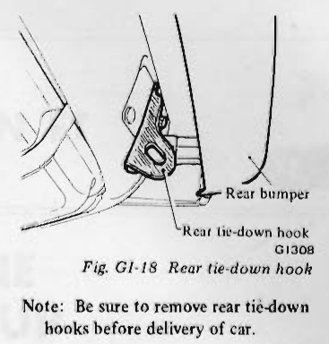
>
> - **Summary:** Rear tie-down hook attached to the rear body panel underneath the rear bumper.
> - **Components:** Rear panel, Rear bumper, Rear tie-down hook
> - **Callouts:** **(Rear bumper)** Rear bumper assembly; **(Rear tie-down hook)** Tie-down bracket attached to rear panel
> - **Mechanic Notes:** Be sure to remove rear tie-down hooks before delivery of car.
> - **Tags:** `rear tie-down hook`, `rear panel`, `shipping bracket`, `removal before delivery`

> [!NOTE]
> Be sure to remove rear tie-down hooks before delivery of car.

# SPECIAL SERVICE TOOLS

Special Tools play very important role in the maintenance of cars. These are essential to the safe, accurate and speedy servicing.  
The working times listed in the column under FLAT RATE TIME in FLAT RATE SCHEDULE are computed based on the use of Special Tools.

The identification code of maintenance tools is made up of 2 alphabetical letters and 8-digital figures.  
The heading two letters roughly classify tools or equipment as:

| Tool Code Prefix | Tool Classification Category |
| :--- | :--- |
| ST00000000 | Special Tool |
| KV00000000 | Special Tool |
| EM00000000 | Engine Overhauling Machine |
| GG00000000 | General Gauge |
| LM00000000 | Garage Tool |
| HT00000000 | Hand Tool |

Refer to Service Bulletin DATSUN 280Z for Special Tool List and further information on Special Tools.

---

## Segmented Diagrams Index

| Figure | Code | Type | Page | Caption | Key Components / Callouts | File |
| :--- | :--- | :--- | :--- | :--- | :--- | :--- |
| **model_designation_breakdown** | `-` | `graph_chart` | GI-2 | Model code designation breakdown | Model designation prefix/suffix, Air conditioner code (C), California/Canada code (V/N), Destination code (U), Transmission code (A/F) | [model_designation_breakdown.png](diagrams/GI General Information/model_designation_breakdown.png) |
| **Fig. GI-1** | `SP053` | `component_location` | GI-3 | Fig. GI-1 Car identification plate location | Car identification plate, Left hoodledge panel, Strut housing | [fig_gi_1_car_identification_plate.png](diagrams/GI General Information/fig_gi_1_car_identification_plate.png) |
| **Fig. GI-2** | `SP057` | `component_location` | GI-3 | Fig. GI-2 Car serial number location | Car serial number, Left dash panel cowl, Vehicle body | [fig_gi_2_car_serial_number.png](diagrams/GI General Information/fig_gi_2_car_serial_number.png) |
| **Fig. GI-3** | `GI303` | `component_location` | GI-3 | Fig. GI-3 Identification number plate location | Identification number plate, Instrument panel, Windshield glass, A-pillar | [fig_gi_3_identification_number_plate.png](diagrams/GI General Information/fig_gi_3_identification_number_plate.png) |
| **Fig. GI-4** | `GI199` | `component_location` | GI-3 | Fig. GI-4 Engine serial number location | Cylinder block, Engine serial number pad, Distributor boss | [fig_gi_4_engine_serial_number.png](diagrams/GI General Information/fig_gi_4_engine_serial_number.png) |
| **Fig. GI-5** | `GI300` | `component_location` | GI-3 | Fig. GI-5 Body color code number label location | Radiator core support, Body color code label | [fig_gi_5_body_color_code_number_label.png](diagrams/GI General Information/fig_gi_5_body_color_code_number_label.png) |
| **Fig. GI-6** | `GI304` | `component_location` | GI-3 | Fig. GI-6 M.V.S.S. certification label location | Left lock pillar (B-pillar), M.V.S.S. certification label | [fig_gi_6_mvss_certification_label.png](diagrams/GI General Information/fig_gi_6_mvss_certification_label.png) |
| **Fig. GI-7** | `GI305` | `component_location` | GI-3 | Fig. GI-7 Emission control information label location | Hood inner panel, Vehicle emission control information label | [fig_gi_7_emission_control_information_label.png](diagrams/GI General Information/fig_gi_7_emission_control_information_label.png) |
| **Fig. GI-8** | `TM235` | `component_location` | GI-3 | Fig. GI-8 Manual transmission number location | Manual transmission case, Bellhousing upper face, Clutch fork boot | [fig_gi_8_manual_transmission_number.png](diagrams/GI General Information/fig_gi_8_manual_transmission_number.png) |
| **Fig. GI-9** | `AT344` | `component_location` | GI-4 | Fig. GI-9 Automatic transmission number location | Automatic transmission case (3N71B), Right-hand side serial number pad, Torque converter housing | [fig_gi_9_automatic_transmission_number.png](diagrams/GI General Information/fig_gi_9_automatic_transmission_number.png) |
| **chart_recommended_sae_viscosity_number** | `-` | `graph_chart` | GI-5 | RECOMMENDED SAE VISCOSITY NUMBER | Engine oil viscosity ranges, Gear oil viscosity ranges, Temperature scale in Celsius and Fahrenheit | [chart_recommended_sae_viscosity_number.png](diagrams/GI General Information/chart_recommended_sae_viscosity_number.png) |
| **Fig. GI-10** | `GI201` | `component_location` | GI-5 | Fig. GI-10 Jacking point | Rocker panel sill flange, Notch, Pantograph jack head | [fig_gi_10_jacking_point.png](diagrams/GI General Information/fig_gi_10_jacking_point.png) |
| **Fig. GI-11** | `GI085, GI086` | `procedure_step` | GI-5 | Fig. GI-11 Wheel chocks and jack | Wheel chock, Tire, Pantograph jack, Rocker sill flange | [fig_gi_11_wheel_chocks_and_jack.png](diagrams/GI General Information/fig_gi_11_wheel_chocks_and_jack.png) |
| **Fig. GI-12** | `GI202` | `procedure_step` | GI-6 | Fig. GI-12 Front jacking point | Front suspension member (crossmember), Garage jack pad, Front tension rods, Transverse links | [fig_gi_12_front_jacking_point.png](diagrams/GI General Information/fig_gi_12_front_jacking_point.png) |
| **Fig. GI-15** | `GI205` | `procedure_step` | GI-6 | Fig. GI-15 Rear supportable points | Front differential mounting crossmember, Safety stands (jack stands), Rear differential carrier | [fig_gi_15_rear_supportable_points.png](diagrams/GI General Information/fig_gi_15_rear_supportable_points.png) |
| **Fig. GI-16** | `GI306` | `procedure_step` | GI-6 | Fig. GI-16 Front towing point | Front side member, Front towing hook, Towing rope, Front apron area | [fig_gi_16_front_towing_point.png](diagrams/GI General Information/fig_gi_16_front_towing_point.png) |
| **Fig. GI-13** | `GI203` | `procedure_step` | GI-6 | Fig. GI-13 Rear jacking point | Differential gear carrier, Garage jack pad, Rear lower transverse links | [fig_gi_13_rear_jacking_point.png](diagrams/GI General Information/fig_gi_13_rear_jacking_point.png) |
| **Fig. GI-14** | `GI204` | `procedure_step` | GI-6 | Fig. GI-14 Front supportable points | Front side members (frame rails), Safety stands, Front suspension crossmember | [fig_gi_14_front_supportable_points.png](diagrams/GI General Information/fig_gi_14_front_supportable_points.png) |
| **Fig. GI-17** | `GI307` | `component_location` | GI-7 | Fig. GI-17 Front tie-down hook | Front side member, Front tie-down hook bracket, Mounting bolts | [fig_gi_17_front_tie_down_hook.png](diagrams/GI General Information/fig_gi_17_front_tie_down_hook.png) |
| **Fig. GI-18** | `GI308` | `component_location` | GI-7 | Fig. GI-18 Rear tie-down hook | Rear panel, Rear bumper, Rear tie-down hook | [fig_gi_18_rear_tie_down_hook.png](diagrams/GI General Information/fig_gi_18_rear_tie_down_hook.png) |
