# MANUAL TRANSMISSION

<!-- Page 1 (MT-1) -->
# SECTION MT - MANUAL TRANSMISSION

## DATSUN 280Z MODEL S30 SERIES

### CONTENTS

| Section | Page |
| :--- | :--- |
| **4-SPEED TRANSMISSION (TYPE: F4W71B)** | MT-2 |
| **5-SPEED TRANSMISSION (TYPE: FS5W71B)** | MT-13 |
| **SERVICE DATA AND SPECIFICATIONS** | MT-18 |
| **TROUBLE DIAGNOSES AND CORRECTIONS** | MT-21 |
| **SPECIAL SERVICE TOOLS** | MT-22 |

---

<!-- Page 2 (MT-2) -->
# 4-SPEED TRANSMISSION (TYPE: F4W71B)

## CONTENTS

| Section | Page | Section | Page |
| :--- | :--- | :--- | :--- |
| **REMOVAL** | MT-4 | **BEARING** | MT-8 |
| **INSTALLATION** | MT-5 | **GEAR** | MT-8 |
| **DISASSEMBLY** | MT-5 | **BAULK RING** | MT-8 |
| &nbsp;&nbsp;HOUSING | MT-5 | **OIL SEAL** | MT-8 |
| &nbsp;&nbsp;FORK ROD | MT-6 | **ASSEMBLY** | MT-8 |
| &nbsp;&nbsp;GEAR | MT-6 | &nbsp;&nbsp;FRONT COVER | MT-8 |
| &nbsp;&nbsp;REAR EXTENSION | MT-7 | &nbsp;&nbsp;REAR EXTENSION | MT-8 |
| &nbsp;&nbsp;ADAPTER PLATE | MT-7 | &nbsp;&nbsp;ADAPTER PLATE | MT-9 |
| **INSPECTION** | MT-7 | &nbsp;&nbsp;GEAR | MT-9 |
| &nbsp;&nbsp;TRANSMISSION CASE AND REAR EXTENSION HOUSING | MT-8 | &nbsp;&nbsp;HOUSING | MT-12 |

> 🖼️ **Fig. MT-1 F4W71B transmission** `[TM126A]` *(Type: `cutaway_flow`)*
>
> 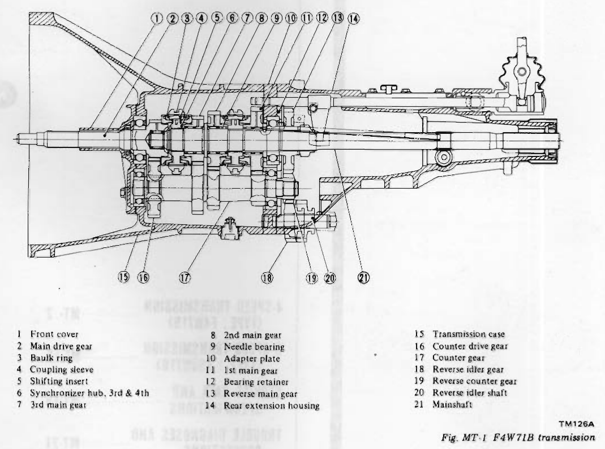
>
> - **Summary:** Cross-sectional longitudinal cutaway view of the complete F4W71B 4-speed manual transmission assembly, detailing the main drive gear, synchronizers, mainshaft gears, countershaft cluster, reverse idler gear, striking rod linkage, adapter plate, and housing structure.
> - **Components:** Front cover, Main drive gear, Baulk ring, Coupling sleeve, Shifting insert, Synchronizer hub, 3rd & 4th, 3rd main gear, 2nd main gear, Needle bearing, Adapter plate, 1st main gear, Bearing retainer, Reverse main gear, Rear extension housing, Transmission case, Counter drive gear, Counter gear, Reverse idler gear, Reverse counter gear, Reverse idler shaft, Mainshaft
> - **Callouts:** **(1)** Front cover; **(2)** Main drive gear; **(3)** Baulk ring; **(4)** Coupling sleeve; **(5)** Shifting insert; **(6)** Synchronizer hub, 3rd & 4th; **(7)** 3rd main gear; **(8)** 2nd main gear; **(9)** Needle bearing; **(10)** Adapter plate; **(11)** 1st main gear; **(12)** Bearing retainer; **(13)** Reverse main gear; **(14)** Rear extension housing; **(15)** Transmission case; **(16)** Counter drive gear; **(17)** Counter gear; **(18)** Reverse idler gear; **(19)** Reverse counter gear; **(20)** Reverse idler shaft; **(21)** Mainshaft
> - **Mechanic Notes:** Main drive gear meshes with counter drive gear; mainshaft is piloted in the main drive gear by needle bearings. Adapter plate supports center bearings.
> - **Tags:** `F4W71B`, `4-speed transmission`, `cutaway`, `geartrain`, `mainshaft`, `countershaft`, `cross-section`

---

<!-- Page 3 (MT-3) -->

> 🖼️ **Fig. MT-2 F4W71B transmission case components** `[TM858]` *(Type: `exploded_view`)*
>
> 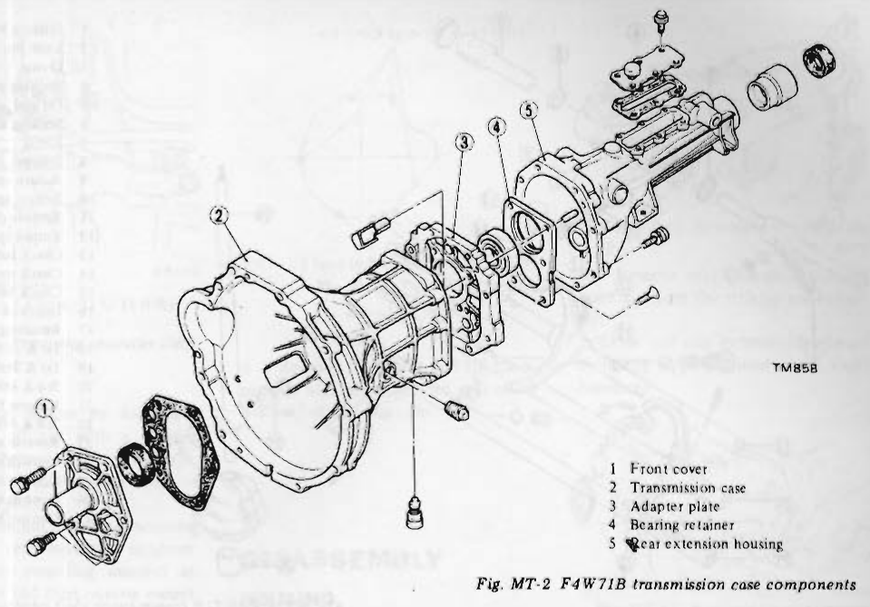
>
> - **Summary:** Exploded view diagram of the transmission case, adapter plate, bearing retainer, rear extension housing, front cover, gaskets, and attaching hardware.
> - **Components:** Front cover, Transmission case, Adapter plate, Bearing retainer, Rear extension housing, Front cover gasket, Rear extension housing gasket/sealant, Dowel pins
> - **Callouts:** **(1)** Front cover; **(2)** Transmission case; **(3)** Adapter plate; **(4)** Bearing retainer; **(5)** Rear extension housing
> - **Mechanic Notes:** Pay attention to dowel pin alignment between transmission case, adapter plate, and rear extension housing.
> - **Tags:** `F4W71B`, `case components`, `exploded view`, `transmission case`, `rear extension`, `adapter plate`

> 🖼️ **Fig. MT-3 F4W71B transmission gear components** `[TM857]` *(Type: `exploded_view`)*
>
> 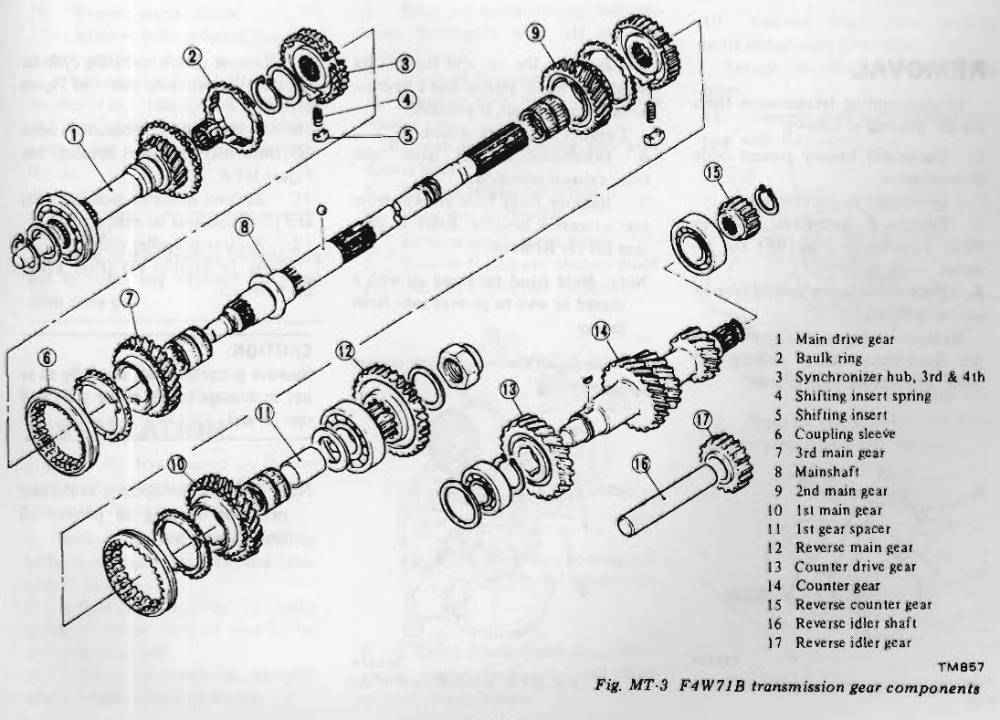
>
> - **Summary:** Exploded view illustrating the gear train components of the F4W71B 4-speed transmission, including main drive gear, mainshaft gears, synchronizer assemblies, countershaft assembly, and reverse idler.
> - **Components:** Main drive gear, Baulk ring, Synchronizer hub, 3rd & 4th, Shifting insert spring, Shifting insert, Coupling sleeve, 3rd main gear, Mainshaft, 2nd main gear, 1st main gear, 1st gear spacer, Reverse main gear, Counter drive gear, Counter gear, Reverse counter gear, Reverse idler shaft, Reverse idler gear
> - **Callouts:** **(1)** Main drive gear; **(2)** Baulk ring; **(3)** Synchronizer hub, 3rd & 4th; **(4)** Shifting insert spring; **(5)** Shifting insert; **(6)** Coupling sleeve; **(7)** 3rd main gear; **(8)** Mainshaft; **(9)** 2nd main gear; **(10)** 1st main gear; **(11)** 1st gear spacer; **(12)** Reverse main gear; **(13)** Counter drive gear; **(14)** Counter gear; **(15)** Reverse counter gear; **(16)** Reverse idler shaft; **(17)** Reverse idler gear
> - **Mechanic Notes:** Mainshaft nut should be discarded and replaced upon disassembly. Note correct order and orientation of synchronizer insert springs and shifting inserts.
> - **Tags:** `F4W71B`, `gear components`, `geartrain`, `exploded view`, `synchronizer`, `mainshaft`, `countershaft`

---

<!-- Page 4 (MT-4) -->

> 🖼️ **Fig. MT-4 F4W71B transmission shift control components** `[TM045A]` *(Type: `exploded_view`)*
>
> 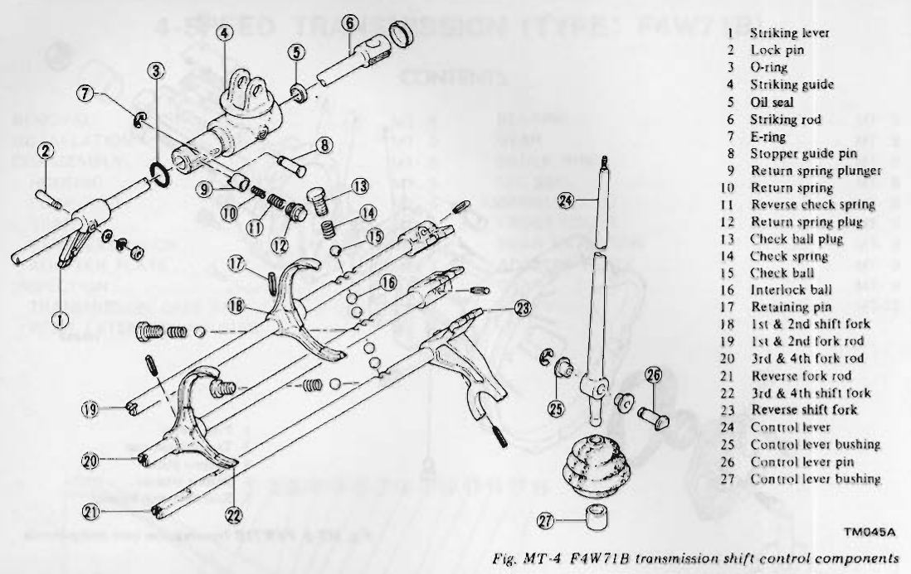
>
> - **Summary:** Exploded view diagram of F4W71B internal shift linkage components, including striking lever, guide, striking rod, shift forks, fork rods, check balls, check springs, interlock balls, and control lever assembly.
> - **Components:** Striking lever, Lock pin, O-ring, Striking guide, Oil seal, Striking rod, E-ring, Stopper guide pin, Return spring plunger, Return spring, Reverse check spring, Return spring plug, Check ball plug, Check spring, Check ball, Interlock ball, Retaining pin, 1st & 2nd shift fork, 1st & 2nd fork rod, 3rd & 4th fork rod, Reverse fork rod, 3rd & 4th shift fork, Reverse shift fork, Control lever, Control lever bushing, Control lever pin, Control lever bushing
> - **Callouts:** **(1)** Striking lever; **(2)** Lock pin; **(3)** O-ring; **(4)** Striking guide; **(5)** Oil seal; **(6)** Striking rod; **(7)** E-ring; **(8)** Stopper guide pin; **(9)** Return spring plunger; **(10)** Return spring; **(11)** Reverse check spring; **(12)** Return spring plug; **(13)** Check ball plug; **(14)** Check spring; **(15)** Check ball; **(16)** Interlock ball; **(17)** Retaining pin; **(18)** 1st & 2nd shift fork; **(19)** 1st & 2nd fork rod; **(20)** 3rd & 4th fork rod; **(21)** Reverse fork rod; **(22)** 3rd & 4th shift fork; **(23)** Reverse shift fork; **(24)** Control lever; **(25)** Control lever bushing; **(26)** Control lever pin; **(27)** Control lever bushing
> - **Mechanic Notes:** Note orientation of check balls and interlock balls in the adapter plate to prevent dual engagement.
> - **Tags:** `F4W71B`, `shift control`, `fork rods`, `shift forks`, `interlock balls`, `striking rod`, `exploded view`

## REMOVAL

In dismounting transmission from the car, proceed as follows:

1. Disconnect battery ground cable from terminal.
2. Disconnect accelerator linkage.
3. Remove floor console. Refer to Floor Console (Section BF) for removal.
4. Place transmission control lever in neutral position.
   Remove E-ring and control lever pin from transmission striking rod guide, and remove control lever.

> 🖼️ **Fig. MT-5 Removing control lever** `[TM335]` *(Type: `procedure_step`)*
>
> 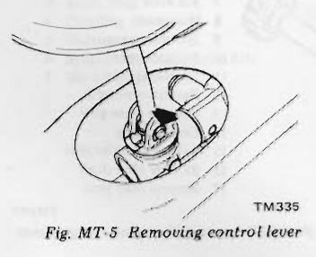
>
> - **Summary:** Illustration showing removal of the transmission gearshift control lever by removing the E-ring and pin from the striking rod guide.
> - **Components:** Control lever, Striking rod guide, E-ring, Control lever pin
> - **Mechanic Notes:** Place transmission control lever in neutral position before removing E-ring and control lever pin.
> - **Tags:** `control lever`, `removal`, `striking rod guide`, `shifter`

5. Jack up the car and support its weight on safety stands. Use a hydraulic hoist or open pit, if available.
   Confirm that safety is insured.
6. Disconnect exhaust front tube from exhaust manifold.
7. Remove front tube bracket from rear extension housing. Refer to Section ER for Removal.
   > **Note:** Hold front tube end up with a thread or wire to prevent tube from falling.
8. Disconnect wires ① from reverse lamp switch.
9. Remove clutch operating cylinder ② from transmission case. See Figure MT-6.
10. Disconnect speedometer cable ③ from rear extension housing. See Figure MT-6.
11. Remove insulator securing bolts and place insulator on exhaust tube.
12. Remove propeller shaft.
    Refer to Section PD (Page PD-2) for Removal.

> [!CAUTION]
> Remove propeller shaft carefully so as not to damage spline, sleeve yoke and rear oil seal.

> **Note:** Plug up the opening in the rear extension housing to prevent oil from flowing out.

> 🖼️ **Fig. MT-6 Bottom view of car** `[TM144A]` *(Type: `component_location`)*
>
> 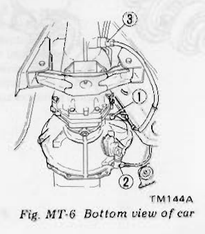
>
> - **Summary:** Underside view of vehicle showing disconnection locations for reverse lamp switch wiring, clutch operating cylinder, and speedometer cable.
> - **Components:** Reverse lamp switch wires, Clutch operating cylinder, Speedometer cable, Transmission case, Rear extension housing
> - **Callouts:** **(1)** Reverse lamp switch wires; **(2)** Clutch operating cylinder; **(3)** Speedometer cable
> - **Wiring / Connections:** Reverse lamp switch electrical wiring (1); Speedometer drive cable (3)
> - **Mechanic Notes:** Remove clutch operating cylinder and let it hang or tie out of way; disconnect speedometer cable before dropping rear extension.
> - **Tags:** `clutch operating cylinder`, `speedometer cable`, `reverse lamp switch`, `underside`, `removal` <!-- Page 5 (MT-5) --> > 🖼️ **Fig. MT-7 Removing propeller shaft** `[ER193]` *(Type: `procedure_step`)*
>
> 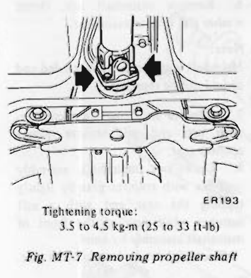
>
> - **Summary:** Illustration of propeller shaft flange bolts removal at the transmission companion flange.
> - **Components:** Propeller shaft, Flange companion bolts, Rear mounting member
> - **Specs / Measurements:** Tightening torque: 3.5 to 4.5 kg-m (25 to 33 ft-lb)
> - **Mechanic Notes:** Tighten propeller shaft bolts to 3.5 to 4.5 kg-m (25 to 33 ft-lb) on reassembly.
> - **Tags:** `propeller shaft`, `flange`, `torque`, `driveshaft`, `removal`

> 🖼️ **Fig. MT-8 Tightening torque** `[TM773]` *(Type: `procedure_step`)*
>
> 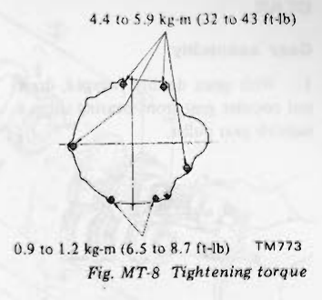
>
> - **Summary:** Diagram illustrating tightening torque patterns and values for transmission bellhousing-to-engine bolts.
> - **Components:** Transmission bellhousing, Engine rear plate, Mounting bolts
> - **Specs / Measurements:** Top transmission to engine bolts: 4.4 to 5.9 kg-m (32 to 43 ft-lb); Bottom bolts (engine rear plate to transmission): 0.9 to 1.2 kg-m (6.5 to 8.7 ft-lb)
> - **Mechanic Notes:** Ensure proper torque distribution across upper heavy bellhousing bolts and lower sheet-metal rear plate bolts.
> - **Tags:** `bellhousing bolts`, `torque specification`, `engine mounting`, `installation`

13. Support engine by locating a jack under oil pan with a wooden block used between oil pan and jack.
14. Support transmission with a transmission jack.
15. Remove nut attaching mounting member to rear mounting insulator. Remove two mounting member attaching bolts and then remove mounting member.
16. Remove starter motor.
17. Remove bolts securing transmission to engine.
    After removing these bolts, support the engine and transmission with jacks, and then slide transmission rearward away from engine and remove from the car.

> [!CAUTION]
> Take care in dismounting transmission not to strike any adjacent parts and main drive gear.

## INSTALLATION

Install the transmission in the reverse order of removal, paying attention to the following points.

1. Before installing, clean mating surfaces of engine rear plate and transmission case.
2. Before installing, lightly apply grease to spline parts of clutch disc and main drive gear.
3. Tighten bolts securing transmission to engine to specifications.
4. Remove filler plug and fill transmission with recommended gear oil to the level of the plug hole.

## DISASSEMBLY

### HOUSING

1. Prior to disassembling transmission, thoroughly wipe off dirt and grease from it.
2. Drain oil thoroughly.
3. Remove dust cover from transmission case.
   Remove release bearing and withdrawal lever.
4. Remove reverse lamp switch.
5. Move gear to Neutral.
6. Remove speedometer pinion.
7. Remove E-ring and stopper guide pin from rear end of rear extension.

> 🖼️ **Fig. MT-9 Removing striking rod E-ring and stopper pin** `[TM337]` *(Type: `procedure_step`)*
>
> 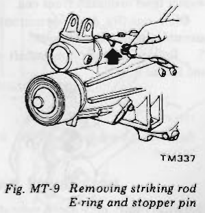
>
> - **Summary:** Detailed illustration showing the removal of E-ring and stopper guide pin from the rear end of the transmission rear extension housing.
> - **Components:** Rear extension housing, Striking rod, Stopper guide pin, E-ring
> - **Mechanic Notes:** Remove E-ring and pull stopper guide pin prior to removing rear extension housing.
> - **Tags:** `striking rod`, `stopper guide pin`, `E-ring`, `rear extension`, `disassembly`

> 🖼️ **Fig. MT-10 Removing return spring plug** `[TM338]` *(Type: `procedure_step`)*
>
> 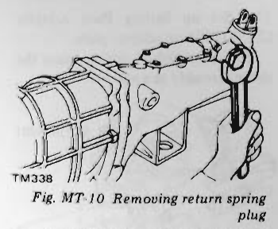
>
> - **Summary:** Technician using a wrench to remove the return spring plug from the side of the rear extension housing.
> - **Components:** Rear extension housing, Return spring plug, Wrench
> - **Mechanic Notes:** Keep track of return spring, reverse check spring, and plunger when plug is removed.
> - **Tags:** `return spring plug`, `rear extension`, `reverse check spring`, `disassembly`

8. Remove return spring plug, return spring, reverse check spring, and plunger from rear extension.
9. Remove rear extension securing bolts and turn the striking rod toward left.
   Drive out rear extension backward by lightly tapping around it with a soft hammer.

> 🖼️ **Fig. MT-11 Removing rear extension** `[TM339]` *(Type: `procedure_step`)*
>
> 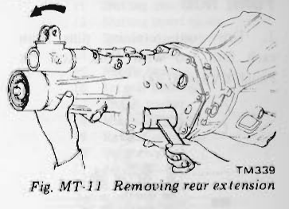
>
> - **Summary:** Removing rear extension housing from adapter plate by lightly tapping with a soft mallet while turning the striking rod leftward.
> - **Components:** Rear extension housing, Adapter plate, Striking rod
> - **Mechanic Notes:** Turn striking rod toward left to disengage striking lever before tapping rear extension off.
> - **Tags:** `rear extension`, `removal`, `striking rod`, `disassembly`

10. Remove front cover securing bolts and remove front cover.
    Detach countershaft front bearing shim.
11. Remove main drive bearing snap ring with Expander.

> 🖼️ **Fig. MT-12 Removing main drive bearing snap ring** `[TM340]` *(Type: `procedure_step`)*
>
> 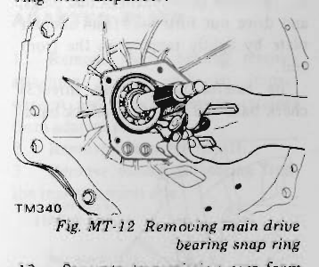
>
> - **Summary:** Using snap ring expander pliers to remove the large snap ring securing the main drive gear front bearing inside the transmission front case.
> - **Components:** Transmission case, Main drive bearing, Snap ring, Snap ring expander pliers
> - **Mechanic Notes:** Remove front cover and countershaft front shim before expanding and removing main drive bearing snap ring.
> - **Tags:** `main drive bearing`, `snap ring`, `expander`, `front cover`, `disassembly`

12. Separate transmission case from adapter plate with a soft hammer.

> 🖼️ **Fig. MT-13 Removing transmission case** `[TM341]` *(Type: `procedure_step`)*
>
> 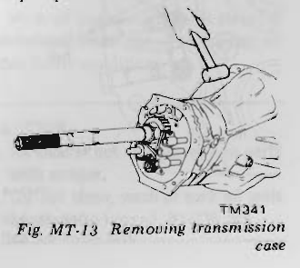
>
> - **Summary:** Separating transmission bellhousing case from the adapter plate using a soft mallet.
> - **Components:** Transmission case, Adapter plate, Soft hammer, Mainshaft
> - **Mechanic Notes:** Tap case gently with soft hammer to break sealant bond without cracking aluminum mating flanges.
> - **Tags:** `transmission case`, `adapter plate`, `soft hammer`, `disassembly` <!-- Page 6 (MT-6) --> 13. Set up Setting Plate Adapter ST23810001 on adapter plate.
    With countershaft side up, place the above assembly in a vise.

> 🖼️ **Fig. MT-14 Attaching gear assembly to special tool** `[TM342]` *(Type: `procedure_step`)*
>
> 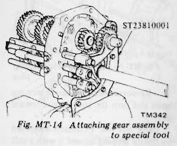
>
> - **Summary:** Mounting the adapter plate and gear train assembly onto Setting Plate Adapter ST23810001 clamped in a workbench vise.
> - **Components:** Setting Plate Adapter ST23810001, Adapter plate, Transmission gear assembly, Bench vise
> - **Specs / Measurements:** Special tool: ST23810001
> - **Mechanic Notes:** Mount assembly with countershaft side facing upwards in vise.
> - **Tags:** `ST23810001`, `setting plate adapter`, `gear assembly`, `vise`, `bench fixture`

### FORK ROD

1. Drive out retaining pins from each fork rod with Fork Rod Pin Punch KV31100300.

> 🖼️ **Fig. MT-15 Drive out retaining pins** `[TM088A]` *(Type: `procedure_step`)*
>
> 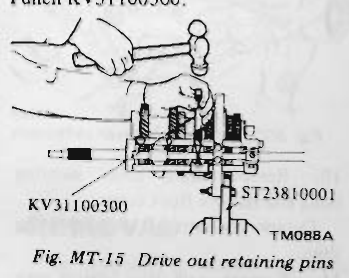
>
> - **Summary:** Technician using Fork Rod Pin Punch KV31100300 and a hammer to drive out roll pins securing shift forks to fork rods.
> - **Components:** Fork Rod Pin Punch KV31100300, Setting Plate Adapter ST23810001, Shift forks, Fork rods, Retaining roll pins
> - **Specs / Measurements:** Special tool: KV31100300; Setting plate adapter: ST23810001
> - **Mechanic Notes:** Retaining roll pins should be replaced with new pins upon reassembly.
> - **Tags:** `KV31100300`, `pin punch`, `retaining pin`, `shift fork`, `fork rod`

2. Remove three(3) check ball plugs, and drive out fork rods from adapter plate by lightly tapping on the front end.
   Be careful not to lose three(3) check balls and four(4) interlock balls.

> 🖼️ **Fig. MT-16 Layout of check ball and interlock ball** `[TM344]` *(Type: `alignment_orientation`)*
>
> 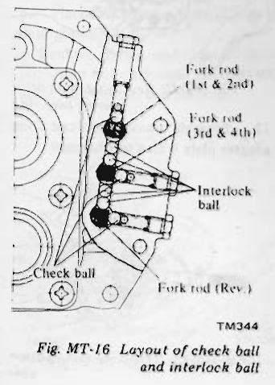
>
> - **Summary:** Cutaway diagram showing relative positions and channels of the three check balls, four interlock balls, and fork rods in the adapter plate.
> - **Components:** Adapter plate, 1st & 2nd fork rod, 3rd & 4th fork rod, Reverse fork rod, Check balls (3), Interlock balls (4)
> - **Callouts:** **(Fork rod (1st & 2nd))** 1st & 2nd fork rod; **(Fork rod (3rd & 4th))** 3rd & 4th fork rod; **(Fork rod (Rev.))** Reverse fork rod; **(Check ball)** Check ball (3 total); **(Interlock ball)** Interlock ball (4 total)
> - **Specs / Measurements:** Three (3) check balls; Four (4) interlock balls
> - **Mechanic Notes:** CRITICAL: Do not lose check balls or interlock balls. Note order: 1st/2nd fork rod, 2 interlock balls, 3rd/4th rod, 2 interlock balls, reverse rod.
> - **Tags:** `check balls`, `interlock balls`, `fork rods`, `adapter plate`, `interlock mechanism`

### GEAR

#### Gear assembly

1. With gears doubly engaged, draw out counter gear front bearing using a suitable gear puller.

> 🖼️ **Fig. MT-17 Removing countershaft front bearing** `[TM398]` *(Type: `procedure_step`)*
>
> 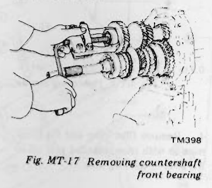
>
> - **Summary:** Using a two-jaw gear puller to remove counter gear front bearing while transmission gears are doubly engaged to lock rotation.
> - **Components:** Counter gear front bearing, Counter gear, Two-jaw puller
> - **Mechanic Notes:** Engage two gears simultaneously (double engage) to prevent shaft rotation during puller operation.
> - **Tags:** `countershaft`, `front bearing`, `puller`, `disassembly`, `bearing removal`

2. Remove counter drive gear snap ring.
3. Draw out counter drive gear with main drive gear by means of a gear puller.
   When drawing out main drive gear assembly, be careful not to drop pilot needle bearing onto floor from the front end of mainshaft.

> 🖼️ **Fig. MT-18 Removing counter drive gear and main drive gear** `[TM345]` *(Type: `procedure_step`)*
>
> 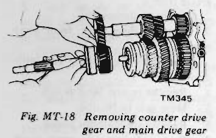
>
> - **Summary:** Pulling counter drive gear together with main drive gear off the shafts using a puller.
> - **Components:** Counter drive gear, Main drive gear, Pilot needle bearing, Mainshaft front end, Gear puller
> - **Mechanic Notes:** Take care not to allow the pilot needle bearing to drop from the front end of the mainshaft.
> - **Tags:** `counter drive gear`, `main drive gear`, `pilot needle bearing`, `puller`

4. Remove snap ring and then thrust washer from mainshaft front end.
   Draw out 3rd & 4th synchronizer assembly and remove 3rd gear.
5. Release staking on mainshaft nut and loosen it.

> 🖼️ **Fig. MT-19 Removing mainshaft nut** `[TM346]` *(Type: `procedure_step`)*
>
> 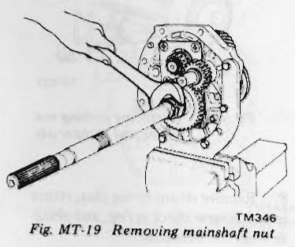
>
> - **Summary:** Releasing lock staking on mainshaft rear nut and unscrewing the nut with a socket bar while gears are locked.
> - **Components:** Mainshaft nut, Mainshaft rear end, Socket handle, Staking notch
> - **Mechanic Notes:** Unstake lock collar before loosening nut. Always discard used mainshaft nut; never reuse.
> - **Tags:** `mainshaft nut`, `unstaking`, `socket`, `disassembly`

6. Remove mainshaft nut, thrust washer and reverse main gear.

> **Note:** Mainshaft nut should be discarded and should not be reused.

7. Remove snap ring from countershaft rear end, and remove reverse counter gear.
8. Draw out mainshaft assembly together with counter gear by lightly tapping the rear end with a soft hammer while holding the front of mainshaft assembly by hand.
   Be careful not to drop counter gear.

> 🖼️ **Fig. MT-20 Driving out gear assembly** `[TM347]` *(Type: `procedure_step`)*
>
> 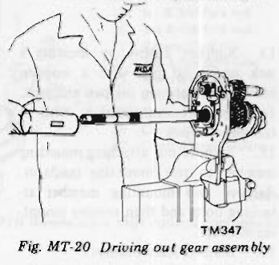
>
> - **Summary:** Technician supporting mainshaft gear assembly with one hand while tapping the rear end with a soft hammer to drive out mainshaft and counter gear together.
> - **Components:** Mainshaft assembly, Counter gear, Adapter plate, Soft hammer
> - **Mechanic Notes:** Carefully hold front of mainshaft assembly by hand while tapping to prevent the counter gear from dropping.
> - **Tags:** `mainshaft`, `counter gear`, `driving out`, `soft hammer`, `disassembly`

#### Mainshaft

1. Remove thrust washer, steel ball, 1st gear and needle bearing. Be careful not to lose steel ball retaining thrust washer.
2. Press out 1st gear mainshaft bushing together with 2nd gear and 1st & 2nd synchronizer using Bearing Puller ST30031000.

> **Note:** When pressing out bushing, hold mainshaft by hand so as not to drop it.

> 🖼️ **Fig. MT-21 Removing 1st gear bushing** `[TM049A]` *(Type: `procedure_step`)*
>
> 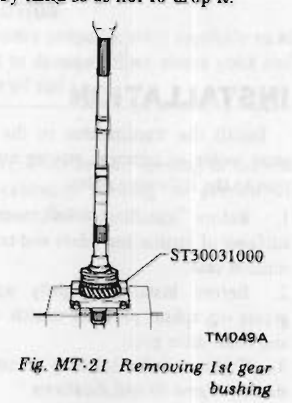
>
> - **Summary:** Using Bearing Puller ST30031000 under a hydraulic press to press off 1st gear mainshaft bushing along with 2nd gear and 1st & 2nd synchronizer assembly.
> - **Components:** 1st gear bushing, 2nd main gear, 1st & 2nd synchronizer assembly, Mainshaft, Bearing Puller ST30031000
> - **Specs / Measurements:** Special tool: ST30031000
> - **Mechanic Notes:** Hold mainshaft by hand while pressing out bushing to prevent it from dropping onto the floor.
> - **Tags:** `ST30031000`, `1st gear bushing`, `bearing puller`, `mainshaft`, `press operation`

---

<!-- Page 7 (MT-7) -->

> 🖼️ **Fig. MT-22 Mainshaft assembly** `[TM127A]` *(Type: `exploded_view`)*
>
> 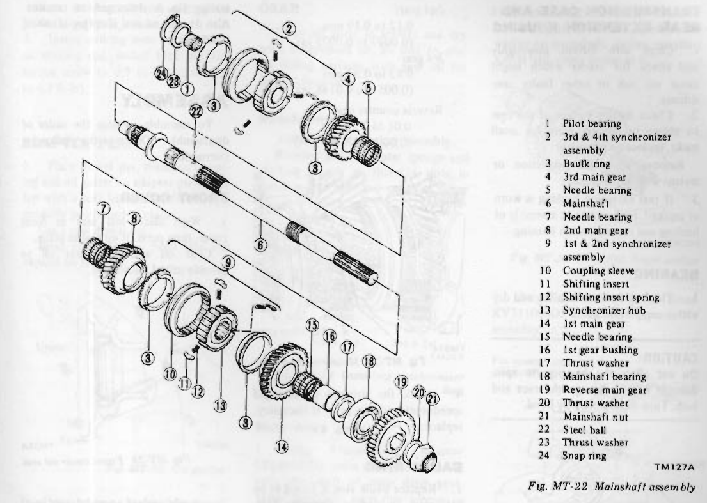
>
> - **Summary:** Exploded view diagram of the complete mainshaft assembly showing sequence of all gears, needle bearings, synchronizer assemblies, bushings, thrust washers, steel ball, main bearing, and nut.
> - **Components:** Pilot bearing, 3rd & 4th synchronizer assembly, Baulk ring, 3rd main gear, Needle bearing, Mainshaft, Needle bearing, 2nd main gear, 1st & 2nd synchronizer assembly, Coupling sleeve, Shifting insert, Shifting insert spring, Synchronizer hub, 1st main gear, Needle bearing, 1st gear bushing, Thrust washer, Mainshaft bearing, Reverse main gear, Thrust washer, Mainshaft nut, Steel ball, Thrust washer, Snap ring
> - **Callouts:** **(1)** Pilot bearing; **(2)** 3rd & 4th synchronizer assembly; **(3)** Baulk ring; **(4)** 3rd main gear; **(5)** Needle bearing; **(6)** Mainshaft; **(7)** Needle bearing; **(8)** 2nd main gear; **(9)** 1st & 2nd synchronizer assembly; **(10)** Coupling sleeve; **(11)** Shifting insert; **(12)** Shifting insert spring; **(13)** Synchronizer hub; **(14)** 1st main gear; **(15)** Needle bearing; **(16)** 1st gear bushing; **(17)** Thrust washer; **(18)** Mainshaft bearing; **(19)** Reverse main gear; **(20)** Thrust washer; **(21)** Mainshaft nut; **(22)** Steel ball; **(23)** Thrust washer; **(24)** Snap ring
> - **Mechanic Notes:** Pay strict attention to placement of steel ball (22) that locks thrust washer (17). Observe synchronizer hub front/rear orientation.
> - **Tags:** `mainshaft assembly`, `exploded view`, `F4W71B`, `geartrain`, `needle bearings`, `thrust washer`

#### Main drive gear

1. Remove main drive gear snap ring and spacer.
2. Remove main drive bearing with Bearing Puller ST30031000 and a suitable press.

> 🖼️ **Fig. MT-23 Removing main drive bearing** `[TM349]` *(Type: `procedure_step`)*
>
> 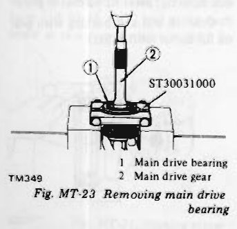
>
> - **Summary:** Press setup showing Bearing Puller ST30031000 supporting the main drive bearing while the press ram drives out the main drive gear shaft.
> - **Components:** Main drive bearing, Main drive gear, Bearing Puller ST30031000
> - **Callouts:** **(1)** Main drive bearing; **(2)** Main drive gear
> - **Specs / Measurements:** Special tool: ST30031000
> - **Mechanic Notes:** Remove snap ring and spacer before pressing off bearing.
> - **Tags:** `ST30031000`, `main drive bearing`, `bearing puller`, `press`, `removal`

#### Counter gear

Press out counter gear rear bearing using Bearing Puller ST30031000.

> **Note:** When pressing out bearing, hold shaft by hand so as not to drop shaft onto floor.

> 🖼️ **Fig. MT-24 Removing countershaft bearing** `[TM351]` *(Type: `procedure_step`)*
>
> 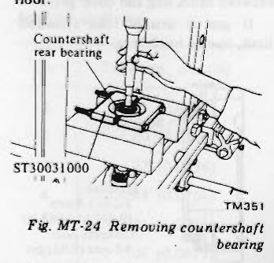
>
> - **Summary:** Press setup showing countershaft rear bearing removal using Bearing Puller ST30031000 under a shop press.
> - **Components:** Countershaft rear bearing, Counter gear, Bearing Puller ST30031000, Press blocks
> - **Callouts:** **(Countershaft rear bearing)** Countershaft rear bearing; **(ST30031000)** Bearing puller tool
> - **Specs / Measurements:** Special tool: ST30031000
> - **Mechanic Notes:** Hold shaft by hand so as not to allow countershaft to drop onto the shop floor when bearing releases.
> - **Tags:** `ST30031000`, `countershaft rear bearing`, `bearing puller`, `press operation`

### REAR EXTENSION

Remove lock pin from striking lever, and remove striking rod.

> **Note:** Do not disassemble rear extension bushing from rear extension.

### ADAPTER PLATE

1. Remove six(6) bearing retainer attaching screws with an impact wrench and remove bearing retainer from adapter plate.
2. Remove reverse idler shaft.
3. Remove mainshaft bearing from the rear extension side.

## INSPECTION

Wash all parts in a suitable cleaning solvent and check for wear, damage or other faulty conditions.

> [!CAUTION]
> a. Be careful not to damage any parts with scraper.  
> b. Do not clean, wash or soak oil seals in solvent.

---

<!-- Page 8 (MT-8) -->
### TRANSMISSION CASE AND REAR EXTENSION HOUSING

1. Clean with solvent thoroughly and check for cracks which might cause oil leak or other faulty conditions.
2. Check mating surface of the case to engine or adapter plate for small nicks, projection or sealant.
   Remove all nicks, projection or sealant with a fine stone.
3. If rear extension bushing is worn or cracked, replace it as an assembly of bushing and rear extension housing.

### BEARING

1. Thoroughly clean bearing and dry with a compressed air.

> [!CAUTION]
> Do not allow the bearings to spin. Because it will damage the race and balls. Turn them slowly by hand.

> 🖼️ **Fig. MT-25 Inspecting ball bearing** `[TM372]` *(Type: `inspection_measurement`)*
>
> 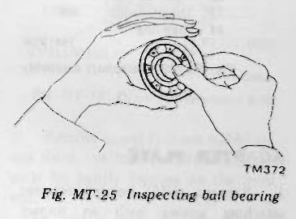
>
> - **Summary:** Hand inspection of a transmission ball bearing, slowly turning inner race by hand to detect roughness, axial play, or damaged balls/races.
> - **Components:** Ball bearing assembly
> - **Mechanic Notes:** Do not spin bearings with compressed air, as lack of lubrication at high speed damages races and balls.
> - **Tags:** `bearing inspection`, `ball bearing`, `inspection`

2. When race and ball surfaces are worn or rough, or when balls are out-of-round or rough, replace bearing with a new one.
3. Replace needle bearing if worn or damaged.

### GEAR

1. Check all gears for excessive wear, chips or cracks; replace as required.
2. Check shaft for bending, crack, wear, and worn spline; if necessary, replace.
3. Measure gear end play:
   - 1st gear: 0.32 to 0.39 mm (0.0126 to 0.0154 in)
   - 2nd gear: 0.12 to 0.19 mm (0.0047 to 0.0075 in)
   - 3rd gear: 0.13 to 0.37 mm (0.0051 to 0.0146 in)
   - Reverse counter gear: 0.01 to 0.20 mm (0.0004 to 0.0079 in)

> 🖼️ **Fig. MT-26 Measuring end play** `[TM374]` *(Type: `inspection_measurement`)*
>
> 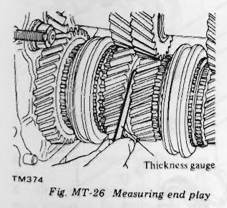
>
> - **Summary:** Using a flat feeler gauge (thickness gauge) inserted between gear faces on the mainshaft to measure axial end play.
> - **Components:** Mainshaft gears, Thickness gauge (feeler gauge)
> - **Callouts:** **(Thickness gauge)** Thickness gauge
> - **Specs / Measurements:** 1st gear end play: 0.32 to 0.39 mm (0.0126 to 0.0154 in); 2nd gear end play: 0.12 to 0.19 mm (0.0047 to 0.0075 in); 3rd gear end play: 0.13 to 0.37 mm (0.0051 to 0.0146 in); Reverse counter gear end play: 0.01 to 0.20 mm (0.0004 to 0.0079 in)
> - **Mechanic Notes:** Measure gear end play with feeler gauge while gears are installed on shaft.
> - **Tags:** `gear end play`, `thickness gauge`, `feeler gauge`, `inspection`

4. Check for stripped or damaged speedometer pinion gear. If necessary, replace.

### BAULK RING

1. Replace baulk ring if found to be deformed, cracked or otherwise damaged excessively.
2. Place baulk ring in position on gear cone.
   While holding baulk ring against gear as far as it will go, measure gap between baulk ring and outer gear.
   If gap is smaller than allowable limit, discard baulk ring.

> 🖼️ **Fig. MT-27 Baulk ring-to-cone gap** `[TM375]` *(Type: `inspection_measurement`)*
>
> 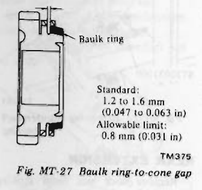
>
> - **Summary:** Cross-sectional detail illustration showing measurement of the gap between the baulk ring face and the gear cone clutch surface.
> - **Components:** Baulk ring, Gear cone
> - **Callouts:** **(Baulk ring)** Baulk ring
> - **Specs / Measurements:** Standard gap: 1.2 to 1.6 mm (0.047 to 0.063 in); Allowable limit: 0.8 mm (0.031 in)
> - **Mechanic Notes:** Hold baulk ring firmly against gear cone when checking gap. If clearance is 0.8 mm (0.031 in) or less, baulk ring must be replaced.
> - **Tags:** `baulk ring`, `gear cone`, `gap clearance`, `synchronizer wear`, `inspection`

### OIL SEAL

Discard O-ring or oil seal which is once removed. Replace oil seal if sealing lip is deformed or cracked. Also discard oil seal if spring is out of position.

## ASSEMBLY

To assemble, reverse the order of disassembly. Observe the following instructions.

### FRONT COVER

1. Wipe clean seal seat in front cover, then press fit oil seal in place.
   Coat oil seal with gear oil to provide initial lubrication.

> 🖼️ **Fig. MT-28 Front cover oil seal** `[TM354]` *(Type: `alignment_orientation`)*
>
> 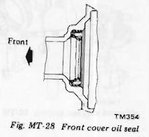
>
> - **Summary:** Cross section showing correct installation direction and lip orientation of front cover oil seal.
> - **Components:** Front cover, Oil seal, Sealing lip
> - **Callouts:** **(Front)** Front of vehicle direction
> - **Mechanic Notes:** Press-fit oil seal with sealing lip facing inward/front as indicated by arrow; coat lip with gear oil prior to assembly.
> - **Tags:** `front cover`, `oil seal`, `orientation`, `assembly`

2. Apply sealant to withdrawal lever ball pin screw. Install withdrawal lever ball pin to front cover and tighten screw to 1.6 to 2.1 kg-m (12 to 15 ft-lb) torque.

### REAR EXTENSION

1. Wipe clean seal seat in rear extension housing; press fit oil seal in place.
   Coat oil seal and bushing with gear oil for initial lubrication.

> 🖼️ **Fig. MT-29 Rear extension oil seal** `[TM355]` *(Type: `alignment_orientation`)*
>
> 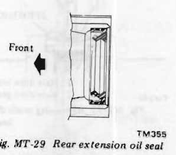
>
> - **Summary:** Cross section showing correct press-in orientation of the rear extension housing rear output oil seal.
> - **Components:** Rear extension housing, Rear oil seal
> - **Callouts:** **(Front)** Front direction
> - **Mechanic Notes:** Press-fit oil seal squarely into housing seat; apply grease to oil seal lip and bushing prior to driveshaft installation.
> - **Tags:** `rear extension`, `oil seal`, `orientation`, `assembly`

2. Apply grease to O-ring and plunger grooves in striking rod. <!-- Page 9 (MT-9) --> Insert striking rod with striking rod guide through rear extension.
3. Install striking lever on front end of striking rod. Install lock pin and torque screw to 0.9 to 1.2 kg-m (6.5 to 8.7 ft-lb).

### ADAPTER PLATE

1. Place dowel pin, mainshaft bearing and oil gutter on adapter plate, and tap with a soft hammer until they are properly positioned in place.
   Use a new dowel pin.
   Bend oil gutter on front side and expand on rear side.

> 🖼️ **Fig. MT-30 Oil gutter** `[TM356]` *(Type: `alignment_orientation`)*
>
> 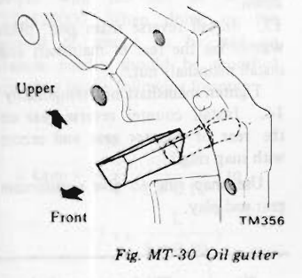
>
> - **Summary:** Illustration of the oil gutter installation and bending orientation on the adapter plate.
> - **Components:** Oil gutter, Adapter plate, Dowel pin
> - **Callouts:** **(Upper)** Upper side orientation; **(Front)** Front side orientation
> - **Mechanic Notes:** Bend oil gutter on front side and expand on rear side after positioning.
> - **Tags:** `oil gutter`, `adapter plate`, `orientation`, `lubrication`

2. Insert reverse idler shaft in adapter plate.
   Make sure that the cut-out portion of reverse idler shaft is lined up with inner face of adapter plate.
3. Install bearing retainer in adapter plate.
   Align bearing retainer with reverse idler shaft at the cut-out portion of this shaft, torque screws to 1.9 to 2.5 kg-m (14 to 18 ft-lb) and stake each screw at two points with a punch.

> 🖼️ **Fig. MT-31 Staking screw** `[TM400]` *(Type: `procedure_step`)*
>
> 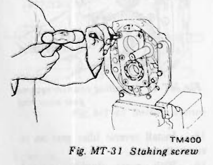
>
> - **Summary:** Using a center punch to stake bearing retainer attaching screws at two points on the adapter plate.
> - **Components:** Adapter plate, Bearing retainer, Attaching screws, Punch
> - **Specs / Measurements:** Screw torque: 1.9 to 2.5 kg-m (14 to 18 ft-lb); Stake at two points
> - **Mechanic Notes:** Torque screws to 1.9 to 2.5 kg-m (14 to 18 ft-lb) and stake each screw at two points to prevent loosening.
> - **Tags:** `staking`, `bearing retainer`, `adapter plate`, `screws`

4. Install countershaft rear bearing in adapter plate by lightly tapping around it with a soft hammer.

### GEAR

Clean all parts in solvent and dry with compressed air. Be sure to coat all sliding surfaces with gear oil for initial lubrication.

#### Synchronizer

Assemble synchronizer assembly.
Position shifting insert springs and shifting inserts in three(3) slots in synchronizer hub; put coupling sleeve on synchronizer hub.

> 🖼️ **Fig. MT-32 Installing synchronizer hub** `[TM357]` *(Type: `alignment_orientation`)*
>
> 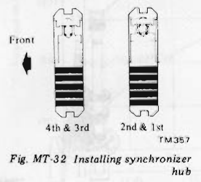
>
> - **Summary:** Cross-sectional comparison showing correct front-to-rear installation orientation of 4th & 3rd synchronizer hub versus 2nd & 1st synchronizer hub.
> - **Components:** Synchronizer hub (4th & 3rd), Synchronizer hub (2nd & 1st), Coupling sleeve
> - **Callouts:** **(Front)** Front of transmission direction; **(4th & 3rd)** 4th & 3rd synchronizer hub profile; **(2nd & 1st)** 2nd & 1st synchronizer hub profile
> - **Mechanic Notes:** Notice asymmetry of boss length between 3rd/4th and 1st/2nd synchronizer hubs. Assemble facing proper direction.
> - **Tags:** `synchronizer hub`, `coupling sleeve`, `orientation`, `assembly`

#### Main drive gear

1. Using Transmission Adapter ST23800000, press main drive bearing onto the shaft of main drive gear. Make sure that snap ring groove on shaft clears bearing.
2. Place main drive bearing spacer on main drive bearing and secure main drive bearing with thicker snap ring that will eliminate end play.

**Available snap ring**

| No. | Thickness mm (in) |
| :---: | :---: |
| 1 | 1.73 (0.0681) |
| 2 | 1.80 (0.0709) |
| 3 | 1.87 (0.0736) |
| 4 | 1.94 (0.0764) |
| 5 | 2.01 (0.0791) |
| 6 | 2.08 (0.0819) |

#### Gear assembly

1. Assemble 2nd gear needle bearing, 2nd gear, baulk ring, 1st & 2nd speed synchronizer assembly, 1st gear baulk ring, 1st gear bush, needle bearing, 1st gear, steel ball, and thrust washer on mainshaft. Before installing a steel ball, apply grease to it.

> 🖼️ **Fig. MT-33 Installing thrust washer** `[TM358]` *(Type: `procedure_step`)*
>
> 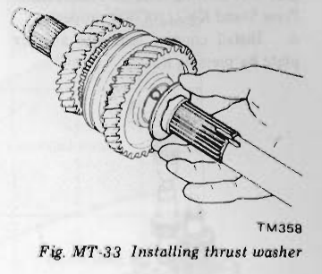
>
> - **Summary:** Technician sliding thrust washer over 1st gear on the mainshaft, ensuring alignment with the locking steel ball.
> - **Components:** Mainshaft, 1st main gear, Thrust washer, Steel ball
> - **Mechanic Notes:** Apply grease to steel ball to hold it in place on mainshaft before sliding thrust washer on.
> - **Tags:** `thrust washer`, `steel ball`, `mainshaft`, `1st gear`, `assembly`

2. Set Transmission Press Stand KV31100400 and place adapter plate assembly on it.

> 🖼️ **Fig. MT-34 Transmission Press Stand** `[TM438]` *(Type: `special_service_tool`)*
>
> 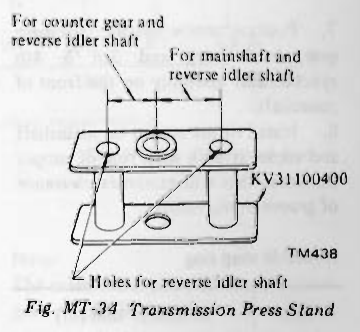
>
> - **Summary:** Detailed diagram of Transmission Press Stand KV31100400 showing hole locations for counter gear, reverse idler shaft, and mainshaft.
> - **Components:** Transmission Press Stand KV31100400
> - **Callouts:** **(KV31100400)** Special tool part number; **(For counter gear and reverse idler shaft)** Left locating position; **(For mainshaft and reverse idler shaft)** Right locating position; **(Holes for reverse idler shaft)** Center clearance holes
> - **Specs / Measurements:** Special tool: KV31100400
> - **Mechanic Notes:** Provides solid base for pressing mainshaft and countershaft into adapter plate bearings without cocking.
> - **Tags:** `KV31100400`, `press stand`, `adapter plate`, `special service tool`

3. Install mainshaft assembly to adapter plate assembly. Be sure to place bearing squarely against shaft and press it into place on shaft gradually.

> 🖼️ **Fig. MT-35 Installing mainshaft assembly** `[TM439]` *(Type: `procedure_step`)*
>
> 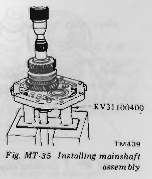
>
> - **Summary:** Press setup pressing mainshaft assembly into the center bearing on adapter plate supported on Press Stand KV31100400.
> - **Components:** Mainshaft assembly, Adapter plate, Press Stand KV31100400, Hydraulic press ram
> - **Callouts:** **(KV31100400)** Press stand special tool
> - **Specs / Measurements:** Special tool: KV31100400
> - **Mechanic Notes:** Ensure bearing is square against shaft; press into place gradually.
> - **Tags:** `mainshaft`, `adapter plate`, `KV31100400`, `press assembly`

4. Place new woodruff keys in grooves in counter gear and tap them lightly until they are seated securely. <!-- Page 10 (MT-10) --> Use a soft hammer to avoid damaging keys.
5. Place adapter plate assembly and mainshaft assembly so that counter gear rear bearing rests on Transmission Press Stand KV31100400 properly.
6. Install counter gear into adapter plate by pressing it.

> 🖼️ **Fig. MT-36 Installing counter gear** `[TM440]` *(Type: `procedure_step`)*
>
> 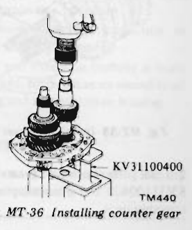
>
> - **Summary:** Press setup showing counter gear being pressed into adapter plate rear bearing while assembly rests on Press Stand KV31100400.
> - **Components:** Counter gear, Adapter plate, Counter gear rear bearing, Press Stand KV31100400
> - **Callouts:** **(KV31100400)** Transmission press stand
> - **Specs / Measurements:** Special tool: KV31100400
> - **Mechanic Notes:** Support counter gear rear bearing properly on press stand during pressing.
> - **Tags:** `counter gear`, `adapter plate`, `KV31100400`, `press assembly`

7. Position needle bearing, 3rd main gear, baulk ring and 3rd & 4th synchronizer assembly on the front of mainshaft.
8. Install thrust washer on mainshaft and secure it with snap ring of proper thickness that will minimize clearance of groove in mainshaft.

**Available snap ring**

| No. | Thickness mm (in) |
| :---: | :---: |
| 1 | 1.4 (0.055) |
| 2 | 1.5 (0.059) |
| 3 | 1.6 (0.063) |

> 🖼️ **Fig. MT-37 Installing snap ring** `[TM441]` *(Type: `procedure_step`)*
>
> 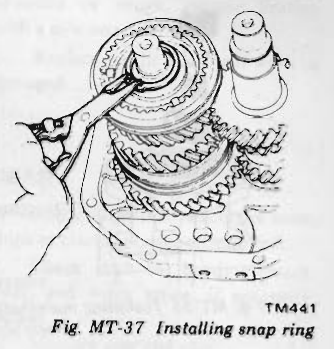
>
> - **Summary:** Installing snap ring in the front end groove of the mainshaft ahead of the 3rd & 4th synchronizer assembly thrust washer.
> - **Components:** Mainshaft front end, Thrust washer, Snap ring, Snap ring pliers
> - **Specs / Measurements:** Snap ring thickness: 1.4 mm, 1.5 mm, or 1.6 mm
> - **Mechanic Notes:** Select snap ring of thickness that minimizes axial clearance in mainshaft groove.
> - **Tags:** `snap ring`, `mainshaft`, `clearance`, `synchronizer`

9. Position baulk ring on cone surface of main drive gear. Apply gear oil to mainshaft pilot bearing and install it on mainshaft.
   Assemble main drive gear assembly on the front end of mainshaft.
10. Press counter drive gear onto counter gear with Counter Gear Drift ST23860000 by meshing gears and secure counter drive gear with thicker snap ring.

> **Note:** Be sure to drive in counter drive gear and main drive gear simultaneously.

> 🖼️ **Fig. MT-38 Installing counter drive gear** `[TM442]` *(Type: `procedure_step`)*
>
> 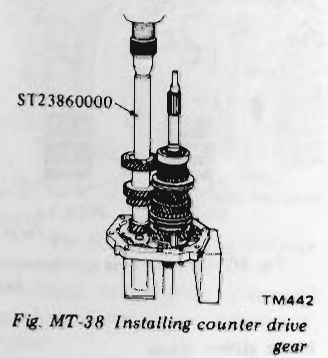
>
> - **Summary:** Pressing counter drive gear onto counter gear using Counter Gear Drift ST23860000 while meshing gears.
> - **Components:** Counter drive gear, Main drive gear, Counter Gear Drift ST23860000, Counter gear
> - **Callouts:** **(ST23860000)** Counter gear drift
> - **Specs / Measurements:** Special tool: ST23860000
> - **Mechanic Notes:** CRITICAL: Counter drive gear and main drive gear must be driven on simultaneously with teeth meshed.
> - **Tags:** `ST23860000`, `counter drive gear`, `drift`, `meshed gears`

**Available counter drive gear snap ring**

| No. | Thickness mm (in) |
| :---: | :---: |
| 1 | 1.4 (0.055) |
| 2 | 1.5 (0.059) |
| 3 | 1.6 (0.063) |

> 🖼️ **Fig. MT-39 Installing snap ring** `[TM366]` *(Type: `procedure_step`)*
>
> 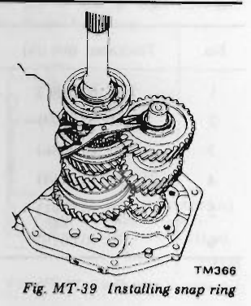
>
> - **Summary:** Fitting counter drive gear retaining snap ring to front end groove of countershaft.
> - **Components:** Counter drive gear, Countershaft, Snap ring, Snap ring pliers
> - **Specs / Measurements:** Counter drive gear snap ring thickness: 1.4 mm, 1.5 mm, or 1.6 mm
> - **Mechanic Notes:** Secure counter drive gear with the thickest snap ring that fits the groove.
> - **Tags:** `counter drive gear`, `snap ring`, `countershaft`

11. Press counter gear front bearing onto counter gear with Bearing Drift ST22360002.

> 🖼️ **Fig. MT-40 Installing counter gear front bearing** `[TM443]` *(Type: `procedure_step`)*
>
> 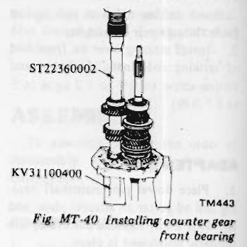
>
> - **Summary:** Pressing counter gear front bearing onto countershaft using Bearing Drift ST22360002 on Press Stand KV31100400.
> - **Components:** Counter gear front bearing, Counter gear, Bearing Drift ST22360002, Press Stand KV31100400
> - **Callouts:** **(ST22360002)** Bearing drift; **(KV31100400)** Press stand
> - **Specs / Measurements:** Special tools: ST22360002, KV31100400
> - **Mechanic Notes:** Ensure bearing is pressed firmly against counter drive gear shoulder.
> - **Tags:** `ST22360002`, `KV31100400`, `bearing drift`, `counter gear front bearing`

12. Support adapter plate in a vise with Setting Plate Adapter ST23810001, with mainshaft facing down.
13. Install reverse main gear, plain washer on the rear of mainshaft and install mainshaft nut.
    Tighten mainshaft nut temporarily.
14. Install counter reverse gear on the rear of counter gear and secure with snap ring.
    Use snap ring to give a minimum gear end play.

**Available snap ring**

| No. | Thickness mm (in) |
| :---: | :---: |
| 1 | 1.4 (0.055) |
| 2 | 1.5 (0.059) |
| 3 | 1.6 (0.063) |

> 🖼️ **Fig. MT-41 Installing counter reverse gear snap ring** `[TM361]` *(Type: `procedure_step`)*
>
> 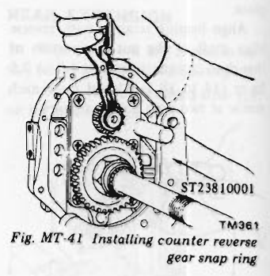
>
> - **Summary:** Installing snap ring on rear end of countershaft to retain counter reverse gear with assembly mounted on Setting Plate Adapter ST23810001.
> - **Components:** Counter reverse gear, Countershaft, Snap ring, Setting Plate Adapter ST23810001
> - **Callouts:** **(ST23810001)** Setting plate adapter
> - **Specs / Measurements:** Counter reverse gear snap ring thickness: 1.4 mm, 1.5 mm, or 1.6 mm
> - **Mechanic Notes:** Select snap ring thickness that gives minimum gear end play (less than 0.20 mm).
> - **Tags:** `counter reverse gear`, `snap ring`, `ST23810001`, `end play`

15. Install reverse idler gear on reverse idler shaft.
16. With gears doubly engaged, tighten mainshaft nut to the converted torque "C" (See Fig. MT-44.) using Wrench ST22520000. <!-- Page 11 (MT-11) --> > 🖼️ **Fig. MT-42 Tightening mainshaft nut** `[TM768]` *(Type: `procedure_step`)*
>
> 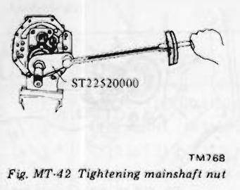
>
> - **Summary:** Tightening the mainshaft rear nut using Special Wrench ST22520000 attached to a click-type or beam-type torque wrench.
> - **Components:** Mainshaft nut, Special Wrench ST22520000, Torque wrench
> - **Callouts:** **(ST22520000)** Special wrench
> - **Specs / Measurements:** Specified nut torque: 14.0 to 17.0 kg-m (101 to 123 ft-lb)
> - **Mechanic Notes:** Gears must be doubly engaged to lock the shaft while torquing mainshaft nut.
> - **Tags:** `ST22520000`, `mainshaft nut`, `torque wrench`, `tightening`

### Explanation of converted torque

Mainshaft nut should be tightened to 14 to 17 kg-m (101 to 123 ft-lb) torque with the aid of Wrench ST22520000. When doing so, the amount of torque to be read on wrench needle should be modified according to the following formula:

$$C \text{ kg-m} = 14 \times \left(\frac{L}{L + 0.10}\right) \text{ to } 17 \times \left(\frac{L}{L + 0.10}\right)$$

or

$$C \text{ (ft-lb)} = 101 \times \left(\frac{L}{L + 0.33}\right) \text{ to } 123 \times \left(\frac{L}{L + 0.33}\right)$$

Where,  
$C$: Value read on the torque wrench kg-m (ft-lb)  
$L$: Effective length of torque wrench m (ft)

> 🖼️ **Fig. MT-43 Setting wrench** `[TM587]` *(Type: `procedure_step`)*
>
> 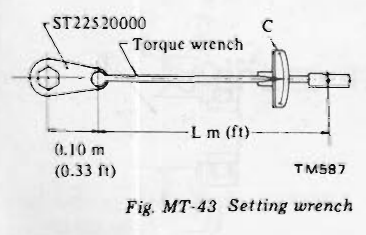
>
> - **Summary:** Schematic diagram showing geometry of torque wrench with Special Wrench ST22520000 extension, defining effective length L and extension offset 0.10 m (0.33 ft).
> - **Components:** Torque wrench, Special Wrench ST22520000
> - **Callouts:** **(ST22520000)** Adapter wrench; **(Torque wrench)** Torque wrench body; **(C)** Indicated torque reading; **(L m (ft))** Effective wrench length; **(0.10 m (0.33 ft))** Extension arm offset
> - **Specs / Measurements:** Extension arm offset: 0.10 m (0.33 ft)
> - **Mechanic Notes:** Because ST22520000 extends the lever arm by 0.10 m (0.33 ft), wrench reading C is lower than actual applied torque at the nut.
> - **Tags:** `ST22520000`, `torque conversion`, `lever arm`, `calculation`, `formula`

**Example:**  
When a 0.40 m (1.31 ft)-long torque wrench is used, the "C" in Fig. MT-44 will be 11.2 to 13.6 kg-m (81 to 98 ft-lb).

> 🖼️ **Fig. MT-44 Converted torque**  *(Type: `graph_chart`)*
>
> 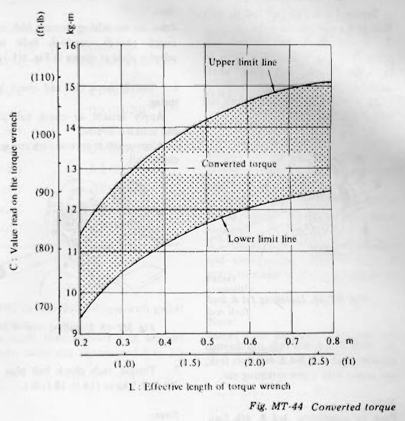
>
> - **Summary:** Nomograph chart plotting converted torque scale reading C (kg-m, ft-lb) against effective torque wrench length L (m, ft) with upper and lower limit tolerance lines.
> - **Components:** Upper limit line, Lower limit line, Converted torque band
> - **Callouts:** **(C)** Value read on the torque wrench (kg-m / ft-lb); **(L)** Effective length of torque wrench (m / ft); **(Upper limit line)** Maximum allowable reading; **(Lower limit line)** Minimum allowable reading
> - **Specs / Measurements:** Target nut torque: 14 to 17 kg-m (101 to 123 ft-lb); For L = 0.40 m: C = 11.2 to 13.6 kg-m (81 to 98 ft-lb); For L = 0.50 m: C = 11.7 to 14.2 kg-m (84 to 103 ft-lb); For L = 0.60 m: C = 12.0 to 14.6 kg-m (87 to 105 ft-lb)
> - **Mechanic Notes:** Look up torque wrench length on horizontal axis to find required gauge reading range.
> - **Tags:** `torque chart`, `nomograph`, `converted torque`, `graph`, `ST22520000`

17. Tighten mainshaft nut to 14.0 to 17.0 kg-m (101 to 123 ft-lb) torque, and stake mainshaft nut to groove of mainshaft with a punch.

> 🖼️ **Fig. MT-45 Staking mainshaft nut** `[TM362]` *(Type: `procedure_step`)*
>
> 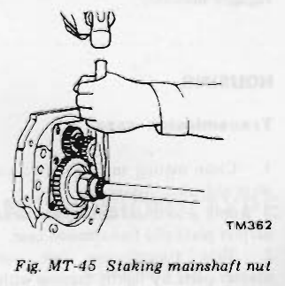
>
> - **Summary:** Using a hammer and punch to stake the thin collar of the mainshaft nut into the groove of the mainshaft.
> - **Components:** Mainshaft nut, Mainshaft groove, Punch, Hammer
> - **Mechanic Notes:** Stake nut securely into mainshaft spline groove to prevent backing off.
> - **Tags:** `staking`, `mainshaft nut`, `punch`, `locking`

18. Measure gear end play and backlash.
    Make sure that they are held within the specified values.
    For details, refer to the instructions under topic "Inspection".

> **Note:**  
> The main drive gear and counter drive gear should be handled as a matched set.  
> When you replace a main drive gear or counter drive gear, be sure to replace as a set of main drive gear and counter drive gear.

### Shift forks and fork rods

1. Place 1st & 2nd shift fork in groove in 1st & 2nd coupling sleeve, and slide 1st & 2nd fork rod through adapter plate and 1st & 2nd shift fork. Prior to installing 1st & 2nd fork rod, install 3rd & 4th shift fork in groove in 3rd & 4th coupling sleeve.

> **Note:**  
> Shift forks for 1st & 2nd and 3rd & 4th are one and the same parts.  
> Make sure that the long end of shift fork for 1st & 2nd is placed on the counter gear side and the long end for 3rd & 4th is on the opposite side. <!-- Page 12 (MT-12) --> Secure 1st & 2nd fork rod to shift fork with a new retaining pin.
2. Install check ball, check ball spring, and check ball plug. Prior to tightening check ball plug, apply sealant to check ball plug.
   Align notch in 1st & 2nd fork rod with check ball.

> 🖼️ **Fig. MT-46 Installing 1st & 2nd fork rod** `[TM367]` *(Type: `procedure_step`)*
>
> 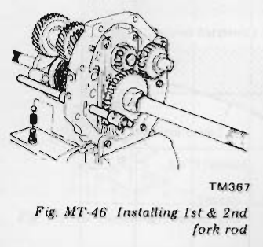
>
> - **Summary:** Sliding the 1st & 2nd fork rod through adapter plate bores and shift fork.
> - **Components:** 1st & 2nd fork rod, 1st & 2nd shift fork, Adapter plate
> - **Mechanic Notes:** Align detent notches in rod with check ball bore. Use new roll pins.
> - **Tags:** `1st & 2nd fork rod`, `shift fork`, `adapter plate`, `assembly`

3. Slide 3rd & 4th fork rod through adapter plate and 3rd & 4th shift fork, and secure with a new retaining pin.

> **Note:** Prior to assembling 3rd & 4th fork rod, install two(2) interlock balls into adapter plate as shown in Fig. MT-16.

4. Install check ball and check ball spring.
   Apply sealant to check ball plug and install it in place.
   Align notch in 3rd & 4th fork rod with check ball by sliding 3rd & 4th fork rod as necessary.

> 🖼️ **Fig. MT-47 Installing 3rd & 4th fork rod** `[TM368]` *(Type: `procedure_step`)*
>
> 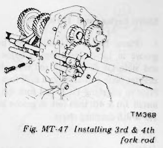
>
> - **Summary:** Installing 3rd & 4th fork rod through adapter plate and 3rd & 4th shift fork.
> - **Components:** 3rd & 4th fork rod, 3rd & 4th shift fork, Adapter plate
> - **Mechanic Notes:** CRITICAL: Install two interlock balls into adapter plate bore before inserting 3rd & 4th fork rod.
> - **Tags:** `3rd & 4th fork rod`, `shift fork`, `interlock balls`, `assembly`

5. Place reverse shift fork in reverse idler gear.
   Slide reverse fork rod through reverse shift fork and adapter plate, and secure with a new retaining pin.

> **Note:** Prior to assembling reverse fork rod, install two(2) interlock balls into adapter plate as shown in Fig. MT-16.

6. Install check ball and check ball spring.
   Apply sealant to check ball plug and install it in place.
   Align notch in reverse fork rod with check ball.

> 🖼️ **Fig. MT-48 Installing reverse fork rod** `[TM369]` *(Type: `procedure_step`)*
>
> 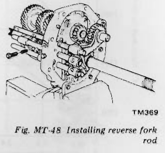
>
> - **Summary:** Installing reverse shift fork and reverse fork rod through adapter plate.
> - **Components:** Reverse fork rod, Reverse shift fork, Adapter plate
> - **Mechanic Notes:** Install two interlock balls into adapter plate prior to inserting reverse fork rod. Check ball plug torque: 1.9 to 2.5 kg-m (14 to 18 ft-lb).
> - **Tags:** `reverse fork rod`, `shift fork`, `interlock balls`, `check ball plug`

7. Torque each check ball plug to 1.9 to 2.5 kg-m (14 to 18 ft-lb).

> **Note:** Ball plug for 1st & 2nd fork rod is longer than those for reverse shift fork rod and 3rd & 4th fork rod.

8. Apply gear oil to all sliding surfaces and check to see that shift rods operate correctly and gears are engaged smoothly.

### HOUSING

#### Transmission case

1. Clean mating surfaces of adapter plate and transmission case.
   Apply sealant to mating surfaces of adapter plate and transmission case.
2. Slide transmission case onto adapter plate by lightly tapping with a soft hammer until case bears against adapter plate.
   Carefully install main drive bearing and countershaft front bearing.
   Make certain that mainshaft rotates freely.
3. Fit main drive bearing snap ring to groove in main drive bearing by using Expander.

> 🖼️ **Fig. MT-49 Fitting main drive bearing snap ring** `[TM340]` *(Type: `procedure_step`)*
>
> 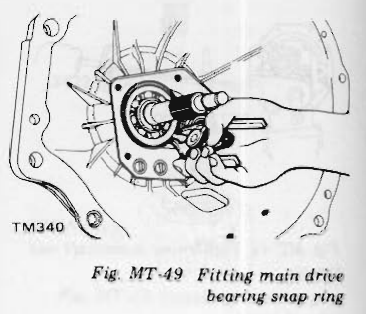
>
> - **Summary:** Using snap ring expander to seat large snap ring into the main drive bearing outer race groove through front case opening.
> - **Components:** Transmission case, Main drive bearing, Outer snap ring, Snap ring expander pliers
> - **Mechanic Notes:** Ensure snap ring is fully seated in outer race groove around its entire circumference.
> - **Tags:** `main drive bearing`, `snap ring`, `expander`, `transmission case`

#### Rear extension

1. Clean mating surfaces of adapter plate and rear extension.
   Apply sealant to mating surfaces of adapter plate and rear extension.
2. With fork rods in their neutral positions, gradually slide rear extension onto adapter plate, making sure that striking lever engages with fork rod brackets correctly.
3. Install washers and through-bolts and torque to 1.6 to 2.1 kg-m (12 to 15 ft-lb).

#### Front cover assembly

1. Select countershaft front bearing shim as follows:
   (1) Measure height "A" from front end of transmission case to countershaft front bearing.
   (2) Select a shim of thickness "A" measured.

> 🖼️ **Fig. MT-50 Selecting counter gear front bearing shim** `[TM371]` *(Type: `inspection_measurement`)*
>
> 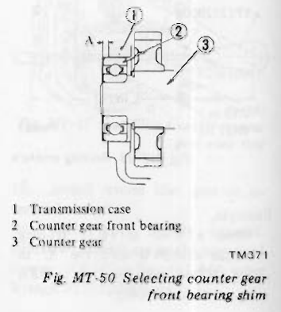
>
> - **Summary:** Diagram illustrating depth measurement dimension 'A' from front face of transmission case to the counter gear front bearing outer race for shim selection.
> - **Components:** Transmission case, Counter gear front bearing, Counter gear
> - **Callouts:** **(1)** Transmission case; **(2)** Counter gear front bearing; **(3)** Counter gear; **(A)** Measurement dimension from case front face to bearing face
> - **Specs / Measurements:** Dimension 'A' range: 2.92 to 3.71 mm (0.1150 to 0.1461 in)
> - **Mechanic Notes:** Accurately measure depth 'A' using depth micrometer or vernier caliper to choose proper compensating shim.
> - **Tags:** `counter gear front bearing`, `shim selection`, `dimension A`, `clearance` <!-- Page 13 (MT-13) --> **Available shim**

| No. | "A" mm (in) | Counter gear front bearing shim mm (in) |
| :---: | :---: | :---: |
| 1 | 2.92 to 3.01 (0.1150 to 0.1185) | 0.6 (0.024) |
| 2 | 3.02 to 3.11 (0.1189 to 0.1224) | 0.5 (0.020) |
| 3 | 3.12 to 3.21 (0.1228 to 0.1264) | 0.4 (0.016) |
| 4 | 3.22 to 3.31 (0.1268 to 0.1303) | 0.3 (0.012) |
| 5 | 3.32 to 3.41 (0.1307 to 0.1343) | 0.2 (0.008) |
| 6 | 3.42 to 3.51 (0.1346 to 0.1382) | 0.1 (0.004) |
| 7 | 3.52 to 3.61 (0.1386 to 0.1421) | — |
| 8 | 3.62 to 3.71 (0.1425 to 0.1461) | — |

2. Clean mating surfaces of front cover and transmission case.
   Apply grease to shim selected to retain it on front cover; install front cover to transmission case with gasket in place.
   Install through-bolts with washers under them and tighten to 1.6 to 2.1 kg-m (12 to 15 ft-lb) torque.
   Apply sealant to threads of through-bolts before installation.
3. Install speedometer pinion.
4. Install back-up lamp switch and torque to 2.0 to 3.0 kg-m (14 to 22 ft-lb).
   Be sure to apply sealant before installation.
5. Apply a light coat of multi-purpose grease to withdrawal lever, release bearing and bearing sleeve; install them on clutch housing.
   After connecting them with holder spring, install dust cover on clutch housing.
6. Install control lever temporarily, and shift control lever through all gears to make sure that gears operate smoothly.

> **Note:** Install drain plug and filler plug with sealant in place.

# 5-SPEED TRANSMISSION (TYPE: FS5W71B)

## CONTENTS

| Section | Page | Section | Page |
| :--- | :--- | :--- | :--- |
| **REMOVAL AND INSTALLATION** | MT-16 | **INSPECTION** | MT-17 |
| **DISASSEMBLY** | MT-16 | **ASSEMBLY** | MT-17 |
| &nbsp;&nbsp;HOUSING | MT-16 | &nbsp;&nbsp;FRONT COVER | MT-17 |
| &nbsp;&nbsp;FORK ROD | MT-16 | &nbsp;&nbsp;REAR EXTENSION | MT-17 |
| &nbsp;&nbsp;GEAR | MT-16 | &nbsp;&nbsp;ADAPTER PLATE | MT-17 |
| &nbsp;&nbsp;REAR EXTENSION | MT-17 | &nbsp;&nbsp;GEAR | MT-17 |
| &nbsp;&nbsp;ADAPTER PLATE | MT-17 | &nbsp;&nbsp;HOUSING | MT-18 |

---

<!-- Page 14 (MT-14) -->

> 🖼️ **Fig. MT-51 FS5W71B transmission** `[TM128A]` *(Type: `cutaway_flow`)*
>
> 
>
> - **Summary:** Cross-sectional longitudinal cutaway view of FS5W71B 5-speed manual transmission showing overdrive gear arrangement behind adapter plate, servo synchro mechanism, and all internal shafts and gears.
> - **Components:** Front cover, Main drive gear, Baulk ring, Coupling sleeve, Shifting insert, Synchronizer hub, 3rd & 4th, 3rd main gear, 2nd main gear, Needle bearing, Adapter plate, 1st main gear, Bearing retainer, Reverse main gear, Synchro ring, Band brake, Overdrive main gear, Rear extension housing, Transmission case, Counter drive gear, Counter gear, Reverse counter gear, Reverse idler gear, Reverse idler shaft, Overdrive counter gear, Mainshaft
> - **Callouts:** **(1)** Front cover; **(2)** Main drive gear; **(3)** Baulk ring; **(4)** Coupling sleeve; **(5)** Shifting insert; **(6)** Synchronizer hub, 3rd & 4th; **(7)** 3rd main gear; **(8)** 2nd main gear; **(9)** Needle bearing; **(10)** Adapter plate; **(11)** 1st main gear; **(12)** Bearing retainer; **(13)** Reverse main gear; **(14)** Synchro ring; **(15)** Band brake; **(16)** Overdrive main gear; **(17)** Rear extension housing; **(18)** Transmission case; **(19)** Counter drive gear; **(20)** Counter gear; **(21)** Reverse counter gear; **(22)** Reverse idler gear; **(23)** Reverse idler shaft; **(24)** Overdrive counter gear; **(25)** Mainshaft
> - **Mechanic Notes:** FS5W71B features Warner synchromesh on 1st-4th gears and Porsche-type servo synchromesh with band brake on 5th (overdrive) gear.
> - **Tags:** `FS5W71B`, `5-speed transmission`, `cutaway`, `overdrive`, `servo synchro`, `geartrain`

> 🖼️ **Fig. MT-52 FS5W71B transmission case components** `[TM046A]` *(Type: `exploded_view`)*
>
> 
>
> - **Summary:** Exploded view diagram of FS5W71B 5-speed transmission casing assemblies, front cover, adapter plate, rear extension housing, breather, and oil seals.
> - **Components:** Front cover, Front cover oil seal, Front cover gasket, Transmission case, Adapter plate, Mainshaft bearing, Bearing retainer, Rear extension, Breather, Rear extension oil seal, Sleeve yoke dust cover
> - **Callouts:** **(1)** Front cover; **(2)** Front cover oil seal; **(3)** Front cover gasket; **(4)** Transmission case; **(5)** Adapter plate; **(6)** Mainshaft bearing; **(7)** Bearing retainer; **(8)** Rear extension; **(9)** Breather; **(10)** Rear extension oil seal; **(11)** Sleeve yoke dust cover
> - **Mechanic Notes:** Note breather vent location on top of rear extension housing and dust cover on rear sleeve yoke.
> - **Tags:** `FS5W71B`, `case components`, `exploded view`, `rear extension`, `front cover`, `breather`

---

<!-- Page 15 (MT-15) -->

> 🖼️ **Fig. MT-53 FS5W71B transmission gear components** `[TM047A]` *(Type: `exploded_view`)*
>
> 
>
> - **Summary:** Exploded view illustration of all gear train components of FS5W71B 5-speed transmission including overdrive main gear, overdrive synchronizer components, reverse gears, countershaft cluster, and reverse idler shaft.
> - **Components:** Main drive gear, Baulk ring, Shifting insert, Shifting insert spring, Synchronizer hub, Coupling sleeve, 3rd main gear, Needle bearing, Mainshaft, 2nd main gear, Bushing, 1st main gear, OD-reverse synchronizer hub, Reverse main gear, Circlip, Thrust block, Brake band, Synchronizer ring, Overdrive main gear, Overdrive gear bushing, Washer, Mainshaft nut, Mainshaft rear bearing, Speedometer drive gear, Counter gear front bearing shim, Counter gear front bearing, Counter drive gear, Counter gear, Counter gear bearing, Reverse counter gear spacer, Reverse counter gear, Overdrive counter gear, Counter gear rear bearing, Counter gear nut, Reverse idler shaft, Reverse idler thrust washer, Reverse idler gear, Reverse idler gear bearing, Reverse idler thrust washer
> - **Callouts:** **(1)** Main drive gear; **(2)** Baulk ring; **(3)** Shifting insert; **(4)** Shifting insert spring; **(5)** Synchronizer hub; **(6)** Coupling sleeve; **(7)** 3rd main gear; **(8)** Needle bearing; **(9)** Mainshaft; **(10)** 2nd main gear; **(11)** Bushing; **(12)** 1st main gear; **(13)** OD-reverse synchronizer hub; **(14)** Reverse main gear; **(15)** Circlip; **(16)** Thrust block; **(17)** Brake band; **(18)** Synchronizer ring; **(19)** Overdrive main gear; **(20)** Overdrive gear bushing; **(21)** Washer; **(22)** Mainshaft nut; **(23)** Mainshaft rear bearing; **(24)** Speedometer drive gear; **(25)** Counter gear front bearing shim; **(26)** Counter gear front bearing; **(27)** Counter drive gear; **(28)** Counter gear; **(29)** Counter gear bearing; **(30)** Reverse counter gear spacer; **(31)** Reverse counter gear; **(32)** Overdrive counter gear; **(33)** Counter gear rear bearing; **(34)** Counter gear nut; **(35)** Reverse idler shaft; **(36)** Reverse idler thrust washer; **(37)** Reverse idler gear; **(38)** Reverse idler gear bearing; **(39)** Reverse idler thrust washer
> - **Mechanic Notes:** Observe assembly sequence of OD brake band (17), thrust block (16), synchro ring (18), and circlip (15). Discard nuts 22 and 34 after removal.
> - **Tags:** `FS5W71B`, `gear components`, `geartrain`, `exploded view`, `overdrive`, `servo synchro`, `mainshaft`, `countershaft`

---

<!-- Page 16 (MT-16) -->

> 🖼️ **Fig. MT-54 FS5W71B transmission shift control components**  *(Type: `exploded_view`)*
>
> 
>
> - **Summary:** Exploded view diagram of FS5W71B shift control linkages, including striking lever, striking guide, striking rod, expansion plug, fork rods (including reverse & OD rod), and shift forks.
> - **Components:** Striking lever, Lock pin, O-ring, Striking guide, Oil seal, Striking rod, Expansion plug, Stopper guide pin, Return spring, Return spring plug, Return spring plunger, Check ball plug, Check spring, Check ball, Retaining pin, Interlock ball, 1st & 2nd shift fork, 1st & 2nd fork rod, 3rd & 4th fork rod, Reverse & OD fork rod, 3rd & 4th shift fork, Reverse & OD shift fork, Control lever, Control lever pin, Control lever bushing
> - **Callouts:** **(1)** Striking lever; **(2)** Lock pin; **(3)** O-ring; **(4)** Striking guide; **(5)** Oil seal; **(6)** Striking rod; **(7)** Expansion plug; **(8)** Stopper guide pin; **(9)** Return spring; **(10)** Return spring plug; **(11)** Return spring plunger; **(12)** Check ball plug; **(13)** Check spring; **(14)** Check ball; **(15)** Retaining pin; **(16)** Interlock ball; **(17)** 1st & 2nd shift fork; **(18)** 1st & 2nd fork rod; **(19)** 3rd & 4th fork rod; **(20)** Reverse & OD fork rod; **(21)** 3rd & 4th shift fork; **(22)** Reverse & OD shift fork; **(23)** Control lever; **(24)** Control lever pin; **(25)** Control lever bushing
> - **Mechanic Notes:** FS5W71B features combined reverse & overdrive shift fork and fork rod. Expansion plug (7) seals rear end of striking rod bore.
> - **Tags:** `FS5W71B`, `shift control`, `shift forks`, `fork rods`, `exploded view`, `overdrive fork`

## REMOVAL AND INSTALLATION

Same as for the F4W71B.

## DISASSEMBLY

Disassembly and assembly procedures are almost the same as those for the F4W71B. Unless otherwise noted, refer to the F4W71B.

### HOUSING

Same as for the F4W71B.

### FORK ROD

Same as for the F4W71B.

### GEAR

#### Gear assembly

1. Remove counter gear front bearing.
2. Remove counter drive gear snap ring.
3. Draw out counter drive gear and main drive gear.
4. With gears doubly engaged, release staking on counter gear nut and mainshaft nut then loosen them.
   Remove counter gear nut.

> **Note:** Counter gear nut and mainshaft nut should be discarded and should not be reused.

> 🖼️ **Fig. MT-55 Removing counter gear nut** `[TM757]` *(Type: `procedure_step`)*
>
> 
>
> - **Summary:** Loosening counter gear nut at rear of countershaft with socket wrench while gears are doubly engaged.
> - **Components:** Counter gear nut, Countershaft, Socket wrench
> - **Mechanic Notes:** Unstake locking flange before loosening. Counter gear nut and mainshaft nut must be discarded and never reused.
> - **Tags:** `counter gear nut`, `socket`, `loosening`, `disassembly`, `FS5W71B`

5. Draw out counter overdrive gear and bearing from countershaft rear end by using a suitable gear puller.

> 🖼️ **Fig. MT-56 Removing counter overdrive gear and bearing** `[TM758]` *(Type: `procedure_step`)*
>
> 
>
> - **Summary:** Drawing counter overdrive gear and rear ball bearing off the countershaft rear extension using a puller.
> - **Components:** Counter overdrive gear, Countershaft rear bearing, Gear puller
> - **Mechanic Notes:** Use a suitable puller engaged behind the bearing outer/inner race.
> - **Tags:** `counter overdrive gear`, `rear bearing`, `puller`, `countershaft`, `disassembly`

6. Remove reverse counter gear and spacer.
7. Remove snap ring from reverse idler shaft, and remove reverse idler gear.
8. Remove snap rings and then draw out speedometer gear and bearing from mainshaft rear side. When drawing out mainshaft rear bearing, use Mainshaft Rear Bearing Puller KV32101330.

> 🖼️ **Fig. MT-57 Removing mainshaft rear bearing** `[TM760]` *(Type: `procedure_step`)*
>
> 
>
> - **Summary:** Using Mainshaft Rear Bearing Puller KV32101330 to draw the mainshaft rear ball bearing off the mainshaft.
> - **Components:** Mainshaft rear bearing, Mainshaft, Mainshaft Rear Bearing Puller KV32101330
> - **Callouts:** **(KV32101330)** Bearing puller tool
> - **Specs / Measurements:** Special tool: KV32101330
> - **Mechanic Notes:** Remove snap rings and speedometer gear before pulling mainshaft rear bearing.
> - **Tags:** `KV32101330`, `mainshaft rear bearing`, `bearing puller`, `special service tool`

9. Remove mainshaft nut, thrust washer, reverse main gear, OD synchronizer and overdrive gear.
10. Draw out mainshaft assembly together with countershaft by lightly tapping the rear end with a soft hammer while holding the front of mainshaft gear assembly by hand.
    Be careful not to drop off counter gear.

---

<!-- Page 17 (MT-17) -->
#### Mainshaft

Same as for the F4W71B.

#### Main drive gear

Same as for the F4W71B.

#### Counter gear

Same as for the F4W71B.

### REAR EXTENSION

Same as for the F4W71B.

### ADAPTER PLATE

Same as for the F4W71B.

## INSPECTION

Same as for the F4W71B.

## ASSEMBLY

### FRONT COVER

Same as for the F4W71B.

### REAR EXTENSION

Same as for the F4W71B.

### ADAPTER PLATE

Same as for the F4W71B.

### GEAR

#### 1st & 2nd and 3rd & 4th gear synchronizer

Same as for the F4W71B.

#### OD gear synchronizer

Position synchronizer ring, band brake, thrust block and anchor block on overdrive clutch gear; install circlip.

> 🖼️ **Fig. MT-58 Installing overdrive gear assembly** `[TM449]` *(Type: `alignment_orientation`)*
>
> 
>
> - **Summary:** Front face and sectional view of the Porsche-type servo overdrive synchronizer assembly showing placement of synchro ring, brake band, thrust block, anchor block, and circlip.
> - **Components:** Synchro ring, Bandbrake, Circlip, Anchor block, Thrust block, Overdrive clutch gear
> - **Callouts:** **(Synchro ring)** Synchro ring; **(Bandbrake)** Bandbrake; **(Circlip)** Circlip; **(Anchor block)** Anchor block; **(Thrust block)** Thrust block
> - **Mechanic Notes:** Carefully fit anchor block and thrust block into their respective recesses in the clutch gear before securing with circlip.
> - **Tags:** `overdrive synchronizer`, `servo synchro`, `band brake`, `thrust block`, `anchor block`, `assembly`, `FS5W71B`

#### Main drive gear

Same as for the F4W71B.

#### Gear assembly

Assembly procedure for the front side is the same as that for the F4W71B. So only rear side is described here.

1. After front side is assembled, assemble snap ring, spacer, needle bearing, reverse idler gear, spacer and snap ring.

> 🖼️ **Fig. MT-59 Reverse idler gear** `[TM451]` *(Type: `alignment_orientation`)*
>
> 
>
> - **Summary:** Assembly cross-section and orientation of the reverse idler gear on its shaft with spacers, needle bearing, and retaining snap rings.
> - **Components:** Reverse idler gear, Reverse idler shaft, Needle bearing, Spacers, Snap rings
> - **Callouts:** **(Front)** Front vehicle direction arrow
> - **Mechanic Notes:** Verify forward facing orientation of reverse idler gear step and ensure snap rings are fully engaged in shaft grooves.
> - **Tags:** `reverse idler gear`, `spacers`, `needle bearing`, `snap ring`, `orientation`

2. Assemble OD-reverse synchronizer hub, reverse gear, OD gear bushing, needle bearing, OD gear assembly, steel ball and thrust washer on mainshaft rear side. Before installing a steel ball, apply grease to it.
3. Assemble new mainshaft nut, and tighten it temporarily.
4. Assemble spacer, reverse counter gear, overdrive counter gear, bearing and new counter gear lock nut.

Tightening torque:  
Counter gear lock nut: **10.0 to 13.0 kg-m (72 to 94 ft-lb)**

5. With gears doubly engaged, tighten mainshaft lock nut.

> 🖼️ **Fig. MT-60 Tightening mainshaft nut** `[TM768]` *(Type: `procedure_step`)*
>
> 
>
> - **Summary:** Tightening mainshaft lock nut on FS5W71B using Special Wrench ST22520000 with gears locked by double engagement.
> - **Components:** Mainshaft lock nut, Special Wrench ST22520000, Torque wrench
> - **Callouts:** **(ST22520000)** Special wrench
> - **Specs / Measurements:** Counter gear lock nut torque: 10.0 to 13.0 kg-m (72 to 94 ft-lb); Mainshaft lock nut converted torque formula: Fig. MT-44
> - **Mechanic Notes:** Use Wrench ST22520000 and calculate converted torque based on torque wrench effective length.
> - **Tags:** `ST22520000`, `mainshaft lock nut`, `counter gear lock nut`, `torque`, `FS5W71B`

6. Stake mainshaft and counter gear nuts to groove of mainshaft and counter gear with a punch.

> 🖼️ **Fig. MT-61 Staking mainshaft nuts** `[TM130A]` *(Type: `procedure_step`)*
>
> 
>
> - **Summary:** Using hammer and punch to stake both the mainshaft lock nut and counter gear lock nut into shaft grooves.
> - **Components:** Mainshaft nut, Counter gear nut, Punch, Mainshaft groove, Countershaft groove
> - **Mechanic Notes:** Both nuts must be securely staked into the respective shaft locking notches.
> - **Tags:** `staking`, `lock nuts`, `punch`, `mainshaft`, `countershaft`, `FS5W71B`

7. Assemble mainshaft rear bearing using Bearing Drift ST22350000. Fit thick snap ring to the rear side of bearing to eliminate end play.

**Available snap ring**

| No. | Thickness mm (in) |
| :---: | :---: |
| 1 | 1.1 (0.043) |
| 2 | 1.2 (0.047) |
| 3 | 1.3 (0.051) |
| 4 | 1.4 (0.055) | <!-- Page 18 (MT-18) --> > 🖼️ **Fig. MT-62 Assembling mainshaft rear bearing** `[TM068A]` *(Type: `procedure_step`)*
>
> 
>
> - **Summary:** Driving mainshaft rear bearing onto mainshaft using Bearing Drift ST22350000 and hammer.
> - **Components:** Mainshaft rear bearing, Mainshaft, Bearing Drift ST22350000, Hammer
> - **Callouts:** **(ST22350000)** Bearing drift tool
> - **Specs / Measurements:** Special tool: ST22350000
> - **Mechanic Notes:** Drive bearing squarely until seated against shoulder, then select thickest snap ring to eliminate axial play.
> - **Tags:** `ST22350000`, `mainshaft rear bearing`, `drift`, `assembly`, `FS5W71B`

8. Fit snap ring to front of speedometer drive gear.
9. Assemble steel ball, speedometer drive gear and rear snap ring.

### Shift forks and fork rods

Same as for the F4W71B.

### HOUSING

Same as for the F4W71B.

# SERVICE DATA AND SPECIFICATIONS

## GENERAL SPECIFICATIONS

| Transmission type | F4W71B | FS5W71B |
| :--- | :--- | :--- |
| **Shift pattern** | 1 &nbsp; 3 |&nbsp;&nbsp;&nbsp;| +---+ |&nbsp;&nbsp;&nbsp;|&nbsp;&nbsp;&nbsp;| 2 &nbsp; 4 &nbsp; R | 1 &nbsp; 3 &nbsp; 5 |&nbsp;&nbsp;&nbsp;|&nbsp;&nbsp;&nbsp;| +---+---+ |&nbsp;&nbsp;&nbsp;|&nbsp;&nbsp;&nbsp;| 2 &nbsp; 4 &nbsp; R |
| **Synchromesh type** | Warner | 1st to 4th Warner, 5th Servo |
| **Gear ratio** | | |
| 1st | 3.321 | 3.321 |
| 2nd | 2.077 | 2.077 |
| 3rd | 1.308 | 1.308 |
| 4th | 1.000 | 1.000 |
| 5th | — | 0.864 |
| Reverse | 3.382 | 3.382 |
| **Number of teeth** | | |
| Main drive gear | 22 | 22 |
| Main gear: 1st | 33 | 33 |
| Main gear: 2nd | 28 | 28 |
| Main gear: 3rd | 26 | 26 |
| Main gear: 5th | — | 19 |
| Main gear: Reverse | 36 | 36 |
| Counter drive gear | 31 | 31 |
| Counter gear: 1st | 14 | 14 |
| Counter gear: 2nd | 19 | 19 |
| Counter gear: 3rd | 28 | 28 |
| Counter gear: 5th | — | 31 |
| Counter gear: Reverse | 15 | 15 |
| Reverse idler gear | 23 | 23 |
| **Oil capacity** liter (US pt, Imp pt) | 1.7 (3 5/8, 3) | 2.0 (4 1/4, 3 1/2) |
| **Speedometer gear ratio** | 17/6 | 17/6 |
| **Final gear ratio** | 3.545 | 3.545 |
| **Tire size** | 195/70HR-14 | 195/70HR-14 |

---

<!-- Page 19 (MT-19) -->
# INSPECTION AND REPAIR

| Transmission type | F4W71B | FS5W71B |
| :--- | :--- | :--- |
| **Gear backlash** mm (in) | | |
| Main drive gear | 0.05 to 0.10 (0.0020 to 0.0039) | 0.05 to 0.10 (0.0020 to 0.0039) |
| 1st gear | 0.05 to 0.20 (0.0020 to 0.0079) | 0.05 to 0.20 (0.0020 to 0.0079) |
| 2nd gear | 0.05 to 0.20 (0.0020 to 0.0079) | 0.05 to 0.20 (0.0020 to 0.0079) |
| 3rd gear | 0.05 to 0.20 (0.0020 to 0.0079) | 0.05 to 0.20 (0.0020 to 0.0079) |
| 5th gear | — | 0.05 to 0.20 (0.0020 to 0.0079) |
| Reverse idler gear | 0.05 to 0.20 (0.0020 to 0.0079) | 0.05 to 0.20 (0.0020 to 0.0079) |
| **Gear end play** mm (in) | | |
| 1st gear | 0.32 to 0.39 (0.0126 to 0.0154) | 0.32 to 0.39 (0.0126 to 0.0154) |
| 2nd gear | 0.12 to 0.19 (0.0047 to 0.0075) | 0.12 to 0.19 (0.0047 to 0.0075) |
| 3rd gear | 0.13 to 0.37 (0.0051 to 0.0146) | 0.13 to 0.37 (0.0051 to 0.0146) |
| 5th gear | — | 0.12 to 0.19 (0.0047 to 0.0075) |
| Reverse counter gear | Less than 0.20 (0.0079) | — |
| Reverse idler gear | — | 0.05 to 0.50 (0.0020 to 0.0197) |
| **Baulk ring to cone gap** mm (in) | | |
| Standard | 1.20 to 1.60 (0.0472 to 0.0630) | 1.20 to 1.60 (0.0472 to 0.0630) |
| Allowable limit | 0.8 (0.0315) | 0.8 (0.0315) |
| **Main drive gear snap ring** mm (in) | 1.73 (0.0681) 1.80 (0.0709) 1.87 (0.0736) 1.94 (0.0764) 2.01 (0.0791) 2.08 (0.0819) | 1.73 (0.0681) 1.80 (0.0709) 1.87 (0.0736) 1.94 (0.0764) 2.01 (0.0791) 2.08 (0.0819) |
| **Mainshaft front snap ring** mm (in) | 1.4 (0.055) 1.5 (0.059) 1.6 (0.063) | 1.4 (0.055) 1.5 (0.059) 1.6 (0.063) |
| **Mainshaft rear bearing snap ring** mm (in) | — | 1.1 (0.043) 1.2 (0.047) 1.3 (0.051) 1.4 (0.055) |
| **Counter drive gear snap ring** mm (in) | 1.4 (0.055) 1.5 (0.059) 1.6 (0.063) | 1.4 (0.055) 1.5 (0.059) 1.6 (0.063) |
| **Counter reverse gear snap ring** mm (in) | 1.4 (0.055) 1.5 (0.059) 1.6 (0.063) | — |
| **Counter gear front bearing shim** mm (in) | 0.1 (0.004) 0.2 (0.008) 0.3 (0.012) 0.4 (0.016) 0.5 (0.020) 0.6 (0.024) | 0.1 (0.004) 0.2 (0.008) 0.3 (0.012) 0.4 (0.016) 0.5 (0.020) 0.6 (0.024) |

---

<!-- Page 20 (MT-20) -->
# TIGHTENING TORQUE

| Application | Unit | Tightening torque |
| :--- | :--- | :--- |
| **Transmission installation** | | |
| Clutch operating cylinder installation bolt | kg-m (ft-lb) | 2.5 to 3.0 (18 to 22) |
| Bolt fixing transmission to engine | kg-m (ft-lb) | 4.4 to 5.9 (32 to 43) |
| Bolt fixing engine rear plate to transmission | kg-m (ft-lb) | 0.9 to 1.2 (6.5 to 8.7) |
| Bolt fixing crossmember to body | kg-m (ft-lb) | 3.2 to 4.3 (23 to 31) |
| Bolt fixing rear mounting insulator to crossmember | kg-m (ft-lb) | 3.2 to 4.3 (23 to 31) |
| Bolt fixing rear mounting insulator to rear extension | kg-m (ft-lb) | 3.2 to 4.3 (23 to 31) |
| **Gear assembly** | | |
| Bolt fixing bearing retainer to adapter plate | kg-m (ft-lb) | 1.9 to 2.5 (14 to 18) |
| Mainshaft lock nut | kg-m (ft-lb) | 14.0 to 17.0 (101 to 123) |
| Counter gear lock nut (FS5W71B only) | kg-m (ft-lb) | 10.0 to 13.0 (72 to 94) |
| Bolt fixing rear extension to transmission case | kg-m (ft-lb) | 1.6 to 2.1 (12 to 15) |
| Bolt fixing front cover to transmission case | kg-m (ft-lb) | 1.6 to 2.1 (12 to 15) |
| Filler plug | kg-m (ft-lb) | 2.5 to 3.5 (18 to 25) |
| Drain plug | kg-m (ft-lb) | 2.5 to 3.5 (18 to 25) |

---

<!-- Page 21 (MT-21) -->
# TROUBLE DIAGNOSES AND CORRECTIONS

| Condition | Probable cause | Corrective action |
| :--- | :--- | :--- |
| **Difficult to intermesh gears**  Causes for difficult gear shifting are classified to troubles concerning control system and transmission. When gear shift lever is heavy and it is difficult to shift gears, clutch disengagement may also be unsmooth. First, make sure that clutch operates correctly, and inspect transmission. | Worn gears, shaft, and/or bearing.  Insufficient operating stroke due to worn or loose sliding part.  Faulty or damaged synchronizer. | Replace.  Repair or replace.  Replace. |
| **Gear slips out of mesh.**  In most cases, this trouble occurs, when interlock ball, check ball, and/or spring is worn or weakened, or when control system is faulty. In this case, the trouble cannot be corrected by replacing gears, and therefore, trouble shooting must be carried out carefully. It should also be noted that gear slips out of mesh due to vibration generated by weakened front and rear engine mounts. | Worn interlock ball.  Worn check ball and/or weakened or broken spring.  Worn fork rod ball groove.  Worn or damaged bearing.  Worn or damaged gear. | Replace.  Replace.  Replace.  Replace.  Replace. |
| **Noise**  When noise occurs with engine idling and ceases when clutch is disengaged, or when noise occurs while shifting gears, it is an indication that the noise is from transmission.  > [!NOTE] > Transmission may rattle during engine idling. Check air-fuel mixture and ignition timing. After above procedure, readjust engine idling. | Insufficient or improper lubricant.  Oil leaking due to faulty oil seal or sealant, clogged breather, etc.  Worn bearing (High humming occurs at a high speed.).  Damaged bearing (Cyclic knocking sound occurs also at a low speed.).  Worn spline.  Worn bushing. | Add oil or replace with designated oil.  Clean or replace.  Replace.  Replace.  Replace.  Replace. |

---

<!-- Page 22 (MT-22) -->
# SPECIAL SERVICE TOOLS

| Tool number & tool name | Kent-Moore No. | Reference page or Fig. No. | Unit application | Tool illustration |
| :--- | :--- | :--- | :--- | :--- |
| **ST23810001** Setting plate adapter | J25693 | Fig. MT-14 Fig. MT-15 Fig. MT-41 | * | 

> 🖼️ **ST23810001 Setting plate adapter**  *(Type: `special_service_tool`)*
>
> 
>
> - **Summary:** Setting plate adapter plate fixture for clamping transmission adapter plate securely in a workbench vise during disassembly and assembly.
> - **Components:** Setting plate adapter ST23810001
> - **Specs / Measurements:** Kent-Moore No.: J25693; Reference: Fig. MT-14, Fig. MT-15, Fig. MT-41
> - **Mechanic Notes:** Applicable to all S30 series models.
> - **Tags:** `ST23810001`, `J25693`, `setting plate adapter`, `special service tool`

 |
| **ST22360002** Bearing drift | J25679 | Fig. MT-40 | * | 

> 🖼️ **ST22360002 Bearing drift**  *(Type: `special_service_tool`)*
>
> 
>
> - **Summary:** Cylindrical bearing drift for pressing counter gear front bearing onto the countershaft.
> - **Components:** Bearing drift ST22360002
> - **Specs / Measurements:** Kent-Moore No.: J25679; Reference: Fig. MT-40
> - **Mechanic Notes:** Applicable to all S30 series models.
> - **Tags:** `ST22360002`, `J25679`, `bearing drift`, `special service tool`

 |
| **KV31100300** Fork rod pin punch | — | Fig. MT-15 | * | 

> 🖼️ **KV31100300 Fork rod pin punch**  *(Type: `special_service_tool`)*
>
> 
>
> - **Summary:** Pin punch specifically sized for driving roll retaining pins into and out of shift forks and fork rods.
> - **Components:** Fork rod pin punch KV31100300
> - **Specs / Measurements:** Reference: Fig. MT-15
> - **Mechanic Notes:** Applicable to all S30 series models.
> - **Tags:** `KV31100300`, `pin punch`, `retaining pin`, `special service tool`

 |
| **ST22520000** Wrench | — | Fig. MT-42 Fig. MT-43 Fig. MT-60 | * | 

> 🖼️ **ST22520000 Wrench**  *(Type: `special_service_tool`)*
>
> 
>
> - **Summary:** Special offset torque wrench adapter socket for tightening mainshaft lock nut.
> - **Components:** Wrench ST22520000
> - **Specs / Measurements:** Reference: Fig. MT-42, Fig. MT-43, Fig. MT-60; Offset: 0.10 m (0.33 ft)
> - **Mechanic Notes:** Applicable to all S30 series models. Requires torque calculation conversion formula.
> - **Tags:** `ST22520000`, `wrench`, `mainshaft nut wrench`, `special service tool`

 |
| **ST30031000** Bearing puller | J 25733-1 | Fig. MT-21 Fig. MT-23 Fig. MT-24 | * | 

> 🖼️ **ST30031000 Bearing puller**  *(Type: `special_service_tool`)*
>
> 
>
> - **Summary:** Split-plate bearing puller attachment for dismounting main drive bearing, countershaft bearing, and 1st gear bushing under a press.
> - **Components:** Bearing puller ST30031000
> - **Specs / Measurements:** Kent-Moore No.: J 25733-1; Reference: Fig. MT-21, Fig. MT-23, Fig. MT-24
> - **Mechanic Notes:** Applicable to all S30 series models.
> - **Tags:** `ST30031000`, `J25733-1`, `bearing puller`, `special service tool`

 |
| **KV32101330** Bearing puller | — | Fig. MT-57 | FS5W71B | 

> 🖼️ **KV32101330 Bearing puller**  *(Type: `special_service_tool`)*
>
> 
>
> - **Summary:** Special puller assembly for drawing off mainshaft rear bearing on FS5W71B transmission.
> - **Components:** Bearing puller KV32101330
> - **Specs / Measurements:** Reference: Fig. MT-57; Unit application: FS5W71B
> - **Mechanic Notes:** Specific to FS5W71B 5-speed manual transmission.
> - **Tags:** `KV32101330`, `bearing puller`, `mainshaft rear bearing`, `FS5W71B`, `special service tool`

 |
| **KV31100400** Transmission press stand | — | Fig. MT-34 Fig. MT-35 Fig. MT-36 Fig. MT-40 | * | 

> 🖼️ **KV31100400 Transmission press stand**  *(Type: `special_service_tool`)*
>
> 
>
> - **Summary:** Multi-hole transmission press stand supporting the adapter plate and shafts during shop press operations.
> - **Components:** Transmission press stand KV31100400
> - **Specs / Measurements:** Reference: Fig. MT-34, Fig. MT-35, Fig. MT-36, Fig. MT-40
> - **Mechanic Notes:** Applicable to all S30 series models.
> - **Tags:** `KV31100400`, `press stand`, `adapter plate`, `special service tool`

 |
| **ST22350000** Mainshaft bearing drift | J25678 | Fig. MT-62 | FS5W71B | 

> 🖼️ **ST22350000 Mainshaft bearing drift**  *(Type: `special_service_tool`)*
>
> 
>
> - **Summary:** Tubular drift sleeve used for driving the mainshaft rear bearing onto the mainshaft of FS5W71B transmission.
> - **Components:** Mainshaft bearing drift ST22350000
> - **Specs / Measurements:** Kent-Moore No.: J25678; Reference: Fig. MT-62; Unit application: FS5W71B
> - **Mechanic Notes:** Specific to FS5W71B 5-speed manual transmission.
> - **Tags:** `ST22350000`, `J25678`, `bearing drift`, `mainshaft rear bearing`, `FS5W71B`, `special service tool`

 |
| **ST23860000** Counter gear drift | — | Fig. MT-38 | * | 

> 🖼️ **ST23860000 Counter gear drift**  *(Type: `special_service_tool`)*
>
> 
>
> - **Summary:** Counter gear drift for pressing counter drive gear onto countershaft with gears meshed.
> - **Components:** Counter gear drift ST23860000
> - **Specs / Measurements:** Reference: Fig. MT-38
> - **Mechanic Notes:** Applicable to all S30 series models.
> - **Tags:** `ST23860000`, `counter gear drift`, `counter drive gear`, `special service tool`

 |
| **ST23800000** Transmission adapter | J25691 | Page MT-9 | * | 

> 🖼️ **ST23800000 Transmission adapter**  *(Type: `special_service_tool`)*
>
> 
>
> - **Summary:** Transmission adapter drift sleeve for pressing main drive bearing onto the shaft of the main drive gear.
> - **Components:** Transmission adapter ST23800000
> - **Specs / Measurements:** Kent-Moore No.: J25691; Reference: Page MT-9
> - **Mechanic Notes:** Applicable to all S30 series models.
> - **Tags:** `ST23800000`, `J25691`, `transmission adapter`, `main drive bearing`, `special service tool`

 |

\*: Applicable to all S30 series models

---

## Segmented Diagrams Index

| Figure | Code | Type | Page | Caption | Key Components / Callouts | File |
| :--- | :--- | :--- | :--- | :--- | :--- | :--- |
| **Fig. MT-1** | `TM126A` | `cutaway_flow` | MT-2 | Fig. MT-1 F4W71B transmission | Front cover, Main drive gear, Baulk ring, Coupling sleeve, Shifting insert | [fig_mt_1_f4w71b_transmission.png](diagrams/MT Manual Transmission/fig_mt_1_f4w71b_transmission.png) |
| **Fig. MT-2** | `TM858` | `exploded_view` | MT-3 | Fig. MT-2 F4W71B transmission case components | Front cover, Transmission case, Adapter plate, Bearing retainer, Rear extension housing | [fig_mt_2_f4w71b_transmission_case_components.png](diagrams/MT Manual Transmission/fig_mt_2_f4w71b_transmission_case_components.png) |
| **Fig. MT-3** | `TM857` | `exploded_view` | MT-3 | Fig. MT-3 F4W71B transmission gear components | Main drive gear, Baulk ring, Synchronizer hub, 3rd & 4th, Shifting insert spring, Shifting insert | [fig_mt_3_f4w71b_transmission_gear_components.png](diagrams/MT Manual Transmission/fig_mt_3_f4w71b_transmission_gear_components.png) |
| **Fig. MT-4** | `TM045A` | `exploded_view` | MT-4 | Fig. MT-4 F4W71B transmission shift control components | Striking lever, Lock pin, O-ring, Striking guide, Oil seal | [fig_mt_4_f4w71b_transmission_shift_control_components.png](diagrams/MT Manual Transmission/fig_mt_4_f4w71b_transmission_shift_control_components.png) |
| **Fig. MT-5** | `TM335` | `procedure_step` | MT-4 | Fig. MT-5 Removing control lever | Control lever, Striking rod guide, E-ring, Control lever pin | [fig_mt_5_removing_control_lever.png](diagrams/MT Manual Transmission/fig_mt_5_removing_control_lever.png) |
| **Fig. MT-6** | `TM144A` | `component_location` | MT-4 | Fig. MT-6 Bottom view of car | Reverse lamp switch wires, Clutch operating cylinder, Speedometer cable, Transmission case, Rear extension housing | [fig_mt_6_bottom_view_of_car.png](diagrams/MT Manual Transmission/fig_mt_6_bottom_view_of_car.png) |
| **Fig. MT-7** | `ER193` | `procedure_step` | MT-5 | Fig. MT-7 Removing propeller shaft | Propeller shaft, Flange companion bolts, Rear mounting member | [fig_mt_7_removing_propeller_shaft.png](diagrams/MT Manual Transmission/fig_mt_7_removing_propeller_shaft.png) |
| **Fig. MT-8** | `TM773` | `procedure_step` | MT-5 | Fig. MT-8 Tightening torque | Transmission bellhousing, Engine rear plate, Mounting bolts | [fig_mt_8_tightening_torque.png](diagrams/MT Manual Transmission/fig_mt_8_tightening_torque.png) |
| **Fig. MT-9** | `TM337` | `procedure_step` | MT-5 | Fig. MT-9 Removing striking rod E-ring and stopper pin | Rear extension housing, Striking rod, Stopper guide pin, E-ring | [fig_mt_9_removing_striking_rod_e_ring_and_stopper_pin.png](diagrams/MT Manual Transmission/fig_mt_9_removing_striking_rod_e_ring_and_stopper_pin.png) |
| **Fig. MT-10** | `TM338` | `procedure_step` | MT-5 | Fig. MT-10 Removing return spring plug | Rear extension housing, Return spring plug, Wrench | [fig_mt_10_removing_return_spring_plug.png](diagrams/MT Manual Transmission/fig_mt_10_removing_return_spring_plug.png) |
| **Fig. MT-11** | `TM339` | `procedure_step` | MT-5 | Fig. MT-11 Removing rear extension | Rear extension housing, Adapter plate, Striking rod | [fig_mt_11_removing_rear_extension.png](diagrams/MT Manual Transmission/fig_mt_11_removing_rear_extension.png) |
| **Fig. MT-12** | `TM340` | `procedure_step` | MT-5 | Fig. MT-12 Removing main drive bearing snap ring | Transmission case, Main drive bearing, Snap ring, Snap ring expander pliers | [fig_mt_12_removing_main_drive_bearing_snap_ring.png](diagrams/MT Manual Transmission/fig_mt_12_removing_main_drive_bearing_snap_ring.png) |
| **Fig. MT-13** | `TM341` | `procedure_step` | MT-5 | Fig. MT-13 Removing transmission case | Transmission case, Adapter plate, Soft hammer, Mainshaft | [fig_mt_13_removing_transmission_case.png](diagrams/MT Manual Transmission/fig_mt_13_removing_transmission_case.png) |
| **Fig. MT-14** | `TM342` | `procedure_step` | MT-6 | Fig. MT-14 Attaching gear assembly to special tool | Setting Plate Adapter ST23810001, Adapter plate, Transmission gear assembly, Bench vise | [fig_mt_14_attaching_gear_assembly_to_special_tool.png](diagrams/MT Manual Transmission/fig_mt_14_attaching_gear_assembly_to_special_tool.png) |
| **Fig. MT-15** | `TM088A` | `procedure_step` | MT-6 | Fig. MT-15 Drive out retaining pins | Fork Rod Pin Punch KV31100300, Setting Plate Adapter ST23810001, Shift forks, Fork rods, Retaining roll pins | [fig_mt_15_drive_out_retaining_pins.png](diagrams/MT Manual Transmission/fig_mt_15_drive_out_retaining_pins.png) |
| **Fig. MT-16** | `TM344` | `alignment_orientation` | MT-6 | Fig. MT-16 Layout of check ball and interlock ball | Adapter plate, 1st & 2nd fork rod, 3rd & 4th fork rod, Reverse fork rod, Check balls (3) | [fig_mt_16_layout_of_check_ball_and_interlock_ball.png](diagrams/MT Manual Transmission/fig_mt_16_layout_of_check_ball_and_interlock_ball.png) |
| **Fig. MT-17** | `TM398` | `procedure_step` | MT-6 | Fig. MT-17 Removing countershaft front bearing | Counter gear front bearing, Counter gear, Two-jaw puller | [fig_mt_17_removing_countershaft_front_bearing.png](diagrams/MT Manual Transmission/fig_mt_17_removing_countershaft_front_bearing.png) |
| **Fig. MT-18** | `TM345` | `procedure_step` | MT-6 | Fig. MT-18 Removing counter drive gear and main drive gear | Counter drive gear, Main drive gear, Pilot needle bearing, Mainshaft front end, Gear puller | [fig_mt_18_removing_counter_drive_gear_and_main_drive_gear.png](diagrams/MT Manual Transmission/fig_mt_18_removing_counter_drive_gear_and_main_drive_gear.png) |
| **Fig. MT-19** | `TM346` | `procedure_step` | MT-6 | Fig. MT-19 Removing mainshaft nut | Mainshaft nut, Mainshaft rear end, Socket handle, Staking notch | [fig_mt_19_removing_mainshaft_nut.png](diagrams/MT Manual Transmission/fig_mt_19_removing_mainshaft_nut.png) |
| **Fig. MT-20** | `TM347` | `procedure_step` | MT-6 | Fig. MT-20 Driving out gear assembly | Mainshaft assembly, Counter gear, Adapter plate, Soft hammer | [fig_mt_20_driving_out_gear_assembly.png](diagrams/MT Manual Transmission/fig_mt_20_driving_out_gear_assembly.png) |
| **Fig. MT-21** | `TM049A` | `procedure_step` | MT-6 | Fig. MT-21 Removing 1st gear bushing | 1st gear bushing, 2nd main gear, 1st & 2nd synchronizer assembly, Mainshaft, Bearing Puller ST30031000 | [fig_mt_21_removing_1st_gear_bushing.png](diagrams/MT Manual Transmission/fig_mt_21_removing_1st_gear_bushing.png) |
| **Fig. MT-22** | `TM127A` | `exploded_view` | MT-7 | Fig. MT-22 Mainshaft assembly | Pilot bearing, 3rd & 4th synchronizer assembly, Baulk ring, 3rd main gear, Needle bearing | [fig_mt_22_mainshaft_assembly.png](diagrams/MT Manual Transmission/fig_mt_22_mainshaft_assembly.png) |
| **Fig. MT-23** | `TM349` | `procedure_step` | MT-7 | Fig. MT-23 Removing main drive bearing | Main drive bearing, Main drive gear, Bearing Puller ST30031000 | [fig_mt_23_removing_main_drive_bearing.png](diagrams/MT Manual Transmission/fig_mt_23_removing_main_drive_bearing.png) |
| **Fig. MT-24** | `TM351` | `procedure_step` | MT-7 | Fig. MT-24 Removing countershaft bearing | Countershaft rear bearing, Counter gear, Bearing Puller ST30031000, Press blocks | [fig_mt_24_removing_countershaft_bearing.png](diagrams/MT Manual Transmission/fig_mt_24_removing_countershaft_bearing.png) |
| **Fig. MT-25** | `TM372` | `inspection_measurement` | MT-8 | Fig. MT-25 Inspecting ball bearing | Ball bearing assembly | [fig_mt_25_inspecting_ball_bearing.png](diagrams/MT Manual Transmission/fig_mt_25_inspecting_ball_bearing.png) |
| **Fig. MT-26** | `TM374` | `inspection_measurement` | MT-8 | Fig. MT-26 Measuring end play | Mainshaft gears, Thickness gauge (feeler gauge) | [fig_mt_26_measuring_end_play.png](diagrams/MT Manual Transmission/fig_mt_26_measuring_end_play.png) |
| **Fig. MT-27** | `TM375` | `inspection_measurement` | MT-8 | Fig. MT-27 Baulk ring-to-cone gap | Baulk ring, Gear cone | [fig_mt_27_baulk_ring_to_cone_gap.png](diagrams/MT Manual Transmission/fig_mt_27_baulk_ring_to_cone_gap.png) |
| **Fig. MT-28** | `TM354` | `alignment_orientation` | MT-8 | Fig. MT-28 Front cover oil seal | Front cover, Oil seal, Sealing lip | [fig_mt_28_front_cover_oil_seal.png](diagrams/MT Manual Transmission/fig_mt_28_front_cover_oil_seal.png) |
| **Fig. MT-29** | `TM355` | `alignment_orientation` | MT-8 | Fig. MT-29 Rear extension oil seal | Rear extension housing, Rear oil seal | [fig_mt_29_rear_extension_oil_seal.png](diagrams/MT Manual Transmission/fig_mt_29_rear_extension_oil_seal.png) |
| **Fig. MT-30** | `TM356` | `alignment_orientation` | MT-9 | Fig. MT-30 Oil gutter | Oil gutter, Adapter plate, Dowel pin | [fig_mt_30_oil_gutter.png](diagrams/MT Manual Transmission/fig_mt_30_oil_gutter.png) |
| **Fig. MT-31** | `TM400` | `procedure_step` | MT-9 | Fig. MT-31 Staking screw | Adapter plate, Bearing retainer, Attaching screws, Punch | [fig_mt_31_staking_screw.png](diagrams/MT Manual Transmission/fig_mt_31_staking_screw.png) |
| **Fig. MT-32** | `TM357` | `alignment_orientation` | MT-9 | Fig. MT-32 Installing synchronizer hub | Synchronizer hub (4th & 3rd), Synchronizer hub (2nd & 1st), Coupling sleeve | [fig_mt_32_installing_synchronizer_hub.png](diagrams/MT Manual Transmission/fig_mt_32_installing_synchronizer_hub.png) |
| **Fig. MT-33** | `TM358` | `procedure_step` | MT-9 | Fig. MT-33 Installing thrust washer | Mainshaft, 1st main gear, Thrust washer, Steel ball | [fig_mt_33_installing_thrust_washer.png](diagrams/MT Manual Transmission/fig_mt_33_installing_thrust_washer.png) |
| **Fig. MT-34** | `TM438` | `special_service_tool` | MT-9 | Fig. MT-34 Transmission Press Stand | Transmission Press Stand KV31100400 | [fig_mt_34_transmission_press_stand.png](diagrams/MT Manual Transmission/fig_mt_34_transmission_press_stand.png) |
| **Fig. MT-35** | `TM439` | `procedure_step` | MT-9 | Fig. MT-35 Installing mainshaft assembly | Mainshaft assembly, Adapter plate, Press Stand KV31100400, Hydraulic press ram | [fig_mt_35_installing_mainshaft_assembly.png](diagrams/MT Manual Transmission/fig_mt_35_installing_mainshaft_assembly.png) |
| **Fig. MT-36** | `TM440` | `procedure_step` | MT-10 | Fig. MT-36 Installing counter gear | Counter gear, Adapter plate, Counter gear rear bearing, Press Stand KV31100400 | [fig_mt_36_installing_counter_gear.png](diagrams/MT Manual Transmission/fig_mt_36_installing_counter_gear.png) |
| **Fig. MT-37** | `TM441` | `procedure_step` | MT-10 | Fig. MT-37 Installing snap ring | Mainshaft front end, Thrust washer, Snap ring, Snap ring pliers | [fig_mt_37_installing_snap_ring.png](diagrams/MT Manual Transmission/fig_mt_37_installing_snap_ring.png) |
| **Fig. MT-38** | `TM442` | `procedure_step` | MT-10 | Fig. MT-38 Installing counter drive gear | Counter drive gear, Main drive gear, Counter Gear Drift ST23860000, Counter gear | [fig_mt_38_installing_counter_drive_gear.png](diagrams/MT Manual Transmission/fig_mt_38_installing_counter_drive_gear.png) |
| **Fig. MT-39** | `TM366` | `procedure_step` | MT-10 | Fig. MT-39 Installing snap ring | Counter drive gear, Countershaft, Snap ring, Snap ring pliers | [fig_mt_39_installing_snap_ring.png](diagrams/MT Manual Transmission/fig_mt_39_installing_snap_ring.png) |
| **Fig. MT-40** | `TM443` | `procedure_step` | MT-10 | Fig. MT-40 Installing counter gear front bearing | Counter gear front bearing, Counter gear, Bearing Drift ST22360002, Press Stand KV31100400 | [fig_mt_40_installing_counter_gear_front_bearing.png](diagrams/MT Manual Transmission/fig_mt_40_installing_counter_gear_front_bearing.png) |
| **Fig. MT-41** | `TM361` | `procedure_step` | MT-10 | Fig. MT-41 Installing counter reverse gear snap ring | Counter reverse gear, Countershaft, Snap ring, Setting Plate Adapter ST23810001 | [fig_mt_41_installing_counter_reverse_gear_snap_ring.png](diagrams/MT Manual Transmission/fig_mt_41_installing_counter_reverse_gear_snap_ring.png) |
| **Fig. MT-42** | `TM768` | `procedure_step` | MT-11 | Fig. MT-42 Tightening mainshaft nut | Mainshaft nut, Special Wrench ST22520000, Torque wrench | [fig_mt_42_tightening_mainshaft_nut.png](diagrams/MT Manual Transmission/fig_mt_42_tightening_mainshaft_nut.png) |
| **Fig. MT-43** | `TM587` | `procedure_step` | MT-11 | Fig. MT-43 Setting wrench | Torque wrench, Special Wrench ST22520000 | [fig_mt_43_setting_wrench.png](diagrams/MT Manual Transmission/fig_mt_43_setting_wrench.png) |
| **Fig. MT-44** | `-` | `graph_chart` | MT-11 | Fig. MT-44 Converted torque | Upper limit line, Lower limit line, Converted torque band | [fig_mt_44_converted_torque.png](diagrams/MT Manual Transmission/fig_mt_44_converted_torque.png) |
| **Fig. MT-45** | `TM362` | `procedure_step` | MT-11 | Fig. MT-45 Staking mainshaft nut | Mainshaft nut, Mainshaft groove, Punch, Hammer | [fig_mt_45_staking_mainshaft_nut.png](diagrams/MT Manual Transmission/fig_mt_45_staking_mainshaft_nut.png) |
| **Fig. MT-46** | `TM367` | `procedure_step` | MT-12 | Fig. MT-46 Installing 1st & 2nd fork rod | 1st & 2nd fork rod, 1st & 2nd shift fork, Adapter plate | [fig_mt_46_installing_1st_2nd_fork_rod.png](diagrams/MT Manual Transmission/fig_mt_46_installing_1st_2nd_fork_rod.png) |
| **Fig. MT-47** | `TM368` | `procedure_step` | MT-12 | Fig. MT-47 Installing 3rd & 4th fork rod | 3rd & 4th fork rod, 3rd & 4th shift fork, Adapter plate | [fig_mt_47_installing_3rd_4th_fork_rod.png](diagrams/MT Manual Transmission/fig_mt_47_installing_3rd_4th_fork_rod.png) |
| **Fig. MT-48** | `TM369` | `procedure_step` | MT-12 | Fig. MT-48 Installing reverse fork rod | Reverse fork rod, Reverse shift fork, Adapter plate | [fig_mt_48_installing_reverse_fork_rod.png](diagrams/MT Manual Transmission/fig_mt_48_installing_reverse_fork_rod.png) |
| **Fig. MT-49** | `TM340` | `procedure_step` | MT-12 | Fig. MT-49 Fitting main drive bearing snap ring | Transmission case, Main drive bearing, Outer snap ring, Snap ring expander pliers | [fig_mt_49_fitting_main_drive_bearing_snap_ring.png](diagrams/MT Manual Transmission/fig_mt_49_fitting_main_drive_bearing_snap_ring.png) |
| **Fig. MT-50** | `TM371` | `inspection_measurement` | MT-12 | Fig. MT-50 Selecting counter gear front bearing shim | Transmission case, Counter gear front bearing, Counter gear | [fig_mt_50_selecting_counter_gear_front_bearing_shim.png](diagrams/MT Manual Transmission/fig_mt_50_selecting_counter_gear_front_bearing_shim.png) |
| **Fig. MT-51** | `TM128A` | `cutaway_flow` | MT-14 | Fig. MT-51 FS5W71B transmission | Front cover, Main drive gear, Baulk ring, Coupling sleeve, Shifting insert | [fig_mt_51_fs5w71b_transmission.png](diagrams/MT Manual Transmission/fig_mt_51_fs5w71b_transmission.png) |
| **Fig. MT-52** | `TM046A` | `exploded_view` | MT-14 | Fig. MT-52 FS5W71B transmission case components | Front cover, Front cover oil seal, Front cover gasket, Transmission case, Adapter plate | [fig_mt_52_fs5w71b_transmission_case_components.png](diagrams/MT Manual Transmission/fig_mt_52_fs5w71b_transmission_case_components.png) |
| **Fig. MT-53** | `TM047A` | `exploded_view` | MT-15 | Fig. MT-53 FS5W71B transmission gear components | Main drive gear, Baulk ring, Shifting insert, Shifting insert spring, Synchronizer hub | [fig_mt_53_fs5w71b_transmission_gear_components.png](diagrams/MT Manual Transmission/fig_mt_53_fs5w71b_transmission_gear_components.png) |
| **Fig. MT-54** | `-` | `exploded_view` | MT-16 | Fig. MT-54 FS5W71B transmission shift control components | Striking lever, Lock pin, O-ring, Striking guide, Oil seal | [fig_mt_54_fs5w71b_transmission_shift_control_components.png](diagrams/MT Manual Transmission/fig_mt_54_fs5w71b_transmission_shift_control_components.png) |
| **Fig. MT-55** | `TM757` | `procedure_step` | MT-16 | Fig. MT-55 Removing counter gear nut | Counter gear nut, Countershaft, Socket wrench | [fig_mt_55_removing_counter_gear_nut.png](diagrams/MT Manual Transmission/fig_mt_55_removing_counter_gear_nut.png) |
| **Fig. MT-56** | `TM758` | `procedure_step` | MT-16 | Fig. MT-56 Removing counter overdrive gear and bearing | Counter overdrive gear, Countershaft rear bearing, Gear puller | [fig_mt_56_removing_counter_overdrive_gear_and_bearing.png](diagrams/MT Manual Transmission/fig_mt_56_removing_counter_overdrive_gear_and_bearing.png) |
| **Fig. MT-57** | `TM760` | `procedure_step` | MT-16 | Fig. MT-57 Removing mainshaft rear bearing | Mainshaft rear bearing, Mainshaft, Mainshaft Rear Bearing Puller KV32101330 | [fig_mt_57_removing_mainshaft_rear_bearing.png](diagrams/MT Manual Transmission/fig_mt_57_removing_mainshaft_rear_bearing.png) |
| **Fig. MT-58** | `TM449` | `alignment_orientation` | MT-17 | Fig. MT-58 Installing overdrive gear assembly | Synchro ring, Bandbrake, Circlip, Anchor block, Thrust block | [fig_mt_58_installing_overdrive_gear_assembly.png](diagrams/MT Manual Transmission/fig_mt_58_installing_overdrive_gear_assembly.png) |
| **Fig. MT-59** | `TM451` | `alignment_orientation` | MT-17 | Fig. MT-59 Reverse idler gear | Reverse idler gear, Reverse idler shaft, Needle bearing, Spacers, Snap rings | [fig_mt_59_reverse_idler_gear.png](diagrams/MT Manual Transmission/fig_mt_59_reverse_idler_gear.png) |
| **Fig. MT-60** | `TM768` | `procedure_step` | MT-17 | Fig. MT-60 Tightening mainshaft nut | Mainshaft lock nut, Special Wrench ST22520000, Torque wrench | [fig_mt_60_tightening_mainshaft_nut.png](diagrams/MT Manual Transmission/fig_mt_60_tightening_mainshaft_nut.png) |
| **Fig. MT-61** | `TM130A` | `procedure_step` | MT-17 | Fig. MT-61 Staking mainshaft nuts | Mainshaft nut, Counter gear nut, Punch, Mainshaft groove, Countershaft groove | [fig_mt_61_staking_mainshaft_nuts.png](diagrams/MT Manual Transmission/fig_mt_61_staking_mainshaft_nuts.png) |
| **Fig. MT-62** | `TM068A` | `procedure_step` | MT-18 | Fig. MT-62 Assembling mainshaft rear bearing | Mainshaft rear bearing, Mainshaft, Bearing Drift ST22350000, Hammer | [fig_mt_62_assembling_mainshaft_rear_bearing.png](diagrams/MT Manual Transmission/fig_mt_62_assembling_mainshaft_rear_bearing.png) |
| **ST23810001** | `-` | `special_service_tool` | MT-22 | ST23810001 Setting plate adapter | Setting plate adapter ST23810001 | [tool_st23810001_setting_plate_adapter.png](diagrams/MT Manual Transmission/tool_st23810001_setting_plate_adapter.png) |
| **ST22360002** | `-` | `special_service_tool` | MT-22 | ST22360002 Bearing drift | Bearing drift ST22360002 | [tool_st22360002_bearing_drift.png](diagrams/MT Manual Transmission/tool_st22360002_bearing_drift.png) |
| **KV31100300** | `-` | `special_service_tool` | MT-22 | KV31100300 Fork rod pin punch | Fork rod pin punch KV31100300 | [tool_kv31100300_fork_rod_pin_punch.png](diagrams/MT Manual Transmission/tool_kv31100300_fork_rod_pin_punch.png) |
| **ST22520000** | `-` | `special_service_tool` | MT-22 | ST22520000 Wrench | Wrench ST22520000 | [tool_st22520000_wrench.png](diagrams/MT Manual Transmission/tool_st22520000_wrench.png) |
| **ST30031000** | `-` | `special_service_tool` | MT-22 | ST30031000 Bearing puller | Bearing puller ST30031000 | [tool_st30031000_bearing_puller.png](diagrams/MT Manual Transmission/tool_st30031000_bearing_puller.png) |
| **KV32101330** | `-` | `special_service_tool` | MT-22 | KV32101330 Bearing puller | Bearing puller KV32101330 | [tool_kv32101330_bearing_puller.png](diagrams/MT Manual Transmission/tool_kv32101330_bearing_puller.png) |
| **KV31100400** | `-` | `special_service_tool` | MT-22 | KV31100400 Transmission press stand | Transmission press stand KV31100400 | [tool_kv31100400_transmission_press_stand.png](diagrams/MT Manual Transmission/tool_kv31100400_transmission_press_stand.png) |
| **ST22350000** | `-` | `special_service_tool` | MT-22 | ST22350000 Mainshaft bearing drift | Mainshaft bearing drift ST22350000 | [tool_st22350000_mainshaft_bearing_drift.png](diagrams/MT Manual Transmission/tool_st22350000_mainshaft_bearing_drift.png) |
| **ST23860000** | `-` | `special_service_tool` | MT-22 | ST23860000 Counter gear drift | Counter gear drift ST23860000 | [tool_st23860000_counter_gear_drift.png](diagrams/MT Manual Transmission/tool_st23860000_counter_gear_drift.png) |
| **ST23800000** | `-` | `special_service_tool` | MT-22 | ST23800000 Transmission adapter | Transmission adapter ST23800000 | [tool_st23800000_transmission_adapter.png](diagrams/MT Manual Transmission/tool_st23800000_transmission_adapter.png) |
