# PROPELLER SHAFT & DIFFERENTIAL CARRIER

<!-- Page 1 (PD-1) -->
# SECTION PD

# PROPELLER SHAFT & DIFFERENTIAL CARRIER

| Section | Page |
| :--- | :--- |
| PROPELLER SHAFT | PD-2 |
| DIFFERENTIAL CARRIER (Type R180) | PD-4 |
| DIFFERENTIAL CARRIER (Type R200) | PD-13 |
| SERVICE DATA AND SPECIFICATIONS | PD-24 |
| TROUBLE DIAGNOSES AND CORRECTIONS | PD-26 |
| SPECIAL SERVICE TOOLS | PD-28 |

---

<!-- Page 2 (PD-2) -->
## PROPELLER SHAFT

### CONTENTS

| Topic | Page |
| :--- | :--- |
| DESCRIPTION | PD-2 |
| INSPECTION | PD-2 |
| REMOVAL | PD-2 |
| INSTALLATION | PD-2 |
| CHECKING AND CORRECTING UNBALANCED PROPELLER SHAFT | PD-2 |
| SERVICE DATA AND SPECIFICATIONS | PD-3 |
| TROUBLE DIAGNOSES AND CORRECTIONS | PD-3 |

> 🖼️ **Fig. PD-1 Cross-sectional view of propeller shaft** `[PD368]` *(Type: `cutaway_flow`)*
>
> 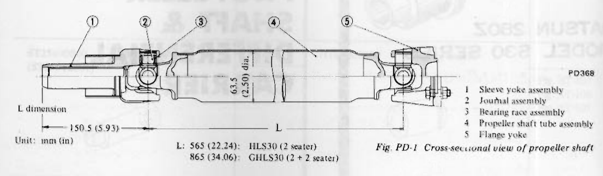
>
> - **Summary:** Cross-sectional view of the 2-joint propeller shaft showing sleeve yoke, journal, bearing race, tube assembly, and flange yoke with dimensions.
> - **Components:** Sleeve yoke assembly, Journal assembly, Bearing race assembly, Propeller shaft tube assembly, Flange yoke
> - **Callouts:** **(1)** Sleeve yoke assembly; **(2)** Journal assembly; **(3)** Bearing race assembly; **(4)** Propeller shaft tube assembly; **(5)** Flange yoke
> - **Specs / Measurements:** L: 565 mm (22.24 in) for HLS30 (2 seater); L: 865 mm (34.06 in) for GHLS30 (2 + 2 seater); Sleeve yoke length: 150.5 mm (5.93 in); Tube diameter: 63.5 mm (2.50 in) dia.
> - **Mechanic Notes:** Propeller shaft and universal joint are balanced as an assembly. Dynamic unbalance under 35 gr-cm (0.49 in-oz) at 5,800 rpm.
> - **Tags:** `propeller shaft`, `driveshaft`, `universal joint`, `sleeve yoke`, `flange yoke`

### DESCRIPTION

The propeller shaft is a 2-joint type. The propeller shaft and universal joint assembly are carefully balanced during original assembly; that is, the dynamic unbalance is under 35 gr-cm (0.49 in-oz) at 5,800 rpm.

The length of propeller shafts differs for HLS30 (2 seater) and GHLS30 (2 + 2 seater) models.

If the propeller shaft is found damaged, replace it as an assembly. When removing or installing the propeller shaft assembly, be careful not to drop it.

### INSPECTION

1. Check journal for axial play. If play exists, replace propeller shaft assembly.

**Note: Journal cannot be disassembled.**

2. Check the propeller shaft tube surface for dents or cracks. If necessary, replace propeller shaft assembly.

### REMOVAL

1. Raise car on hoist. Remove insulator, exhaust tube and main muffler mounting bolts to free them from car body.
2. Scribe match marks both on propeller shaft and companion flange so that shaft can be reinstalled in the original position.
3. Remove bolts securing shaft to companion flange.
4. Draw out propeller shaft sleeve yoke from transmission by moving shaft rearward, passing it under rear axle.

Watch for oil leakage from transmission rear end. Take proper action if oil leak is discovered.

**Note: Remove propeller shaft carefully so as not to damage the spline, sleeve yoke or rear oil seal.**

### INSTALLATION

To install, reverse the foregoing removal procedure.

**CAUTION:**
**Align propeller shaft with companion flange using reference marks prescribed in "Removal" procedure and tighten them with bolts. Failure to do so could result in driving vibration.**

Tightening torque:
- 3.5 to 4.5 kg-m (25 to 33 ft-lb)

### CHECKING AND CORRECTING UNBALANCED PROPELLER SHAFT

To check and correct an unbalanced propeller shaft, proceed as follows:
1. Remove undercoating and other foreign material which could upset shaft balance, and check shaft vibration by road test.
2. If shaft vibration is noted during road test, disconnect propeller shaft at differential carrier companion flange, rotate companion flange 180 degrees and reinstall propeller shaft.
3. Again check shaft vibration. If vibration still persists, replace propeller shaft assembly.

---

<!-- Page 3 (PD-3) -->
## SERVICE DATA AND SPECIFICATIONS

| Item | Unit | Value |
| :--- | :--- | :--- |
| Permissible dynamic unbalance | gr-cm (in-oz) | 35 (0.49) at 5,800 rpm |
| Axial play of spider journal | mm (in) | 0 (0) |
| Journal swinging torque | kg-cm (in-lb) | 3 to 15 (2.6 to 13.0) |
| Tightening torque: Propeller shaft to companion flange bolt | kg-m (ft-lb) | 3.5 to 4.5 (25 to 33) |

## TROUBLE DIAGNOSES AND CORRECTIONS

| Condition | Probable cause | Corrective action |
| :--- | :--- | :--- |
| Vibration at medium or high speed | Worn or damaged universal joint needle bearing. | Replace propeller shaft assembly. |
| | Unbalance due to bent or dented propeller shaft. | Replace propeller shaft assembly. |
| | Loose propeller shaft installation. | Retighten. |
| | Worn transmission rear extension bushing. | Replace. |
| | Undercoating or mud on the shaft causing unbalance. | Clean shaft. |
| | Tire unbalance. | Balance wheel and tire assembly. |
| | Balance weights missing. | Replace. |
| Knocking sound on propeller shaft while starting or noise while coasting. | Worn or damaged universal joint. | Replace propeller shaft assembly. |
| | Worn sleeve yoke and main shaft spline. | Replace propeller shaft assembly. |
| | Loose propeller shaft installation. | Retighten. |
| Scraping noise | Dust cover on sleeve yoke rubbing on transmission rear extension. Dust cover on companion flange rubbing on differential carrier. | Straighten dust cover to remove interference. |

---

<!-- Page 4 (PD-4) -->
## DIFFERENTIAL CARRIER (Type R180)

### CONTENTS

| Topic | Page |
| :--- | :--- |
| DESCRIPTION | PD-4 |
| REMOVAL | PD-6 |
| PRE-DISASSEMBLY INSPECTION | PD-6 |
| DISASSEMBLY | PD-6 |
| DISASSEMBLY OF DIFFERENTIAL CASE | PD-6 |
| INSPECTION | PD-7 |
| ASSEMBLY AND ADJUSTMENT | PD-7 |
| PRECAUTIONS IN REASSEMBLY | PD-7 |
| ASSEMBLY OF DIFFERENTIAL GEAR CASE | PD-7 |
| ADJUSTMENT OF DRIVE PINION PRELOAD | PD-8 |
| ADJUSTMENT OF DRIVE PINION HEIGHT | PD-9 |
| ADJUSTMENT OF SIDE RETAINER SHIMS | PD-10 |
| INSTALLATION | PD-12 |
| REPLACEMENT OF FRONT OIL SEAL | PD-12 |

### DESCRIPTION

The differential gear carrier assembly on the S30 series is available in the different types.

The R180 type differential carrier is adopted on automatic transmission equipped models.

The drive pinion is mounted with one ball bearing and two tapered roller bearings which are preloaded by pinion bearing adjusting spacer and washer during assembly.

The drive pinion is positioned by a washer located between a shoulder of the drive pinion and the rear bearing.

The differential case is supported in the carrier by two tapered roller side bearings. These are preloaded by inserting shims between the carrier and the side retainers. The differential case assembly is positioned for proper ring gear-to-drive pinion backlash by varying these shims. The ring gear is bolted to the differential case. The case houses two side gears in mesh with two pinions mounted on a pinion shaft. The pinion shaft is anchored in the case by lock pin. The pinions and side gears are backed by thrust washers.

| Car model | HLS30 (2 seater) Manual | HLS30 (2 seater) Automatic | GHLS30 (2 + 2 seater) Manual | GHLS30 (2 + 2 seater) Automatic |
| :--- | :--- | :--- | :--- | :--- |
| Type of differential carrier | R200 | R180 | R200 | R180 |
| Gear ratio | 3.545 | 3.545 | 3.545 | 3.545 |

---

<!-- Page 5 (PD-5) -->
## (TYPE R180)

> 🖼️ **Fig. PD-2 Cross-sectional view of differential carrier** `[PD416]` *(Type: `cutaway_flow`)*
>
> 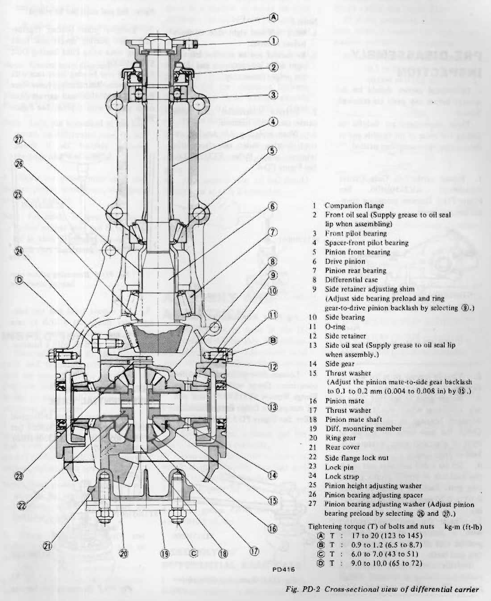
>
> - **Summary:** Cross-sectional longitudinal view of the Type R180 differential carrier showing the internal pinion, differential case, bearings, seals, retainers, and torque callouts.
> - **Components:** Companion flange, Front oil seal, Front pilot bearing, Spacer-front pilot bearing, Pinion front bearing, Drive pinion, Pinion rear bearing, Differential case, Side retainer adjusting shim, Side bearing, O-ring, Side retainer, Side oil seal, Side gear, Thrust washer, Pinion mate, Thrust washer, Pinion mate shaft, Diff. mounting member, Ring gear, Rear cover, Side flange lock nut, Lock pin, Lock strap, Pinion height adjusting washer, Pinion bearing adjusting spacer, Pinion bearing adjusting washer
> - **Callouts:** **(1)** Companion flange; **(2)** Front oil seal (Supply grease to oil seal lip when assembling); **(3)** Front pilot bearing; **(4)** Spacer-front pilot bearing; **(5)** Pinion front bearing; **(6)** Drive pinion; **(7)** Pinion rear bearing; **(8)** Differential case; **(9)** Side retainer adjusting shim (Adjust side bearing preload and ring gear-to-drive pinion backlash by selecting 9.); **(10)** Side bearing; **(11)** O-ring; **(12)** Side retainer; **(13)** Side oil seal (Supply grease to oil seal lip when assembly.); **(14)** Side gear; **(15)** Thrust washer (Adjust the pinion mate-to-side gear backlash to 0.1 to 0.2 mm (0.004 to 0.008 in) by 15.); **(16)** Pinion mate; **(17)** Thrust washer; **(18)** Pinion mate shaft; **(19)** Diff. mounting member; **(20)** Ring gear; **(21)** Rear cover; **(22)** Side flange lock nut; **(23)** Lock pin; **(24)** Lock strap; **(25)** Pinion height adjusting washer; **(26)** Pinion bearing adjusting spacer; **(27)** Pinion bearing adjusting washer (Adjust pinion bearing preload by selecting 26 and 27.); **(A)** Tightening torque: 17 to 20 kg-m (123 to 145 ft-lb); **(B)** Tightening torque: 0.9 to 1.2 kg-m (6.5 to 8.7 ft-lb); **(C)** Tightening torque: 6.0 to 7.0 kg-m (43 to 51 ft-lb); **(D)** Tightening torque: 9.0 to 10.0 kg-m (65 to 72 ft-lb)
> - **Specs / Measurements:** Pinion mate-to-side gear backlash: 0.1 to 0.2 mm (0.004 to 0.008 in); Companion flange nut tightening torque: 17 to 20 kg-m (123 to 145 ft-lb); Side retainer bolt tightening torque: 0.9 to 1.2 kg-m (6.5 to 8.7 ft-lb); Rear cover to mounting member lock nut tightening torque: 6.0 to 7.0 kg-m (43 to 51 ft-lb); Ring gear bolt tightening torque: 9.0 to 10.0 kg-m (65 to 72 ft-lb)
> - **Mechanic Notes:** Supply grease to front oil seal lip and side oil seal lip when assembling.
> - **Tags:** `differential carrier`, `R180`, `cross section`, `drive pinion`, `ring gear`, `differential case`, `bearings`, `preload`

---

<!-- Page 6 (PD-6) -->
### REMOVAL

Service procedures are covered under Gear Carrier in Section RA.

### PRE-DISASSEMBLY INSPECTION

Differential carrier should be inspected before any parts are removed from it.

These inspections are helpful in finding the cause of the trouble and in determining the corrections needed.

1. Mount carrier on Gear Carrier Attachment KV38100800. See Figure PD-3. Remove mounting member and rear cover.

> 🖼️ **Fig. PD-3 Holding differential carrier** `[PD419]` *(Type: `procedure_step`)*
>
> 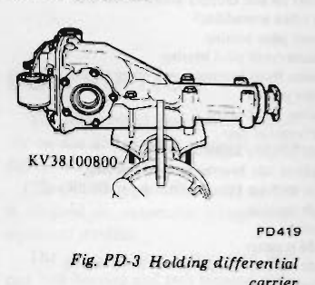
>
> - **Summary:** Differential carrier clamped onto Gear Carrier Attachment KV38100800.
> - **Components:** Differential carrier, Gear Carrier Attachment KV38100800
> - **Callouts:** **(KV38100800)** Gear carrier attachment
> - **Mechanic Notes:** Mount carrier on Gear Carrier Attachment KV38100800 before removing rear cover.
> - **Tags:** `differential carrier`, `KV38100800`, `bench stand`, `attachment`

2. Visually inspect parts for wear or damage.
3. Rotate gears to see that there is any roughness which would indicate damaged bearings or chipped gears. Check the gear teeth for scoring or signs of abnormal wear. Measure preload of drive pinion.
4. Set up a dial indicator and check the backlash at several points around ring gear. Backlash should be within 0.10 to 0.20 mm (0.0039 to 0.0079 in).
5. Check the gear tooth contact with a mixture of recommended powder and oil apply sparingly to all ring gear teeth.

For the tooth contact pattern, see paragraph dealing with tooth contact pattern adjustment.

### DISASSEMBLY

1. Remove side retainer fixing bolts, and extract side retainer.

**Note:**
- **a. Mark left and right side retainers before removal.**
- **b. Be careful not to confuse left and right hand side retainers and shims for proper reassembly.**

2. Extract differential case from carrier using slide hammer.
3. When replacing side bearing, extract bearing outer race from side retainer using Puller ST33290001. See Figure PD-4.

> 🖼️ **Fig. PD-4 Removing side bearing outer race** `[PD243]` *(Type: `procedure_step`)*
>
> 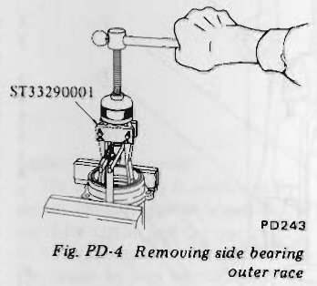
>
> - **Summary:** Extracting side bearing outer race from side retainer using puller ST33290001.
> - **Components:** Side retainer, Side bearing outer race, Puller ST33290001
> - **Callouts:** **(ST33290001)** Puller
> - **Mechanic Notes:** Extract bearing outer race from side retainer using puller ST33290001.
> - **Tags:** `side retainer`, `side bearing`, `outer race`, `ST33290001`

4. Loosen drive pinion nut, holding companion flange with Drive Pinion Flange Wrench ST31530000 and pull off companion flange using a standard puller. See Figure PD-5.

> 🖼️ **Fig. PD-5 Removing drive pinion nut** `[PD178]` *(Type: `procedure_step`)*
>
> 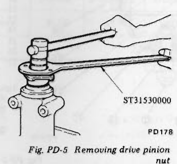
>
> - **Summary:** Loosening drive pinion nut using flange wrench ST31530000 on companion flange.
> - **Components:** Drive pinion nut, Companion flange, Drive Pinion Flange Wrench ST31530000
> - **Callouts:** **(ST31530000)** Drive pinion flange wrench
> - **Mechanic Notes:** Hold companion flange with wrench ST31530000 while loosening nut.
> - **Tags:** `drive pinion nut`, `ST31530000`, `flange wrench`, `companion flange`

5. Extract drive pinion from carrier using a press. Take out drive pinion together with rear bearing cone, bearing spacer and adjusting washers.
6. Remove front oil seal.

**Note: Oil seal must not be reused.**

7. Remove pilot bearing together with pilot bearing spacer and front bearing cone using Pilot Bearing Drift ST30650001.
8. Hold rear bearing inner race with Drive Pinion Rear Bearing Inner Race Puller ST30031000 and extract from drive pinion with a press. See Figure PD-6.

> 🖼️ **Fig. PD-6 Removing pinion rear bearing inner race** `[PD179]` *(Type: `procedure_step`)*
>
> 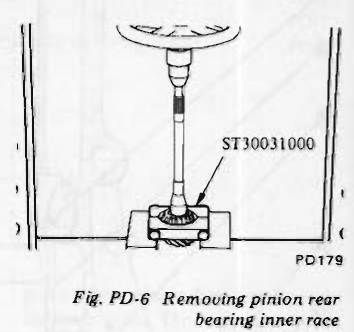
>
> - **Summary:** Holding rear bearing inner race with puller ST30031000 and extracting from drive pinion with a press.
> - **Components:** Drive pinion, Pinion rear bearing inner race, Puller ST30031000
> - **Callouts:** **(ST30031000)** Inner race puller
> - **Mechanic Notes:** Extract from drive pinion with a press.
> - **Tags:** `drive pinion`, `rear bearing inner race`, `ST30031000`, `press`

9. To remove front and rear bearing outer races, put a drift to race surface, and withdraw them by tapping the top of drift with a hammer.

### DISASSEMBLY OF DIFFERENTIAL CASE

1. Extract bearing using Differential Side Bearing Puller ST3306S001 (set of ST33051001 and ST33061000). See Figure PD-7.

> 🖼️ **Fig. PD-7 Removing side bearing** `[PD081]` *(Type: `procedure_step`)*
>
> 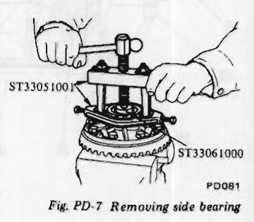
>
> - **Summary:** Extracting side bearing from differential case using puller set ST3306S001.
> - **Components:** Differential case, Side bearing, Puller set ST3306S001, ST33051001, ST33061000
> - **Callouts:** **(ST33051001)** Puller body; **(ST33061000)** Adapter
> - **Mechanic Notes:** Handle puller with care catching the edge of bearing inner race.
> - **Tags:** `differential case`, `side bearing`, `ST3306S001`, `ST33051001`, `ST33061000` <!-- Page 7 (PD-7) --> **Note:**
- **a. The puller should be handled with care in catching the edge of bearing inner race.**
- **b. Be careful not to confuse the left and right hand parts.**

2. Remove ring gear by unfolding lock strap and loosening ring gear bolts.

**Note: Loosen bolts diagonally.**

3. Punch off pinion mate shaft lock pin from ring gear side using Solid Punch KV31100300.

**Note: Lock pin is caulked at pin hole mouth on differential case. Do not punch it off forcibly without checking how it is caulked.**

4. Draw out pinion mate shaft and remove pinion mate gears, side gears and thrust washers.

**Note: Put marks on gear and thrust washer so that they can be reinstalled in their original positions from which they were removed.**

### INSPECTION

Thoroughly clean all disassembled parts, and examine them to see that they are worn, damaged or otherwise defective, and how they are affected. Repair or replace all defective parts, whichever is necessary.

1. Check gear teeth for scoring, cracking or chipping, and make sure that tooth contact pattern indicates correct meshing depth. If any defect is evident, replace parts as required.

**Note: Drive pinion and drive gear are supplied for replacement as a set, therefore, should either part be damaged, replace as a set.**

2. Check pinion gear shaft, and pinion gear for scores and signs of wear, and replace as required.

Follow the same procedure for side gear and their seats on differential case.

3. Inspect all bearing races and rollers for scoring, chipping or evidence of excessive wear. They should be in tiptop condition such as not worn and with mirror-like surfaces. Replace if there is a shadow of doubt on their efficiency, as an incorrect bearing operation may result in noises and gear seizure.
4. Inspect thrust washer faces. Small defects can be corrected with sandpaper. If pinion mate-to-side gear backlash (or the clearance between side gear and thrust washer) exceeds limits 0.1 to 0.2 mm (0.004 to 0.008 in), replace thrust washers.
5. Inspect carrier and differential case for cracks or distortion. If either condition is evident, replace defective parts.
6. As a general rule, oil seal should be replaced at each disassembly.

### ASSEMBLY AND ADJUSTMENT

Assembly can be done in the reverse order of disassembly. The following directions for adjustment and usage of special tools enable to obtain a perfect differential operation.

### PRECAUTIONS IN REASSEMBLY

1. Arrange shims, washers and the like to install them correctly.
2. Thoroughly clean the surfaces on which shims, washers, bearings and bearing retainers are installed.
3. Apply gear oil when installing bearings.
4. Pack grease cavity between lips when fitting oil seal.

### ASSEMBLY OF DIFFERENTIAL GEAR CASE

1. Assemble pinion mates, side gears and thrust washers in differential case.
2. Fit pinion shaft to differential case so that it meets lock pin holes.
3. Adjust side gear-to-pinion mate backlash or adjust the clearance between the rear face of side gear and thrust washer. See Figure PD-8.

If above procedure is not effective with existing washer, try with other washers available for the purpose.

Normal backlash or clearance: 0.1 to 0.2 mm (0.004 to 0.008 in)

> 🖼️ **Fig. PD-8 Measuring clearance** `[PD023]` *(Type: `inspection_measurement`)*
>
> 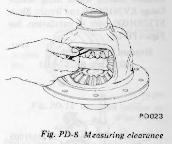
>
> - **Summary:** Feeler gauge inserted between rear face of side gear and thrust washer to measure backlash/clearance.
> - **Components:** Differential case, Side gear, Thrust washer, Feeler gauge
> - **Specs / Measurements:** Normal backlash or clearance: 0.1 to 0.2 mm (0.004 to 0.008 in)
> - **Mechanic Notes:** Adjust side gear-to-pinion mate backlash or adjust clearance between rear face of side gear and thrust washer.
> - **Tags:** `differential case`, `side gear`, `thrust washer`, `feeler gauge`, `clearance`, `backlash`

#### Side gear thrust washer

| Thickness mm (in) |
| :--- |
| 0.75 to 0.80 (0.0295 to 0.0315) |
| 0.80 to 0.85 (0.0315 to 0.0335) |
| 0.85 to 0.90 (0.0335 to 0.0354) |

4. Lock pinion shaft lock pin using a punch after it is secured into place.
5. Apply oil to gear tooth surfaces and thrust surfaces and check if they turn properly.
6. Place ring gear on differential case and install bolts and lock washers.

Tightening torque:
- 9.0 to 10.0 kg-m (65 to 72 ft-lb)

**CAUTION:**
- **a. Use only genuine ring gear bolts and new lock straps.**
- **b. Tighten bolts in criss-cross fashion lightly tapping around bolt heads with a hammer. See Figure PD-9.**

---

<!-- Page 8 (PD-8) -->

> 🖼️ **Fig. PD-9 Tapping bolt head** `[PD124]` *(Type: `procedure_step`)*
>
> 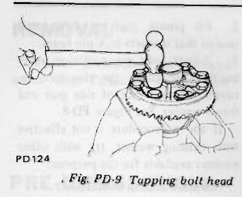
>
> - **Summary:** Tapping bolt heads lightly with hammer while tightening in criss-cross pattern.
> - **Components:** Differential case, Ring gear, Hammer, Wrench
> - **Mechanic Notes:** Tighten bolts in criss-cross fashion lightly tapping around bolt heads with a hammer.
> - **Tags:** `ring gear`, `bolts`, `criss-cross`, `hammer`

7. When replacing side bearing, measure bearing width using Master Gauge KV38101900 and Weight Block ST32501000 prior to installation. See Figure PD-10.

Standard bearing width:
- 20.00 mm (0.7874 in)

> 🖼️ **Fig. PD-10 Measuring bearing width** `[PD320]` *(Type: `inspection_measurement`)*
>
> 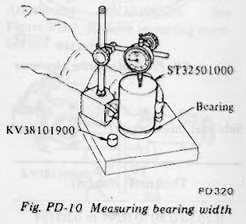
>
> - **Summary:** Measuring side bearing width with Master Gauge KV38101900 and Weight Block ST32501000 under a dial indicator.
> - **Components:** Master Gauge KV38101900, Weight Block ST32501000, Bearing, Dial gauge
> - **Callouts:** **(KV38101900)** Master gauge; **(ST32501000)** Weight block; **(Bearing)** Side bearing
> - **Specs / Measurements:** Standard bearing width: 20.00 mm (0.7874 in)
> - **Mechanic Notes:** Measure bearing width using Master Gauge KV38101900 and Weight Block ST32501000 prior to installation.
> - **Tags:** `side bearing`, `bearing width`, `KV38101900`, `ST32501000`, `master gauge`

8. Press fit side bearing cone on differential case using Gear Carrier Side Bearing Drift ST33230000 and Adapter ST33061000. See Figure PD-11.

> 🖼️ **Fig. PD-11 Installing side bearing cone** `[PD244]` *(Type: `procedure_step`)*
>
> 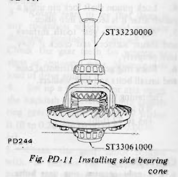
>
> - **Summary:** Press fitting side bearing cone on differential case with drift ST33230000 and adapter ST33061000.
> - **Components:** Differential case, Side bearing cone, Drift ST33230000, Adapter ST33061000
> - **Callouts:** **(ST33230000)** Gear Carrier Side Bearing Drift; **(ST33061000)** Adapter
> - **Mechanic Notes:** Press fit side bearing cone on differential case using drift ST33230000 and adapter ST33061000.
> - **Tags:** `side bearing`, `ST33230000`, `ST33061000`, `press fit`

9. Press fit side bearing outer race into side retainer using Drive Pinion Outer Race Drift Set ST30611000 and ST30621000.
10. Set new oil seal on side retainer using Oil Seal Drift Assembly ST33270000. Apply grease cavity between seal lips.

### ADJUSTMENT OF DRIVE PINION PRELOAD

Adjust preload of drive pinion with spacer and washer between front and rear bearing cones, regardless of thickness of pinion height adjusting washer.

This adjustment must be carried out without oil seal inserted.

1. Press fit front and rear bearing outer races into gear carrier using Drive Pinion Outer Race Drift Set ST30611000, ST30701000 and ST30621000.
   - Front: ST30611000 and ST30701000
   - Rear: ST30611000 and ST30621000
2. Insert Dummy Shaft Spacer ST31851000, pinion height adjusting washer (use one of 3.09 to 3.27 thickness) and rear bearing cone into Dummy Shaft ST31212000 to make convenient to adjust pinion height. See Figure PD-14.

**Note: Reuse the old washer if they have normal tooth contact pattern in a pre-disassembly check.**

3. Fit drive pinion bearing spacer, washer, front bearing cone, Drive Pinion Dummy Collar ST31214000 and companion flange in this order on dummy shaft and tighten drive pinion nut to the specified torque using Stopper ST31852000 and checking pinion bearing preload. See Figure PD-12.

> 🖼️ **Fig. PD-12 Tightening drive pinion nut** `[PD424]` *(Type: `procedure_step`)*
>
> 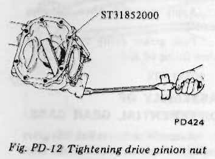
>
> - **Summary:** Tightening drive pinion nut on dummy shaft using stopper ST31852000.
> - **Components:** Carrier housing, Dummy shaft, Pinion nut, Stopper ST31852000, Wrench
> - **Callouts:** **(ST31852000)** Stopper
> - **Specs / Measurements:** Pinion nut torque: 17 to 20 kg-m (123 to 145 ft-lb)
> - **Mechanic Notes:** Tighten drive pinion nut to specified torque using Stopper ST31852000.
> - **Tags:** `drive pinion nut`, `ST31852000`, `dummy shaft`, `stopper`

Measure pinion bearing preload using Preload Gauge ST3127S000, and select washer and spacer that will provide required preload. See Figure PD-13.

Pinion bearing preload (without oil seal):
- 10 to 13 kg-cm (8.7 to 11.3 in-lb)

Tightening torque of pinion nut:
- 17 to 20 kg-m (123 to 145 ft-lb)

**Note: Replace bearing washer and spacer with thicker ones if pinion cannot be turned by hand while it is being tightened.**

> 🖼️ **Fig. PD-13 Measuring pinion preload** `[PD245]` *(Type: `inspection_measurement`)*
>
> 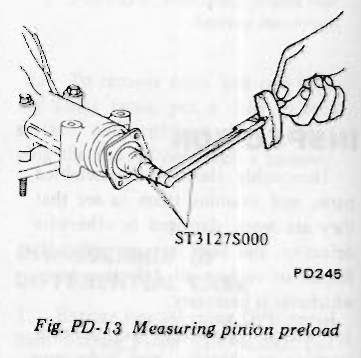
>
> - **Summary:** Measuring pinion bearing preload using torque wrench preload gauge ST3127S000.
> - **Components:** Differential carrier, Preload gauge ST3127S000, Pinion nut
> - **Callouts:** **(ST3127S000)** Preload gauge
> - **Specs / Measurements:** Pinion bearing preload (without oil seal): 10 to 13 kg-cm (8.7 to 11.3 in-lb)
> - **Mechanic Notes:** Measure preload without oil seal inserted.
> - **Tags:** `pinion preload`, `ST3127S000`, `preload gauge`, `torque wrench`

#### Pinion bearing adjusting spacer

| Length mm (in) |
| :--- |
| 52.20 (2.0551) |
| 52.40 (2.0630) |
| 52.60 (2.0709) |
| 52.80 (2.0787) |
| 53.00 (2.0866) |
| 53.20 (2.0945) | <!-- Page 9 (PD-9) --> #### Pinion bearing adjusting washer

| Thickness mm (in) |
| :--- |
| 2.30 to 2.32 (0.0906 to 0.0913) |
| 2.32 to 2.34 (0.0913 to 0.0921) |
| 2.34 to 2.36 (0.0921 to 0.0929) |
| 2.36 to 2.38 (0.0929 to 0.0937) |
| 2.38 to 2.40 (0.0937 to 0.0945) |
| 2.40 to 2.42 (0.0945 to 0.0953) |
| 2.42 to 2.44 (0.0953 to 0.0961) |
| 2.44 to 2.46 (0.0961 to 0.0969) |
| 2.46 to 2.48 (0.0969 to 0.0976) |
| 2.48 to 2.50 (0.0976 to 0.0984) |
| 2.50 to 2.52 (0.0984 to 0.0992) |
| 2.52 to 2.54 (0.0992 to 0.1000) |
| 2.54 to 2.56 (0.1000 to 0.1008) |
| 2.56 to 2.58 (0.1008 to 0.1016) |
| 2.58 to 2.60 (0.1016 to 0.1024) |

### ADJUSTMENT OF DRIVE PINION HEIGHT

Adjust pinion height with washer provided between rear bearing cone and back of pinion gear.

1. Install Height Gauge ST31211000 on carrier with dummy shaft mounted. See Figure PD-14.
2. Measure the clearance (N) between the tip end of height gauge and the end surface of dummy shaft, using a thickness gauge. See Figure PD-15.

> 🖼️ **Fig. PD-14 Measuring the clearance** `[PD246]` *(Type: `inspection_measurement`)*
>
> 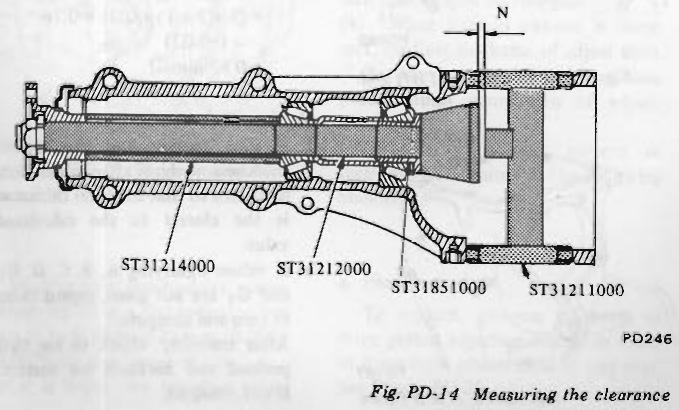
>
> - **Summary:** Cross-sectional drawing showing height gauge ST31211000, dummy shaft ST31212000, spacer ST31851000, and collar ST31214000 setup for measuring clearance N.
> - **Components:** Height gauge ST31211000, Dummy shaft ST31212000, Spacer ST31851000, Collar ST31214000
> - **Callouts:** **(ST31211000)** Height gauge; **(ST31212000)** Dummy shaft; **(ST31851000)** Spacer; **(ST31214000)** Collar; **(N)** Clearance
> - **Mechanic Notes:** Install Height Gauge ST31211000 on carrier with dummy shaft mounted to measure clearance N.
> - **Tags:** `pinion height`, `height gauge`, `dummy shaft`, `ST31211000`, `clearance N`

> 🖼️ **Fig. PD-15 Adjusting pinion height** `[PD091]` *(Type: `inspection_measurement`)*
>
> 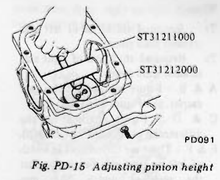
>
> - **Summary:** Using thickness gauge to measure clearance between height gauge ST31211000 and dummy shaft ST31212000.
> - **Components:** Differential carrier, Height gauge ST31211000, Dummy shaft ST31212000, Thickness gauge
> - **Callouts:** **(ST31211000)** Height gauge; **(ST31212000)** Dummy shaft
> - **Mechanic Notes:** Measure clearance N between tip end of height gauge and end surface of dummy shaft.
> - **Tags:** `pinion height`, `thickness gauge`, `ST31211000`, `ST31212000`

3. The thickness of drive pinion height adjusting washer can be obtained from the following formula:

$$T = W + N - [(H - D' - S) \times 0.01] - 0.2$$

Where,
- $T$: Required thickness of rear bearing adjusting washers (mm).
- $W$: Thickness of washers temporarily inserted (mm).
- $N$: Measured value with thickness gauge (mm).
- $H$: Figure marked on the drive pinion head. See Figure PD-16.
- $D'$: Figure marked on the dummy shaft.
- $S$: Figure marked on the height gauge.

Figures for $H$, $D'$ and $S$ are dimensional variations in a unit of 1/100 mm against each standard measurement.

> 🖼️ **Fig. PD-16 Variation number on drive pinion** `[PD186]` *(Type: `alignment_orientation`)*
>
> 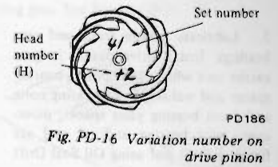
>
> - **Summary:** Drive pinion head showing set number 41 and head number (H) stamped as +2.
> - **Components:** Drive pinion
> - **Callouts:** **(Head number (H))** +2; **(Set number)** 41
> - **Specs / Measurements:** Variation figure in units of 1/100 mm
> - **Mechanic Notes:** Head number (H) represents dimensional variation in 1/100 mm against standard measurement.
> - **Tags:** `drive pinion`, `head number`, `variation number`, `set number`

#### Example of calculation

$$\begin{aligned}
W &= 3.09\text{ mm} \\
N &= 0.33\text{ mm} \\
H &= +2,\; D' = -1,\; S = 0 \\
T &= W + N - [(H - D' - S) \times 0.01] - 0.2 \\
  &= 3.09 + 0.33 - [(2 - (-1) - 0) \times 0.01] - 0.2 \\
  &= 3.19\text{ mm}
\end{aligned}$$

The correct washer is 3.18 mm thick.

#### Pinion height adjusting washer

| Thickness mm (in) |
| :--- |
| 3.09 (0.1217) |
| 3.12 (0.1228) |
| 3.15 (0.1240) |
| 3.18 (0.1252) |
| 3.21 (0.1264) |
| 3.24 (0.1276) |
| 3.27 (0.1287) |
| 3.30 (0.1299) |
| 3.33 (0.1311) |
| 3.36 (0.1323) |
| 3.39 (0.1335) |
| 3.42 (0.1346) |
| 3.45 (0.1358) |
| 3.48 (0.1370) |
| 3.51 (0.1382) |
| 3.54 (0.1394) |
| 3.57 (0.1406) |
| 3.60 (0.1417) |
| 3.63 (0.1429) |
| 3.66 (0.1441) |

4. Fit determined pinion height adjusting washer in drive pinion, and press fit rear bearing cone in it using Base ST30901000. See Figure PD-17.

---

<!-- Page 10 (PD-10) -->

> 🖼️ **Fig. PD-17 Pressing rear bearing cone** `[PD417]` *(Type: `procedure_step`)*
>
> 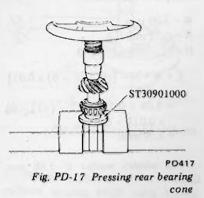
>
> - **Summary:** Pressing drive pinion rear bearing cone onto drive pinion using Base ST30901000.
> - **Components:** Drive pinion, Rear bearing cone, Base ST30901000
> - **Callouts:** **(ST30901000)** Base
> - **Mechanic Notes:** Fit determined pinion height adjusting washer on drive pinion and press fit rear bearing cone.
> - **Tags:** `drive pinion`, `bearing cone`, `ST30901000`, `press`

5. Lubricate pinion front and rear bearings. Install drive pinion in gear carrier into which drive pinion bearing spacer and washer, front bearing cone and front bearing pilot spacer, moreover, pilot bearing and oil seal are fitted. Fit oil seal using Oil Seal Drift ST30720000.
6. Press fit companion flange in drive pinion and secure them in position by tightening nut to specified torque confirming preload.

Tightening torque:
- 17 to 20 kg-m (123 to 145 ft-lb)

Preload (with oil seal):
- 11 to 17 kg-cm (9.5 to 14.8 in-lb)

**Note: If drive pinion lock nut is worn, replace it.**

### ADJUSTMENT OF SIDE RETAINER SHIMS

1. If the hypoid gear set, carrier, differential case, side bearing or side bearing retainer has been replaced with new part, adjust the side bearing preload with adjusting shim. The required thicknesses of the left and right retainer shims can be obtained from the following formulas:

$$T_1 = (A + C + G_1 - D) \times 0.01 + 0.76 - E$$
$$T_2 = (B + D + G_2) \times 0.01 + 0.76 - F$$

Where,
- $T_1$: Required thickness of left side retainer shim (mm).
- $T_2$: Required thickness of right side retainer shim (mm).
- $A$ & $B$: Figure marked on the gear carrier. See Figure PD-19.
- $C$ & $D$: Figure marked on the differential case. See Figure PD-20.
- $E$ & $F$: These are differences in width of left or right side bearing against the standard width 20.0 mm (0.787 in).
- $G_1$ & $G_2$: Figure marked on the left or right side retainer. See Figure PD-21.

**Note:**
- **Figures for $A$, $B$, $C$, $D$, $G_1$, and $G_2$ are dimensional variations in a unit of 1/100 mm (4/10,000 in) against each standard measurement.**
- **To measure width of side bearing, see differential case assembly procedure.**
- **Note: Preload of the old bearing should be the same as that of a new bearing.**

> 🖼️ **Fig. PD-18 Thickness of left and right shims** `[PD093]` *(Type: `cutaway_flow`)*
>
> 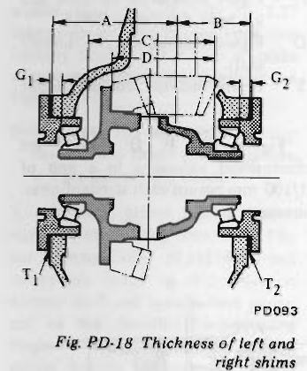
>
> - **Summary:** Section diagram of differential carrier highlighting dimensions A, B, C, D, G1, G2, T1, and T2 for calculating side retainer shim thicknesses.
> - **Components:** Differential carrier, Differential case, Side retainers, Side bearings, Shims
> - **Callouts:** **(A)** Carrier left bore depth variation; **(B)** Carrier right bore depth variation; **(C)** Diff case left bearing seat variation; **(D)** Diff case right bearing seat variation; **(G1)** Left side retainer variation; **(G2)** Right side retainer variation; **(T1)** Left side retainer shim thickness; **(T2)** Right side retainer shim thickness
> - **Mechanic Notes:** Use formulas for T1 and T2 to determine proper shim pack thicknesses.
> - **Tags:** `differential carrier`, `side retainer`, `shims`, `T1`, `T2`, `preload`, `backlash`

> 🖼️ **Fig. PD-19 A & B figure** `[PD187]` *(Type: `component_location`)*
>
> 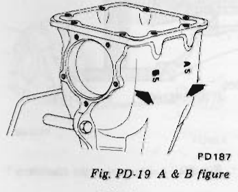
>
> - **Summary:** Differential carrier casting showing stamped figures A and B.
> - **Components:** Differential carrier housing
> - **Callouts:** **(A)** Left bore variation mark; **(B)** Right bore variation mark
> - **Specs / Measurements:** Unit of 1/100 mm (4/10,000 in)
> - **Mechanic Notes:** If values are not given, regard them as zero.
> - **Tags:** `carrier housing`, `stamped figures`, `A and B`

> 🖼️ **Fig. PD-20 C & D figures** `[PD188]` *(Type: `component_location`)*
>
> 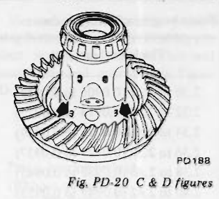
>
> - **Summary:** Differential case showing location of stamped figures C and D.
> - **Components:** Differential case, Ring gear
> - **Callouts:** **(C)** Left side case variation; **(D)** Right side case variation
> - **Specs / Measurements:** Unit of 1/100 mm
> - **Mechanic Notes:** Figures C & D stamped on differential case flange.
> - **Tags:** `differential case`, `stamped figures`, `C and D`

> 🖼️ **Fig. PD-21 G1 & G2 figure** `[PD189]` *(Type: `component_location`)*
>
> 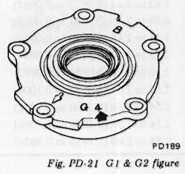
>
> - **Summary:** Side retainer showing stamped figures G1 and G2.
> - **Components:** Side retainer
> - **Callouts:** **(G1)** Left retainer variation mark; **(G2)** Right retainer variation mark
> - **Specs / Measurements:** Unit of 1/100 mm
> - **Mechanic Notes:** Figures stamped on side retainer flange.
> - **Tags:** `side retainer`, `stamped figures`, `G1 and G2`

#### Example of calculation

$$\begin{aligned}
A &= 5,\; B = 5,\; C = 3,\; D = 3 \\
G_1 &= 4,\; G_2 = 1,\; E = -0.01\text{ mm},\; F = +0.02\text{ mm} \\
\text{Left side: } T_1 &= (A + C + G_1 - D) \times 0.01 + 0.76 - E \\
  &= [5 + 3 + 4 - (+3)] \times 0.01 + 0.76 - (-0.01) \\
  &= 0.86\text{ mm} \\
\text{Right side: } T_2 &= (B + D + G_2) \times 0.01 + 0.76 - F \\
  &= (5 + 3 + 1) \times 0.01 + 0.76 - (+0.02) \\
  &= 0.83\text{ mm}
\end{aligned}$$

**Note:**
- **a. If you cannot find the desired thickness of shims after calculation, use shims so that the total thickness is the closest to the calculated value.**
- **b. If values signifying $A$, $B$, $C$, $D$, $G_1$ and $G_2$ are not given, regard them as zero and compute.**
- **After assembly, check to see that preload and backlash are correct. If not, readjust.**

---

<!-- Page 11 (PD-11) -->
#### Side retainer adjusting shim

| Thickness mm (in) |
| :--- |
| 0.20 (0.0079) |
| 0.25 (0.0098) |
| 0.30 (0.0118) |
| 0.40 (0.0157) |
| 0.50 (0.0197) |

2. Install differential case assembly in gear carrier in reverse order to which it is disassembled.
3. Fit given shims and O-ring in both side retainers, and install retainers in carrier using Gear Carrier Side Retainer Guide ST33720000 (See Figure PD-22), and the arrow mark on retainer positioned as shown in Figure PD-23.

**Note: When installing retainers, take care that side bearing outer races are not damaged by roller.**

> 🖼️ **Fig. PD-22 Installing side retainer** `[PD191]` *(Type: `procedure_step`)*
>
> 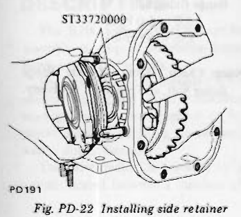
>
> - **Summary:** Installing side retainer into differential carrier using Gear Carrier Side Retainer Guide ST33720000.
> - **Components:** Side retainer, Differential carrier, Gear Carrier Side Retainer Guide ST33720000
> - **Callouts:** **(ST33720000)** Gear carrier side retainer guide
> - **Mechanic Notes:** When installing retainers, take care that side bearing outer races are not damaged by roller.
> - **Tags:** `side retainer`, `ST33720000`, `differential carrier`, `guide`

> 🖼️ **Fig. PD-23 The arrow mark on retainer** `[PD192]` *(Type: `alignment_orientation`)*
>
> 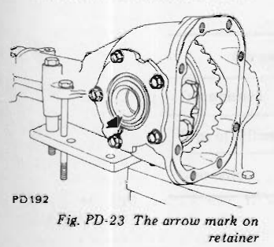
>
> - **Summary:** Orientation of side retainer showing upward pointing arrow mark.
> - **Components:** Side retainer, Differential carrier housing
> - **Mechanic Notes:** Arrow mark on retainer must point in the prescribed direction as shown.
> - **Tags:** `side retainer`, `arrow mark`, `alignment`, `orientation`

4. Measure ring gear-to-drive pinion backlash by using a dial indicator and adjust it to 0.10 to 0.20 mm (0.0039 to 0.0079 in). See Figure PD-24.

If it is below the specified value, move shim from right to left. If it is over it, move it inversely.

> 🖼️ **Fig. PD-24 Measuring the backlash of ring gear and pinion** `[PD097]` *(Type: `inspection_measurement`)*
>
> 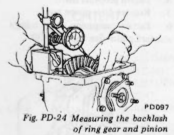
>
> - **Summary:** Dial indicator mounted to check backlash of ring gear against drive pinion.
> - **Components:** Differential carrier, Ring gear, Dial indicator
> - **Specs / Measurements:** Ring gear backlash: 0.10 to 0.20 mm (0.0039 to 0.0079 in)
> - **Mechanic Notes:** If backlash is below specified value, move shim from right to left; if over, move inversely.
> - **Tags:** `backlash`, `ring gear`, `drive pinion`, `dial indicator`

5. At the same time, check side bearing preload. Bearing preload should be 12 to 20 kg-cm (10 to 17 in-lb) of rotating torque at companion flange.

If preload is not according to this specification, adjust it with side retainer shims.

Incidentally, decrease or increase in thickness of shims causes change of ring gear-to-pinion backlash.

Thus, check if they have proper backlash.

6. Check and adjust the tooth contact pattern of ring gear and drive pinion.
- (1) Thoroughly clean ring and drive pinion gear teeth.
- (2) Paint ring gear teeth lightly and evenly with a mixture of recommended powder and oil of a suitable consistency to produce a contact pattern.
- (3) Rotate pinion through several revolutions in the forward and reverse direction until a definite contact pattern is developed on ring gear.
- (4) When contact pattern is incorrect, readjust thickness of adjust shim.

Be sure to wipe off red lead completely upon completion of adjustment.

- (5) Incorrect contact pattern of teeth can be adjusted in the following manner.

**a. Heel contact**
To correct, increase thickness of drive pinion adjusting washer in order to bring drive pinion close to ring gear. See Figure PD-25.

> 🖼️ **Fig. PD-25 Heel contact** `[PD193]` *(Type: `inspection_measurement`)*
>
> 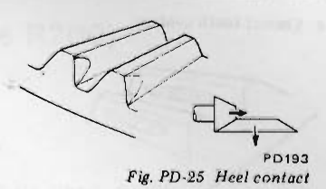
>
> - **Summary:** Tooth contact pattern showing heel contact and correction arrow.
> - **Components:** Gear tooth
> - **Mechanic Notes:** To correct, increase thickness of drive pinion adjusting washer to bring drive pinion closer to ring gear.
> - **Tags:** `tooth contact`, `heel contact`, `adjustment`

**b. Toe contact**
To correct, reduce thickness of drive pinion adjusting washer in order to make drive pinion go away from ring gear. See Figure PD-26.

> 🖼️ **Fig. PD-26 Toe contact** `[PD194]` *(Type: `inspection_measurement`)*
>
> 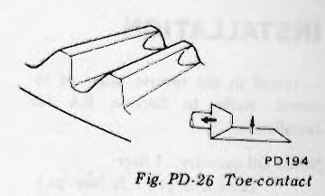
>
> - **Summary:** Tooth contact pattern showing toe contact and correction arrow.
> - **Components:** Gear tooth
> - **Mechanic Notes:** To correct, reduce thickness of drive pinion adjusting washer to move pinion away from ring gear.
> - **Tags:** `tooth contact`, `toe contact`, `adjustment`

**c. Flank contact**
Adjust in the same manner as in b. See Figure PD-27.

> 🖼️ **Fig. PD-27 Flank contact** `[PD195]` *(Type: `inspection_measurement`)*
>
> 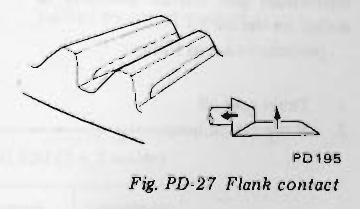
>
> - **Summary:** Tooth contact pattern showing flank contact and correction arrow.
> - **Components:** Gear tooth
> - **Mechanic Notes:** Adjust in the same manner as toe contact (reduce thickness of washer).
> - **Tags:** `tooth contact`, `flank contact`, `adjustment`

**d. Face contact**
Adjust in the same manner as in a. See Figure PD-28.

> 🖼️ **Fig. PD-28 Face contact** `[PD196]` *(Type: `inspection_measurement`)*
>
> 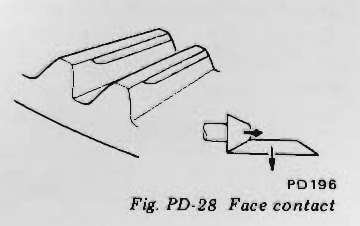
>
> - **Summary:** Tooth contact pattern showing face contact and correction arrow.
> - **Components:** Gear tooth
> - **Mechanic Notes:** Adjust in the same manner as heel contact (increase thickness of washer).
> - **Tags:** `tooth contact`, `face contact`, `adjustment` <!-- Page 12 (PD-12) --> **e. Correct tooth contact**

> 🖼️ **Fig. PD-29 Correct tooth contact** `[PD197]` *(Type: `inspection_measurement`)*
>
> 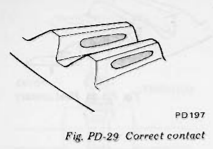
>
> - **Summary:** Ideal tooth contact pattern showing centered contact on tooth flank.
> - **Components:** Gear tooth
> - **Mechanic Notes:** Ideal contact pattern centered across gear tooth profile.
> - **Tags:** `tooth contact`, `correct contact`, `ideal pattern`

**Note: Change in thickness of adjusting washer is accompanied by change in backlash. Check it when installing gear.**

### INSTALLATION

Install in the reverse order of removal. Refer to Section RA for Installation.

**Note: Oil quantity: 1 liter (2 1/8 U.S. pt., 1 3/4 Imp. pt.)**

### REPLACEMENT OF FRONT OIL SEAL

Replacement of front oil seal with differential gear carrier assembly installed on the car.

procedures are as follows:
1. Drain gear oil.
2. Raise car on hoist.
3. Remove insulator, exhaust tube and main muffler mounting bolts to free them from car body.
4. Detach propeller shaft.
5. Remove drive pinion nut.
6. Extract companion flange using a standard puller. See Figure PD-30.

> 🖼️ **Fig. PD-30 Removing companion flange** `[PD264]` *(Type: `procedure_step`)*
>
> 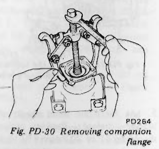
>
> - **Summary:** Standard puller attached to companion flange to extract it from pinion shaft.
> - **Components:** Differential carrier, Companion flange, Puller
> - **Mechanic Notes:** Extract companion flange using a standard puller.
> - **Tags:** `companion flange`, `puller`, `front oil seal`

7. Remove oil seal.
8. Set new oil seal in position using Gear Carrier Oil Seal Drift ST30720000. Apply grease cavity between seal lips.
9. Fit companion flange on drive pinion, and secure them in position by tightening nut to specified torque confirming the following preload, using Drive Pinion Flange Wrench ST31530000.

Tightening torque of pinion nut:
- 17 to 20 kg-m (123 to 145 ft-lb)

Pinion bearing preload (with oil seal):
- 11 to 17 kg-cm (9.5 to 14.8 in-lb)

**Note: The preload of old bearing is the same value as that of a new bearing.**

10. Reinstall propeller shaft by reversing the foregoing removal procedure. And fill up gear oil.

Side oil seal is replaced by using the following procedures:
- (1) Detach drive shaft from gear carrier.
- (2) Remove oil seal.
- (3) Set in new oil seal.

**Note: Apply grease cavity between oil seal lips.**

- (4) Reinstall drive shaft.

Tightening torque of flange yoke fixing bolt:
- 3.2 to 4.3 kg-m (23 to 31 ft-lb)

Drive shaft to companion flange fixing bolt:
- 5.0 to 6.0 kg-m (36 to 43 ft-lb)

**Note: Check O-ring of side flange fixing bolt, and replace if necessary.**

---

<!-- Page 13 (PD-13) -->
## DIFFERENTIAL CARRIER (Type R200)

### CONTENTS

| Topic | Page |
| :--- | :--- |
| DESCRIPTION | PD-13 |
| REMOVAL | PD-15 |
| PRE-DISASSEMBLY INSPECTION | PD-15 |
| DISASSEMBLY | PD-15 |
| DISASSEMBLY OF DIFFERENTIAL CASE | PD-16 |
| INSPECTION | PD-17 |
| ASSEMBLY AND ADJUSTMENT | PD-17 |
| PRECAUTIONS IN REASSEMBLY | PD-17 |
| ASSEMBLY OF DIFFERENTIAL GEAR CASE | PD-17 |
| ADJUSTMENT OF DRIVE PINION PRELOAD | PD-18 |
| ADJUSTMENT OF DRIVE PINION HEIGHT | PD-18 |
| ADJUSTMENT OF SIDE BEARING WASHERS | PD-20 |
| INSTALLATION | PD-22 |
| REPLACEMENT OF OIL SEALS: FRONT OIL SEAL | PD-22 |
| REPLACEMENT OF OIL SEALS: SIDE OIL SEAL | PD-23 |

### DESCRIPTION

The R200 type differential carrier assembly is adopted on manual transmission equipped models.

The drive pinion is mounted with one ball bearing and two tapered roller bearings which are preloaded by pinion bearing adjusting spacer and washer during assembly.

The drive pinion is adjusted by a washer located between a shoulder of the drive pinion and the rear bearing.

The differential case is supported in the carrier by two tapered roller side bearings. These bearings are preloaded with an interference fit of 0.1 mm (0.004 in) to the final drive housing. The side bearing adjustment is properly made by washer(s) inserted between the housing and side bearings. The differential case assembly is positioned for proper ring gear-to-drive pinion backlash by varying these washers. The ring gear is bolted to the differential case. The case houses two side gears in mesh with two pinions mounted on a pinion mate shaft. The pinion mate shaft is anchored in the case by lock pin. The pinions and side gears are backed by thrust washers.

| Car model | HLS30 (2 seater) Manual | HLS30 (2 seater) Automatic | GHLS30 (2 + 2 seater) Manual | GHLS30 (2 + 2 seater) Automatic |
| :--- | :--- | :--- | :--- | :--- |
| Type of differential carrier | R200 | R180 | R200 | R180 |
| Gear ratio | 3.545 | 3.545 | 3.545 | 3.545 |

---

<!-- Page 14 (PD-14) -->
## (TYPE R200)

> 🖼️ **Fig. PD-31 Sectional view of differential carrier** `[PD369]` *(Type: `cutaway_flow`)*
>
> 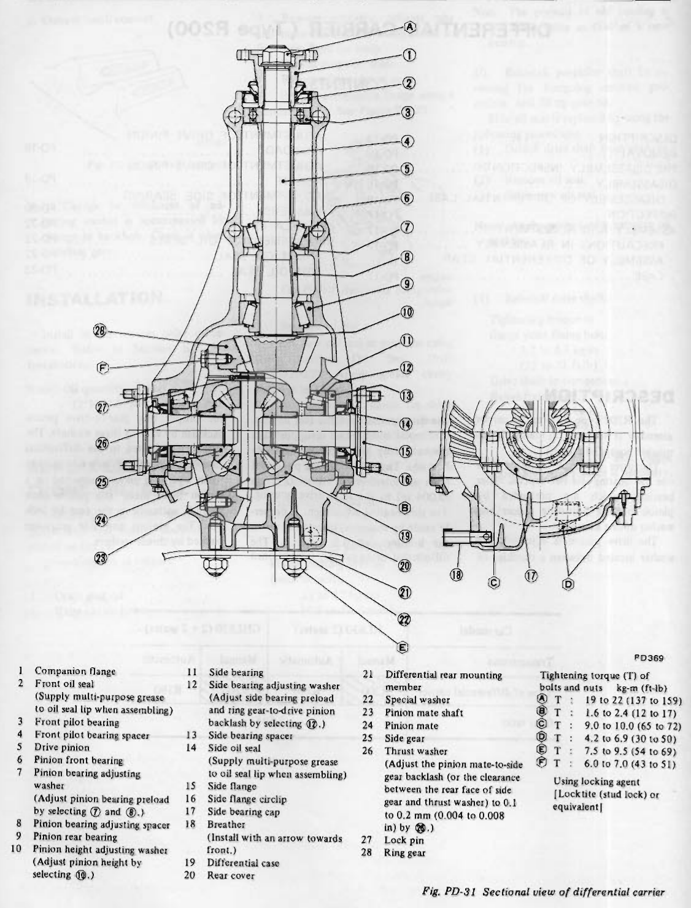
>
> - **Summary:** Detailed cross-sectional and cutaway view of the Type R200 differential carrier showing internal components, bearings, shims, side flanges, breather, and tightening torques.
> - **Components:** Companion flange, Front oil seal, Front pilot bearing, Front pilot bearing spacer, Drive pinion, Pinion front bearing, Pinion bearing adjusting washer, Pinion bearing adjusting spacer, Pinion rear bearing, Pinion height adjusting washer, Side bearing, Side bearing adjusting washer, Side bearing spacer, Side oil seal, Side flange, Side flange circlip, Side bearing cap, Breather, Differential case, Rear cover, Differential rear mounting member, Special washer, Pinion mate shaft, Pinion mate, Side gear, Thrust washer, Lock pin, Ring gear
> - **Callouts:** **(1)** Companion flange; **(2)** Front oil seal (Supply multi-purpose grease to oil seal lip when assembling); **(3)** Front pilot bearing; **(4)** Front pilot bearing spacer; **(5)** Drive pinion; **(6)** Pinion front bearing; **(7)** Pinion bearing adjusting washer (Adjust pinion bearing preload by selecting 7 and 8); **(8)** Pinion bearing adjusting spacer; **(9)** Pinion rear bearing; **(10)** Pinion height adjusting washer (Adjust pinion height by selecting 10); **(11)** Side bearing; **(12)** Side bearing adjusting washer (Adjust side bearing preload and ring gear-to-drive pinion backlash by selecting 12); **(13)** Side bearing spacer; **(14)** Side oil seal (Supply multi-purpose grease to oil seal lip when assembling); **(15)** Side flange; **(16)** Side flange circlip; **(17)** Side bearing cap; **(18)** Breather (Install with an arrow towards front.); **(19)** Differential case; **(20)** Rear cover; **(21)** Differential rear mounting member; **(22)** Special washer; **(23)** Pinion mate shaft; **(24)** Pinion mate; **(25)** Side gear; **(26)** Thrust washer (Adjust the pinion mate-to-side gear backlash to 0.1 to 0.2 mm (0.004 to 0.008 in) by 26); **(27)** Lock pin; **(28)** Ring gear; **(A)** Tightening torque: 19 to 22 kg-m (137 to 159 ft-lb); **(B)** Tightening torque: 1.6 to 2.4 kg-m (12 to 17 ft-lb); **(C)** Tightening torque: 9.0 to 10.0 kg-m (65 to 72 ft-lb); **(D)** Tightening torque: 4.2 to 6.9 kg-m (30 to 50 ft-lb); **(E)** Tightening torque: 7.5 to 9.5 kg-m (54 to 69 ft-lb); **(F)** Tightening torque: 6.0 to 7.0 kg-m (43 to 51 ft-lb) Using locking agent [Locktite (stud lock) or equivalent]
> - **Specs / Measurements:** Pinion mate-to-side gear backlash: 0.1 to 0.2 mm (0.004 to 0.008 in); Drive pinion nut torque: 19 to 22 kg-m (137 to 159 ft-lb); Rear cover fixing bolt torque: 1.6 to 2.4 kg-m (12 to 17 ft-lb); Side bearing cap bolt torque: 9.0 to 10.0 kg-m (65 to 72 ft-lb); Drain/filler plug torque: 4.2 to 6.9 kg-m (30 to 50 ft-lb); Rear cover to mounting member lock nut torque: 7.5 to 9.5 kg-m (54 to 69 ft-lb); Ring gear bolt torque: 6.0 to 7.0 kg-m (43 to 51 ft-lb)
> - **Mechanic Notes:** Breather must be installed with arrow facing forward. Use Loctite (stud lock) or equivalent on ring gear bolts.
> - **Tags:** `differential carrier`, `R200`, `sectional view`, `drive pinion`, `ring gear`, `differential case`, `tightening torque`

---

<!-- Page 15 (PD-15) -->
### REMOVAL

Service procedures are covered under Gear Carrier in Section RA.

### PRE-DISASSEMBLY INSPECTION

Differential carrier should be inspected before parts except rear cover are removed from it.

These inspections are helpful in finding the cause of the problem and in determining necessary corrections.

1. Using three 45 mm (1.77 in) spacers, mount carrier on Gear Carrier Attachment KV38100800. See Figure PD-32.

> 🖼️ **Fig. PD-32 Mounting differential carrier** `[PD418]` *(Type: `procedure_step`)*
>
> 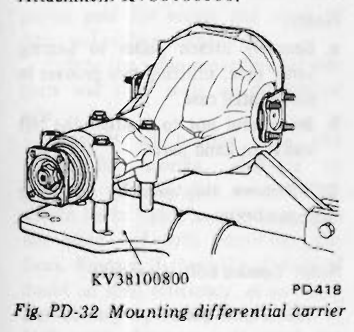
>
> - **Summary:** R200 Differential carrier mounted on attachment KV38100800 using three 45 mm spacers.
> - **Components:** Differential carrier, Gear Carrier Attachment KV38100800, Spacers
> - **Callouts:** **(KV38100800)** Gear carrier attachment
> - **Specs / Measurements:** Spacer length: 45 mm (1.77 in)
> - **Mechanic Notes:** Use three 45 mm (1.77 in) spacers to mount carrier on attachment.
> - **Tags:** `differential carrier`, `R200`, `KV38100800`, `stand`

2. Remove rear cover.
3. Visually inspect parts for wear or damage.
4. Rotate gears checking for any roughness which would indicate damaged bearings or chipped gears. Check gear teeth for scoring or signs of abnormal wear. Measure preload of drive pinion. See Figure PD-33.

> 🖼️ **Fig. PD-33 Measuring pinion preload** `[PD340]` *(Type: `inspection_measurement`)*
>
> 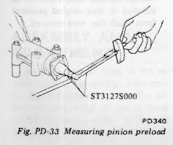
>
> - **Summary:** Measuring pinion preload with Preload Gauge ST3127S000 before disassembly.
> - **Components:** Differential carrier, Preload gauge ST3127S000
> - **Callouts:** **(ST3127S000)** Preload gauge
> - **Mechanic Notes:** Check preload before disassembling parts.
> - **Tags:** `pinion preload`, `ST3127S000`, `pre-disassembly`

5. Set up a dial indicator and check the backlash at several points around ring gear. Backlash should be within 0.13 to 0.18 mm (0.0051 to 0.0071 in). See Figure PD-34.

> 🖼️ **Fig. PD-34 Measuring the backlash of ring gear and pinion** `[PD341]` *(Type: `inspection_measurement`)*
>
> 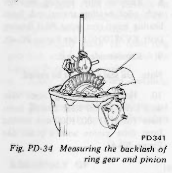
>
> - **Summary:** Dial indicator checking ring gear backlash on R200 carrier.
> - **Components:** Differential carrier, Ring gear, Dial indicator
> - **Specs / Measurements:** Backlash: 0.13 to 0.18 mm (0.0051 to 0.0071 in)
> - **Mechanic Notes:** Check backlash at several points around ring gear.
> - **Tags:** `backlash`, `ring gear`, `drive pinion`, `R200`

6. Check gear tooth contact with a mixture of recommended powder and oil.

For the tooth contact pattern, see page PD-22 - Contact Pattern.

### DISASSEMBLY

1. Drive side flange out with pry bar. See Figure PD-35.

**Note: Hold side flange with hand to prevent it from jumping out of carrier.**

> 🖼️ **Fig. PD-35 Removing side flange** `[PD342]` *(Type: `procedure_step`)*
>
> 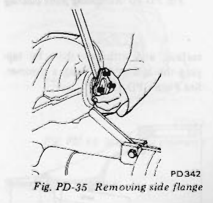
>
> - **Summary:** Prying side flange out of differential carrier with pry bar while holding flange.
> - **Components:** Differential carrier, Side flange, Pry bar
> - **Mechanic Notes:** Hold side flange with hand to prevent it from jumping out.
> - **Tags:** `side flange`, `pry bar`, `removal`

2. Put match marks on side bearing caps and carrier.
3. Loosen side bearing cap bolts and remove bearing caps. See Figure PD-36.

> 🖼️ **Fig. PD-36 Removing side bearing cap** `[PD343]` *(Type: `procedure_step`)*
>
> 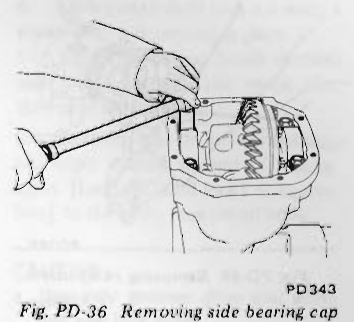
>
> - **Summary:** Loosening and removing side bearing cap bolts on differential carrier.
> - **Components:** Differential carrier, Side bearing cap, Wrench
> - **Mechanic Notes:** Put match marks on side bearing caps and carrier before removing.
> - **Tags:** `side bearing cap`, `bolts`, `match marks`

4. Using Slide Hammer HT72400000 lift differential case assembly out. See Figure PD-37.

> 🖼️ **Fig. PD-37 Removing differential case assembly** `[PD344]` *(Type: `procedure_step`)*
>
> 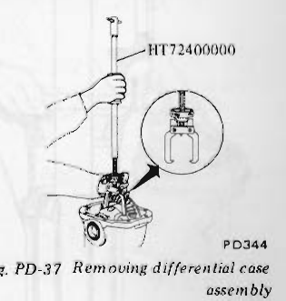
>
> - **Summary:** Lifting differential case assembly out using Slide Hammer HT72400000.
> - **Components:** Differential carrier, Differential case, Slide Hammer HT72400000
> - **Callouts:** **(HT72400000)** Slide hammer
> - **Mechanic Notes:** Care should be taken not to confuse left and right bearing outer races.
> - **Tags:** `differential case`, `slide hammer`, `HT72400000`

**Note: Care should be taken not to confuse the left and right hand bearing caps and bearing outer races so that parts may be installed to the original position.**

5. Loosen drive pinion nut, holding companion flange with Drive Pinion Flange Wrench ST31530000 and pull off companion flange using a suitable puller. See Figures PD-38 and PD-39.

> 🖼️ **Fig. PD-38 Removing drive pinion nut** `[PD345]` *(Type: `procedure_step`)*
>
> 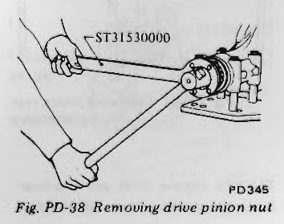
>
> - **Summary:** Holding companion flange with wrench ST31530000 while loosening drive pinion nut.
> - **Components:** Drive Pinion Flange Wrench ST31530000, Companion flange, Pinion nut
> - **Callouts:** **(ST31530000)** Drive pinion flange wrench
> - **Mechanic Notes:** Hold companion flange with wrench ST31530000.
> - **Tags:** `drive pinion nut`, `companion flange`, `ST31530000` <!-- Page 16 (PD-16) --> > 🖼️ **Fig. PD-39 Removing companion flange** `[PD346]` *(Type: `procedure_step`)*
>
> 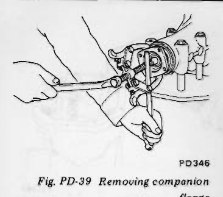
>
> - **Summary:** Standard puller pulling companion flange off drive pinion shaft.
> - **Components:** Differential carrier, Companion flange, Puller
> - **Mechanic Notes:** Pull off companion flange using a suitable puller.
> - **Tags:** `companion flange`, `puller`, `R200`

6. Extract drive pinion from carrier using a press. Take out drive pinion together with rear bearing inner race, bearing spacer and adjusting washer.
7. Remove oil seal.

**Note: Oil seal must not be reused.**

8. Remove pilot bearing together with pilot bearing spacer and front bearing inner race using Pilot Bearing Drift KV38100401. See Figure PD-40.
9. Remove side oil seal.

**Note: Oil seal must not be reused.**

10. Hold rear bearing inner race with Drive Pinion Rear Bearing Inner Race Puller ST30031000 and extract from drive pinion with a press. See Figure PD-41.

> 🖼️ **Fig. PD-40 Removing pilot bearing** `[PD348]` *(Type: `procedure_step`)*
>
> 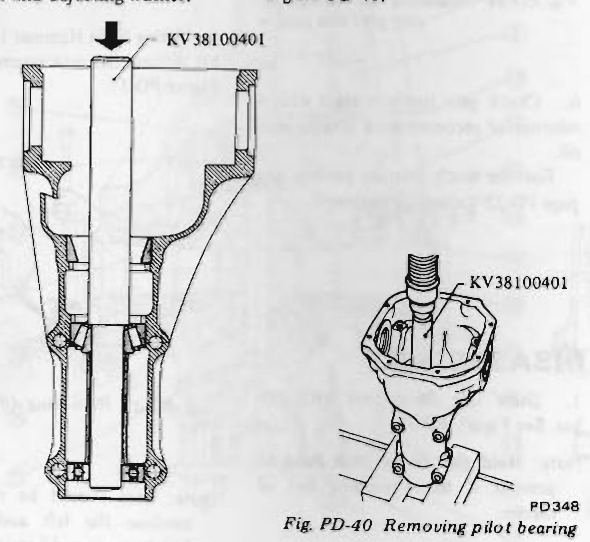
>
> - **Summary:** Cross-sectional and isometric views showing drift KV38100401 driving out pilot bearing, spacer, and front bearing cone.
> - **Components:** Differential carrier housing, Pilot Bearing Drift KV38100401, Pilot bearing, Front bearing cone
> - **Callouts:** **(KV38100401)** Pilot bearing drift
> - **Mechanic Notes:** Remove pilot bearing together with pilot bearing spacer and front bearing inner race using KV38100401.
> - **Tags:** `pilot bearing`, `KV38100401`, `drift`, `carrier`

> 🖼️ **Fig. PD-41 Removing pinion rear bearing inner race** `[PD179]` *(Type: `procedure_step`)*
>
> 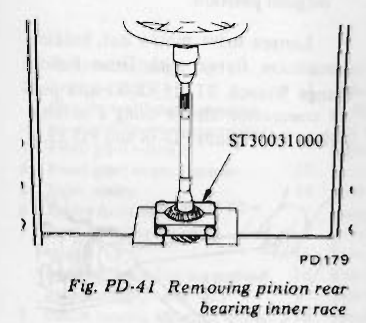
>
> - **Summary:** Inner race puller ST30031000 supporting pinion rear bearing inner race under a press.
> - **Components:** Drive pinion, Rear bearing inner race, Puller ST30031000
> - **Callouts:** **(ST30031000)** Inner race puller
> - **Mechanic Notes:** Extract rear bearing inner race from drive pinion with a press.
> - **Tags:** `drive pinion`, `inner race`, `ST30031000`, `press`

11. To remove front and rear bearing outer races, put a drift to race surface, and withdraw them by tapping the top of drift with a hammer. See Figure PD-42.

> 🖼️ **Fig. PD-42 Removing pinion bearing outer races** `[PD349]` *(Type: `procedure_step`)*
>
> 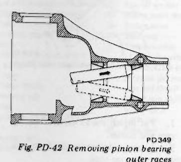
>
> - **Summary:** Drift placed through housing to tap out bearing outer races.
> - **Components:** Differential carrier housing, Bearing outer race, Drift
> - **Mechanic Notes:** Withdraw races by tapping top of drift with a hammer.
> - **Tags:** `bearing outer races`, `drift`, `carrier housing`

### DISASSEMBLY OF DIFFERENTIAL CASE

1. Extract bearing using Differential Side Bearing Puller ST3306S001 (set of ST33051001 and ST33061000). See Figure PD-43.

> 🖼️ **Fig. PD-43 Removing side bearing** `[PD350]` *(Type: `procedure_step`)*
>
> 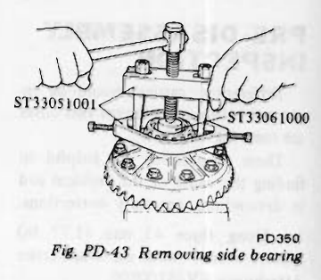
>
> - **Summary:** Differential side bearing puller set ST3306S001 removing side bearing from differential case.
> - **Components:** Differential case, Side bearing, Puller ST33051001, Adapter ST33061000
> - **Callouts:** **(ST33051001)** Puller body; **(ST33061000)** Adapter
> - **Mechanic Notes:** Utilize two grooves in differential case to securely attach puller.
> - **Tags:** `side bearing`, `differential case`, `ST33051001`, `ST33061000`, `puller`

**Note:**
- **a. Securely attach puller to bearing inner race, utilizing two grooves in differential case.**
- **b. Be careful not to confuse the left and right hand parts.**

2. Remove ring gear by loosening ring gear bolts.

**Note: Loosen bolts diagonally.**

3. Punch off pinion mate shaft lock pin from ring gear side using Solid Punch KV31100300.

**Note: Lock pin is caulked at pin hole mouth on differential case. Do not punch it off forcibly without checking how it is caulked.**

4. Draw out pinion mate shaft and remove pinion mate gears, side gears and thrust washers.

**Note: Put marks on gear and thrust washer so that they can be re-installed in their original positions from which they were removed.**

---

<!-- Page 17 (PD-17) -->
### INSPECTION

Thoroughly clean all disassembled parts, and examine them to see that they are worn, damaged or otherwise defective, and how they are affected. Repair or replace all faulty parts, whichever is necessary.

1. Check gear teeth for scoring, cracking or chipping, and make sure that tooth contact pattern indicates correct meshing depth. If any fault is evident, replace parts as required.

**Note: Drive pinion and drive gear are supplied for replacement as a set, therefore, should either part be damaged, replace as a set.**

2. Check pinion gear shaft, and pinion gear for scores and signs of wear, and replace as required.

Follow the same procedure for side gears and their seats on differential case.

3. Inspect all bearing races and rollers for scoring, chipping or evidence of excessive wear. They should be in tiptop condition such as not worn and with mirror-like surfaces. Replace if there is a shadow of doubt on their efficiency, as an incorrect bearing operation may result in noise and gear seizure.
4. Inspect thrust washer faces. Small faults can be corrected with sandpaper. If pinion mate to side gear backlash (or the clearance between side gear and thrust washer) exceeds limits 0.1 to 0.2 mm (0.004 to 0.008 in), replace thrust washers.
5. Inspect carrier and differential case for cracks or distortion. If either condition is evident, replace faulty parts.
6. As a general rule, oil seal should be replaced at each disassembly.

### PRECAUTIONS IN REASSEMBLY

1. Arrange shims, washers and the like to install them correctly.
2. Thoroughly clean the surfaces on which shims, washers, bearings and bearing retainers are installed.
3. Thoroughly clean oil from ring gear bolt and its hole with "Locktite Lacquic Primer" or equivalent.
4. Apply gear oil when installing bearings.
5. Pack recommended multi-purpose grease into cavity between lips when fitting oil seal.

### ASSEMBLY OF DIFFERENTIAL GEAR CASE

1. Assemble pinion mates, side gears and thrust washers in differential case.
2. Fit pinion shaft to differential case so that it meets lock pin holes.
3. Adjust side gear-to-pinion mate backlash or adjust the clearance between the rear face of side gear and thrust washer. See Figure PD-44.

If above procedure is not effective with existing washer, try with other washers.

Normal backlash or clearance:
- 0.1 to 0.2 mm (0.004 to 0.008 in)

> 🖼️ **Fig. PD-44 Measuring clearance** `[PD023]` *(Type: `inspection_measurement`)*
>
> 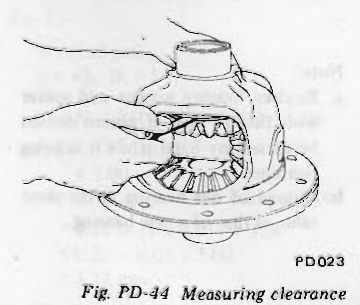
>
> - **Summary:** Feeler gauge measuring clearance between rear face of side gear and thrust washer in differential case.
> - **Components:** Differential case, Side gear, Thrust washer, Feeler gauge
> - **Specs / Measurements:** Normal clearance: 0.1 to 0.2 mm (0.004 to 0.008 in)
> - **Mechanic Notes:** Measure clearance between rear face of side gear and thrust washer.
> - **Tags:** `side gear`, `clearance`, `thrust washer`, `feeler gauge`

#### Side gear thrust washer

| Thickness mm (in) |
| :--- |
| 0.75 to 0.80 (0.0295 to 0.0315) |
| 0.80 to 0.85 (0.0315 to 0.0335) |
| 0.85 to 0.90 (0.0335 to 0.0354) |

4. Lock pinion shaft lock pin using a punch after it is secured in place.
5. Apply oil to gear tooth surfaces and thrust surfaces and check that they turn properly.
6. Place ring gear on differential case and apply a small amount of locking agent [Locktite (stud lock) or equivalent] to the bolts; then install bolts.

**CAUTION:**
- **a. Use only genuine drive gear bolts and new lock straps.**
- **b. Tighten bolts in criss-cross fashion lightly tapping around bolt heads with a hammer.**

Tightening torque:
- 7 to 8 kg-m (51 to 58 ft-lb)

> 🖼️ **Fig. PD-45 Tapping bolt heads** `[PD351]` *(Type: `procedure_step`)*
>
> 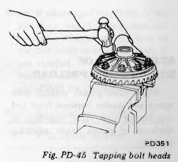
>
> - **Summary:** Lightly tapping ring gear bolt heads with a hammer while tightening in criss-cross fashion.
> - **Components:** Differential case, Ring gear, Hammer, Wrench, Vise
> - **Specs / Measurements:** Tightening torque: 7 to 8 kg-m (51 to 58 ft-lb) [Note: later specified as 6.0 to 7.0 kg-m (43 to 51 ft-lb) in SDS]
> - **Mechanic Notes:** Apply Loctite (stud lock) to bolts and tighten in criss-cross fashion.
> - **Tags:** `ring gear`, `bolts`, `criss-cross`, `torque`, `hammer`

7. When replacing side bearing, measure bearing width using Master Gauge KV38102000 and Weight Block ST32501000 prior to installation. See Figure PD-46.

Standard bearing width:
- 21.00 mm (0.8268 in)

> 🖼️ **Fig. PD-46 Measuring bearing width** `[PD425]` *(Type: `inspection_measurement`)*
>
> 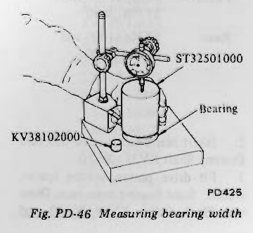
>
> - **Summary:** Measuring side bearing width using Master Gauge KV38102000 and Weight Block ST32501000 under a dial indicator.
> - **Components:** Master Gauge KV38102000, Weight Block ST32501000, Bearing, Dial gauge
> - **Callouts:** **(KV38102000)** Master gauge; **(ST32501000)** Weight block; **(Bearing)** Side bearing
> - **Specs / Measurements:** Standard bearing width: 21.00 mm (0.8268 in)
> - **Mechanic Notes:** Measure bearing width using Master Gauge KV38102000 prior to installation.
> - **Tags:** `side bearing`, `bearing width`, `KV38102000`, `ST32501000`, `dial indicator`

---

<!-- Page 18 (PD-18) -->
8. Press fit side bearing inner race on differential case with Gear Carrier Side Bearing Drift KV38100300 and Adapter ST33061000. See Figure PD-47.

> 🖼️ **Fig. PD-47 Installing side bearing inner race** `[PD353]` *(Type: `procedure_step`)*
>
> 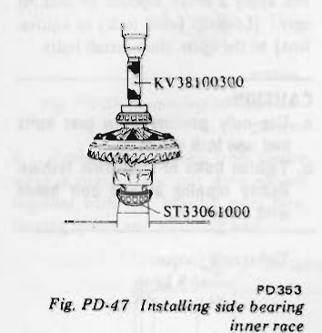
>
> - **Summary:** Press fitting side bearing inner race on differential case using drift KV38100300 and adapter ST33061000.
> - **Components:** Differential case, Side bearing inner race, Drift KV38100300, Adapter ST33061000
> - **Callouts:** **(KV38100300)** Diff side bearing drift; **(ST33061000)** Adapter
> - **Mechanic Notes:** Press fit side bearing inner race on differential case with drift KV38100300 and adapter ST33061000.
> - **Tags:** `side bearing`, `differential case`, `KV38100300`, `ST33061000`

### ADJUSTMENT OF DRIVE PINION PRELOAD

Adjust drive pinion preload with spacer and washer between front and rear bearing inner races, regardless of thickness of pinion height adjusting washer.

This adjustment must be carried out without oil seal inserted.

1. Press fit front and rear bearing outer races into gear carrier using Drive Pinion Outer Race Drift Set ST30611000, ST30613000 and ST30621000.
   - Front: ST30611000 and ST30613000
   - Rear: ST30611000 and ST30621000
2. Insert rear bearing inner race into Dummy Shaft KV38100110.
3. Fit drive pinion bearing spacer, washer, front bearing inner race, Dummy Shaft Collar KV38100130 and companion flange in that order on dummy shaft and tighten drive pinion nut to specified torque with Stopper KV38100140. See Figure PD-48.

Tightening torque of pinion nut:
- 19 to 22 kg-m (137 to 159 ft-lb)

> 🖼️ **Fig. PD-48 Tightening drive pinion nut** `[PD354]` *(Type: `procedure_step`)*
>
> 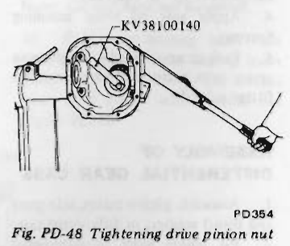
>
> - **Summary:** Tightening drive pinion nut on dummy shaft using stopper KV38100140.
> - **Components:** Differential carrier, Dummy shaft, Stopper KV38100140, Wrench
> - **Callouts:** **(KV38100140)** Stopper
> - **Specs / Measurements:** Pinion nut torque: 19 to 22 kg-m (137 to 159 ft-lb)
> - **Mechanic Notes:** Tighten drive pinion nut to specified torque with Stopper KV38100140.
> - **Tags:** `drive pinion nut`, `dummy shaft`, `KV38100140`, `stopper`

4. Measure pinion bearing preload using Preload Gauge ST3127S000, and select washer and spacer that will provide required preload. See Figure PD-49.

Pinion bearing preload (without oil seal):
- 10 to 13 kg-cm (8.7 to 11.3 in-lb)

**Note:**
- **a. Replace bearing washer and spacer with thicker ones if pinion cannot be turned by hand while it is being tightened.**
- **b. Preload of old bearing is the same value as that of a new bearing.**

> 🖼️ **Fig. PD-49 Measuring pinion preload** `[PD340]` *(Type: `inspection_measurement`)*
>
> 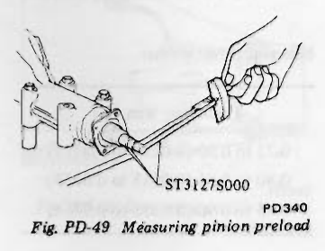
>
> - **Summary:** Measuring pinion preload using torque wrench gauge ST3127S000.
> - **Components:** Differential carrier, Preload gauge ST3127S000
> - **Callouts:** **(ST3127S000)** Preload gauge
> - **Specs / Measurements:** Preload (without oil seal): 10 to 13 kg-cm (8.7 to 11.3 in-lb)
> - **Mechanic Notes:** Preload of old bearing is the same value as that of a new bearing.
> - **Tags:** `pinion preload`, `ST3127S000`, `preload gauge`

#### Pinion bearing adjusting spacer

| Length mm (in) |
| :--- |
| 55.10 (2.1693) |
| 55.40 (2.1811) |
| 55.70 (2.1929) |
| 56.00 (2.2047) |
| 56.25 (2.2146) |

#### Pinion bearing adjusting washer

| Thickness mm (in) |
| :--- |
| 3.80 to 3.82 (0.1496 to 0.1504) |
| 3.82 to 3.84 (0.1504 to 0.1512) |
| 3.84 to 3.86 (0.1512 to 0.1520) |
| 3.86 to 3.88 (0.1520 to 0.1528) |
| 3.88 to 3.90 (0.1528 to 0.1535) |
| 3.90 to 3.92 (0.1535 to 0.1543) |
| 3.92 to 3.94 (0.1543 to 0.1551) |
| 3.94 to 3.96 (0.1551 to 0.1559) |
| 3.96 to 3.98 (0.1559 to 0.1567) |
| 3.98 to 4.00 (0.1567 to 0.1575) |
| 4.00 to 4.02 (0.1575 to 0.1583) |
| 4.02 to 4.04 (0.1583 to 0.1591) |
| 4.04 to 4.06 (0.1591 to 0.1598) |
| 4.06 to 4.08 (0.1598 to 0.1606) |
| 4.08 to 4.10 (0.1606 to 0.1614) |

### ADJUSTMENT OF DRIVE PINION HEIGHT

Adjust pinion height with washer located between rear bearing inner race and back of pinion gear.

1. Install Height Gauge KV38100120 on carrier with dummy shaft mounted. See Figure PD-50. <!-- Page 19 (PD-19) --> > 🖼️ **Fig. PD-50 Measuring the clearance (N)** `[PD355]` *(Type: `cutaway_flow`)*
>
> 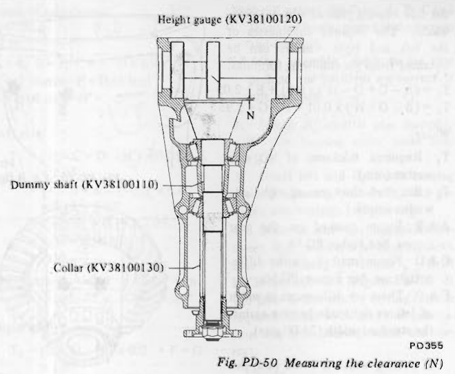
>
> - **Summary:** Cross-sectional drawing showing dummy shaft KV38100110, collar KV38100130, and height gauge KV38100120 assembled in carrier to measure clearance N.
> - **Components:** Differential carrier, Height gauge KV38100120, Dummy shaft KV38100110, Collar KV38100130
> - **Callouts:** **(Height gauge (KV38100120))** Height gauge; **(Dummy shaft (KV38100110))** Dummy shaft; **(Collar (KV38100130))** Collar; **(N)** Clearance
> - **Mechanic Notes:** Measure clearance N between tip of height gauge and end surface of dummy shaft.
> - **Tags:** `dummy shaft`, `height gauge`, `KV38100120`, `KV38100110`, `clearance N`

2. Measure the clearance (N) between the tip end of height gauge and the end surface of dummy shaft, using a thickness gauge. See Figure PD-51.

> 🖼️ **Fig. PD-51 Adjusting pinion height** `[PD356]` *(Type: `inspection_measurement`)*
>
> 
>
> - **Summary:** Using a feeler/thickness gauge to measure clearance between height gauge KV38100120 and dummy shaft KV38100110.
> - **Components:** Differential carrier, Height gauge KV38100120, Dummy shaft KV38100110, Thickness gauge
> - **Callouts:** **(KV38100120)** Height gauge; **(KV38100110)** Dummy shaft
> - **Mechanic Notes:** Measure clearance N using a thickness gauge.
> - **Tags:** `pinion height`, `thickness gauge`, `KV38100120`, `KV38100110`

3. The thickness of drive pinion height adjusting washer can be obtained from the following formula:

$$T = N - [(H - D') \times 0.01] + 3.00$$

Where,
- $T$: Required thickness of rear bearing adjusting washers (mm).
- $N$: Measured value with thickness gauge (mm).
- $H$: Figure marked on the drive pinion head. See Figure PD-52.
- $D'$: Figure marked on the dummy shaft.

**Note: Figures for $H$ and $D'$ are dimensional variations in a unit of 1/100 mm (4/10,000 in) against each standard measurement.**

> 🖼️ **Fig. PD-52 Variation number on drive pinion** `[PD186]` *(Type: `alignment_orientation`)*
>
> 
>
> - **Summary:** Head of drive pinion showing set number 41 and head variation number (H) stamped as +2.
> - **Components:** Drive pinion
> - **Callouts:** **(Head number (H))** +2; **(Set number)** 41
> - **Specs / Measurements:** Unit of 1/100 mm (4/10,000 in)
> - **Mechanic Notes:** Figure marked on the drive pinion head is used for calculation formula.
> - **Tags:** `drive pinion`, `head number`, `variation number`, `set number`

#### Examples of calculation

**Ex. 1 ---**
$$\begin{aligned}
N &= 0.23\text{ mm} \\
H &= +2,\; D' = 1 \\
T &= N - [(H - D') \times 0.01] + 3.00 \\
  &= 0.23 - [((+2) - 1) \times 0.01] + 3.00 \\
  &= 0.23 - [(2 - 1) \times 0.01] + 3.00 \\
  &= 0.23 - [1 \times 0.01] + 3.00 \\
  &= 0.23 - 0.01 + 3.00 \\
  &= 3.22\text{ mm}
\end{aligned}$$

The correct washer is 3.21 mm thick.

**Ex. 2 ---**
$$\begin{aligned}
N &= 0.35\text{ mm} \\
H &= -1,\; D' = 2 \\
T &= N - [(H - D') \times 0.01] + 3.00 \\
  &= 0.35 - [((-1) - 2) \times 0.01] + 3.00 \\
  &= 0.35 - [(-1 - 2) \times 0.01] + 3.00 \\
  &= 0.35 - [(-3) \times 0.01] + 3.00 \\
  &= 0.35 - [-0.03] + 3.00 \\
  &= 0.35 + 0.03 + 3.00 \\
  &= 3.38\text{ mm}
\end{aligned}$$

The correct washer is 3.39 mm thick.

**Ex. 3 ---**
$$\begin{aligned}
N &= 0.27\text{ mm} \\
H &= 0,\; D' = 0 \\
T &= N - [(H - D') \times 0.01] + 3.00 \\
  &= 0.27 - [(0 - 0) \times 0.01] + 3.00 \\
  &= 0.27 - [0 \times 0.01] + 3.00 \\
  &= 0.27 - 0 + 3.00 \\
  &= 3.27\text{ mm}
\end{aligned}$$

The correct washer is 3.27 mm thick.

**Note: If values signifying $H$ and $D'$ are not given, regard them as zero and compute. After assembly, check to see that tooth contact is correct. If not, readjust. For the tooth contact pattern, see page PD-11 for Contact Pattern.**

#### Pinion bearing adjusting washer

| Thickness mm (in) |
| :--- |
| 3.09 (0.1217) |
| 3.12 (0.1228) |
| 3.15 (0.1240) |
| 3.18 (0.1252) |
| 3.21 (0.1264) |
| 3.24 (0.1276) |
| 3.27 (0.1287) |
| 3.30 (0.1299) |
| 3.33 (0.1311) |
| 3.36 (0.1323) |
| 3.39 (0.1335) |
| 3.42 (0.1346) |
| 3.45 (0.1358) |
| 3.48 (0.1370) |
| 3.51 (0.1382) |
| 3.54 (0.1394) |
| 3.57 (0.1406) |
| 3.60 (0.1417) |
| 3.63 (0.1429) |
| 3.66 (0.1441) |
| 0.05 (0.0020) |
| 0.07 (0.0028) | <!-- Page 20 (PD-20) --> **Note: Pinion height adjustment can be made in a unit of 1/100 mm (4/10,000 in) by selecting either 0.05 mm (0.0020 in) or 0.07 mm (0.0028 in) shim in above chart.**

4. Fit determined pinion height adjusting washer in drive pinion, and press fit rear bearing inner race in it using Base ST30901000. See Figure PD-53.

> 🖼️ **Fig. PD-53 Pressing rear bearing inner race** `[PD092]` *(Type: `procedure_step`)*
>
> 
>
> - **Summary:** Press fitting drive pinion rear bearing inner race onto pinion using Base ST30901000.
> - **Components:** Drive pinion, Rear bearing inner race, Base ST30901000
> - **Callouts:** **(ST30901000)** Base
> - **Mechanic Notes:** Insert washer into pinion with the chamfered side towards gear.
> - **Tags:** `drive pinion`, `rear bearing`, `ST30901000`, `press fit`

**Note: Insert washer into pinion with the chamfered side towards gear.**

5. Lubricate pinion front and rear bearings. Install drive pinion in gear carrier into which drive pinion bearing spacer and washer, front bearing inner race and front pilot bearing spacer, moreover, pilot bearing and front oil seal are fitted. Fit front oil seal using Gear Carrier Front Oil Seal Drift KV38100500.
6. Fit companion flange on drive pinion, and secure it in position by tightening nut to specified torque confirming preload.

Tightening torque:
- 19 to 22 kg-m (137 to 159 ft-lb)

Preload (with oil seal):
- 11 to 17 kg-cm (9.5 to 14.8 in-lb)

**Note: If drive pinion lock nut is worn, replace it.**

### ADJUSTMENT OF SIDE BEARING WASHERS

1. If the hypoid gear set, carrier, differential case or side bearing has been replaced with new part, adjust the side bearing preload with adjusting washer. The required thicknesses of the left and right washers can be obtained from the following formulas:

$$T_1 = (A - C + D - H') \times 0.01 + E + 2.05$$
$$T_2 = (B - D + H') \times 0.01 + F + G + 1.95$$

Where,
- $T_1$: Required thickness of left side washer (mm).
- $T_2$: Required thickness of right side washer (mm).
- $A$ & $B$: Figure marked on the gear carrier. See Figure PD-55.
- $C$ & $D$: Figure marked on the differential case. See Figure PD-56.
- $E$ & $F$: These are differences in width of left or right side bearing against the standard width (21.00 mm).
  - If bearing width is 20.82 mm, this figure will be as follows: $21.00 - 20.82 = 0.18\text{ (mm)}$
- $G$: This is the difference in thickness of side spacer against the standard width (8.10 mm). If spacer width is 8.02 mm, this figure will be as follows: $8.10 - 8.02 = 0.08\text{ (mm)}$
- $H'$: Figure marked on ring gear. See Figure PD-57.

Figures for $A$, $B$, $C$ and $D$ are dimensional variations in a unit of 1/100 mm against each standard measurement.

To measure width of side bearing, see differential case assembly procedure.

Before calculation, determine "G" value by measuring spacer thickness. If spacer is deformed or scratched, replace.

> 🖼️ **Fig. PD-54 Thickness of left and right washers** `[PD357]` *(Type: `cutaway_flow`)*
>
> 
>
> - **Summary:** Cross section of differential carrier showing dimensions T1 and T2 for left and right side bearing adjusting washers.
> - **Components:** Differential carrier housing, Differential case, Side bearings, Adjusting washers
> - **Callouts:** **(T1)** Left side washer thickness; **(T2)** Right side washer thickness
> - **Mechanic Notes:** Use formulas for T1 and T2 to calculate required washer thicknesses.
> - **Tags:** `side bearing`, `adjusting washer`, `T1`, `T2`, `preload`, `backlash`

> 🖼️ **Fig. PD-55 A & B figures** `[PD358]` *(Type: `component_location`)*
>
> 
>
> - **Summary:** Carrier casting showing locations of stamped figures A and B.
> - **Components:** Differential carrier housing
> - **Callouts:** **(A)** Left bearing seat variation mark; **(B)** Right bearing seat variation mark
> - **Specs / Measurements:** Unit of 1/100 mm
> - **Mechanic Notes:** Figures marked on the gear carrier casting.
> - **Tags:** `carrier housing`, `stamped figures`, `A and B`, `R200`

> 🖼️ **Fig. PD-56 C & D figures** `[PD359]` *(Type: `component_location`)*
>
> 
>
> - **Summary:** Differential case showing stamped variation figures C and D.
> - **Components:** Differential case, Ring gear
> - **Callouts:** **(C)** Left side variation mark; **(D)** Right side variation mark
> - **Specs / Measurements:** Unit of 1/100 mm
> - **Mechanic Notes:** Figures marked on the differential case.
> - **Tags:** `differential case`, `stamped figures`, `C and D`, `R200`

> 🖼️ **Fig. PD-57 Variation number on ring gear** `[PD190]` *(Type: `component_location`)*
>
> 
>
> - **Summary:** Ring gear back face showing set number and stamped variation number (H').
> - **Components:** Ring gear
> - **Callouts:** **(Set number)** 41; **(Variation number (H'))** -2
> - **Specs / Measurements:** Unit of 1/100 mm
> - **Mechanic Notes:** Figure marked on ring gear back face.
> - **Tags:** `ring gear`, `variation number`, `H'`, `set number`

#### Side bearing adjusting washer

| Thickness mm (in) |
| :--- |
| 2.00 (0.0787) |
| 2.05 (0.0807) |
| 2.10 (0.0827) |
| 2.15 (0.0846) |
| 2.20 (0.0866) |
| 2.25 (0.0886) |
| 2.30 (0.0906) |
| 2.35 (0.0925) |
| 2.40 (0.0945) |
| 2.45 (0.0965) |
| 2.50 (0.0984) |
| 2.55 (0.1004) |
| 2.60 (0.1024) | <!-- Page 21 (PD-21) --> #### Example of calculation

**Ex. 1 ---**
$$\begin{aligned}
A &= 4,\; B = 3,\; C = 5,\; D = 6 \\
E &= 0.18\text{ mm},\; F = 0.15\text{ mm} \\
G &= 0.08\text{ mm},\; H' = -2 \\
\text{Left side: } T_1 &= (A - C + D - H') \times 0.01 + E + 2.05 \\
  &= [4 - 5 + 6 - (-2)] \times 0.01 + 0.18 + 2.05 \\
  &= 7 \times 0.01 + 0.18 + 2.05 \\
  &= 0.07 + 0.18 + 2.05 \\
  &= 2.30\text{ mm}
\end{aligned}$$

The correct washer is 2.30 mm thick.

$$\begin{aligned}
\text{Right side: } T_2 &= (B - D + H') \times 0.01 + F + G + 1.95 \\
  &= [3 - 6 + (-2)] \times 0.01 + 0.15 + 0.08 + 1.95 \\
  &= (-5) \times 0.01 + 0.15 + 0.08 + 1.95 \\
  &= -0.05 + 0.15 + 0.08 + 1.95 \\
  &= 2.13\text{ mm}
\end{aligned}$$

The correct washer is 2.15 mm thick.

**Ex. 2 ---**
$$\begin{aligned}
A &= 6,\; B = 6,\; C = 5,\; D = 3 \\
E &= 0.17\text{ mm},\; F = 0.22\text{ mm} \\
G &= 0.10\text{ mm},\; H' = 2 \\
\text{Left side: } T_1 &= (A - C + D - H') \times 0.01 + E + 2.05 \\
  &= (6 - 5 + 3 - 2) \times 0.01 + 0.17 + 2.05 \\
  &= 2 \times 0.01 + 0.17 + 2.05 \\
  &= 0.02 + 0.17 + 2.05 \\
  &= 2.24\text{ mm}
\end{aligned}$$

The correct washer is 2.25 mm thick.

$$\begin{aligned}
\text{Right side: } T_2 &= (B - D + H') \times 0.01 + F + G + 1.95 \\
  &= (6 - 3 + 2) \times 0.01 + 0.22 + 0.10 + 1.95 \\
  &= 5 \times 0.01 + 0.22 + 0.10 + 1.95 \\
  &= 0.05 + 0.22 + 0.10 + 1.95 \\
  &= 2.32\text{ mm}
\end{aligned}$$

The correct washer is 2.30 mm thick.

**Note: If values signifying A, B, C and D are not given, regard them as zero and compute. After assembly, check to see that preload and backlash are correct. If not, readjust.**

2. Install differential case assembly with side bearing outer races into carrier.
3. Insert left and right side bearing preload adjusting washers in place between side bearings and housing.
4. Drive in side bearing spacer between R.H. washer and housing with Side Bearing Spacer Drift KV38100600. See Figure PD-58. If too great or too small a driving force is required, check to be sure that calculation and side bearing width are correct.

> 🖼️ **Fig. PD-58 Driving spacer into place** `[PD361]` *(Type: `procedure_step`)*
>
> 
>
> - **Summary:** Driving side bearing spacer into carrier between R.H. washer and housing using drift KV38100600.
> - **Components:** Differential carrier, Side bearing spacer, Side Bearing Spacer Drift KV38100600, Hammer
> - **Callouts:** **(KV38100600)** Side bearing spacer drift
> - **Mechanic Notes:** Be careful not to tilt side bearing outer race to either side when driving spacer into place.
> - **Tags:** `side bearing spacer`, `KV38100600`, `drift`, `R200`

**Note: When driving spacer into place, be careful not to tilt side bearing outer race to either side.**

5. Align mark on bearing cap with that on carrier and install bearing cap on carrier. And tighten bolts to specified torque.

Tightening torque:
- 9 to 10 kg-m (65 to 72 ft-lb)

> 🖼️ **Fig. PD-59 Tightening side bearing cap** `[PD362]` *(Type: `procedure_step`)*
>
> 
>
> - **Summary:** Torquing side bearing cap bolts with torque wrench.
> - **Components:** Differential carrier, Bearing cap, Torque wrench
> - **Specs / Measurements:** Tightening torque: 9 to 10 kg-m (65 to 72 ft-lb)
> - **Mechanic Notes:** Align mark on bearing cap with that on carrier before tightening.
> - **Tags:** `side bearing cap`, `torque wrench`, `tightening torque`, `R200`

6. Measure ring gear-to-drive pinion backlash with a dial indicator and adjust it to 0.13 to 0.18 mm (0.0051 to 0.0071 in). See Figure PD-60.

If it is below the specified value, replace left washer with a thinner one and right washer with a thicker one. If it is over it, replace left washer with a thicker one and right washer with a thinner one.

**Note: To maintain correct preload at all times, do not change total thickness of washers.**

> 🖼️ **Fig. PD-60 Measuring the backlash of ring gear and pinion** `[PD341]` *(Type: `inspection_measurement`)*
>
> 
>
> - **Summary:** Dial indicator set up against ring gear tooth to verify backlash on R200 differential.
> - **Components:** Differential carrier, Ring gear, Dial indicator
> - **Specs / Measurements:** Backlash: 0.13 to 0.18 mm (0.0051 to 0.0071 in)
> - **Mechanic Notes:** Do not change total thickness of washers to maintain correct preload at all times.
> - **Tags:** `backlash`, `ring gear`, `drive pinion`, `dial indicator`, `R200`

Incidentally a decrease or increase in thickness of washers causes change in ring gear-to-pinion backlash. Thus, check for proper backlash.

7. Check and adjust the tooth contact pattern of ring gear and drive pinion.
- (1) Thoroughly clean ring and drive pinion gear teeth.
- (2) Paint ring gear teeth lightly and evenly with a mixture of powdered red lead and oil of a suitable consistency to produce a contact pattern.
- (3) Rotate pinion through several revolutions in the forward and reverse direction until a definite contact pattern is developed on ring gear.
- (4) If contact pattern is incorrect, readjust thickness of adjusting washer. Be sure to completely wipe off red lead upon completion of adjustment.
- (5) Incorrect teeth contact pattern can be adjusted in the following manner.

### Contact pattern

**a. Heel contact**
To correct, increase thickness of pinion height adjusting washer in order to bring drive pinion close to ring gear. See Figure PD-61. <!-- Page 22 (PD-22) --> > 🖼️ **Fig. PD-61 Heel contact** `[PD193]` *(Type: `inspection_measurement`)*
>
> 
>
> - **Summary:** Tooth contact showing heel contact.
> - **Components:** Gear tooth
> - **Mechanic Notes:** Increase thickness of pinion height adjusting washer to correct.
> - **Tags:** `tooth contact`, `heel contact`

**b. Toe contact**
To correct, reduce thickness of pinion height adjusting washer in order to make drive pinion move away from ring gear. See Figure PD-62.

> 🖼️ **Fig. PD-62 Toe contact** `[PD194]` *(Type: `inspection_measurement`)*
>
> 
>
> - **Summary:** Tooth contact showing toe contact.
> - **Components:** Gear tooth
> - **Mechanic Notes:** Reduce thickness of pinion height adjusting washer to correct.
> - **Tags:** `tooth contact`, `toe contact`

**c. Flank contact**
Adjust in the same manner as in b. See Figure PD-63.

> 🖼️ **Fig. PD-63 Flank contact** `[PD195]` *(Type: `inspection_measurement`)*
>
> 
>
> - **Summary:** Tooth contact showing flank contact.
> - **Components:** Gear tooth
> - **Mechanic Notes:** Adjust in the same manner as toe contact (reduce thickness).
> - **Tags:** `tooth contact`, `flank contact`

**d. Face contact**
Adjust in the same manner as in a. See Figure PD-64.

> 🖼️ **Fig. PD-64 Face contact** `[PD196]` *(Type: `inspection_measurement`)*
>
> 
>
> - **Summary:** Tooth contact showing face contact.
> - **Components:** Gear tooth
> - **Mechanic Notes:** Adjust in the same manner as heel contact (increase thickness).
> - **Tags:** `tooth contact`, `face contact`

**e. Correct tooth contact**

> 🖼️ **Fig. PD-65 Correct contact** `[PD197]` *(Type: `inspection_measurement`)*
>
> 
>
> - **Summary:** Diagram illustrating correct hypoid gear tooth contact pattern.
> - **Components:** Gear tooth
> - **Mechanic Notes:** Proper pattern centered on tooth flank.
> - **Tags:** `tooth contact`, `correct contact`

**Note: Change in thickness of adjusting washer is accompanied by change in backlash. Check it when installing gear.**

8. Install rear cover.

Tightening torque:
- 1.6 to 2.4 kg-m (12 to 17 ft-lb)

9. Apply grease to cavity at sealing lips of oil seal. Press side oil seal into carrier with Gear Carrier Side Oil Seal Drift KV38100200. See Figure PD-66.

> 🖼️ **Fig. PD-66 Installing side oil seal** `[PD363]` *(Type: `procedure_step`)*
>
> 
>
> - **Summary:** Pressing side oil seal into carrier housing using Drift KV38100200.
> - **Components:** Differential carrier, Side oil seal, Drift KV38100200
> - **Callouts:** **(KV38100200)** Side oil seal drift
> - **Mechanic Notes:** Apply grease to cavity at sealing lips of oil seal before driving in.
> - **Tags:** `side oil seal`, `KV38100200`, `drift`, `carrier`

10. Install side flange on carrier. Engage spline in side flange with that in side gear and apply light hammer blows until side flange circlip is fitted into groove in side flange. See Figure PD-67.

> 🖼️ **Fig. PD-67 Installing side flange** `[PD364]` *(Type: `procedure_step`)*
>
> 
>
> - **Summary:** Installing side flange into carrier housing with light hammer taps to engage circlip.
> - **Components:** Differential carrier, Side flange, Hammer
> - **Mechanic Notes:** Engage spline and apply light hammer blows until side flange circlip is fitted into groove. Shorter flange on left, longer on right.
> - **Tags:** `side flange`, `circlip`, `hammer`, `installation`

**Note:**
- **a. The length of side flanges differs for their locations. Install the shorter flange on the left side (ring gear) and the longer one on the right side.**
- **b. Be careful not to scratch oil seal lips with side flange.**

### INSTALLATION

Install in the reverse order of removal. Refer to Section RA for Installation.

**Note: Oil quantity: 1.3 liters (2 3/4 U.S. pt., 2 1/4 Imp. pt., use API GL-5).**

### REPLACEMENT OF OIL SEALS

Replacement of oil seals with differential gear carrier assembly installed on the car.

### FRONT OIL SEAL

Procedures are as follows:
1. Drain gear oil.
2. Raise car on hoist.
3. Remove insulator, exhaust tube and main muffler mounting bolt to free them from car body.
4. Detach propeller shaft.
5. Remove drive pinion nut.
6. Extract companion flange with a suitable puller.
7. Remove oil seal.
8. Set new oil seal in position with Gear Carrier Front Oil Seal Drift KV38100500. Apply grease to cavity between seal lips.
9. Fit companion flange on drive pinion, and secure it in position by tightening nut to specified torque confirming the following preload, with Drive Pinion Flange Wrench ST31530000. <!-- Page 23 (PD-23) --> Tightening torque of pinion nut:
- 19 to 22 kg-m (137 to 159 ft-lb)

Pinion bearing preload (with oil seal):
- 11 to 17 kg-cm (9.5 to 14.8 in-lb)
- At companion flange bolt hole: 3.1 to 4.9 kg (6.8 to 10.8 lb)

10. Reinstall rear stabilizer, propeller shaft and muffler in reverse order of removal, and fill up gear oil.

### SIDE OIL SEAL

Side oil seal is replaced as follows:
1. Disconnect drive shaft on the gear carrier side.
2. Drive side flange out with pry bar.

**Note: Hold side bearing flange with hand to prevent it from jumping out of carrier.**

3. Remove oil seal.
4. Set in new oil seal with Gear Carrier Side Oil Seal Drift KV38100200.

**Note: Apply grease to cavity between oil seal lips.**

5. Install side flange on carrier. Engage spline in side flange with that in side gear and apply light hammer blows until side flange circlip is fitted into groove in side flange.
6. Join drive shaft with side flange and tighten nuts to specified torque.

Tightening torque:
- 5.0 to 6.0 kg-m (36 to 43 ft-lb)

**Note: Be careful not to scratch oil seal lips with side flange.**

---

<!-- Page 24 (PD-24) -->
## SERVICE DATA AND SPECIFICATIONS

| Item | Unit | R180 | R200 |
| :--- | :--- | :--- | :--- |
| Gear ratio (number of teeth) | | 3.545 (39/11) | 3.545 (39/11) |
| Drive pinion preload adjusted by | | Washer | Washer |
| Drive pinion Preload (without oil seal) | kg-cm (in-lb) | 10 to 13 (8.7 to 11.3) | 10 to 13 (8.7 to 11.3) |
| Drive pinion Preload (with oil seal) | kg-cm (in-lb) | 11 to 17 (9.5 to 14.8) | 11 to 17 (9.5 to 14.8) |

### Thickness of pinion height adjusting washer

| mm (in) - R180 | mm (in) - R200 |
| :--- | :--- |
| 3.09 (0.1217) | 3.09 (0.1217) |
| 3.12 (0.1228) | 3.12 (0.1228) |
| 3.15 (0.1240) | 3.15 (0.1240) |
| 3.18 (0.1252) | 3.18 (0.1252) |
| 3.21 (0.1264) | 3.21 (0.1264) |
| 3.24 (0.1276) | 3.24 (0.1276) |
| 3.27 (0.1287) | 3.27 (0.1287) |
| 3.30 (0.1299) | 3.30 (0.1299) |
| 3.33 (0.1311) | 3.33 (0.1311) |
| 3.36 (0.1323) | 3.36 (0.1323) |
| 3.39 (0.1335) | 3.39 (0.1335) |
| 3.42 (0.1346) | 3.42 (0.1346) |
| 3.45 (0.1358) | 3.45 (0.1358) |
| 3.48 (0.1370) | 3.48 (0.1370) |
| 3.51 (0.1382) | 3.51 (0.1382) |
| 3.54 (0.1394) | 3.54 (0.1394) |
| 3.57 (0.1406) | 3.57 (0.1406) |
| 3.60 (0.1417) | 3.60 (0.1417) |
| 3.63 (0.1429) | 3.63 (0.1429) |
| 3.66 (0.1441) | 3.66 (0.1441) |
| | 0.05 (0.0020) |
| | 0.07 (0.0028) |

### Length of pinion bearing adjusting spacer

| mm (in) - R180 | mm (in) - R200 |
| :--- | :--- |
| 52.20 (2.0551) | 55.10 (2.1693) |
| 52.40 (2.0630) | 55.40 (2.1811) |
| 52.60 (2.0709) | 55.70 (2.1929) |
| 52.80 (2.0787) | 56.00 (2.2047) |
| 53.00 (2.0866) | 56.25 (2.2146) |
| 53.20 (2.0945) | |

### Thickness of pinion bearing adjusting washer

| mm (in) - R180 | mm (in) - R200 |
| :--- | :--- |
| 2.30 to 2.32 (0.0910 to 0.0913) | 3.80 to 3.82 (0.1496 to 0.1504) |
| 2.32 to 2.34 (0.0913 to 0.0921) | 3.82 to 3.84 (0.1504 to 0.1512) |
| 2.34 to 2.36 (0.0921 to 0.0929) | 3.84 to 3.86 (0.1512 to 0.1520) |
| 2.36 to 2.38 (0.0929 to 0.0937) | 3.86 to 3.88 (0.1520 to 0.1528) |
| 2.38 to 2.40 (0.0937 to 0.0945) | 3.88 to 3.90 (0.1528 to 0.1535) |
| 2.40 to 2.42 (0.0945 to 0.0953) | 3.90 to 3.92 (0.1535 to 0.1543) |
| 2.42 to 2.44 (0.0953 to 0.0961) | 3.92 to 3.94 (0.1543 to 0.1551) |
| 2.44 to 2.46 (0.0961 to 0.0969) | 3.94 to 3.96 (0.1551 to 0.1559) |
| 2.46 to 2.48 (0.0969 to 0.0976) | 3.96 to 3.98 (0.1559 to 0.1567) |
| 2.48 to 2.50 (0.0976 to 0.0984) | 3.98 to 4.00 (0.1567 to 0.1575) |
| 2.50 to 2.52 (0.0984 to 0.0992) | 4.00 to 4.02 (0.1575 to 0.1583) |
| 2.52 to 2.54 (0.0992 to 0.0999) | 4.02 to 4.04 (0.1583 to 0.1591) |
| 2.54 to 2.56 (0.0999 to 0.1008) | 4.04 to 4.06 (0.1591 to 0.1598) |
| 2.56 to 2.58 (0.1008 to 0.1016) | 4.06 to 4.08 (0.1598 to 0.1606) |
| 2.58 to 2.60 (0.1016 to 0.1024) | 4.08 to 4.10 (0.1606 to 0.1614) |

### Side gear and pinion mate: Thickness of side gear thrust washer

| mm (in) - R180 | mm (in) - R200 |
| :--- | :--- |
| 0.75 to 0.80 (0.0295 to 0.0315) | 0.75 to 0.80 (0.0295 to 0.0315) |
| 0.80 to 0.85 (0.0315 to 0.0335) | 0.80 to 0.85 (0.0315 to 0.0335) |
| 0.85 to 0.90 (0.0335 to 0.0354) | 0.85 to 0.90 (0.0335 to 0.0354) | <!-- Page 25 (PD-25) --> ## SERVICE DATA AND SPECIFICATIONS (CONTINUED)

| Item | Unit | R180 | R200 |
| :--- | :--- | :--- | :--- |
| Pinion mate-to-side gear backlash (or clearance between side gear and thrust washer) | mm (in) | 0.1 to 0.2 (0.004 to 0.008) | 0.1 to 0.2 (0.004 to 0.008) |
| Ring gear-to-drive pinion backlash | mm (in) | 0.10 to 0.20 (0.0039 to 0.0079) | 0.13 to 0.18 (0.0051 to 0.0071) |

### Thickness of side retainer shim (R180) or side bearing adjusting washer (R200)

| mm (in) - R180 | mm (in) - R200 |
| :--- | :--- |
| 0.20 (0.0079) | 2.00 (0.0787) |
| 0.25 (0.0098) | 2.05 (0.0807) |
| 0.30 (0.0118) | 2.10 (0.0827) |
| 0.40 (0.0157) | 2.15 (0.0846) |
| 0.50 (0.0197) | 2.20 (0.0866) |
| | 2.25 (0.0886) |
| | 2.30 (0.0906) |
| | 2.35 (0.0925) |
| | 2.40 (0.0945) |
| | 2.45 (0.0965) |
| | 2.50 (0.0984) |
| | 2.55 (0.1004) |
| | 2.60 (0.1024) |

| Item | Unit | R180 | R200 |
| :--- | :--- | :--- | :--- |
| Side bearing standard width | mm (in) | 20.00 (0.7874) | 21.00 (0.8268) |
| Oil capacity (about) | liter (U.S. pt, Imp. pt) | 1.0 (2 1/8, 1 3/4) | 1.3 (2 3/4, 2 1/4) |

### Tightening torque

| Item | Unit | R180 | R200 |
| :--- | :--- | :--- | :--- |
| Drive pinion nut | kg-m (ft-lb) | 17 to 20 (123 to 145) | 19 to 22 (137 to 159) |
| Ring gear bolt [using Locktite (stud lock) or equivalent] | kg-m (ft-lb) | 9.0 to 10.0 (65 to 72) | 6.0 to 7.0 (43 to 51) |
| Side bearing cap bolt | kg-m (ft-lb) | — | 9.0 to 10.0 (65 to 72) |
| Side retainer bolt | kg-m (ft-lb) | 0.9 to 1.2 (6.5 to 8.7) | — |
| Rear cover fixing bolt | kg-m (ft-lb) | 4.0 to 5.0 (29 to 36) | 1.6 to 2.4 (12 to 17) |
| Rear cover to rear mounting member lock nut | kg-m (ft-lb) | 6.0 to 7.0 (43 to 51) | 7.5 to 9.5 (54 to 69) |
| Differential carrier to front mounting insulator fixing bolt | kg-m (ft-lb) | 6.0 to 8.0 (43 to 58) | 6.0 to 8.0 (43 to 58) |
| Companion flange to propeller shaft fixing bolt | kg-m (ft-lb) | 3.5 to 4.5 (25 to 33) | 3.5 to 4.5 (25 to 33) |
| Side flange to drive shaft fixing nut | kg-m (ft-lb) | — | 5.0 to 6.0 (36 to 43) |
| Flange yoke to side gear fixing bolt | kg-m (ft-lb) | 3.2 to 4.3 (23 to 31) | — |
| Filler and drain plug | kg-m (ft-lb) | 4.2 to 6.9 (30 to 50) | 4.2 to 6.9 (30 to 50) |

---

<!-- Page 26 (PD-26) -->
## TROUBLE DIAGNOSES AND CORRECTIONS

When gear carrier is suspected causing noise, it is advisable to make a thorough test to determine whether the noise originates in the tires, road surface, exhaust, universal joint, propeller shaft, wheel bearings, engine, transmission, or gear carrier. Noise which originates in other places cannot be corrected by adjustment or replacement of parts in the rear axle assembly.

| Condition | Probable cause | Corrective action |
| :--- | :--- | :--- |
| Noise during driving and/or coasting | Shortage of oil. | Supply gear oil. Rebuild gear carrier if necessary. |
| | Incorrect tooth contact between ring gear and drive pinion. | Adjust tooth contact or replace the hypoid gear set. |
| | Incorrect backlash between ring gear and drive pinion. | Adjust backlash or replace the hypoid gear set if necessary. |
| | Seized or damaged ring gear and drive pinion. | Replace the hypoid gear set. |
| | Seized, damaged or broken drive pinion bearing. | Replace the pinion bearing and faulty parts. |
| | Seized, damaged or broken side bearing. | Replace the side bearing and faulty parts. |
| | Loose bolts or nuts fixing ring gear, side bearing caps, etc. | Tighten to specified torque, and replace faulty parts. |
| Noise on turns. | Seized, damaged or broken side and pinion gears. | Replace faulty parts. |
| | Seized, damaged or broken side gear and pinion thrust washer. | Replace faulty parts. |
| | Pinion gears too tight on their shaft. | Replace faulty parts. |
| | Interference between side flange and differential case. | Repair the part responsible for interference, or replace the side flange and differential case. |
| Knocking sound during starting or gear shifting | Excessive backlash: Incorrect backlash of ring gear-to-drive pinion or side gear-to-pinion gear. | Adjust backlash. |
| | Worn gears or case. | Replace worn parts. |
| | Worn side flange and side gear spline. | Replace worn parts. |
| | Pinion bearing under preload. | Adjust preload. |
| | Loose drive pinion nut. | Repair or replace. |
| | Loose bolts or nuts fixing ring gear, side bearing caps, etc. | Tighten or replace if necessary. |
| Seizure or breakage. | Shortage of oil or use of unsuitable oil. | Replace faulty parts. |
| | Excessively small backlash. | Adjust backlash and replace as required. |
| | Incorrect adjustment of bearings or gears. | Replace faulty parts. |
| | Severe service due to excessive loading, improper use of clutch. | Replace faulty parts. |
| | Loose bolts and nuts, such as ring gear bolts. | Replace faulty parts. | <!-- Page 27 (PD-27) --> ## TROUBLE DIAGNOSES AND CORRECTIONS (CONTINUED)

| Condition | Probable cause | Corrective action |
| :--- | :--- | :--- |
| Oil leakage. | Worn-out, damaged or improperly driven front oil seal, or bruised, dented or abnormally worn slide face of companion flange. | Replace the faulty oil seal. Amend the affected flange with sandpaper or replace if necessary. |
| | Worn, damaged or improperly driven side oil seal, or bruised, dented or abnormally worn slide flange. | Treat as above. |
| | Loose rear cover bolts. | Tighten the bolts to specified torque. |
| | Worn rear cover gasket. | Replace the faulty gasket with new one. |
| | Loose filler or drain plug. | Tighten the plug. |
| | Clogged or damaged breather. | Repair or replace. |

---

<!-- Page 28 (PD-28) -->
## SPECIAL SERVICE TOOLS

| Tool number & tool name | Kent-Moore No. / Reference page or Fig. No. / Unit application |
| :--- | :--- |
| **ST30611000** Drive pinion outer race drift bar | Kent-Moore No.: J 25742-1 Ref: Page PD-8, Page PD-18 Unit: * |
| **ST30613000** Drive pinion outer race drift | Kent-Moore No.: J 25742-3 Ref: Page PD-18 Unit: R200 (Front) |
| **ST30621000** Drive pinion outer race drift | Kent-Moore No.: — Ref: Page PD-8, Page PD-18 Unit: * |
| **ST30650001** Pilot bearing drift | Kent-Moore No.: J 25749 Ref: Page PD-6 Unit: R180 |
| **ST30701000** Drive pinion outer race drift | Kent-Moore No.: J 25742-2 Ref: Page PD-8 Unit: R180 (Front) |
| **ST30720000** Gear carrier front oil seal drift | Kent-Moore No.: J 25751 Ref: Page PD-10, Page PD-12 Unit: R180 |
| **ST3090S000** Drive pinion rear inner race puller set 1 ST30031000 Puller 2 ST30901000 Base | Kent-Moore No.: — Ref: Fig. PD-6, Fig. PD-17, Fig. PD-41, Fig. PD-53, Page PD-9 Unit: * |
| **ST3127S000** Preload gauge 1 GG91030000 Torque wrench 2 HT62940000 Socket adapter 3 HT62900000 Socket adapter | Kent-Moore No.: See J 25765 Ref: Fig. PD-13, Fig. PD-33, Fig. PD-49 Unit: * |

\*: Applicable to all S30 series models <!-- Page 29 (PD-29) --> ## SPECIAL SERVICE TOOLS (CONTINUED)

| Tool number & tool name | Kent-Moore No. / Reference page or Fig. No. / Unit application |
| :--- | :--- |
| **ST31530000** Drive pinion flange wrench | Kent-Moore No.: J 25774 Ref: Page PD-12, Page PD-22, Fig. PD-5, Fig. PD-38 Unit: * |
| **ST3121S000** Height gauge assembly (R160, R180) 1 ST31211000 Height gauge 2 ST31212000 Dummy shaft 3 ST31213000 Stopper (R160 only) 4 ST31214000 Collar | Kent-Moore No.: See J 25269-01 Ref: Fig. PD-14, Fig. PD-15, Page PD-8 Unit: R180 |
| **ST31851000** Spacer (R180) | Kent-Moore No.: See J 25269-01 Ref: Page PD-8 Unit: R180 |
| **ST31852000** Stopper (R180) | Kent-Moore No.: — Ref: Fig. PD-12 Unit: R180 |
| **ST32501000** Weight block | Kent-Moore No.: J 25407-3 Ref: Fig. PD-10, Fig. PD-46 Unit: * |
| **ST3306S001** Diff. side bearing puller set 1 ST33051001 Body 2 ST33061000 Adapter | Kent-Moore No.: — Ref: Fig. PD-7, Fig. PD-11, Fig. PD-43, Fig. PD-47 Unit: * |
| **ST33230000** Diff. side bearing drift | Kent-Moore No.: J 25805-01 Ref: Fig. PD-11 Unit: R180 |
| **ST33270000** Gear carrier side oil seal drift | Kent-Moore No.: J 25809 Ref: Page PD-8 Unit: R180 |

\*: Applicable to all S30 series models <!-- Page 30 (PD-30) --> ## SPECIAL SERVICE TOOLS (CONTINUED)

| Tool number & tool name | Kent-Moore No. / Reference page or Fig. No. / Unit application |
| :--- | :--- |
| **ST33290001** Side bearing outer race puller | Kent-Moore No.: J 25810 Ref: Fig. PD-4 Unit: R180 |
| **ST33720000** Gear carrier side retainer guide (R160, R180) | Kent-Moore No.: J 25817 Ref: Fig. PD-22 Unit: R180 |
| **KV38100800** Gear carrier attachment | Kent-Moore No.: — Ref: Fig. PD-3, Fig. PD-32 Unit: * |
| **KV31100300** Solid punch | Kent-Moore No.: — Ref: Page PD-7, Page PD-16 Unit: * |
| **KV38100200** Gear carrier side oil seal drift | Kent-Moore No.: — Ref: Page PD-23, Fig. PD-66 Unit: R200 |
| **KV381001S0** Drive pinion setting gauge set (R200) 1 KV38100110 Dummy shaft 2 KV38100120 Height gauge 3 KV38100130 Collar 4 KV38100140 Stopper | Kent-Moore No.: — Ref: Page PD-18, Fig. PD-48, Fig. PD-50, Fig. PD-51 Unit: R200 |
| **KV38100300** Diff. side bearing drift | Kent-Moore No.: — Ref: Fig. PD-47 Unit: R200 |
| **KV38100401** Pilot bearing drift | Kent-Moore No.: — Ref: Fig. PD-40 Unit: R200 |
| **KV38100500** Gear carrier front oil seal drift | Kent-Moore No.: — Ref: Page PD-20, Page PD-22 Unit: R200 |

\*: Applicable to all S30 series models <!-- Page 31 (PD-31) --> ## SPECIAL SERVICE TOOLS (CONTINUED)

| Tool number & tool name | Kent-Moore No. / Reference page or Fig. No. / Unit application |
| :--- | :--- |
| **KV38100600** Side bearing spacer drift | Kent-Moore No.: — Ref: Fig. PD-58 Unit: R200 |
| **KV38101900** Master gauge [20.0 mm (0.787 in)] | Kent-Moore No.: — Ref: Fig. PD-10 Unit: R180 |
| **KV38102000** Master gauge [21.0 mm (0.827 in)] | Kent-Moore No.: — Ref: Fig. PD-46 Unit: R200 |
| **HT72400000** Slide hammer | Kent-Moore No.: — Ref: Fig. PD-37 Unit: R200 |

\*: Applicable to all S30 series models

---

## Segmented Diagrams Index

| Figure | Code | Type | Page | Caption | Key Components / Callouts | File |
| :--- | :--- | :--- | :--- | :--- | :--- | :--- |
| **Fig. PD-1** | `PD368` | `cutaway_flow` | PD-2 | Fig. PD-1 Cross-sectional view of propeller shaft | Sleeve yoke assembly, Journal assembly, Bearing race assembly, Propeller shaft tube assembly, Flange yoke | [fig_pd_1_propeller_shaft_cross_section.png](diagrams/PD Propeller Shaft and Differential/fig_pd_1_propeller_shaft_cross_section.png) |
| **Fig. PD-2** | `PD416` | `cutaway_flow` | PD-5 | Fig. PD-2 Cross-sectional view of differential carrier | Companion flange, Front oil seal, Front pilot bearing, Spacer-front pilot bearing, Pinion front bearing | [fig_pd_2_r180_cross_sectional_view.png](diagrams/PD Propeller Shaft and Differential/fig_pd_2_r180_cross_sectional_view.png) |
| **Fig. PD-3** | `PD419` | `procedure_step` | PD-6 | Fig. PD-3 Holding differential carrier | Differential carrier, Gear Carrier Attachment KV38100800 | [fig_pd_3_holding_differential_carrier.png](diagrams/PD Propeller Shaft and Differential/fig_pd_3_holding_differential_carrier.png) |
| **Fig. PD-4** | `PD243` | `procedure_step` | PD-6 | Fig. PD-4 Removing side bearing outer race | Side retainer, Side bearing outer race, Puller ST33290001 | [fig_pd_4_removing_side_bearing_outer_race.png](diagrams/PD Propeller Shaft and Differential/fig_pd_4_removing_side_bearing_outer_race.png) |
| **Fig. PD-5** | `PD178` | `procedure_step` | PD-6 | Fig. PD-5 Removing drive pinion nut | Drive pinion nut, Companion flange, Drive Pinion Flange Wrench ST31530000 | [fig_pd_5_removing_drive_pinion_nut.png](diagrams/PD Propeller Shaft and Differential/fig_pd_5_removing_drive_pinion_nut.png) |
| **Fig. PD-6** | `PD179` | `procedure_step` | PD-6 | Fig. PD-6 Removing pinion rear bearing inner race | Drive pinion, Pinion rear bearing inner race, Puller ST30031000 | [fig_pd_6_removing_pinion_rear_bearing_inner_race.png](diagrams/PD Propeller Shaft and Differential/fig_pd_6_removing_pinion_rear_bearing_inner_race.png) |
| **Fig. PD-7** | `PD081` | `procedure_step` | PD-6 | Fig. PD-7 Removing side bearing | Differential case, Side bearing, Puller set ST3306S001, ST33051001, ST33061000 | [fig_pd_7_removing_side_bearing.png](diagrams/PD Propeller Shaft and Differential/fig_pd_7_removing_side_bearing.png) |
| **Fig. PD-8** | `PD023` | `inspection_measurement` | PD-7 | Fig. PD-8 Measuring clearance | Differential case, Side gear, Thrust washer, Feeler gauge | [fig_pd_8_measuring_clearance.png](diagrams/PD Propeller Shaft and Differential/fig_pd_8_measuring_clearance.png) |
| **Fig. PD-9** | `PD124` | `procedure_step` | PD-8 | Fig. PD-9 Tapping bolt head | Differential case, Ring gear, Hammer, Wrench | [fig_pd_9_tapping_bolt_head.png](diagrams/PD Propeller Shaft and Differential/fig_pd_9_tapping_bolt_head.png) |
| **Fig. PD-10** | `PD320` | `inspection_measurement` | PD-8 | Fig. PD-10 Measuring bearing width | Master Gauge KV38101900, Weight Block ST32501000, Bearing, Dial gauge | [fig_pd_10_measuring_bearing_width.png](diagrams/PD Propeller Shaft and Differential/fig_pd_10_measuring_bearing_width.png) |
| **Fig. PD-11** | `PD244` | `procedure_step` | PD-8 | Fig. PD-11 Installing side bearing cone | Differential case, Side bearing cone, Drift ST33230000, Adapter ST33061000 | [fig_pd_11_installing_side_bearing_cone.png](diagrams/PD Propeller Shaft and Differential/fig_pd_11_installing_side_bearing_cone.png) |
| **Fig. PD-12** | `PD424` | `procedure_step` | PD-8 | Fig. PD-12 Tightening drive pinion nut | Carrier housing, Dummy shaft, Pinion nut, Stopper ST31852000, Wrench | [fig_pd_12_tightening_drive_pinion_nut.png](diagrams/PD Propeller Shaft and Differential/fig_pd_12_tightening_drive_pinion_nut.png) |
| **Fig. PD-13** | `PD245` | `inspection_measurement` | PD-8 | Fig. PD-13 Measuring pinion preload | Differential carrier, Preload gauge ST3127S000, Pinion nut | [fig_pd_13_measuring_pinion_preload.png](diagrams/PD Propeller Shaft and Differential/fig_pd_13_measuring_pinion_preload.png) |
| **Fig. PD-14** | `PD246` | `inspection_measurement` | PD-9 | Fig. PD-14 Measuring the clearance | Height gauge ST31211000, Dummy shaft ST31212000, Spacer ST31851000, Collar ST31214000 | [fig_pd_14_measuring_clearance.png](diagrams/PD Propeller Shaft and Differential/fig_pd_14_measuring_clearance.png) |
| **Fig. PD-15** | `PD091` | `inspection_measurement` | PD-9 | Fig. PD-15 Adjusting pinion height | Differential carrier, Height gauge ST31211000, Dummy shaft ST31212000, Thickness gauge | [fig_pd_15_adjusting_pinion_height.png](diagrams/PD Propeller Shaft and Differential/fig_pd_15_adjusting_pinion_height.png) |
| **Fig. PD-16** | `PD186` | `alignment_orientation` | PD-9 | Fig. PD-16 Variation number on drive pinion | Drive pinion | [fig_pd_16_variation_number_on_drive_pinion.png](diagrams/PD Propeller Shaft and Differential/fig_pd_16_variation_number_on_drive_pinion.png) |
| **Fig. PD-17** | `PD417` | `procedure_step` | PD-10 | Fig. PD-17 Pressing rear bearing cone | Drive pinion, Rear bearing cone, Base ST30901000 | [fig_pd_17_pressing_rear_bearing_cone.png](diagrams/PD Propeller Shaft and Differential/fig_pd_17_pressing_rear_bearing_cone.png) |
| **Fig. PD-18** | `PD093` | `cutaway_flow` | PD-10 | Fig. PD-18 Thickness of left and right shims | Differential carrier, Differential case, Side retainers, Side bearings, Shims | [fig_pd_18_thickness_of_left_and_right_shims.png](diagrams/PD Propeller Shaft and Differential/fig_pd_18_thickness_of_left_and_right_shims.png) |
| **Fig. PD-19** | `PD187` | `component_location` | PD-10 | Fig. PD-19 A & B figure | Differential carrier housing | [fig_pd_19_a_and_b_figure.png](diagrams/PD Propeller Shaft and Differential/fig_pd_19_a_and_b_figure.png) |
| **Fig. PD-20** | `PD188` | `component_location` | PD-10 | Fig. PD-20 C & D figures | Differential case, Ring gear | [fig_pd_20_c_and_d_figures.png](diagrams/PD Propeller Shaft and Differential/fig_pd_20_c_and_d_figures.png) |
| **Fig. PD-21** | `PD189` | `component_location` | PD-10 | Fig. PD-21 G1 & G2 figure | Side retainer | [fig_pd_21_g1_and_g2_figure.png](diagrams/PD Propeller Shaft and Differential/fig_pd_21_g1_and_g2_figure.png) |
| **Fig. PD-22** | `PD191` | `procedure_step` | PD-11 | Fig. PD-22 Installing side retainer | Side retainer, Differential carrier, Gear Carrier Side Retainer Guide ST33720000 | [fig_pd_22_installing_side_retainer.png](diagrams/PD Propeller Shaft and Differential/fig_pd_22_installing_side_retainer.png) |
| **Fig. PD-23** | `PD192` | `alignment_orientation` | PD-11 | Fig. PD-23 The arrow mark on retainer | Side retainer, Differential carrier housing | [fig_pd_23_arrow_mark_on_retainer.png](diagrams/PD Propeller Shaft and Differential/fig_pd_23_arrow_mark_on_retainer.png) |
| **Fig. PD-24** | `PD097` | `inspection_measurement` | PD-11 | Fig. PD-24 Measuring the backlash of ring gear and pinion | Differential carrier, Ring gear, Dial indicator | [fig_pd_24_measuring_backlash_ring_gear_pinion.png](diagrams/PD Propeller Shaft and Differential/fig_pd_24_measuring_backlash_ring_gear_pinion.png) |
| **Fig. PD-25** | `PD193` | `inspection_measurement` | PD-11 | Fig. PD-25 Heel contact | Gear tooth | [fig_pd_25_heel_contact.png](diagrams/PD Propeller Shaft and Differential/fig_pd_25_heel_contact.png) |
| **Fig. PD-26** | `PD194` | `inspection_measurement` | PD-11 | Fig. PD-26 Toe contact | Gear tooth | [fig_pd_26_toe_contact.png](diagrams/PD Propeller Shaft and Differential/fig_pd_26_toe_contact.png) |
| **Fig. PD-27** | `PD195` | `inspection_measurement` | PD-11 | Fig. PD-27 Flank contact | Gear tooth | [fig_pd_27_flank_contact.png](diagrams/PD Propeller Shaft and Differential/fig_pd_27_flank_contact.png) |
| **Fig. PD-28** | `PD196` | `inspection_measurement` | PD-11 | Fig. PD-28 Face contact | Gear tooth | [fig_pd_28_face_contact.png](diagrams/PD Propeller Shaft and Differential/fig_pd_28_face_contact.png) |
| **Fig. PD-29** | `PD197` | `inspection_measurement` | PD-12 | Fig. PD-29 Correct tooth contact | Gear tooth | [fig_pd_29_correct_tooth_contact.png](diagrams/PD Propeller Shaft and Differential/fig_pd_29_correct_tooth_contact.png) |
| **Fig. PD-30** | `PD264` | `procedure_step` | PD-12 | Fig. PD-30 Removing companion flange | Differential carrier, Companion flange, Puller | [fig_pd_30_removing_companion_flange.png](diagrams/PD Propeller Shaft and Differential/fig_pd_30_removing_companion_flange.png) |
| **Fig. PD-31** | `PD369` | `cutaway_flow` | PD-14 | Fig. PD-31 Sectional view of differential carrier | Companion flange, Front oil seal, Front pilot bearing, Front pilot bearing spacer, Drive pinion | [fig_pd_31_r200_sectional_view.png](diagrams/PD Propeller Shaft and Differential/fig_pd_31_r200_sectional_view.png) |
| **Fig. PD-32** | `PD418` | `procedure_step` | PD-15 | Fig. PD-32 Mounting differential carrier | Differential carrier, Gear Carrier Attachment KV38100800, Spacers | [fig_pd_32_mounting_differential_carrier.png](diagrams/PD Propeller Shaft and Differential/fig_pd_32_mounting_differential_carrier.png) |
| **Fig. PD-33** | `PD340` | `inspection_measurement` | PD-15 | Fig. PD-33 Measuring pinion preload | Differential carrier, Preload gauge ST3127S000 | [fig_pd_33_measuring_pinion_preload_predisassembly.png](diagrams/PD Propeller Shaft and Differential/fig_pd_33_measuring_pinion_preload_predisassembly.png) |
| **Fig. PD-34** | `PD341` | `inspection_measurement` | PD-15 | Fig. PD-34 Measuring the backlash of ring gear and pinion | Differential carrier, Ring gear, Dial indicator | [fig_pd_34_measuring_backlash_ring_gear_pinion_r200.png](diagrams/PD Propeller Shaft and Differential/fig_pd_34_measuring_backlash_ring_gear_pinion_r200.png) |
| **Fig. PD-35** | `PD342` | `procedure_step` | PD-15 | Fig. PD-35 Removing side flange | Differential carrier, Side flange, Pry bar | [fig_pd_35_removing_side_flange.png](diagrams/PD Propeller Shaft and Differential/fig_pd_35_removing_side_flange.png) |
| **Fig. PD-36** | `PD343` | `procedure_step` | PD-15 | Fig. PD-36 Removing side bearing cap | Differential carrier, Side bearing cap, Wrench | [fig_pd_36_removing_side_bearing_cap.png](diagrams/PD Propeller Shaft and Differential/fig_pd_36_removing_side_bearing_cap.png) |
| **Fig. PD-37** | `PD344` | `procedure_step` | PD-15 | Fig. PD-37 Removing differential case assembly | Differential carrier, Differential case, Slide Hammer HT72400000 | [fig_pd_37_removing_differential_case_assembly.png](diagrams/PD Propeller Shaft and Differential/fig_pd_37_removing_differential_case_assembly.png) |
| **Fig. PD-38** | `PD345` | `procedure_step` | PD-15 | Fig. PD-38 Removing drive pinion nut | Drive Pinion Flange Wrench ST31530000, Companion flange, Pinion nut | [fig_pd_38_removing_drive_pinion_nut_r200.png](diagrams/PD Propeller Shaft and Differential/fig_pd_38_removing_drive_pinion_nut_r200.png) |
| **Fig. PD-39** | `PD346` | `procedure_step` | PD-16 | Fig. PD-39 Removing companion flange | Differential carrier, Companion flange, Puller | [fig_pd_39_removing_companion_flange_r200.png](diagrams/PD Propeller Shaft and Differential/fig_pd_39_removing_companion_flange_r200.png) |
| **Fig. PD-40** | `PD348` | `procedure_step` | PD-16 | Fig. PD-40 Removing pilot bearing | Differential carrier housing, Pilot Bearing Drift KV38100401, Pilot bearing, Front bearing cone | [fig_pd_40_removing_pilot_bearing.png](diagrams/PD Propeller Shaft and Differential/fig_pd_40_removing_pilot_bearing.png) |
| **Fig. PD-41** | `PD179` | `procedure_step` | PD-16 | Fig. PD-41 Removing pinion rear bearing inner race | Drive pinion, Rear bearing inner race, Puller ST30031000 | [fig_pd_41_removing_pinion_rear_bearing_inner_race_r200.png](diagrams/PD Propeller Shaft and Differential/fig_pd_41_removing_pinion_rear_bearing_inner_race_r200.png) |
| **Fig. PD-42** | `PD349` | `procedure_step` | PD-16 | Fig. PD-42 Removing pinion bearing outer races | Differential carrier housing, Bearing outer race, Drift | [fig_pd_42_removing_pinion_bearing_outer_races.png](diagrams/PD Propeller Shaft and Differential/fig_pd_42_removing_pinion_bearing_outer_races.png) |
| **Fig. PD-43** | `PD350` | `procedure_step` | PD-16 | Fig. PD-43 Removing side bearing | Differential case, Side bearing, Puller ST33051001, Adapter ST33061000 | [fig_pd_43_removing_side_bearing_r200.png](diagrams/PD Propeller Shaft and Differential/fig_pd_43_removing_side_bearing_r200.png) |
| **Fig. PD-44** | `PD023` | `inspection_measurement` | PD-17 | Fig. PD-44 Measuring clearance | Differential case, Side gear, Thrust washer, Feeler gauge | [fig_pd_44_measuring_clearance_r200.png](diagrams/PD Propeller Shaft and Differential/fig_pd_44_measuring_clearance_r200.png) |
| **Fig. PD-45** | `PD351` | `procedure_step` | PD-17 | Fig. PD-45 Tapping bolt heads | Differential case, Ring gear, Hammer, Wrench, Vise | [fig_pd_45_tapping_bolt_heads_r200.png](diagrams/PD Propeller Shaft and Differential/fig_pd_45_tapping_bolt_heads_r200.png) |
| **Fig. PD-46** | `PD425` | `inspection_measurement` | PD-17 | Fig. PD-46 Measuring bearing width | Master Gauge KV38102000, Weight Block ST32501000, Bearing, Dial gauge | [fig_pd_46_measuring_bearing_width_r200.png](diagrams/PD Propeller Shaft and Differential/fig_pd_46_measuring_bearing_width_r200.png) |
| **Fig. PD-47** | `PD353` | `procedure_step` | PD-18 | Fig. PD-47 Installing side bearing inner race | Differential case, Side bearing inner race, Drift KV38100300, Adapter ST33061000 | [fig_pd_47_installing_side_bearing_inner_race_r200.png](diagrams/PD Propeller Shaft and Differential/fig_pd_47_installing_side_bearing_inner_race_r200.png) |
| **Fig. PD-48** | `PD354` | `procedure_step` | PD-18 | Fig. PD-48 Tightening drive pinion nut | Differential carrier, Dummy shaft, Stopper KV38100140, Wrench | [fig_pd_48_tightening_drive_pinion_nut_r200.png](diagrams/PD Propeller Shaft and Differential/fig_pd_48_tightening_drive_pinion_nut_r200.png) |
| **Fig. PD-49** | `PD340` | `inspection_measurement` | PD-18 | Fig. PD-49 Measuring pinion preload | Differential carrier, Preload gauge ST3127S000 | [fig_pd_49_measuring_pinion_preload_r200.png](diagrams/PD Propeller Shaft and Differential/fig_pd_49_measuring_pinion_preload_r200.png) |
| **Fig. PD-50** | `PD355` | `cutaway_flow` | PD-19 | Fig. PD-50 Measuring the clearance (N) | Differential carrier, Height gauge KV38100120, Dummy shaft KV38100110, Collar KV38100130 | [fig_pd_50_measuring_clearance_n_r200.png](diagrams/PD Propeller Shaft and Differential/fig_pd_50_measuring_clearance_n_r200.png) |
| **Fig. PD-51** | `PD356` | `inspection_measurement` | PD-19 | Fig. PD-51 Adjusting pinion height | Differential carrier, Height gauge KV38100120, Dummy shaft KV38100110, Thickness gauge | [fig_pd_51_adjusting_pinion_height_r200.png](diagrams/PD Propeller Shaft and Differential/fig_pd_51_adjusting_pinion_height_r200.png) |
| **Fig. PD-52** | `PD186` | `alignment_orientation` | PD-19 | Fig. PD-52 Variation number on drive pinion | Drive pinion | [fig_pd_52_variation_number_on_drive_pinion_r200.png](diagrams/PD Propeller Shaft and Differential/fig_pd_52_variation_number_on_drive_pinion_r200.png) |
| **Fig. PD-53** | `PD092` | `procedure_step` | PD-20 | Fig. PD-53 Pressing rear bearing inner race | Drive pinion, Rear bearing inner race, Base ST30901000 | [fig_pd_53_pressing_rear_bearing_inner_race_r200.png](diagrams/PD Propeller Shaft and Differential/fig_pd_53_pressing_rear_bearing_inner_race_r200.png) |
| **Fig. PD-54** | `PD357` | `cutaway_flow` | PD-20 | Fig. PD-54 Thickness of left and right washers | Differential carrier housing, Differential case, Side bearings, Adjusting washers | [fig_pd_54_thickness_left_right_washers_r200.png](diagrams/PD Propeller Shaft and Differential/fig_pd_54_thickness_left_right_washers_r200.png) |
| **Fig. PD-55** | `PD358` | `component_location` | PD-20 | Fig. PD-55 A & B figures | Differential carrier housing | [fig_pd_55_a_and_b_figures_r200.png](diagrams/PD Propeller Shaft and Differential/fig_pd_55_a_and_b_figures_r200.png) |
| **Fig. PD-56** | `PD359` | `component_location` | PD-20 | Fig. PD-56 C & D figures | Differential case, Ring gear | [fig_pd_56_c_and_d_figures_r200.png](diagrams/PD Propeller Shaft and Differential/fig_pd_56_c_and_d_figures_r200.png) |
| **Fig. PD-57** | `PD190` | `component_location` | PD-20 | Fig. PD-57 Variation number on ring gear | Ring gear | [fig_pd_57_variation_number_on_ring_gear_r200.png](diagrams/PD Propeller Shaft and Differential/fig_pd_57_variation_number_on_ring_gear_r200.png) |
| **Fig. PD-58** | `PD361` | `procedure_step` | PD-21 | Fig. PD-58 Driving spacer into place | Differential carrier, Side bearing spacer, Side Bearing Spacer Drift KV38100600, Hammer | [fig_pd_58_driving_spacer_into_place.png](diagrams/PD Propeller Shaft and Differential/fig_pd_58_driving_spacer_into_place.png) |
| **Fig. PD-59** | `PD362` | `procedure_step` | PD-21 | Fig. PD-59 Tightening side bearing cap | Differential carrier, Bearing cap, Torque wrench | [fig_pd_59_tightening_side_bearing_cap.png](diagrams/PD Propeller Shaft and Differential/fig_pd_59_tightening_side_bearing_cap.png) |
| **Fig. PD-60** | `PD341` | `inspection_measurement` | PD-21 | Fig. PD-60 Measuring the backlash of ring gear and pinion | Differential carrier, Ring gear, Dial indicator | [fig_pd_60_measuring_backlash_ring_gear_pinion.png](diagrams/PD Propeller Shaft and Differential/fig_pd_60_measuring_backlash_ring_gear_pinion.png) |
| **Fig. PD-61** | `PD193` | `inspection_measurement` | PD-22 | Fig. PD-61 Heel contact | Gear tooth | [fig_pd_61_heel_contact_r200.png](diagrams/PD Propeller Shaft and Differential/fig_pd_61_heel_contact_r200.png) |
| **Fig. PD-62** | `PD194` | `inspection_measurement` | PD-22 | Fig. PD-62 Toe contact | Gear tooth | [fig_pd_62_toe_contact_r200.png](diagrams/PD Propeller Shaft and Differential/fig_pd_62_toe_contact_r200.png) |
| **Fig. PD-63** | `PD195` | `inspection_measurement` | PD-22 | Fig. PD-63 Flank contact | Gear tooth | [fig_pd_63_flank_contact_r200.png](diagrams/PD Propeller Shaft and Differential/fig_pd_63_flank_contact_r200.png) |
| **Fig. PD-64** | `PD196` | `inspection_measurement` | PD-22 | Fig. PD-64 Face contact | Gear tooth | [fig_pd_64_face_contact_r200.png](diagrams/PD Propeller Shaft and Differential/fig_pd_64_face_contact_r200.png) |
| **Fig. PD-65** | `PD197` | `inspection_measurement` | PD-22 | Fig. PD-65 Correct contact | Gear tooth | [fig_pd_65_correct_tooth_contact_r200.png](diagrams/PD Propeller Shaft and Differential/fig_pd_65_correct_tooth_contact_r200.png) |
| **Fig. PD-66** | `PD363` | `procedure_step` | PD-22 | Fig. PD-66 Installing side oil seal | Differential carrier, Side oil seal, Drift KV38100200 | [fig_pd_66_installing_side_oil_seal.png](diagrams/PD Propeller Shaft and Differential/fig_pd_66_installing_side_oil_seal.png) |
| **Fig. PD-67** | `PD364` | `procedure_step` | PD-22 | Fig. PD-67 Installing side flange | Differential carrier, Side flange, Hammer | [fig_pd_67_installing_side_flange.png](diagrams/PD Propeller Shaft and Differential/fig_pd_67_installing_side_flange.png) |
