# REAR AXLE & REAR SUSPENSION

<!-- Page 1 (RA-1) -->
# SECTION RA: REAR AXLE & REAR SUSPENSION

## DATSUN 280Z MODEL S30 SERIES

### CONTENTS

| Section | Page |
| :--- | :--- |
| **DESCRIPTION** | RA-2 |
| **REAR AXLE** | RA-4 |
| **REAR SUSPENSION** | RA-8 |
| **SERVICE DATA AND SPECIFICATIONS** | RA-13 |
| **TROUBLE DIAGNOSES AND CORRECTIONS** | RA-15 |
| **SPECIAL SERVICE TOOLS** | RA-16 |

NISSAN MOTOR CO., LTD. TOKYO, JAPAN

---

<!-- Page 2 (RA-2) -->
# DESCRIPTION

The rear suspension is a strut type independent suspension. Briefly, this means that the rear wheel is supported by the strut and transverse link, the gear carrier is aligned independently and separately from the suspension, and the gear carrier is installed directly on the body with rubber insulators. Thus, the three major rear suspension elements supporting the left wheel, right wheel, and gear carrier, are separated, and very high suspension performance is obtained.

As regards construction, the rear axle housing is brazed on the lower end of the strut which has a self-contained shock absorber, and the lower side is connected to the transverse link through rubber bushing. On the intermediate position of the strut, the body is suspended with a coil spring, the upper end is installed on the body through a rubber insulator, and the transverse link is also directly installed on the body with rubber bushings.

A horizontal leaf spring is connected to the rear end of the gear carrier, and the gear carrier is installed on the body at three positions (both ends of the leaf spring and the front end of the gear carrier) through rubber insulators.

There are two types of drive shafts. One is called Side Flange type (for M/T model with R200 differential). The other is Side Yoke type (for A/T model with R180 differential).

Driving power is transmitted to the rear axle shaft by the freely extensible drive shaft through side flanges or side yokes on both ends of the gear carrier. The rear axle shaft is supported by two ball bearings in the axle housing.

> 🖼️ **Fig. RA-1 Cross sectional view of rear axle** `[RA417]` *(Type: `cutaway_flow`)*
>
> 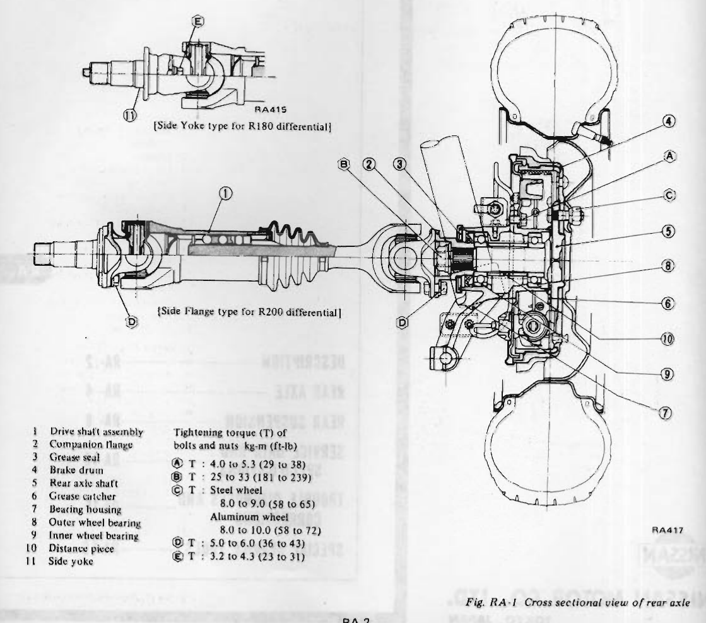
>
> - **Summary:** Cross-sectional assembly diagram of rear axle and drive shaft showing wheel bearings, housing, companion flange, brake drum, axle shaft, and both R180 side yoke and R200 side flange configurations.
> - **Components:** Drive shaft assembly, Companion flange, Grease seal, Brake drum, Rear axle shaft, Grease catcher, Bearing housing, Outer wheel bearing, Inner wheel bearing, Distance piece, Side yoke
> - **Callouts:** **(1)** Drive shaft assembly; **(2)** Companion flange; **(3)** Grease seal; **(4)** Brake drum; **(5)** Rear axle shaft; **(6)** Grease catcher; **(7)** Bearing housing; **(8)** Outer wheel bearing; **(9)** Inner wheel bearing; **(10)** Distance piece; **(11)** Side yoke; **(A)** Tightening torque: 4.0 to 5.3 kg-m (29 to 38 ft-lb); **(B)** Tightening torque: 25 to 33 kg-m (181 to 239 ft-lb); **(C)** Tightening torque: Steel wheel 8.0 to 9.0 kg-m (58 to 65 ft-lb), Aluminum wheel 8.0 to 10.0 kg-m (58 to 72 ft-lb); **(D)** Tightening torque: 5.0 to 6.0 kg-m (36 to 43 ft-lb); **(E)** Tightening torque: 3.2 to 4.3 kg-m (23 to 31 ft-lb)
> - **Specs / Measurements:** Flange bolt torque (A): 4.0 to 5.3 kg-m (29 to 38 ft-lb); Axle bearing lock nut torque (B): 25 to 33 kg-m (181 to 239 ft-lb); Wheel nuts torque (C, steel): 8.0 to 9.0 kg-m (58 to 65 ft-lb); Wheel nuts torque (C, aluminum): 8.0 to 10.0 kg-m (58 to 72 ft-lb); Drive shaft bolts torque (D): 5.0 to 6.0 kg-m (36 to 43 ft-lb); Side yoke bolt torque (E): 3.2 to 4.3 kg-m (23 to 31 ft-lb)
> - **Mechanic Notes:** Two types of drive shafts: Side Flange type for R200 differential (M/T), Side Yoke type for R180 differential (A/T). Side yoke type inset coded RA415.
> - **Tags:** `rear axle`, `cross section`, `wheel bearing`, `companion flange`, `distance piece`, `R180`, `R200`, `torque specs`

---

<!-- Page 3 (RA-3) -->
# REAR SUSPENSION SYSTEM

> 🖼️ **Fig. RA-2 Rear suspension system** `[RA316]` *(Type: `exploded_view`)*
>
> 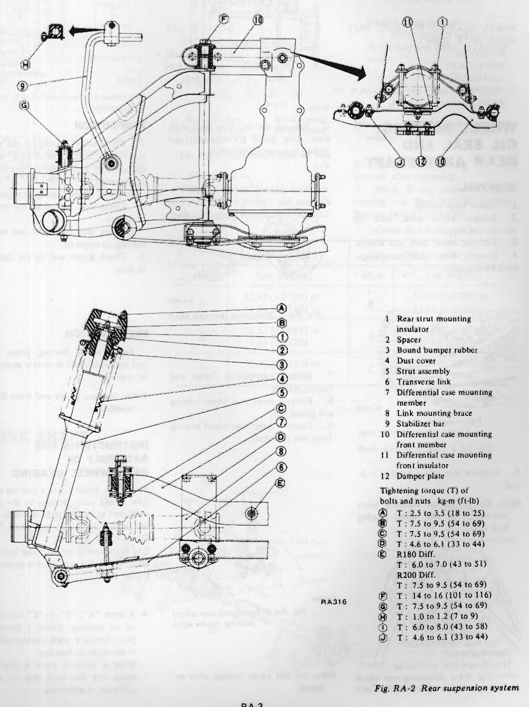
>
> - **Summary:** Complete schematic layout of the rear suspension system including strut assembly, transverse link, differential case mounting members, insulator mounts, stabilizer bar, and all torque specifications.
> - **Components:** Rear strut mounting insulator, Spacer, Bound bumper rubber, Dust cover, Strut assembly, Transverse link, Differential case mounting member, Link mounting brace, Stabilizer bar, Differential case mounting front member, Differential case mounting front insulator, Damper plate
> - **Callouts:** **(1)** Rear strut mounting insulator; **(2)** Spacer; **(3)** Bound bumper rubber; **(4)** Dust cover; **(5)** Strut assembly; **(6)** Transverse link; **(7)** Differential case mounting member; **(8)** Link mounting brace; **(9)** Stabilizer bar; **(10)** Differential case mounting front member; **(11)** Differential case mounting front insulator; **(12)** Damper plate; **(A)** Tightening torque: 2.5 to 3.5 kg-m (18 to 25 ft-lb); **(B)** Tightening torque: 7.5 to 9.5 kg-m (54 to 69 ft-lb); **(C)** Tightening torque: 7.5 to 9.5 kg-m (54 to 69 ft-lb); **(D)** Tightening torque: 4.6 to 6.1 kg-m (33 to 44 ft-lb); **(E)** Tightening torque: R180 Diff. 6.0 to 7.0 kg-m (43 to 51 ft-lb), R200 Diff. 7.5 to 9.5 kg-m (54 to 69 ft-lb); **(F)** Tightening torque: 14 to 16 kg-m (101 to 116 ft-lb); **(G)** Tightening torque: 7.5 to 9.5 kg-m (54 to 69 ft-lb); **(H)** Tightening torque: 1.0 to 1.2 kg-m (7 to 9 ft-lb); **(I)** Tightening torque: 6.0 to 8.0 kg-m (43 to 58 ft-lb); **(J)** Tightening torque: 4.6 to 6.1 kg-m (33 to 44 ft-lb)
> - **Specs / Measurements:** A (strut mounting upper nut): 2.5 to 3.5 kg-m (18 to 25 ft-lb); B (strut piston rod lock nut): 7.5 to 9.5 kg-m (54 to 69 ft-lb); C (transverse link outer self-lock nut): 7.5 to 9.5 kg-m (54 to 69 ft-lb); D (transverse link mounting brace bolt): 4.6 to 6.1 kg-m (33 to 44 ft-lb); E (differential rear member installation nut): R180 Diff. 6.0 to 7.0 kg-m (43 to 51 ft-lb), R200 Diff. 7.5 to 9.5 kg-m (54 to 69 ft-lb); F (transverse link inner bolt): 14 to 16 kg-m (101 to 116 ft-lb); G (differential rear insulator installation nut): 7.5 to 9.5 kg-m (54 to 69 ft-lb); H (stabilizer bar connecting bolt): 1.0 to 1.2 kg-m (7 to 9 ft-lb); I (gear carrier and front insulator nut): 6.0 to 8.0 kg-m (43 to 58 ft-lb); J (differential front member bolt): 4.6 to 6.1 kg-m (33 to 44 ft-lb)
> - **Mechanic Notes:** Illustrates relationship of strut, coil spring, transverse link, differential mounting front and rear members, and stabilizer linkage.
> - **Tags:** `rear suspension`, `strut`, `transverse link`, `differential mounting`, `stabilizer bar`, `torque specs`

---

<!-- Page 4 (RA-4) -->
# REAR AXLE

## CONTENTS

| Subject | Page |
| :--- | :--- |
| WHEEL BEARING, OIL SEAL AND REAR AXLE SHAFT | RA-4 |
| - REMOVAL | RA-4 |
| - INSPECTION | RA-4 |
| - INSTALLATION | RA-4 |
| - INSTRUCTIONS FOR ASSEMBLY OF REAR WHEEL BEARING | RA-4 |
| DRIVE SHAFT | RA-5 |
| - REMOVAL | RA-6 |
| - DISASSEMBLY | RA-6 |
| - INSPECTION | RA-6 |
| - ASSEMBLY | RA-6 |

---

## WHEEL BEARING, OIL SEAL AND REAR AXLE SHAFT

### REMOVAL

1. Chock front wheels.
2. Loosen wheel nuts, jack up the car, and support it with stands.
3. Remove wheel nuts and wheels.
4. Remove drive shaft installation bolts (wheel side).

> 🖼️ **Fig. RA-3 Removing drive shaft** `[RA290]` *(Type: `procedure_step`)*
>
> 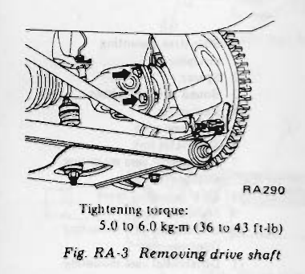
>
> - **Summary:** Removing drive shaft installation bolts at the rear axle wheel companion flange.
> - **Components:** Drive shaft, Companion flange, Mounting bolts
> - **Callouts:** **(Tightening torque)** 5.0 to 6.0 kg-m (36 to 43 ft-lb)
> - **Specs / Measurements:** Tightening torque: 5.0 to 6.0 kg-m (36 to 43 ft-lb)
> - **Mechanic Notes:** Bolts connect drive shaft flange to rear axle companion flange.
> - **Tags:** `drive shaft removal`, `companion flange`, `torque spec`

5. Remove rear wheel bearing lock nut.

> [!NOTE]
> Do not release caulking when removing the rear wheel bearing lock nut.

> 🖼️ **Fig. RA-4 Removing rear wheel bearing lock nut** `[RA507]` *(Type: `procedure_step`)*
>
> 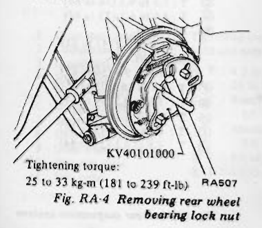
>
> - **Summary:** Removing the staked rear wheel bearing lock nut using tool KV40101000 while hub is stationary.
> - **Components:** Rear wheel bearing lock nut, Axle shaft, Rear Axle Stand KV40101000
> - **Callouts:** **(KV40101000)** Rear axle stand KV40101000; **(Tightening torque)** 25 to 33 kg-m (181 to 239 ft-lb)
> - **Specs / Measurements:** Tightening torque: 25 to 33 kg-m (181 to 239 ft-lb); Special tool: KV40101000
> - **Mechanic Notes:** Do not release caulking when removing the rear wheel bearing lock nut.
> - **Tags:** `wheel bearing lock nut`, `KV40101000`, `torque spec`

6. Remove the rear axle shaft with Rear Axle Stand KV40101000 and Sliding hammer ST36230000.

> 🖼️ **Fig. RA-5 Removing rear axle shaft** `[RA490]` *(Type: `procedure_step`)*
>
> 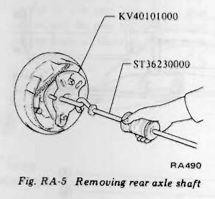
>
> - **Summary:** Pulling the rear axle shaft out of the bearing housing using sliding hammer ST36230000 attached to rear axle stand KV40101000.
> - **Components:** Rear axle shaft, Rear Axle Stand KV40101000, Sliding hammer ST36230000, Wheel hub
> - **Callouts:** **(KV40101000)** Rear axle stand KV40101000; **(ST36230000)** Sliding hammer ST36230000
> - **Specs / Measurements:** Special tools: KV40101000, ST36230000
> - **Mechanic Notes:** Thread slide hammer adapter onto wheel hub studs/flange via KV40101000 stand.
> - **Tags:** `axle shaft removal`, `slide hammer`, `KV40101000`, `ST36230000`

7. Remove companion flange and bearing washer.
8. Remove inner rear wheel bearing and grease seal.
9. Remove outer rear wheel bearing from rear axle shaft.

> 🖼️ **Fig. RA-6 Removing rear wheel bearing (outer side)** `[RA296]` *(Type: `procedure_step`)*
>
> 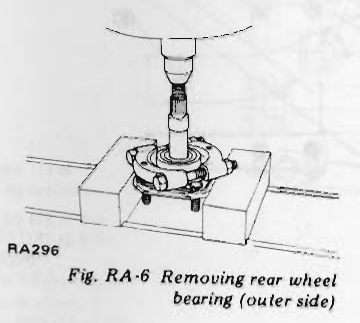
>
> - **Summary:** Pressing the outer rear wheel bearing off the axle shaft using a press and support plates.
> - **Components:** Rear axle shaft, Outer wheel bearing, Support plates, Press ram
> - **Mechanic Notes:** Do not reuse bearing after removal.
> - **Tags:** `wheel bearing removal`, `outer bearing`, `hydraulic press`

> [!NOTE]
> Do not reuse bearing after removal.

### INSPECTION

1. Check wheel bearing for end play, the rolling surface for flaking, wear, seizure, and grease seal for cracks or deformation. Replace wheel bearing as required.
2. Check rear axle shaft for cracks or seizure. Replace rear axle shaft and wheel bearing as required.
3. Check grease seal lip for damage or wear.

### INSTALLATION

Install wheel bearing, grease seal and rear axle shaft in reverse sequence of removal.

> [!NOTE]
> Replace grease seal every disassembly.

### INSTRUCTIONS FOR ASSEMBLY OF REAR WHEEL BEARING

1. Outer bearing has a seal on one side. Install outer bearing to the rear axle shaft so that the side to which the seal is attached faces the wheel. See Figure RA-8.
2. Relationship between rear bearing housing and distance piece is shown in Figure RA-7.
- A mark "A", "B", or "C" is stamped on housing. Select a distance piece having a mark corresponding to the mark on housing.
When a distance piece is reused, make sure that both ends are not collapsed or deformed. <!-- Page 5 (RA-5) --> > 🖼️ **Fig. RA-7 Rear bearing housing and distance piece** `[RA317]` *(Type: `inspection_measurement`)*
>
> 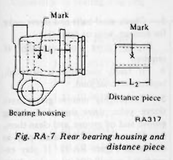
>
> - **Summary:** Marking positions and dimension definitions for rear bearing housing length (L1) and distance piece length (L2).
> - **Components:** Bearing housing, Distance piece
> - **Callouts:** **(Mark)** Mark stamped location (A, B, or C); **(L1)** Housing internal shoulder dimension; **(L2)** Distance piece length
> - **Specs / Measurements:** Mark A housing: 52.63 to 52.73 mm (2.0720 to 2.0760 in); Mark A distance piece: 52.60 to 52.66 mm (2.0709 to 2.0732 in); Mark B housing: 52.53 to 52.63 mm (2.0681 to 2.0720 in); Mark B distance piece: 52.50 to 52.56 mm (2.0669 to 2.0693 in); Mark C housing: 52.43 to 52.53 mm (2.0642 to 2.0681 in); Mark C distance piece: 52.40 to 52.46 mm (2.0630 to 2.0654 in)
> - **Mechanic Notes:** Select distance piece having a mark corresponding to mark on housing. When distance piece is reused, verify ends are not collapsed or deformed.
> - **Tags:** `bearing housing`, `distance piece`, `selective fit`, `clearance`

> 🖼️ **Fig. RA-8 Lubrication chart of rear axle** `[RA318]` *(Type: `cutaway_flow`)*
>
> 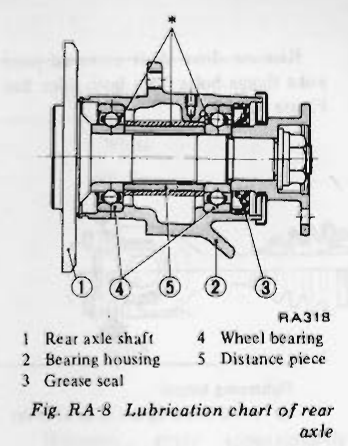
>
> - **Summary:** Cross-sectional lubrication diagram of rear axle housing indicating cavity areas to pack with multi-purpose grease (asterisk *).
> - **Components:** Rear axle shaft, Bearing housing, Grease seal, Wheel bearing, Distance piece
> - **Callouts:** **(1)** Rear axle shaft; **(2)** Bearing housing; **(3)** Grease seal; **(4)** Wheel bearing; **(5)** Distance piece; **(*)** Fill with recommended multi-purpose grease
> - **Specs / Measurements:** Lock nut torque: 25 to 33 kg-m (181 to 239 ft-lb); Preload: 4.5 kg-cm (3.9 in-lb), <= 790 gr (27.86 oz) at hub bolt; End play: 0 to 0.15 mm (0 to 0.0059 in)
> - **Mechanic Notes:** Outer bearing has seal on one side. Install outer bearing so seal faces the wheel. Fill portions marked with asterisk (*) with grease.
> - **Tags:** `lubrication chart`, `wheel bearing grease`, `grease seal`, `bearing orientation`

3. For wheel bearing grease, use recommended multi-purpose grease. Fill the portions indicated by asterisk (*) in Figure RA-8.
4. Tighten wheel bearing lock nut, and measure the preload and rear axle shaft end play. Readjust as required.

- Tightening torque of wheel bearing lock nut: 25 to 33 kg-m (181 to 239 ft-lb)
- Wheel bearing preload: 4.5 kg-cm (3.9 in-lb)
  - At the hub bolt: 790 gr (27.86 oz) or less
- Rear axle shaft end play: 0 to 0.15 mm (0 to 0.0059 in)

> [!NOTE]
> Use new lock nuts every disassembly.

5. Caulk wheel bearing lock nuts securely after tightening.
6. When fitting outer rear wheel bearing, use Rear Axle Shaft Outer Bearing Drift ST37780000.

| Rear bearing housing Mark | Rear bearing housing Size mm (in) | Distance piece Mark | Distance piece Size mm (in) |
| :--- | :--- | :--- | :--- |
| A | 52.63 (2.0720) to 52.73 (2.0760) | A | 52.60 (2.0709) to 52.66 (2.0732) |
| B | 52.53 (2.0681) to 52.63 (2.0720) | B | 52.50 (2.0669) to 52.56 (2.0693) |
| C | 52.43 (2.0642) to 52.53 (2.0681) | C | 52.40 (2.0630) to 52.46 (2.0654) |

---

## DRIVE SHAFT

> 🖼️ **Fig. RA-9 Drive shaft components** `[RA416]` *(Type: `exploded_view`)*
>
> 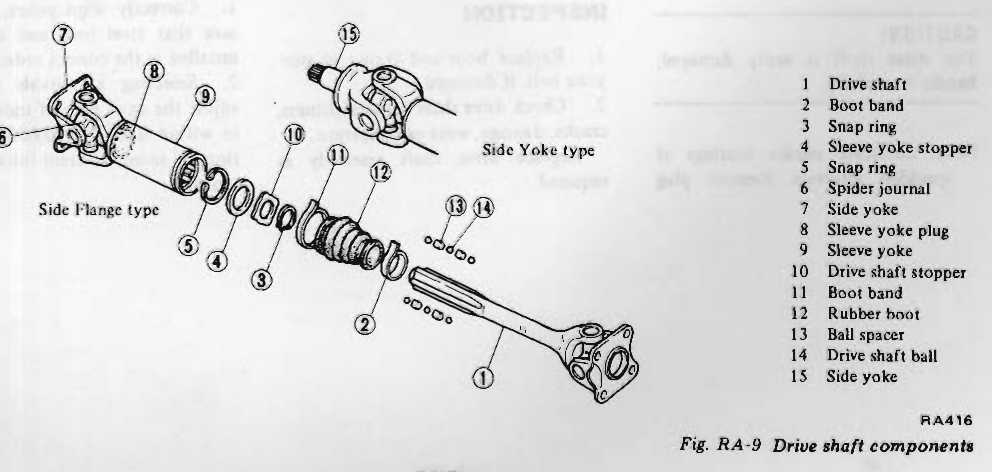
>
> - **Summary:** Exploded view of drive shaft assembly showing components for both Side Flange type (R200) and Side Yoke type (R180).
> - **Components:** Drive shaft, Boot band, Snap ring, Sleeve yoke stopper, Spider journal, Side yoke, Sleeve yoke plug, Sleeve yoke, Drive shaft stopper, Rubber boot, Ball spacer, Drive shaft ball
> - **Callouts:** **(1)** Drive shaft; **(2)** Boot band; **(3)** Snap ring; **(4)** Sleeve yoke stopper; **(5)** Snap ring; **(6)** Spider journal; **(7)** Side yoke; **(8)** Sleeve yoke plug; **(9)** Sleeve yoke; **(10)** Drive shaft stopper; **(11)** Boot band; **(12)** Rubber boot; **(13)** Ball spacer; **(14)** Drive shaft ball; **(15)** Side yoke
> - **Mechanic Notes:** Shows ball spline assembly order and universal joint spider yokes.
> - **Tags:** `drive shaft`, `exploded view`, `ball spline`, `spider journal`, `side yoke`, `side flange`

---

<!-- Page 6 (RA-6) -->
## DRIVE SHAFT (Continued)

### REMOVAL

1. Chock front wheels.
2. Jack up rear of car and support on safety stands.
3. R200 type:
Remove drive shaft universal joint yoke flange bolts from both sides. See Figure RA-10.

> 🖼️ **Fig. RA-10 Removing drive shaft** `[RA516]` *(Type: `procedure_step`)*
>
> 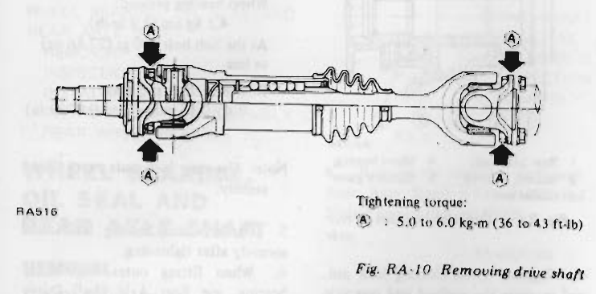
>
> - **Summary:** Removing universal joint yoke flange bolts from both wheel and differential sides on R200 drive shaft.
> - **Components:** Drive shaft, Flange yoke, Differential companion flange, Mounting bolts
> - **Callouts:** **(A)** Tightening torque: 5.0 to 6.0 kg-m (36 to 43 ft-lb)
> - **Specs / Measurements:** Tightening torque (A): 5.0 to 6.0 kg-m (36 to 43 ft-lb)
> - **Mechanic Notes:** Remove bolts from both ends (wheel side and gear carrier side).
> - **Tags:** `drive shaft removal`, `R200`, `flange bolts`, `torque spec`

4. R180 type:
Disconnect drive shaft on the wheel side.
Remove side yoke fitting bolts, and extract side yokes together with drive shafts.

> 🖼️ **Fig. RA-11 Removing side yoke fitting bolt** `[PD323]` *(Type: `procedure_step`)*
>
> 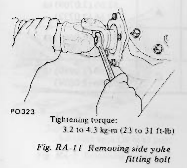
>
> - **Summary:** Loosening center side yoke retaining bolt on R180 differential carrier.
> - **Components:** Side yoke, Fitting bolt, R180 differential carrier
> - **Callouts:** **(Tightening torque)** 3.2 to 4.3 kg-m (23 to 31 ft-lb)
> - **Specs / Measurements:** Tightening torque: 3.2 to 4.3 kg-m (23 to 31 ft-lb)
> - **Mechanic Notes:** Remove side yoke fitting bolts and extract side yokes together with drive shafts.
> - **Tags:** `side yoke`, `R180`, `fitting bolt`, `torque spec`

> [!CAUTION]
> The drive shaft is easily damaged; handle it carefully.

> [!NOTE]
> Lubricate needle bearings at specified intervals. Remove plug screw at journal and screw nipple in place when lubricating. Be sure to screw in plug screw after lubricating.

### DISASSEMBLY

Drive shaft should be disassembled only when lubricating the ball spline.
Lubrication is required at specified intervals.
1. Remove boot band and remove boot from sleeve yoke.
2. Remove snap ring from sleeve yoke using suitable snap ring plier and take out sleeve yoke stopper.
3. Withdraw drive shaft carefully from sleeve yoke so as not to lose balls and spacers.

### INSPECTION

1. Replace boot and O-ring of side yoke bolt, if damaged.
2. Check drive shaft for straightness, cracks, damage, wear or distortion. Replace drive shaft assembly as required.
3. Check steel balls and sleeve yoke for damage, wear or distortion. Replace drive shaft assembly as required.
4. If faulty condition is detected, replace universal joint.
5. Thoroughly remove grease from sleeve yoke, drive shaft ball rolling groove and oil groove, and clean them.
6. Measure the drive shaft play as shown in Figure RA-12. If play exceeds 0.1 mm (0.004 in), replace drive shaft assembly. Be sure to measure the drive shaft play with drive shaft completely compressed.

> 🖼️ **Fig. RA-12 Measuring drive shaft play** `[RA044]` *(Type: `inspection_measurement`)*
>
> 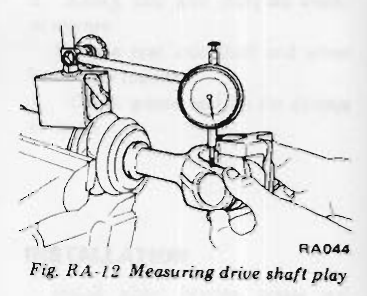
>
> - **Summary:** Dial gauge setup measuring spline play in the drive shaft assembly while fully compressed.
> - **Components:** Drive shaft assembly, Dial indicator, V-block / stand
> - **Specs / Measurements:** Drive shaft play limit: 0.1 mm (0.004 in)
> - **Mechanic Notes:** Measure drive shaft play with drive shaft completely compressed. If play exceeds 0.1 mm (0.004 in), replace drive shaft assembly.
> - **Tags:** `drive shaft play`, `dial indicator`, `spline wear`, `inspection`

### ASSEMBLY

Assemble drive shaft in reverse sequence of disassembly noting the following:
1. Correctly align yokes, and make sure that steel balls and spacers are installed in the correct order.
2. Selecting a suitable snap ring, adjust the axial play of universal joint to within 0.02 mm (0.0008 in). Snap rings of seven different thicknesses are available. <!-- Page 7 (RA-7) --> ### Universal joint bearing snap ring

| Thickness mm (in) | Color identification |
| :--- | :--- |
| 1.49 (0.0587) | White |
| 1.52 (0.0598) | Yellow |
| 1.55 (0.0610) | Red |
| 1.58 (0.0622) | Green |
| 1.61 (0.0634) | Blue |
| 1.64 (0.0646) | Light brown |
| 1.67 (0.0657) | Black |

> [!NOTE]
> Drive shaft components are not available as service parts. Therefore, drive shaft must be replaced as an assembly, even if only one component is faulty.

> 🖼️ **Fig. RA-13 Cross-sectional view of drive shaft** `[RA517]` *(Type: `cutaway_flow`)*
>
> 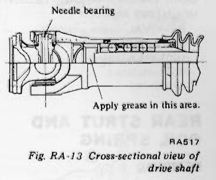
>
> - **Summary:** Cross-sectional detail of universal joint needle bearing and drive shaft sleeve yoke showing grease packing area.
> - **Components:** Drive shaft, Sleeve yoke, Needle bearing, Spider journal
> - **Callouts:** **(Needle bearing)** Needle bearing; **(Apply grease in this area)** Apply grease in this area
> - **Specs / Measurements:** Grease for ball rolling groove and oil groove: approximately 10 gr (0.35 oz); Grease for sleeve yoke cavity: approximately 35 gr (1.23 oz)
> - **Mechanic Notes:** Apply recommended multi-purpose grease to specified cavity. Drive shaft components are not available as separate service parts.
> - **Tags:** `drive shaft`, `cross section`, `grease application`, `needle bearing`, `lubrication`

3. Apply an adequate amount of recommended multi-purpose grease [approximately 10 gr (0.35 oz)] to ball rolling groove and oil groove.
Moreover, apply approximately 35 gr (1.23 oz) of grease to the area shown in Figure RA-13.

---

<!-- Page 8 (RA-8) -->
# REAR SUSPENSION

## CONTENTS

| Subject | Page |
| :--- | :--- |
| REAR STRUT AND COIL SPRING | RA-8 |
| - REMOVAL | RA-8 |
| - INSTALLATION | RA-9 |
| GEAR CARRIER AND DIFFERENTIAL MOUNTING MEMBER | RA-9 |
| - REMOVAL | RA-9 |
| - INSPECTION | RA-10 |
| - INSTALLATION | RA-10 |
| TRANSVERSE LINK | RA-11 |
| - REMOVAL | RA-11 |
| - INSPECTION | RA-11 |
| - INSTALLATION | RA-11 |
| STABILIZER | RA-12 |
| - REMOVAL | RA-12 |
| - INSPECTION | RA-12 |
| - INSTALLATION | RA-12 |

---

## REAR STRUT AND COIL SPRING

### REMOVAL

1. Chock the front wheels.
2. Loosen wheel nuts, jack up car, and support body with stands.
3. Remove wheel nuts and remove wheels.
4. Disconnect brake line connector (body side) ① and side brake linkage ②.

> [!CAUTION]
> a. When disconnecting brake tube, use suitable tube wrench. Never use open-end or adjustable wrench.
> b. Cover brake hose and pipe openings to prevent entrance of dirt.

> 🖼️ **Fig. RA-14 Removing brake hose and side brake linkage** `[RA286]` *(Type: `procedure_step`)*
>
> 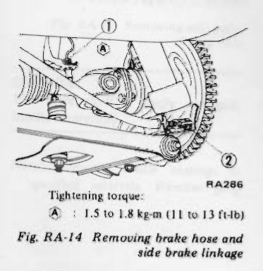
>
> - **Summary:** Disconnecting the brake line tube flare connector (body side) and emergency side brake cable linkage at rear wheel.
> - **Components:** Brake line connector, Side brake linkage, Brake hose
> - **Callouts:** **(1)** Brake line connector (body side); **(2)** Side brake linkage; **(A)** Tightening torque: 1.5 to 1.8 kg-m (11 to 13 ft-lb)
> - **Specs / Measurements:** Tightening torque (A): 1.5 to 1.8 kg-m (11 to 13 ft-lb)
> - **Wiring / Connections:** Hydraulic brake line connector; Mechanical parking brake cable linkage
> - **Mechanic Notes:** Use suitable tube wrench; never use open-end or adjustable wrench. Cover brake hose and pipe openings to prevent dirt ingress.
> - **Tags:** `brake hose`, `parking brake`, `tube wrench`, `torque spec`

5. Remove stabilizer bar from transverse link. See Figure RA-15.

> 🖼️ **Fig. RA-15 Removing stabilizer from transverse link** `[RA287]` *(Type: `procedure_step`)*
>
> 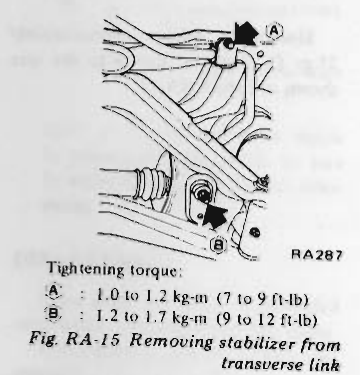
>
> - **Summary:** Detaching the rear stabilizer bar connecting link from transverse link mount.
> - **Components:** Stabilizer bar, Connecting rod, Transverse link, Rubber bushings
> - **Callouts:** **(A)** Tightening torque: 1.0 to 1.2 kg-m (7 to 9 ft-lb); **(B)** Tightening torque: 1.2 to 1.7 kg-m (9 to 12 ft-lb)
> - **Specs / Measurements:** Tightening torque (A): 1.0 to 1.2 kg-m (7 to 9 ft-lb); Tightening torque (B): 1.2 to 1.7 kg-m (9 to 12 ft-lb)
> - **Mechanic Notes:** Note bushing orientation and sequence on connecting rod.
> - **Tags:** `stabilizer bar`, `transverse link`, `connecting link`, `torque spec`

6. Remove transverse link outer self-lock nuts ② and lock bolt ① of rear transverse spindle from the lower end of bearing housing.

> 🖼️ **Fig. RA-16 Removing lock bolt and self-lock nuts** `[RA288]` *(Type: `procedure_step`)*
>
> 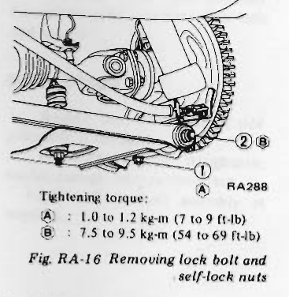
>
> - **Summary:** Removing transverse spindle lock bolt and outer spindle self-locking nuts from lower strut housing.
> - **Components:** Lock bolt, Self-lock nuts, Spindle, Strut bearing housing
> - **Callouts:** **(1)** Lock bolt; **(2)** Transverse link outer self-lock nuts; **(A)** Tightening torque: 1.0 to 1.2 kg-m (7 to 9 ft-lb); **(B)** Tightening torque: 7.5 to 9.5 kg-m (54 to 69 ft-lb)
> - **Specs / Measurements:** Lock bolt torque (A): 1.0 to 1.2 kg-m (7 to 9 ft-lb); Self-lock nuts torque (B): 7.5 to 9.5 kg-m (54 to 69 ft-lb)
> - **Mechanic Notes:** Remove lock bolt completely before driving out spindle.
> - **Tags:** `spindle lock bolt`, `self-lock nut`, `strut lower mount`, `torque spec`

7. Withdraw spindle, and separate transverse link from strut assembly. See Figure RA-17.

> 🖼️ **Fig. RA-17 Removing spindle** `[RA289]` *(Type: `procedure_step`)*
>
> 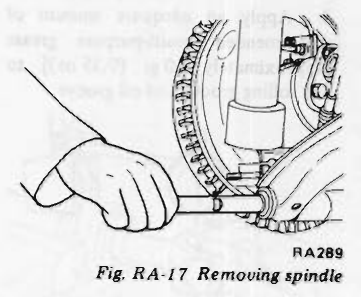
>
> - **Summary:** Withdrawing the rear transverse link spindle through the lower strut housing.
> - **Components:** Spindle pin, Transverse link, Strut housing
> - **Mechanic Notes:** Drive spindle out gently so as not to damage threads.
> - **Tags:** `spindle removal`, `transverse link`, `strut removal`

8. Disconnect drive shaft (wheel side).
9. Remove strut installation nuts (from the passenger compartment side). The strut assembly can be removed downward. See Figures RA-18 and RA-19.

> 🖼️ **Fig. RA-18 Removing strut installation nuts** `[RA291]` *(Type: `procedure_step`)*
>
> 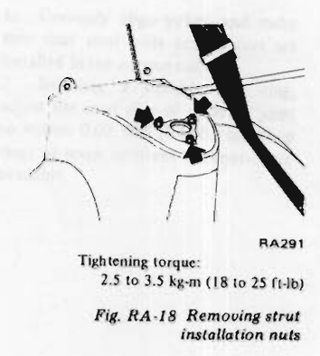
>
> - **Summary:** Removing upper strut insulator mounting nuts from inside the passenger / luggage compartment under the trim.
> - **Components:** Strut insulator mounting nuts, Upper strut tower, Luggage area trim
> - **Callouts:** **(Tightening torque)** 2.5 to 3.5 kg-m (18 to 25 ft-lb)
> - **Specs / Measurements:** Tightening torque: 2.5 to 3.5 kg-m (18 to 25 ft-lb)
> - **Mechanic Notes:** Accessed from passenger compartment side. Support strut from below when loosening.
> - **Tags:** `upper strut nuts`, `strut tower`, `torque spec`

---

<!-- Page 9 (RA-9) -->

> 🖼️ **Fig. RA-19 Removing strut assembly** `[RA292]` *(Type: `procedure_step`)*
>
> 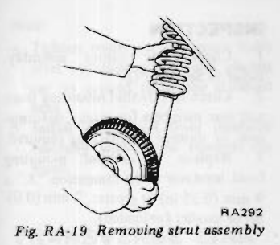
>
> - **Summary:** Lowering the rear strut and brake drum assembly down out of the rear wheel well.
> - **Components:** Rear strut assembly, Brake backing plate, Wheel housing
> - **Mechanic Notes:** Place a jack under lower end of strut, and remove it gradually.
> - **Tags:** `strut removal`, `rear suspension`

> [!CAUTION]
> When removing strut assembly, place a jack under the lower end of strut, and remove it gradually.

10. For the removal and reinstallation of spring, disassembly of strut, inspection and adjustment, apply the instructions for front strut assembly. Refer to Section FA.

> [!NOTE]
> a. It is important that correct amount of fluid be poured into strut to assure correct damping force of shock absorber.
> - Amount of oil: 400 cc (24.41 cu in)
> b. Use Nissan genuine shock absorber oil "NISSAN GENUINE STRUT OIL" or equivalent.

### INSTALLATION

Install strut assembly in reverse sequence of removal.

> [!CAUTION]
> When installing brake tubes, use Flare Nut Torque Wrench GG94310000.

> [!NOTE]
> a. Install spindle so that the shorter side (when measured from the position where the lock bolt is installed) faces the front of car. See Figure RA-20.

> 🖼️ **Fig. RA-20 Spindle** `[RA325]` *(Type: `inspection_measurement`)*
>
> 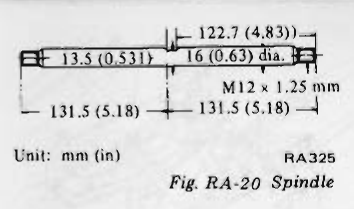
>
> - **Summary:** Dimensional diagram of transverse link rear spindle showing lock notch offset and length asymmetry.
> - **Components:** Transverse spindle
> - **Callouts:** **(Shorter side)** 122.7 mm (4.831 in); **(Longer side)** 131.5 mm (5.18 in); **(Notch width)** 13.5 mm (0.531 in); **(Diameter)** 16 mm (0.63 in) dia.; **(Thread)** M12 x 1.25 mm
> - **Specs / Measurements:** Shorter length from lock bolt position: 122.7 mm (4.831 in); Longer length from lock bolt position: 131.5 mm (5.18 in); Shaft diameter: 16 mm (0.63 in); Lock notch width: 13.5 mm (0.531 in); Thread size: M12 x 1.25 mm
> - **Mechanic Notes:** Install spindle so that shorter side (when measured from position where lock bolt is installed) faces front of car.
> - **Tags:** `spindle dimensions`, `orientation`, `alignment`

> b. After installing wheels and placing car under the standard load, tighten transverse link outer self-lock nut completely.

> [!CAUTION]
> Correctly fit open end on spring seat.

---

## GEAR CARRIER AND DIFFERENTIAL MOUNTING MEMBER

### REMOVAL

1. Chock front wheels.
2. Jack up car, and support body with stands.
3. Remove main muffler. Refer to Section FE.
4. Separate propeller shaft from gear carrier. Refer to Section PD.
5. Loosen front side transverse link inner bolts.

> 🖼️ **Fig. RA-21 Removing transverse link inner bolts** `[RA274]` *(Type: `procedure_step`)*
>
> 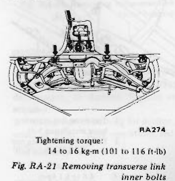
>
> - **Summary:** Loosening the inner pivot bolts of the transverse link at the differential front crossmember.
> - **Components:** Transverse link inner bolts, Front crossmember, Transverse link
> - **Callouts:** **(Tightening torque)** 14 to 16 kg-m (101 to 116 ft-lb)
> - **Specs / Measurements:** Tightening torque: 14 to 16 kg-m (101 to 116 ft-lb)
> - **Mechanic Notes:** Loosen front side transverse link inner bolts when removing differential.
> - **Tags:** `transverse link inner bolt`, `front crossmember`, `torque spec`

6. Remove drive shaft installation bolts (wheel side and gear carrier side), and separate drive shaft from the gear carrier. See Figures RA-11, RA-22 and RA-23.

> 🖼️ **Fig. RA-22 Removing drive shaft installation bolts (wheel side)** `[RA290]` *(Type: `procedure_step`)*
>
> 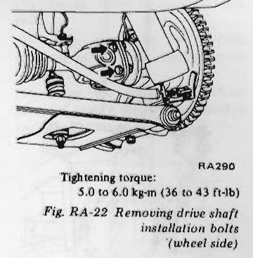
>
> - **Summary:** Disconnecting drive shaft bolts from companion flange at the wheel side.
> - **Components:** Drive shaft, Wheel companion flange, Mounting bolts
> - **Callouts:** **(Tightening torque)** 5.0 to 6.0 kg-m (36 to 43 ft-lb)
> - **Specs / Measurements:** Tightening torque: 5.0 to 6.0 kg-m (36 to 43 ft-lb)
> - **Mechanic Notes:** Tighten to 5.0 to 6.0 kg-m (36 to 43 ft-lb) on reassembly.
> - **Tags:** `drive shaft bolts`, `wheel side`, `torque spec`

> 🖼️ **Fig. RA-23 Loosening drive shaft installation bolts (gear carrier side)** `[RA302]` *(Type: `procedure_step`)*
>
> 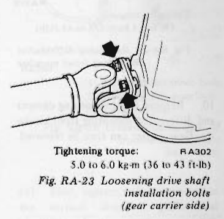
>
> - **Summary:** Disconnecting drive shaft flange bolts from the differential side companion flange.
> - **Components:** Drive shaft, Differential companion flange, Bolts
> - **Callouts:** **(Tightening torque)** 5.0 to 6.0 kg-m (36 to 43 ft-lb)
> - **Specs / Measurements:** Tightening torque: 5.0 to 6.0 kg-m (36 to 43 ft-lb)
> - **Mechanic Notes:** Applies to R200 side flange type. For R180 side yoke, refer to Fig. RA-11.
> - **Tags:** `drive shaft bolts`, `differential side`, `R200`, `torque spec`

7. Place a jack beneath gear carrier and raise it.
8. Remove differential mounting rear member installation nut.

> 🖼️ **Fig. RA-24 Removing differential mounting rear member** `[RA306]` *(Type: `procedure_step`)*
>
> 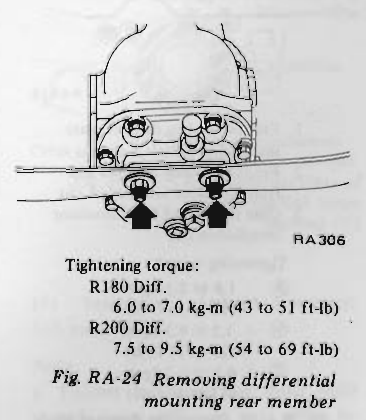
>
> - **Summary:** Removing nuts securing the differential rear cover to the transverse rear mounting leaf member.
> - **Components:** Differential rear cover, Rear mounting member, Mounting nuts
> - **Callouts:** **(Tightening torque R180 Diff.)** 6.0 to 7.0 kg-m (43 to 51 ft-lb); **(Tightening torque R200 Diff.)** 7.5 to 9.5 kg-m (54 to 69 ft-lb)
> - **Specs / Measurements:** R180 Diff. torque: 6.0 to 7.0 kg-m (43 to 51 ft-lb); R200 Diff. torque: 7.5 to 9.5 kg-m (54 to 69 ft-lb)
> - **Mechanic Notes:** Place jack beneath gear carrier before removing rear member nuts.
> - **Tags:** `differential rear member`, `R180`, `R200`, `torque spec`

9. Remove differential mounting front member installation bolts, lower the jack slowly, and remove gear carrier and front mounting member as an assembly. See Figure RA-25. <!-- Page 10 (RA-10) --> > 🖼️ **Fig. RA-25 Removing differential mounting front member** `[RA319]` *(Type: `procedure_step`)*
>
> 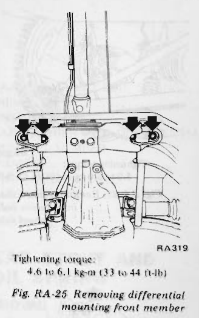
>
> - **Summary:** Removing bolts securing the front crossmember of the differential to the underbody frame.
> - **Components:** Differential mounting front member, Body frame mounts, Installation bolts
> - **Callouts:** **(Tightening torque)** 4.6 to 6.1 kg-m (33 to 44 ft-lb)
> - **Specs / Measurements:** Tightening torque: 4.6 to 6.1 kg-m (33 to 44 ft-lb)
> - **Mechanic Notes:** Lower jack slowly and remove gear carrier and front mounting member as an assembly.
> - **Tags:** `differential front member`, `removal`, `torque spec`

10. Remove front mounting damper and differential mounting front insulator. Gear carrier can then be removed.

> 🖼️ **Fig. RA-26 Removing damper plate bolts and mounting front insulator nuts** `[RA518]` *(Type: `procedure_step`)*
>
> 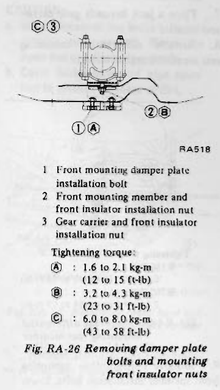
>
> - **Summary:** Removing damper plate bolts, front mounting insulator nuts, and differential case insulator retaining nuts.
> - **Components:** Front mounting damper plate, Front mounting member, Differential front insulator, Gear carrier
> - **Callouts:** **(1)** Front mounting damper plate installation bolt; **(2)** Front mounting member and front insulator installation nut; **(3)** Gear carrier and front insulator installation nut; **(A)** Tightening torque: 1.6 to 2.1 kg-m (12 to 15 ft-lb); **(B)** Tightening torque: 3.2 to 4.3 kg-m (23 to 31 ft-lb); **(C)** Tightening torque: 6.0 to 8.0 kg-m (43 to 58 ft-lb)
> - **Specs / Measurements:** Bolt 1 / Torque A: 1.6 to 2.1 kg-m (12 to 15 ft-lb); Nut 2 / Torque B: 3.2 to 4.3 kg-m (23 to 31 ft-lb); Nut 3 / Torque C: 6.0 to 8.0 kg-m (43 to 58 ft-lb)
> - **Mechanic Notes:** Torque nuts and bolts to specified values upon reinstallation.
> - **Tags:** `damper plate`, `front insulator`, `differential mount`, `torque specs`

11. Loosen rear side transverse link inner bolts. See Figure RA-27.

> 🖼️ **Fig. RA-27 Removing transverse link inner bolts** `[RA321]` *(Type: `procedure_step`)*
>
> 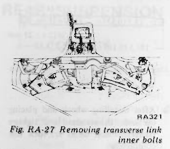
>
> - **Summary:** Loosening rear side inner transverse link pivot bolts at rear link mounting brackets.
> - **Components:** Transverse link inner bolts, Link rear bracket, Transverse link
> - **Mechanic Notes:** Loosen rear side transverse link inner bolts before unbolting bracket.
> - **Tags:** `transverse link`, `rear inner bolt`, `removal`

12. Remove link mounting rear bracket.

> 🖼️ **Fig. RA-28 Removing rear bracket** `[RA278]` *(Type: `procedure_step`)*
>
> 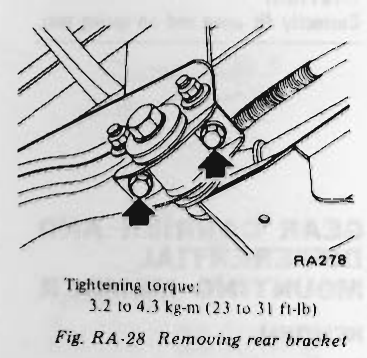
>
> - **Summary:** Removing bolts securing the transverse link mounting rear bracket to the vehicle body.
> - **Components:** Link mounting rear bracket, Mounting bolts, Body mount
> - **Callouts:** **(Tightening torque)** 3.2 to 4.3 kg-m (23 to 31 ft-lb)
> - **Specs / Measurements:** Tightening torque: 3.2 to 4.3 kg-m (23 to 31 ft-lb)
> - **Mechanic Notes:** Tighten rear bracket bolts to 3.2 to 4.3 kg-m (23 to 31 ft-lb).
> - **Tags:** `rear bracket`, `link mount`, `torque spec`

13. Remove transverse link mounting brace and body installation bolts ① and differential mounting rear insulator and body installation bolts ②.

> 🖼️ **Fig. RA-29 Removing link mounting brace and differential mounting member installation bolts** `[RA276]` *(Type: `procedure_step`)*
>
> 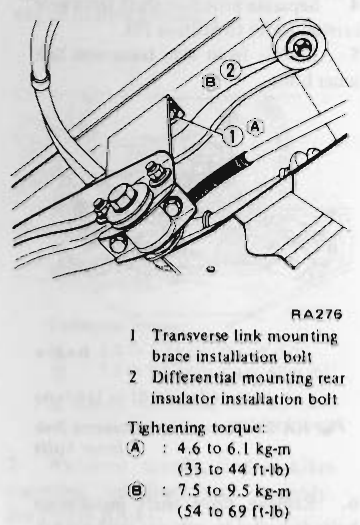
>
> - **Summary:** Removing transverse link brace bolts and differential rear mounting insulator bolts at body anchor points.
> - **Components:** Transverse link mounting brace, Differential mounting rear insulator, Body chassis
> - **Callouts:** **(1)** Transverse link mounting brace installation bolt; **(2)** Differential mounting rear insulator installation bolt; **(A)** Tightening torque: 4.6 to 6.1 kg-m (33 to 44 ft-lb); **(B)** Tightening torque: 7.5 to 9.5 kg-m (54 to 69 ft-lb)
> - **Specs / Measurements:** Brace bolt 1 / Torque A: 4.6 to 6.1 kg-m (33 to 44 ft-lb); Insulator bolt 2 / Torque B: 7.5 to 9.5 kg-m (54 to 69 ft-lb)
> - **Mechanic Notes:** Support member while loosening insulator bolts.
> - **Tags:** `mounting brace`, `rear insulator`, `chassis bolts`, `torque spec`

### INSPECTION

1. Check gear carrier assembly. Refer to Section PD.
2. Check differential mounting front and rear members for cracks, deformation or damage. Replace as required.
3. Replace differential mounting front insulator if the dimension "A" is 9 mm (0.35 in) or greater, 2 mm (0.08 in) or smaller (unloaded).

> 🖼️ **Fig. RA-30 Sectional view of differential mounting insulators**  *(Type: `inspection_measurement`)*
>
> 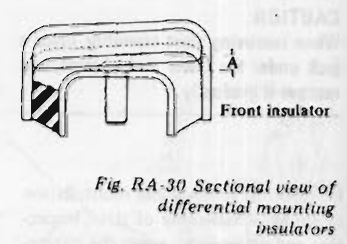
>
> - **Summary:** Cross-sectional inspection diagram of differential front insulator showing clearance dimension 'A'.
> - **Components:** Front insulator, Rubber cushion, Steel bracket
> - **Callouts:** **(Front insulator)** Front insulator; **(A)** Dimension A inspection point
> - **Specs / Measurements:** Dimension A limit: Replace if 9 mm (0.35 in) or greater, or 2 mm (0.08 in) or smaller (unloaded)
> - **Mechanic Notes:** Replace differential mounting front insulator if dimension 'A' is 9 mm (0.35 in) or greater, or 2 mm (0.08 in) or smaller (unloaded).
> - **Tags:** `front insulator`, `dimension A`, `inspection clearance`, `rubber bushing`

4. Replace rubber insulators of differential mounting member, if worn, using Differential Mounting Insulator Drift ST33260010 (for removal) and ST33260020 (for installation). See Figures RA-31 and RA-32.

> 🖼️ **Fig. RA-31 Removing insulator from differential mounting member** `[RA508]` *(Type: `procedure_step`)*
>
> 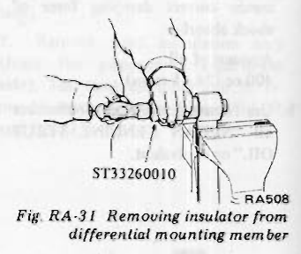
>
> - **Summary:** Pressing the rubber insulator out of the differential mounting member using drift ST33260010.
> - **Components:** Differential mounting member, Rubber insulator, Drift ST33260010
> - **Callouts:** **(ST33260010)** Differential mounting insulator drift ST33260010
> - **Specs / Measurements:** Special tool: ST33260010
> - **Mechanic Notes:** Use ST33260010 for removal of differential mounting member rubber insulator.
> - **Tags:** `insulator removal`, `ST33260010`, `differential member`

> 🖼️ **Fig. RA-32 Installing insulator to differential mounting member** `[RA509]` *(Type: `procedure_step`)*
>
> 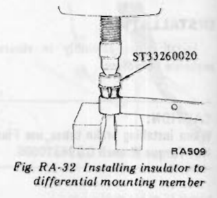
>
> - **Summary:** Pressing a new rubber insulator into the differential mounting member using drift ST33260020.
> - **Components:** Differential mounting member, Rubber insulator, Drift ST33260020
> - **Callouts:** **(ST33260020)** Differential mounting insulator drift ST33260020
> - **Specs / Measurements:** Special tool: ST33260020
> - **Mechanic Notes:** Use ST33260020 for installation of differential mounting member rubber insulator.
> - **Tags:** `insulator installation`, `ST33260020`, `differential member`

### INSTALLATION

Install gear carrier and differential mounting member in reverse sequence of removal. <!-- Page 11 (RA-11) --> > [!NOTE]
> a. Tighten transverse link inner bolts after installing wheels and placing car on ground under the standard load.
> b. Install differential front insulator carefully with arrow towards the front.

---

## TRANSVERSE LINK

### REMOVAL

1. Chock front wheels.
2. Loosen wheel nuts, jack up car, and support body with stands.
3. Remove wheel nuts, and remove wheels.
4. Remove stabilizer bar from transverse link.
5. Separate transverse link from the strut. (Refer to the paragraph on Strut and Coil Spring.)
6. Place a jack beneath gear carrier, and raise it.
7. Loosen transverse link inner bolts ① and damper plate installation bolts ②. See Figure RA-33.
8. Remove the differential mount front insulator installation nut ③.
9. Remove differential mounting front member installation nuts ④, and remove differential mounting front member ⑤.

> 🖼️ **Fig. RA-33 Removing differential mounting front member** `[RA275]` *(Type: `procedure_step`)*
>
> 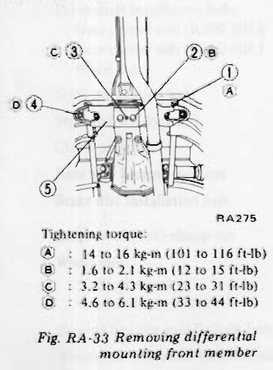
>
> - **Summary:** Removing differential front crossmember fasteners, transverse link inner bolts, and damper plate bolts.
> - **Components:** Transverse link inner bolts, Damper plate bolts, Front insulator nut, Front member nuts, Differential front member
> - **Callouts:** **(1)** Transverse link inner bolts; **(2)** Damper plate installation bolts; **(3)** Differential mount front insulator installation nut; **(4)** Differential mounting front member installation nuts; **(5)** Differential mounting front member; **(A)** Tightening torque: 14 to 16 kg-m (101 to 116 ft-lb); **(B)** Tightening torque: 1.6 to 2.1 kg-m (12 to 15 ft-lb); **(C)** Tightening torque: 3.2 to 4.3 kg-m (23 to 31 ft-lb); **(D)** Tightening torque: 4.6 to 6.1 kg-m (33 to 44 ft-lb)
> - **Specs / Measurements:** Inner bolts 1 / Torque A: 14 to 16 kg-m (101 to 116 ft-lb); Damper plate bolts 2 / Torque B: 1.6 to 2.1 kg-m (12 to 15 ft-lb); Front insulator nut 3 / Torque C: 3.2 to 4.3 kg-m (23 to 31 ft-lb); Front member nuts 4 / Torque D: 4.6 to 6.1 kg-m (33 to 44 ft-lb)
> - **Mechanic Notes:** Support differential case with jack before removing member nuts.
> - **Tags:** `front member`, `transverse link`, `torque specs`, `removal`

10. Remove link mounting rear bracket. Transverse link can now be removed. See Figure RA-34.

> 🖼️ **Fig. RA-34 Removing transverse link** `[RA278]` *(Type: `procedure_step`)*
>
> 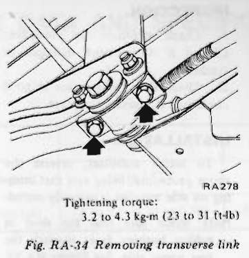
>
> - **Summary:** Unbolting rear link mounting bracket to dismount the transverse link from the chassis.
> - **Components:** Transverse link, Rear mounting bracket, Bolts
> - **Callouts:** **(Tightening torque)** 3.2 to 4.3 kg-m (23 to 31 ft-lb)
> - **Specs / Measurements:** Tightening torque: 3.2 to 4.3 kg-m (23 to 31 ft-lb)
> - **Mechanic Notes:** Tighten to 3.2 to 4.3 kg-m (23 to 31 ft-lb) on reassembly.
> - **Tags:** `transverse link`, `rear bracket`, `torque spec`

11. Remove outer bushing from transverse link with Rear Transverse Link Bushing Replacer ST38800000.

> [!CAUTION]
> Do not tap end face of bushing directly with a hammer as deformation may result in loose bolt.

> 🖼️ **Fig. RA-35 Removing transverse link outer bushing** `[RA280]` *(Type: `procedure_step`)*
>
> 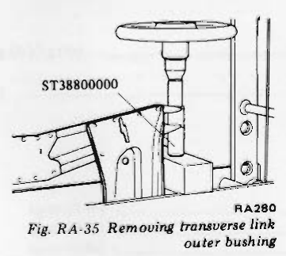
>
> - **Summary:** Using Rear Transverse Link Bushing Replacer ST38800000 in a press to extract the spindle outer rubber bushing.
> - **Components:** Transverse link, Outer bushing, Bushing replacer ST38800000
> - **Callouts:** **(ST38800000)** Rear transverse link bushing replacer ST38800000
> - **Specs / Measurements:** Special tool: ST38800000
> - **Mechanic Notes:** Do not tap end face of bushing directly with a hammer as deformation may result in loose bolt.
> - **Tags:** `outer bushing`, `bushing replacer`, `ST38800000`, `transverse link`

### INSPECTION

1. Check transverse link differential mounting front member for cracks, deformation, or damage. Replace as required.
2. Check rubber bushing for decline, wear, or other faulty conditions and replace as required.

### INSTALLATION

1. Install transverse link in reverse sequence of removal.
2. Install transverse link inner bushing by the following instructions. Figures RA-36 and RA-37.
(1) Install inner bushing to link shaft.
(2) Align projection on bushing (directed to the axis direction) horizontally.
(3) Align the center of bushing (directed toward the axis direction) to the center of bracket.

> 🖼️ **Fig. RA-36 Cross-sectional view of transverse link inner bushing (I)** `[RA284]` *(Type: `alignment_orientation`)*
>
> 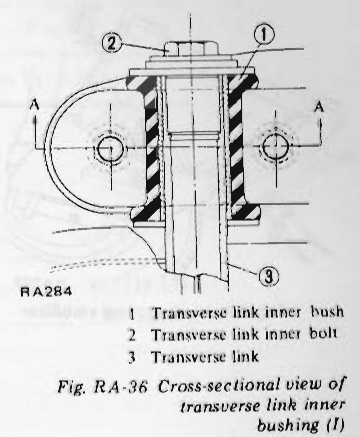
>
> - **Summary:** Cross-sectional view showing proper horizontal alignment of inner bushing projection along the link shaft.
> - **Components:** Transverse link inner bush, Transverse link inner bolt, Transverse link
> - **Callouts:** **(1)** Transverse link inner bush; **(2)** Transverse link inner bolt; **(3)** Transverse link; **(A)** Alignment axis plane
> - **Mechanic Notes:** Align projection on bushing (directed to the axis direction) horizontally. Align center of bushing to center of bracket.
> - **Tags:** `inner bushing`, `cross section`, `orientation`, `alignment projection`

(4) First, tighten bolts supported in the vertical direction (differential mounting front member or link mounting rear bracket).

> 🖼️ **Fig. RA-37 Cross-sectional view of transverse link inner bushing (II)** `[RA285]` *(Type: `alignment_orientation`)*
>
> 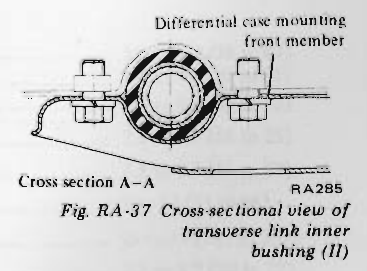
>
> - **Summary:** Cross section A-A showing clamp assembly of transverse link inner bushing into the differential front member bracket.
> - **Components:** Differential case mounting front member, Inner bushing, Link shaft, Bracket clamp
> - **Callouts:** **(Differential case mounting front member)** Differential case mounting front member; **(Cross section A-A)** Cross section A-A
> - **Mechanic Notes:** First, tighten bolts supported in vertical direction. Temporarily tighten inner bolts, and final-tighten with vehicle under standard load on ground.
> - **Tags:** `inner bushing`, `cross section A-A`, `mounting member`, `bushing clamping`

(5) Temporarily tighten transverse link inner bolts.

> [!NOTE]
> a. Tighten transverse link inner bolts and outer self-lock nuts after installing wheels and placing car on ground under the standard load.
> b. Install differential carrier front insulator carefully with arrow towards the front.

---

<!-- Page 12 (RA-12) -->
# STABILIZER

### REMOVAL

1. Remove main muffler. Refer to Section FE.
2. Remove stabilizer bar from side member and remove connecting rod. See Figure RA-38.

> 🖼️ **Fig. RA-38 Removing stabilizer** `[RA322]` *(Type: `procedure_step`)*
>
> 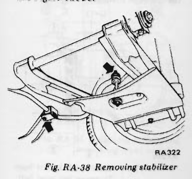
>
> - **Summary:** Removing the rear stabilizer bar clamp bracket from the chassis side member.
> - **Components:** Stabilizer bar, Side member bracket, Rubber bushing, Connecting rod
> - **Mechanic Notes:** Remove main muffler prior to stabilizer bar removal.
> - **Tags:** `stabilizer removal`, `side member`, `anti-roll bar`

### INSPECTION

1. Check stabilizer for condition. Discard if it is found damaged or cracked.
2. Check that bushings are in good condition. If necessary, replace.

### INSTALLATION

To install stabilizer, reverse the above procedure, being sure that bushing on side member is properly seated.

> [!NOTE]
> Make sure that the dent in rubber bushing faces towards the rear upper side. See Figure RA-39.

> 🖼️ **Fig. RA-39 Rubber bushing** `[RA323]` *(Type: `alignment_orientation`)*
>
> 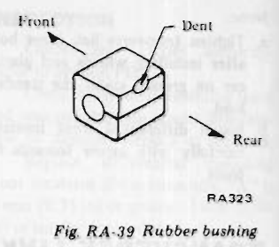
>
> - **Summary:** Orientation diagram of stabilizer mounting rubber bushing showing location and direction of alignment dent.
> - **Components:** Stabilizer rubber bushing
> - **Callouts:** **(Front)** Front of vehicle; **(Rear)** Rear of vehicle; **(Dent)** Alignment dent
> - **Mechanic Notes:** Make sure that the dent in rubber bushing faces towards the rear upper side.
> - **Tags:** `stabilizer bushing`, `bushing dent`, `orientation`, `installation note`

---

<!-- Page 13 (RA-13) -->
# SERVICE DATA AND SPECIFICATIONS

## Wheel alignment (unladen)

| Item | S30 | GS30 (2 + 2 seater) |
| :--- | :--- | :--- |
| Camber degree | -3' to 1°27' | -9' to 1°21' |
| Toe-in mm (in) | -5 to 5 (-0.20 to 0.20) | -5 to 5 (-0.20 to 0.20) |

## Coil spring

| Item | Specification |
| :--- | :--- |
| Active turns of coil | 8.5 |
| Free length mm (in) | 392 (15.43) |
| Spring constant kg/mm (lb/in) | 2.28 (127.7) |

## Strut assembly

| Item | Specification |
| :--- | :--- |
| Damping force at piston speed 0.3 m (0.98 ft)/sec | |
| - Expansion/Compression kg (lb) | 55 (121)/30 (66) |
| Rear axle end play mm (in) | 0 to 0.15 (0 to 0.0059) |

## Tightening torque

| Part | kg-m | ft-lb |
| :--- | :--- | :--- |
| **Drive shaft installation bolts** | | |
| - Gear carrier side (R200 diff.) | 5.0 to 6.0 | 36 to 43 |
| - Gear carrier side (R180 diff.) | 3.2 to 4.3 | 23 to 31 |
| - Wheel side | 5.0 to 6.0 | 36 to 43 |
| **Strut installation nut** | 2.5 to 3.5 | 18 to 25 |
| **Strut rod self-lock nut** | 7.5 to 9.5 | 54 to 69 |
| **Gland packing** | 7 to 13 | 51 to 94 |
| **Rear axle bearing lock nut** | 25 to 33 | 181 to 239 |
| **Brake disc installation bolt** | 2.7 to 3.7 | 20 to 27 |
| **Brake hose (line) clamp nut** | 1.5 to 1.8 | 11 to 13 |
| **Wheel nut** | | |
| - Steel wheel | 8.0 to 9.0 | 58 to 65 |
| - Aluminum wheel | 8.0 to 10.0 | 58 to 72 |
| **Bearing housing spindle lock bolt** | 1.0 to 1.2 | 7 to 9 |
| **Transverse link outer self-lock nut** | 7.5 to 9.5 | 54 to 69 |
| **Transverse link inner bolt** | 14 to 16 | 101 to 106 |
| **Rear link mounting bracket installation bolt** | 3.2 to 4.3 | 23 to 31 | <!-- Page 14 (RA-14) --> ## Tightening torque (Continued)

| Part | kg-m | ft-lb |
| :--- | :--- | :--- |
| **Front differential mounting member installation bolt** | 4.6 to 6.1 | 33 to 44 |
| **Front differential mounting member and front differential mounting insulator installation nut** | 3.2 to 4.3 | 23 to 31 |
| **Front mounting damper plate installation bolt** | 1.6 to 2.1 | 12 to 15 |
| **Gear carrier and differential mounting front insulator installation nut** | 6.0 to 8.0 | 43 to 58 |
| **Belt fitting self-lock nut** | 11.3 to 13.8 | 82 to 100 |
| **Belt fitting bracket installation bolt** | 3.2 to 4.3 | 23 to 31 |
| **Rear differential mounting member installation nut (to diff. rear cover)** | | |
| - R180 diff. | 6.0 to 7.0 | 43 to 51 |
| - R200 diff. | 7.5 to 9.5 | 54 to 69 |
| **Rear differential mounting insulator installation nut** | 7.5 to 9.5 | 54 to 69 |
| **Transverse link mounting brace installation bolt** | 4.6 to 6.1 | 33 to 44 |
| **Propeller shaft and differential companion flange installation nut** | 3.5 to 4.5 | 25 to 33 |

---

<!-- Page 15 (RA-15) -->
# TROUBLE DIAGNOSES AND CORRECTIONS

| Condition | Probable cause | Corrective action |
| :--- | :--- | :--- |
| **Noise (unusual sound)**  *It is difficult to definitely distinguish noise, or unusual sounds, emanating from the rear axle from other noises (unusual sounds) generated by the differential carrier and propeller shaft. If an unusual sound is present, therefore, check closely to be sure that the noise is in fact coming from the rear axle.* | 1) Loose joint. 2) Unbalanced tires. 3) Insufficient lubrication, improper adjustment, worn, or damaged wheel bearing. 4) Damaged transverse link rubber bushing. 5) Faulty shock absorber (in strut). 6) Damaged differential mount insulator. 7) Damaged universal joint. 8) Worn or seized drive shaft ball spline. 9) Broken coil spring. | Retighten. Adjust. Lubricate, adjust, or replace.  Replace. Replace. Replace. Replace. Replace. Replace. |
| **Unstable running.**  *This problem is also related to the front suspension. For trouble diagnosis, refer to the paragraph covering the front suspension, also.* | 1) Loose wheel nut(s). 2) Damaged transverse link bushing. 3) Reduced shock absorber damping force. 4) Seized or damaged drive shaft ball spline. 5) Weakened spring. | Retighten. Replace. Replace. Replace. Replace. |
| **Oil leakage** | 1) Damaged drive shaft dust cover. 2) Worn or damaged rear axle shaft grease seal. | Disassemble, clean, and reassemble, or replace dust cover. Replace. |

---

<!-- Page 16 (RA-16) -->
# SPECIAL SERVICE TOOLS

| Tool number & tool name | Kent-Moore No. | Reference page or Fig. No. |
| :--- | :--- | :--- |
| **KV40101000** Rear axle stand | J 25604-01 | Fig. RA-4 Fig. RA-5 |
| **ST36230000** Sliding hammer | J 25840 | Fig. RA-5 |
| **ST38800000** Rear transverse link bushing replacer ① ST38800010 Drift ② ST38800020 Support ring | J 25875 | Fig. RA-35 |
| **ST37780000** Rear axle shaft outer bearing drift | J 25863 | Page RA-5 |
| **ST33260000** Diff. mounting member insulator drift set ① ST33260010 Adapter insulator drift (1) ② ST33260020 Adapter insulator drift (2) | J25808 | Fig. RA-31 Fig. RA-32 |
| **GG94310000** Flare nut torque wrench | — | Page RA-9 |

> 🖼️ **Rear axle stand (KV40101000 / Kent-Moore J 25604-01)**  *(Type: `special_service_tool`)*
>
> 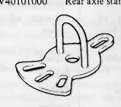
>
> - **Summary:** Rear axle stand adapter plate tool used for holding hub and slide hammer extraction.
> - **Components:** Rear axle stand plate with handle and slotted lug holes
> - **Specs / Measurements:** Tool number: KV40101000; Kent-Moore No.: J 25604-01; Ref: Fig. RA-4, Fig. RA-5
> - **Mechanic Notes:** Bolts to rear wheel studs to hold flange while loosening locknut or pulling axle.
> - **Tags:** `special service tool`, `KV40101000`, `J 25604-01`, `rear axle stand`

> 🖼️ **Sliding hammer (ST36230000 / Kent-Moore J 25840)**  *(Type: `special_service_tool`)*
>
> 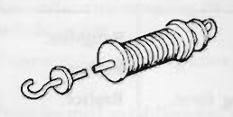
>
> - **Summary:** Sliding hammer puller tool for removing rear axle shaft from bearing housing.
> - **Components:** Sliding hammer weight, Shaft, Threaded adapter end, Handle
> - **Specs / Measurements:** Tool number: ST36230000; Kent-Moore No.: J 25840; Ref: Fig. RA-5
> - **Mechanic Notes:** Attaches to KV40101000 to pull axle shaft out of housing.
> - **Tags:** `special service tool`, `ST36230000`, `J 25840`, `sliding hammer`

> 🖼️ **Rear transverse link bushing replacer (ST38800000 / Kent-Moore J 25875) with drift ① and support ring ②**  *(Type: `special_service_tool`)*
>
> 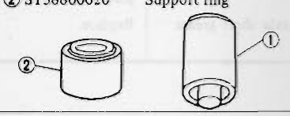
>
> - **Summary:** Transverse link outer bushing replacement tool set including drift ST38800010 and support ring ST38800020.
> - **Components:** ST38800010 Drift (1), ST38800020 Support ring (2)
> - **Callouts:** **(1)** ST38800010 Drift; **(2)** ST38800020 Support ring
> - **Specs / Measurements:** Tool set: ST38800000; Kent-Moore No.: J 25875; Ref: Fig. RA-35
> - **Mechanic Notes:** Use in hydraulic press to replace transverse link outer bushing without damaging the link.
> - **Tags:** `special service tool`, `ST38800000`, `J 25875`, `bushing replacer`

> 🖼️ **Rear axle shaft outer bearing drift (ST37780000 / Kent-Moore J 25863)**  *(Type: `special_service_tool`)*
>
> 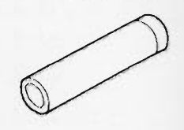
>
> - **Summary:** Cylindrical bearing driver drift for installing outer rear wheel bearing onto axle shaft.
> - **Components:** Cylindrical drift tool
> - **Specs / Measurements:** Tool number: ST37780000; Kent-Moore No.: J 25863; Ref: Page RA-5
> - **Mechanic Notes:** Applies press force evenly to bearing inner race when fitting outer bearing onto axle shaft.
> - **Tags:** `special service tool`, `ST37780000`, `J 25863`, `bearing drift`

> 🖼️ **Diff. mounting member insulator drift set (ST33260000 / Kent-Moore J25808) with ① Adapter insulator drift (1) ST33260010 and ② Adapter insulator drift (2) ST33260020**  *(Type: `special_service_tool`)*
>
> 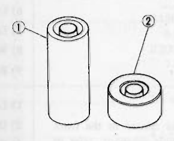
>
> - **Summary:** Differential mounting member insulator drift tool set with adapter drifts for removal and installation.
> - **Components:** ST33260010 Adapter insulator drift (1) for removal, ST33260020 Adapter insulator drift (2) for installation
> - **Callouts:** **(1)** ST33260010 Adapter insulator drift (1) for removal; **(2)** ST33260020 Adapter insulator drift (2) for installation
> - **Specs / Measurements:** Tool set: ST33260000; Kent-Moore No.: J25808; Ref: Fig. RA-31, Fig. RA-32
> - **Mechanic Notes:** ST33260010 used for removing insulator; ST33260020 used for pressing new insulator into mounting member.
> - **Tags:** `special service tool`, `ST33260000`, `J25808`, `differential insulator drift`

> 🖼️ **Flare nut torque wrench (GG94310000)**  *(Type: `special_service_tool`)*
>
> 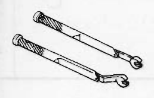
>
> - **Summary:** Specialized flare nut wrench adapters for torque-tightening brake tubing nuts without rounding hex corners.
> - **Components:** Flare nut wrench adapter handles
> - **Specs / Measurements:** Tool number: GG94310000; Kent-Moore No.: —; Ref: Page RA-9
> - **Mechanic Notes:** Always use flare nut torque wrench when tightening brake tubing connections.
> - **Tags:** `special service tool`, `GG94310000`, `flare nut wrench`, `brake lines`

> [!NOTE]
> As to special tools for Rear Strut, refer to FA Section.

---

## Segmented Diagrams Index

| Figure | Code | Type | Page | Caption | Key Components / Callouts | File |
| :--- | :--- | :--- | :--- | :--- | :--- | :--- |
| **Fig. RA-1** | `RA417` | `cutaway_flow` | RA-2 | Fig. RA-1 Cross sectional view of rear axle | Drive shaft assembly, Companion flange, Grease seal, Brake drum, Rear axle shaft | [fig_ra_1_cross_sectional_view_of_rear_axle.png](diagrams/RA Rear axle and Suspension/fig_ra_1_cross_sectional_view_of_rear_axle.png) |
| **Fig. RA-2** | `RA316` | `exploded_view` | RA-3 | Fig. RA-2 Rear suspension system | Rear strut mounting insulator, Spacer, Bound bumper rubber, Dust cover, Strut assembly | [fig_ra_2_rear_suspension_system.png](diagrams/RA Rear axle and Suspension/fig_ra_2_rear_suspension_system.png) |
| **Fig. RA-3** | `RA290` | `procedure_step` | RA-4 | Fig. RA-3 Removing drive shaft | Drive shaft, Companion flange, Mounting bolts | [fig_ra_3_removing_drive_shaft.png](diagrams/RA Rear axle and Suspension/fig_ra_3_removing_drive_shaft.png) |
| **Fig. RA-4** | `RA507` | `procedure_step` | RA-4 | Fig. RA-4 Removing rear wheel bearing lock nut | Rear wheel bearing lock nut, Axle shaft, Rear Axle Stand KV40101000 | [fig_ra_4_removing_rear_wheel_bearing_lock_nut.png](diagrams/RA Rear axle and Suspension/fig_ra_4_removing_rear_wheel_bearing_lock_nut.png) |
| **Fig. RA-5** | `RA490` | `procedure_step` | RA-4 | Fig. RA-5 Removing rear axle shaft | Rear axle shaft, Rear Axle Stand KV40101000, Sliding hammer ST36230000, Wheel hub | [fig_ra_5_removing_rear_axle_shaft.png](diagrams/RA Rear axle and Suspension/fig_ra_5_removing_rear_axle_shaft.png) |
| **Fig. RA-6** | `RA296` | `procedure_step` | RA-4 | Fig. RA-6 Removing rear wheel bearing (outer side) | Rear axle shaft, Outer wheel bearing, Support plates, Press ram | [fig_ra_6_removing_rear_wheel_bearing_outer_side.png](diagrams/RA Rear axle and Suspension/fig_ra_6_removing_rear_wheel_bearing_outer_side.png) |
| **Fig. RA-7** | `RA317` | `inspection_measurement` | RA-5 | Fig. RA-7 Rear bearing housing and distance piece | Bearing housing, Distance piece | [fig_ra_7_rear_bearing_housing_and_distance_piece.png](diagrams/RA Rear axle and Suspension/fig_ra_7_rear_bearing_housing_and_distance_piece.png) |
| **Fig. RA-8** | `RA318` | `cutaway_flow` | RA-5 | Fig. RA-8 Lubrication chart of rear axle | Rear axle shaft, Bearing housing, Grease seal, Wheel bearing, Distance piece | [fig_ra_8_lubrication_chart_of_rear_axle.png](diagrams/RA Rear axle and Suspension/fig_ra_8_lubrication_chart_of_rear_axle.png) |
| **Fig. RA-9** | `RA416` | `exploded_view` | RA-5 | Fig. RA-9 Drive shaft components | Drive shaft, Boot band, Snap ring, Sleeve yoke stopper, Spider journal | [fig_ra_9_drive_shaft_components.png](diagrams/RA Rear axle and Suspension/fig_ra_9_drive_shaft_components.png) |
| **Fig. RA-10** | `RA516` | `procedure_step` | RA-6 | Fig. RA-10 Removing drive shaft | Drive shaft, Flange yoke, Differential companion flange, Mounting bolts | [fig_ra_10_removing_drive_shaft.png](diagrams/RA Rear axle and Suspension/fig_ra_10_removing_drive_shaft.png) |
| **Fig. RA-11** | `PD323` | `procedure_step` | RA-6 | Fig. RA-11 Removing side yoke fitting bolt | Side yoke, Fitting bolt, R180 differential carrier | [fig_ra_11_removing_side_yoke_fitting_bolt.png](diagrams/RA Rear axle and Suspension/fig_ra_11_removing_side_yoke_fitting_bolt.png) |
| **Fig. RA-12** | `RA044` | `inspection_measurement` | RA-6 | Fig. RA-12 Measuring drive shaft play | Drive shaft assembly, Dial indicator, V-block / stand | [fig_ra_12_measuring_drive_shaft_play.png](diagrams/RA Rear axle and Suspension/fig_ra_12_measuring_drive_shaft_play.png) |
| **Fig. RA-13** | `RA517` | `cutaway_flow` | RA-7 | Fig. RA-13 Cross-sectional view of drive shaft | Drive shaft, Sleeve yoke, Needle bearing, Spider journal | [fig_ra_13_cross_sectional_view_of_drive_shaft.png](diagrams/RA Rear axle and Suspension/fig_ra_13_cross_sectional_view_of_drive_shaft.png) |
| **Fig. RA-14** | `RA286` | `procedure_step` | RA-8 | Fig. RA-14 Removing brake hose and side brake linkage | Brake line connector, Side brake linkage, Brake hose | [fig_ra_14_removing_brake_hose_and_side_brake_linkage.png](diagrams/RA Rear axle and Suspension/fig_ra_14_removing_brake_hose_and_side_brake_linkage.png) |
| **Fig. RA-15** | `RA287` | `procedure_step` | RA-8 | Fig. RA-15 Removing stabilizer from transverse link | Stabilizer bar, Connecting rod, Transverse link, Rubber bushings | [fig_ra_15_removing_stabilizer_from_transverse_link.png](diagrams/RA Rear axle and Suspension/fig_ra_15_removing_stabilizer_from_transverse_link.png) |
| **Fig. RA-16** | `RA288` | `procedure_step` | RA-8 | Fig. RA-16 Removing lock bolt and self-lock nuts | Lock bolt, Self-lock nuts, Spindle, Strut bearing housing | [fig_ra_16_removing_lock_bolt_and_self_lock_nuts.png](diagrams/RA Rear axle and Suspension/fig_ra_16_removing_lock_bolt_and_self_lock_nuts.png) |
| **Fig. RA-17** | `RA289` | `procedure_step` | RA-8 | Fig. RA-17 Removing spindle | Spindle pin, Transverse link, Strut housing | [fig_ra_17_removing_spindle.png](diagrams/RA Rear axle and Suspension/fig_ra_17_removing_spindle.png) |
| **Fig. RA-18** | `RA291` | `procedure_step` | RA-8 | Fig. RA-18 Removing strut installation nuts | Strut insulator mounting nuts, Upper strut tower, Luggage area trim | [fig_ra_18_removing_strut_installation_nuts.png](diagrams/RA Rear axle and Suspension/fig_ra_18_removing_strut_installation_nuts.png) |
| **Fig. RA-19** | `RA292` | `procedure_step` | RA-9 | Fig. RA-19 Removing strut assembly | Rear strut assembly, Brake backing plate, Wheel housing | [fig_ra_19_removing_strut_assembly.png](diagrams/RA Rear axle and Suspension/fig_ra_19_removing_strut_assembly.png) |
| **Fig. RA-20** | `RA325` | `inspection_measurement` | RA-9 | Fig. RA-20 Spindle | Transverse spindle | [fig_ra_20_spindle.png](diagrams/RA Rear axle and Suspension/fig_ra_20_spindle.png) |
| **Fig. RA-21** | `RA274` | `procedure_step` | RA-9 | Fig. RA-21 Removing transverse link inner bolts | Transverse link inner bolts, Front crossmember, Transverse link | [fig_ra_21_removing_transverse_link_inner_bolts.png](diagrams/RA Rear axle and Suspension/fig_ra_21_removing_transverse_link_inner_bolts.png) |
| **Fig. RA-22** | `RA290` | `procedure_step` | RA-9 | Fig. RA-22 Removing drive shaft installation bolts (wheel side) | Drive shaft, Wheel companion flange, Mounting bolts | [fig_ra_22_removing_drive_shaft_installation_bolts_wheel_side.png](diagrams/RA Rear axle and Suspension/fig_ra_22_removing_drive_shaft_installation_bolts_wheel_side.png) |
| **Fig. RA-23** | `RA302` | `procedure_step` | RA-9 | Fig. RA-23 Loosening drive shaft installation bolts (gear carrier side) | Drive shaft, Differential companion flange, Bolts | [fig_ra_23_loosening_drive_shaft_installation_bolts_gear_carrier_side.png](diagrams/RA Rear axle and Suspension/fig_ra_23_loosening_drive_shaft_installation_bolts_gear_carrier_side.png) |
| **Fig. RA-24** | `RA306` | `procedure_step` | RA-9 | Fig. RA-24 Removing differential mounting rear member | Differential rear cover, Rear mounting member, Mounting nuts | [fig_ra_24_removing_differential_mounting_rear_member.png](diagrams/RA Rear axle and Suspension/fig_ra_24_removing_differential_mounting_rear_member.png) |
| **Fig. RA-25** | `RA319` | `procedure_step` | RA-10 | Fig. RA-25 Removing differential mounting front member | Differential mounting front member, Body frame mounts, Installation bolts | [fig_ra_25_removing_differential_mounting_front_member.png](diagrams/RA Rear axle and Suspension/fig_ra_25_removing_differential_mounting_front_member.png) |
| **Fig. RA-26** | `RA518` | `procedure_step` | RA-10 | Fig. RA-26 Removing damper plate bolts and mounting front insulator nuts | Front mounting damper plate, Front mounting member, Differential front insulator, Gear carrier | [fig_ra_26_removing_damper_plate_bolts_and_mounting_front_insulator_nuts.png](diagrams/RA Rear axle and Suspension/fig_ra_26_removing_damper_plate_bolts_and_mounting_front_insulator_nuts.png) |
| **Fig. RA-27** | `RA321` | `procedure_step` | RA-10 | Fig. RA-27 Removing transverse link inner bolts | Transverse link inner bolts, Link rear bracket, Transverse link | [fig_ra_27_removing_transverse_link_inner_bolts.png](diagrams/RA Rear axle and Suspension/fig_ra_27_removing_transverse_link_inner_bolts.png) |
| **Fig. RA-28** | `RA278` | `procedure_step` | RA-10 | Fig. RA-28 Removing rear bracket | Link mounting rear bracket, Mounting bolts, Body mount | [fig_ra_28_removing_rear_bracket.png](diagrams/RA Rear axle and Suspension/fig_ra_28_removing_rear_bracket.png) |
| **Fig. RA-29** | `RA276` | `procedure_step` | RA-10 | Fig. RA-29 Removing link mounting brace and differential mounting member installation bolts | Transverse link mounting brace, Differential mounting rear insulator, Body chassis | [fig_ra_29_removing_link_mounting_brace_and_differential_mounting_member_installation_bolts.png](diagrams/RA Rear axle and Suspension/fig_ra_29_removing_link_mounting_brace_and_differential_mounting_member_installation_bolts.png) |
| **Fig. RA-30** | `-` | `inspection_measurement` | RA-10 | Fig. RA-30 Sectional view of differential mounting insulators | Front insulator, Rubber cushion, Steel bracket | [fig_ra_30_sectional_view_of_differential_mounting_insulators.png](diagrams/RA Rear axle and Suspension/fig_ra_30_sectional_view_of_differential_mounting_insulators.png) |
| **Fig. RA-31** | `RA508` | `procedure_step` | RA-10 | Fig. RA-31 Removing insulator from differential mounting member | Differential mounting member, Rubber insulator, Drift ST33260010 | [fig_ra_31_removing_insulator_from_differential_mounting_member.png](diagrams/RA Rear axle and Suspension/fig_ra_31_removing_insulator_from_differential_mounting_member.png) |
| **Fig. RA-32** | `RA509` | `procedure_step` | RA-10 | Fig. RA-32 Installing insulator to differential mounting member | Differential mounting member, Rubber insulator, Drift ST33260020 | [fig_ra_32_installing_insulator_to_differential_mounting_member.png](diagrams/RA Rear axle and Suspension/fig_ra_32_installing_insulator_to_differential_mounting_member.png) |
| **Fig. RA-33** | `RA275` | `procedure_step` | RA-11 | Fig. RA-33 Removing differential mounting front member | Transverse link inner bolts, Damper plate bolts, Front insulator nut, Front member nuts, Differential front member | [fig_ra_33_removing_differential_mounting_front_member.png](diagrams/RA Rear axle and Suspension/fig_ra_33_removing_differential_mounting_front_member.png) |
| **Fig. RA-34** | `RA278` | `procedure_step` | RA-11 | Fig. RA-34 Removing transverse link | Transverse link, Rear mounting bracket, Bolts | [fig_ra_34_removing_transverse_link.png](diagrams/RA Rear axle and Suspension/fig_ra_34_removing_transverse_link.png) |
| **Fig. RA-35** | `RA280` | `procedure_step` | RA-11 | Fig. RA-35 Removing transverse link outer bushing | Transverse link, Outer bushing, Bushing replacer ST38800000 | [fig_ra_35_removing_transverse_link_outer_bushing.png](diagrams/RA Rear axle and Suspension/fig_ra_35_removing_transverse_link_outer_bushing.png) |
| **Fig. RA-36** | `RA284` | `alignment_orientation` | RA-11 | Fig. RA-36 Cross-sectional view of transverse link inner bushing (I) | Transverse link inner bush, Transverse link inner bolt, Transverse link | [fig_ra_36_cross_sectional_view_of_transverse_link_inner_bushing_1.png](diagrams/RA Rear axle and Suspension/fig_ra_36_cross_sectional_view_of_transverse_link_inner_bushing_1.png) |
| **Fig. RA-37** | `RA285` | `alignment_orientation` | RA-11 | Fig. RA-37 Cross-sectional view of transverse link inner bushing (II) | Differential case mounting front member, Inner bushing, Link shaft, Bracket clamp | [fig_ra_37_cross_sectional_view_of_transverse_link_inner_bushing_2.png](diagrams/RA Rear axle and Suspension/fig_ra_37_cross_sectional_view_of_transverse_link_inner_bushing_2.png) |
| **Fig. RA-38** | `RA322` | `procedure_step` | RA-12 | Fig. RA-38 Removing stabilizer | Stabilizer bar, Side member bracket, Rubber bushing, Connecting rod | [fig_ra_38_removing_stabilizer.png](diagrams/RA Rear axle and Suspension/fig_ra_38_removing_stabilizer.png) |
| **Fig. RA-39** | `RA323` | `alignment_orientation` | RA-12 | Fig. RA-39 Rubber bushing | Stabilizer rubber bushing | [fig_ra_39_rubber_bushing.png](diagrams/RA Rear axle and Suspension/fig_ra_39_rubber_bushing.png) |
| **KV40101000** | `-` | `special_service_tool` | RA-16 | Rear axle stand (KV40101000 / Kent-Moore J 25604-01) | Rear axle stand plate with handle and slotted lug holes | [sst_kv40101000_rear_axle_stand.png](diagrams/RA Rear axle and Suspension/sst_kv40101000_rear_axle_stand.png) |
| **ST36230000** | `-` | `special_service_tool` | RA-16 | Sliding hammer (ST36230000 / Kent-Moore J 25840) | Sliding hammer weight, Shaft, Threaded adapter end, Handle | [sst_st36230000_sliding_hammer.png](diagrams/RA Rear axle and Suspension/sst_st36230000_sliding_hammer.png) |
| **ST38800000** | `-` | `special_service_tool` | RA-16 | Rear transverse link bushing replacer (ST38800000 / Kent-Moore J 25875) with drift ① and support ring ② | ST38800010 Drift (1), ST38800020 Support ring (2) | [sst_st38800000_rear_transverse_link_bushing_replacer.png](diagrams/RA Rear axle and Suspension/sst_st38800000_rear_transverse_link_bushing_replacer.png) |
| **ST37780000** | `-` | `special_service_tool` | RA-16 | Rear axle shaft outer bearing drift (ST37780000 / Kent-Moore J 25863) | Cylindrical drift tool | [sst_st37780000_rear_axle_shaft_outer_bearing_drift.png](diagrams/RA Rear axle and Suspension/sst_st37780000_rear_axle_shaft_outer_bearing_drift.png) |
| **ST33260000** | `-` | `special_service_tool` | RA-16 | Diff. mounting member insulator drift set (ST33260000 / Kent-Moore J25808) with ① Adapter insulator drift (1) ST33260010 and ② Adapter insulator drift (2) ST33260020 | ST33260010 Adapter insulator drift (1) for removal, ST33260020 Adapter insulator drift (2) for installation | [sst_st33260000_diff_mounting_member_insulator_drift_set.png](diagrams/RA Rear axle and Suspension/sst_st33260000_diff_mounting_member_insulator_drift_set.png) |
| **GG94310000** | `-` | `special_service_tool` | RA-16 | Flare nut torque wrench (GG94310000) | Flare nut wrench adapter handles | [sst_gg94310000_flare_nut_torque_wrench.png](diagrams/RA Rear axle and Suspension/sst_gg94310000_flare_nut_torque_wrench.png) |
