# STEERING SYSTEM

<!-- Page 1 (ST-1) -->
# SECTION ST: STEERING SYSTEM

## SERVICE MANUAL
### DATSUN 280Z MODEL S30 SERIES

### CONTENTS

| Section | Page |
| :--- | :--- |
| STEERING SYSTEM | ST-2 |
| SERVICE DATA AND SPECIFICATIONS | ST-12 |
| TROUBLE DIAGNOSES AND CORRECTION | ST-13 |
| SPECIAL SERVICE TOOLS | ST-17 |

NISSAN MOTOR CO., LTD.  
TOKYO, JAPAN

---

<!-- Page 2 (ST-2) -->
# STEERING SYSTEM

## CONTENTS

| Section | Page | Section | Page |
| :--- | :--- | :--- | :--- |
| DESCRIPTION | ST-2 | STEERING LOCK | ST-5 |
| STEERING WHEEL | ST-3 | REMOVAL | ST-5 |
| REMOVAL | ST-3 | INSTALLATION | ST-5 |
| INSTALLATION | ST-3 | STEERING GEAR AND LINKAGE | ST-6 |
| STEERING COLUMN (Collapsible type) | ST-3 | REMOVAL | ST-6 |
| REMOVAL | ST-3 | DISASSEMBLY | ST-7 |
| INSPECTION | ST-4 | INSPECTION | ST-8 |
| INSTALLATION | ST-5 | ASSEMBLY AND ADJUSTMENT | ST-9 |
| | | INSTALLATION | ST-11 |

## DESCRIPTION

The steering assembly is direct-acting rack-and-pinion type with a gear ratio of 18.0 : 1, providing sharp, light, and accurate control under all conditions.

It consists of a rack bar and toothed pinion, both working in the plain bearings of the housing. Backlash is held to 0 mm (0 in) by the retainer and the retainer spring.

> 🖼️ **Fig. ST-1 Structural view of steering system** `[ST429]` *(Type: `component_location`)*
>
> 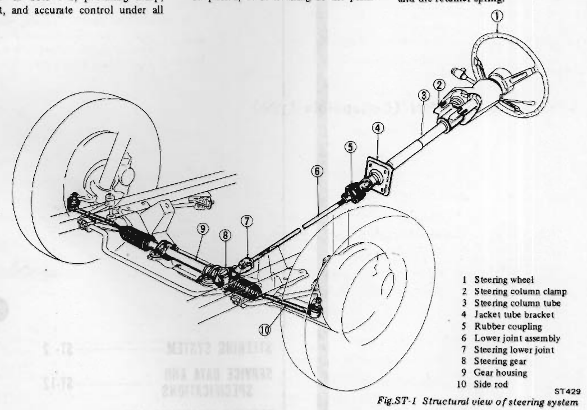
>
> - **Summary:** Structural perspective drawing showing the complete steering system layout in relation to the front suspension and steering column assembly.
> - **Components:** Steering wheel, Steering column clamp, Steering column tube, Jacket tube bracket, Rubber coupling, Lower joint assembly, Steering lower joint, Steering gear, Gear housing, Side rod
> - **Callouts:** **(1)** Steering wheel; **(2)** Steering column clamp; **(3)** Steering column tube; **(4)** Jacket tube bracket; **(5)** Rubber coupling; **(6)** Lower joint assembly; **(7)** Steering lower joint; **(8)** Steering gear; **(9)** Gear housing; **(10)** Side rod
> - **Specs / Measurements:** Gear ratio: 18.0 : 1; Backlash: 0 mm (0 in)
> - **Mechanic Notes:** Universal joints require no lubrication. Rubber coupling isolates road vibration.
> - **Tags:** `steering system`, `rack and pinion`, `steering column`, `structural view`, `overview`

The steering wheel is a cone type which exhibits excellent safety characteristics. Between the steering wheel and gear assembly, a rubber coupling is used to prevent the transmission of vibrations from the road surface, insuring excellent handling and safety. Two universal joints are used between the gear assembly and steering wheel to give the most suitable steering wheel position and angle.

These joints require no lubrication and have an excellent service life.

The collapsible steering column is a steel ball type, which collapses upon <!-- Page 3 (ST-3) --> impact. Thus, if the car should be involved in a head-on collision that throws the driver forward, the steering column will absorb the energy of his forward movement and greatly reduce the possibility of his being injured.

The gear housing is located in front of the front suspension, and a ball joint with excellent sealing and long durability is used on the knuckle arm end of the steering linkage.

As mentioned above, this steering assembly is of simple construction. Shim adjustment or selective assembly of parts, essential in the case of conventional assemblies, is not necessary. Thus, servicing is very convenient and structural strength is more than adequate.

The oil level in the gear housing should be checked and corrected at recommended maintenance intervals. Apply the recommended multi-purpose grease to idler side joint and ball joints in the steering linkage at recommended maintenance intervals.

## STEERING WHEEL

### REMOVAL

1. Disconnect battery ground cable.
2. Remove horn pad by depressing it and turning counterclockwise.
3. Remove steering wheel nut.
4. Using the Steering Wheel Puller ST27180001, install puller anchor screws into threaded holes provided in steering wheel. Turn center bolt of the special tool clockwise to remove steering wheel. See Figure ST-2.

> 🖼️ **Fig. ST-2 Removing steering wheel** `[ST430]` *(Type: `procedure_step`)*
>
> 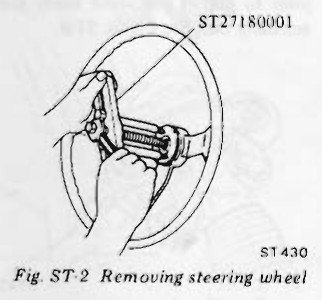
>
> - **Summary:** Removing steering wheel using Steering Wheel Puller ST27180001 threaded into the steering wheel hub.
> - **Components:** Steering wheel, Steering wheel puller ST27180001, Puller anchor screws, Center forcing bolt
> - **Callouts:** **(ST27180001)** Steering wheel puller
> - **Specs / Measurements:** Tool number: ST27180001 (Kent-Moore J 25726)
> - **Mechanic Notes:** Do not strike end of steering column shaft with a hammer. Striking shaft will damage bearing or collapsible shaft. Be careful not to damage cancel pole.
> - **Tags:** `steering wheel`, `puller`, `removal`, `ST27180001`

> [!CAUTION]
> a. Do not strike end of steering column shaft with a hammer. Striking shaft will damage bearing or collapsible shaft.  
> b. Be careful not to damage cancel pole.

### INSTALLATION

Install the steering wheel in the reverse order of removal. Observe the following instructions.
1. Apply grease to sliding portions.
2. Install steering wheel to column shaft in a straight ahead position after facing the punch mark on the top of upper column shaft and tighten steering wheel nut to specified torque.

Tightening torque: 4 to 5 kg-m (29 to 36 ft-lb)

*Note: After installing steering wheel, turn it clockwise or counterclockwise and check for catch or drag. Also check horn operation.*

## STEERING COLUMN (Collapsible type)

> 🖼️ **Fig. ST-3 Sectional view of collapsible type steering** `[ST431]` *(Type: `cutaway_flow`)*
>
> 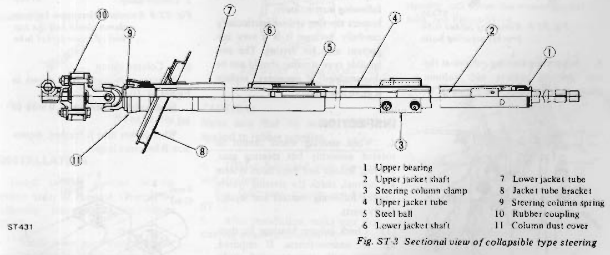
>
> - **Summary:** Sectional view of the steel ball collapsible steering column showing jacket tubes, bearing, spring, bracket, and rubber coupling.
> - **Components:** Upper bearing, Upper jacket shaft, Steering column clamp, Upper jacket tube, Steel ball, Lower jacket shaft, Lower jacket tube, Jacket tube bracket, Steering column spring, Rubber coupling, Column dust cover
> - **Callouts:** **(1)** Upper bearing; **(2)** Upper jacket shaft; **(3)** Steering column clamp; **(4)** Upper jacket tube; **(5)** Steel ball; **(6)** Lower jacket shaft; **(7)** Lower jacket tube; **(8)** Jacket tube bracket; **(9)** Steering column spring; **(10)** Rubber coupling; **(11)** Column dust cover
> - **Mechanic Notes:** Never apply undue stress to steering column in axial direction. Do not apply bending force during installation.
> - **Tags:** `steering column`, `collapsible type`, `sectional view`, `steel ball`, `construction`

> [!CAUTION]
> a. Never in any case should undue stress be applied to steering column in axial direction.  
> b. When installing, do not apply bending force to steering column.

### REMOVAL

1. Disconnect steering column assembly from lower joint shaft at rubber coupling by removing bolt. See Figure ST-4. <!-- Page 4 (ST-4) --> > 🖼️ **Fig. ST-4 Removing rubber coupling bolt** `[ST432]` *(Type: `procedure_step`)*
>
> 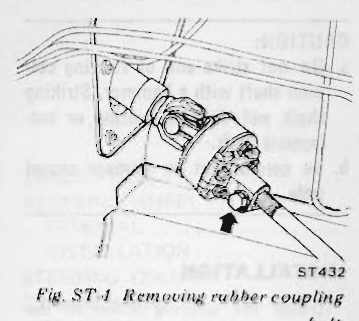
>
> - **Summary:** Removing bolt securing the steering column shaft to the rubber coupling flange.
> - **Components:** Rubber coupling, Steering column shaft, Coupling bolt
> - **Mechanic Notes:** Disconnect steering column assembly from lower joint shaft at rubber coupling by removing bolt.
> - **Tags:** `rubber coupling`, `bolt`, `removal`, `steering column`

2. Remove steering wheel. Refer to Steering Wheel.
3. By loosening screws, remove steering column shell covers.
4. Remove turn signal switch assembly and combined light switch assembly by loosening screws.
5. Remove bolts securing jacket tube bracket to dash panel. See Figure ST-5.

> 🖼️ **Fig. ST-5 Removing jacket tube bracket securing bolts** `[ST433]` *(Type: `procedure_step`)*
>
> 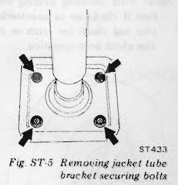
>
> - **Summary:** Location of four bolts securing jacket tube bracket to the dash panel under the dashboard.
> - **Components:** Jacket tube bracket, Dash panel mounting bolts
> - **Mechanic Notes:** Remove bolts securing jacket tube bracket to dash panel.
> - **Tags:** `jacket tube bracket`, `dash panel`, `securing bolts`

6. Supporting steering column at the top portion, remove two column clamp securing bolts. See Figure ST-6.

> 🖼️ **Fig. ST-6 Removing column clamp securing bolts** `[ST335]` *(Type: `procedure_step`)*
>
> 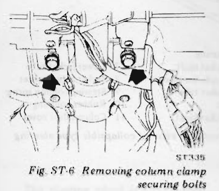
>
> - **Summary:** Removing two column clamp securing bolts while supporting the steering column assembly.
> - **Components:** Column clamp, Column clamp securing bolts, Steering column
> - **Mechanic Notes:** Support steering column at the top portion while removing two column clamp securing bolts.
> - **Tags:** `column clamp`, `securing bolts`, `removal`

7. Draw out steering column assembly from the interior side. See Figure ST-7.

> 🖼️ **Fig. ST-7 Drawing out steering column assembly** `[ST189]` *(Type: `procedure_step`)*
>
> 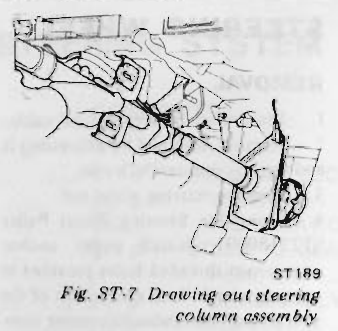
>
> - **Summary:** Withdrawing the complete steering column assembly rearward into the passenger compartment.
> - **Components:** Steering column assembly, Pedal bracket, Dash interior
> - **Mechanic Notes:** Draw out steering column assembly from the interior side.
> - **Tags:** `steering column`, `removal`, `interior`

8. By loosening nut securing lower joint to pinion gear, take lower joint assembly out. See Figure ST-8.

> 🖼️ **Fig. ST-8 Loosening nut securing lower joint to pinion gear** `[ST434]` *(Type: `procedure_step`)*
>
> 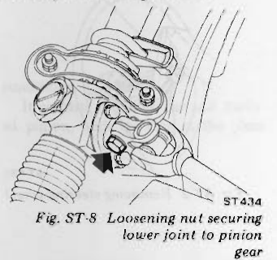
>
> - **Summary:** Loosening pinch bolt nut clamping the lower steering joint to the pinion gear serration.
> - **Components:** Lower joint, Pinion gear shaft, Pinch nut
> - **Mechanic Notes:** Take lower joint assembly out by loosening nut securing lower joint to pinion gear.
> - **Tags:** `lower joint`, `pinion gear`, `pinch nut`

*Note: When an accident (collision) occurs and the car, especially its front unit, is damaged, conduct an inspection in accordance with the following instructions.*

*Inspect steering system particularly carefully because it is a very important unit for driving. The collapsible type steering should not be disassembled; if necessary, replace it as an assembly.*

## INSPECTION

1. When steering wheel cannot be rotated smoothly but steering gear, steering linkage and suspension system are normal, check the steering system for the following matters and replace faulty parts.
   (1) Check column bearings for damage or unsmoothness. If required, lubricate with recommended multi-purpose grease or replace with a new one as steering column assembly.
   (2) Check jacket tube for deformation or breakage, and replace if necessary.
   (3) Check column shaft spring, and replace if damaged or weakened.

| Item | Value |
| :--- | :--- |
| Wire diameter | 3.5 mm (0.138 in) |
| Free length | 27.3 mm (1.075 in) |
| Load x length | 30 kg (66 lb) x 15 mm (0.59 in) |

> 🖼️ **Column shaft spring dimensions**  *(Type: `inspection_measurement`)*
>
> 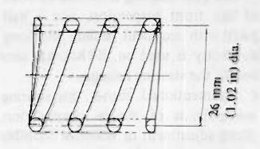
>
> - **Summary:** Inspection dimension diagram of the column shaft spring showing outer diameter and free length.
> - **Components:** Column shaft spring
> - **Specs / Measurements:** Wire diameter: 3.5 mm (0.138 in); Free length: 27.3 mm (1.075 in); Outer diameter: 26 mm (1.02 in) dia.; Load x length: 30 kg (66 lb) x 15 mm (0.59 in)
> - **Mechanic Notes:** Replace spring if damaged or weakened.
> - **Tags:** `column shaft spring`, `dimensions`, `inspection`

2. If the car has been involved in a light collision, check the following parts and replace if necessary.
   (1) Jacket tube  
   Measure the dimension A as shown in Figure ST-9. Standard installed dimension is 176.1 mm (6.93 in). When jacket tube is crushed, dimension A becomes smaller.

> 🖼️ **Fig. ST-9 Standard dimension between column clamp and the top end of lower jacket tube** `[ST192]` *(Type: `inspection_measurement`)*
>
> 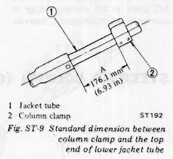
>
> - **Summary:** Measuring dimension A between column clamp and the upper edge of lower jacket tube to inspect for collapse.
> - **Components:** Jacket tube, Column clamp
> - **Callouts:** **(1)** Jacket tube; **(2)** Column clamp
> - **Specs / Measurements:** Dimension A standard: 176.1 mm (6.93 in)
> - **Mechanic Notes:** When jacket tube is crushed in a collision, dimension A becomes smaller.
> - **Tags:** `jacket tube`, `column clamp`, `dimension A`, `collision check`

   (2) Column clamp  
   Measure dimension B as shown in Figure ST-10.  
   Standard B dimension is 0 mm (0 in).  
   When jacket tube is crushed, dimension B becomes larger.

> 🖼️ **Fig. ST-10 Standard dimension B** `[ST193]` *(Type: `inspection_measurement`)*
>
> 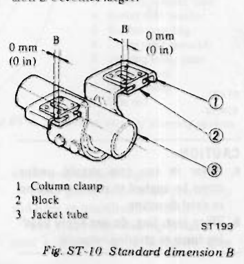
>
> - **Summary:** Checking dimension B gap at the column clamp block to determine if the column has begun collapsing.
> - **Components:** Column clamp, Block, Jacket tube
> - **Callouts:** **(1)** Column clamp; **(2)** Block; **(3)** Jacket tube
> - **Specs / Measurements:** Standard B dimension: 0 mm (0 in)
> - **Mechanic Notes:** Standard B dimension is 0 mm (0 in). When jacket tube is crushed, dimension B becomes larger.
> - **Tags:** `column clamp`, `dimension B`, `block`, `collision check`

---

<!-- Page 5 (ST-5) -->
(3) Steering wheel  
   Check steering wheel for axial play.  
   When steering jacket shaft is crushed, axial play occurs. See Figure ST-11.

> 🖼️ **Fig. ST-11 Inspecting steering wheel for axial play** `[ST194]` *(Type: `inspection_measurement`)*
>
> 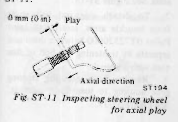
>
> - **Summary:** Checking for 0 mm axial play along the column shaft axis at the steering wheel.
> - **Components:** Steering wheel, Steering column shaft
> - **Specs / Measurements:** Axial play: 0 mm (0 in)
> - **Mechanic Notes:** When steering jacket shaft is crushed, axial play occurs.
> - **Tags:** `steering wheel`, `axial play`, `inspection`

## INSTALLATION

Install steering column in the reverse order of removal. Observe the following instructions. See Figure ST-12.

> 🖼️ **Fig. ST-12 Installing steering column assembly** `[ST435]` *(Type: `procedure_step`)*
>
> 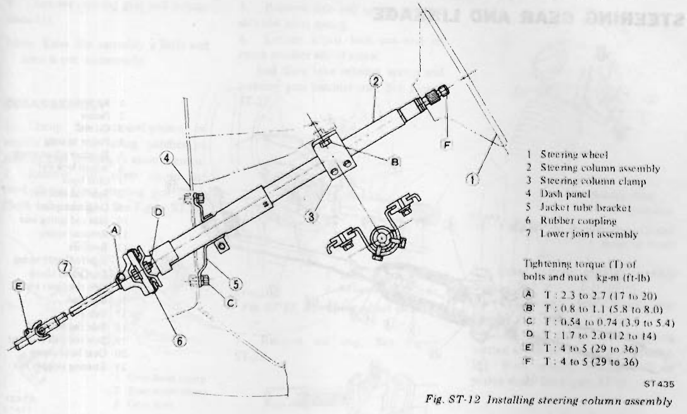
>
> - **Summary:** Installation diagram of steering column assembly detailing mounting points 1-7 and tightening torques A through F.
> - **Components:** Steering wheel, Steering column assembly, Steering column clamp, Dash panel, Jacket tube bracket, Rubber coupling, Lower joint assembly
> - **Callouts:** **(1)** Steering wheel; **(2)** Steering column assembly; **(3)** Steering column clamp; **(4)** Dash panel; **(5)** Jacket tube bracket; **(6)** Rubber coupling; **(7)** Lower joint assembly
> - **Specs / Measurements:** A (Lower joint to rubber coupling): 2.3 to 2.7 kg-m (17 to 20 ft-lb); B (Steering column clamp): 0.8 to 1.1 kg-m (5.8 to 8.0 ft-lb); C (Jacket tube bracket to dash panel): 0.54 to 0.74 kg-m (3.9 to 5.4 ft-lb); D (Rubber coupling securing bolt): 1.7 to 2.0 kg-m (12 to 14 ft-lb); E (Lower joint to pinion gear): 4 to 5 kg-m (29 to 36 ft-lb); F (Steering wheel nut): 4 to 5 kg-m (29 to 36 ft-lb)
> - **Mechanic Notes:** Tighten bolts and nuts correctly and securely to specified torques. Make sure no undue stress is applied to rubber coupling.
> - **Tags:** `steering column`, `installation`, `tightening torque`, `torques A-F`

1. Install lower joint assembly after installing steering column assembly.
2. Set the wheels in a straight ahead position.
3. Line up the slits of universal joints with the punched mark located on the top end of upper steering shaft. See Figure ST-13.

> 🖼️ **Fig. ST-13 Lining up slit with punched mark** `[ST117]` *(Type: `alignment_orientation`)*
>
> 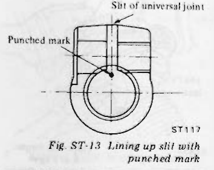
>
> - **Summary:** Aligning universal joint slit with punch mark on the top end of the upper steering shaft.
> - **Components:** Universal joint, Slit of universal joint, Punched mark, Steering shaft
> - **Mechanic Notes:** Line up the slits of universal joints with the punched mark located on the top end of upper steering shaft.
> - **Tags:** `universal joint`, `slit`, `punch mark`, `alignment`

> [!CAUTION]
> Make sure that no undue stress is applied to rubber coupling.

4. Tighten bolts and nuts correctly and securely.  
   For tightening torque, see Figure ST-12.
5. After installation, make sure that steering wheel turns smoothly.

## STEERING LOCK

To make tamper-proof, self-shear type screws are used, and their heads are sheared off when installed so that the steering lock system cannot be removed easily.

### REMOVAL

1. Break two self-shear type screws with a drill or other proper tool.
2. Remove two screws and dismount steering lock from the steering jacket tube. See Figure ST-14.

> 🖼️ **Fig. ST-14 Removing steering lock securing screws** `[ST436]` *(Type: `procedure_step`)*
>
> 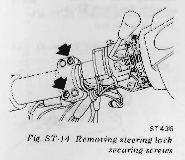
>
> - **Summary:** Location of two headless self-shear screws securing the steering lock housing to the steering jacket tube.
> - **Components:** Steering lock, Self-shear type screws, Steering jacket tube
> - **Mechanic Notes:** Break two self-shear type screws with a drill or other proper tool. Upon installation, cut off screw heads.
> - **Tags:** `steering lock`, `shear screws`, `removal`, `tamper-proof`

### INSTALLATION

1. Align steering lock hole in jacket tube with the mating portion of steering lock.
2. Install self-shear type screws and cut off their heads.

---

<!-- Page 6 (ST-6) -->
# STEERING GEAR AND LINKAGE

> 🖼️ **Fig. ST-15 Cross-section of rack-and-pinion and side rod assembly** `[ST437]` *(Type: `cutaway_flow`)*
>
> 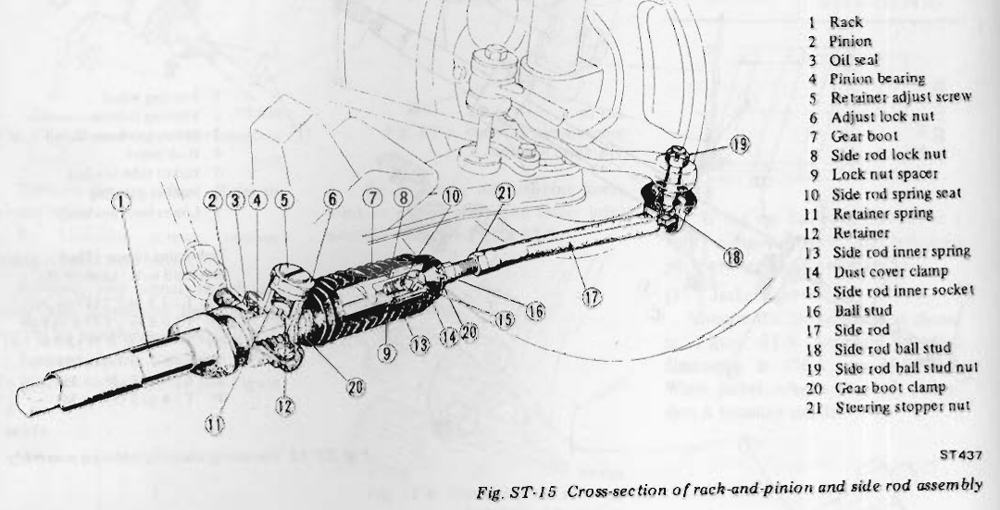
>
> - **Summary:** Comprehensive cutaway illustration showing internal construction and callouts 1 through 21 of the rack-and-pinion steering gear and side rod linkage.
> - **Components:** Rack, Pinion, Oil seal, Pinion bearing, Retainer adjust screw, Adjust lock nut, Gear boot, Side rod lock nut, Lock nut spacer, Side rod spring seat, Retainer spring, Retainer, Side rod inner spring, Dust cover clamp, Side rod inner socket, Ball stud, Side rod, Side rod ball stud, Side rod ball stud nut, Gear boot clamp, Steering stopper nut
> - **Callouts:** **(1)** Rack; **(2)** Pinion; **(3)** Oil seal; **(4)** Pinion bearing; **(5)** Retainer adjust screw; **(6)** Adjust lock nut; **(7)** Gear boot; **(8)** Side rod lock nut; **(9)** Lock nut spacer; **(10)** Side rod spring seat; **(11)** Retainer spring; **(12)** Retainer; **(13)** Side rod inner spring; **(14)** Dust cover clamp; **(15)** Side rod inner socket; **(16)** Ball stud; **(17)** Side rod; **(18)** Side rod ball stud; **(19)** Side rod ball stud nut; **(20)** Gear boot clamp; **(21)** Steering stopper nut
> - **Mechanic Notes:** Backlash is held to 0 mm (0 in) by the retainer and retainer spring.
> - **Tags:** `rack and pinion`, `cross section`, `side rod`, `steering linkage`, `internal construction`

## REMOVAL

1. Jack up the front of car and support it with suitable safety stands.
2. Remove front wheels.
3. Disconnect lower joint from steering column at rubber coupling by loosening bolts securing lower joint assembly. See Figure ST-16.

> 🖼️ **Fig. ST-16 Loosening bolts securing lower joint assembly** `[ST432]` *(Type: `procedure_step`)*
>
> 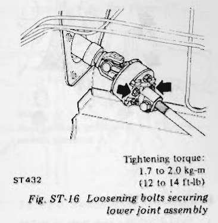
>
> - **Summary:** Loosening coupling bolts connecting the lower joint shaft to the rubber coupling.
> - **Components:** Lower joint assembly, Rubber coupling, Securing bolts
> - **Specs / Measurements:** Tightening torque: 1.7 to 2.0 kg-m (12 to 14 ft-lb)
> - **Mechanic Notes:** Disconnect lower joint from steering column at rubber coupling.
> - **Tags:** `lower joint`, `rubber coupling`, `removal`, `torque`

4. Loosen bolt securing lower joint assembly to pinion, and then remove lower joint assembly from engine compartment. See Figure ST-17.

> 🖼️ **Fig. ST-17 Disconnecting lower joint from pinion** `[ST434]` *(Type: `procedure_step`)*
>
> 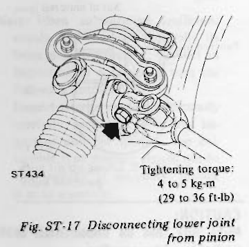
>
> - **Summary:** Disconnecting lower joint pinch clamp from the steering pinion shaft in the engine compartment.
> - **Components:** Lower joint, Pinion shaft, Pinch bolt
> - **Specs / Measurements:** Tightening torque: 4 to 5 kg-m (29 to 36 ft-lb)
> - **Mechanic Notes:** Loosen bolt securing lower joint assembly to pinion, and then remove lower joint assembly from engine compartment.
> - **Tags:** `lower joint`, `pinion`, `removal`, `torque`

5. Remove splash board.
6. Remove cotter pins and nuts fastening side rod ball studs to knuckle arms. See Figure ST-18.

> 🖼️ **Fig. ST-18 Removing outer ball stud nut** `[ST439]` *(Type: `procedure_step`)*
>
> 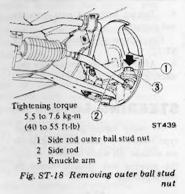
>
> - **Summary:** Removing the side rod outer ball stud nut and cotter pin at the steering knuckle arm.
> - **Components:** Side rod outer ball stud nut, Side rod, Knuckle arm
> - **Callouts:** **(1)** Side rod outer ball stud nut; **(2)** Side rod; **(3)** Knuckle arm
> - **Specs / Measurements:** Tightening torque: 5.5 to 7.6 kg-m (40 to 55 ft-lb)
> - **Mechanic Notes:** Use Ball Joint Puller HT72520000 to detach ball studs from knuckle arms.
> - **Tags:** `side rod ball stud`, `knuckle arm`, `outer ball stud`, `torque`

7. To detach side rod ball studs from knuckle arms, insert Ball Joint Puller HT72520000 between them and separate by tightening the bolt of this tool with a wrench.
8. Remove bolts securing steering gear housing to suspension member. See Figure ST-19.

> 🖼️ **Fig. ST-19 Removing bolts securing housing to suspension member** `[ST440]` *(Type: `procedure_step`)*
>
> 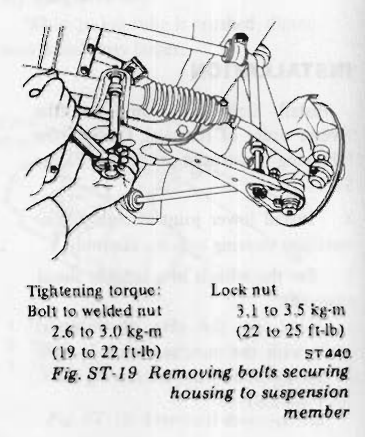
>
> - **Summary:** Removing bolts and lock nuts securing steering gear housing mounting brackets to the front suspension member.
> - **Components:** Steering gear housing, Suspension member, Mounting bolts, Lock nuts
> - **Specs / Measurements:** Bolt to welded nut tightening torque: 2.6 to 3.0 kg-m (19 to 22 ft-lb); Lock nut tightening torque: 3.1 to 3.5 kg-m (22 to 25 ft-lb)
> - **Mechanic Notes:** Remove bolts securing steering gear housing to suspension member.
> - **Tags:** `gear housing`, `suspension crossmember`, `mounting bolts`, `torque` <!-- Page 7 (ST-7) --> 9. Remove steering gear and linkage assembly.  
*Note: Raise the assembly a little and draw it out transversely.*

## DISASSEMBLY

1. Clamp the rack-and-pinion assembly in a vise using patches on steering gear housing to avoid scarring.
2. Remove dust cover clamp and boot clamp from steering gear boot. (Both left and right) See Figure ST-20.

> 🖼️ **Fig. ST-20 Removing clamps** `[ST441]` *(Type: `procedure_step`)*
>
> 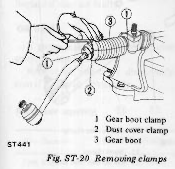
>
> - **Summary:** Removing gear boot clamp and dust cover clamp from the steering gear boot.
> - **Components:** Gear boot clamp, Dust cover clamp, Gear boot
> - **Callouts:** **(1)** Gear boot clamp; **(2)** Dust cover clamp; **(3)** Gear boot
> - **Mechanic Notes:** Remove both left and right clamps.
> - **Tags:** `gear boot`, `clamps`, `disassembly`

3. Loosen side lock nut and inner socket assembly.
4. Remove side rod assembly from rack. See Figure ST-21.  
*Note: Do not disassemble side rod assembly.*

> 🖼️ **Fig. ST-21 Disconnecting side rod assembly** `[ST442]` *(Type: `procedure_step`)*
>
> 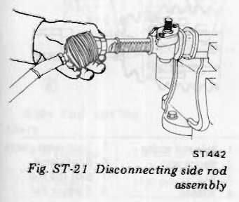
>
> - **Summary:** Unthreading side rod inner socket assembly from the end of the rack shaft.
> - **Components:** Side rod assembly, Inner socket, Rack shaft
> - **Mechanic Notes:** Do not disassemble side rod assembly.
> - **Tags:** `side rod`, `inner socket`, `rack`, `disassembly`

5. Remove side rod spring seat and side rod inner spring.
6. Loosen adjust lock nut and remove retainer adjust screw. And then take retainer spring and steering gear retainer out. See Figure ST-22.

> 🖼️ **Fig. ST-22 Removing adjust lock nut** `[ST443]` *(Type: `procedure_step`)*
>
> 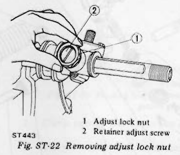
>
> - **Summary:** Loosening adjust lock nut and unthreading the retainer adjust screw from gear housing.
> - **Components:** Adjust lock nut, Retainer adjust screw, Steering gear housing
> - **Callouts:** **(1)** Adjust lock nut; **(2)** Retainer adjust screw
> - **Mechanic Notes:** Remove retainer spring and steering gear retainer after removing screw.
> - **Tags:** `adjust lock nut`, `retainer adjust screw`, `disassembly`

7. Remove oil seal. See Figure ST-23.

> 🖼️ **Fig. ST-23 Removing oil seal** `[ST444]` *(Type: `procedure_step`)*
>
> 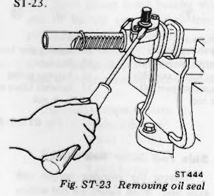
>
> - **Summary:** Prying the pinion shaft oil seal out from the top of the gear housing.
> - **Components:** Oil seal, Steering gear housing, Pry tool
> - **Mechanic Notes:** Replace oil seal every disassembly.
> - **Tags:** `oil seal`, `pinion`, `disassembly`

8. Remove bolts, housing cover and pinion adjust shim. See Figure ST-24.

> 🖼️ **Fig. ST-24 Removing bolts and housing cover** `[ST444]` *(Type: `procedure_step`)*
>
> 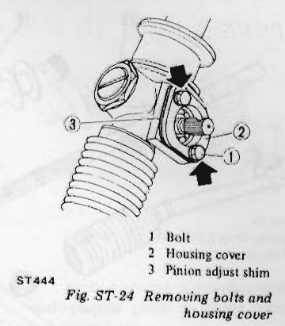
>
> - **Summary:** Removing bolts, pinion housing cover, and pinion adjust shims from the steering gear housing.
> - **Components:** Bolt, Housing cover, Pinion adjust shim
> - **Callouts:** **(1)** Bolt; **(2)** Housing cover; **(3)** Pinion adjust shim
> - **Mechanic Notes:** Save shims for preload adjustment upon reassembly.
> - **Tags:** `housing cover`, `pinion shim`, `disassembly`

9. Draw steering pinion assembly out.
10. Draw rack out from gear housing.
11. Pry off pinion lower bearing located at the bottom of gear housing.
12. Press pinion bearing out of pinion shaft. See Figure ST-25.

> 🖼️ **Fig. ST-25 Pressing pinion bearing out of pinion shaft** `[ST445]` *(Type: `procedure_step`)*
>
> 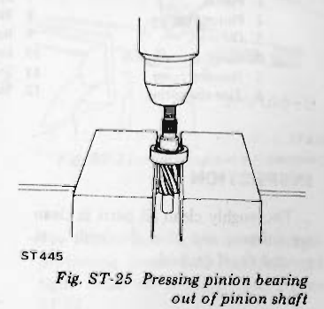
>
> - **Summary:** Pressing the ball bearing off the pinion shaft using a hydraulic/mechanical press.
> - **Components:** Pinion shaft, Pinion bearing, Press arbor, Support plate
> - **Mechanic Notes:** Properly support pinion to avoid damaging gear teeth.
> - **Tags:** `pinion bearing`, `press`, `disassembly`

13. Draw rack out of gear housing.

---

<!-- Page 8 (ST-8) -->

> 🖼️ **Fig. ST-26 Rack-and-pinion and side rod components** `[ST446]` *(Type: `exploded_view`)*
>
> 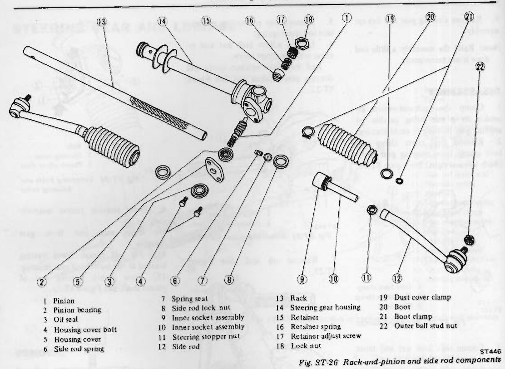
>
> - **Summary:** Exploded view diagram of complete steering rack, pinion gear, housing, boots, and side rod linkage with callouts 1 through 22.
> - **Components:** Pinion, Pinion bearing, Oil seal, Housing cover bolt, Housing cover, Side rod spring, Spring seat, Side rod lock nut, Inner socket assembly, Inner socket assembly, Steering stopper nut, Side rod, Rack, Steering gear housing, Retainer, Retainer spring, Retainer adjust screw, Lock nut, Dust cover clamp, Boot, Boot clamp, Outer ball stud nut
> - **Callouts:** **(1)** Pinion; **(2)** Pinion bearing; **(3)** Oil seal; **(4)** Housing cover bolt; **(5)** Housing cover; **(6)** Side rod spring; **(7)** Spring seat; **(8)** Side rod lock nut; **(9)** Inner socket assembly; **(10)** Inner socket assembly; **(11)** Steering stopper nut; **(12)** Side rod; **(13)** Rack; **(14)** Steering gear housing; **(15)** Retainer; **(16)** Retainer spring; **(17)** Retainer adjust screw; **(18)** Lock nut; **(19)** Dust cover clamp; **(20)** Boot; **(21)** Boot clamp; **(22)** Outer ball stud nut
> - **Mechanic Notes:** Thoroughly clean all parts in cleaning solvent and blow dry before inspection.
> - **Tags:** `exploded view`, `rack and pinion`, `components`, `side rod`, `steering gear`

## INSPECTION

Thoroughly clean all parts in cleaning solvent, and blow dry with compressed air, if available.

### Rack
Thoroughly examine all parts; components showing signs of wear must be replaced.  
Fractures, hollows, or roughness in the surfaces of the rack indicates unserviceability.

### Pinion
Thoroughly examine all parts; components showing signs of damage, cracking, or wear must be replaced. A damaged bearing or oil seal must be replaced.

### Side rod ball and spring seat
Components showing signs of damage or wear must be replaced.

### Side rod outer ball joint
Measure the swinging torque and axial play. When values are not within the specified range, replace. See Figure ST-27.

**Side rod outer ball joint:**
- Swinging torque: 0.8 to 1.5 kg-m (5.8 to 10.8 ft-lb)
- Axial play: 0.1 to 0.5 mm (0.004 to 0.020 in)

> 🖼️ **Fig. ST-27 Cross-section of outer ball joint** `[ST179]` *(Type: `cutaway_flow`)*
>
> 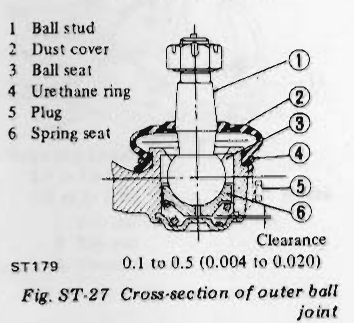
>
> - **Summary:** Internal cross-section of the outer tie rod ball joint showing callouts 1-6 and clearance specification.
> - **Components:** Ball stud, Dust cover, Ball seat, Urethane ring, Plug, Spring seat
> - **Callouts:** **(1)** Ball stud; **(2)** Dust cover; **(3)** Ball seat; **(4)** Urethane ring; **(5)** Plug; **(6)** Spring seat
> - **Specs / Measurements:** Clearance (axial play): 0.1 to 0.5 mm (0.004 to 0.020 in); Swinging torque: 0.8 to 1.5 kg-m (5.8 to 10.8 ft-lb)
> - **Mechanic Notes:** Measure swinging torque and axial play. Replace when values are not within specified range.
> - **Tags:** `outer ball joint`, `cross section`, `clearance`, `ball stud`

### Side rod inner ball joint

> 🖼️ **Fig. ST-28 Side rod inner ball joint** `[ST447]` *(Type: `cutaway_flow`)*
>
> 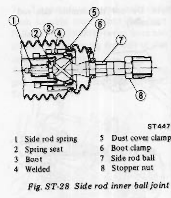
>
> - **Summary:** Cross-sectional view of the inner side rod ball socket assembly with callouts 1-8.
> - **Components:** Side rod spring, Spring seat, Boot, Welded, Dust cover clamp, Boot clamp, Side rod ball, Stopper nut
> - **Callouts:** **(1)** Side rod spring; **(2)** Spring seat; **(3)** Boot; **(4)** Welded; **(5)** Dust cover clamp; **(6)** Boot clamp; **(7)** Side rod ball; **(8)** Stopper nut
> - **Mechanic Notes:** Check inner ball joint for play. If ball stud is worn and axial play is excessive or joint is hard to swing, replace as a complete unit.
> - **Tags:** `inner ball joint`, `side rod`, `cross section`, `spring`

Check inner ball joint for play. If ball stud is worn and play in axial direction is excessive or joint is hard to swing, replace as a complete unit. See Figure ST-28. <!-- Page 9 (ST-9) --> **Side rod inner ball joint:**
- Swinging torque: 0 to 0.5 kg-m (0 to 3.6 ft-lb)
- Axial play: 0 to 0.05 mm (0 to 0.0020 in)

### Pinion bearing and inner bearing
Inspect bearings to see that they roll freely and are free from cracked, pitted, or worn balls, rollers and races. Replace if they are faulty.

### Oil seal
If grease leakage is detected during assembly, replace.  
Replace oil seal every disassembly even if it appears serviceable.

### Retainer spring

| Item | Value |
| :--- | :--- |
| Wire diameter | 2.9 mm (0.114 in) |
| Free length | 19.6 mm (0.772 in) |
| Load x length | 20 kg (44 lb) x 16.3 mm (0.642 in) |

> 🖼️ **Retainer spring dimensions**  *(Type: `inspection_measurement`)*
>
> 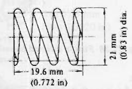
>
> - **Summary:** Dimensional sketch of retainer spring showing 21 mm (0.83 in) outside diameter and 19.6 mm (0.772 in) free length.
> - **Components:** Retainer spring
> - **Specs / Measurements:** Wire diameter: 2.9 mm (0.114 in); Free length: 19.6 mm (0.772 in); Outer diameter: 21 mm (0.83 in) dia.; Load x length: 20 kg (44 lb) x 16.3 mm (0.642 in)
> - **Mechanic Notes:** Inspect spring free length and load before reassembly.
> - **Tags:** `retainer spring`, `specifications`, `dimensions`

### Side rod spring

| Item | Value |
| :--- | :--- |
| Wire diameter | 2.6 mm (0.102 in) |
| Free length | 19.0 mm (0.748 in) |
| Load x length | 40 kg (88 lb) x 17.0 mm (0.669 in) |

> 🖼️ **Side rod spring dimensions**  *(Type: `inspection_measurement`)*
>
> 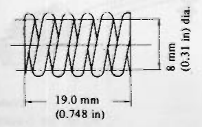
>
> - **Summary:** Dimensional sketch of side rod inner spring showing 8 mm (0.31 in) diameter and 19.0 mm (0.748 in) free length.
> - **Components:** Side rod spring
> - **Specs / Measurements:** Wire diameter: 2.6 mm (0.102 in); Free length: 19.0 mm (0.748 in); Outer diameter: 8 mm (0.31 in) dia.; Load x length: 40 kg (88 lb) x 17.0 mm (0.669 in)
> - **Mechanic Notes:** Inspect side rod spring free length and load before reassembly.
> - **Tags:** `side rod spring`, `specifications`, `dimensions`

## ASSEMBLY AND ADJUSTMENT

1. Press bearing onto pinion gear. See Figure ST-29.

> 🖼️ **Fig. ST-29 Pressing bearing onto pinion gear** `[ST448]` *(Type: `procedure_step`)*
>
> 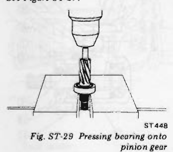
>
> - **Summary:** Pressing the ball bearing squarely onto the pinion gear shaft using an arbor press.
> - **Components:** Pinion gear, Pinion bearing, Press arbor, Support tool
> - **Mechanic Notes:** Press bearing onto pinion gear until firmly seated.
> - **Tags:** `pinion bearing`, `press`, `pinion gear`, `assembly`

2. Clamp steering gear housing in a vise.
3. Thinly apply recommended multi-purpose grease to toothed faces and friction surfaces of rack.
4. Insert pinion lower bearing with seal of bearing upward, then insert pinion assembly into housing.
5. Tighten bolts of housing cover after selecting adequate pinion adjust shim to obtain specified rotary torque.

Tightening torque of nuts: 2.0 to 3.0 kg-m (14 to 22 ft-lb)  
Rotary torque of pinion: 3 to 6 kg-cm (2.6 to 5.2 in-lb)

### Pinion adjust shim oversize

| Thickness mm (in) |
| :--- |
| 0.05 (0.0020) |
| 0.127 (0.0050) |
| 0.25 (0.0098) |
| 0.50 (0.0197) |
| 1.00 (0.0394) |

6. After this, remove bolts, housing cover, shim and pinion assembly.
7. Insert rack into tube from gear housing side.  
*Note: Pay attention to the direction of rack.*
8. Make sure that rack protrudes by the same amount from both ends of housing. See Figure ST-30.

> 🖼️ **Fig. ST-30 Measuring protruding portion of rack** `[ST449]` *(Type: `inspection_measurement`)*
>
> 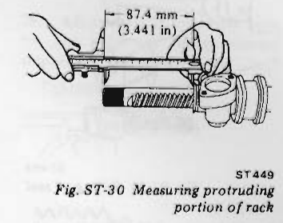
>
> - **Summary:** Measuring protruding length of rack bar from housing end with vernier calipers to establish 87.4 mm (3.441 in) center.
> - **Components:** Rack, Steering gear housing, Vernier caliper
> - **Specs / Measurements:** Rack protrusion: 87.4 mm (3.441 in)
> - **Mechanic Notes:** Make sure that rack protrudes by the same amount from both ends of housing.
> - **Tags:** `rack protrusion`, `centering`, `caliper`, `measurement`

9. Apply a coating of recommended multi-purpose grease to pinion teeth and pinion bearing.
10. Properly mesh pinion with rack, and insert pinion assembly with the groove on the pinion serration part directed upward. See Figure ST-31.

> 🖼️ **Fig. ST-31 Inserting pinion assembly** `[ST450]` *(Type: `procedure_step`)*
>
> 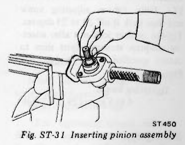
>
> - **Summary:** Inserting pinion assembly into housing with the groove on the pinion serration directed upward while meshing teeth.
> - **Components:** Pinion assembly, Steering gear housing, Pinion serration groove
> - **Mechanic Notes:** Properly mesh pinion with rack, and insert pinion assembly with the groove on the pinion serration part directed upward.
> - **Tags:** `pinion assembly`, `meshing`, `serration groove`, `installation`

11. Make sure again of the length protruding from both the left and right sides of housing. See Figure ST-32.

> 🖼️ **Fig. ST-32 Measuring protruding portion of rack** `[ST451]` *(Type: `inspection_measurement`)*
>
> 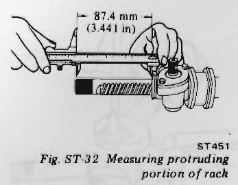
>
> - **Summary:** Re-measuring rack protrusion from housing after pinion insertion to verify equal 87.4 mm (3.441 in) extension.
> - **Components:** Rack, Steering gear housing, Vernier caliper
> - **Specs / Measurements:** Rack protrusion: 87.4 mm (3.441 in)
> - **Mechanic Notes:** Make sure again of the length protruding from both the left and right sides of housing.
> - **Tags:** `rack protrusion`, `verification`, `measurement`

12. Tighten housing cover bolts.  
Tightening torque: 2.0 to 3.0 kg-m (14 to 22 ft-lb)
13. Fit oil seal. See Figure ST-33. <!-- Page 10 (ST-10) --> > 🖼️ **Fig. ST-33 Fitting oil seal** `[ST452]` *(Type: `procedure_step`)*
>
> 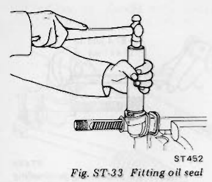
>
> - **Summary:** Fitting the pinion shaft oil seal into the upper pinion bore of the gear housing.
> - **Components:** Oil seal, Steering gear housing, Pinion shaft
> - **Mechanic Notes:** Fit oil seal and make sure pinion rotates smoothly.
> - **Tags:** `oil seal`, `pinion`, `installation`

14. Make sure that pinion assembly rotates smoothly.
15. Apply an adequate amount of recommended multi-purpose grease to steering gear retainer.
16. Insert gear retainer and retainer spring into housing. Turn retainer adjusting screw in, and install adjusting lock nut.
17. Fully tighten adjusting screw and then back it off 20 to 25 degrees. Tighten retainer lock nut after selecting adequate steering adjust shim to obtain specified rotary torque. See Figure ST-34.

Tightening torque: 4 to 6 kg-m (29 to 43 ft-lb)

### Steering adjust shim oversize

| Thickness mm (in) |
| :--- |
| 0.25 (0.0098) |
| 0.50 (0.0197) |
| 1.00 (0.0394) |

> 🖼️ **Fig. ST-34 Locking retainer lock nut** `[ST454]` *(Type: `procedure_step`)*
>
> 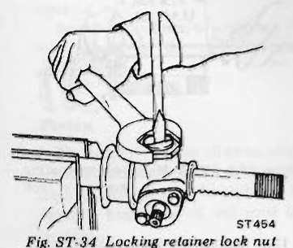
>
> - **Summary:** Locking the retainer adjusting screw lock nut while holding the adjusting screw at the backed-off position.
> - **Components:** Retainer adjusting screw, Lock nut, Steering gear housing
> - **Specs / Measurements:** Tightening torque: 4 to 6 kg-m (29 to 43 ft-lb); Back-off angle: 20 to 25 degrees
> - **Mechanic Notes:** Fully tighten adjusting screw and then back it off 20 to 25 degrees. Tighten retainer lock nut to 4 to 6 kg-m.
> - **Tags:** `retainer lock nut`, `adjusting screw`, `torque`, `preload adjustment`

18. After this, apply suitable liquid sealant around lock nut at "A". See Figure ST-35.

> 🖼️ **Fig. ST-35 Area to which liquid sealant is applied** `[ST455]` *(Type: `cutaway_flow`)*
>
> 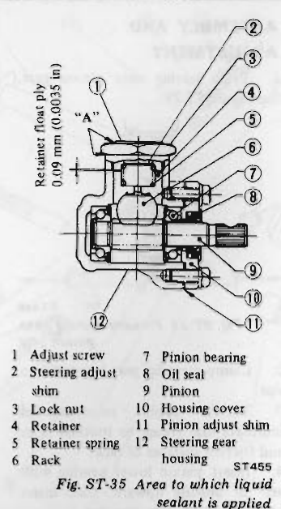
>
> - **Summary:** Sectional view of the steering gear housing showing retainer float play (0.09 mm / 0.0035 in), callouts 1-12, and liquid sealant application area 'A'.
> - **Components:** Adjust screw, Steering adjust shim, Lock nut, Retainer, Retainer spring, Rack, Pinion bearing, Oil seal, Pinion, Housing cover, Pinion adjust shim, Steering gear housing
> - **Callouts:** **(1)** Adjust screw; **(2)** Steering adjust shim; **(3)** Lock nut; **(4)** Retainer; **(5)** Retainer spring; **(6)** Rack; **(7)** Pinion bearing; **(8)** Oil seal; **(9)** Pinion; **(10)** Housing cover; **(11)** Pinion adjust shim; **(12)** Steering gear housing
> - **Specs / Measurements:** Retainer float play: 0.09 mm (0.0035 in)
> - **Mechanic Notes:** Apply suitable liquid sealant around lock nut at 'A'.
> - **Tags:** `liquid sealant`, `retainer float play`, `adjust screw`, `cross section`

19. Upon completion of gear assembly measure the torque required to keep pinion and rack in motion. Re-adjust retainer adjusting screw as necessary to obtain proper torque shown in the following chart. See Figures ST-36 and ST-37.

**Pinion (rotary torque):** Less than 20 kg-cm (17 in-lb)  
**Rack (force to pull at neutral position):** 14 to 17 kg (31 to 37 lb)

*Note: Both parts should move smoothly over their entire travel.*

> 🖼️ **Fig. ST-36 Measuring pinion rotary torque** `[ST456]` *(Type: `inspection_measurement`)*
>
> 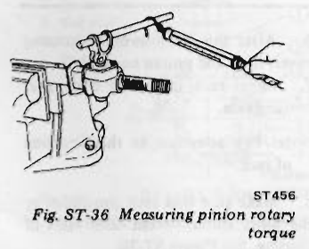
>
> - **Summary:** Measuring pinion rotary torque using a torque gauge on the pinion serration shaft.
> - **Components:** Pinion shaft, Torque wrench / gauge, Steering gear housing
> - **Specs / Measurements:** Pinion rotary torque: Less than 20 kg-cm (17 in-lb)
> - **Mechanic Notes:** Measure torque required to keep pinion and rack in motion.
> - **Tags:** `pinion rotary torque`, `torque measurement`, `inspection`

> 🖼️ **Fig. ST-37 Measuring rack force to pull** `[ST457]` *(Type: `inspection_measurement`)*
>
> 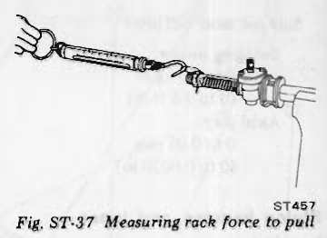
>
> - **Summary:** Measuring force required to pull rack at neutral position using a spring scale.
> - **Components:** Rack, Spring scale, Steering gear housing
> - **Specs / Measurements:** Rack force to pull at neutral position: 14 to 17 kg (31 to 37 lb)
> - **Mechanic Notes:** Re-adjust retainer adjusting screw as necessary to obtain proper torque.
> - **Tags:** `rack force to pull`, `spring scale`, `neutral position`

20. Fit boot on side rod assembly, and boot clamp (rubber) and dust cover on boot.
21. Thread lock nut spacer and lock nut over the threaded portion of rack.
22. Apply an adequate amount of recommended grease to the sliding surfaces of side rod inner socket and spring seat.
23. Fit side rod assembly to rack end together with inner spring and spring seat. See Figure ST-38.

> 🖼️ **Fig. ST-38 Fitting side rod assembly to rack** `[ST442]` *(Type: `procedure_step`)*
>
> 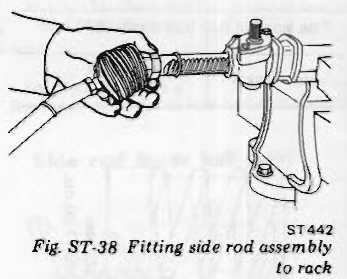
>
> - **Summary:** Fitting side rod inner socket onto rack end with inner spring and spring seat.
> - **Components:** Side rod assembly, Rack, Inner spring, Spring seat
> - **Mechanic Notes:** Apply recommended grease to sliding surfaces of side rod inner socket and spring seat. Boot must be positioned toward ball stud end.
> - **Tags:** `side rod`, `rack`, `inner socket`, `installation`

*Note:*
*a. Make sure that boot is carefully positioned toward the ball stud end.*
*b. Side rod assembly for the left side has an L-mark. (No mark is used for the right side.) See Figure ST-39.*

> 🖼️ **Fig. ST-39 L-mark** `[ST458]` *(Type: `alignment_orientation`)*
>
> 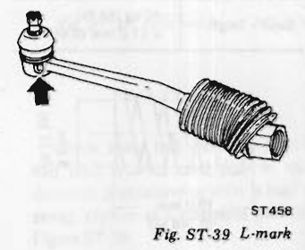
>
> - **Summary:** Identification L-mark stamped on the left side rod assembly.
> - **Components:** Side rod assembly, L-mark
> - **Mechanic Notes:** Side rod assembly for the left side has an L-mark. No mark is used for the right side.
> - **Tags:** `side rod`, `L-mark`, `identification`, `left side` <!-- Page 11 (ST-11) --> 24. Screw inner socket portion until ball seat reaches the rack end, and then tighten lock nut securely. See Figure ST-40.

Tightening torque: 8 to 10 kg-m (58 to 72 ft-lb)

> 🖼️ **Fig. ST-40 Tightening lock nut** `[ST459]` *(Type: `procedure_step`)*
>
> 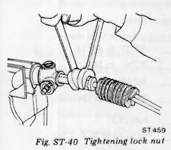
>
> - **Summary:** Tightening the inner socket lock nut against the rack end using two wrenches.
> - **Components:** Inner socket, Lock nut, Rack shaft
> - **Specs / Measurements:** Tightening torque: 8 to 10 kg-m (58 to 72 ft-lb)
> - **Mechanic Notes:** Screw inner socket portion until ball seat reaches rack end, then tighten lock nut securely.
> - **Tags:** `inner socket`, `lock nut`, `torque`, `side rod`

25. Upon completion of side rod assembly, measure swinging torque and axial play of inner ball joint. See Figure ST-41.

**Swinging torque:** 0 to 0.5 kg-m (0 to 3.6 ft-lb)  
**Axial play:** 0 to 0.05 mm (0 to 0.0020 in)

> 🖼️ **Fig. ST-41 Measuring swinging torque** `[ST460]` *(Type: `inspection_measurement`)*
>
> 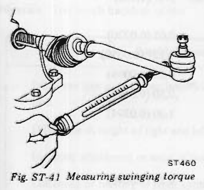
>
> - **Summary:** Measuring swinging torque of the inner side rod ball joint with a spring scale.
> - **Components:** Side rod, Inner ball joint, Spring scale
> - **Specs / Measurements:** Swinging torque: 0 to 0.5 kg-m (0 to 3.6 ft-lb); Axial play: 0 to 0.05 mm (0 to 0.0020 in)
> - **Mechanic Notes:** Measure swinging torque and axial play upon completion of side rod assembly.
> - **Tags:** `swinging torque`, `inner ball joint`, `axial play`, `inspection`

26. Measure rack stroke. See Figure ST-42.

> 🖼️ **Fig. ST-42 Measuring rack stroke** `[ST461]` *(Type: `inspection_measurement`)*
>
> 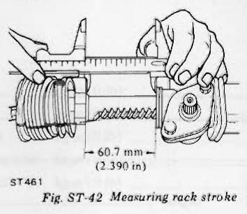
>
> - **Summary:** Measuring rack stroke from lock to lock using vernier calipers: 60.7 mm (2.390 in).
> - **Components:** Rack, Steering gear housing, Vernier caliper
> - **Specs / Measurements:** Rack stroke: 60.7 mm (2.390 in)
> - **Mechanic Notes:** Verify full stroke of 60.7 mm (2.390 in) without interference.
> - **Tags:** `rack stroke`, `caliper`, `travel`, `measurement`

**Rack stroke:** 60.7 mm (2.390 in)

27. Fit boot, boot clamp (rubber) and dust cover clamp, install a grease nipple at both ends of rack, and apply recommended multi-purpose grease to each joint.  
*Note: Lubrication of the rack ends is made so that a small quantity of new grease appears at the boot grease outlet hole. Do not apply an excessive amount of grease.*

28. Fit spacer to outer side until it reaches stopper nut. Install boot to gear housing, then tighten inside boot clamp securely. See Figure ST-43.

> 🖼️ **Fig. ST-43 Tightening boot clamp** `[ST462]` *(Type: `procedure_step`)*
>
> 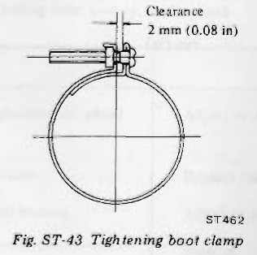
>
> - **Summary:** Tightening boot clamp screw until the specified lug gap clearance of 2 mm (0.08 in) is reached.
> - **Components:** Boot clamp, Clamp screw
> - **Specs / Measurements:** Clearance: 2 mm (0.08 in)
> - **Mechanic Notes:** Tighten inside boot clamp securely. Boot should be neither too inflated nor too elongated.
> - **Tags:** `boot clamp`, `clearance`, `boot installation`

*Note: Boot should be neither too inflated nor too elongated.*

29. Adjust the side rod length both left and right, and tighten steering stopper nuts. See Figure ST-44.

Tightening torque: 8 to 10 kg-m (58 to 72 ft-lb)

> 🖼️ **Fig. ST-44 Adjusting side rod length** `[ST447]` *(Type: `inspection_measurement`)*
>
> 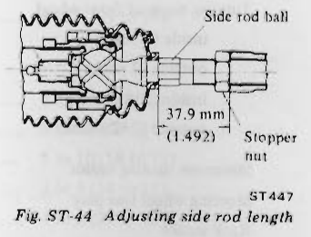
>
> - **Summary:** Sectional view of side rod length adjustment showing 37.9 mm (1.492 in) setting from stopper nut to ball stud center.
> - **Components:** Side rod ball, Stopper nut
> - **Specs / Measurements:** Side rod length: 37.9 mm (1.492 in); Tightening torque: 8 to 10 kg-m (58 to 72 ft-lb)
> - **Mechanic Notes:** Adjust side rod length both left and right, and tighten steering stopper nuts to specified torque.
> - **Tags:** `side rod length`, `stopper nut`, `adjustment`, `torque`

## INSTALLATION

Install steering linkage in the reverse order of removal.  
Observe the followings:
1. For tightening torque, refer to Removal.
2. Check wheel alignment, and if necessary adjust. See Section FA.

---

<!-- Page 12 (ST-12) -->
# SERVICE DATA AND SPECIFICATIONS

## SPECIFICATIONS

| Item | Specification |
| :--- | :--- |
| Steering gear type | Rack-and-pinion type |
| Turns of steering wheel (lock to lock) | 3.1 |
| Steering gear ratio | 18 : 1 |
| Turning angle of front wheel: | |
| - inside (2 seater) | 33°54' to 34°54' |
| - outside (2 seater) | 32°6' to 34°6' |
| - inside (2+2 seater) | 36°18' to 37°18' |
| - outside (2+2 seater) | 34°24' to 36°24' |
| Minimum turning radius | 4.8 m (15.7 ft) |
| Steering wheel free play | 20 to 30 mm (0.79 to 1.18 in) |
| Rack stroke | 60.7 mm (2.390 in) |

## SERVICE DATA

| Item | Unit | Value |
| :--- | :--- | :--- |
| Standard clearance between clamp and lower jacket | mm (in) | 176.1 (6.93) |
| Side rod outer ball joint: | | |
| - Swinging torque | kg-m (ft-lb) | 0.8 to 1.5 (5.8 to 10.8) |
| Side rod inner ball joint: | | |
| - Swinging torque | kg-m (ft-lb) | 0 to 0.5 (0 to 3.6) |
| Rack force to pull | kg (lb) | 14 to 17 (31 to 37) |
| Side rod length | mm (in) | 37.9 (1.492) |
| Pinion adjust shim oversize: | | |
| - Thickness | mm (in) | 0.05 (0.0020) |
| | | 0.127 (0.0050) |
| | | 0.25 (0.0098) |
| | | 0.50 (0.0197) |
| | | 1.00 (0.0394) |
| Steering adjust shim oversize: | | |
| - Thickness | mm (in) | 0.25 (0.0098) |
| | | 0.50 (0.0197) |
| | | 1.00 (0.0394) |

---

<!-- Page 13 (ST-13) -->
## TIGHTENING TORQUE

| Item | Unit | Value |
| :--- | :--- | :--- |
| **Column shaft** | | |
| Steering wheel nut | kg-m (ft-lb) | 4 to 5 (29 to 36) |
| Column clamp bolt | kg-m (ft-lb) | 0.8 to 1.1 (5.8 to 8.0) |
| Rubber coupling securing bolt | kg-m (ft-lb) | 1.7 to 2.0 (12 to 14) |
| Lower joint to rubber coupling bolt | kg-m (ft-lb) | 2.3 to 2.7 (17 to 20) |
| Lower joint to pinion gear bolt | kg-m (ft-lb) | 4 to 5 (29 to 36) |
| **Steering gear and linkage** | | |
| Nut securing side rod ball stud to knuckle arm | kg-m (ft-lb) | 5.5 to 7.6 (40 to 55) |
| Side rod stopper nut | kg-m (ft-lb) | 8 to 10 (58 to 72) |
| Side rod lock nut | kg-m (ft-lb) | 8 to 10 (58 to 72) |
| Gear housing cover bolt | kg-m (ft-lb) | 2 to 3 (14 to 22) |
| Retainer lock nut | kg-m (ft-lb) | 4 to 6 (29 to 43) |
| Side rod inner socket lock nut | kg-m (ft-lb) | 8 to 10 (58 to 72) |

# TROUBLE DIAGNOSES AND CORRECTIONS

Problems in the Front Axle and Front Suspension are discussed at this point, because they are generally associated with steering malfunctions.

### 1. Vibration, shock and shimmying of steering wheel
- **Vibration:** Too much backlash of the steering gear, wear of linkage parts or the rubber coupling, and vibration of front wheels are, in many cases, transmitted to the steering wheel. This is very noticeable when traveling over rough roads.
- **Shock:** When the front wheels are traveling over bumpy roads, shock is transmitted to the steering wheel. This is also very noticeable when traveling over rough roads.
- **Shimmying:** This is abnormal vibration of the front suspension group and the entire steering linkage, and occurs when a specific speed is attained.

| Possible causes | Corrective action |
| :--- | :--- |
| Improper tire pressure or insufficient tightening of wheel nuts. | Adjust or tighten. |
| Difference in height of right and left tire treads. | Replace tires. |
| Incorrect adjustment or wear of front wheel bearing. | Adjust or replace. |
| Collapsing or twisting of front spring. | Replace. |
| Incorrect brake (binding) adjustment. | Adjust. |
| Incorrect adjustment of brakes (binding). | Readjust. |
| Wear of rubber bushings for fitting transverse link and compression rod. | Replace. |
| Deformation of steering linkage and suspension link. | Replace. | <!-- Page 14 (ST-14) --> | Possible causes | Corrective action |
| :--- | :--- |
| Excessive clearance of side rod inner or outer ball joint. | Replace. |
| Loose side rod lock nut. | Tighten more. |
| Car level unbalance. | Correct the unbalance. |

### 2. Wandering of car in one direction
When driving with hands off the steering wheel over a flat road, the car gently pulls to one side of the road.

*Note: Faulty rear suspension may also be the cause of this tendency. Refer to information concerning the rear suspension.*

| Possible causes | Corrective action |
| :--- | :--- |
| Improper tire pressure. | Adjust. |
| Unbalance or deformation of load wheel. | Correct the unbalance or replace. |
| Uneven tire wear or insufficient tightening. | Replace or tighten. |
| Faulty wheel alignment. | Adjust. |
| Wear of bushings for fitting transverse link and compression rod. | Replace. |
| Loose steering post clamp. | Retighten. |
| Wear of steering column bearing. | Replace steering column assembly. |
| Breakage or collapsing of steering column shaft spring. | Replace. |
| Loose rubber coupling bolts or wear of rubber coupling. | Retighten or replace. |
| Excessive serration play. | Replace. |
| Wear of lower joint journal. | Replace. |
| Insufficient tightening of steering gear housing. | Retighten. |
| Wear of suspension ball joint. | Replace. |
| Improper adjustment of retainer. (Too much backlash) | Adjust. |
| Malfunction of shock absorber (inside strut) or loose bolts. | Replace or tighten. |
| Car level unbalance. | Correct the unbalance. |

---

<!-- Page 15 (ST-15) -->
### 3. Instability of car

| Possible causes | Corrective action |
| :--- | :--- |
| Improper tire pressure. | Adjust. |
| Wear of rubber bushings for fitting transverse link and compression rod. | Replace. |
| Incorrect wheel alignment. | Adjust. |
| Wear or deformation of steering linkage and suspension link. | Replace. |
| Worn mounting rubber. | Replace. |
| Loose gear housing bolt. | Retighten. |
| Loose side rod lock nut. | Retighten. |
| Excessive play of side rod inner or outer ball joint. | Replace. |
| Incorrect adjustment of retainer. | Readjust. |
| Deformation and unbalance of wheel. | Correct or replace. |

### 4. Steering wheel resistance
**(Sequence of checking)**  
Jack up the front of the car, detach the lower joint upper part and operate the steering wheel. If resistance is low, check the steering gear, steering linkage, suspension and accelerator groups. If high, check the steering column.

| Possible causes | Corrective action |
| :--- | :--- |
| Improper tire pressure. | Adjust. |
| Insufficient grease or impurities in gear housing. | Replenish grease or replace gear housing. |
| Insufficient grease, impurities in steering linkage, or abnormal wear. | Replenish grease or replace the part. |
| Stiffness, damage, or insufficient grease in suspension ball joint. | Replace. |
| Wear or incorrect adjustment of wheel bearing. | Replace or adjust. |
| Seizing of housing bushing. | Replace with gear housing. |
| Wear or damage of rack-and-pinion or bearing. | Replace. |
| Incorrect adjustment of retainer. | Readjust. |
| Tight retainer. | Adjust. |
| Deformation of steering linkage. | Replace. | <!-- Page 16 (ST-16) --> | Possible cause | Corrective action |
| :--- | :--- |
| Incorrect wheel alignment. | Adjust. |
| Damage of bearing at upper end of strut. | Replace. |
| Damage or stiffness of piston or rod of shock absorber (in the strut). | Replace. |
| Interference of steering column with turn signal switch. | Adjust. |
| Damage, seizing, or stiffness of steering column bearing. | Replace with steering column jacket. |

### 5. Excessive steering wheel play

| Possible causes | Corrective action |
| :--- | :--- |
| Incorrect adjustment of retainer. | Adjust. |
| Wear of steering linkage. | Replace. |
| Improper fitting of gear housing. | Tighten. |
| Worn mounting rubber. | Replace. |
| Incorrect adjustment of wheel bearing. | Adjust. |
| Wear of bushings for fitting transverse link and tension rod. | Replace. |
| Loose rubber coupling bolts. | Retighten. |
| Wear of rubber coupling. | Replace. |
| Loose lower joint bolts. | Retighten. |

### 6. Noises

| Possible causes | Corrective action |
| :--- | :--- |
| Improper tire pressure. | Adjust. |
| Insufficient grease for suspension ball joint and steering linkage, or breakage. | Replenish grease, or replace. |
| Loose bolts of steering gear housing, linkage, and suspension groups. | Retighten. |
| Faulty shock absorber (inside strut). | Replace. |
| Faulty wheel bearing. | Replace. | <!-- Page 17 (ST-17) --> | Possible cause | Corrective action |
| :--- | :--- |
| Wear of steering linkage and rack-and-pinion. | Replace. |
| Wear of bushings for fitting transverse link and compression rod. | Replace. |
| Breakage or collapsing of coil spring. | Replace. |
| Loose nuts (holding strut mounting insulator). | Retighten. |
| Wear of housing bushing. | Replace housing gear assembly. |
| Excessive thrust play of pinion. | Adjust or replace. |
| Loose retainer part. | Replace retainer spring or tighten lock nut. |

# SPECIAL SERVICE TOOLS

| Tool number & tool name | Kent-Moore No. | Reference page or Fig. No. |
| :--- | :--- | :--- |
| ST27180001 Steering wheel puller | J 25726 | Fig. ST-2 |
| HT72520000 Ball joint remover | — | Page ST-6 |

> 🖼️ **Steering wheel puller (ST27180001 / J 25726)**  *(Type: `special_service_tool`)*
>
> 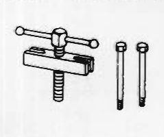
>
> - **Summary:** Steering wheel puller tool ST27180001 (Kent-Moore J 25726) featuring puller yoke, center bolt, and two side anchor bolts.
> - **Components:** Steering wheel puller yoke, Center forcing screw, Anchor bolts
> - **Specs / Measurements:** Kent-Moore No.: J 25726; Reference: Fig. ST-2
> - **Mechanic Notes:** Use to pull steering wheel hub off splined shaft without hammer impact.
> - **Tags:** `special service tool`, `steering wheel puller`, `ST27180001`, `J 25726`, `SST`

> 🖼️ **Ball joint remover (HT72520000)**  *(Type: `special_service_tool`)*
>
> 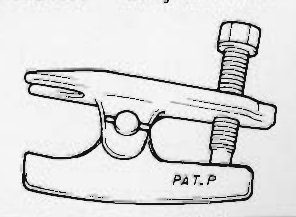
>
> - **Summary:** Ball joint remover HT72520000 lever type tool with forcing screw and pivot pin marked PAT. P.
> - **Components:** Ball joint remover body, Forcing screw, Lever
> - **Specs / Measurements:** Reference: Page ST-6
> - **Mechanic Notes:** Insert between side rod ball stud and knuckle arm, tighten bolt to separate ball stud.
> - **Tags:** `special service tool`, `ball joint remover`, `HT72520000`, `SST`

---

## Segmented Diagrams Index

| Figure | Code | Type | Page | Caption | Key Components / Callouts | File |
| :--- | :--- | :--- | :--- | :--- | :--- | :--- |
| **Fig. ST-1** | `ST429` | `component_location` | ST-2 | Fig. ST-1 Structural view of steering system | Steering wheel, Steering column clamp, Steering column tube, Jacket tube bracket, Rubber coupling | [fig_st_1_structural_view_of_steering_system.png](diagrams/ST Steering/fig_st_1_structural_view_of_steering_system.png) |
| **Fig. ST-2** | `ST430` | `procedure_step` | ST-3 | Fig. ST-2 Removing steering wheel | Steering wheel, Steering wheel puller ST27180001, Puller anchor screws, Center forcing bolt | [fig_st_2_removing_steering_wheel.png](diagrams/ST Steering/fig_st_2_removing_steering_wheel.png) |
| **Fig. ST-3** | `ST431` | `cutaway_flow` | ST-3 | Fig. ST-3 Sectional view of collapsible type steering | Upper bearing, Upper jacket shaft, Steering column clamp, Upper jacket tube, Steel ball | [fig_st_3_sectional_view_of_collapsible_type_steering.png](diagrams/ST Steering/fig_st_3_sectional_view_of_collapsible_type_steering.png) |
| **Fig. ST-4** | `ST432` | `procedure_step` | ST-4 | Fig. ST-4 Removing rubber coupling bolt | Rubber coupling, Steering column shaft, Coupling bolt | [fig_st_4_removing_rubber_coupling_bolt.png](diagrams/ST Steering/fig_st_4_removing_rubber_coupling_bolt.png) |
| **Fig. ST-5** | `ST433` | `procedure_step` | ST-4 | Fig. ST-5 Removing jacket tube bracket securing bolts | Jacket tube bracket, Dash panel mounting bolts | [fig_st_5_removing_jacket_tube_bracket_securing_bolts.png](diagrams/ST Steering/fig_st_5_removing_jacket_tube_bracket_securing_bolts.png) |
| **Fig. ST-6** | `ST335` | `procedure_step` | ST-4 | Fig. ST-6 Removing column clamp securing bolts | Column clamp, Column clamp securing bolts, Steering column | [fig_st_6_removing_column_clamp_securing_bolts.png](diagrams/ST Steering/fig_st_6_removing_column_clamp_securing_bolts.png) |
| **Fig. ST-7** | `ST189` | `procedure_step` | ST-4 | Fig. ST-7 Drawing out steering column assembly | Steering column assembly, Pedal bracket, Dash interior | [fig_st_7_drawing_out_steering_column_assembly.png](diagrams/ST Steering/fig_st_7_drawing_out_steering_column_assembly.png) |
| **Fig. ST-8** | `ST434` | `procedure_step` | ST-4 | Fig. ST-8 Loosening nut securing lower joint to pinion gear | Lower joint, Pinion gear shaft, Pinch nut | [fig_st_8_loosening_nut_securing_lower_joint_to_pinion_gear.png](diagrams/ST Steering/fig_st_8_loosening_nut_securing_lower_joint_to_pinion_gear.png) |
| **fig_st_column_shaft_spring** | `-` | `inspection_measurement` | ST-4 | Column shaft spring dimensions | Column shaft spring | [fig_st_column_shaft_spring.png](diagrams/ST Steering/fig_st_column_shaft_spring.png) |
| **Fig. ST-9** | `ST192` | `inspection_measurement` | ST-4 | Fig. ST-9 Standard dimension between column clamp and the top end of lower jacket tube | Jacket tube, Column clamp | [fig_st_9_standard_dimension_between_column_clamp_and_the_top_end_of_lower_jacket_tube.png](diagrams/ST Steering/fig_st_9_standard_dimension_between_column_clamp_and_the_top_end_of_lower_jacket_tube.png) |
| **Fig. ST-10** | `ST193` | `inspection_measurement` | ST-4 | Fig. ST-10 Standard dimension B | Column clamp, Block, Jacket tube | [fig_st_10_standard_dimension_b.png](diagrams/ST Steering/fig_st_10_standard_dimension_b.png) |
| **Fig. ST-11** | `ST194` | `inspection_measurement` | ST-5 | Fig. ST-11 Inspecting steering wheel for axial play | Steering wheel, Steering column shaft | [fig_st_11_inspecting_steering_wheel_for_axial_play.png](diagrams/ST Steering/fig_st_11_inspecting_steering_wheel_for_axial_play.png) |
| **Fig. ST-12** | `ST435` | `procedure_step` | ST-5 | Fig. ST-12 Installing steering column assembly | Steering wheel, Steering column assembly, Steering column clamp, Dash panel, Jacket tube bracket | [fig_st_12_installing_steering_column_assembly.png](diagrams/ST Steering/fig_st_12_installing_steering_column_assembly.png) |
| **Fig. ST-13** | `ST117` | `alignment_orientation` | ST-5 | Fig. ST-13 Lining up slit with punched mark | Universal joint, Slit of universal joint, Punched mark, Steering shaft | [fig_st_13_lining_up_slit_with_punched_mark.png](diagrams/ST Steering/fig_st_13_lining_up_slit_with_punched_mark.png) |
| **Fig. ST-14** | `ST436` | `procedure_step` | ST-5 | Fig. ST-14 Removing steering lock securing screws | Steering lock, Self-shear type screws, Steering jacket tube | [fig_st_14_removing_steering_lock_securing_screws.png](diagrams/ST Steering/fig_st_14_removing_steering_lock_securing_screws.png) |
| **Fig. ST-15** | `ST437` | `cutaway_flow` | ST-6 | Fig. ST-15 Cross-section of rack-and-pinion and side rod assembly | Rack, Pinion, Oil seal, Pinion bearing, Retainer adjust screw | [fig_st_15_cross_section_of_rack_and_pinion_and_side_rod_assembly.png](diagrams/ST Steering/fig_st_15_cross_section_of_rack_and_pinion_and_side_rod_assembly.png) |
| **Fig. ST-16** | `ST432` | `procedure_step` | ST-6 | Fig. ST-16 Loosening bolts securing lower joint assembly | Lower joint assembly, Rubber coupling, Securing bolts | [fig_st_16_loosening_bolts_securing_lower_joint_assembly.png](diagrams/ST Steering/fig_st_16_loosening_bolts_securing_lower_joint_assembly.png) |
| **Fig. ST-17** | `ST434` | `procedure_step` | ST-6 | Fig. ST-17 Disconnecting lower joint from pinion | Lower joint, Pinion shaft, Pinch bolt | [fig_st_17_disconnecting_lower_joint_from_pinion.png](diagrams/ST Steering/fig_st_17_disconnecting_lower_joint_from_pinion.png) |
| **Fig. ST-18** | `ST439` | `procedure_step` | ST-6 | Fig. ST-18 Removing outer ball stud nut | Side rod outer ball stud nut, Side rod, Knuckle arm | [fig_st_18_removing_outer_ball_stud_nut.png](diagrams/ST Steering/fig_st_18_removing_outer_ball_stud_nut.png) |
| **Fig. ST-19** | `ST440` | `procedure_step` | ST-6 | Fig. ST-19 Removing bolts securing housing to suspension member | Steering gear housing, Suspension member, Mounting bolts, Lock nuts | [fig_st_19_removing_bolts_securing_housing_to_suspension_member.png](diagrams/ST Steering/fig_st_19_removing_bolts_securing_housing_to_suspension_member.png) |
| **Fig. ST-20** | `ST441` | `procedure_step` | ST-7 | Fig. ST-20 Removing clamps | Gear boot clamp, Dust cover clamp, Gear boot | [fig_st_20_removing_clamps.png](diagrams/ST Steering/fig_st_20_removing_clamps.png) |
| **Fig. ST-21** | `ST442` | `procedure_step` | ST-7 | Fig. ST-21 Disconnecting side rod assembly | Side rod assembly, Inner socket, Rack shaft | [fig_st_21_disconnecting_side_rod_assembly.png](diagrams/ST Steering/fig_st_21_disconnecting_side_rod_assembly.png) |
| **Fig. ST-22** | `ST443` | `procedure_step` | ST-7 | Fig. ST-22 Removing adjust lock nut | Adjust lock nut, Retainer adjust screw, Steering gear housing | [fig_st_22_removing_adjust_lock_nut.png](diagrams/ST Steering/fig_st_22_removing_adjust_lock_nut.png) |
| **Fig. ST-23** | `ST444` | `procedure_step` | ST-7 | Fig. ST-23 Removing oil seal | Oil seal, Steering gear housing, Pry tool | [fig_st_23_removing_oil_seal.png](diagrams/ST Steering/fig_st_23_removing_oil_seal.png) |
| **Fig. ST-24** | `ST444` | `procedure_step` | ST-7 | Fig. ST-24 Removing bolts and housing cover | Bolt, Housing cover, Pinion adjust shim | [fig_st_24_removing_bolts_and_housing_cover.png](diagrams/ST Steering/fig_st_24_removing_bolts_and_housing_cover.png) |
| **Fig. ST-25** | `ST445` | `procedure_step` | ST-7 | Fig. ST-25 Pressing pinion bearing out of pinion shaft | Pinion shaft, Pinion bearing, Press arbor, Support plate | [fig_st_25_pressing_pinion_bearing_out_of_pinion_shaft.png](diagrams/ST Steering/fig_st_25_pressing_pinion_bearing_out_of_pinion_shaft.png) |
| **Fig. ST-26** | `ST446` | `exploded_view` | ST-8 | Fig. ST-26 Rack-and-pinion and side rod components | Pinion, Pinion bearing, Oil seal, Housing cover bolt, Housing cover | [fig_st_26_rack_and_pinion_and_side_rod_components.png](diagrams/ST Steering/fig_st_26_rack_and_pinion_and_side_rod_components.png) |
| **Fig. ST-27** | `ST179` | `cutaway_flow` | ST-8 | Fig. ST-27 Cross-section of outer ball joint | Ball stud, Dust cover, Ball seat, Urethane ring, Plug | [fig_st_27_cross_section_of_outer_ball_joint.png](diagrams/ST Steering/fig_st_27_cross_section_of_outer_ball_joint.png) |
| **Fig. ST-28** | `ST447` | `cutaway_flow` | ST-8 | Fig. ST-28 Side rod inner ball joint | Side rod spring, Spring seat, Boot, Welded, Dust cover clamp | [fig_st_28_side_rod_inner_ball_joint.png](diagrams/ST Steering/fig_st_28_side_rod_inner_ball_joint.png) |
| **fig_st_retainer_spring** | `-` | `inspection_measurement` | ST-9 | Retainer spring dimensions | Retainer spring | [fig_st_retainer_spring.png](diagrams/ST Steering/fig_st_retainer_spring.png) |
| **fig_st_side_rod_spring** | `-` | `inspection_measurement` | ST-9 | Side rod spring dimensions | Side rod spring | [fig_st_side_rod_spring.png](diagrams/ST Steering/fig_st_side_rod_spring.png) |
| **Fig. ST-29** | `ST448` | `procedure_step` | ST-9 | Fig. ST-29 Pressing bearing onto pinion gear | Pinion gear, Pinion bearing, Press arbor, Support tool | [fig_st_29_pressing_bearing_onto_pinion_gear.png](diagrams/ST Steering/fig_st_29_pressing_bearing_onto_pinion_gear.png) |
| **Fig. ST-30** | `ST449` | `inspection_measurement` | ST-9 | Fig. ST-30 Measuring protruding portion of rack | Rack, Steering gear housing, Vernier caliper | [fig_st_30_measuring_protruding_portion_of_rack.png](diagrams/ST Steering/fig_st_30_measuring_protruding_portion_of_rack.png) |
| **Fig. ST-31** | `ST450` | `procedure_step` | ST-9 | Fig. ST-31 Inserting pinion assembly | Pinion assembly, Steering gear housing, Pinion serration groove | [fig_st_31_inserting_pinion_assembly.png](diagrams/ST Steering/fig_st_31_inserting_pinion_assembly.png) |
| **Fig. ST-32** | `ST451` | `inspection_measurement` | ST-9 | Fig. ST-32 Measuring protruding portion of rack | Rack, Steering gear housing, Vernier caliper | [fig_st_32_measuring_protruding_portion_of_rack.png](diagrams/ST Steering/fig_st_32_measuring_protruding_portion_of_rack.png) |
| **Fig. ST-33** | `ST452` | `procedure_step` | ST-10 | Fig. ST-33 Fitting oil seal | Oil seal, Steering gear housing, Pinion shaft | [fig_st_33_fitting_oil_seal.png](diagrams/ST Steering/fig_st_33_fitting_oil_seal.png) |
| **Fig. ST-34** | `ST454` | `procedure_step` | ST-10 | Fig. ST-34 Locking retainer lock nut | Retainer adjusting screw, Lock nut, Steering gear housing | [fig_st_34_locking_retainer_lock_nut.png](diagrams/ST Steering/fig_st_34_locking_retainer_lock_nut.png) |
| **Fig. ST-35** | `ST455` | `cutaway_flow` | ST-10 | Fig. ST-35 Area to which liquid sealant is applied | Adjust screw, Steering adjust shim, Lock nut, Retainer, Retainer spring | [fig_st_35_area_to_which_liquid_sealant_is_applied.png](diagrams/ST Steering/fig_st_35_area_to_which_liquid_sealant_is_applied.png) |
| **Fig. ST-36** | `ST456` | `inspection_measurement` | ST-10 | Fig. ST-36 Measuring pinion rotary torque | Pinion shaft, Torque wrench / gauge, Steering gear housing | [fig_st_36_measuring_pinion_rotary_torque.png](diagrams/ST Steering/fig_st_36_measuring_pinion_rotary_torque.png) |
| **Fig. ST-37** | `ST457` | `inspection_measurement` | ST-10 | Fig. ST-37 Measuring rack force to pull | Rack, Spring scale, Steering gear housing | [fig_st_37_measuring_rack_force_to_pull.png](diagrams/ST Steering/fig_st_37_measuring_rack_force_to_pull.png) |
| **Fig. ST-38** | `ST442` | `procedure_step` | ST-10 | Fig. ST-38 Fitting side rod assembly to rack | Side rod assembly, Rack, Inner spring, Spring seat | [fig_st_38_fitting_side_rod_assembly_to_rack.png](diagrams/ST Steering/fig_st_38_fitting_side_rod_assembly_to_rack.png) |
| **Fig. ST-39** | `ST458` | `alignment_orientation` | ST-10 | Fig. ST-39 L-mark | Side rod assembly, L-mark | [fig_st_39_l_mark.png](diagrams/ST Steering/fig_st_39_l_mark.png) |
| **Fig. ST-40** | `ST459` | `procedure_step` | ST-11 | Fig. ST-40 Tightening lock nut | Inner socket, Lock nut, Rack shaft | [fig_st_40_tightening_lock_nut.png](diagrams/ST Steering/fig_st_40_tightening_lock_nut.png) |
| **Fig. ST-41** | `ST460` | `inspection_measurement` | ST-11 | Fig. ST-41 Measuring swinging torque | Side rod, Inner ball joint, Spring scale | [fig_st_41_measuring_swinging_torque.png](diagrams/ST Steering/fig_st_41_measuring_swinging_torque.png) |
| **Fig. ST-42** | `ST461` | `inspection_measurement` | ST-11 | Fig. ST-42 Measuring rack stroke | Rack, Steering gear housing, Vernier caliper | [fig_st_42_measuring_rack_stroke.png](diagrams/ST Steering/fig_st_42_measuring_rack_stroke.png) |
| **Fig. ST-43** | `ST462` | `procedure_step` | ST-11 | Fig. ST-43 Tightening boot clamp | Boot clamp, Clamp screw | [fig_st_43_tightening_boot_clamp.png](diagrams/ST Steering/fig_st_43_tightening_boot_clamp.png) |
| **Fig. ST-44** | `ST447` | `inspection_measurement` | ST-11 | Fig. ST-44 Adjusting side rod length | Side rod ball, Stopper nut | [fig_st_44_adjusting_side_rod_length.png](diagrams/ST Steering/fig_st_44_adjusting_side_rod_length.png) |
| **ST27180001** | `-` | `special_service_tool` | ST-17 | Steering wheel puller (ST27180001 / J 25726) | Steering wheel puller yoke, Center forcing screw, Anchor bolts | [fig_sst_st27180001_steering_wheel_puller.png](diagrams/ST Steering/fig_sst_st27180001_steering_wheel_puller.png) |
| **HT72520000** | `-` | `special_service_tool` | ST-17 | Ball joint remover (HT72520000) | Ball joint remover body, Forcing screw, Lever | [fig_sst_ht72520000_ball_joint_remover.png](diagrams/ST Steering/fig_sst_ht72520000_ball_joint_remover.png) |
