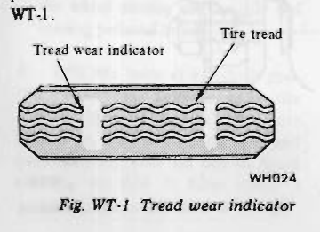
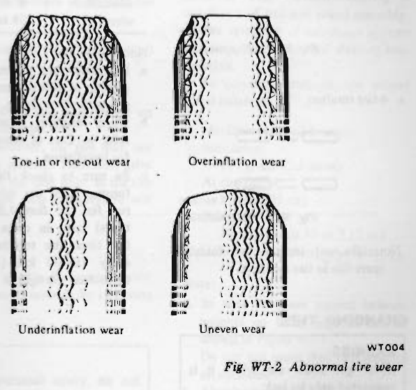
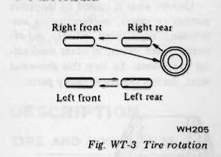
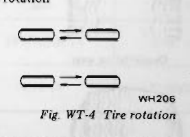
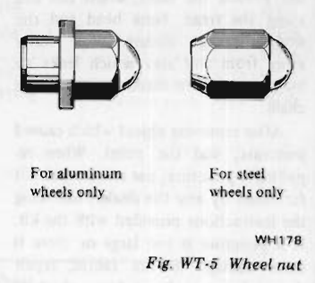
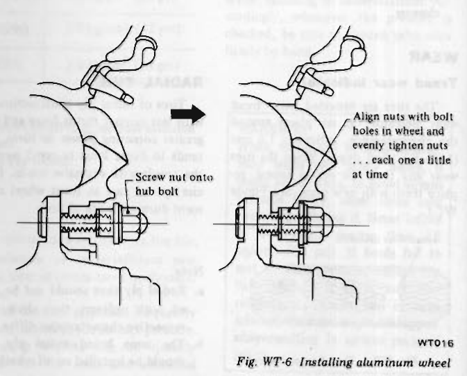
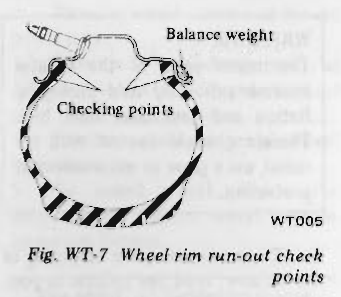

# Wheel and Tire

<!-- Page 1 (WT-1) -->
# SECTION WT

# WHEEL AND TIRE

## CONTENTS

| Section | Page |
| :--- | :--- |
| WHEEL AND TIRE | WT-2 |
| TROUBLE DIAGNOSES AND CORRECTIONS | WT-7 |

---

<!-- Page 2 (WT-2) -->
# WHEEL AND TIRE

## CONTENTS

| | | | |
| :--- | :--- | :--- | :--- |
| DESCRIPTION | WT-2 | RADIAL TIRE | WT-3 |
| TIRE AND WHEEL SIZE | WT-2 | TIRE ROTATION | WT-3 |
| RECOMMENDED INFLATION PRESSURE | WT-2 | CHANGING TIRE | WT-4 |
| MAINTENANCE AND SERVICE | WT-2 | FOLDABLE SPARE TIRE | WT-5 |
| TIRE INFLATION | WT-2 | INSPECTION | WT-5 |
| REPAIR | WT-3 | WHEEL BALANCE | WT-5 |
| WEAR | WT-3 | WHEEL AND TIRE | WT-5 |

## DESCRIPTION

### TIRE AND WHEEL SIZE

| Tire | | Wheel | |
| :--- | :--- | :--- | :--- |
| Size | Remarks | Size | Remarks |
| 195/70HR-14 | Steel radial, tubeless | 5½J-14 | Aluminum wheel Offset 15 mm (0.59 in) |
| C78-14 | Foldable spare tire | 5J-14 | Steel wheel Offset 15 mm (0.59 in) |

### RECOMMENDED INFLATION PRESSURE

| Tire | Car speed | Pressure |
| :--- | :--- | :--- |
| 195/70HR-14 | Under 160 km/h (100 MPH) | 2.0 kg/cm² (28 psi) |
| 195/70HR-14 | Over 160 km/h (100 MPH) | 2.3 kg/cm² (32 psi) |
| C78-14 | Under 80 km/h (50 MPH) | 2.0 kg/cm² (28 psi) |

Note:
a. For continuous high-speed driving [over 100 km/h (62 MPH)], increase inflation pressure by the amount shown in the above chart.
b. Inflation pressure should be measured when the tire is cold.

## MAINTENANCE AND SERVICE

### TIRE INFLATION

Correct tire pressure is very important for steering ease and riding comfort. Correct pressure also makes for a quieter ride and extends tire life; overinflation or underinflation promotes wear at center tread or shoulder of tire.

If all tires are inspected frequently and maintained at the correct pressure, any sharp objects can be quickly detected in the tread and abnormal wear, which invites serious problem, can be avoided.

After inflating tires, valves should be checked for leakage. Without valve caps, leakage will occur due to dirt and water, resulting in underinflation. Accordingly, whenever tire pressure is checked, be sure to tighten valve caps firmly by hand.

> [!WARNING]
> **WARNING:**
> When, while tire is being inflated, bead snaps over safety hump, it might break. Thus, to avoid serious personal injury, never stand over tire when inflating it. Never inflate to a pressure greater than 2.8 kg/cm² (40 psi). If beads fail to seat at that pressure, deflate the tire, lubricate it again, and then reinflate it. If the tire is overinflated, the bead might break, possibly resulting in serious personal injury.

---

<!-- Page 3 (WT-3) -->
## REPAIR

### Tubeless tire

To check for leaks, apply soapy solution to tire or submerge tire and wheel in water after tire has been inflated to specified pressure. Special inspection for leaks should be carried out around the valve, wheel rim and along the tread. Note bead and rim where leakage occurs. Wipe water away from any area which leaks air bubbles and then mark the place with chalk.

After removing object which caused puncture, seal the point. When repairing a puncture, use a tire repair kit furnished by any tire dealer, following the instructions provided with the kit. If a puncture is too large or there is some damage to tire fabric, repair should be carried out by authorized tire dealer.

### Wheel

Inspect wheel rim flange for bent sections or dents. If any are detected, repair should be made to secure complete sealing. The flange should be cleaned with a wire brush when rust is found on it. Furthermore, if there is excessive pitting on the rim, eliminate it with a file.

Note: Aluminum wheel
Do not wash the wheel with wire brush. Always use a neutral cleanser.

## WEAR

### Tread wear indicator

The tires are provided with "tread wear indicator" at six places around tire circumference, indicating 1.6 mm (1/16 in) tread depth. When the tires wear and then the marks appear, replace them with new ones. See Figure WT-1.

> 🖼️ **Fig. WT-1 Tread wear indicator** `[WH024]` *(Type: `inspection_measurement`)*
>
> 
>
> - **Summary:** Illustration of tire tread pattern and tread wear indicator bars located across tread grooves.
> - **Components:** Tread wear indicator, Tire tread, Grooves
> - **Callouts:** **(Tread wear indicator)** Tread wear indicator bar across grooves; **(Tire tread)** Tire tread surface
> - **Specs / Measurements:** 1.6 mm (1/16 in) remaining tread depth; Located at six places around tire circumference
> - **Mechanic Notes:** When tread wears down to 1.6 mm (1/16 in) and wear indicator marks appear across the grooves, replace tires with new ones.
> - **Tags:** `tread wear indicator`, `tire wear`, `tire tread`, `minimum tread depth`, `inspection`

### Misalignment

When the front wheels are aligned in an excessive toe-in or toe-out condition, the tires will tend to scrape the tread rubber off and the tread will develop a feathered edge.

### Center wear

Center wear is caused by overinflation of the tire.

### Shoulder wear

This wear may be caused by underinflation, incorrect wheel camber, or continued excessive speed around curves. In general, the first two causes are the most common. Underinflation causes wear on both sides of treads, while camber causes wear on only one side of tread.

### Uneven wear

Uneven wear is caused by incorrect camber or caster, malfunctioning suspension, unbalanced wheel, out-of-round brake drum, or other mechanical conditions. To stop this abnormal wear, correct the above faulty parts.

> 🖼️ **Fig. WT-2 Abnormal tire wear** `[WT004]` *(Type: `inspection_measurement`)*
>
> 
>
> - **Summary:** Four cross-sectional illustrations demonstrating abnormal tire tread wear patterns: toe-in/toe-out wear (feathered edge), overinflation wear (center), underinflation wear (both shoulders), and uneven wear (one side or irregular).
> - **Components:** Tire tread cross section, Tread contact profile
> - **Callouts:** **(Toe-in or toe-out wear)** Feathered edge wear pattern caused by excessive toe-in or toe-out; **(Overinflation wear)** Center tread wear pattern caused by tire overinflation; **(Underinflation wear)** Shoulder wear on both edges caused by tire underinflation or hard cornering; **(Uneven wear)** One-sided or irregular wear caused by incorrect camber/caster, out-of-round drum, or unbalanced wheel
> - **Mechanic Notes:** Inspect tread wear patterns to diagnose underlying wheel alignment, tire pressure, or suspension faults.
> - **Tags:** `abnormal tire wear`, `toe-in wear`, `toe-out wear`, `overinflation wear`, `underinflation wear`, `uneven wear`, `feathered edge`

## RADIAL TIRE

Tires of radial ply construction roll with less camber thrust force and with greater cornering power on turns. This tends to cause local or rapid wear on the treads with excessive toe-in. Exercise special care in front wheel alignment during the life of tires.

Note:
a. Radial ply tires should not be mixed with ordinary tires since their respective characteristics differ.
b. The same brand radial ply tires should be installed on all wheels.
c. Only tubes designed exclusively for radial tires should be used.
d. Snow chains should not be used because they cause damage to side walls.

## TIRE ROTATION

Tires tend to wear unevenly and become unbalanced after a certain running distance. Uneven tire wear often results in tire noise which is attributed to rear axle gears, bearing, etc. Front tires also tend to wear unevenly because of improperly aligned front wheels. <!-- Page 4 (WT-4) --> Accordingly, to equalize tire wear, it is necessary to rotate tires periodically as recommended in the "Periodic Maintenance". See Figures WT-3 and WT-4.

### Radial ply tires

All the tires are of the same type.

* **5-tire rotation**

> 🖼️ **Fig. WT-3 Tire rotation** `[WH205]` *(Type: `alignment_orientation`)*
>
> 
>
> - **Summary:** Five-tire rotation pattern schematic diagram showing repositioning sequence for all four road wheels and the full-size spare tire.
> - **Components:** Right front tire, Right rear tire, Left front tire, Left rear tire, Spare tire
> - **Callouts:** **(Right front)** Right front wheel position; **(Right rear)** Right rear wheel position; **(Left front)** Left front wheel position; **(Left rear)** Left rear wheel position
> - **Mechanic Notes:** Rotate tires periodically to equalize wear. Never include the foldable emergency spare tire in rotation.
> - **Tags:** `tire rotation`, `5-tire rotation`, `spare tire rotation`, `radial tire rotation`

* **4-tire rotation**

> 🖼️ **Fig. WT-4 Tire rotation** `[WH206]` *(Type: `alignment_orientation`)*
>
> 
>
> - **Summary:** Four-tire rotation pattern schematic diagram showing rotation paths between front and rear wheels without spare tire.
> - **Components:** Right front tire, Right rear tire, Left front tire, Left rear tire
> - **Mechanic Notes:** Cross rear tires to opposite front positions; move front tires directly to rear positions. Do not include foldable spare.
> - **Tags:** `tire rotation`, `4-tire rotation`, `radial tire rotation`

Note: Do not include the foldable spare tire in tire rotation.

## CHANGING TIRE

> [!WARNING]
> **WARNING:**
> Never get under car while it is supported only by jack.
> Always use safety stands to support side member of body construction when you must get beneath car.

> [!CAUTION]
> **CAUTION:**
> Bias, bias belted and radial ply tires must not be mixed except in an emergency. Mixed use of different types of tires can adversely affect car handling and may cause driver to lose control.

To change a tire and wheel with a jack in a safe manner, observe the following procedures:
1. Engage parking brake and block front wheels when rear wheel is being changed.
2. Remove wheel cover and loosen wheel nuts.
3. Place jack at jacking point as described in Section GI and raise car until wheel clears ground.
4. Remove wheel nuts and wheel from drum.
5. To install wheel, reverse the above steps. Tighten wheel nuts in criss-cross fashion.

| Tire wheel | Tightening torque |
| :--- | :--- |
| Steel wheel | 8 to 9 kg-m (58 to 65 ft-lb) |
| Aluminum wheel | 8 to 10 kg-m (58 to 72 ft-lb) |

Note:
a. Be careful not to smear threaded portion of bolt and nut, and seat of nut with oil or grease.
b. When installing aluminum wheel, refer to Care of Aluminum Wheel for installation.
c. Be sure to check the wheel nut torque, after the wheel has been run for the first 1,000 km (600 miles) (also in cases of repairing flat tires, tire rotation, etc.) and every 10,000 km (6,000 miles) thereafter. Retighten if necessary.

### Care of aluminum wheel

> [!CAUTION]
> **CAUTION:**
> Use the wheel nut for exclusive use in aluminum wheels.

> 🖼️ **Fig. WT-5 Wheel nut** `[WH178]` *(Type: `component_location`)*
>
> 
>
> - **Summary:** Comparison illustration showing two distinct wheel nut designs: sleeve-shank nut with washer for aluminum wheels only, and tapered acorn nut for steel wheels only.
> - **Components:** Wheel nut for aluminum wheels, Wheel nut for steel wheels, Washer
> - **Callouts:** **(For aluminum wheels only)** Sleeve-type wheel nut with integral washer for aluminum wheels; **(For steel wheels only)** Tapered acorn-seat wheel nut for steel wheels
> - **Mechanic Notes:** Always use exclusive sleeve wheel nuts on aluminum wheels. Never interchange aluminum wheel nuts and steel wheel nuts. Never use aluminum wheel nuts on the foldable spare tire wheel.
> - **Tags:** `wheel nut`, `lug nut`, `aluminum wheel nut`, `steel wheel nut`, `fastener`

To install an aluminum wheel, proceed as follows:
1. Snugly tighten the four nuts after the wheel is positioned. See Figure WT-6.
2. Slightly pull the wheel back to properly align the nuts with bolt holes in the wheel, and tighten the nuts as much as possible with your fingers.
3. Tighten the four nuts evenly with a wheel wrench in criss-cross fashion.

> 🖼️ **Fig. WT-6 Installing aluminum wheel** `[WT016]` *(Type: `procedure_step`)*
>
> 
>
> - **Summary:** Two-step procedure diagram illustrating correct installation and shank alignment of aluminum wheels: loosely threading sleeve nuts onto hub bolts, then pulling the wheel back to center the shank into wheel bolt counterbores before progressively tightening in criss-cross order.
> - **Components:** Wheel hub, Brake drum, Hub bolt, Aluminum wheel center disc, Sleeve wheel nut
> - **Callouts:** **(Screw nut onto hub bolt)** Initial loose finger threading of sleeve nut onto hub bolt; **(Align nuts with bolt holes in wheel and evenly tighten nuts ... each one a little at time)** Pull wheel back to align sleeve nut shank into counterbored wheel hole, then tighten progressively
> - **Specs / Measurements:** Tightening torque: 8 to 10 kg-m (58 to 72 ft-lb)
> - **Mechanic Notes:** Snugly tighten four nuts after wheel is positioned, pull wheel back slightly to align sleeve nuts into bolt hole counterbores, tighten finger-tight, then torque evenly with wrench in criss-cross pattern.
> - **Tags:** `installing aluminum wheel`, `wheel installation`, `hub bolt`, `sleeve nut alignment`, `criss-cross tightening`

---

<!-- Page 5 (WT-5) -->
## FOLDABLE SPARE TIRE

The foldable spare tire is designed for emergency use only. The foldable spare tire is stored in a deflated condition.
An inflator (canister) has been provided to inflate the spare.
The foldable spare tire can be used repeatedly for emergency situations. However, the inflator (canister) must be replaced after each inflation.
Be sure to obtain the proper size inflator for foldable spare tire size.
The foldable spare tire is restricted in driving speed up to a maximum of 80 km/h (50 MPH) for short distances and emergency use only.

### Inflation with approved inflator

1. Before changing tire, carefully read the caution and directions affixed on both the inflator and the foldable spare tire.
2. Remove the uninflated foldable spare tire and the inflator canister from rear compartment.

> [!WARNING]
> **WARNING:**
> Do not inflate at this point.

3. Jack up front or rear of car as required and remove the damaged tire. Then mount the uninflated foldable spare tire to the axle. (Tighten wheel nuts slightly.)

Note: On aluminum wheels equipped cars, be sure to use spare wheel nuts.
The wheel nuts for aluminum wheels must not be used on the foldable spare tire wheel to avoid the wheel coming off the axle and causing personal injury.

4. With tire valve at 6 o'clock position, inflate the foldable spare tire with the inflator (canister). Place tire inflator on the tire inflation valve and push squarely until gas can be heard entering the tire. It takes about 3 minutes.

> [!WARNING]
> **WARNING:**
> The metal parts of the inflator become extremely cold during inflation and can cause frost bite. Therefore, avoid contact with the metal, use a glove or other means of protection.

5. To ensure complete emptying of the inflator, hold the inflator in position for one minute after sound stops.

Note: If temperature is below -10°C (14°F), the canister must be warmed on the windshield defroster for five to ten minutes to provide tire inflation.

6. Lower car and fully tighten wheel nuts.

Note:
a. Do not install the wheel cover on the foldable spare tire.
b. In cold weather, the tire may not look fully inflated. Therefore, drive slowly for the first mile, as the tire temperature rises the pressure will increase.

### Deflation

1. Deflate tire by depressing button on tire inflation valve or by removing valve core.

> [!WARNING]
> **WARNING:**
> To avoid personal injury, do not inhale the gas which is vented while the tire is deflating.

2. Flatten tire. The foldable spare tire becomes folded gradually while deflating.
3. Store tire in rear compartment.

### Repair

Note: Only qualified tire experts are authorized to dismount the foldable spare tire from its rim or repair it in any way. Improper service can result in serious personal injury. Contact Datsun dealers or any authorized tire dealers to repair the foldable spare tire.

## INSPECTION

### WHEEL BALANCE

The wheel and tire assembly should be kept balanced statically and dynamically.
Proper tire balance is necessary when driving the car at high speeds. Consequently, the wheel and tire assembly should be properly rebalanced whenever puncture is repaired.
The wheel and tire assembly becomes out of balance according to uneven tire wear. Severe acceleration and braking, or fast cornering is the cause of wear on tire, resulting in unbalance of tire and wheel assembly.
The symptom of unbalance appears as tramp, car shake and steering malfunction.
To correct unbalance, use proper wheel balancer.

Maximum allowable static unbalance:
177 gr-cm (2.5 in-oz)
At rim flange:
10 gr (0.35 oz)
Balance weight:
10 to 60 gr (0.35 to 2.12 oz) at 10 gr (0.35 oz) interval

Note:
a. Be sure to place correct balance weights on inner edge of rim as shown in Figure WT-7.
Do not put more than two weights on each side.
b. Aluminum wheel
Use balance weights for exclusive use in aluminum wheel.

### WHEEL AND TIRE

In order to ensure satisfactory steering condition as well as maximum tire life, proceed as follows:
1. Check wheel rim, especially, rim flange and bead seat for rust, distortion, cracks or other defects which might cause air leaks. Function of tubeless tire depends on a good seal between the bead and wheel rim. Thoroughly remove rust, dust, oxidized rubber or sand from wheel rim with wire brush, emery cloth or paper. Use dial gauge to examine wheel rim <!-- Page 6 (WT-6) --> for lateral and diametral runout. See Figure WT-7.

Lateral runout limit:
Less than 1.0 mm (0.039 in) total indicator reading

Note: Aluminum wheel
Remove fragments of rubber, dust or sand from rim flange with cloth. Do not use sandpaper or wire brush.

> 🖼️ **Fig. WT-7 Wheel rim run-out check points** `[WT005]` *(Type: `inspection_measurement`)*
>
> 
>
> - **Summary:** Cross-sectional illustration of wheel rim profile indicating balance weight clipping location and dial indicator checking points for measuring lateral and diametral rim runout.
> - **Components:** Wheel rim, Rim flange, Bead seat, Balance weight
> - **Callouts:** **(Balance weight)** Balance weight clipped to inner/outer rim flange edge; **(Checking points)** Dial indicator stylus contact points on rim flange and bead seat for lateral and diametral runout measurement
> - **Specs / Measurements:** Lateral runout limit: Less than 1.0 mm (0.039 in) total indicator reading; Static unbalance limit: 177 gr-cm (2.5 in-oz); Rim flange unbalance limit: 10 gr (0.35 oz)
> - **Mechanic Notes:** Use dial gauge to inspect rim runout. Remove rubber/dust/sand with cloth on aluminum wheels (do not use sandpaper or wire brush). Place correct balance weights on inner edge of rim, not more than two per side.
> - **Tags:** `wheel rim run-out`, `lateral runout`, `diametral runout`, `balance weight`, `dial indicator`, `wheel inspection`

2. Discard when any of the following conditions occur;
(1) Broken or damaged bead wire.
(2) Ply or tread separation.
(3) Worn fabric injuries on tubeless tire.
(4) Cracked or damaged sidewall, etc.

Note: In replacing tire, take extra care not to damage tire bead, rim-flange and bead seat.
Do not use tire irons to force beads away from wheel rim-flange; that is, always use tire replacement device whenever tire is removed.

---

<!-- Page 7 (WT-7) -->
# TROUBLE DIAGNOSES AND CORRECTIONS

| Condition | Probable cause | Corrective action |
| :--- | :--- | :--- |
| Wheel wobbles. | Improper tire pressure. | Measure and adjust correctly. |
| | Damaged tire or distorted wheel rim. | Repair or replace. |
| | Unbalanced wheel. | Balance or replace. |
| | Loose wheel nuts. | Tighten. |
| | Worn or damaged wheel bearing, or excessive play of wheel bearing. | Correct play or replace wheel bearing. |
| | Improper front wheel alignment. | Align correctly. |
| | Worn or damaged ball joint. | Replace. |
| | Excessive steering linkage play or worn steering linkage. | Adjust or replace. |
| | Loose steering linkage connection. | Tighten the nuts to the rated torque, or replace worn parts if any. |
| | Broken suspension spring. | Replace. |
| | Faulty shock absorber. | Replace. |
| Unevenly or excessively worn tire. | Improper tire rotation. | Conduct tire rotation periodically. |
| | Improper tire pressure. | Measure and adjust correctly. |
| | Unbalanced wheel. | Balance or replace. |
| | Improperly adjusted brake. | Adjust correctly. |
| | Improper wheel alignment. | Align correctly. |
| | Excessively distorted or improperly installed suspension link. | Repair or replace if necessary, or reinstall correctly. |
| | High speed on curves. | Reduce speed. |
| | Sudden start and improper speed due to rapid acceleration or improper brake application. | Follow correct and proper driving manner. |
| Tire squeals. | Improper tire pressure. | Measure and adjust correctly. |
| | Improper front wheel alignment. | Align correctly. |
| | Distorted knuckle or suspension link. | Repair or replace if necessary. |

---

## Segmented Diagrams Index

| Figure | Code | Type | Page | Caption | Key Components / Callouts | File |
| :--- | :--- | :--- | :--- | :--- | :--- | :--- |
| **Fig. WT-1** | `WH024` | `inspection_measurement` | WT-3 | Fig. WT-1 Tread wear indicator | Tread wear indicator, Tire tread, Grooves | [fig_wt_1_tread_wear_indicator.png](diagrams/WT Wheel and Tire/fig_wt_1_tread_wear_indicator.png) |
| **Fig. WT-2** | `WT004` | `inspection_measurement` | WT-3 | Fig. WT-2 Abnormal tire wear | Tire tread cross section, Tread contact profile | [fig_wt_2_abnormal_tire_wear.png](diagrams/WT Wheel and Tire/fig_wt_2_abnormal_tire_wear.png) |
| **Fig. WT-3** | `WH205` | `alignment_orientation` | WT-4 | Fig. WT-3 Tire rotation | Right front tire, Right rear tire, Left front tire, Left rear tire, Spare tire | [fig_wt_3_tire_rotation_5.png](diagrams/WT Wheel and Tire/fig_wt_3_tire_rotation_5.png) |
| **Fig. WT-4** | `WH206` | `alignment_orientation` | WT-4 | Fig. WT-4 Tire rotation | Right front tire, Right rear tire, Left front tire, Left rear tire | [fig_wt_4_tire_rotation_4.png](diagrams/WT Wheel and Tire/fig_wt_4_tire_rotation_4.png) |
| **Fig. WT-5** | `WH178` | `component_location` | WT-4 | Fig. WT-5 Wheel nut | Wheel nut for aluminum wheels, Wheel nut for steel wheels, Washer | [fig_wt_5_wheel_nut.png](diagrams/WT Wheel and Tire/fig_wt_5_wheel_nut.png) |
| **Fig. WT-6** | `WT016` | `procedure_step` | WT-4 | Fig. WT-6 Installing aluminum wheel | Wheel hub, Brake drum, Hub bolt, Aluminum wheel center disc, Sleeve wheel nut | [fig_wt_6_installing_aluminum_wheel.png](diagrams/WT Wheel and Tire/fig_wt_6_installing_aluminum_wheel.png) |
| **Fig. WT-7** | `WT005` | `inspection_measurement` | WT-6 | Fig. WT-7 Wheel rim run-out check points | Wheel rim, Rim flange, Bead seat, Balance weight | [fig_wt_7_wheel_rim_run_out_check_points.png](diagrams/WT Wheel and Tire/fig_wt_7_wheel_rim_run_out_check_points.png) |
