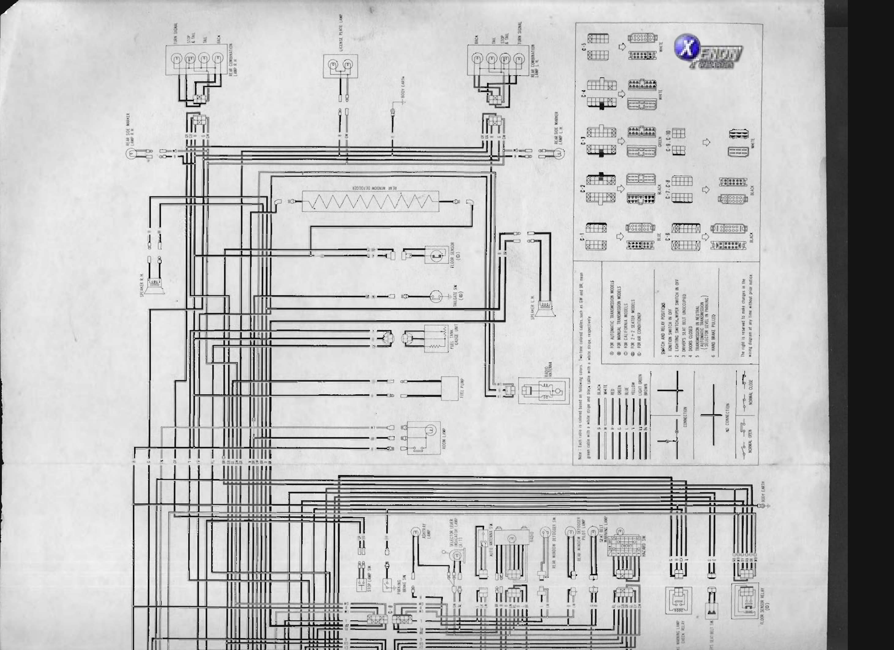
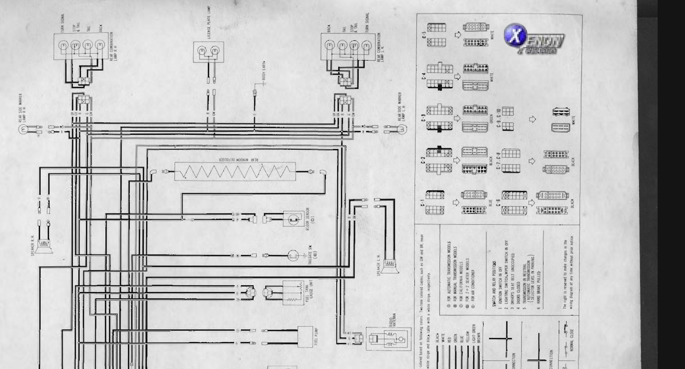
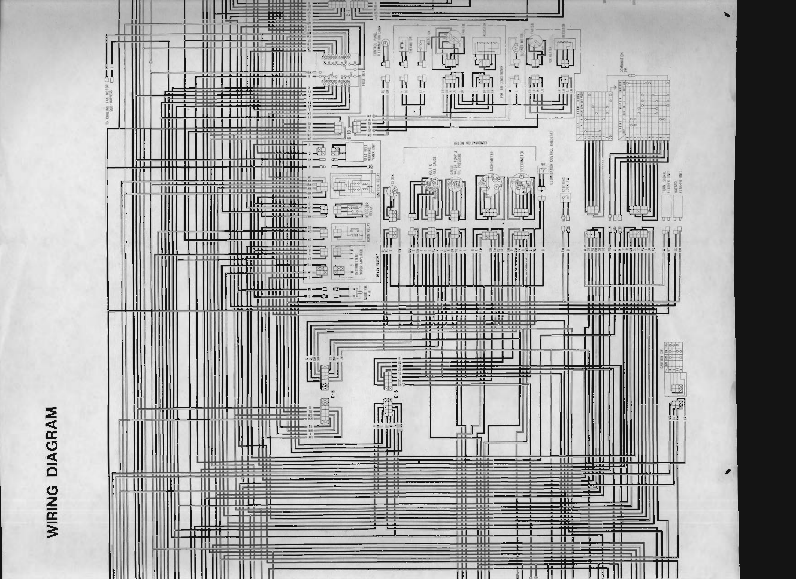
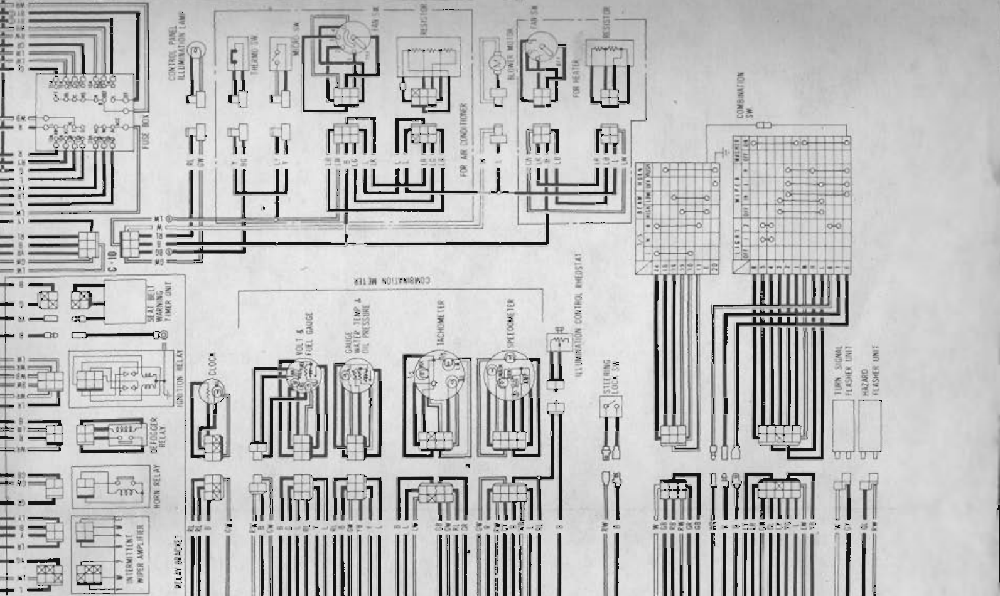
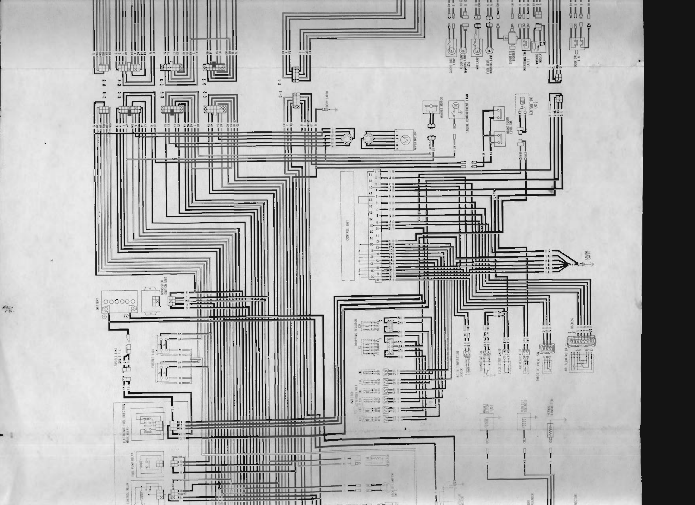
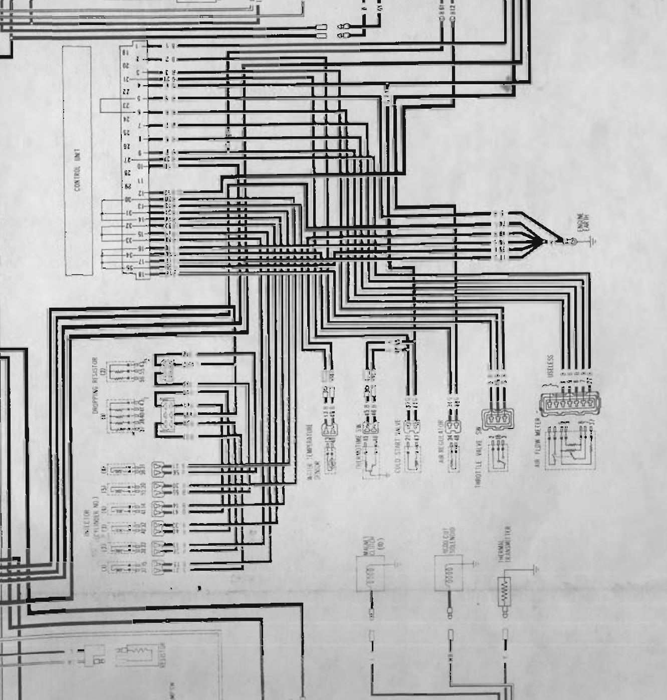
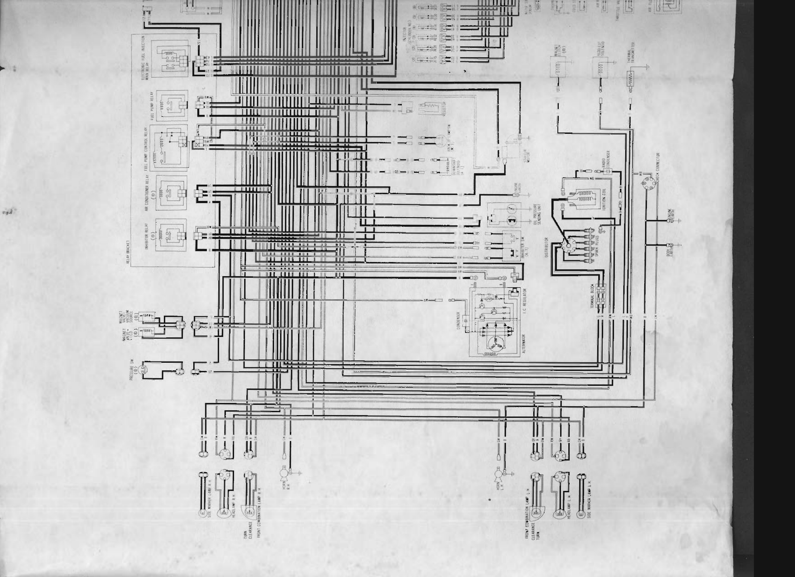
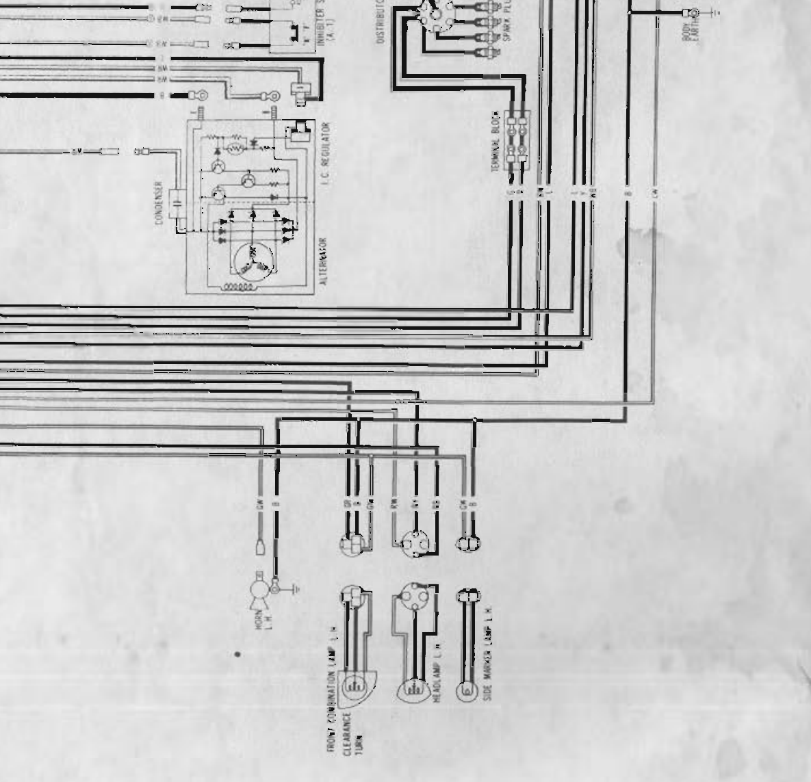

# Wiring Diagram

<!-- Page 1 (WD-1) -->
# 1978 Datsun 280Z Factory Wiring Diagram — Sheet 1: Rear Body, Cargo Area & Center Console Harness

## Overview
Sheet 1 represents the rear vehicle electrical system, luggage/cargo compartment, fuel supply, rear window defogger, rear lighting circuits, audio speakers, center console switches, and intermediate harness connectors `C-1` through `C-10`.

> 🖼️ **Wiring Diagram Sheet 1: Rear Combination Lamps, Cargo Area, Fuel Delivery, Defogger, and Center Console Harness** `[XENON-WD-1]` *(Type: `electrical_schematic`)*
>
> 
>
> - **Summary:** Full high-resolution electrical schematic of the 1978 Datsun 280Z rear body, tail lighting, fuel pump, fuel gauge sending unit, rear window defogger grid, auto antenna, audio speakers, center console switches, and harness connectors C-1 through C-10.
> - **Components:** Rear Combination Lamp R.H., Rear Combination Lamp L.H., Rear Side Marker Lamp R.H., Rear Side Marker Lamp L.H., License Plate Lamp, Rear Window Defogger Grid, Electric Fuel Pump, Fuel Tank Gauge Unit, Speaker R.H., Speaker L.H., Radio Antenna Motor, Tailgate Switch, Floor Sensor (California), Room Lamp, Ashtray Lamp, Selector Lever Indicator Lamp (A/T), Auto Antenna Switch, Radio Head Unit, Rear Window Defogger Switch, Hazard Switch, Warning Lamp Check Relay, Driver's Seat Belt Switch, Floor Sensor Relay (California), Stop Lamp Switch, Parking Brake Switch, Harness Connectors C-1 through C-10
> - **Callouts:** **(C-1)** 6-pole Blue connector; **(C-2)** 8-pole Black connector; **(C-3)** 8-pole Green connector; **(C-4)** 8-pole White connector; **(C-5)** 10-pole White connector; **(C-6)** 10-pole Black connector; **(C-7)** Console/Body connector (Black); **(C-8)** Console/Body connector (Green); **(C-9)** Harness junction connector (White); **(C-10)** Harness junction connector (Black)
> - **Specs / Measurements:** Fuel tank sender resistance: approx. 10 to 80 ohms (Empty ~80Ω, Full ~10Ω); Rear window defogger current draw: 12-15A (approx. 1 ohm total grid resistance); Stop lamp bulbs: 12V 21W / 32CP; Tail lamp bulbs: 12V 5W / 3CP; Turn signal bulbs: 12V 21W / 32CP; Back-up lamp bulbs: 12V 21W / 32CP
> - **Wiring / Connections:** G (Turn RH / Stop switch feed); GW (Turn LH); RG (Stop lamp feed); R (Tail / Marker / License feed); RY (Back-up lamp feed); WB (Defogger power); Y (Fuel gauge sender signal); YB (Low fuel warning lamp signal); B (Chassis ground)
> - **Mechanic Notes:** All rear exterior lamps share the common body ground point in the rear hatch quarter panel; corroded or loose ground lugs cause dim lamps or cross-backfeeding into turn signal circuits.
> - **Tags:** `wiring`, `schematic`, `rear lighting`, `fuel pump`, `fuel gauge`, `rear defogger`, `hazard switch`, `connectors`

---

## Component Layout & Functional Breakdown

### 1. Rear Exterior Lighting & Signaling
- **Rear Combination Lamp R.H.**:
  - `Turn Signal`: 12V 21W / 32CP single-filament bulb fed by Green (`G`) lead.
  - `Stop & Tail`: 12V 21/5W (32/3CP) dual-filament bulb. Stop filament fed by Red/Green (`RG`); Tail filament fed by Red (`R`).
  - `Tail`: Auxiliary tail lamp bulb fed by Red (`R`).
  - `Back-up`: 12V 21W / 32CP reverse light bulb fed by Red/Yellow (`RY`).
  - Common Ground: Black (`B`) lead to body earth stud.
- **Rear Combination Lamp L.H.**:
  - `Turn Signal`: 12V 21W / 32CP single-filament bulb fed by Green/White (`GW`) lead.
  - `Stop & Tail`: 12V 21/5W dual-filament bulb. Stop fed by Red/Green (`RG`); Tail fed by Red (`R`).
  - `Tail`: Auxiliary tail lamp bulb fed by Red (`R`).
  - `Back-up`: Reverse light bulb fed by Red/Yellow (`RY`).
  - Common Ground: Black (`B`) lead to body earth stud.
- **Rear Side Marker Lamps (R.H. and L.H.)**: Red marker lamps fed by Red (`R`) tail circuit; grounded via Black (`B`) wire.
- **License Plate Lamp**: Dual lamp assemblies illuminated on tail circuit fed by Red (`R`) wire, grounded via Black (`B`) to `BODY EARTH`.

### 2. Fuel Delivery & Gauging
- **Electric Fuel Pump**: Submerged/external high-pressure electric roller-cell fuel pump located at the right rear near the fuel tank. Fed switched +12V power by Green (`G`) lead from the Fuel Pump Relay; chassis grounded via Black (`B`) wire.
- **Fuel Tank Gauge Unit**: Variable rheostat sender unit measuring fuel tank level. Fed by Yellow (`Y`) lead to combination meter fuel gauge. Includes integrated low-fuel reserve contact connected via Yellow/Black (`YB`) wire to dashboard low fuel warning lamp. Grounded via Black (`B`) wire.

### 3. Cargo, Hatch & Defogger Equipment
- **Rear Window Defogger**: High-current resistive heating grid baked onto rear hatch glass. Fed +12V switched power from Defogger Relay via heavy White/Black (`WB`) wire; grounded to body via Black (`B`) ground strap.
- **Tailgate Switch (6D)**: Plunger switch activated by rear hatch lid opening/closing. Connects Red/Black (`RB`) circuit to ground.
- **Floor Sensor (D)**: Catalytic converter overheat floor temperature thermo-sensor (California models only). Connected to Floor Sensor Relay via dedicated harness.
- **Rear Speakers (R.H. and L.H.)**: Audio output pairs from AM/FM radio receiver. R.H. speaker fed by Red (`R`) and Red/White (`RW`); L.H. speaker fed by Blue (`L`) and Blue/White (`LW`).
- **Power Radio Antenna**: Electric reversible motor with mast drive. Connected to `AUTO ANTENNA SW` via Blue (`L`), Light Green (`LG`), and Light Green/Red (`LGR`) lines; grounded via Black (`B`).

### 4. Center Console & Cabin Controls
- **Room Lamp (Dome Lamp)**: 3-position overhead lamp (`ON`, `OFF`, `DOOR`). Constant +12V unswitched feed from Red (`R`) wire. Grounded via Black (`B`) in `ON` position, or via Red/Black (`RB`) through door jamb switches in `DOOR` position.
- **Ashtray Lamp**: Console illumination fed by Red (`R`) tail/clearance circuit; grounded via Black (`B`).
- **Selector Lever Indicator Lamp (A/T)**: Automatic transmission shift quadrant illumination lamp fed by Red (`R`) tail circuit; grounded via Black (`B`).
- **Hazard Warning Switch**: Heavy-duty multi-pole rocker switch cross-connecting turn signal lines (`G`, `GW`), hazard flasher input (`GO` / `GL`), and pilot indicator.
- **Rear Window Defogger Switch & Pilot Lamp**: Rocker switch with built-in indicator lamp controlling defogger relay coil.
- **Stop Lamp Switch**: Mechanical plunger switch mounted above brake pedal arm. Fed unswitched +12V from 20A Stop/Hazard fuse via Green (`G`) wire; routes power to Red/Green (`RG`) stop lamp wire when pedal is depressed.
- **Parking Brake Switch**: Single-wire ground contact switch on handbrake lever mechanism. Grounds Yellow (`Y`) brake warning light circuit when lever is raised.
- **Driver's Seat Belt Switch & Warning Lamp Check Relay**: Seat buckle contact switch providing ground path when unlatched; triggers seat belt warning timer and warning buzzer.
- **Floor Sensor Relay (D)**: Under-seat / console relay controlling California floor temperature warning circuit.

---

## Node-to-Node Connectivity Table (Sheet 1)

| Source Component | Source Terminal | Wire Color Code | Wire Color Name | Destination Component | Destination Terminal / Pin | Circuit Function / Notes |
| :--- | :--- | :--- | :--- | :--- | :--- | :--- |
| Rear Harness Connector C-3 | Pin 1 | `G` | Green | Rear Combination Lamp R.H. | Turn Signal (+) | Right rear turn signal pulse from flasher/hazard |
| Rear Harness Connector C-3 | Pin 2 | `GW` | Green/White | Rear Combination Lamp L.H. | Turn Signal (+) | Left rear turn signal pulse from flasher/hazard |
| Rear Harness Connector C-3 | Pin 3 | `RG` | Red/Green | Rear Combination Lamps (RH/LH) | Stop Lamp (+) | Brake lamp illumination when brake pedal is applied |
| Rear Harness Connector C-3 | Pin 4 | `R` | Red | Rear Combination Lamps (RH/LH) | Tail Lamp (+) | Tail light illumination from lighting switch 1st/2nd pos |
| Rear Harness Connector C-3 | Pin 5 | `R` | Red | Rear Side Marker Lamps (RH/LH) | Marker Lamp (+) | Side marker illumination from tail circuit |
| Rear Harness Connector C-3 | Pin 6 | `R` | Red | License Plate Lamps | Lamp (+) | License plate illumination from tail circuit |
| Rear Harness Connector C-3 | Pin 7 | `RY` | Red/Yellow | Rear Combination Lamps (RH/LH) | Back-Up Lamp (+) | Reverse lamps engaged when transmission in Reverse |
| Rear Combo / Marker Lamps | Earth Lug | `B` | Black | Vehicle Chassis / Body Earth | Body Ground Stud | Common lighting chassis ground |
| Fuel Pump Relay (Sheet 3/4) | Relay Contact Out | `G` | Green | Electric Fuel Pump | Positive (+) Terminal | High-pressure fuel pump +12V operating supply |
| Electric Fuel Pump | Ground Lug | `B` | Black | Vehicle Chassis / Body Earth | Body Ground Stud | Fuel pump motor return path |
| Combination Meter (Sheet 2) | Fuel Gauge Terminal | `Y` | Yellow | Fuel Tank Gauge Unit | Variable Float Resistor | Fuel level sender signal (approx. 10-80 ohms) |
| Combination Meter (Sheet 2) | Low Fuel Lamp | `YB` | Yellow/Black | Fuel Tank Gauge Unit | Low Fuel Warning Switch | Low fuel reserve warning lamp circuit ground |
| Fuel Tank Gauge Unit | Ground Lug | `B` | Black | Vehicle Chassis / Body Earth | Body Ground Stud | Sender ground return |
| Defogger Relay (Sheet 2) | Relay Contact Out | `WB` | White/Black | Rear Window Defogger | Grid Input Terminal | High-current +12V defrost grid heating power |
| Rear Window Defogger | Grid Return | `B` | Black | Hatch / Tailgate Frame | Body Earth | Defroster grid ground return |
| Radio Head Unit | Speaker RH (+) | `R` | Red | Speaker R.H. | Terminal 1 | Right channel audio speaker output |
| Radio Head Unit | Speaker RH (-) | `RW` | Red/White | Speaker R.H. | Terminal 2 | Right channel audio speaker return |
| Radio Head Unit | Speaker LH (+) | `L` | Blue | Speaker L.H. | Terminal 1 | Left channel audio speaker output |
| Radio Head Unit | Speaker LH (-) | `LW` | Blue/White | Speaker L.H. | Terminal 2 | Left channel audio speaker return |
| Auto Antenna Switch | Switch UP | `LG` | Light Green | Radio Antenna Motor | Up Field / Winding | Power antenna mast raise command |
| Auto Antenna Switch | Switch DOWN | `LGR` | Light Green/Red | Radio Antenna Motor | Down Field / Winding | Power antenna mast lower command |
| Fuse Box (Room Lamp 10A) | Output Terminal | `R` | Red | Room Lamp (Dome) | Center Constant (+) | Interior dome lamp unswitched power feed |
| Door Jamb Switches (LH/RH) | Ground Contact | `RB` | Red/Black | Room Lamp (Dome) | "DOOR" Terminal | Door courtesy lamp switched ground circuit |
| Stop / Hazard Fuse (20A) | Output Terminal | `G` | Green | Stop Lamp Switch | Input Terminal | Brake light switch constant unswitched +12V feed |
| Stop Lamp Switch | Output Contact | `RG` | Red/Green | Rear Harness / C-3 | Stop Lamp Bus | Switched brake light signal to rear combo lamps |
| Combination Meter (Brake) | Warning Lamp | `Y` | Yellow | Parking Brake Switch | Switch Contact | Handbrake warning circuit; grounds when pulled |
| Floor Sensor Relay (D) | Sensor Input | Dedicated | Harness Pair | Floor Sensor (D) | Thermo-element | Catalytic converter overheat temperature input |

---

## Color Code & Schematic Conventions
- `B`: Black
- `W`: White
- `R`: Red
- `G`: Green
- `Y`: Yellow
- `L`: Blue
- `LG`: Light Green
- `Br`: Brown
- Two-tone cables: First letter denotes base wire color, second letter denotes stripe color (e.g. `GW` = Green with White stripe; `RG` = Red with Green stripe; `YB` = Yellow with Black stripe).

### Model Designation Codes
- `(A/T)`: Automatic Transmission models
- `(M/T)`: Manual Transmission models
- `(D)`: California models (exhaust emissions / floor temperature sensors)
- `(2S)`: 2-Seater coupe models
- `(2+2)`: 4-Passenger 2+2 models
- `(A/C)`: Air Conditioner equipped models

### Standard Switch & Relay Test Positions
1. Ignition switch in `OFF`
2. Lighting switch and wiper switch in `OFF`
3. Driver's seat belt unoccupied / unlatched
4. Doors closed
5. Transmission in `Neutral` (M/T) or Selector lever in `Park` (A/T)
6. Hand brake pulled (engaged)

> 🖼️ **Rear Exterior Lighting, Fuel Pump, and Tank Sending Unit Sub-Circuit**  *(Type: `electrical_schematic`)*
>
> 
>
> - **Summary:** Close-up detail of the rear lighting harness, license lamps, fuel pump power feed, and fuel level sender connections.
> - **Components:** Rear Combination Lamp R.H., Rear Combination Lamp L.H., License Plate Lamp, Rear Side Marker Lamps, Electric Fuel Pump, Fuel Tank Gauge Unit, Body Earth Stud
> - **Specs / Measurements:** Fuel pump operating voltage: 12V (draws approx. 3.0-4.5A); Fuel level gauge resistance: 10 ohms (full) to 80 ohms (empty)
> - **Wiring / Connections:** G: Turn Signal RH & Fuel Pump feed; GW: Turn Signal LH; RG: Stop lamps; R: Tail / Marker lamps; RY: Back-up lamps; Y: Fuel gauge sender; YB: Low fuel warning; B: Body ground
> - **Mechanic Notes:** Verify fuel pump dedicated ground lug bolted to inner wheel arch frame to avoid intermittent engine stall under vibration.
> - **Tags:** `rear lighting`, `fuel pump`, `fuel gauge sender` <!-- Page 2 (WD-2) --> # 1978 Datsun 280Z Factory Wiring Diagram — Sheet 2: Instrument Cluster, Dash Controls, Fuse Block & Relay Bracket

## Overview
Sheet 2 details the main instrument cluster (combination meter), steering column combination switch, ignition switch, under-dash fuse block, relay bracket, and heating/ventilation/air-conditioning (HVAC) electrical controls.

> 🖼️ **Wiring Diagram Sheet 2: Combination Meter, Steering Column Switches, Under-Dash Fuse Box, Relay Bracket, and HVAC System** `[XENON-WD-2]` *(Type: `electrical_schematic`)*
>
> 
>
> - **Summary:** Comprehensive schematic of the 1978 Datsun 280Z dashboard electrical wiring including the combination meter cluster (volts, fuel, temp, oil, tach, speedo, clock), steering column combination switch contact matrices, ignition switch, 12-circuit fuse block, relay bracket, and heater/AC controls.
> - **Components:** Combination Meter Assembly, Speedometer, Tachometer, Volt & Fuel Gauge, Water Temp & Oil Pressure Gauge, Quartz Clock, Illumination Control Rheostat, Steering Lock Switch, Combination Switch (Lights, Dimmer, Wiper/Washer, Turn), Ignition Switch, Under-Dash Fuse Box (12 circuits), Intermittent Wiper Amplifier, Horn Relay, Defogger Relay, Ignition Relay, Seat Belt Warning Timer Unit, Blower Motor (Heater), Heater Fan Switch, Heater Resistor Block, Air Conditioner Fan Switch, Air Conditioner Resistor, Thermo Switch (A/C), Micro Switch (A/C), Turn Signal Flasher Unit, Hazard Flasher Unit, Cooling Fan Motor Sub-Harness Connector
> - **Callouts:** **(C-5)** 10-pole White dashboard-to-chassis connector; **(C-6)** 10-pole Black dashboard-to-chassis connector; **(C-7)** Harness junction connector; **(C-10)** Harness junction connector
> - **Specs / Measurements:** Fuse ratings: 10A (x6), 15A (x2), 20A (x4); Seat belt warning timer interval: 4-8 seconds; Tachometer calibration: 4 pulses per 2 revolutions (6-cylinder 4-stroke); Water temperature sender resistance: approx. 70-90Ω at 60°C (140°F), 20-30Ω at 100°C (212°F); Oil pressure sender resistance: approx. 10-15Ω at 0 psi, 80-90Ω at 60 psi
> - **Wiring / Connections:** W / WR (Battery unswitched bus); BW (Switched ignition ON bus); L (Switched ACC bus); BY (Starter cranking trigger); RW (High beam & pilot); RB (Low beam); R (Tail / Clearance circuit); RL (Dimmed instrument illumination); G (Turn RH / Stop feed); GW (Turn LH); GY (Turn flasher feed); GR (Horn button contact); GB (Horn relay output); LW (Wiper low speed); LY (Wiper high speed); LB (Washer pump); LR (Intermittent wiper trigger); YW (Water temp gauge sender); YL (Oil pressure gauge sender); Y (Fuel gauge sender / Brake warning); B (Chassis ground)
> - **Mechanic Notes:** When troubleshooting no-start or dead instrument clusters, inspect the ignition switch solder joints and the multi-pin connector C-6 for burnt pins caused by high current draw.
> - **Tags:** `dashboard`, `combination meter`, `gauges`, `fuse box`, `ignition switch`, `combination switch`, `relays`, `HVAC`

---

## Component Layout & Functional Breakdown

### 1. Relay Bracket & Auxiliary Modules
- **Relay Bracket Assembly**:
  - `Intermittent Wiper Amplifier`: Electronic solid-state pulse timer governing wiper sweep delay in `INT` mode. Wires: Blue (`L`) ignition 12V, Blue/Red (`LR`) from wiper switch, Blue/White (`LW`) to wiper motor low brush, Black (`B`) ground.
  - `Horn Relay`: Normally open 12V relay. Coil fed unswitched +12V from 20A fuse via Green (`G`); grounded by steering wheel horn contact via Green/Red (`GR`). Contacts switch +12V Green (`G`) to dual horns via Green/Black (`GB`).
  - `Defogger Relay`: Heavy-duty 12V relay controlling high-current rear window defrost grid. Coil energized by White/Black (`WB`) from defogger switch; contacts feed White/Black (`WB`) to rear grid.
  - `Ignition Relay`: Relays ignition circuit power to heavy electrical consumers during key `ON` position.
  - `Seat Belt Warning Timer Unit`: Bimetallic/solid-state timer module sounding warning buzzer and lighting seat belt indicator for approximately 4 to 8 seconds upon ignition switch turn-on.
- **Door Switch R.H.**: Right-hand door jamb plunger switch connecting to cabin courtesy lighting.

### 2. Instrument Cluster (Combination Meter)
- **Speedometer Assembly**: Mechanical speedometer drive housing the following electrical indicators:
  - `Brake Warning Lamp`: Fed ignition +12V via Black/White (`BW`); grounded by parking brake switch or master cylinder brake fluid level switch via Yellow (`Y`).
  - `Floor Temp Warning Lamp (D)`: California cat overheat indicator fed ignition +12V; grounded by floor sensor relay.
  - `High Beam Indicator Lamp`: Fed directly from dimmer switch high beam circuit via Red/White (`RW`); grounded via Black (`B`).
  - `Turn Signal Indicator Lamps (LH & RH)`: Left indicator fed by Green/White (`GW`); Right indicator fed by Green (`G`).
  - `Illumination Lamps`: Meter backlighting lamps fed from rheostat dimmed circuit via Red/Blue (`RL`); grounded via Black (`B`).
- **Tachometer Assembly**: Electronic pulse-sensing tachometer (0-8000 RPM). Fed ignition +12V via Black/White (`BW`), grounded via Black (`B`). Signal pulse input received from ignition coil negative terminal / TIU amplifier via Blue (`L`) or Black/White (`BW`).
- **Water Temperature & Oil Pressure Gauge**:
  - Water Temperature: Thermal bimetallic cross-coil gauge fed ignition +12V (`BW`); signal line Yellow/White (`YW`) to thermal transmitter on thermostat housing.
  - Oil Pressure: Thermal bimetallic cross-coil gauge fed ignition +12V (`BW`); signal line Yellow/Blue (`YL`) to variable sender unit on engine block.
- **Volt & Fuel Level Gauge**:
  - Voltmeter: Direct-reading dial connected between switched ignition +12V (`BW`) and ground (`B`).
  - Fuel Gauge: Bimetallic thermal gauge fed ignition +12V (`BW`); signal line Yellow (`Y`) to fuel tank float unit.
  - Low Fuel Warning Indicator: Dedicated bulb fed ignition +12V; grounded via Yellow/Black (`YB`) contact at fuel tank unit.
- **Quartz Electric Clock**: Fed unswitched +12V constant battery power from Room Lamp / Clock fuse; grounded via Black (`B`).
- **Illumination Control Rheostat**: Wire-wound variable potentiometer on dashboard adjusting instrument backlighting brilliance.
- **Steering Lock Switch**: Key-in ignition cylinder sensor. Closes contact to sound Warning Buzzer if driver's door opens while key remains inserted in lock.

### 3. Steering Column Combination Switch
Multi-function switch stalk incorporating lighting, dimmer, wiper/washer, turn signal, and hazard functions:

#### Lighting Switch Truth Table
| Position | Battery Feed (`WR`) | Clearance / Tail (`R`) | Headlamp Feed (`RW`/`RB`) |
| :--- | :---: | :---: | :---: |
| `OFF` | Open | Open | Open |
| `1ST` (Parking) | **Connected** | **Connected** | Open |
| `2ND` (Headlight) | **Connected** | **Connected** | **Connected** |

#### Dimmer / Passing Switch Truth Table
| Beam Mode | Input Feed | High Beam (`RW`) | Low Beam (`RB`) | High Beam Pilot (`RW`) |
| :--- | :---: | :---: | :---: | :---: |
| `LOW` | Headlamp In | Open | **Connected** | Open |
| `HIGH` | Headlamp In | **Connected** | Open | **Connected** |
| `PASS` (Flash) | Battery In | **Connected** | Open | **Connected** |

#### Wiper & Washer Switch Truth Table
| Position | Wiper +12V Feed (`L`) | INT Amp (`LR`) | Low Speed (`LW`) | High Speed (`LY`) | Washer Pump (`LB`) |
| :--- | :---: | :---: | :---: | :---: | :---: |
| `OFF` | Open (Park Circuit Active) | Open | Open | Open | Open |
| `INT` | **Connected** | **Connected** | Pulsed by Amp | Open | Open |
| `1` (Low) | **Connected** | Open | **Connected** | Open | Open |
| `2` (High) | **Connected** | Open | Open | **Connected** | Open |
| `WASH` | **Connected** | Open | **Connected** | Open | **Connected** |

### 4. Ignition Switch
Key-operated 4-position rotary switch controlling vehicle power distribution:

#### Ignition Switch Truth Table
| Key Position | Terminal `B` (Battery In) | Terminal `ACC` (Accessory) | Terminal `IGN` (Ignition ON) | Terminal `START` (Crank) |
| :--- | :---: | :---: | :---: | :---: |
| `LOCK` / `OFF` | Open | Open | Open | Open |
| `ACC` | **Connected** | **Connected** | Open | Open |
| `ON` | **Connected** | **Connected** | **Connected** | Open |
| `START` | **Connected** | Open | **Connected** | **Connected** |

### 5. Under-Dash Fuse Block Circuit Allocation

| Fuse Slot | Rating (Amps) | Power Source | Wire Color In / Out | Protected Circuits |
| :---: | :---: | :--- | :--- | :--- |
| 1 | 10A | Lighting Switch (1st Pos) | `R` / `R` | Tail Lamp R.H., Clearance Lamp R.H., Side Marker R.H., License Plate Lamps |
| 2 | 10A | Lighting Switch (1st Pos) | `R` / `R` | Tail Lamp L.H., Clearance Lamp L.H., Side Marker L.H., Glove Box Lamp, Dash Rheostat |
| 3 | 10A | Dimmer Switch (High Beam) | `RW` / `RW` | Headlamp R.H. & L.H. High Beams, High Beam Pilot Indicator |
| 4 | 10A | Dimmer Switch (Low Beam) | `RB` / `RB` | Headlamp R.H. & L.H. Low Beams |
| 5 | 20A | Battery Fusible Link (Unswitched) | `W` / `G` | Stop Lamps, Dual Electric Horns (via Horn Relay), Hazard Flasher Unit |
| 6 | 10A | Ignition Switch `ON` Bus | `BW` / `GY` | Turn Signal Flasher, Meter Gauges, Warning Indicators, Back-up Lamps |
| 7 | 15A | Ignition Switch `ACC` Bus | `L` / `LR` | Windshield Wiper Motor, Washer Motor, Intermittent Wiper Amplifier |
| 8 | 20A | Ignition Switch `ON` Bus | `BW` / `L` | Heater Blower Motor, Heater Fan Switch, Resistor Block |
| 9 | 15A | Ignition Switch `ACC` Bus | `L` / `L` | Cigar Lighter, AM/FM Radio Receiver |
| 10 | 10A | Battery Fusible Link (Unswitched) | `W` / `R` | Room (Dome) Lamp, Map Lamp, Electric Quartz Clock, Key Reminder Buzzer |
| 11 | 20A | Battery Fusible Link (Unswitched) | `W` / `WB` | Rear Window Defogger Relay Power Contacts & Heated Glass Grid |
| 12 | 10A | Ignition Switch `ON` Bus | `BW` / `LG` | Air Conditioner Compressor Clutch Relay, Fast Idle Solenoid, Microswitch |

### 6. Heater & Air Conditioner Controls
- **Heater Blower Motor & Fan Switch**: 4-position rotary fan switch (`OFF`, `LOW`, `MED`, `HIGH`) directing current through multi-tap wire-wound resistor cage.
- **Air Conditioner Auxiliary Controls**: Includes `Thermo SW` (evaporator freeze-up switch), `Micro SW` (vacuum/temperature control valve lever interlock), dedicated `Fan SW (A/C)`, and `Resistor (A/C)`.

---

## Node-to-Node Connectivity Table (Sheet 2)

| Source Component | Terminal | Wire Code | Destination Component | Destination Terminal | Function / Operating Condition |
| :--- | :--- | :--- | :--- | :--- | :--- |
| Ignition Switch | `B` | `W` / `WR` | Fusible Link Block (Sheet 3) | Battery Bus | Constant unswitched +12V battery power input |
| Ignition Switch | `ACC` | `L` | Fuse Block (Fuses 7, 9) | Input Bus | Switched accessory +12V (active in ACC and ON) |
| Ignition Switch | `IGN` | `BW` | Fuse Block (Fuses 6, 8, 12), Relays | Input Bus | Switched ignition +12V (active in ON and START) |
| Ignition Switch | `START` | `BY` | Inhibitor Relay / Starter (Sheet 4) | Terminal 50 | Starter solenoid engagement trigger (cranking only) |
| Combination Switch | Horn Button | `GR` | Horn Relay (Relay Bracket) | Coil Terminal (-) | Horn relay coil grounding path when button pressed |
| Horn Relay | Contact Out | `GB` | Dual Electric Horns (Sheet 4) | Horn (+) Terminals | +12V high-current pulse to sound horns |
| Defogger Switch | Switch Out | `WB` | Defogger Relay (Relay Bracket) | Coil Terminal (+) | Defogger relay coil energize signal |
| Defogger Relay | Contact Out | `WB` | Rear Harness Connector C-3 | Defogger Grid (+) | Switched 15A power feed to rear window defroster |
| Wiper Switch | INT Contact | `LR` | Intermittent Wiper Amplifier | Pulse Trigger In | Variable delay intermittent sweep command |
| Intermittent Amp | Output Contact | `LW` | Windshield Wiper Motor (Sheet 3) | Low Speed Brush | Pulsed low-speed sweep power |
| Wiper Switch | Low Contact | `LW` | Windshield Wiper Motor (Sheet 3) | Low Speed Brush | Constant low-speed wiper power |
| Wiper Switch | High Contact | `LY` | Windshield Wiper Motor (Sheet 3) | High Speed Brush | Constant high-speed wiper power |
| Washer Switch | Wash Contact | `LB` | Washer Fluid Pump (Sheet 3) | Motor (+) Terminal | Washer motor power delivery during lever pull |
| Turn Signal Flasher | Output (L) | `GY` | Combination Switch (Turn Stalk) | Center Flasher In | Intermittent flashing current from bi-metal flasher |
| Combination Switch | Turn Left Out | `GW` | Front & Rear LH Turn Bulbs | Lamp (+) Terminals | Flashing 12V to left-hand turn signal indicators |
| Combination Switch | Turn Right Out | `G` | Front & Rear RH Turn Bulbs | Lamp (+) Terminals | Flashing 12V to right-hand turn signal indicators |
| Water Temp Gauge | Sender Terminal | `YW` | Thermal Transmitter (Sheet 3/4) | Gauge Sender Stud | Engine coolant temperature signal (low ohms = hot) |
| Oil Pressure Gauge | Sender Terminal | `YL` | Oil Pressure Sending Unit (Sheet 4) | Gauge Sender Stud | Engine oil pressure signal (high ohms = high psi) |
| Tachometer | Signal Input | `BW` / `L` | Ignition Coil (-) Terminal (Sheet 4) | Coil (-) Post | Engine RPM ignition trigger pulses |
| Dashboard Rheostat | Dimmer Out | `RL` | Cluster Illumination Bulbs | Lamp (+) Leads | Variable dimmed instrument backlighting voltage |

> 🖼️ **Under-Dash Fuse Box, Ignition Switch, and Relay Bracket Sub-Circuit**  *(Type: `electrical_schematic`)*
>
> 
>
> - **Summary:** Focused schematic showing the under-dash 12-circuit fuse box power distribution, ignition switch contact assignments, and relay bracket module pinouts.
> - **Components:** Fuse Box, Ignition Switch, Horn Relay, Defogger Relay, Ignition Relay, Seat Belt Warning Timer Unit, Intermittent Wiper Amplifier
> - **Specs / Measurements:** Fuse box continuous rating: 12V 10A-20A glass barrel fuses (SFE/AGC type); Ignition switch rating: 30A continuous at 12V
> - **Wiring / Connections:** WR / W: Battery main feed; BW: Switched ignition feed; L: Switched accessory feed; BY: Starter solenoid engage; WB: Defogger feed; GB: Horn feed; B: Chassis ground
> - **Mechanic Notes:** Glass fuse clips in the 280Z fuse box are prone to corrosion and tension loss, causing voltage drop to EFI and ignition circuits.
> - **Tags:** `fuse box`, `relays`, `ignition switch` <!-- Page 3 (WD-3) --> # 1978 Datsun 280Z Factory Wiring Diagram — Sheet 3: Electronic Fuel Injection (EFI), Power Distribution & Engine Bulkhead

## Overview
Sheet 3 details the heart of the L28E engine electrical system: the electronic fuel injection (EFI) electronic control unit (ECU), 35-pin harness pinout, dropping resistor bank, fuel injectors, thermotime switch, cold start valve, air flow meter, water temp sensor, primary battery power distribution, and fusible links.

> 🖼️ **Wiring Diagram Sheet 3: Electronic Fuel Injection (EFI) ECU, Injector Harness, Dropping Resistor Bank, Air Flow Meter, and Power Distribution** `[XENON-WD-3]` *(Type: `electrical_schematic`)*
>
> 
>
> - **Summary:** Complete schematic of the 1978 Datsun 280Z Electronic Fuel Injection (EFI) circuitry showing the 35-pin ECU connector pinout, dropping resistor bank, 6 fuel injectors, cold start valve, thermotime switch, air regulator, throttle valve switch, air flow meter, battery, and fusible links.
> - **Components:** EFI Control Unit (ECU, 35 pins), Dropping Resistor Pack (6 resistors), Fuel Injector No. 1, Fuel Injector No. 2, Fuel Injector No. 3, Fuel Injector No. 4, Fuel Injector No. 5, Fuel Injector No. 6, Cold Start Valve, Thermotime Switch, Air Regulator (Auxiliary Air Valve), Throttle Valve Switch, Air Flow Meter (AFM), Water Temperature Sensor, Thermal Transmitter (Gauge), Altitude Switch (California), Micro Cut Solenoid (California), Battery (12V), Fusible Link Block (Green, Black, Brown), Transistor Ignition Unit (TIU), EFI Main Relay, Fuel Pump Relay, Wiper Motor, Washer Motor, Engine Compartment Lamp, Brake Fluid Level Switch, Warning Buzzer, Engine Earth Lug Cluster
> - **Callouts:** **(C-1)** 6-pole Blue connector; **(C-2)** 8-pole Black connector; **(C-3)** 8-pole Green connector; **(C-4)** 8-pole White connector; **(C-9)** Harness junction connector
> - **Specs / Measurements:** Dropping resistor individual branch resistance: 5.6 to 6.4 ohms; Fuel injector coil resistance: 2.0 to 3.0 ohms (low impedance); Water temperature sensor resistance: 2.1 to 2.9 kΩ at 20°C (68°F); 0.27 to 0.38 kΩ at 80°C (176°F); Air regulator heater coil resistance: approx. 70 to 80 ohms; Thermotime switch opening temperature: approx. 35°C (95°F); max cranking duration: 8-12 seconds; Air flow meter potentiometer resistance (pins 8-9): approx. 180 to 220 ohms; Fusible link capacities: Brown (0.3mm² / approx. 30A), Green (0.5mm² / approx. 40A), Black (1.25mm² / approx. 80A)
> - **Wiring / Connections:** BW (Ignition switched feed / AFM ground); WB (Injector bank 1 trigger: Cyl 1, 2, 3); WR (Injector bank 2 trigger: Cyl 4, 5, 6); BY (Starter cranking trigger: Pin 4 & cold start); WL (AFM flap potentiometer signal); BG (AFM reference supply); GW (AFM air temp sensor); RY (Water temp sensor signal); RB (Full throttle switch contact); RL (Idle throttle switch contact); YL (Altitude switch signal); G (AFM fuel pump safety switch / injector power); B (Engine earth / sensor return)
> - **Mechanic Notes:** A poor ground connection at the intake manifold engine earth cluster is the #1 cause of bizarre EFI malfunctions, rich surging, or injector failure to fire.
> - **Tags:** `EFI`, `ECU`, `injectors`, `dropping resistor`, `air flow meter`, `water temp sensor`, `cold start valve`, `thermotime switch`, `fusible links`

---

## Component Layout & Functional Breakdown

### 1. Primary Power Distribution & Fusible Links
- **12V Lead-Acid Battery**: Heavy positive post connecting directly to starter solenoid stud and three-lead fusible link holder mounted adjacent to battery.
- **Fusible Link Block**:
  - `Green Fusible Link (0.5 mm²)`: Feeds vehicle main bus and ignition switch.
  - `Black Fusible Link (1.25 mm²)`: Feeds lighting switch and exterior lights.
  - `Brown Fusible Link (0.3 mm²)`: Dedicated feed to EFI Main Relay and injection electronics.
- **Transistor Ignition Unit (TIU)**: Solid-state electronic ignition amplifier mounted on the cabin kick panel. Replaces traditional mechanical breaker points; receives magnetic timing pickup pulses from distributor and switches primary coil circuit to ground.
- **EFI Main Relay**: Dual-contact relay providing clean, isolated battery power to the ECU, dropping resistor bank, fuel injectors, and auxiliary air valve whenever ignition switch is in `ON` or `START`.
- **Fuel Pump Relay**: Safety power relay controlling fuel pump operation during cranking and running. Interlocked with AFM internal safety vane switch.

### 2. EFI Actuators & Sensors
- **Fuel Injectors (Cylinders No. 1 through 6)**: High-precision electromagnetic pintle injectors mounted in intake runners. Fired in two batched banks of three:
  - Bank 1 (Cylinders 1, 2, 3): Controlled simultaneously via ECU Pin 2.
  - Bank 2 (Cylinders 4, 5, 6): Controlled simultaneously via ECU Pin 3.
- **Dropping Resistor Assembly**: Six-resistor ceramic heat-sinked ballast block (approx. 6 ohms per branch) mounted on the right inner fender apron. Limits current through low-impedance injector coils, preventing driver transistor overheating.
- **Air Flow Meter (AFM)**: Flap-type vane air flow meter with internal precision carbon-track potentiometer, intake air temperature sensor (NTC), and mechanical fuel pump safety contact.
- **Water Temperature Sensor**: Engine coolant temperature sensor (NTC thermistor) screwed into the thermostat housing. Provides progressive fuel enrichment signal to ECU from freezing to operating temperature.
- **Thermotime Switch**: Bimetallic thermal switch screwed into thermostat housing. Limits Cold Start Valve operation during cranking based on engine block temperature and electric heater wire duration (max 8-12 seconds when freezing).
- **Cold Start Valve**: 7th fuel injector located centrally on intake plenum. Provides atomized fuel spray only while starter motor is cranking cold.
- **Air Regulator (Auxiliary Air Valve)**: Heated bimetal shutter valve bypassing throttle plate to provide high cold idle speed (approx. 1,200 RPM); gradually closes within 2 to 5 minutes as internal electric heater warms element.
- **Throttle Valve Switch (TPS)**: Microswitch mounted on throttle body shaft signaling idle (closed throttle) and wide-open throttle (full load enrichment) to ECU.
- **Altitude Switch (D)**: Barometric pressure switch on California models leaning mixture at high elevations.
- **Micro Cut Solenoid (D)**: Deceleration fuel shutoff / vacuum control solenoid (California models).
- **Brake Fluid Level Switch**: Dual float switches in master cylinder reservoirs detecting fluid loss.
- **Engine Earth Terminal**: Heavy multi-wire ground eyelet cluster bolted directly to the intake manifold casting.

---

## Complete EFI Control Unit 35-Pin Connector Pinout

| ECU Pin | Wire Color Code | Wire Color Name | Connected Component | Function & Electrical Specification |
| :---: | :--- | :--- | :--- | :--- |
| **1** | `BW` / `L` | Black/White / Blue | Ignition Coil (-) / TIU | Engine RPM signal input; negative coil trigger pulses |
| **2** | `WB` | White/Black | Dropping Resistors (Cyl 1, 2, 3) | Injector Group A driver output; pulled to ground to fire injectors |
| **3** | `WR` | White/Red | Dropping Resistors (Cyl 4, 5, 6) | Injector Group B driver output; pulled to ground to fire injectors |
| **4** | `BY` | Black/Yellow | Starter Solenoid Terminal 50 | Start signal input; activates cold cranking enrichment logic (12V in crank) |
| **5** | `RB` | Red/Black | Throttle Valve Switch | Full-load contact input; signals wide-open throttle enrichment |
| **6** | `GW` | Green/White | Air Flow Meter (Temp Sensor) | Intake air temperature sensor input (NTC thermistor) |
| **7** | `WL` | White/Blue | Air Flow Meter (Vane Flap) | Flap potentiometer signal voltage (proportional to air volume) |
| **8** | `BG` | Black/Green | Air Flow Meter | Potentiometer reference voltage supply |
| **9** | `BW` | Black/White | Air Flow Meter | Potentiometer return / circuit ground |
| **10** | `BW` | Black/White | EFI Main Relay | Switched +12V power supply to ECU internal circuits |
| **11** | `B` | Black | Engine Earth (Intake Manifold) | Primary ECU power ground return |
| **12** | `B` | Black | Engine Earth (Intake Manifold) | Primary ECU power ground return |
| **13** | `RY` | Red/Yellow | Water Temperature Sensor | Coolant temperature signal input (approx. 2.5kΩ cold, 300Ω hot) |
| **14** | `YL` | Yellow/Blue | Altitude Switch (D) | Barometric compensation signal (California models only) |
| **15** | `W` | White | Dropping Resistor Return | Injector current monitor / feedback reference |
| **16** | `B` | Black | Water Temp Sensor Return | Shielded ground return for coolant sensor |
| **17** | `B` | Black | Sensor Ground Bus | Internal analog sensor ground reference |
| **18** | `R` | Red | Throttle Valve Switch | Idle contact input; triggers idle air/fuel mapping |
| **19** | `B` | Black | Throttle Valve Switch | Ground return for throttle position switch |
| **20** | `B` (Shield) | Black (Shield) | AFM Shielded Harness | Ground shield preventing RF interference from ignition cables |
| **21** | `WB` | White/Black | Injector Bank 1 Feedback | Current sense feedback loop for injectors 1, 2, 3 |
| **22** | `WR` | White/Red | Injector Bank 2 Feedback | Current sense feedback loop for injectors 4, 5, 6 |
| **23** | `—` | Blank | Unused / Internal | Open pin |
| **24** | `—` | Blank | Unused / Internal | Open pin |
| **25** | `—` | Blank | Unused / Internal | Open pin |
| **26** | `—` | Blank | Unused / Internal | Open pin |
| **27** | `RL` | Red/Blue | Throttle Switch (Idle Pin) | Idle position contact input (continuity to ground at idle) |
| **28** | `RB` | Red/Black | Throttle Switch (Full Pin) | Full throttle contact input (continuity to ground >45° throttle) |
| **29** | `WL` | White/Blue | EFI Main Relay / Battery | Constant +12V unswitched battery feed via EFI fusible link |
| **30** | `BG` | Black/Green | Air Flow Meter | Potentiometer internal resistance track tap |
| **31** | `BW` | Black/White | Air Flow Meter | Sensor ground return tap |
| **32** | `WL` | White/Blue | Air Flow Meter | Flap position resistance track Tap 1 |
| **33** | `WL` | White/Blue | Air Flow Meter | Flap position resistance track Tap 2 |
| **34** | `G` | Green | AFM Fuel Pump Safety Switch | Switched power line to Fuel Pump Relay coil |
| **35** | `B` | Black | AFM Fuel Pump Safety Switch | Ground return for fuel pump relay interlock circuit |

---

## Node-to-Node Connectivity Table (Sheet 3)

| Source Component | Terminal | Wire Code | Destination Component | Destination Terminal | Circuit Function / Notes |
| :--- | :--- | :--- | :--- | :--- | :--- |
| Battery (+) Post | Bolt Post | Thick `W` | Fusible Link Block | Main Input Bus | Heavy battery positive cable feed to fusible link holder |
| Fusible Link (Brown) | Link Out | `WL` | EFI Main Relay | Terminal 30 / Contact | +12V battery feed to EFI main relay power contacts |
| Fusible Link (Green) | Link Out | `W` | Ignition Switch (Sheet 2) | Terminal `B` | Main vehicle unswitched power feed to cabin ignition switch |
| Fusible Link (Black) | Link Out | `WR` | Lighting Switch (Sheet 2) | Battery Feed In | Unswitched battery feed to headlamp and exterior lighting bus |
| EFI Main Relay | Contact Out | `BW` | Dropping Resistors (Common) | Common Bus Bar | +12V power supply to injector ballast resistor pack |
| EFI Main Relay | Contact Out | `BW` | Air Regulator (Aux Air) | Terminal 1 (+) | +12V heating power to bimetal auxiliary air shutter |
| EFI Main Relay | Contact Out | `BW` | ECU Pin 10 | Switched 12V In | Operating voltage for ECU logic board |
| Dropping Resistor 1 | Resistor Out | `G` | Injector No. 1 | Terminal 1 (+) | Ballasted +12V power to injector 1 coil (approx. 6Ω in series) |
| Dropping Resistor 2 | Resistor Out | `G` | Injector No. 2 | Terminal 1 (+) | Ballasted +12V power to injector 2 coil |
| Dropping Resistor 3 | Resistor Out | `G` | Injector No. 3 | Terminal 1 (+) | Ballasted +12V power to injector 3 coil |
| Dropping Resistor 4 | Resistor Out | `G` | Injector No. 4 | Terminal 1 (+) | Ballasted +12V power to injector 4 coil |
| Dropping Resistor 5 | Resistor Out | `G` | Injector No. 5 | Terminal 1 (+) | Ballasted +12V power to injector 5 coil |
| Dropping Resistor 6 | Resistor Out | `G` | Injector No. 6 | Terminal 1 (+) | Ballasted +12V power to injector 6 coil |
| Injectors 1, 2, 3 | Negative (-) | `WB` | ECU Pin 2 | Driver Bank 1 | Grounding pulse line firing injectors 1, 2, 3 simultaneously |
| Injectors 4, 5, 6 | Negative (-) | `WR` | ECU Pin 3 | Driver Bank 2 | Grounding pulse line firing injectors 4, 5, 6 simultaneously |
| Starter Solenoid (Sheet 4) | Terminal 50 | `BY` | Thermotime Switch | Terminal `G` (+) | Cranking power feed to thermotime heater and cold start valve |
| Thermotime Switch | Switch Contact | `B` / `L` | Cold Start Valve | Terminal (-) | Ground return path; breaks circuit when coolant reaches ~35°C |
| Starter Solenoid (Sheet 4) | Terminal 50 | `BY` | Cold Start Valve | Terminal (+) | +12V cranking pulse operating cold start auxiliary injector |
| Air Flow Meter | Pin 34 | `G` | Fuel Pump Relay | Relay Coil In | Fuel pump relay energizing circuit; closed whenever air flows |
| Air Flow Meter | Pin 35 | `B` | Engine Earth | Ground Stud | Fuel pump interlock ground return |
| TIU Module | Collector Pin | `BW` / `L` | Ignition Coil (-) (Sheet 4) | Coil (-) Stud | High-voltage primary coil switching pulses |
| Engine Earth Eyelet | Multiple Lugs | Thick `B` | Intake Manifold Casting | Engine Ground Stud | Critical ground reference for ECU, AFM, and sensors |

> 🖼️ **EFI Control Unit, Dropping Resistor, and Injector Bank Sub-Circuit**  *(Type: `electrical_schematic`)*
>
> 
>
> - **Summary:** High-density detail of the 35-pin Bosch L-Jetronic ECU pin connections, dropping resistor connections, and 6-cylinder injector firing lines.
> - **Components:** EFI Control Unit (35 pins), Dropping Resistor, Injectors 1 through 6, Throttle Valve Switch, Air Flow Meter, Water Temp Sensor
> - **Specs / Measurements:** Total injector resistance per cylinder: approx. 8.5Ω (2.5Ω injector + 6.0Ω resistor); Injector pulse width: 2.0 to 9.0 milliseconds depending on load/temperature
> - **Wiring / Connections:** WB: Injectors 1, 2, 3 trigger; WR: Injectors 4, 5, 6 trigger; BW: Switched 12V; WL: AFM signal; RY: Water temp signal; B: Engine ground
> - **Mechanic Notes:** Never connect 12V directly across the fuel injectors without the dropping resistor in series; doing so will immediately fry the delicate low-impedance injector solenoid windings.
> - **Tags:** `ECU pinout`, `injectors`, `dropping resistor` <!-- Page 4 (WD-4) --> # 1978 Datsun 280Z Factory Wiring Diagram — Sheet 4: Engine Bay, Charging, Starting, Ignition & Front Lighting

## Overview
Sheet 4 illustrates the front-end electrical architecture of the vehicle, encompassing the starting system, alternator and integrated-circuit (IC) voltage regulator, electronic distributor, high-energy ignition coil, ballast resistor, front exterior lighting, dual horns, and front relay bracket.

> 🖼️ **Wiring Diagram Sheet 4: Alternator, IC Regulator, Starter Motor, Electronic Distributor, Ignition Coil, Front Lighting, and Relay Bracket** `[XENON-WD-4]` *(Type: `electrical_schematic`)*
>
> 
>
> - **Summary:** Comprehensive schematic of the 1978 Datsun 280Z front engine compartment electrical system including alternator charging circuit, solid-state IC regulator, starter motor cranking circuit, ballast resistor, high-energy ignition coil, electronic distributor, front lighting, and under-hood diagnostic check connector.
> - **Components:** Alternator (12V 60A), I.C. Voltage Regulator, Alternator Condenser, Starter Motor (12V 1.4kW), Starter Solenoid, Inhibitor Switch (A/T), Electronic Distributor, Magnetic Pickup Reluctor, Ignition Coil, Dual Ballast Resistor, Radio Noise Condenser (Coil), Spark Plugs (1 through 6), Headlamp R.H. (Sealed Beam), Headlamp L.H. (Sealed Beam), Front Combination Lamp R.H., Front Combination Lamp L.H., Front Side Marker Lamp R.H., Front Side Marker Lamp L.H., Dual Electric Horns (R.H. and L.H.), Relay Bracket (EFI Main, Fuel Pump, A/C, Inhibitor), Check Connector (6 pins), Oil Pressure Sending Unit, Thermal Transmitter, Pressure Switch (California), Magnet Valve 1 (Air Cut - California), Magnet Valve 2 (Vacuum Source - California), Terminal Block
> - **Callouts:** **(Check Connector Pin 1)** Black/Yellow (Starter trigger); **(Check Connector Pin 2)** Blue (Coil negative / Tach); **(Check Connector Pin 3)** Black/White (Switched 12V); **(Check Connector Pin 4)** White/Red (Battery 12V); **(Check Connector Pin 5)** Yellow/White (Alternator L terminal); **(Check Connector Pin 6)** Black (Chassis ground)
> - **Specs / Measurements:** Alternator regulated voltage: 14.0 to 14.7V at 2,500 RPM; Alternator maximum output: 60A at 12V; Starter motor no-load current: less than 90A at 11V (over 4,000 RPM); Ballast resistor total resistance: approx. 1.5 to 1.7 ohms; Ignition coil primary winding resistance: approx. 1.0 to 1.3 ohms; Ignition coil secondary winding resistance: approx. 8.0 to 12.0 kΩ; Distributor magnetic pickup stator resistance: approx. 600 to 800 ohms; Firing order: 1 - 5 - 3 - 6 - 2 - 4 (clockwise distributor rotation); Spark plug gap: 0.8 to 0.9 mm (0.031 to 0.035 in)
> - **Wiring / Connections:** WR: Alternator BAT output / Battery feed; WB: Alternator field coil / IC regulator F; Y: Alternator neutral stator tap / IC regulator N; YW: IC regulator L terminal / Charge lamp; W: IC regulator S terminal (battery sense); BY: Starter solenoid terminal 50 engage; BR: Starter terminal R ballast bypass line; BW: Switched ignition 12V to ballast resistor; L: Ignition coil negative / TIU switching / Tach; G / R: Distributor magnetic pickup stator twisted pair; RW: Headlamp high beam circuit; RB: Headlamp low beam circuit; R: Front clearance / marker lamps; G: Front turn signal RH; GW: Front turn signal LH; GB: Horn relay output to dual horns; YL: Oil pressure sending unit signal; YW: Water temperature sending unit signal; B: Chassis / Engine block ground
> - **Mechanic Notes:** The ballast bypass line (Black/Red wire from starter terminal R to coil positive) is essential for cold starting; if disconnected, the engine will crank vigorously but will only catch or fire as the key is released back to the ON position.
> - **Tags:** `engine bay`, `alternator`, `regulator`, `starter motor`, `ignition coil`, `distributor`, `ballast resistor`, `headlamps`, `horns`, `check connector`

---

## Component Layout & Functional Breakdown

### 1. Front Relay Bracket & Emission Solenoids
- **Front Relay Bracket Assembly** (Mounted on right front inner wheel arch):
  - `Electronic Fuel Injection Main Relay`: Heavy-duty sealed relay providing battery power to ECU and EFI circuits.
  - `Fuel Pump Relay`: Controls power to electric fuel pump in tank area.
  - `Fuel Pump Control Relay`: Modulates pump circuit during cranking and starting.
  - `Air Conditioner Relay (A/C)`: Switches high-current 12V to compressor magnetic clutch.
  - `Inhibitor Relay (A/T)`: Starter safety interlock relay for automatic transmission; permits starter engagement only when selector is in `P` or `N`.
- **Emission Control Vacuum Valves (California Models)**:
  - `Pressure Switch (D)`: Atmospheric pressure switch adjusting vacuum advance.
  - `Magnet Valve 1 (Air Cut) (D)`: Solenoid valve preventing afterburn during deceleration.
  - `Magnet Valve 2 (Vacuum Source) (D)`: Solenoid valve modulating distributor vacuum advance.

### 2. Front Exterior Lighting & Horns
- **Headlamp R.H. & L.H.**: 7-inch sealed beam headlamp units (High/Low dual beam). High beam fed via Red/White (`RW`) lead from high-beam fuse; Low beam fed via Red/Black (`RB`) lead from low-beam fuse; grounded via Black (`B`) lead to front radiator core support ground eyelet.
- **Front Combination Lamps (R.H. and L.H.)**:
  - `Turn Signal`: Amber lens with 12V 21W bulb. R.H. fed by Green (`G`); L.H. fed by Green/White (`GW`). Grounded via Black (`B`).
  - `Clearance (Parking)`: Clear lens with 12V 5W bulb fed by Red (`R`) tail circuit; grounded via Black (`B`).
- **Front Side Marker Lamps (R.H. and L.H.)**: Amber marker lamps mounted on front fenders. Fed by Red (`R`) tail circuit; grounded via Black (`B`).
- **Dual Electric Horns (R.H. & L.H.)**: High- and low-pitch horn pair mounted behind front grille. Fed +12V pulse from Horn Relay via Green/Black (`GB`) wire; grounded via horn mounting brackets to chassis.

### 3. Charging System
- **Alternator**: Hitachi/Mitsubishi 12V 60A alternator with internal delta/star three-phase stator windings, rotor field coil, and 6 silicone rectifier diodes.
  - `Terminal A` (`BAT` / `B+`): Heavy M6 post carrying rectified alternator output. Connected via thick White/Red (`WR`) cable directly to battery positive via fusible link.
  - `Terminal N`: Neutral stator center tap output connected to IC regulator terminal `N` via Yellow (`Y`) wire.
  - `Terminal F`: Rotor field winding terminal connected to IC regulator terminal `F` via White/Black (`WB`) wire.
  - `Terminal E`: Alternator casing ground lug bonded to engine block via Black (`B`) strap.
- **I.C. Regulator**: Solid-state monolithic integrated-circuit voltage regulator maintaining system charging voltage at 14.0 to 14.7 volts:
  - `Terminal S` (Sense): White (`W`) wire sensing true battery voltage.
  - `Terminal L` (Lamp): Yellow/White (`YW`) wire operating dashboard `CHARGE` warning lamp.
  - `Terminal IG` (Ignition): Black/White (`BW`) switched ignition 12V energizing internal circuit.
  - `Terminal F` (Field): Field current control line to alternator rotor.
  - `Terminal N` (Neutral): Stator neutral reference voltage input.
  - `Terminal E` (Earth): Black (`B`) chassis ground connection.
- **Condenser (Alternator)**: Radio noise suppression capacitor (approx. 0.5 µF) connected between `BAT` post and casing ground.

### 4. Starting System
- **Starter Motor Assembly**: High-torque 12V 1.4 kW pre-engaged starter with magnetic solenoid switch:
  - `Terminal 30` (Battery Lug): Heavy-gauge Black battery cable bolted directly to copper solenoid contact stud.
  - `Terminal 50` (`S` Terminal): Solenoid pull-in/hold-in coil terminal fed +12V during cranking by Black/Yellow (`BY`) wire from ignition switch START position / Inhibitor Relay.
  - `Terminal R` (Ballast Bypass): Black/Red (`BR`) auxiliary terminal that outputs direct +12V battery power during cranking to bypass the ballast resistor and provide maximum primary voltage to the ignition coil.
- **Inhibitor Switch (A/T)**: Transmission case neutral safety switch. Blocks starter crank circuit unless transmission is in `Park` or `Neutral`. Also houses back-up lamp switch contacts fed by Red/Yellow (`RY`) wire.

### 5. Electronic Ignition System
- **Distributor**: Contactless distributor equipped with reluctor wheel and magnetic pickup coil (stator). Outputs AC sine wave trigger pulses to TIU amplifier module via twisted shielded Red (`R`) and Green (`G`) cable.
- **Ignition Coil**: High-energy oil-cooled ignition coil:
  - `Positive (+) Post`: Fed ballasted voltage (approx. 8-9V) in `RUN` via Black/White (`BW`) wire through ballast resistor; fed full battery voltage (12V) during `START` via Black/Red (`BR`) bypass wire from starter solenoid terminal `R`.
  - `Negative (-) Post`: Switched to ground by Transistor Ignition Unit power transistor via Blue (`L`) wire. Also provides engine speed trigger pulses to tachometer and ECU pin 1.
  - `High-Tension Center Tower`: Heavy silicone HT lead carrying 25kV-30kV discharge spark to distributor cap center carbon brush.
- **Dual Ballast Resistor**: Ceramic block resistor (approx. 1.6 ohms total) mounted near ignition coil protecting coil primary windings during continuous engine operation.
- **Radio Condenser (Ignition Coil)**: Suppression capacitor attached to coil bracket damping primary ringing oscillations.
- **Spark Plugs**: Six spark plugs (firing order: 1-5-3-6-2-4).
- **Oil Pressure Sending Unit**: Diaphragm rheostat transmitter on engine block fed by Yellow/Blue (`YL`) wire to dash gauge.
- **Thermal Transmitter**: Thermistor single-wire temp sensor on thermostat housing fed by Yellow/White (`YW`) wire to dash gauge.
- **Check Connector**: 6-terminal under-hood diagnostic diagnostic connector providing quick test access to battery, starter, ignition trigger, and charging circuits.

---

## Node-to-Node Connectivity Table (Sheet 4)

| Source Component | Terminal | Wire Code | Destination Component | Destination Terminal | Circuit Function / Notes |
| :--- | :--- | :--- | :--- | :--- | :--- |
| Alternator | `A` (`BAT`) | Thick `WR` | Fusible Link / Battery (+) | Terminal Post | Alternator main rectified output charging battery (up to 60A) |
| Alternator | `N` (Neutral) | `Y` | I.C. Regulator | Terminal `N` | Stator neutral tap signal for regulator phase sensing |
| Alternator | `F` (Field) | `WB` | I.C. Regulator | Terminal `F` | Rotor field excitation current modulated by regulator |
| Alternator | `E` (Earth) | Thick `B` | Engine Block / Chassis | Ground Stud | Heavy alternator chassis ground path |
| I.C. Regulator | Terminal `S` | `W` | Fusible Link Block | Battery Sense Bus | Battery voltage sensing line for precise voltage regulation |
| I.C. Regulator | Terminal `L` | `YW` | Combination Meter (Charge Lamp) | Lamp (-) Terminal | Charge warning lamp circuit (grounds when not charging) |
| I.C. Regulator | Terminal `IG` | `BW` | Ignition Switch `ON` Bus | Fuse Block (Fuse 6) | Switched 12V activating regulator internal circuitry |
| Starter Motor | Terminal 30 | Thick `B` | Battery Positive (+) Post | Clamp Lug | Heavy battery cable supplying high cranking current (150-250A) |
| Ignition Switch / Inhibitor | Terminal `START` | `BY` | Starter Solenoid Terminal 50 | Solenoid Terminal `S` | Starter solenoid engagement pulse (pulls in pinion gear) |
| Starter Solenoid | Terminal `R` | `BR` | Ignition Coil (+) Post | Resistor Bypass Post | Ballast resistor bypass line providing full 12V during cranking |
| Ballast Resistor | Input Terminal | `BW` | Switched Ignition 12V | Fuse Block / Relay | Primary ignition feed reducing continuous voltage to coil (~8-9V) |
| Ballast Resistor | Output Terminal | `BW` | Ignition Coil (+) Post | Primary Terminal (+) | Ballasted operating voltage to ignition coil primary winding |
| Transistor Ignition Unit | Output Transistor | `L` / `BW` | Ignition Coil (-) Post | Primary Terminal (-) | Primary ignition switching line; opens circuit to induce spark |
| Ignition Coil | Negative (-) Post | `L` | Tachometer (Sheet 2) | Signal Input Post | RPM pulse signal to instrument cluster tachometer |
| Ignition Coil | Negative (-) Post | `BW` | ECU (Sheet 3) | Pin 1 Input | RPM trigger pulses signaling engine rotation to injection computer |
| Ignition Coil | HT Tower | HT Lead | Distributor Cap | Center Tower | High voltage discharge to distributor rotor (25,000V+) |
| Distributor Rotor | Plug Towers | HT Leads | Spark Plugs (1 to 6) | Spark Plug Electrodes | Spark distribution according to firing order 1-5-3-6-2-4 |
| Distributor Pickup | Stator (+) | `G` | Transistor Ignition Unit | Stator (+) In | Magnetic reluctor AC pulse positive signal |
| Distributor Pickup | Stator (-) | `R` | Transistor Ignition Unit | Stator (-) In | Magnetic reluctor AC pulse negative signal |
| Headlamp Fuse RH (10A) | High Beam Out | `RW` | Headlamp R.H. | High Beam Pin | Right headlamp high beam filament power |
| Headlamp Fuse RH (10A) | Low Beam Out | `RB` | Headlamp R.H. | Low Beam Pin | Right headlamp low beam filament power |
| Headlamp Fuse LH (10A) | High Beam Out | `RW` | Headlamp L.H. | High Beam Pin | Left headlamp high beam filament power |
| Headlamp Fuse LH (10A) | Low Beam Out | `RB` | Headlamp L.H. | Low Beam Pin | Left headlamp low beam filament power |
| Front Lighting Harness | Ground Eyelet | `B` | Radiator Core Support | Chassis Ground Stud | Common ground for headlamps, clearance, and turn lamps |
| Front Turn LH Circuit | Front Feed | `GW` | Front Combination Lamp LH | Turn Filament (+) | Left front turn signal flashing power |
| Front Turn RH Circuit | Front Feed | `G` | Front Combination Lamp RH | Turn Filament (+) | Right front turn signal flashing power |
| Front Clearance Circuit | Front Feed | `R` | Front Combination Lamps (LH/RH) | Clearance Lamp (+) | Front parking / clearance illumination |
| Front Marker Circuit | Front Feed | `R` | Front Side Marker Lamps (LH/RH) | Marker Lamp (+) | Front amber side marker illumination |
| Horn Relay (Sheet 2) | Relay Out | `GB` | Dual Electric Horns | Terminal (+) | +12V power sounding dual horns |
| Dual Electric Horns | Horn Bracket | `B` / Metal | Front Apron / Body | Mounting Bolts | Horn chassis ground return |
| Thermal Transmitter | Gauge Sender | `YW` | Combination Meter (Sheet 2) | Water Temp Gauge | Water temperature gauge variable resistance to ground |
| Oil Pressure Sender | Gauge Sender | `YL` | Combination Meter (Sheet 2) | Oil Pressure Gauge | Oil pressure gauge variable resistance to ground |
| Check Connector | Pin 1 | `BY` | Starter Solenoid Terminal 50 | Remote Crank | Test port terminal for starter cranking diagnostic jumper |
| Check Connector | Pin 2 | `L` | Ignition Coil (-) Post | Tach Test Port | Test port terminal for external diagnostic tachometer/scope |
| Check Connector | Pin 3 | `BW` | Switched Ignition Bus | 12V Test Port | Switched ignition voltage verification test point |
| Check Connector | Pin 4 | `WR` | Battery Bus | 12V Test Port | Unswitched battery voltage verification test point |
| Check Connector | Pin 5 | `YW` | Alternator `L` Terminal | Charge Test Port | Alternator warning circuit diagnostic test point |
| Check Connector | Pin 6 | `B` | Chassis Ground | Ground Test Port | Diagnostic test ground reference |

> 🖼️ **Alternator, IC Regulator, Starter, and Ignition Sub-Circuit**  *(Type: `electrical_schematic`)*
>
> 
>
> - **Summary:** High-density detail of the alternator charging circuit with solid-state IC regulator, starter motor solenoid wiring, ballast resistor, high-tension ignition coil, and distributor.
> - **Components:** Alternator, I.C. Regulator, Starter Motor, Starter Solenoid, Distributor, Ignition Coil, Ballast Resistor, Check Connector
> - **Specs / Measurements:** Regulated charging voltage: 14.0 - 14.7V; Ballast resistor: 1.6 ohms; Coil primary: 1.1 ohms
> - **Wiring / Connections:** WR: Alternator output; WB: Field coil; Y: Stator center tap; BY: Starter trigger; BR: Ballast bypass; BW: Primary ignition; L: Coil negative
> - **Mechanic Notes:** Use the 6-pin Check Connector to test charging and ignition signals directly with a multimeter without puncturing harness insulation.
> - **Tags:** `charging system`, `ignition`, `starter`

---

## Segmented Diagrams Index

| Figure | Code | Type | Page | Caption | Key Components / Callouts | File |
| :--- | :--- | :--- | :--- | :--- | :--- | :--- |
| **Sheet 1 (WD-1)** | `XENON-WD-1` | `electrical_schematic` | WD-1 | Wiring Diagram Sheet 1: Rear Combination Lamps, Cargo Area, Fuel Delivery, Defogger, and Center Console Harness | Rear Combination Lamp R.H., Rear Combination Lamp L.H., Rear Side Marker Lamp R.H., Rear Side Marker Lamp L.H., License Plate Lamp | [wd_sheet_1_rear_body_console.png](diagrams/Wiring Diagram/wd_sheet_1_rear_body_console.png) |
| **Sheet 1 Sub-Circuit A** | `-` | `electrical_schematic` | WD-1 | Rear Exterior Lighting, Fuel Pump, and Tank Sending Unit Sub-Circuit | Rear Combination Lamp R.H., Rear Combination Lamp L.H., License Plate Lamp, Rear Side Marker Lamps, Electric Fuel Pump | [wd_sub_sheet_1_rear_lighting_fuel.png](diagrams/Wiring Diagram/wd_sub_sheet_1_rear_lighting_fuel.png) |
| **Sheet 2 (WD-2)** | `XENON-WD-2` | `electrical_schematic` | WD-2 | Wiring Diagram Sheet 2: Combination Meter, Steering Column Switches, Under-Dash Fuse Box, Relay Bracket, and HVAC System | Combination Meter Assembly, Speedometer, Tachometer, Volt & Fuel Gauge, Water Temp & Oil Pressure Gauge | [wd_sheet_2_dashboard_cluster_fuses.png](diagrams/Wiring Diagram/wd_sheet_2_dashboard_cluster_fuses.png) |
| **Sheet 2 Sub-Circuit B** | `-` | `electrical_schematic` | WD-2 | Under-Dash Fuse Box, Ignition Switch, and Relay Bracket Sub-Circuit | Fuse Box, Ignition Switch, Horn Relay, Defogger Relay, Ignition Relay | [wd_sub_sheet_2_fuse_box_ignition.png](diagrams/Wiring Diagram/wd_sub_sheet_2_fuse_box_ignition.png) |
| **Sheet 3 (WD-3)** | `XENON-WD-3` | `electrical_schematic` | WD-3 | Wiring Diagram Sheet 3: Electronic Fuel Injection (EFI) ECU, Injector Harness, Dropping Resistor Bank, Air Flow Meter, and Power Distribution | EFI Control Unit (ECU, 35 pins), Dropping Resistor Pack (6 resistors), Fuel Injector No. 1, Fuel Injector No. 2, Fuel Injector No. 3 | [wd_sheet_3_efi_power_bulkhead.png](diagrams/Wiring Diagram/wd_sheet_3_efi_power_bulkhead.png) |
| **Sheet 3 Sub-Circuit C** | `-` | `electrical_schematic` | WD-3 | EFI Control Unit, Dropping Resistor, and Injector Bank Sub-Circuit | EFI Control Unit (35 pins), Dropping Resistor, Injectors 1 through 6, Throttle Valve Switch, Air Flow Meter | [wd_sub_sheet_3_ecu_injectors.png](diagrams/Wiring Diagram/wd_sub_sheet_3_ecu_injectors.png) |
| **Sheet 4 (WD-4)** | `XENON-WD-4` | `electrical_schematic` | WD-4 | Wiring Diagram Sheet 4: Alternator, IC Regulator, Starter Motor, Electronic Distributor, Ignition Coil, Front Lighting, and Relay Bracket | Alternator (12V 60A), I.C. Voltage Regulator, Alternator Condenser, Starter Motor (12V 1.4kW), Starter Solenoid | [wd_sheet_4_engine_bay_charging_ignition.png](diagrams/Wiring Diagram/wd_sheet_4_engine_bay_charging_ignition.png) |
| **Sheet 4 Sub-Circuit D** | `-` | `electrical_schematic` | WD-4 | Alternator, IC Regulator, Starter, and Ignition Sub-Circuit | Alternator, I.C. Regulator, Starter Motor, Starter Solenoid, Distributor | [wd_sub_sheet_4_charging_ignition.png](diagrams/Wiring Diagram/wd_sub_sheet_4_charging_ignition.png) |
