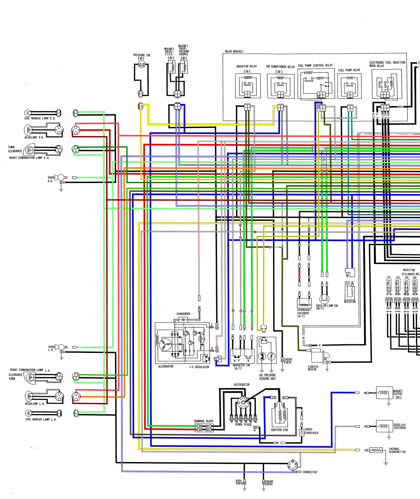
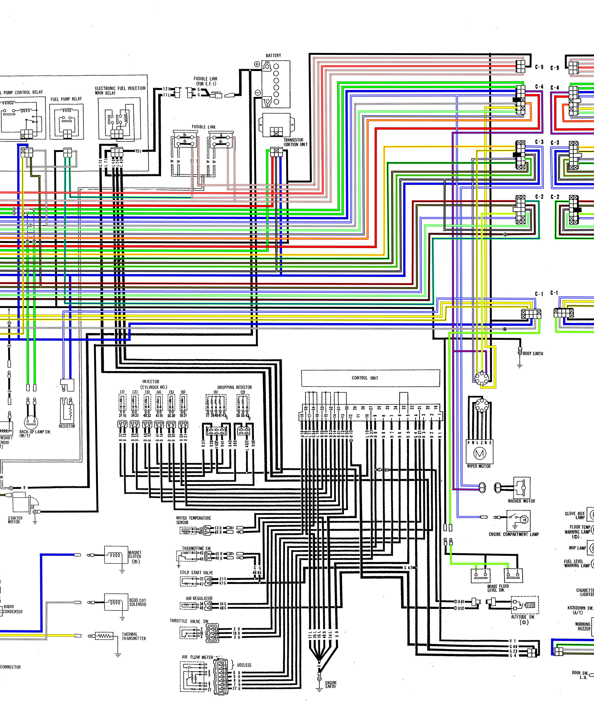
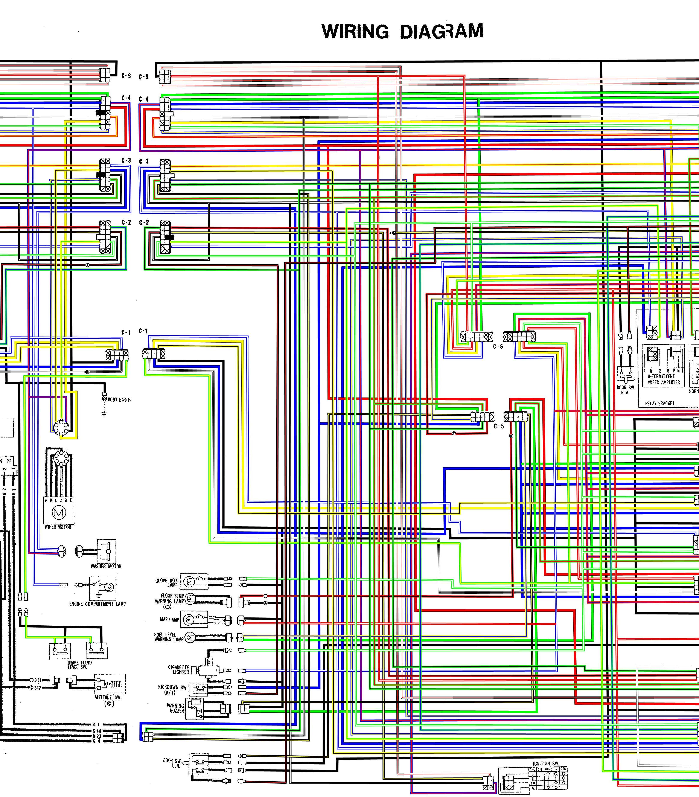
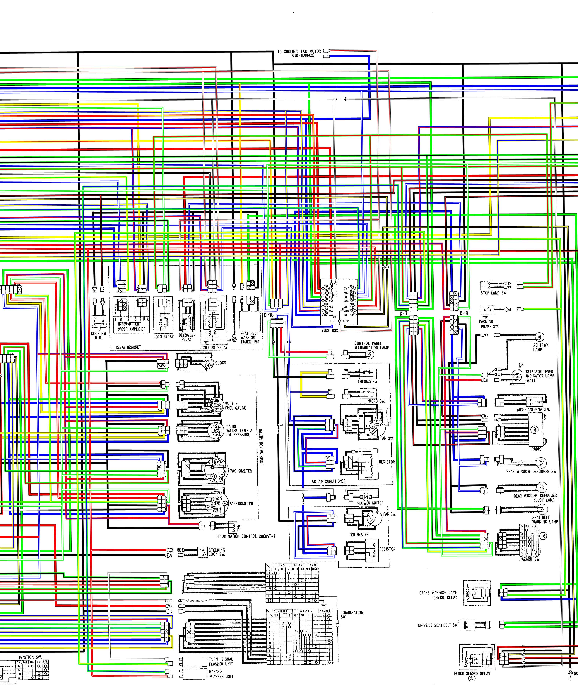
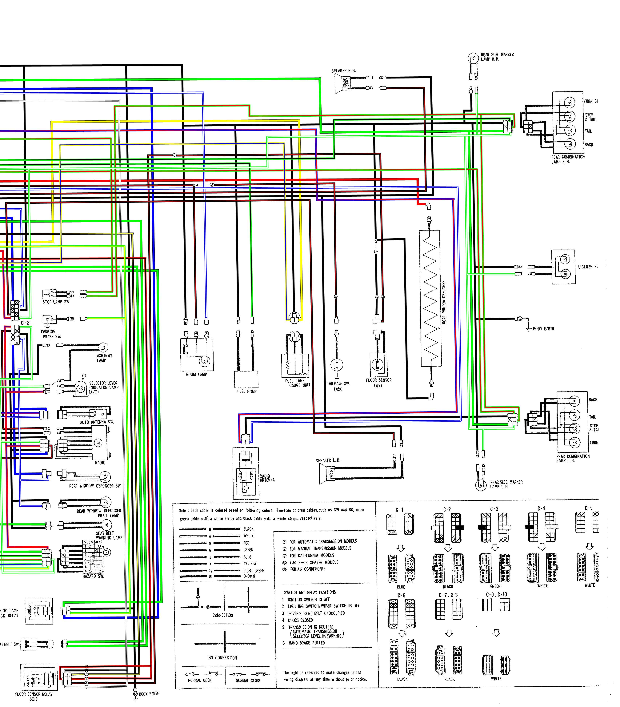

# 1978 Color Wiring Diagram

<!-- Page 1 (Zone 1: Front/Left — Headlights, Alternator, Starter & Ignition) -->
# 1978 Datsun 280Z Factory Color Wiring Diagram — Zone 1: Front Chassis, Lighting, Engine Sensors, Alternator & Starter

## Overview & Zone Boundaries
Zone 1 encompasses the forward-most chassis and engine compartment systems of the 1978 Datsun 280Z. This section includes the dual round sealed-beam headlamps, front parking and turn clearance lamps, dual electric horn assemblies, side marker lamps, engine block sensors, ignition distributor with magnetic pickup, ignition coil, starter motor, internally regulated IC alternator, automatic transmission inhibitor and downshift solenoids, manual transmission back-up lamp switch, air conditioning compressor clutch and fast idle control solenoids, and the 6-pin engine diagnostic check connector.

> 🖼️ **1978 Datsun 280Z Factory Color Wiring Diagram — Zone 1: Front Chassis, Lighting, Alternator, Starter & Ignition**  *(Type: `electrical_schematic`)*
>
> 
>
> - **Summary:** High-resolution schematic segment of the forward vehicle harness for 1978 Datsun 280Z. Shows complete wiring paths and color codes for dual sealed-beam headlamps, front combination turn/clearance lamps, horn circuits, alternator with integrated IC regulator, starter motor and solenoid, check connector, ignition distributor and coil, thermal transmitter, oil pressure sender, and transmission inhibitor/reverse switches.
> - **Components:** Pressure Switch (A/C), Magnet Valve - F.I.C.D. (A/C), Magnet Valve - Vacuum Source (A/C), Side Marker Lamp R.H., Headlamp R.H., Front Combination Lamp R.H. (Turn / Clearance), Horn R.H., Horn L.H., Front Combination Lamp L.H. (Turn / Clearance), Headlamp L.H., Side Marker Lamp L.H., Alternator with I.C. Regulator, Alternator Condenser, Inhibiter Switch (A/T), Downshift Solenoid (A/T), Back-Up Lamp Switch (M/T), Oil Pressure Sending Unit, Starter Motor & Solenoid, Electronic Distributor, Terminal Block, Spark Plugs (1–6), Ignition Coil, Radio Condenser, Magnet Clutch (A/C), BCDD Cut Solenoid, Thermal Transmitter, Check Connector (6-Pin), Engine Earth, Body Earth
> - **Callouts:** **(A)** Alternator Output Terminal (BAT); **(S)** Alternator Battery Voltage Sense Terminal / Starter Solenoid Terminal; **(L)** Alternator Charge Lamp Terminal / Ignition Coil (-) Lead; **(E)** Earth / Ground Terminal; **(B)** Starter Motor Direct Battery Terminal; **(P)** Park Position Contact (Inhibitor Switch); **(N)** Neutral Position Contact (Inhibitor Switch); **(R)** Reverse Position Contact (Inhibitor Switch / Backup Lamp)
> - **Specs / Measurements:** Alternator Output: 12V 60A (Mitsubishi or Hitachi with integral IC regulator); Starter Motor: 12V 1.4 kW reduction gear drive; Headlamps: Dual round sealed beams (12V 50W Low / 60W High); Front Turn Signal Bulbs: 12V 27W (Single filament amber/clear); Front Clearance / Parking Bulbs: 12V 8W; Ignition Coil Primary Resistance: 0.84 to 1.02 Ω; Ignition Coil Secondary Resistance: 8.2 to 12.4 kΩ; Check Connector: 6-pin circular automotive test socket
> - **Wiring / Connections:** RW: Headlamp R.H. Low Beam feed; RB: Headlamp R.H. High Beam feed; RL: Headlamp L.H. Low Beam & clearance lamp bus; RY: Headlamp L.H. High Beam feed; R: Protected 12V headlamp power bus from fuses 4 & 5; GY: Right front turn signal wire; GB: Left front turn signal wire & Horn power feed; B: Chassis ground / engine earth; WR: Alternator main BAT charging output to fusible link; Y: Alternator voltage sense lead to fusible link; WB: Alternator L terminal to charge lamp & check connector; BY: Starter solenoid S trigger (12V START bus); BW: Switched 12V ignition power bus (ON/START); L: Ignition coil negative trigger pulse / tachometer signal; YB: Oil pressure sender variable resistance wire; YW: Thermal transmitter coolant temperature wire; LR: Air conditioning compressor clutch power feed
> - **Mechanic Notes:** Ensure clean metal-to-metal contact at the front body ground lugs adjacent to each headlamp bucket. When installing replacement alternators, verify that the 'S' (Sense) and 'L' (Lamp) spade terminals are not reversed; reversing these terminals will prevent charging and cause continuous battery discharge through the regulator.
> - **Tags:** `headlights`, `alternator`, `ic_regulator`, `starter_motor`, `ignition_coil`, `distributor`, `check_connector`, `horns`, `front_turn_signals`, `oil_pressure_sender`, `thermal_transmitter`, `inhibitor_switch`

---

## Forward Lighting & Front Chassis Circuitry

### Headlamps (High & Low Beams)
* **Headlamp R.H.**:
  * Low Beam filament powered by **RW** (Red with White stripe) wire from the Lighting/Dimmer switch via the 15A Headlamp R.H. fuse.
  * High Beam filament powered by **RB** (Red with Black stripe) wire from the Dimmer switch.
  * Common power/feed: **R** (Red) wire.
* **Headlamp L.H.**:
  * Low Beam filament powered by **RL** (Red with Blue stripe) wire from the Dimmer switch.
  * High Beam filament powered by **RY** (Red with Yellow stripe) wire from the Dimmer switch.
  * Common power/feed: **R** (Red) wire from the 15A Headlamp L.H. fuse.

### Turn Signal & Clearance / Parking Lamps
* **Front Combination Lamp R.H.**:
  * Turn Signal filament (27W): **GY** (Green with Yellow stripe) wire originating from the Turn Signal Switch.
  * Clearance / Parking filament (8W): **RL** (Red with Blue stripe) wire from the Lighting Switch (1st position) via Fuse 3 (10A).
  * Ground: Dedicated **B** (Black) wire to front body ground point.
* **Front Combination Lamp L.H.**:
  * Turn Signal filament (27W): **GB** (Green with Black stripe) wire originating from the Turn Signal Switch.
  * Clearance / Parking filament (8W): **RL** (Red with Blue stripe) wire from Fuse 3.
  * Ground: Dedicated **B** (Black) wire to front body ground point.
* **Front Side Marker Lamps (R.H. and L.H.)**:
  * Power: **RL** (Red with Blue stripe) tied to the clearance/tail circuit.
  * Ground: **B** (Black) return to body ground.

### Horn Circuit
* **Dual Horns (R.H. & L.H.)**:
  * High and low pitch electric horns mounted behind the front grille.
  * Power Feed: **GB** (Green with Black stripe) wire supplied directly from the normally open contacts of the Horn Relay located on the cabin relay bracket.
  * Ground: Direct **B** (Black) chassis ground bracket attachment.

---

## Charging & Starting Systems

### Alternator with Built-in I.C. Regulator
* **Output Terminal 'A' (BAT)**: Heavy-gauge **WR** (White with Red stripe) and **W** (White) charging output cable running directly to the main Fusible Link block and Battery (+) post. Protected with radio noise suppression condenser.
* **Sense Terminal 'S'**: **Y** (Yellow) voltage feedback wire routed directly to the fusible link block to sense true battery post terminal voltage.
* **Lamp Terminal 'L'**: **WB** (White with Black stripe) field exciter wire routed to the Charge Warning Light in the combination meter and the Check Connector. Grounded through the IC regulator when not charging, extinguishing the bulb once output reaches operating threshold.
* **Ground Terminal 'E'**: Heavy **B** (Black) lead grounded directly to the engine block and chassis body ground.

### Starter Motor & Solenoid
* **Main Terminal 'B'**: Heavy-gauge insulated **B** (Black) battery cable bolted directly to the Starter Solenoid B-terminal from the Battery (+) post.
* **Starter Solenoid 'S' (Terminal 50)**: **BY** (Black with Yellow stripe) wire energized during key-turn to START. On automatic transmission vehicles, this wire passes through the Inhibitor Switch (closed only in 'P' and 'N'). On manual transmission models, it connects through the starter interlock.
* **Motor Housing**: Directly grounded through the starter mounting bolts to the engine block and transmission bellhousing.

### Diagnostic Check Connector (6-Pin)
Located near the distributor/ignition coil on the right inner fender:
1. **Pin 1 (L - Blue)**: Ignition Coil (-) trigger / primary pulse signal (Tachometer test point).
2. **Pin 2 (WB - White/Black)**: Alternator 'L' circuit (Charge warning lamp & regulator field monitor).
3. **Pin 3 (BY - Black/Yellow)**: Starter Solenoid 'S' trigger (Cranking bypass & starter circuit test point).
4. **Pin 4 (B - Black)**: Engine Ground / Chassis Earth.
5. **Pins 5 & 6 (GY & GB)**: Auxiliary test leads for pulse and accessory monitoring.

---

## Ignition Subsystem (Front Engine)

### Electronic Distributor
* Magnetic pick-up assembly with 6-lobe reluctor rotor.
* Two-wire shielded signal harness (**Blue** and **White** wires) routed through the distributor **Terminal Block** directly to the Transistor Ignition Unit on the strut tower.
* Distributor body grounded via **B** (Black) lead.
* High-tension center lead connected to the center tower of the Ignition Coil.
* Six high-tension spark plug leads numbered 1 through 6 routed according to the firing order: `1-5-3-6-2-4`.

### Ignition Coil
* **Positive (+) Terminal**: Powered by **BW** (Black with White stripe) wire from the Ignition Relay (12V in ON and START key positions). Connected in parallel to an external **Radio Noise Condenser**.
* **Negative (-) Terminal**: Triggered by **L** (Blue) wire from the Transistor Ignition Unit power transistor collector. Also splices to the Tachometer pulse input, ECU Pin 1 engine speed sensor, and Check Connector.

---

## Engine Sensors & Transmission Switches

| Sensor / Switch | Pin / Terminal | Wire Color Code | Connected To | Circuit Function |
|---|---|---|---|---|
| Oil Pressure Sending Unit | Single Post | YB | Combination Meter (Oil Pressure Gauge) | Variable resistance to ground (0–70 psi gauge movement) |
| Thermal Transmitter | Single Bullet | YW | Combination Meter (Water Temp Gauge) | Variable NTC resistance to ground (coolant temperature gauge) |
| BCDD Cut Solenoid | 2-Pin | BW / B | Switched Ignition / Engine Ground | Boost Controlled Deceleration Device vacuum cut solenoid |
| Back-Up Lamp Switch (M/T) | 2-Pin Bullet | GW / RB | Fuse 9 (10A IGN) / Rear Back-Up Lamps | Reverse gear detection; completes 12V circuit to reverse lights |
| Inhibitor Switch (A/T) | 4-Pin Multi | BY (x2), GW, RB | Ignition Switch STA, Starter 'S', Fuse 9, Back-Up Lamps | Starter lockout in reverse/drive; activates backup lights in 'R' |
| Downshift Solenoid (A/T) | Single Terminal | YG | Kickdown Switch at accelerator pedal | Transmission forced 3-to-2 kickdown on full throttle |
| Pressure Switch (A/C) | 2-Pin | LL / LB | A/C Relay Control Circuit | Refrigerant pressure safety switch; cuts compressor if low |
| Magnet Valve - F.I.C.D. (A/C) | 2-Pin | LR / B | A/C Relay Output / Ground | Fast Idle Control Device air bypass solenoid for A/C idle bump |
| Magnet Valve - Vac Source (A/C) | 2-Pin | LR / B | A/C Relay Output / Ground | Vacuum source valve for interior HVAC actuator control |
| Magnet Clutch (A/C) | Single Bullet | LR | A/C Relay Output (pin to compressor coil) | Electromagnetic compressor clutch engagement (chassis grounded) |

---

## Zone 1 Component & Wire Color Connectivity Table

| Component | Pin / Terminal | Wire Color Code | Connected To | Circuit / Function |
|---|---|---|---|---|
| Headlamp R.H. | Low Beam | RW | Lighting / Dimmer Switch | Low beam headlamp illumination (Right side) |
| Headlamp R.H. | High Beam | RB | Lighting / Dimmer Switch | High beam headlamp illumination (Right side) |
| Headlamp R.H. | Common Feed | R | Fuse Box (15A Fuse 4) | 12V headlamp protected power feed |
| Headlamp L.H. | Low Beam | RL | Lighting / Dimmer Switch | Low beam headlamp illumination (Left side) |
| Headlamp L.H. | High Beam | RY | Lighting / Dimmer Switch | High beam headlamp illumination (Left side) |
| Headlamp L.H. | Common Feed | R | Fuse Box (15A Fuse 5) | 12V headlamp protected power feed |
| Front Combination Lamp R.H. | Turn Signal | GY | Combination Switch (Turn Signal) | 27W front right flasher / turn indicator |
| Front Combination Lamp R.H. | Clearance Lamp | RL | Fuse Box (10A Fuse 3) | 8W front right parking/clearance marker |
| Front Combination Lamp R.H. | Ground | B | Front Body Ground | Ground return to chassis |
| Front Combination Lamp L.H. | Turn Signal | GB | Combination Switch (Turn Signal) | 27W front left flasher / turn indicator |
| Front Combination Lamp L.H. | Clearance Lamp | RL | Fuse Box (10A Fuse 3) | 8W front left parking/clearance marker |
| Front Combination Lamp L.H. | Ground | B | Front Body Ground | Ground return to chassis |
| Side Marker Lamp R.H. | Power | RL | Fuse Box (10A Fuse 3) | Right front side amber marker illumination |
| Side Marker Lamp R.H. | Ground | B | Front Body Ground | Ground return to chassis |
| Side Marker Lamp L.H. | Power | RL | Fuse Box (10A Fuse 3) | Left front side amber marker illumination |
| Side Marker Lamp L.H. | Ground | B | Front Body Ground | Ground return to chassis |
| Horn R.H. | Power Feed | GB | Horn Relay Output Contact | High-pitch horn diaphragm drive (12V) |
| Horn R.H. | Ground | B | Horn Bracket to Chassis | Horn return to chassis ground |
| Horn L.H. | Power Feed | GB | Horn Relay Output Contact | Low-pitch horn diaphragm drive (12V) |
| Horn L.H. | Ground | B | Horn Bracket to Chassis | Horn return to chassis ground |
| Alternator | BAT / 'A' | WR & W | Main Fusible Link / Battery (+) | High-current 60A DC charging output |
| Alternator | S (Sense) | Y | Fusible Link Block / Battery (+) | Constant battery voltage sensing input |
| Alternator | L (Lamp) | WB | Charge Lamp / Check Connector | Alternator field excitation / indicator light driver |
| Alternator | E (Ground) | B | Engine Earth / Chassis Ground | System ground return |
| Alternator Condenser | Input | WR | Alternator BAT to Case | Radio frequency noise suppression filter |
| Starter Motor | Terminal B | Heavy Black | Battery (+) Terminal | Direct heavy-gauge unswitched cranking power |
| Starter Motor | Terminal S | BY | Inhibitor Sw. (A/T) / Ignition Sw. | Solenoid engagement coil trigger (12V START) |
| Starter Motor | Motor Housing | Engine Metal | Engine Earth / Battery (-) Cable | High-amperage cranking ground return |
| Distributor | Pickup (+) | Blue (shielded) | Transistor Ignition Unit | Reluctor AC trigger pulse positive lead |
| Distributor | Pickup (-) | White (shielded)| Transistor Ignition Unit | Reluctor AC trigger pulse negative lead |
| Distributor | Housing Ground | B | Body Ground | Shield ground and static drain |
| Ignition Coil | Terminal (+) | BW | Ignition Relay (ON/START bus) | Primary winding 12V ignition power |
| Ignition Coil | Terminal (-) | L | Transistor Ignition / Tach / ECU | Primary winding switched ground / spark trigger |
| Radio Condenser | Terminal (+) | BW | Ignition Coil (+) to Bracket | Ignition primary RF interference suppression |
| Oil Pressure Sender | Signal Stud | YB | Center Dash Oil Pressure Gauge | Oil pressure resistance sensor (0–70 psi) |
| Thermal Transmitter | Bullet Stud | YW | Center Dash Water Temp Gauge | Engine coolant temperature sender |
| BCDD Solenoid | Power | BW | Switched Ignition (ON) | Solenoid valve power feed |
| BCDD Solenoid | Ground | B | Engine Ground | Solenoid ground return |
| Check Connector | Pin 1 | L | Coil (-) / Tachometer Signal | Engine RPM diagnostic tap |
| Check Connector | Pin 2 | WB | Alternator 'L' Circuit | Charging system voltage diagnostic tap |
| Check Connector | Pin 3 | BY | Starter Solenoid 'S' Circuit | Starter engagement test/crank trigger tap |
| Check Connector | Pin 4 | B | Engine Earth | Ground reference test terminal |
| Check Connector | Pins 5 & 6 | GY / GB | Test Circuit Splices | Diagnostic instrument auxiliary test taps | <!-- Page 2 (Zone 2: Engine Compartment, Relays, Fusible Links & EFI System) --> # 1978 Datsun 280Z Factory Color Wiring Diagram — Zone 2: Engine Compartment, Relay Bracket, Fusible Links & EFI System

## Overview & Zone Boundaries
Zone 2 covers the heart of the L28E engine electrical and fuel management systems. It details the 12V Battery distribution, main fusible links, dedicated Electronic Fuel Injection (EFI) fusible link, Transistor Ignition Unit, engine bay Relay Bracket (Inhibitor Relay, A/C Relay, Fuel Pump Control Relay, Fuel Pump Relay, EFI Main Relay), 35-pin Bosch L-Jetronic Electronic Control Unit (ECU), 6-cylinder Fuel Injector harness, precision 6-ohm Dropping Resistor packs, Air Flow Meter (AFM) with integrated fuel pump safety switch, Water Temperature Sensor, Thermotime Switch, Cold Start Valve, Air Regulator, Throttle Valve Switch (TPS), Wiper/Washer motors, and harness bulkhead disconnect connectors C-1, C-2, C-3, C-4, and C-9.

> 🖼️ **1978 Datsun 280Z Factory Color Wiring Diagram — Zone 2: Engine Compartment, Relays, Fusible Links & EFI System**  *(Type: `electrical_schematic`)*
>
> 
>
> - **Summary:** Detailed schematic segment showing the complete L28E engine electrical management system. Includes Battery, fusible links (Green EFI link and Main fusible link block), Transistor Ignition Unit, Relay Bracket (Inhibitor, A/C, Fuel Pump Control, Fuel Pump, and EFI Main relays), 35-pin ECU harness, Dropping Resistor packs, Injectors 1 through 6, Air Flow Meter, Cold Start Valve, Thermotime Switch, Water Temperature Sensor, Air Regulator, Throttle Valve Switch, Wiper/Washer motors, and harness disconnects C-1 through C-9.
> - **Components:** Battery (12V), Fusible Link (for E.F.I. - Green), Fusible Link Block (Main - Brown & Black), Transistor Ignition Unit, Inhibitor Relay (A/T), Air Conditioner Relay, Fuel Pump Control Relay, Fuel Pump Relay, Electronic Fuel Injection Main Relay, Control Unit (ECU - 35 Pins), Dropping Resistor Block (1), Dropping Resistor Block (2), Fuel Injectors (Cylinders 1, 2, 3, 4, 5, 6), Cold Start Valve, Thermotime Switch, Water Temperature Sensor, Air Regulator, Throttle Valve Switch (TPS), Air Flow Meter (AFM), Wiper Motor, Washer Motor, Engine Compartment Lamp, Brake Fluid Level Switches (Dual), Altitude Switch (California Models), Door Switch L.H., Harness Connectors C-1, C-2, C-3, C-4, C-9, Engine Earth Stud, Body Earth Strap
> - **Callouts:** **(71 L)** Switched 12V EFI power from main relay to ECU; **(72 R)** Unswitched 12V battery standby from green fusible link; **(43/2)** Common 12V power rail to dropping resistors; **(P)** Wiper Park Terminal; **(H)** Wiper High Speed Terminal; **(L)** Wiper Low Speed Terminal; **(E)** Wiper Ground Terminal; **(B)** Wiper Power Terminal
> - **Specs / Measurements:** EFI Fusible Link: Green (approx. 40A equivalent capacity); Main Fusible Links: Brown (30A) and Black/Green (40A); Dropping Resistor Resistance: 6.0 Ω ± 0.3 Ω per resistor section; Fuel Injector Coil Resistance: 2.5 to 3.0 Ω (low impedance EV1); Water Temperature Sensor Resistance: 2.1 to 2.9 kΩ @ 20°C (68°F); 270 to 380 Ω @ 80°C (176°F); Thermotime Switch Resistance: Below 14°C (57°F): 0 Ω (closed); Above 35°C (95°F): ∞ (open); Air Regulator Resistance: Approx. 70 to 80 Ω heater element; ECU Connector: 35-pin AMP automotive multi-pin
> - **Wiring / Connections:** 72 R: Heavy Red wire from EFI fusible link to relay contact; 71 L: Heavy Blue wire from EFI main relay to ECU pins; BW: Switched 12V ignition power to relay coils and transistor unit; L: Switched spark trigger wire from transistor unit to coil (-); B: Engine ground returns for ECU, sensors, and relays; BY: Starter 50 cranking signal to ECU pin 4 and fuel pump control relay; G 21 / G 47: Cold start valve trigger leads; B 45 / B 46: Thermotime switch heater and contact leads; 34 G / 48 G: Air regulator warmup heater power and ground; 6, 7, 8, 9, 27 (Black): AFM potentiometer and intake air temp leads; GY / BW: High-current power feed to electric fuel pump
> - **Mechanic Notes:** Never connect 12V directly to the fuel injector terminals without the 6-ohm dropping resistors in series; direct 12V will burn out the low-impedance injector coils in seconds. Check the heavy engine ground cluster on the intake manifold whenever intermittent EFI or misfire issues occur.
> - **Tags:** `efi`, `ecu`, `fuel_injection`, `dropping_resistors`, `injectors`, `air_flow_meter`, `thermotime_switch`, `cold_start_valve`, `fuel_pump_relay`, `fusible_links`, `transistor_ignition`, `wiper_motor`

---

## Primary Power Distribution & Fusible Links

### Battery Connections
* **Positive (+) Terminal**:
  * Heavy-gauge **Black (B)** cable bolted directly to Starter Motor Terminal B.
  * Dual-circuit feed to the **Fusible Link Holder** mounted on the right inner fender adjacent to the battery.
* **Negative (-) Terminal**:
  * Heavy-gauge **Black (B)** cable securely bolted to the engine block (**Engine Earth**) with a secondary bonding strap to the inner fender (**Body Earth**).

### Fusible Link Specifications & Circuits
1. **Fusible Link (for E.F.I.)**:
   * **Rating / Color**: **Green (G)** link (approx. 40A equivalent capacity / 0.5 mm² wire gauge).
   * **Feeds**: Directly powers Pin 72 **R** (Red) and Pin 71 **L** (Blue) on the EFI Main Relay, isolating the fuel injection computer and fuel injectors from vehicle voltage spikes.
2. **Main Fusible Link Block**:
   * **Brown (Br) Link** (approx. 30A capacity): Protects the constant battery power bus (**W** - White wire) feeding the Ignition Switch (Terminal B) and Fuse Box battery bus (Fuses 1 and 2).
   * **Black (B) / Green (G) Links** (approx. 40A capacity): Protect the alternator charging circuit (**WR** - White/Red) and the lighting switch battery feed.

---

## Relay Bracket (Engine Compartment)

Mounted on the right-hand inner fender liner:
* **Inhibitor Relay (A/T Models)**: Prevents starter solenoid engagement unless the transmission selector lever is in Park or Neutral.
* **Air Conditioner Relay**: Controls power delivery to the compressor magnetic clutch, condenser fan, and FICD idle compensation solenoids.
* **Fuel Pump Control Relay**: Dual-coil safety interlock relay. Contains a cranking coil energized by the **BY** (Starter STA) circuit and a holding circuit tied to the alternator charge status / airflow meter flap switch. If the engine stalls with the ignition switch ON, this relay automatically de-energizes the fuel pump within 1 second.
* **Fuel Pump Relay**: High-current switching relay providing direct 12V power from the battery bus to the electric fuel pump located at the fuel tank.
* **Electronic Fuel Injection (EFI) Main Relay**: Dual-contact relay energized whenever the Ignition Switch is in the ON position (**BW** wire). Supplies clean battery voltage from the green EFI fusible link to ECU pins 71 and 72, the Dropping Resistor common rail, and the Air Regulator.

---

## Electronic Control Unit (ECU) 35-Pin Connector Pinout

The Bosch L-Jetronic ECU utilizes a 35-pin multi-pin connector. The factory wiring assignments are documented below:

| ECU Pin | Wire Color | Signal / Circuit Name | Connected Component | Function & Electrical Characteristics |
|---|---|---|---|---|
| 1 | L | RPM / Coil (-) Trigger | Ignition Coil (-) / Transistor Unit | Engine speed trigger pulses for injection timing |
| 2 | B | Idle Switch Signal | Throttle Valve Switch | Grounded at curb idle (throttle fully closed) |
| 3 | B | Full Load Switch Signal | Throttle Valve Switch | Grounded at wide open throttle (>35° throttle angle) |
| 4 | BY | Start Signal (50) | Starter Solenoid S / Key STA | 12V during cranking to trigger cold enrichment pulse |
| 5 | B | Power Ground | Engine Earth (Intake Manifold) | Primary ECU power stage ground return |
| 6 | B | AFM Ground Reference | Air Flow Meter Terminal 6 | Ground reference for airflow potentiometer |
| 7 | B | AFM Wiper Voltage | Air Flow Meter Terminal 7 | Variable 0–12V flap deflection air volume signal |
| 8 | B | AFM Reference Voltage | Air Flow Meter Terminal 8 | Regulated supply voltage to potentiometer track |
| 9 | B | AFM Reference Ground | Air Flow Meter Terminal 9 | Temperature-compensated reference ground |
| 10 | — | Blank / Not Used | Unconnected | Spare terminal |
| 11 | — | Blank / Not Used | Unconnected | Spare terminal |
| 12 | — | Blank / Not Used | Unconnected | Spare terminal |
| 13 | B | Coolant Temp Signal | Water Temperature Sensor | Variable resistance input from NTC sensor in thermostat housing |
| 14 | B | Injector #4 Driver | Cylinder 4 Injector | Switched ground output for Cylinder #4 fuel injector |
| 15 | B | Injector #1 Driver | Cylinder 1 Injector | Switched ground output for Cylinder #1 fuel injector |
| 16 | L | Logic Ground | Engine Earth | Signal and sensor logic reference ground |
| 17 | L | Power Ground | Engine Earth | Output stage power ground return |
| 18 | B | TPS Common Ground | Throttle Valve Switch Pin 18 | Ground return for idle and full-load switch contacts |
| 19 | — | Blank / Not Used | Unconnected | Spare terminal |
| 20 | — | Blank / Not Used | Unconnected | Spare terminal |
| 21 | G | Cold Start Trigger | Cold Start Valve | Switched ground trigger during cold start cranking |
| 22 | — | Blank / Not Used | Unconnected | Spare terminal |
| 23 | — | Blank / Not Used | Unconnected | Spare terminal |
| 24 | — | Blank / Not Used | Unconnected | Spare terminal |
| 25 | — | Blank / Not Used | Unconnected | Spare terminal |
| 26 | — | Blank / Not Used | Unconnected | Spare terminal |
| 27 | B | Intake Air Temp Signal | Air Flow Meter Terminal 27 | Variable resistance input from intake air temp NTC thermistor |
| 28 | — | Blank / Not Used | Unconnected | Spare terminal |
| 29 | — | Blank / Not Used | Unconnected | Spare terminal |
| 30 | B | Injector #5 Driver | Cylinder 5 Injector | Switched ground output for Cylinder #5 fuel injector |
| 31 | B | Injector #6 Driver | Cylinder 6 Injector | Switched ground output for Cylinder #6 fuel injector |
| 32 | B | Injector #3 Driver | Cylinder 3 Injector | Switched ground output for Cylinder #3 fuel injector |
| 33 | B | Injector #2 Driver | Cylinder 2 Injector | Switched ground output for Cylinder #2 fuel injector |
| 34 | G | Air Regulator Feed | Air Regulator Pin 34 | 12V heating power from fuel pump circuit |
| 35 | L | Main Logic Ground | Engine Earth | Master system ground return to intake manifold stud |
| 43/2 | L | Main Power Feed | EFI Main Relay Output | Switched 12V operating power to ECU and dropping resistors |
| 49 | B | Sensor Ground Return | Water Temp & AFM Sensors | Dedicated sensor ground return circuit |
| 71 | L | Switched EFI Power | EFI Main Relay Output | 12V power supply to ECU internal circuitry |
| 72 | R | Unswitched Battery Feed| Green EFI Fusible Link | Continuous 12V battery standby supply |

---

## Dropping Resistors & Fuel Injectors

### Dropping Resistor Assembly (Blocks 1 & 2)
To achieve rapid injector opening times without overheating the low-impedance (approx. 2.5–3.0 Ω) injector coils, a precision 6.0 Ω ballast resistor is placed in series with each injector:
* **Common Rail Feed**: Powered via Pin 43/2 **L** (Blue) from the EFI Main Relay.
* **Resistor Block (1)**:
  * Output Pin 37: 6.0 Ω ballast to Injector #1
  * Output Pin 38: 6.0 Ω ballast to Injector #2
  * Output Pin 40: 6.0 Ω ballast to Injector #3
  * Output Pin 41: 6.0 Ω ballast to Injector #4
* **Resistor Block (2)**:
  * Output Pin 55: 6.0 Ω ballast to Injector #5
  * Output Pin 56: 6.0 Ω ballast to Injector #6

### Fuel Injectors (Cylinders 1–6)
* **Injector #1**: Pin 37 (12V via Resistor) — Pin 15 (ECU switched ground)
* **Injector #2**: Pin 38 (12V via Resistor) — Pin 33 (ECU switched ground)
* **Injector #3**: Pin 40 (12V via Resistor) — Pin 32 (ECU switched ground)
* **Injector #4**: Pin 41 (12V via Resistor) — Pin 14 (ECU switched ground)
* **Injector #5**: Pin 55 (12V via Resistor) — Pin 30 (ECU switched ground)
* **Injector #6**: Pin 56 (12V via Resistor) — Pin 31 (ECU switched ground)

---

## Cold Start, Auxiliary Air & Sensor Circuits

### Cold Start Valve & Thermotime Switch
* **Cold Start Valve**: Solenoid injector mounted directly into the intake air manifold chamber.
  * Power: **21 G** wire energized from Starter circuit (cranking only).
  * Ground: Controlled through **47 G / 46 B** wire to the Thermotime Switch.
* **Thermotime Switch**: Screwed into the thermostat housing.
  * Contains an internal bimetal heater strip (powered via **45 B** during cranking) and an electrical contact to ground.
  * Below 14°C (57°F), grounds the Cold Start Valve for up to 8 seconds during cranking. Above 35°C (95°F), the contacts remain open, preventing flood-out on warm restarts.

### Air Regulator (Auxiliary Air Bypass)
* Rotary shutter valve with internal electric heater coil.
* Wires: **34 G** and **48 G**.
* Energized whenever the fuel pump runs, heating the internal bimetal strip to gradually close off the auxiliary idle air passage over a 3 to 5 minute period as the engine warms.

### Air Flow Meter (AFM)
* Vane-type volume meter mounted between air filter and throttle chamber.
* Terminals 6, 7, 8, 9: Potentiometer voltage divider and wiper signal.
* Terminal 27: Integrated NTC intake air temperature sensor.
* **Fuel Pump Safety Contacts**: Microswitch contacts close upon the slightest flap deflection caused by engine vacuum, maintaining power to the Fuel Pump Relay holding coil.

---

## Transistor Ignition Unit

Solid-state high-energy ignition amplifier module mounted on the inner fender:
* **Power**: **BW** (Black/White) 12V from Ignition Relay in ON and START positions.
* **Trigger Input**: Shielded Blue and White twisted pair from distributor pickup coil.
* **Output**: **L** (Blue) switched collector circuit connected to Ignition Coil negative (-) terminal.
* **Ground**: Dedicated **B** (Black) lead to chassis earth.

---

## Zone 2 Component & Wire Color Connectivity Table

| Component | Pin / Terminal | Wire Color Code | Connected To | Circuit / Function |
|---|---|---|---|---|
| Battery | Positive (+) | Heavy Black | Starter Motor B Terminal | Main unswitched cranking supply |
| Battery | Positive (+) | Red / White | Fusible Link Block | Main electrical system supply |
| Battery | Negative (-) | Heavy Black | Engine Earth & Body Ground | Primary vehicle chassis and block ground |
| Fusible Link (EFI) | Input / Output | Green Link (G) | Battery (+) to Pins 71 L & 72 R | 40A dedicated clean EFI power feed |
| Main Fusible Link | Input / Output | Brown Link (Br)| Battery (+) to W wire | 30A Ignition switch & Fuse Box BAT bus |
| Main Fusible Link | Input / Output | Black Link (B) | Battery (+) to WR wire | 40A Alternator & Lighting switch feed |
| Transistor Ignition Unit | Power | BW | Ignition Relay (ON/START) | 12V operating power to amplifier |
| Transistor Ignition Unit | Output | L | Ignition Coil (-) & Tachometer | High-voltage spark primary trigger |
| Transistor Ignition Unit | Pick-up (+) | Blue (shielded)| Distributor Pickup Coil | Reluctor AC pulse input (+) |
| Transistor Ignition Unit | Pick-up (-) | White (shielded)| Distributor Pickup Coil | Reluctor AC pulse input (-) |
| Transistor Ignition Unit | Ground | B | Body Ground | Module electronic ground return |
| EFI Main Relay | Coil (+) | BW | Ignition Switch ON Bus | Relay energizing coil 12V |
| EFI Main Relay | Coil (-) | B | Engine Ground | Relay coil ground return |
| EFI Main Relay | Contact In | 72 R / 71 L | EFI Fusible Link (Battery +) | Direct protected battery power in |
| EFI Main Relay | Contact Out | L & BW | ECU, Dropping Resistors, Air Reg | Switched clean 12V EFI power out |
| Fuel Pump Control Relay | Crank Coil | BY | Starter Solenoid 'S' Circuit | Cranking fuel pump safety trigger |
| Fuel Pump Control Relay | Run Holding | WB / AFM | Alternator L / AFM Flap Switch | Engine running safety interlock |
| Fuel Pump Relay | Coil In | From Control Relay | Fuel Pump Control Relay Output | Relay activation coil |
| Fuel Pump Relay | Contact Out | GY / BW | Rear Electric Fuel Pump | High-amperage 12V to rear fuel pump |
| ECU | Pin 1 | L | Coil (-) / Transistor Unit | Engine RPM pulse counter input |
| ECU | Pin 2 | B | Throttle Valve Switch (Idle) | Closed throttle position detection |
| ECU | Pin 3 | B | Throttle Valve Switch (WOT) | Wide open throttle enrichment signal |
| ECU | Pin 4 | BY | Starter Solenoid S Terminal | 12V cranking enrichment trigger |
| ECU | Pins 5, 16, 17, 35 | B / L | Engine Earth (Intake Manifold) | Master power and logic ground returns |
| ECU | Pins 6, 7, 8, 9 | B | Air Flow Meter Potentiometer | Flap vane position / air volume signals |
| ECU | Pin 13 | B | Water Temperature Sensor | Coolant temperature fuel enrichment |
| ECU | Pins 14, 15, 30, 31, 32, 33 | B | Injectors 4, 1, 5, 6, 3, 2 | Individual injector ground pulse drivers |
| ECU | Pin 18 | B | Throttle Switch Common | TPS ground return circuit |
| ECU | Pin 27 | B | Air Flow Meter Temp Sensor | Intake air temperature compensation |
| Dropping Resistor (1) | Pin 43/2 | L | EFI Main Relay Output | 12V common power rail to resistors |
| Dropping Resistor (1) | Pins 37, 38, 40, 41 | B / Multi | Injectors #1, #2, #3, #4 | 6.0 Ω ballasted power feeds |
| Dropping Resistor (2) | Pins 55, 56 | B / Multi | Injectors #5, #6 | 6.0 Ω ballasted power feeds |
| Cold Start Valve | 2-Pin | 21 G / 47 G | Starter Circuit / Thermotime Sw | Auxiliary cold start injection solenoid |
| Thermotime Switch | 2-Pin | 45 B / 46 B | Starter Circuit / Cold Start Vlv| Bimetal thermal ground timer |
| Water Temp Sensor | 2-Pin | 13 B / 49 B | ECU Pins 13 & 49 | Engine coolant NTC sensor (2.5kΩ @ 20°C)|
| Air Regulator | 2-Pin | 34 G / 48 G | Fuel Pump Relay / Ground | Electric auxiliary air warmup heater |
| Throttle Valve Switch | 3-Pin | 2 B, 18 B, 3 B | ECU Pins 2, 18, 3 | Idle and full throttle microswitches |
| Wiper Motor | Multi-pin | P, H, L, 2, B, E | Wiper Switch & Intermittent Amp | 2-speed motor with auto-park contact |
| Washer Motor | 2-Pin | Lg / B | Wiper Combination Switch | Electric windshield washer fluid pump |
| Engine Compartment Lamp | 2-Pin | R / B | Fuse 2 (10A BAT) / Mercury Sw | Under-hood service illumination lamp |
| Brake Fluid Level Sw. | Dual 2-Pin | RY / B | Master Cylinder Caps to Warning | Dual reservoir fluid level safety float |
| Altitude Switch (C) | 2-Pin | B61 / B12 | ECU Altitude Compensation | High-altitude barometric leaning switch |
| Door Switch L.H. | Single Pin | B | Warning Buzzer / Room Lamp | Driver door courtesy ground switch | <!-- Page 3 (Zone 3: Center Dash, Switches, Combination Meter & Steering Column) --> # 1978 Datsun 280Z Factory Color Wiring Diagram — Zone 3: Center Dash, Switches, Combination Meter & Steering Column

## Overview & Zone Boundaries
Zone 3 details the cockpit instrument cluster, dash switchgear, steering column controls, and auxiliary relay brackets for the 1978 Datsun 280Z. This section includes the three central auxiliary gauge pods (Clock, Voltmeter & Fuel Gauge, Water Temperature & Oil Pressure Gauge), the two primary 4.5-inch driver binnacles (Tachometer with integrated turn indicators, and Speedometer with warning lamps), the multi-function Combination Switch (Lighting, Dimmer/Passing, Turn Signals, Horn, Wiper, and Washer controls), steering lock key warning switch, ignition switch, turn signal and hazard flasher units, intermittent wiper amplifier, defogger relay, horn relay, ignition relay, and seat belt warning timer module.

> 🖼️ **1978 Datsun 280Z Factory Color Wiring Diagram — Zone 3: Center Dash, Switches, Combination Meter & Steering Column**  *(Type: `electrical_schematic`)*
>
> 
>
> - **Summary:** Schematic segment covering cockpit instrumentation, steering column controls, and auxiliary relay modules. Details the three auxiliary center gauges (Clock, Voltmeter/Fuel, Water Temp/Oil Pressure), Tachometer, Speedometer, Combination Switch matrices (Turn, Beam, Horn, Lighting, Wiper, Washer), Ignition Switch truth table, Intermittent Wiper Amplifier, Horn Relay, Defogger Relay, Ignition Relay, Seat Belt Timer, and Flasher units.
> - **Components:** Clock, Volt & Fuel Gauge, Gauge Water Temp & Oil Pressure, Tachometer with Turn Pilots, Speedometer with Brake & High Beam Lamps, Illumination Control Rheostat, Steering Lock Key Switch, Ignition Switch, Combination Switch (Multi-Function Stalk), Turn Signal Flasher Unit (3-Terminal), Hazard Flasher Unit (2-Terminal), Intermittent Wiper Amplifier, Horn Relay, Defogger Relay, Ignition Relay, Seat Belt Warning Timer Unit, Brake Warning Lamp Check Relay, Harness Connectors C-5, C-6, C-9, C-10
> - **Callouts:** **(1)** Ignition Switch in OFF; **(2)** Lighting Switch, Wiper Switch in OFF; **(3)** Driver's Seat Belt Unoccupied; **(4)** Doors Closed; **(5)** Transmission in Neutral / Park; **(6)** Hand Brake Pulled
> - **Specs / Measurements:** Fuel Tank Sender Resistance: Empty: 80 Ω; 1/2 Tank: 40 Ω; Full Tank: 10 Ω; Oil Pressure Sender Resistance: 0 psi: approx. 10 Ω; 70 psi: approx. 80 Ω; Instrument Illumination Bulbs: 12V 3.4W (Type 158 / 194 wedge base); Turn Signal & Warning Indicator Bulbs: 12V 1.4W (Type 74 wedge base); Turn Signal Flasher Rate: 60 to 90 flashes/min; Seat Belt Warning Chime Duration: 4 to 8 seconds
> - **Wiring / Connections:** W: Unswitched heavy 12V battery power from fusible link to ignition switch; BW: Switched 12V ignition bus (ON/START) from ignition relay; L: Switched 12V accessory bus (ACC/ON) and tachometer coil (-) trigger; BY: 12V starter crank trigger wire (START); RL: Instrument backlight and clearance/marker lighting bus; GB: Left turn signal flasher feed; GY: Right turn signal flasher feed; GW: Constant 12V battery feed from Fuse 1 to hazard flasher and horn relay; YR: Switched ground wire for brake warning lamp; YL: Variable resistance signal from fuel level tank sender; YW: Variable resistance signal from water temperature thermal transmitter; YB: Variable resistance signal from oil pressure sending unit
> - **Mechanic Notes:** When diagnosing tachometer inoperation, verify the blue (L) trigger wire at the coil negative terminal; an open ballast resistor or faulty ignition transistor will kill tachometer deflection. Ensure the instrument ground cluster behind the center console is tight; high resistance causes fuel and temperature gauges to read artificially high.
> - **Tags:** `gauges`, `tachometer`, `speedometer`, `voltmeter`, `fuel_gauge`, `oil_pressure_gauge`, `water_temp_gauge`, `combination_switch`, `ignition_switch`, `horn_relay`, `defogger_relay`, `wiper_amplifier`, `flashers`

---

## Combination Meter & Dashboard Instruments

### Center Auxiliary Gauge Pods (Top of Center Stack)
1. **Clock**:
   * Constant 12V Battery Power: **R** (Red) wire from Fuse 2 (10A BAT bus).
   * Illumination: **RL** (Red with Blue stripe) wire from the Illumination Control Rheostat.
   * Ground: **B** (Black) wire to instrument sub-harness ground.
2. **Voltmeter & Fuel Level Gauge**:
   * **Voltmeter**: Switched 12V from **BW** (Black/White) wire (Fuse 10 IGN bus); grounded via **B** (Black).
   * **Fuel Level Gauge**: Powered by **BW** (switched 12V); variable ground return through **YL** (Yellow with Blue stripe) wire from the fuel tank sender.
   * **Fuel Level Warning Lamp**: Independent low-fuel warning bulb powered by **BW**; grounded through **YG** (Yellow with Green stripe) wire connected to the thermistor in the fuel tank unit.
   * Illumination: **RL** (Red/Blue) controlled by dimmer rheostat.
3. **Water Temperature & Oil Pressure Gauge**:
   * Common Switched Power: **BW** (Black/White) wire from Fuse 10.
   * **Water Temperature Gauge**: Ground return via **YW** (Yellow with White stripe) wire from the engine thermal transmitter.
   * **Oil Pressure Gauge**: Ground return via **YB** (Yellow with Black stripe) wire from the engine oil pressure sending unit.
   * Illumination: **RL** (Red/Blue).

### Primary Driver Instruments (Steering Binnacles)
1. **Tachometer**:
   * Operating Power: **BW** (Black/White) 12V from Fuse 10.
   * RPM Pulse Input: **L** (Blue) wire directly from the negative (-) terminal of the Ignition Coil / Transistor Ignition Unit.
   * Ground: **B** (Black) to chassis earth.
   * **Turn Signal Pilot Lamps**:
     * Left Turn Indicator: **GB** (Green with Black stripe) wire.
     * Right Turn Indicator: **GY** (Green with Yellow stripe) wire.
   * Backlight: **RL** (Red/Blue).
2. **Speedometer & Warning Lamp Cluster**:
   * Mechanical speedometer driven by flexible cable from transmission tailhousing.
   * **BRAKE Warning Lamp**: Powered by **BW** (Fuse 10). Grounded via **YR** (Yellow/Red) wire through either the Parking Brake Switch, Brake Fluid Level Switches, or Brake Warning Lamp Check Relay.
   * **High Beam Indicator Lamp**: Powered by **RB** / **RY** high beam circuit; grounded through **B** (Black).
   * **Floor Temp / Exhaust Warning Lamp (California Models)**: Triggered by California Floor Sensor Relay.
   * Backlight Bulbs: **RL** (Red/Blue).
3. **Illumination Control Rheostat**:
   * Rotary wire-wound potentiometer located on lower dash.
   * Input: **RL** (Red with Blue stripe) from Lighting Switch.
   * Output: Variable voltage rail to all instrument backlighting bulbs.
   * Ground: **B** (Black).

---

## Master Switchgear & Steering Column Controls

### Ignition Switch Truth Table & Circuitry
Mounted on the steering column with integrated steering lock and key warning contact:

| Key Position | Terminals Connected | Active Circuits & Wire Colors |
|---|---|---| 
| **OFF** | None | Key removable; all switched circuits open |
| **ACC** | B to ACC | Switched 12V to Blue (**L**) wire: Radio, Cigar Lighter, Wiper/Washer |
| **ON** | B to ACC, ON, ST (off) | Switched 12V to **L** (ACC bus) and **BW** (IGN bus): Ignition Relay, EFI, Gauges, Fan |
| **STA** | B to ON, STA (ACC cuts off) | 12V to **BW** (Ignition) and **BY** (Starter Solenoid & Cold Start); cuts ACC to maximize battery for cranking |

* **B Terminal**: Heavy **W** (White) cable directly from the 30A Brown Fusible Link.
* **ACC Terminal**: **L** (Blue) wire to Fuse 7 and Fuse 8.
* **ON Terminal**: **BW** (Black with White stripe) wire to Ignition Relay coil and primary systems.
* **STA Terminal**: **BY** (Black with Yellow stripe) wire to Starter Solenoid 'S' (via Inhibitor Switch on A/T).

### Combination Switch Truth Tables
Stalk-mounted master control switch incorporating Lighting, Dimmer/Passing, Turn Signals, Horn, Wiper, and Washer controls:

#### 1. Turn Signal, Beam & Horn Switch Matrix

| Function | Position | Connected Terminals | Wire Colors & Active Circuits |
|---|---|---|---|
| **Turn Signal** | **L (Left)** | 16 to 15 | Flasher input (G) connected to Left Turn circuit (GB) |
| **Turn Signal** | **N (Neutral)** | None | All turn signal circuits open |
| **Turn Signal** | **R (Right)** | 16 to 17 | Flasher input (G) connected to Right Turn circuit (GY) |
| **Headlamp Dimmer** | **Low Beam** | 8 to 4, 8 to 5 | Power in connects to RW (Right Low) and RL (Left Low) |
| **Headlamp Dimmer** | **High Beam** | 8 to 2, 8 to 3 | Power in connects to RB (Right High) and RY (Left High) |
| **Beam Passing (Flash)**| **Pull-to-Flash** | 8 to 2, 8 to 3 (momentary) | Powers high beams regardless of lighting switch position |
| **Horn Push** | **Depressed** | Horn to Ground | Grounds Green (**G**) wire from Horn Relay coil to steering column ground |

#### 2. Lighting, Wiper & Washer Switch Matrix

| Function | Position | Connected Terminals | Wire Colors & Active Circuits |
|---|---|---|---|
| **Lighting Switch** | **OFF** | None | All lighting circuits open |
| **Lighting Switch** | **1 (Clearance)** | 8 to 7 | Powers Clearance, Tail, Side Marker, and Backlight bus (RL) |
| **Lighting Switch** | **2 (Headlights)** | 8 to 7, 8 to 1 | Maintains RL bus; energizes Headlamp supply circuit (R) to Dimmer |
| **Wiper Switch** | **OFF** | 2 to P | Connects wiper motor park switch circuit to ground/auto-stop |
| **Wiper Switch** | **INT** | 2 to W | Routes wiper control through Intermittent Wiper Amplifier timer |
| **Wiper Switch** | **1 (Low)** | 2 to L | Feeds 12V directly to Wiper Motor Low Speed winding |
| **Wiper Switch** | **2 (High)** | 2 to H | Feeds 12V directly to Wiper Motor High Speed winding |
| **Washer Switch** | **PUSH** | 2 to W (Washer) | Energizes Washer Motor pump relay and motor |

---

## Auxiliary Relays & Modules (Cabin Bracket)

Located beneath the dashboard adjacent to the steering column:
* **Intermittent Wiper Amplifier**: Solid-state pulse timer module (Terminals: `1`, `W`, `2`, `B`, `P`, `M`, `E`). Provides adjustable intermittent wipe intervals and automatic wipe cycle when the windshield washer button is pressed.
* **Horn Relay**: 3-terminal relay. Constant 12V from Fuse 1 (**GW**). Coil energized when the horn button grounds the **G** wire; contacts close to output 12V to horns via **GB** wire.
* **Defogger Relay**: 4-terminal high-amperage relay. Energized by the dash Defogger Switch only when the ignition is ON; feeds high-current power to the rear window defogger grid via Fuse 6 (20A).
* **Ignition Relay**: Heavy-duty relay energized by the key switch in ON position. Supplies the primary **BW** ignition bus, taking heavy electrical load off the ignition switch contacts.
* **Seat Belt Warning Timer Unit**: Solid-state chime/timer module. Interconnected with the driver's seat belt buckle switch, door switch, and seat belt warning light. Sounds warning chime for 4–8 seconds if key is turned ON with seat belt unfastened.
* **Brake Warning Lamp Check Relay**: Automatically illuminates the BRAKE warning lamp during engine cranking to verify bulb integrity.

---

## Flasher Units
* **Turn Signal Flasher Unit**: 3-terminal thermal/electro-mechanical flasher powered from Fuse 9 (10A IGN bus) via Green (**G**) wire. Drives turn indicators at approx. 60–90 flashes per minute.
* **Hazard Flasher Unit**: Dedicated 2-terminal heavy-duty flasher powered from Fuse 1 (15A BAT bus) via Green/White (**GW**) wire. Operates all four turn signal lamps simultaneously regardless of ignition key position.

---

## Zone 3 Component & Wire Color Connectivity Table

| Component | Pin / Terminal | Wire Color Code | Connected To | Circuit / Function |
|---|---|---|---|---|
| Clock | Power (+) | R | Fuse 2 (10A BAT Bus) | Continuous 12V battery power for quartz movement |
| Clock | Illumination | RL | Dimmer Rheostat | Instrument backlight illumination |
| Clock | Ground (-) | B | Dash Ground | Ground return to chassis |
| Voltmeter | Power (+) | BW | Fuse 10 (15A IGN Bus) | Switched 12V operating power |
| Voltmeter | Ground (-) | B | Dash Ground | Ground reference |
| Fuel Gauge | Power (+) | BW | Fuse 10 (15A IGN Bus) | Switched 12V operating power |
| Fuel Gauge | Sender Signal | YL | Fuel Tank Gauge Unit | Variable ground resistance from tank float sender |
| Fuel Warning Lamp | Power (+) | BW | Fuse 10 (15A IGN Bus) | Switched 12V bulb power |
| Fuel Warning Lamp | Thermistor Lead | YG | Fuel Tank Gauge Unit | Low-fuel thermistor ground switch in fuel tank |
| Water Temp Gauge | Power (+) | BW | Fuse 10 (15A IGN Bus) | Switched 12V operating power |
| Water Temp Gauge | Sensor Lead | YW | Engine Thermal Transmitter | Variable resistance to ground from engine sender |
| Oil Pressure Gauge | Power (+) | BW | Fuse 10 (15A IGN Bus) | Switched 12V operating power |
| Oil Pressure Gauge | Sensor Lead | YB | Engine Oil Pressure Sender | Variable resistance to ground from block sender |
| Tachometer | Power (+) | BW | Fuse 10 (15A IGN Bus) | Switched 12V operating power |
| Tachometer | RPM Pulse (-) | L | Coil (-) / Transistor Unit | Primary ignition negative pulse counter |
| Tachometer | Ground (-) | B | Dash Ground | Module ground return |
| Tachometer | Left Turn Pilot | GB | Left Turn Signal Circuit | Green left turn cluster indicator lamp |
| Tachometer | Right Turn Pilot| GY | Right Turn Signal Circuit | Green right turn cluster indicator lamp |
| Speedometer | High Beam Pilot | RB / RY | Headlamp Dimmer High Beam | Blue high beam cluster indicator lamp |
| Speedometer | Brake Warning | YR | Handbrake & Fluid Switches | Red BRAKE warning cluster lamp |
| Speedometer | CHK / Floor Temp| R / Y | California Floor Relay | Amber catalytic converter overheat warning |
| Dimmer Rheostat | Input Feed | RL | Lighting Switch (Pos 1 & 2) | Protected 12V instrument lighting feed |
| Dimmer Rheostat | Output Variable | RL | All Cluster Backlight Bulbs | Variable voltage backlight dimmer control |
| Dimmer Rheostat | Ground | B | Dash Ground | Potentiometer ground reference |
| Ignition Switch | Terminal B | W | Brown Fusible Link (30A) | Unswitched direct battery power input |
| Ignition Switch | Terminal ACC | L | Fuse 7 & 8 (ACC Bus) | Switched 12V in ACC and ON positions |
| Ignition Switch | Terminal ON | BW | Ignition Relay Coil & IGN Bus| Switched 12V in ON and START positions |
| Ignition Switch | Terminal STA | BY | Starter Solenoid & Cold Start | 12V in START position only |
| Steering Lock Sw. | 2-Pin | B / Ground | Warning Buzzer / Door Sw | Key-in-ignition sensing ground switch |
| Combination Switch | Lighting Pin 8 | R | Fuses 4 & 5 (Headlamp Bus) | Headlamp power feed |
| Combination Switch | Lighting Pin 7 | RL | Fuse 3 (Tail/Marker Bus) | Clearance, marker, tail & dash illumination feed |
| Combination Switch | Dimmer Low | RW & RL | Headlamps R.H. & L.H. (Low) | Low beam power feeds |
| Combination Switch | Dimmer High | RB & RY | Headlamps R.H. & L.H. (High)| High beam power feeds |
| Combination Switch | Turn In | G | Turn Signal Flasher Output | Flasher intermittent 12V power input |
| Combination Switch | Turn Left Out | GB | Left Turn Lamps & Pilot | Left turn signal output |
| Combination Switch | Turn Right Out| GY | Right Turn Lamps & Pilot | Right turn signal output |
| Combination Switch | Horn Contact | G | Horn Relay Coil | Horn button ground switch |
| Combination Switch | Wiper 2 (Feed) | L | Fuse 7 (15A ACC Bus) | Switched 12V wiper power |
| Combination Switch | Wiper L | L | Wiper Motor Low Terminal | Wiper low speed drive |
| Combination Switch | Wiper H | H | Wiper Motor High Terminal | Wiper high speed drive |
| Combination Switch | Wiper P | P | Wiper Motor Park Switch | Wiper auto-park return circuit |
| Intermittent Wiper Amp | Multi-Pin | 1, W, 2, B, P, M, E | Wiper Motor & Switch | Variable intermittent delay timer module |
| Horn Relay | Coil Feed | GW | Fuse 1 (15A BAT Bus) | Constant 12V relay coil power |
| Horn Relay | Coil Ground | G | Horn Button (Comb. Switch) | Steering wheel horn contact ground switch |
| Horn Relay | Contact Out | GB | Dual Horns (R.H. & L.H.) | 12V high-current horn diaphragm drive |
| Defogger Relay | Contact In | Heavy Wire | Fuse 6 (20A Defogger Bus) | High-current rear grid power input |
| Defogger Relay | Contact Out | Heavy Wire | Rear Window Defogger Grid | Switched 12V to rear window heating element |
| Ignition Relay | Coil In | BW | Ignition Switch ON Terminal | Relay activation trigger |
| Ignition Relay | Contact Out | BW | Main Switched Ignition Bus | High-amperage switched 12V to engine systems |
| Seat Belt Timer Unit | Multi-Pin | BW, B, YR, Warning | Belt Switch, Door Sw, Warning| Seat belt reminder chime and lamp controller |
| Turn Flasher Unit | 3-Pin | G, GR, B | Fuse 9 / Turn Signal Switch | Turn signal pulse flasher module |
| Hazard Flasher Unit | 2-Pin | GW, G | Fuse 1 / Hazard Switch | Emergency 4-way hazard flasher module | <!-- Page 4 (Zone 4: Cabin, Fuse Box Circuits, HVAC, Audio & Center Console) --> # 1978 Datsun 280Z Factory Color Wiring Diagram — Zone 4: Cabin, Fuse Box Circuits, HVAC, Audio & Center Console

## Overview & Zone Boundaries
Zone 4 encompasses the passenger compartment electrical nerve center, centered on the main 12-circuit Fuse Box mounted on the right-hand kick panel. This zone details all protected branch circuits and fuse ratings, the factory Heating and Air Conditioning blower, switches and resistor packs, center console switchgear, radio and power antenna controls, stop lamp and parking brake switches, rear window defogger switch and pilot light, hazard warning switch matrix, seat belt reminder system, and California catalytic converter floor temperature warning relay.

> 🖼️ **1978 Datsun 280Z Factory Color Wiring Diagram — Zone 4: Cabin, Fuse Box Circuits, HVAC, Audio & Center Console**  *(Type: `electrical_schematic`)*
>
> 
>
> - **Summary:** High-resolution schematic segment detailing the passenger compartment electrical system. Features the complete 12-circuit Fuse Box layout with fuse amperage ratings and circuit allocations, Heater and Air Conditioning blower motor circuits, fan switches, resistor banks, A/C thermo and micro switches, Stop Lamp Switch, Parking Brake Switch, Radio, Auto Antenna Switch, Hazard Warning Switch matrix, Seat Belt Warning system, and rear harness disconnects C-7, C-8, and C-10.
> - **Components:** 12-Circuit Fuse Box (Fuses 1–12), Cooling Fan Motor Sub-Harness Feed, Heater Blower Motor, Heater Fan Switch (4-Position), Heater Resistor Pack, Air Conditioner Thermo Switch, Air Conditioner Micro Switch, Air Conditioner Fan Switch & Resistor, Control Panel Illumination Lamp, Stop Lamp Switch, Parking Brake Switch, Radio AM/FM Unit, Auto Antenna Switch, Ashtray Lamp, Selector Lever Indicator Lamp (A/T), Rear Window Defogger Switch, Rear Window Defogger Pilot Lamp, Hazard Warning Switch, Seat Belt Warning Lamp, Driver's Seat Belt Buckle Switch, Brake Warning Lamp Check Relay, Floor Sensor Relay (California Models), Harness Connectors C-7, C-8, C-10
> - **Callouts:** **(Fuse 1)** 15A - Hazard, Horn, Stop Lamps (BAT Bus); **(Fuse 2)** 10A - Room, Map, Clock, Tailgate, Hood (BAT Bus); **(Fuse 3)** 10A - Tail, Clearance, Marker, License, Dash (LIGHT Bus); **(Fuse 4)** 15A - Headlamp R.H. (LIGHT Bus); **(Fuse 5)** 15A - Headlamp L.H. (LIGHT Bus); **(Fuse 6)** 20A - Rear Window Defogger (DEF Bus); **(Fuse 7)** 15A - Wiper & Washer Motors (ACC Bus); **(Fuse 8)** 10A - Radio, Cigar Lighter, Auto Antenna (ACC Bus); **(Fuse 9)** 10A - Turn Signals & Back-Up Lamps (IGN Bus); **(Fuse 10)** 15A - Gauges, Warning Lights, Seat Belt (IGN Bus); **(Fuse 11)** 15A - Heater Blower Motor (IGN Bus); **(Fuse 12)** 20A - Air Conditioner Compressor & Auxiliary Fan (IGN Bus)
> - **Specs / Measurements:** Fuse Box Format: 12-position cartridge glass fuses (AGW / SFE standard); Total Fuse Box Capacity: 175 Amperes cumulative branch rating; Heater Blower Current Draw: Low: approx. 3.5A; Med: approx. 6.0A; High: approx. 11.5A; Stop Lamp Current Draw: Dual 27W bulbs = approx. 4.5A total; Rear Window Defogger Current Draw: Approx. 12 to 15A continuous; Auxiliary Cooling Fan Current Draw: Approx. 7.5 to 9.0A
> - **Wiring / Connections:** GW: Unswitched 12V battery power from Fuse 1 to stop switch and hazard switch; GY: Switched 12V stop lamp output from brake pedal switch; RL: Protected clearance, marker, tail and instrument illumination bus from Fuse 3; L: Switched 12V accessory power from Fuses 7 & 8 to radio and wipers; BW: Switched 12V ignition power from Fuse 10 to instruments and warning relays; G: Switched 12V ignition power from Fuse 9 to turn flasher and reverse lights; YR: Switched ground circuit for handbrake warning light; B: Dedicated cabin and console chassis ground leads
> - **Mechanic Notes:** Glass fuse clips in the 280Z fuse box are prone to corrosion and tension loss over time, leading to high electrical resistance, intermittent accessory failure, or localized overheating. When troubleshooting blower motor or defogger failure, always inspect fuse end caps and spring clips for oxidation or heat discoloration.
> - **Tags:** `fuse_box`, `fuses`, `heater_blower`, `air_conditioning`, `hazard_switch`, `stop_lamp_switch`, `radio`, `auto_antenna`, `parking_brake_switch`, `defogger_switch`, `seat_belt_timer`

---

## 12-Circuit Fuse Box Specifications & Branch Circuit Allocations

The fuse box contains 12 glass-tube cartridge fuses arranged in two vertical banks of six fuses each. The power distribution, fuse ratings, and protected circuits are detailed below:

### Left Fuse Bank (Front-to-Rear / Top-to-Bottom)

| Fuse No. | Rating | Bus Supply | Primary Wire Color | Protected Circuits & Components |
|---|---|---|---|---|
| **Fuse 1** | **15A** | BAT Bus (Constant 12V) | GW (Green/White) | Hazard Flasher Unit, Horn Relay power/contacts, Stop Lamp Switch (brake lights) |
| **Fuse 2** | **10A** | BAT Bus (Constant 12V) | R / RW (Red / Red-White)| Room Lamp (dome), Map Lamp, Quartz Clock, Tailgate Switch, Engine Compartment Lamp |
| **Fuse 3** | **10A** | Lighting Switch Bus | RL (Red/Blue) | Clearance Lamps (Front L/R), Tail Lamps (Rear L/R), Side Marker Lamps (4 corners), License Plate Lamps (2), Glove Box Lamp, Ashtray Lamp, HVAC Control Panel Illumination, Rheostat |
| **Fuse 4** | **15A** | Lighting Switch Bus | R / RW / RB | Headlamp R.H. (High & Low beams via Dimmer Switch) |
| **Fuse 5** | **15A** | Lighting Switch Bus | R / RL / RY | Headlamp L.H. (High & Low beams via Dimmer Switch) |
| **Fuse 6** | **20A** | Defogger Relay Bus | Heavy Insulated Wire | Rear Window Defogger high-current heating element grid |

### Right Fuse Bank (Front-to-Rear / Top-to-Bottom)

| Fuse No. | Rating | Bus Supply | Primary Wire Color | Protected Circuits & Components |
|---|---|---|---|---|
| **Fuse 7** | **15A** | ACC Bus (Switched 12V) | L (Blue) | Windshield Wiper Motor, Intermittent Wiper Amplifier, Windshield Washer Motor |
| **Fuse 8** | **10A** | ACC Bus (Switched 12V) | L (Blue) | AM/FM Radio, Cigarette Lighter, Auto Antenna Switch & Motor |
| **Fuse 9** | **10A** | IGN Bus (Switched 12V) | G (Green) | Turn Signal Flasher Unit, Back-Up Lamp Switch (M/T), Inhibitor Switch Back-up circuit (A/T), Rear Back-Up Lamps |
| **Fuse 10**| **15A** | IGN Bus (Switched 12V) | BW (Black/White) | Combination Meter (Volt, Fuel, Temp, Oil gauges), Brake Warning Lamp, High Beam Indicator, Seat Belt Warning Timer, Brake Warning Relay |
| **Fuse 11**| **15A** | IGN Bus (Switched 12V) | L / LW (Blue / Blue-White)| Heater Blower Motor, Heater Fan Switch & Resistor, A/C Micro Switch |
| **Fuse 12**| **20A** | IGN Bus (Switched 12V) | LR / LB (Blue-Red / Blue-Blk)| Air Conditioner Relay, Compressor Magnet Clutch, Cooling Fan Motor Sub-Harness |

*Note on Top Harness Exit*: The two heavy wires exiting the top of Zone 4 labeled **"TO COOLING FAN MOTOR SUB-HARNESS"** provide switched power to the electric auxiliary engine cooling fan.

---

## Heating & Air Conditioning Systems

### Heater Blower Subsystem
* **Blower Motor**: 12V permanent magnet DC motor located inside the cabin heater box.
* **Heater Fan Switch**: 4-position rotary selector switch on HVAC control panel:
  * **OFF**: Motor circuit open.
  * **LOW**: Power routed through entire 3-element **Heater Resistor** pack (maximum voltage drop / lowest fan speed).
  * **MED**: Power routed through partial resistor pack (intermediate fan speed).
  * **HIGH**: Full 12V routed directly to Blower Motor, bypassing the resistor pack.
* **Heater Resistor**: Ceramic-insulated wire-wound resistor assembly mounted in the heater blower discharge duct for continuous airflow cooling.

### Air Conditioner Subsystem
* **Thermo Switch**: Capillary bimetallic cycling switch inserted into the evaporator core fins. Opens the compressor clutch circuit if evaporator temperature drops near freezing (32°F / 0°C) to prevent core frost blockage.
* **Micro Switch**: Cam-operated switch actuated by the air selector lever. Automatically enables the A/C compressor circuit when set to A/C or DEFROST.
* **A/C Fan Switch & Resistor**: Dedicated 4-speed blower control circuitry providing tailored airflow volume across the evaporator core.
* **Control Panel Illumination Lamp**: Miniature lamp providing night backlighting for temperature and mode slider levers (powered via **RL** from Fuse 3).

---

## Center Console & Interior Switchgear

### Brake & Stop Lamp Circuitry
* **Stop Lamp Switch**: Plunger switch mounted on the brake pedal pedal box support:
  * Input: Constant 12V via **GW** (Green with White stripe) wire from Fuse 1 (15A BAT bus).
  * Output: **GY** (Green with Yellow stripe) wire running through harness to both rear combination stop lamp filaments (27W).
* **Parking Brake Switch**: Single-wire ground switch beneath handbrake lever. Grounds **YR** (Yellow/Red) wire to illuminate the dash BRAKE warning light when the lever is pulled.
* **Brake Warning Lamp Check Relay**: Solid-state proofing relay that grounds the BRAKE lamp during cranking to confirm bulb operation.

### Audio & Antenna
* **Radio**: AM/FM stereo factory receiver:
  * Operating Power: **L** (Blue) wire from Fuse 8 (10A ACC bus).
  * Backlight: **RL** (Red/Blue) wire from dimmer rheostat.
  * Ground: Direct **B** (Black) lead to console ground point.
* **Auto Antenna Switch**: Momentary rocker switch on center console:
  * **UP**: Applies 12V forward polarity to electric antenna mast motor.
  * **DOWN**: Reverses polarity to retract antenna mast.

### Hazard Warning Switch Matrix
Multi-contact push-pull rocker switch mounted on the center console. In the **ON** position, it:
1. Disconnects the Turn Signal Flasher from the turn signal circuit.
2. Connects the heavy-duty Hazard Flasher Unit (powered unswitched from Fuse 1) to both the Left (**GB**) and Right (**GY**) turn signal circuits simultaneously.
3. Flashes all four exterior turn lamps and both cluster turn indicators.

### Seat Belt Reminder & Warning System
* **Seat Belt Warning Lamp**: Red indicator in dash console.
* **Driver's Seat Belt Switch**: Built into driver's buckle receiver; contacts close to ground when unlatched.
* **Seat Belt Warning Timer Unit**: Energizes buzzer and warning lamp for 4 to 8 seconds if driver's seat belt is unbuckled when key is turned to ON.

### California Floor Sensor Relay
* On California emission vehicles, receives signal from the floor temperature thermocouple beneath the catalytic converter. If exhaust catalyst temperature becomes excessive, energizes the amber **FLOOR TEMP** warning lamp in the speedometer face.

---

## Zone 4 Component & Wire Color Connectivity Table

| Component | Pin / Terminal | Wire Color Code | Connected To | Circuit / Function |
|---|---|---|---|---|
| Fuse Box (Fuse 1) | Input / Output | GW (Green/White)| Battery Bus to Hazard / Horn / Stop | 15A unswitched constant battery power |
| Fuse Box (Fuse 2) | Input / Output | R / RW | Battery Bus to Room / Map / Clock | 10A unswitched interior courtesy power |
| Fuse Box (Fuse 3) | Input / Output | RL (Red/Blue) | Light Switch to Clearance / Tail / Dash | 10A parking, marker & instrument lights |
| Fuse Box (Fuse 4) | Input / Output | R / RW / RB | Light Switch to Headlamp R.H. | 15A right headlamp beam circuits |
| Fuse Box (Fuse 5) | Input / Output | R / RL / RY | Light Switch to Headlamp L.H. | 15A left headlamp beam circuits |
| Fuse Box (Fuse 6) | Input / Output | Heavy Insulated| Defogger Relay to Rear Grid | 20A high-power rear window defogger |
| Fuse Box (Fuse 7) | Input / Output | L (Blue) | Ignition ACC to Wiper / Washer | 15A switched accessory wiper power |
| Fuse Box (Fuse 8) | Input / Output | L (Blue) | Ignition ACC to Radio / Cigar / Antenna| 10A switched accessory radio power |
| Fuse Box (Fuse 9) | Input / Output | G (Green) | Ignition ON to Turn Flasher & Back-Up | 10A switched ignition signaling power |
| Fuse Box (Fuse 10)| Input / Output | BW (Black/White)| Ignition ON to Gauges & Warning Lamps | 15A switched instrument cluster power |
| Fuse Box (Fuse 11)| Input / Output | L / LW | Ignition ON to Heater Blower Motor | 15A switched heater fan power |
| Fuse Box (Fuse 12)| Input / Output | LR / LB | Ignition ON to A/C Clutch & Condenser | 20A switched air conditioning power |
| Blower Motor | Positive Lead | L / LW | Heater Fan Switch | Variable voltage blower motor armature drive |
| Blower Motor | Negative Lead | B | Cabin Ground | Direct blower motor ground return |
| Heater Fan Switch | 4-Position | L, LW, Resistor | Fuse 11 & Heater Resistor Pack | 3-speed blower motor speed selector |
| Heater Resistor | Multi-tapped | Resistor Coils | Heater Fan Switch & Blower Motor | Stepped resistance voltage drop for fan |
| A/C Thermo Switch | 2-Pin | L / LB | A/C Micro Switch & Relay | Evaporator freeze-prevention thermostat |
| A/C Micro Switch | 2-Pin | LR / LB | HVAC Lever & A/C Thermo Switch | Mode lever A/C compressor enable switch |
| Stop Lamp Switch | Input Stud | GW | Fuse 1 (15A BAT Bus) | Constant 12V brake power feed |
| Stop Lamp Switch | Output Stud | GY | Rear Stop Lamp Filaments | Switched 12V to rear 27W stop lights |
| Parking Brake Sw. | Single Post | YR | Speedometer BRAKE Warning Lamp | Handbrake ground circuit for warning light |
| Radio Receiver | Power Feed | L | Fuse 8 (10A ACC Bus) | Switched 12V radio operating power |
| Radio Receiver | Backlight | RL | Dimmer Rheostat | Night illumination for radio dial |
| Radio Receiver | Ground | B | Console Chassis Ground | Audio shield and chassis ground |
| Auto Antenna Switch| Rocker Contacts| L, Up, Down | Fuse 8 & Antenna Motor | Up/Down power antenna direction control |
| Ashtray Lamp | 2-Pin | RL / B | Fuse 3 & Console Ground | Miniature console ashtray night lamp |
| Selector Lamp (A/T)| 2-Pin | RL / B | Fuse 3 & Console Ground | Automatic shift gate PRND21 illumination |
| Defogger Switch | Toggle Contacts| BW, Heavy Wire | Ignition ON & Defogger Relay Coil | Switched trigger to defogger relay |
| Defogger Pilot Lamp| Built-in | Heavy Wire / B | Defogger Grid Feed & Ground | Amber dash pilot indicating defogger ON |
| Hazard Switch | Multi-Pole | GW, GB, GY, G | Fuse 1, Hazard Flasher, Turn Signals | 4-way emergency flasher cross-connect |
| Seat Belt Lamp | 2-Pin | BW / Timer Lead| Fuse 10 & Seat Belt Warning Timer | Dash cluster red seat belt reminder bulb |
| Driver's Belt Sw. | Buckle Lead | B / Timer Lead | Buckle Latch to Seat Belt Timer | Closed-to-ground when driver unbuckled |
| Floor Sensor Relay | Multi-Pin | R / Y / Ground | Floor Thermocouple & Warning Lamp | California catalytic converter overheat |
| Connectors C-7, C-8| Multi-Pin | Cabin Harness | Rear Chassis Harness Interconnect | Rear body harness pass-through disconnects | <!-- Page 5 (Zone 5: Rear Chassis, Tail Lamps, Fuel Pump, Rear Defogger & Schematic Legend) --> # 1978 Datsun 280Z Factory Color Wiring Diagram — Zone 5: Rear Chassis, Tail Lamps, Fuel Pump, Rear Defogger & Schematic Legend

## Overview & Zone Boundaries
Zone 5 covers the rear chassis, tailgate, cargo area, and rear lighting assemblies, as well as the complete master factory wiring schematic legend, color code index, switch contact test states, and multi-pin disconnect connector pinouts (C-1 through C-10). This zone details the high-pressure electric fuel pump, fuel tank level sender and low-fuel warning thermistor, rear combination lamp clusters (Turn, Stop/Tail, Tail, and Back-Up lamps), rear side marker lamps, dual license plate lights, dome/room lamp, tailgate hatch switch, rear window defogger grid, motorized power antenna assembly, stereo speakers, and rear body ground points.

> 🖼️ **1978 Datsun 280Z Factory Color Wiring Diagram — Zone 5: Rear Chassis, Tail Lamps, Fuel Pump, Rear Defogger & Schematic Legend**  *(Type: `electrical_schematic`)*
>
> 
>
> - **Summary:** Schematic segment covering the rear chassis, fuel pump and tank sender, tailgate, rear combination lamps, and the master factory schematic legend. Details high-pressure electric fuel pump wiring, fuel gauge sender and low-fuel warning thermistor, rear combination lamps (turn, stop, tail, back-up), rear side markers, license lamps, rear window defogger grid, dome lamp, tailgate switch, motorized antenna, master wire color abbreviations, model option codes, schematic default test states, and connector housing configurations (C-1 through C-10).
> - **Components:** Rear Combination Lamp R.H. (Turn, Stop, Tail, Back-Up), Rear Combination Lamp L.H. (Turn, Stop, Tail, Back-Up), Rear Side Marker Lamp R.H., Rear Side Marker Lamp L.H., License Plate Lamps (Dual), Electric Fuel Pump, Fuel Tank Gauge Unit (Sender & Thermistor), Rear Window Defogger Grid, Room Lamp (Dome Courtesy Lamp), Tailgate Switch (California Models), Radio Antenna (Motorized Mast Assembly), Speaker R.H. & Speaker L.H., Floor Sensor (California Models), Master Wire Color Code Legend, Connector Housing Types C-1 through C-10, Rear Body Earth Lugs
> - **Callouts:** **(B)** Black Wire Color Code; **(W)** White Wire Color Code; **(R)** Red Wire Color Code; **(G)** Green Wire Color Code; **(L)** Blue Wire Color Code; **(Y)** Yellow Wire Color Code; **(Lg)** Light Green Wire Color Code; **(Br)** Brown Wire Color Code; **(C-1)** Blue 16-Pin Connector; **(C-2)** Black 8-Pin Connector; **(C-3)** Green 8-Pin Connector; **(C-4)** White 8-Pin Connector; **(C-5)** White 16-Pin Connector; **(C-6)** Black 16-Pin Connector; **(C-7, C-8)** Black 12-Pin Connector; **(C-9, C-10)** White 8-Pin Connector
> - **Specs / Measurements:** Fuel Tank Sender Resistance: Full: 10 Ω; 1/2: 40 Ω; Empty: 80 Ω; Low Fuel Warning Trigger Threshold: Approx. 2.5 gallons (9.5 liters) remaining; Rear Combination Turn Signal Bulbs: 12V 27W (Single filament); Rear Stop / Tail Bulbs: 12V 27W / 8W (Dual filament #1034 / #1157); Rear Back-Up Bulbs: 12V 27W (Clear single filament #1156); Rear Side Marker Bulbs: 12V 8W; License Plate Bulbs: 12V 8W (Type G18 / #89); Rear Defogger Resistance: Approx. 0.8 to 1.1 Ω across bus bars
> - **Wiring / Connections:** GY: Right rear turn signal wire and brake stop lamp bus; GB: Left rear turn signal wire; RL: Tail lamp, side marker, and license plate lamp bus; RB: Back-up reverse lamp feed from transmission switch; BW / GY: Electric fuel pump high-current switched 12V power; YL: Fuel level sender variable resistance wire to gauge; YG: Low-fuel thermistor signal wire to warning lamp; RW: Constant 12V battery power from Fuse 2 to dome room lamp; B: Chassis frame and sheet metal ground return points
> - **Mechanic Notes:** A common cause of dim rear lights or erratic turn signals on S30 chassis is a corroded ground ring terminal inside the rear tail light pocket; clean both rear body earth lugs down to bare metal. Ensure the heavy ground strap between the fuel tank flange and chassis is intact to prevent static electricity discharge and erratic fuel gauge readings.
> - **Tags:** `rear_lights`, `tail_lights`, `stop_lights`, `turn_signals`, `fuel_pump`, `fuel_tank_sender`, `defogger`, `room_lamp`, `color_codes`, `connectors`, `schematic_legend`

---

## Rear Chassis Lighting & Signaling Assemblies

### Rear Combination Lamp Assemblies (R.H. and L.H.)
Each rear combination lamp cluster contains four distinct lighting chambers:

| Lamp Section | Bulb Rating / Type | R.H. Wire Color | L.H. Wire Color | Circuit / Operating Condition |
|---|---|---|---|---|
| **Turn Signal** | 12V 27W Single Filament | **GY** (Green/Yellow) | **GB** (Green/Black) | Flashes with turn signal or hazard switch |
| **Stop & Tail** | 12V 27W / 8W Dual Filament | **GY** (27W) / **RL** (8W) | **GY** (27W) / **RL** (8W) | Stop: Brake pedal depressed; Tail: Headlight switch pos 1 or 2 |
| **Tail Lamp** | 12V 8W Single Filament | **RL** (Red/Blue) | **RL** (Red/Blue) | Continuous running light when headlight switch is on |
| **Back-Up Lamp** | 12V 27W Single Filament | **RB** (Red/Black) | **RB** (Red/Black) | Powered when transmission shifted into Reverse |
| **Lamp Ground** | Common Ground Plate | **B** (Black) | **B** (Black) | Heavy ring terminal bolted to rear inner valance sheet metal |

### Rear Perimeter Lighting
* **Rear Side Marker Lamps (R.H. and L.H.)**:
  * Red side marker lenses on rear quarter panels.
  * Power: **RL** (Red with Blue stripe) connected to the tail lamp circuit.
  * Ground: **B** (Black) to local chassis body earth.
* **License Plate Lamps (2 Lamps)**:
  * Mounted above rear bumper license plate recess.
  * Power: **RL** (Red with Blue stripe) from Fuse 3.
  * Ground: **B** (Black) to rear valance ground.

---

## Fuel Delivery & Fuel Level Sensing (Rear Chassis)

### High-Pressure Electric Fuel Pump
* Roller-cell electric fuel pump mounted on the chassis frame rail adjacent to the fuel tank and right rear wheel arch.
* **Power Feed**: High-current **BW** (Black with White stripe) or **GY** wire originating from the Fuel Pump Relay contacts.
* **Ground**: Heavy-gauge **B** (Black) ground wire bolted securely to the rear structural chassis rail (**Body Earth**).
* *Safety Interlock*: The pump operates only when the starter motor is cranking or when the engine is actively drawing air through the Air Flow Meter.

### Fuel Tank Gauge Unit (Level Sender & Low Fuel Warning)
Mounted in the forward-facing wall of the fuel tank:
* **Fuel Level Sender**: Variable float-arm rheostat immersed in fuel.
  * Resistance Specs: **Full Tank: 10 Ω**; **1/2 Tank: 40 Ω**; **Empty Tank: 80 Ω**.
  * Signal Wire: **YL** (Yellow with Blue stripe) running directly to the dashboard Fuel Level Gauge.
* **Low-Fuel Warning Sensor**: Submerged NTC thermistor bead.
  * Signal Wire: **YG** (Yellow with Green stripe) running to the Fuel Warning Lamp in the center cluster.
  * Operation: When fuel drops below approx. 2.5 gallons, the thermistor is exposed to air, self-heats, decreases in resistance, and illuminates the low-fuel warning lamp.
* **Ground**: **B** (Black) common ground flange terminal grounded to vehicle chassis.

---

## Cargo Area, Audio & Defogger Systems

### Rear Window Defogger
* High-wattage ceramic heating grid baked directly onto the inside of the tailgate hatch glass.
* Power: Heavy-gauge insulated feed wire from the **Defogger Relay** via Fuse 6 (20A).
* Ground: Heavy **B** (Black) ground strap grounded to the rear body hatch pillar.
* Current Draw: Approx. 12 to 15 Amperes continuous.

### Interior Courtesy Lighting & Hatch Switch
* **Room Lamp (Dome Light)**: Overhead passenger cabin courtesy lamp with 3-position integrated slide switch:
  * **ON**: Grounded directly to roof chassis metal (always on).
  * **DOOR**: Switched ground through Door Switches (L.H. & R.H.) and Tailgate Switch (**C**).
  * **OFF**: Open circuit.
  * Power Feed: **RW** (Red with White stripe) continuous 12V from Fuse 2 (10A BAT bus).
* **Tailgate Switch (California / Option Models)**: Plunger switch in hatch jamb; completes ground when hatch is unlatched.

### Power Antenna & Stereo Speakers
* **Radio Antenna**: Motorized telescoping antenna mast unit mounted inside the right rear quarter panel:
  * Reversible DC motor with internal limit switches and clutch.
  * Control Wires: Up and Down polarity feeds from the console Auto Antenna Switch; chassis grounded.
* **Rear Speakers (R.H. and L.H.)**: Factory stereo speaker pods mounted in the rear quarter trim panels, wired to radio audio output terminals.

### California Floor Sensor
* Thermocouple probe installed through floor pan above catalytic converter heat shield.
* Signal leads: Connected to **Floor Sensor Relay (C)** beneath dash.

---

## Master Schematic Legend & Technical Conventions

### Wire Color Code Reference Table

| Abbreviation | Base Color | Abbreviation | Base Color |
|---|---|---|---|
| **B** | **BLACK** | **L** | **BLUE** |
| **W** | **WHITE** | **Y** | **YELLOW** |
| **R** | **RED** | **Lg** | **LIGHT GREEN** |
| **G** | **GREEN** | **Br** | **BROWN** |

*Two-Toned Wire Convention*: Two-toned colored wires are designated with two letters where the **first letter denotes the base cable insulation color** and the **second letter denotes the stripe / tracer color**.
* *Example*: `GW` = Green wire with a White stripe.
* *Example*: `BW` = Black wire with a White stripe.
* *Example*: `RL` = Red wire with a Blue stripe.

### Vehicle Option Code Markers
* **(A)**: For Automatic Transmission Models
* **(M)**: For Manual Transmission Models
* **(C)**: For California Models
* **(2)**: For 2+2 Seater Models (GHLS30)
* **(AC)**: For Air Conditioner Equipped Vehicles

### Schematic Switch & Relay Default Positions
The entire 1978 Datsun 280Z wiring schematic is depicted under the following standardized baseline conditions:
1. **Ignition Switch**: In **OFF** position.
2. **Lighting Switch & Wiper Switch**: In **OFF** position.
3. **Driver's Seat Belt**: **Unoccupied** (unbuckled).
4. **Doors**: **Closed**.
5. **Transmission**: In **Neutral** (Automatic Transmission selector lever in **PARK**).
6. **Hand Brake**: **Pulled** (engaged).

### Connection Symbols
* **Solid Black Dot at Wire Crossing**: Electrical connection / solder joint / factory splice.
* **Crossing Lines without Dot**: Wires cross with no electrical connection.
* **Open Contacts Symbol**: Normally Open (N.O.) contact.
* **Closed Contacts Symbol**: Normally Closed (N.C.) contact.

---

## Multi-Pin Harness Connector Housing Reference

| Connector ID | Housing Color | Terminal Layout / Pin Count | Harness Location & Interconnect Function |
|---|---|---|---|
| **C-1** | **Blue** | 2 Rows of 8 Pins (16-Pin Total) | Engine Compartment to Dash Main Harness Interconnect |
| **C-2** | **Black** | 2 Rows of 4 Pins (8-Pin Total) | Alternator, Sensor & Charging Harness Interconnect |
| **C-3** | **Green** | 2 Rows of 4 Pins (8-Pin Total) | Forward Lighting & Horn Harness Interconnect |
| **C-4** | **White** | 2 Rows of 4 Pins (8-Pin Total) | EFI System & Ignition Sub-Harness Interconnect |
| **C-5** | **White** | 2 Rows of 8 Pins (16-Pin Total) | Dash to Steering Column Combination Switch Interconnect |
| **C-6** | **Black** | 2 Rows of 8 Pins (16-Pin Total) | Dash to Instrument Cluster Sub-Harness Interconnect |
| **C-7, C-8** | **Black** | 2 Rows of 6 Pins (12-Pin Total) | Cabin to Rear Chassis Tail & Fuel Harness Interconnect |
| **C-9, C-10**| **White** | 2 Rows of 4 Pins (8-Pin Total) | Starter, Ignition Switch & Auxiliary Power Interconnect |

---

## Zone 5 Component & Wire Color Connectivity Table

| Component | Pin / Terminal | Wire Color Code | Connected To | Circuit / Function |
|---|---|---|---|---|
| Rear Comb. Lamp R.H. | Turn Signal | GY | Hazard / Turn Signal Switch | 27W rear right flasher bulb |
| Rear Comb. Lamp R.H. | Stop Filament | GY | Stop Lamp Switch | 27W rear right brake light filament |
| Rear Comb. Lamp R.H. | Tail Filament | RL | Fuse 3 (10A Tail Bus) | 8W rear right running light filament |
| Rear Comb. Lamp R.H. | Tail Lamp 2 | RL | Fuse 3 (10A Tail Bus) | 8W secondary rear right running bulb |
| Rear Comb. Lamp R.H. | Back-Up Lamp | RB | Back-up Switch / Inhibitor Sw | 27W clear reverse illumination bulb |
| Rear Comb. Lamp R.H. | Ground Plate | B | Rear Chassis Body Earth | Lamp ground return to chassis |
| Rear Comb. Lamp L.H. | Turn Signal | GB | Hazard / Turn Signal Switch | 27W rear left flasher bulb |
| Rear Comb. Lamp L.H. | Stop Filament | GY | Stop Lamp Switch | 27W rear left brake light filament |
| Rear Comb. Lamp L.H. | Tail Filament | RL | Fuse 3 (10A Tail Bus) | 8W rear left running light filament |
| Rear Comb. Lamp L.H. | Tail Lamp 2 | RL | Fuse 3 (10A Tail Bus) | 8W secondary rear left running bulb |
| Rear Comb. Lamp L.H. | Back-Up Lamp | RB | Back-up Switch / Inhibitor Sw | 27W clear reverse illumination bulb |
| Rear Comb. Lamp L.H. | Ground Plate | B | Rear Chassis Body Earth | Lamp ground return to chassis |
| Side Marker Lamp R.H.| Power Stud | RL | Fuse 3 (Tail Bus) | Red rear right side marker light |
| Side Marker Lamp R.H.| Ground | B | Rear Body Earth | Ground return to chassis |
| Side Marker Lamp L.H.| Power Stud | RL | Fuse 3 (Tail Bus) | Red rear left side marker light |
| Side Marker Lamp L.H.| Ground | B | Rear Body Earth | Ground return to chassis |
| License Plate Lamp (1)| Power Lead | RL | Fuse 3 (Tail Bus) | Rear license plate illumination |
| License Plate Lamp (1)| Ground | B | Rear Body Earth | Ground return to chassis |
| License Plate Lamp (2)| Power Lead | RL | Fuse 3 (Tail Bus) | Rear license plate illumination |
| License Plate Lamp (2)| Ground | B | Rear Body Earth | Ground return to chassis |
| Electric Fuel Pump | Power (+) | BW / GY | Fuel Pump Relay Contact | High-pressure fuel pump motor power (12V) |
| Electric Fuel Pump | Ground (-) | Heavy B | Rear Chassis Rail Earth | Motor ground return to frame |
| Fuel Tank Sender | Float Stud | YL | Center Dash Fuel Gauge | Variable resistance (10–80Ω) fuel level |
| Fuel Tank Sender | Thermistor Stud| YG | Center Dash Fuel Warning Lamp | Low fuel warning thermistor ground switch |
| Fuel Tank Sender | Flange Ground | B | Rear Chassis Body Earth | Tank sender ground reference |
| Rear Window Defogger | Power (+) | Heavy Wire | Defogger Relay via Fuse 6 | 12V high-current heating grid power |
| Rear Window Defogger | Ground (-) | Heavy B | Hatch Pillar Body Earth | High-amperage defogger ground return |
| Room Lamp (Dome) | Power Feed | RW | Fuse 2 (10A BAT Bus) | Continuous 12V cabin courtesy power |
| Room Lamp (Dome) | Door Sw Ground | B / Door Return| Door Switches & Tailgate Switch| Switched courtesy ground return |
| Tailgate Switch (C) | Plunger Stud | B | Room Lamp Door Circuit | Hatch open courtesy ground switch |
| Radio Antenna Motor | Up Control | Up Lead | Console Auto Antenna Switch | Motor 12V forward polarity (raise mast) |
| Radio Antenna Motor | Down Control | Down Lead | Console Auto Antenna Switch | Motor 12V reverse polarity (retract mast)|
| Radio Antenna Motor | Ground | B | Rear Quarter Panel Earth | Antenna chassis ground and RF shield |
| Rear Speaker R.H. | Audio Leads | Twisted Pair | Dash Radio Output | Right channel stereo speaker audio |
| Rear Speaker L.H. | Audio Leads | Twisted Pair | Dash Radio Output | Left channel stereo speaker audio |
| Floor Sensor (C) | Thermocouple | Sensor Leads | Floor Sensor Relay (California)| Catalytic converter overheat detection |

---

## Segmented Diagrams Index

| Figure | Code | Type | Page | Caption | Key Components / Callouts | File |
| :--- | :--- | :--- | :--- | :--- | :--- | :--- |
| **Wiring Diagram Zone 1** | `-` | `electrical_schematic` | Zone 1: Front/Left — Headlights, Alternator, Starter & Ignition | 1978 Datsun 280Z Factory Color Wiring Diagram — Zone 1: Front Chassis, Lighting, Alternator, Starter & Ignition | Pressure Switch (A/C), Magnet Valve - F.I.C.D. (A/C), Magnet Valve - Vacuum Source (A/C), Side Marker Lamp R.H., Headlamp R.H. | [wiring_diagram_zone_1_front_chassis.png](diagrams/1978 Color Wiring Diagram/wiring_diagram_zone_1_front_chassis.png) |
| **Wiring Diagram Zone 2** | `-` | `electrical_schematic` | Zone 2: Engine Compartment, Relays, Fusible Links & EFI System | 1978 Datsun 280Z Factory Color Wiring Diagram — Zone 2: Engine Compartment, Relays, Fusible Links & EFI System | Battery (12V), Fusible Link (for E.F.I. - Green), Fusible Link Block (Main - Brown & Black), Transistor Ignition Unit, Inhibitor Relay (A/T) | [wiring_diagram_zone_2_engine_efi.png](diagrams/1978 Color Wiring Diagram/wiring_diagram_zone_2_engine_efi.png) |
| **Wiring Diagram Zone 3** | `-` | `electrical_schematic` | Zone 3: Center Dash, Switches, Combination Meter & Steering Column | 1978 Datsun 280Z Factory Color Wiring Diagram — Zone 3: Center Dash, Switches, Combination Meter & Steering Column | Clock, Volt & Fuel Gauge, Gauge Water Temp & Oil Pressure, Tachometer with Turn Pilots, Speedometer with Brake & High Beam Lamps | [wiring_diagram_zone_3_center_dash.png](diagrams/1978 Color Wiring Diagram/wiring_diagram_zone_3_center_dash.png) |
| **Wiring Diagram Zone 4** | `-` | `electrical_schematic` | Zone 4: Cabin, Fuse Box Circuits, HVAC, Audio & Center Console | 1978 Datsun 280Z Factory Color Wiring Diagram — Zone 4: Cabin, Fuse Box Circuits, HVAC, Audio & Center Console | 12-Circuit Fuse Box (Fuses 1–12), Cooling Fan Motor Sub-Harness Feed, Heater Blower Motor, Heater Fan Switch (4-Position), Heater Resistor Pack | [wiring_diagram_zone_4_cabin_fuse_box.png](diagrams/1978 Color Wiring Diagram/wiring_diagram_zone_4_cabin_fuse_box.png) |
| **Wiring Diagram Zone 5** | `-` | `electrical_schematic` | Zone 5: Rear Chassis, Tail Lamps, Fuel Pump, Rear Defogger & Schematic Legend | 1978 Datsun 280Z Factory Color Wiring Diagram — Zone 5: Rear Chassis, Tail Lamps, Fuel Pump, Rear Defogger & Schematic Legend | Rear Combination Lamp R.H. (Turn, Stop, Tail, Back-Up), Rear Combination Lamp L.H. (Turn, Stop, Tail, Back-Up), Rear Side Marker Lamp R.H., Rear Side Marker Lamp L.H., License Plate Lamps (Dual) | [wiring_diagram_zone_5_rear_chassis.png](diagrams/1978 Color Wiring Diagram/wiring_diagram_zone_5_rear_chassis.png) |
