# 280-Z ELECTRONIC FUEL INJECTION - THEORY & TROUBLESHOOTING

<!-- Page 1 (Cover) -->
# ELECTRONIC Fuel Injection

## 280-Z ELECTRONIC FUEL INJECTION

* THEORY
* TROUBLESHOOTING

> 🖼️ **Cutaway view of cylinder head and fuel injector spraying into intake port**  *(Type: `cutaway_flow`)*
>
> 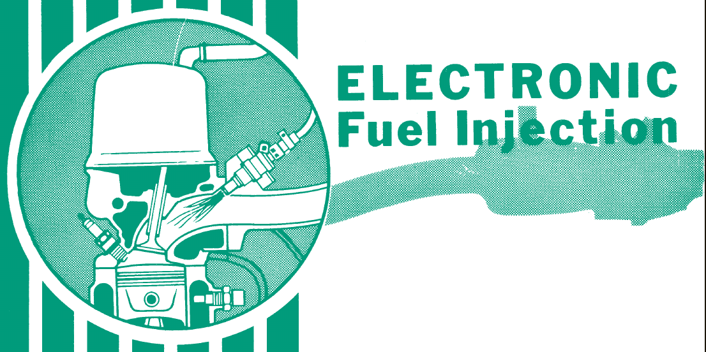
>
> - **Summary:** Cover graphic featuring a circular cutaway of the Datsun L28 engine cylinder head showing an electronic fuel injector injecting fuel towards the open intake valve above the piston crown.
> - **Components:** cylinder head, fuel injector, intake valve, combustion chamber, piston, spark plug, intake runner
> - **Mechanic Notes:** Depicts direct manifold port injection geometry where the injector atomizes fuel directly at the intake valve opening.
> - **Tags:** `cover`, `cutaway`, `fuel injector`, `cylinder head`, `intake valve`, `manifold injection`

---

<!-- Page 2 (Title Page) -->
# 280-Z ELECTRONIC FUEL INJECTION

* THEORY
* TROUBLESHOOTING

Revised November 1975

---

<!-- Page 3 (Contents) -->
# CONTENTS

## DATSUN FUEL INJECTION

| Section / Topic | Page |
| :--- | :--- |
| **SECTION I THEORY OF OPERATION** | 1 |
| The Fuel Circuit | 1 |
| Fuel Pump | 2 |
| Fuel Damper | 3 |
| Filter | 4 |
| Injectors | 5 |
| Injector Operation | 6 |
| Control Unit | 7 |
| Pressure Regulator | 8 |
| Fuel Injection Air Flow | 9 |
| Air Flow Meter | 10 |
| Sensor Input To The Control Unit | 12 |
| Throttle Switch | 13 |
| Water Temperature Sensor | 14 |
| Air Temperature Sensor | 15 |
| Cold Start System | 16 |
| Cold Start Valve | 16 |
| Thermotime Switch | 17 |
| Auxiliary Air Regulator | 18 |
| Fuel Injection Electrical System | 19 |
| Harness | 21 |
| Injection Relay | 22 |
| Relay Operation | 24 |
| Air Flow Meter Contacts | 25 |
| **SECTION II FUEL INJECTION TROUBLESHOOTING** | 27 |

---

<!-- Page 4 (Section I) -->
# SECTION I

## FUEL INJECTION

### THEORY OF OPERATION

---

<!-- Page 5 (Frontispiece) -->

> 🖼️ **280Z Electronic Fuel Injection Component Layout**  *(Type: `component_location`)*
>
> 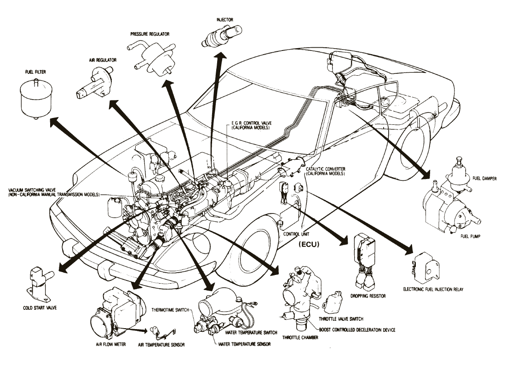
>
> - **Summary:** Ghosted isometric cutaway view of the complete Datsun 280Z vehicle showing the exact physical mounting locations of all Electronic Fuel Injection components throughout the engine compartment, passenger cabin, and rear chassis.
> - **Components:** Fuel filter, Air regulator, Pressure regulator, Injector, E.G.R. control valve (California models), Catalytic converter (California models), Control unit (ECU), Dropping resistor, Electronic fuel injection relay, Fuel damper, Fuel pump, Vacuum switching valve (non-California manual transmission models), Cold start valve, Thermotime switch, Water temperature sensor, Water temperature switch, Throttle chamber, Boost controlled deceleration device, Throttle valve switch, Air flow meter, Air temperature sensor
> - **Callouts:** **(Fuel Filter)** Mounted on right front fender panel; **(Air Regulator)** Mounted on engine intake side; **(Pressure Regulator)** Mounted at front end of fuel rail; **(Injector)** Mounted on intake manifold runners; **(E.G.R. Control Valve (California Models))** Mounted at rear of cylinder head/manifold; **(Catalytic Converter (California Models))** Located in exhaust system under floor; **(Control Unit (ECU))** Mounted on driver side cowl/kick panel behind trim; **(Dropping Resistor)** Mounted on left inner fender panel; **(Electronic Fuel Injection Relay)** Mounted on driver side cabin/kick panel area; **(Fuel Damper)** Mounted adjacent to electric fuel pump near fuel tank; **(Fuel Pump)** Mounted underneath near rear fuel tank; **(Vacuum Switching Valve (Non-California Manual Transmission Models))** Mounted on inner fender; **(Cold Start Valve)** Mounted on intake manifold plenum collector; **(Thermotime Switch)** Threaded into thermostat housing; **(Water Temperature Sensor)** Threaded into thermostat housing; **(Water Temperature Switch)** Threaded into thermostat housing; **(Throttle Chamber)** Mounted between intake manifold and AFM duct; **(Boost Controlled Deceleration Device)** Integrated with throttle chamber; **(Throttle Valve Switch)** Mounted on throttle chamber valve shaft; **(Air Flow Meter)** Mounted between air cleaner and throttle duct; **(Air Temperature Sensor)** Integrated into intake horn of air flow meter
> - **Mechanic Notes:** Key layout overview for diagnosing component locations on both Federal and California spec 280Z models.
> - **Tags:** `component layout`, `locations`, `overview`, `280Z chassis`, `cutaway`

---

<!-- Page 6 (1) -->
# ELECTRONIC FUEL INJECTION OPERATION

Although Nissan Motor Co., Ltd. has been installing Electronic Fuel Injection on vehicles sold in Japan for four years, 1975 is the first year for the importation of this system to the United States.

The system used on the new 280Z is similar to the so-called "L-Jetronic" system developed by Bosch in Germany, and employed by various auto manufacturers. It is called "L" Jetronic because it operates on the principle of air flow measurement. The "L" stands for "Luft," which is the German word for "air."

## THE FUEL CIRCUIT

> 🖼️ **The Fuel Circuit Schematic Diagram**  *(Type: `cutaway_flow`)*
>
> 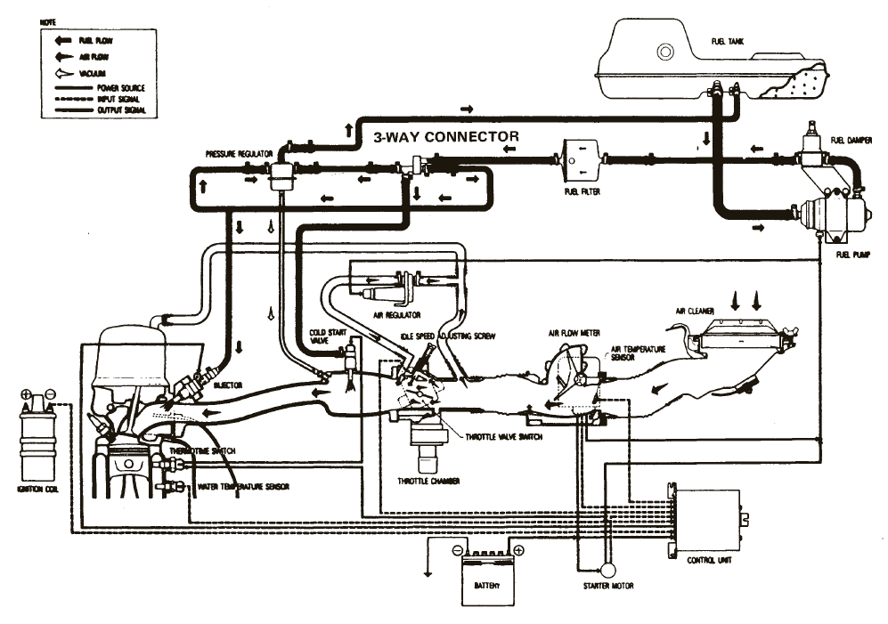
>
> - **Summary:** Schematic flow diagram of the 280Z fuel circuit and related control subsystems, tracing fuel delivery from tank through damper, pump, filter, fuel rail, pressure regulator, and injectors, along with air flow, vacuum sensing, and electrical control signals.
> - **Components:** Fuel tank, Fuel damper, Fuel pump, Fuel filter, 3-way connector, Pressure regulator, Injector, Cold start valve, Air regulator, Idle speed adjusting screw, Throttle chamber, Throttle valve switch, Air flow meter, Air temperature sensor, Air cleaner, Ignition coil, Thermotime switch, Water temperature sensor, Battery, Starter motor, Control unit
> - **Callouts:** **(FUEL FLOW)** Solid arrow indicating direction of pressurized gasoline; **(AIR FLOW)** Open triangle arrow indicating induction air path; **(VACUUM)** Hollow outline arrow indicating intake manifold vacuum sensing; **(POWER SOURCE)** Crosshatched pattern line indicating primary electrical feed; **(INPUT SIGNAL)** Dashed line indicating sensor input to ECU; **(OUTPUT SIGNAL)** Solid line indicating ECU control command to injectors
> - **Mechanic Notes:** High pressure fuel is constantly supplied to the fuel rail with unused fuel bleeding back to the tank via the pressure regulator; air volume measured at AFM determines base fuel injection duration.
> - **Tags:** `fuel circuit`, `schematic`, `flow diagram`, `L-Jetronic`, `system overview`

To make it easier to understand the operation of the system, let's break it down into its component subsystems. Here you can see the Fuel Circuit. Let's take a look at how this circuit works.

---

<!-- Page 7 (2) -->
### Fuel Pump

> 🖼️ **FUEL PUMP**  *(Type: `component_location`)*
>
> 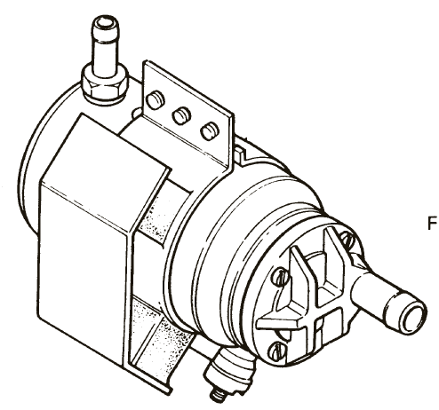
>
> - **Summary:** Isometric exterior drawing of the 280Z electric rotary roller fuel pump with mounting bracket and hose fittings.
> - **Components:** Electric fuel pump, Mounting bracket, Inlet fitting, Outlet fitting, Electrical terminals
> - **Mechanic Notes:** Wet-type rotary roller fuel pump where gasoline flows around the armature.
> - **Tags:** `fuel pump`, `exterior`, `rotary roller`, `wet pump`

First, fuel is drawn from the tank by an electric fuel pump. This is not the same pump as that used on the 1974 Z-Car. This new type is a rotary roller pump in which the armature actually has gasoline flowing around it. For this reason it is called a "wet" type pump.

> 🖼️ **FUEL PUMP SECTIONAL VIEW**  *(Type: `cutaway_flow`)*
>
> 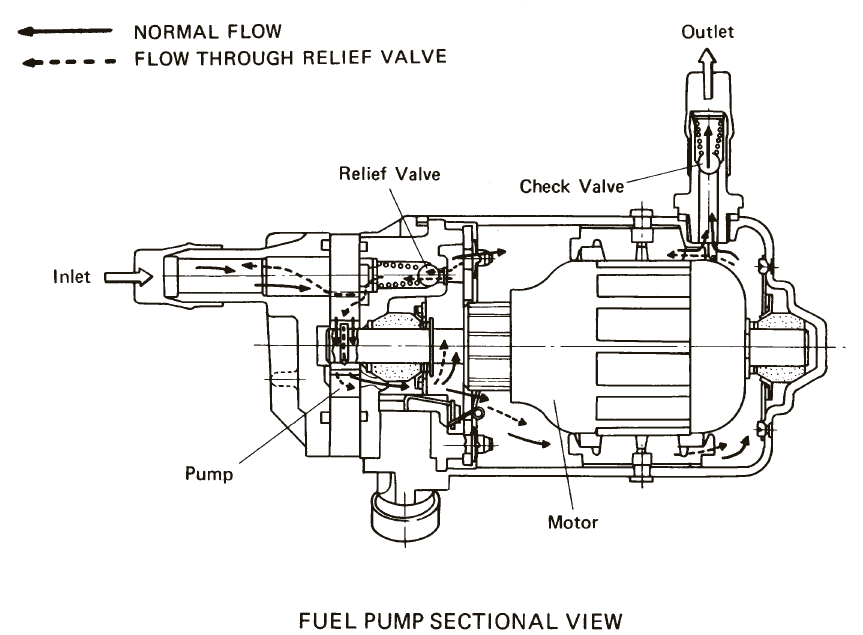
>
> - **Summary:** Longitudinal cutaway sectional view of the electric fuel pump showing internal flow path from inlet, through roller pump mechanism, past electric motor armature, and through outlet check valve, as well as the internal pressure relief valve.
> - **Components:** Inlet, Pump (rotary roller), Relief Valve, Motor, Check Valve, Outlet
> - **Callouts:** **(Inlet)** Fuel suction inlet from gas tank; **(Pump)** Rotary roller pumping chamber; **(Relief Valve)** Internal pressure relief valve bypassing to inlet; **(Motor)** Electric motor armature immersed in fuel; **(Check Valve)** One-way outlet check valve holding line pressure; **(Outlet)** Fuel delivery outlet to damper
> - **Specs / Measurements:** Relief valve opening pressure: above 43 psi
> - **Mechanic Notes:** Gasoline circulates around the motor armature for cooling and lubrication. Check valve maintains residual fuel system pressure after pump shutdown.
> - **Tags:** `fuel pump`, `cutaway`, `sectional view`, `check valve`, `relief valve`, `roller pump` <!-- Page 8 (3) --> The fuel pump runs constantly whenever the engine is either running or being cranked. It will not run if the engine stops and if the key is left in the "Ignition On" position.

A word of warning about this pump: DON'T ALLOW THE CAR TO RUN OUT OF GAS, as priming the pump could be very difficult. If the vehicle does run out of gas, you may have to fill the tank all the way to the top before the pump will begin to draw.

The fuel pump also contains a pressure relief valve, which will let fuel recirculate in the pump when pressure goes above 43 pounds psi.

### Fuel Damper

> 🖼️ **FUEL DAMPER**  *(Type: `component_location`)*
>
> 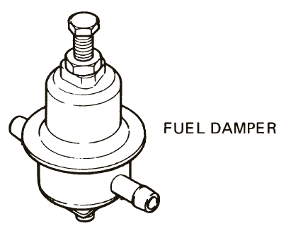
>
> - **Summary:** Exterior view of the fuel pulsation damper showing upper adjusting screw and inlet/outlet tube connections.
> - **Components:** Fuel damper, Upper adjusting bolt, Inlet tube, Outlet tube
> - **Mechanic Notes:** Mounted immediately adjacent to the fuel pump near the fuel tank.
> - **Tags:** `fuel damper`, `pulsation damper`, `exterior`

From the fuel pump, fuel flows to a fuel "damper," mounted right next to the pump. The damper acts like a shock absorber. It has a diaphragm which is under spring pressure. If the fuel pump puts out pressure surges, then these surges push against the diaphragm and are absorbed by the spring instead of making themselves felt all the way to the injectors, and thus possibly affecting engine performance.

> 🖼️ **FUEL DAMPER SECTIONAL VIEW**  *(Type: `cutaway_flow`)*
>
> 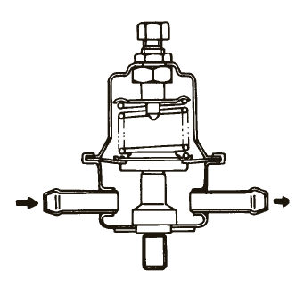
>
> - **Summary:** Cross-sectional cutaway drawing of the fuel damper revealing the spring-loaded flexible diaphragm that absorbs hydraulic pressure pulses from the roller pump.
> - **Components:** Diaphragm, Compression spring, Damper body, Fuel passage
> - **Mechanic Notes:** Acts as a shock absorber and acoustic muffler to prevent fuel pressure pulsation spikes from reaching injectors or transmitting humming noise into cabin.
> - **Tags:** `fuel damper`, `cutaway`, `sectional view`, `pulsation damper`

The fuel damper also acts as a muffler — that is, it keeps the pressure surges from making noises which could be heard by the driver.

---

<!-- Page 9 (4) -->
### Fuel Filter

> 🖼️ **FUEL FILTER**  *(Type: `component_location`)*
>
> 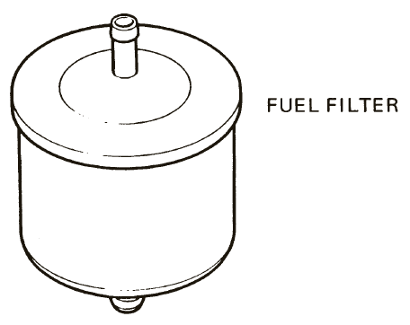
>
> - **Summary:** Isometric view of the canister-type high-pressure fuel filter showing inlet and outlet tube connections.
> - **Components:** Fuel filter canister, Top inlet fitting, Bottom outlet fitting
> - **Specs / Measurements:** Replacement interval: every 25,000 miles
> - **Mechanic Notes:** High efficiency filter essential for preventing minuscule contaminants from jamming electronic injector pintles.
> - **Tags:** `fuel filter`, `filter`, `canister`

From the fuel damper, the fuel passes through the line to the engine compartment where it goes through a special filter, mounted on the right hand fender panel.

> 🖼️ **Fuel filter mounted on the right hand fender panel next to carbon canister**  *(Type: `component_location`)*
>
> 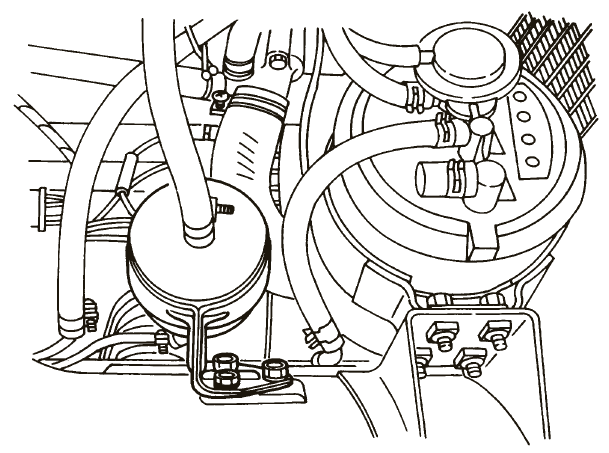
>
> - **Summary:** Illustration of the fuel filter mounted in its bracket on the right hand engine compartment fender panel beside the carbon canister.
> - **Components:** Fuel filter, Mounting bracket, Carbon canister, Fender panel, Fuel lines
> - **Specs / Measurements:** Replacement interval: every 25,000 miles
> - **Mechanic Notes:** Inspect hoses and clamps for leakage whenever replacing filter.
> - **Tags:** `fuel filter`, `installation`, `engine bay`, `right fender`

This filter is critical to proper engine operation, since if even the smallest particle becomes wedged in one of the injectors, the operation of that cylinder might be adversely affected. This filter should be changed every 25,000 miles.

---

<!-- Page 10 (5) -->
### Injectors

> 🖼️ **INJECTOR**  *(Type: `component_location`)*
>
> 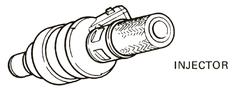
>
> - **Summary:** Exterior view of an electronic fuel injector showing electrical receptacle, braided fuel hose collar, and discharge nozzle.
> - **Components:** Fuel injector, Electrical connector, Fuel inlet hose collar, Nozzle
> - **Mechanic Notes:** Solenoid needle valve injector operated by electrical pulses from the ECU.
> - **Tags:** `injector`, `exterior`, `fuel injector`

From the fuel filter, gasoline flows through the line to the injectors. Thus, the injectors have fuel pressure behind them at all times.

> 🖼️ **Injectors mounted on the intake manifold**  *(Type: `component_location`)*
>
> 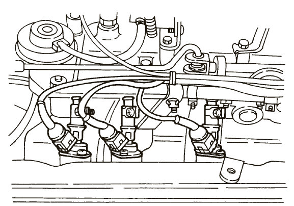
>
> - **Summary:** View of fuel injectors installed on the intake manifold runners adjacent to the cylinder head intake ports with fuel supply rail and wiring harness connectors.
> - **Components:** Injectors, Intake manifold, Cylinder head, Fuel rail, Harness connectors
> - **Mechanic Notes:** Manifold injection configuration directing fuel spray directly onto intake valves.
> - **Tags:** `injector`, `intake manifold`, `mounting`, `engine bay`

The injectors are mounted on the intake manifold next to the cylinder head intake ports. (Because of the injectors' location, this type of system is called manifold injection.)

> 🖼️ **Injector cross-sectional internal view**  *(Type: `cutaway_flow`)*
>
> 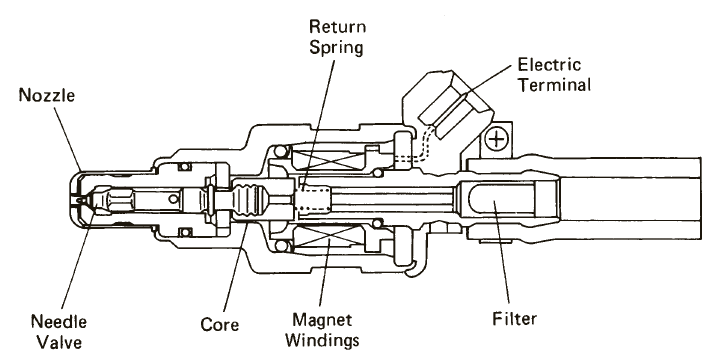
>
> - **Summary:** Detailed longitudinal cutaway diagram of the electromagnetic fuel injector detailing all internal operating elements.
> - **Components:** Nozzle, Needle Valve, Core, Magnet Windings, Return Spring, Electric Terminal, Filter
> - **Callouts:** **(Nozzle)** Precision fuel atomization orifice; **(Needle Valve)** Magnetic plunger valve sealing against nozzle seat; **(Core)** Solenoid magnetic core; **(Magnet Windings)** Electromagnetic actuator coil; **(Return Spring)** Valve return closing spring; **(Electric Terminal)** Electrical plug terminals for ground pulsing; **(Filter)** Internal fine mesh screen filter at fuel inlet
> - **Mechanic Notes:** Energizing the coil lifts the needle valve against the spring, releasing pressurized fuel through the nozzle orifice.
> - **Tags:** `injector`, `cross section`, `cutaway`, `needle valve`, `solenoid`, `internal view`

The injectors are really little magnet valves. When they are energized, they open; gasoline is then squirted into the intake manifold. The longer they stay open, the more gasoline will be injected, and the richer the system will run.

---

<!-- Page 11 (6) -->
### Injector Operation

> 🖼️ **DROPPING RESISTOR**  *(Type: `component_location`)*
>
> 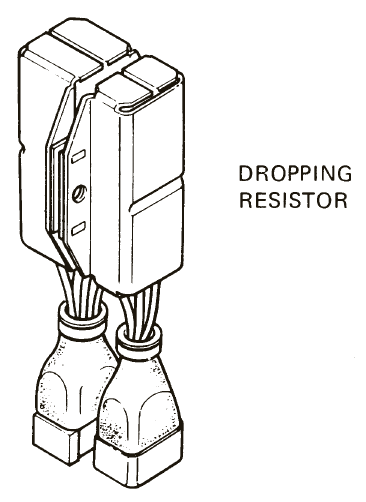
>
> - **Summary:** Exterior view of the dual dropping resistor pack housing with electrical harness plugs.
> - **Components:** Dropping resistor assembly, Housing brackets, Dual harness connector plugs
> - **Mechanic Notes:** Contains six individual ballast resistors (one per injector).
> - **Tags:** `dropping resistor`, `ballast resistor`, `exterior`

When the system is operating, the battery is connected directly to each injector through a resistor. Thus there are six resistors on the 280Z. The resistor causes a voltage drop so that the injector operates on less than battery voltage.

> 🖼️ **Dropping resistor location in engine compartment**  *(Type: `component_location`)*
>
> 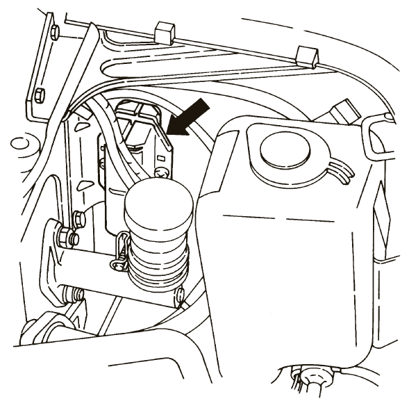
>
> - **Summary:** Location drawing of the dropping resistor pack mounted on the left inner fender apron forward of the brake master cylinder.
> - **Components:** Dropping resistor, Left inner fender, Brake master cylinder reservoir, Strut tower
> - **Mechanic Notes:** Reduces operating voltage to injectors and protects them against alternator and electrical system voltage spikes.
> - **Tags:** `dropping resistor`, `location`, `inner fender`, `engine bay`

The resistor also protects the injector from voltage surges coming from the alternator and from the effects of other components in the electrical system.

---

<!-- Page 12 (7) -->
### Control Unit

> 🖼️ **Electronic Control Unit (ECU)**  *(Type: `component_location`)*
>
> 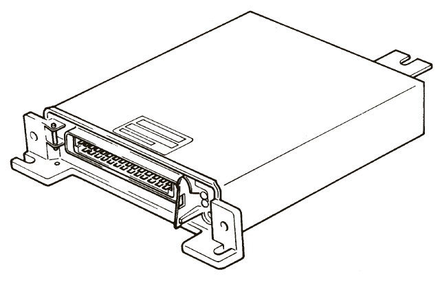
>
> - **Summary:** Isometric drawing of the Electronic Control Unit (ECU) showing metal housing and 35-pin multi-terminal harness receptacle.
> - **Components:** Electronic Control Unit (ECU), 35-pin connector receptacle, Mounting flanges
> - **Specs / Measurements:** 35-pin connector
> - **Wiring / Connections:** 35-pin multi-pin harness connector
> - **Mechanic Notes:** ECU controls fuel delivery duration by switching the ground side of the injector circuits.
> - **Tags:** `ECU`, `control unit`, `exterior`, `connector`

The injectors are grounded inside the Electronic Control Unit, or ECU. This unit controls the injectors by turning their ground on and off, just the way the transistor ignition control unit turns the coil ground on and off.

When the control unit grounds the injectors, current runs from the battery, through the resistor, through the injector and then finally into the control unit. Since the circuit is complete, the injector is energized. It opens and gasoline is injected into the manifold.

This is the basic principle of fuel injection operation. The control unit can govern how much fuel is injected by holding the injectors open for longer or shorter periods of time.

> 🖼️ **Testing the fuel injection system at the ECU harness connector with a multimeter**  *(Type: `procedure_step`)*
>
> 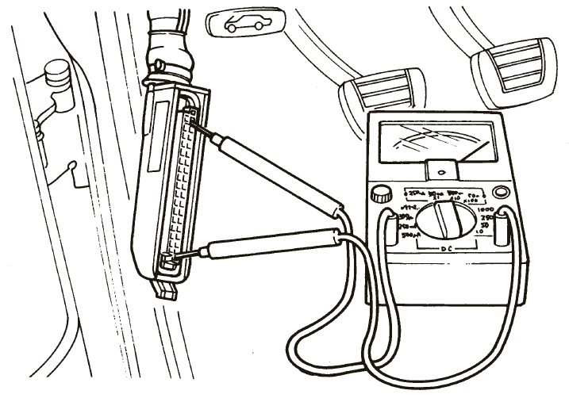
>
> - **Summary:** Diagnostic testing procedure using a multimeter test probes at the 35-pin harness connector in the driver footwell by the pedals.
> - **Components:** 35-pin harness connector, Multimeter (VOM), Clutch/brake pedals, Steering column area
> - **Wiring / Connections:** 35-pin ECU harness plug
> - **Mechanic Notes:** The entire EFI electrical circuit and sensor network can be completely tested and diagnosed from the 35-pin connector at the ECU.
> - **Tags:** `ECU`, `multimeter`, `testing`, `diagnostic`, `35-pin connector`, `kick panel`

The ECU is mounted on the driver's side kick panel behind a protective cover. By the way, the large connector at this unit can be used to test the entire Fuel Injection System.

---

<!-- Page 13 (8) -->
## Fuel Pressure Regulation

Obviously, the pressure of the fuel going to the injectors is very important. If the pressure goes up, more fuel will be injected during a certain period of time. If the pressure goes down, then less fuel will be injected. There is also the effect of manifold vacuum: if the vacuum gets very high, more fuel will be "sucked" out of the injectors; while if the vacuum drops, less fuel will pass through them.

### Pressure Regulator

> 🖼️ **PRESSURE REGULATOR**  *(Type: `component_location`)*
>
> 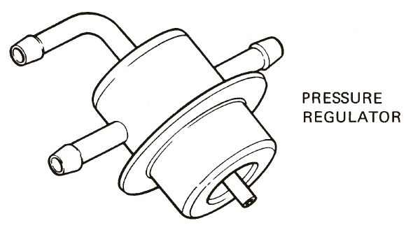
>
> - **Summary:** Isometric exterior view of the fuel pressure regulator showing vacuum nipple, fuel inlet lines, and fuel return outlet.
> - **Components:** Pressure regulator, Manifold vacuum port, Fuel rail inlet pipes, Fuel return pipe
> - **Mechanic Notes:** Pre-set at factory and non-adjustable.
> - **Tags:** `pressure regulator`, `fuel pressure`, `exterior`

Therefore, the system includes a fuel pressure regulator. When the pressure in the line gets too high, then this pressure regulator opens and allows some fuel to flow back to the fuel tank by the return line. When the engine is running, there is actually a constant bleed of gasoline back to the fuel tank.

> 🖼️ **Sectional view of pressure regulator showing spring chamber, diaphragm, and fuel chamber**  *(Type: `cutaway_flow`)*
>
> 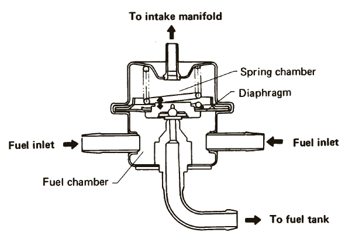
>
> - **Summary:** Cross-sectional schematic cutaway of the fuel pressure regulator showing vacuum reference chamber, diaphragm, spring, valve seat, and fuel flow paths.
> - **Components:** Spring chamber, Diaphragm, Fuel chamber, Valve, Vacuum port, Return port
> - **Callouts:** **(To intake manifold)** Manifold vacuum sensing port; **(Spring chamber)** Upper reference chamber containing calibrated spring; **(Diaphragm)** Flexible regulating diaphragm; **(Fuel inlet)** Dual fuel inlet tubes from fuel rail; **(Fuel chamber)** High pressure fuel chamber; **(To fuel tank)** Return line port back to fuel tank
> - **Specs / Measurements:** Differential pressure: 36 psi (between fuel rail and intake manifold)
> - **Mechanic Notes:** Maintains a constant 36 psi pressure differential across injector tips by compensating for intake manifold vacuum fluctuations.
> - **Tags:** `pressure regulator`, `cutaway`, `sectional view`, `diaphragm`, `36 psi`, `vacuum referenced`

A vacuum sensing line, connected to the intake manifold, allows the manifold vacuum to operate against the pressure regulator diaphragm. As vacuum goes up, the regulator thus allows more fuel to bleed back to the tank, and so the fuel pressure lowers. The pressure regulator thus maintains a constant balance between fuel and manifold pressure, keeping the difference between them at 36 pounds psi.

The pressure regulator is pre-set and cannot be adjusted.

---

<!-- Page 14 (9) -->
# FUEL INJECTION AIR FLOW

> 🖼️ **AIR FLOW METER**  *(Type: `component_location`)*
>
> 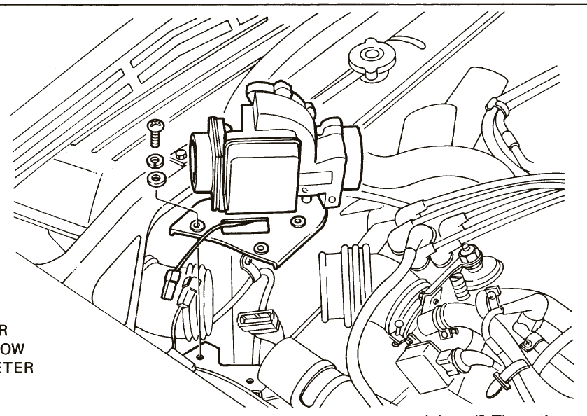
>
> - **Summary:** Installation view of the air flow meter mounted in the 280Z engine bay between the air cleaner and throttle chamber.
> - **Components:** Air flow meter, Mounting bracket, Intake duct, Throttle body, Radiator support area
> - **Mechanic Notes:** Measures volume of induction air entering engine; primary load signal for ECU.
> - **Tags:** `air flow meter`, `AFM`, `installation`, `engine bay`

How does the Control Unit know how much gasoline should be injected? The main source of information is the Air Flow Meter, which is mounted between the air cleaner and the throttle plate. This meter measures the amount of air coming into the intake manifold, in much the same manner as the gas tank gauge measures the amount of fuel in the tank.

> 🖼️ **Throttle Valve operation by throttle linkage**  *(Type: `procedure_step`)*
>
> 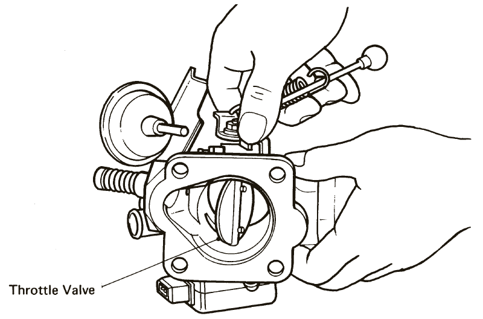
>
> - **Summary:** Illustration showing hand opening the throttle valve butterfly plate on the throttle body via the external throttle actuator linkage.
> - **Components:** Throttle chamber, Throttle valve (butterfly plate), Throttle lever/linkage, Return spring, Throttle switch
> - **Callouts:** **(Throttle Valve)** Rotating throttle valve plate governing induction airflow
> - **Mechanic Notes:** Opening the throttle allows air to flow through AFM and intake manifold, determining engine speed.
> - **Tags:** `throttle valve`, `throttle chamber`, `linkage`, `throttle plate`

Just as with a carbureted engine, the speed of the engine is determined by the throttle. When the throttle is opened, air passes through the air filter and into the air flow meter.

---

<!-- Page 15 (10) -->
### Air Flow Meter

> 🖼️ **Air Flow Meter cutaway view and potentiometer electrical chamber**  *(Type: `cutaway_flow`)*
>
> 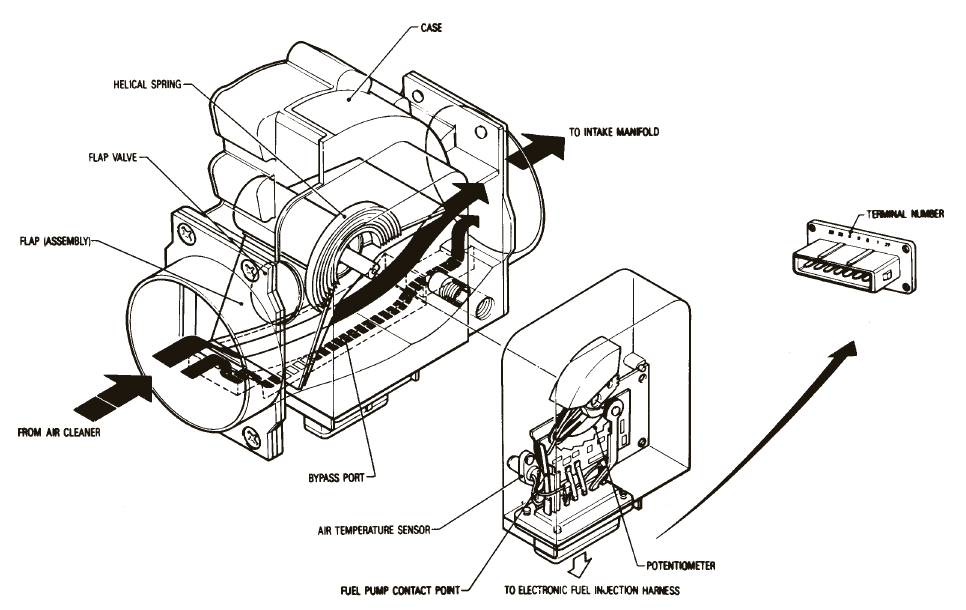
>
> - **Summary:** Ghosted cutaway and exploded perspective view of the vane-type air flow meter showing the internal flap assembly, helical damping spring, idle bypass channel, air temperature sensor, fuel pump switch contacts, and sealed potentiometer electronics chamber.
> - **Components:** Case, Helical Spring, Flap Valve, Flap (Assembly), Bypass Port, Air Temperature Sensor, Fuel Pump Contact Point, Potentiometer, Harness connector
> - **Callouts:** **(FROM AIR CLEANER)** Intake air inlet; **(TO INTAKE MANIFOLD)** Metered air outlet; **(CASE)** Cast aluminum housing; **(HELICAL SPRING)** Calibrated flap return and damping spring; **(FLAP VALVE)** Primary measuring vane flap; **(FLAP (ASSEMBLY))** Counterbalanced measuring and damping flap unit; **(BYPASS PORT)** Internal idle air bypass passage; **(AIR TEMPERATURE SENSOR)** Intake air temperature thermistor; **(FUEL PUMP CONTACT POINT)** Safety interlock switch contacts for fuel pump power; **(POTENTIOMETER)** Linear resistive potentiometer track and wiper arm; **(TO ELECTRONIC FUEL INJECTION HARNESS)** Harness plug connector socket; **(TERMINAL NUMBER)** Connector terminal pin assignment (pins 39, 36, 6, 8, 9, 7, 27)
> - **Wiring / Connections:** Terminals 6, 7, 8, 9, 27, 36, 39
> - **Mechanic Notes:** Air pushing the flap rotates the potentiometer wiper to supply a proportional voltage signal to the ECU. Also houses the fuel pump safety interlock switch.
> - **Tags:** `air flow meter`, `AFM`, `cutaway`, `potentiometer`, `vane`, `flap`, `fuel pump switch`

> 🖼️ **Air Flow Meter internal electrical circuit schematic**  *(Type: `electrical_schematic`)*
>
> 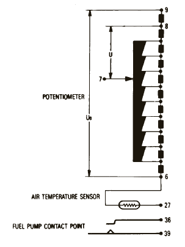
>
> - **Summary:** Internal circuit diagram of the air flow meter showing the stepped resistor ladder potentiometer (terminals 9, 8, 7, 6), intake air temperature sensor thermistor (terminal 27), and fuel pump safety contacts (terminals 36, 39).
> - **Components:** Potentiometer resistor chain, Wiper arm contact, Air temperature sensor, Fuel pump contact points
> - **Callouts:** **(9, 8, 7, 6)** Potentiometer terminals (7 is wiper arm); **(27)** Air temperature sensor terminal; **(36, 39)** Fuel pump switch contacts
> - **Wiring / Connections:** Pin 9; Pin 8; Pin 7; Pin 6; Pin 27; Pin 36; Pin 39
> - **Mechanic Notes:** Contacts 36 and 39 close as soon as induction air deflects the flap, energizing the fuel pump relay during engine run.
> - **Tags:** `air flow meter`, `schematic`, `potentiometer`, `pinout`, `wiring`

In order to pass through the meter, the air must push open a hinged flap. The more air passing through, the farther the flap will be pushed open. The air will then pass by the throttle plate and travel on into the cylinders.

---

<!-- Page 16 (11) -->
The air flow meter is connected to the control unit, and sends a voltage signal to it. The farther the flap is pushed open, the stronger the signal which the air flow meter supplies to the control unit. The control unit then responds by holding the injectors open longer so they inject more fuel. Thus the air flow meter is the control unit's most important source of information which it uses to judge the fuel-air ratio. The control unit, the injectors, and the air flow meter form the heart of the fuel-injection system.

> 🖼️ **IDLE SPEED SCREW**  *(Type: `procedure_step`)*
>
> 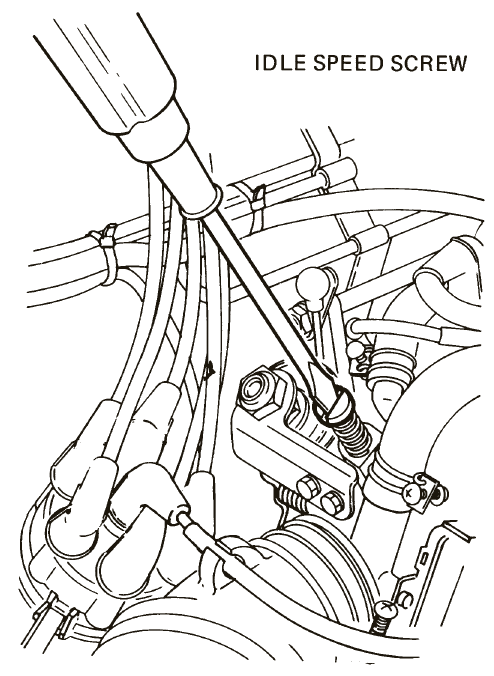
>
> - **Summary:** Adjustment procedure showing a screwdriver turning the idle speed bypass screw on the throttle chamber.
> - **Components:** Idle speed adjusting screw, Throttle chamber, Intake manifold, Screwdriver, Spark plug wires
> - **Mechanic Notes:** Controls idle engine speed by regulating bypass air volume around the closed throttle plate. WARNING: ANY VACUUM LEAK between AFM and intake valves will alter idle speed and lean out the mixture.
> - **Tags:** `idle speed screw`, `throttle chamber`, `adjustment`, `idle speed`, `vacuum leak warning`

What happens at idle? When the throttle is closed, air passes through an idle bypass, the size of which is controlled by an idle speed adjusting screw.

Air also flows through a bypass in the air flow meter. (This bypass is installed so that air flow into the engine at idle can be uniform. You see, if all the air had to go past the flap, individual piston pulsations at the low idle speed would cause the flap to shudder, and an uneven fuel mix would result. This idle bypass is factory set and cannot be adjusted.)

As you can see, the air flow in our injection system is even easier to understand than was the fuel flow. There is one point, however, which is very IMPORTANT: ANY VACUUM LEAK AT ALL, from the air flow meter to the intake valve, WILL CAUSE THE IDLE SPEED AND AIR-FUEL MIXTURE RATIO TO CHANGE, since this leaking air will not be measured by the air flow meter.

---

<!-- Page 17 (12) -->
# SENSOR INPUTS TO THE CONTROL UNIT

So far, we have looked at how the fuel and air actually reach the engine. We have also looked at the air flow meter, which is the principal source of input to the control unit.

> 🖼️ **ELECTRONIC FUEL INJECTION SYSTEM (ELECTRONIC SIGNAL)**  *(Type: `electrical_schematic`)*
>
> 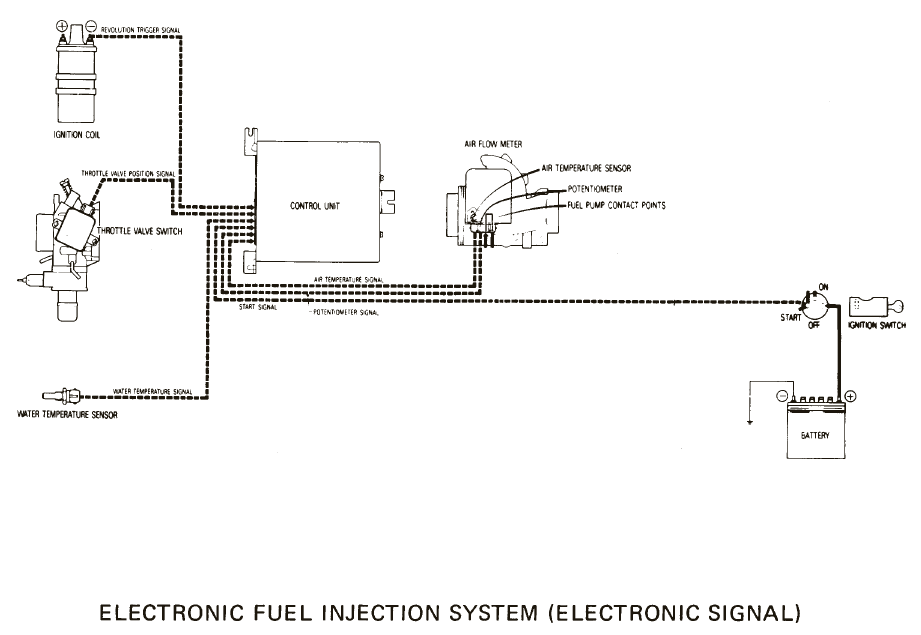
>
> - **Summary:** Block schematic showing all input sensor signals wired to the Electronic Control Unit (ECU): Ignition coil (RPM trigger), Throttle valve switch (Idle/Full throttle), Water temperature sensor, Air flow meter (Potentiometer, Air temp sensor, Fuel pump switch), Ignition switch (Start signal), and Battery.
> - **Components:** Ignition coil, Throttle valve switch, Water temperature sensor, Control unit, Air flow meter, Ignition switch, Battery
> - **Callouts:** **(REVOLUTION TRIGGER SIGNAL)** Coil negative (-) terminal to ECU; **(THROTTLE VALVE POSITION SIGNAL)** Idle and full load contact signals to ECU; **(WATER TEMPERATURE SIGNAL)** Coolant temperature resistance to ECU; **(AIR TEMPERATURE SIGNAL)** Intake air temperature resistance to ECU; **(POTENTIOMETER SIGNAL)** AFM flap angle voltage to ECU; **(START SIGNAL)** Ignition switch start position feed to ECU; **(FUEL PUMP CONTACT POINTS)** AFM internal switch to fuel pump relay
> - **Specs / Measurements:** Simultaneous injection: all 6 injectors fire once per revolution (twice per 4-stroke cycle)
> - **Wiring / Connections:** Coil (-); AFM harness; Throttle switch harness; Water temp sensor lead; Ignition switch 'START'
> - **Mechanic Notes:** Ignition coil negative hookup serves as both engine speed tachometer input and injection timing trigger.
> - **Tags:** `sensor inputs`, `electronic signals`, `ECU block diagram`, `schematic`

Actually, though, there are a total of six inputs to the control unit which all work together to determine the final mixture ratio. Let's take a look at the other five sensor inputs.

### Coil

First, there is the ignition coil, which tells the control unit how fast the engine is turning. In other words, this is a tachometer hookup. The control unit can vary the mixture ratio with speed, since engine requirements change from idle to very high RPM. Also, this connection to the negative side of the coil tells the unit when the cylinders are firing, and therefore it serves to time the moment of injection. The control unit fires all the injectors at the same time, once per revolution (twice per cycle).

---

<!-- Page 18 (13) -->
### Throttle Switch

> 🖼️ **Throttle Switch mounted on throttle chamber**  *(Type: `component_location`)*
>
> 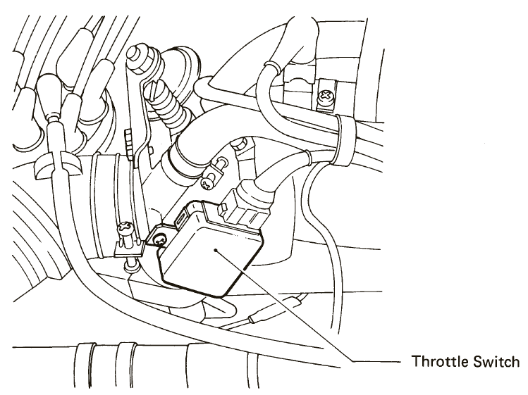
>
> - **Summary:** Drawing of the throttle valve switch mounted on the side of the throttle body, coupled to the throttle valve shaft.
> - **Components:** Throttle switch, Throttle chamber, Throttle linkage, Harness connector
> - **Callouts:** **(Throttle Switch)** Throttle valve position switch assembly
> - **Mechanic Notes:** Contains two distinct sets of contact points: idle contacts and full throttle contacts.
> - **Tags:** `throttle switch`, `throttle chamber`, `installation`, `throttle valve switch`

The next sensor input comes from a switch which is mounted on the throttle chamber, and which is therefore called the throttle switch. This sensor actually contains two separate switches, and supplies two different signals to the control unit.

> 🖼️ **Throttle switch internal contact points: Full Throttle Contact Points and Idle Contact Points**  *(Type: `cutaway_flow`)*
>
> 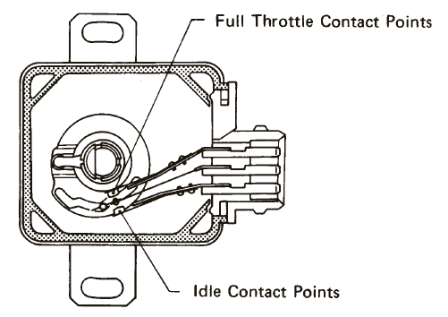
>
> - **Summary:** Internal view of the throttle switch revealing the rotating contact cam, idle contact points, and full throttle contact points.
> - **Components:** Idle Contact Points, Full Throttle Contact Points, Operating cam, Connector terminals
> - **Callouts:** **(Full Throttle Contact Points)** Upper contacts closed when throttle is opened wide; **(Idle Contact Points)** Lower contacts closed when throttle is released to idle
> - **Mechanic Notes:** Idle switch closes when accelerator pedal is released, signaling idle enrichment or deceleration fuel cut depending on engine RPM.
> - **Tags:** `throttle switch`, `internal contacts`, `idle contacts`, `full throttle contacts`

The first of these is the idle switch, which is closed when the driver releases the throttle. This tells the control unit that the engine is either idling or decelerating. You can see that the ignition coil input tells the control unit which is the case. If the engine is idling, then the control unit can richen the mixture ratio slightly, just as the idle circuit in a carburetor supplies a slightly richer mixture than does the high-speed circuit. <!-- Page 19 (14) --> > 🖼️ **Engine RPM thresholds for fuel cut during deceleration: 3200 rpm fuel injection stops, 2800 rpm fuel injection begins, 800 rpm idling**  *(Type: `graph_chart`)*
>
> 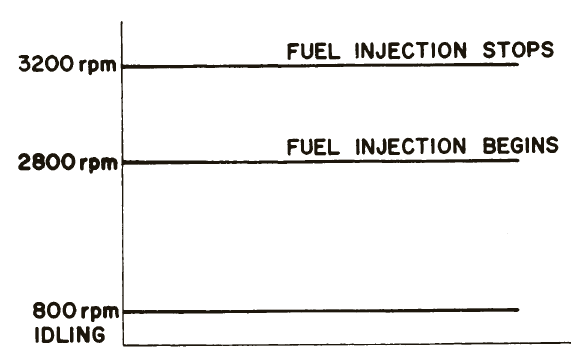
>
> - **Summary:** Vertical chart showing engine RPM thresholds for deceleration fuel cut-off and resumption.
> - **Components:** Deceleration fuel cut threshold, Fuel recovery threshold, Base idle speed
> - **Callouts:** **(3200 rpm)** FUEL INJECTION STOPS (deceleration above 3200 rpm); **(2800 rpm)** FUEL INJECTION BEGINS (injection resumes as RPM falls to 2800); **(800 rpm)** IDLING speed reference
> - **Specs / Measurements:** 3200 rpm: fuel injection stops; 2800 rpm: fuel injection resumes; 800 rpm: idle speed
> - **Mechanic Notes:** When decelerating with idle contacts closed, ECU shuts off injector pulses completely between 3200 rpm and 2800 rpm for emissions control and fuel economy.
> - **Tags:** `fuel cut`, `deceleration`, `rpm thresholds`, `throttle switch`, `chart`

If the engine is decelerating, on the other hand, then less gas is needed; in fact, from any speed above 3200 RPM down to 2800 RPM, the control unit turns off the gas completely. Thus we can get better gas mileage and fewer emissions.

The throttle switch also contains another set of contacts, called the full throttle contacts. These are closed when the driver opens the throttle past a certain point. The control unit can respond by richening the mixture—again, according to engine speed. Thus we can obtain both acceleration and heavy load enrichment.

### Water Temperature Sensor

Next, a water temperature sensor, located in the thermostat housing, allows the control unit to richen the mixture until the engine arrives at operating temperature. While the engine is warming up, the oil is thicker; there is more resistance, so more fuel is needed.

> 🖼️ **Water Temperature Sensor and its location in the thermostat housing**  *(Type: `component_location`)*
>
> 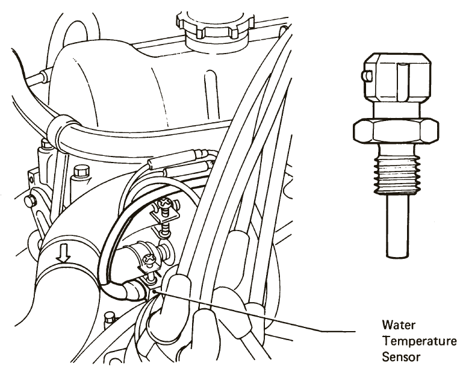
>
> - **Summary:** Component drawing of the threaded water temperature sensor alongside its installation location in the front thermostat housing.
> - **Components:** Water Temperature Sensor, Thermostat housing, Electrical harness lead, Spark plug wires
> - **Callouts:** **(Water Temperature Sensor)** Threaded NTC thermistor sensor
> - **Mechanic Notes:** Senses engine coolant temperature to determine warm-up enrichment.
> - **Tags:** `water temperature sensor`, `thermostat housing`, `coolant temperature`, `location` <!-- Page 20 (15) --> This sensor is just like the sensor which controls the water temperature gauge in the dash. That is, it changes its resistance as the engine temperature changes. The warmer the engine, the leaner the mixture, until the water temperature reaches 150 degrees Fahrenheit. (After warmup, this sensor should not affect injection operation.)

### Air Temperature Sensor

When the intake air is colder, it is denser. Or, in other words, there are more molecules (particles) of air in a given space. Therefore, more fuel must be mixed with this cold air than would be necessary with hot air.

> 🖼️ **AIR TEMPERATURE SENSOR in the air flow meter inlet**  *(Type: `component_location`)*
>
> 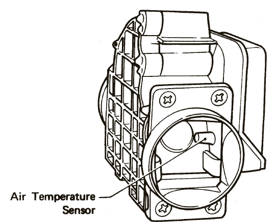
>
> - **Summary:** Close-up perspective of the air flow meter inlet horn showing the location of the intake air temperature sensor thermistor bulb.
> - **Components:** Air Temperature Sensor (thermistor), Air flow meter intake horn, Protective grid
> - **Callouts:** **(Air Temperature Sensor)** Thermistor bead positioned directly in incoming air stream
> - **Specs / Measurements:** Water temperature enrichment cutoff: 150°F; Air temperature enrichment cutoff: 68°F
> - **Mechanic Notes:** Below 68°F, ECU meters extra fuel to compensate for denser cold intake air. Eliminates need for carbureted-style exhaust manifold preheat tubes.
> - **Tags:** `air temperature sensor`, `intake air temperature`, `AFM inlet`, `thermistor`

An air temperature sensor measures the temperature of the air coming in from the air cleaner. While the air is warming up to 68 degrees, additional fuel is metered to the cylinders by the control unit. This temperature sensor works like the water temperature sensor; so the colder the intake air, the richer the mixture. Thus it is not necessary to preheat the air using vacuum motors and breather preheating tubes as are used on our carbureted engines.

### Start Signal

The control unit also receives a signal from the ignition switch while the engine is being cranked. This is because an engine requires additional fuel while starting since additional power is needed to move from a standstill to idling RPM, and because the air velocity through the manifold is not sufficient to cause a complete mixture of fuel and air. The control unit therefore responds to the start signal by holding the injectors open longer during cranking.

### Summary

Here again are the six sensor inputs to the control unit:

1. Air Flow Meter
2. Ignition Coil
3. Throttle Switch (2 positions)
4. Water Temperature Sensor
5. Air Temperature Sensor
6. Ignition Switch Start Signal

---

<!-- Page 21 (16) -->
# THE COLD START SYSTEM

Just like a carbureted engine, the fuel-injected Z-Car needs a choke system which supplies very large amounts of fuel only during starting. Also, like a carbureted engine, we need a fast idle to raise the engine speed while the engine is warming up.

### Cold Start Valve

> 🖼️ **COLD START VALVE**  *(Type: `component_location`)*
>
> 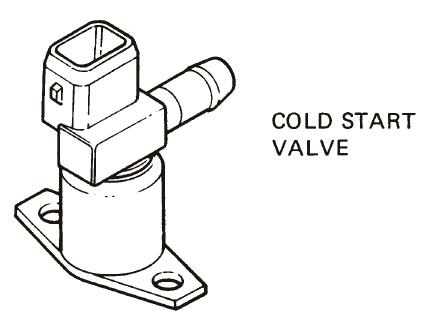
>
> - **Summary:** Exterior view of the cold start valve showing 2-bolt mounting flange, electrical receptacle, and fuel supply nipple.
> - **Components:** Cold start valve, Mounting flange, Electrical connector, Fuel inlet fitting
> - **Mechanic Notes:** Seventh injector providing cold cranking fuel enrichment.
> - **Tags:** `cold start valve`, `seventh injector`, `exterior`, `choke system`

To inject the additional fuel, we use a cold start valve. This is actually a seventh injector, and is mounted behind the throttle plate where it can spray fuel into the air which is going to all the cylinders. When you crank the engine, current goes from the ignition switch to this valve, which is then energized and sprays a very fine mist of fuel into the manifold. When you release the key, the current to this valve is cut off. This is very important to remember: THE COLD START VALVE GETS CURRENT ONLY WHEN THE STARTER IS CRANKING.

> 🖼️ **SECTIONAL VIEW OF COLD START VALVE**  *(Type: `cutaway_flow`)*
>
> 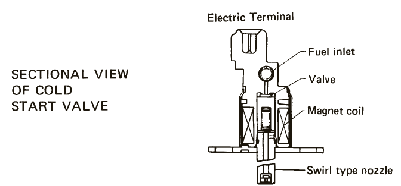
>
> - **Summary:** Cross-sectional cutaway drawing of the cold start valve showing internal electrical terminal, fuel inlet, solenoid magnet coil, plunger valve, and swirl spray nozzle.
> - **Components:** Electric Terminal, Fuel inlet, Valve, Magnet coil, Swirl type nozzle
> - **Callouts:** **(Electric Terminal)** 2-pin connector receiving cranking power; **(Fuel inlet)** Pressurized fuel feed connection; **(Valve)** Electromagnetic plunger needle valve; **(Magnet coil)** Actuating solenoid coil; **(Swirl type nozzle)** Precision swirl-type atomizing spray nozzle
> - **Mechanic Notes:** Operates ONLY while ignition starter is cranking; sprays atomized fuel into intake plenum.
> - **Tags:** `cold start valve`, `cutaway`, `sectional view`, `swirl nozzle`, `solenoid`

Now suppose the engine is in need of new spark plugs, and the ignition system is therefore not firing as well as it should. You would have to crank the starter longer before the engine would start. You can see that if the cold start valve continued to stay open, the engine might flood. <!-- Page 22 (17) --> ### Thermotime Switch

This problem is avoided by grounding the cold start valve through a switch with a little heating element in it. When the starter is being cranked, current runs from the ignition switch through the cold start valve to this switch and thus to ground. While this is happening, the little heater in the switch is operating; and after a certain time, the heat causes the switch (bimetal) to open.

> 🖼️ **COLD START VALVE — THERMOTIME SWITCH SCHEMATIC**  *(Type: `electrical_schematic`)*
>
> 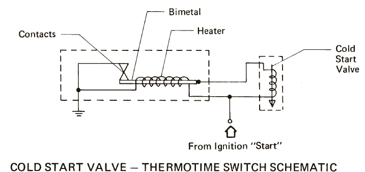
>
> - **Summary:** Electrical schematic illustrating the series circuit connecting ignition 'Start' terminal, cold start valve solenoid, and the thermotime switch bimetal heater and contacts to ground.
> - **Components:** Contacts, Bimetal, Heater, Cold Start Valve, Ignition switch (Start), Ground
> - **Callouts:** **(Contacts)** Normally closed switch contacts; **(Bimetal)** Bimetallic deflection element; **(Heater)** Electrical resistance heating coil; **(Cold Start Valve)** Solenoid valve coil; **(From Ignition 'Start')** Power feed during cranking
> - **Specs / Measurements:** Maximum operating duration: ~12 seconds
> - **Wiring / Connections:** From Ignition 'Start'
> - **Mechanic Notes:** Prevents engine flooding by limiting cold start valve injection time to a maximum of approximately 12 seconds during extended cranking.
> - **Tags:** `thermotime switch`, `cold start valve`, `schematic`, `bimetal`, `heater`, `wiring`

Because this switch operates according to both temperature and time, we call it the Thermotime Switch.

> 🖼️ **THERMOTIME SWITCH in thermostat housing**  *(Type: `component_location`)*
>
> 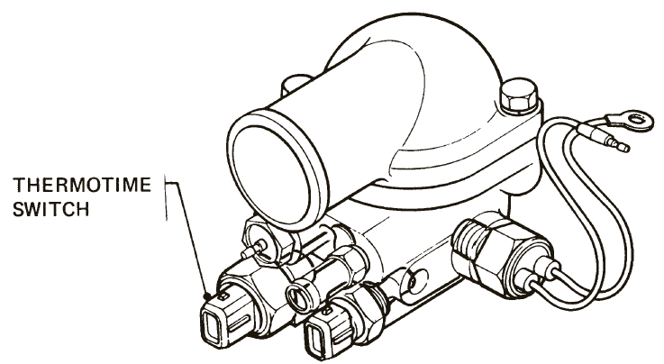
>
> - **Summary:** Perspective drawing of the thermostat housing assembly showing the thermotime switch screwed in next to the water temperature sensor.
> - **Components:** Thermotime switch, Thermostat housing, Water temperature sensor, Harness pigtails, Ground lug
> - **Callouts:** **(THERMOTIME SWITCH)** Threaded thermotime switch with electrical connector
> - **Specs / Measurements:** Maximum duration: ~12 seconds
> - **Mechanic Notes:** Engine coolant temperature determines initial bimetal deflection; if coolant is warm, contacts remain open and prevent cold start valve injection entirely.
> - **Tags:** `thermotime switch`, `location`, `thermostat housing`, `cooling system`

This switch is screwed into the thermostat housing next to the water temperature sensor. This is because a cold engine will need the cold start valve operation for a longer period of time than will a warm engine; and a hot engine will not need the valve at all. So, the engine heat also acts on the switch and makes it turn off the cold start valve. Therefore, the length of time that the cold start valve operates depends directly on engine temperature. (Incidentally, the maximum time for valve operation is about 12 seconds.)

---

<!-- Page 23 (18) -->
### Auxiliary Air Regulator

As we mentioned before, we also need some form of "fast idle" system to supply additional air during warmup.

> 🖼️ **AIR REGULATOR**  *(Type: `component_location`)*
>
> 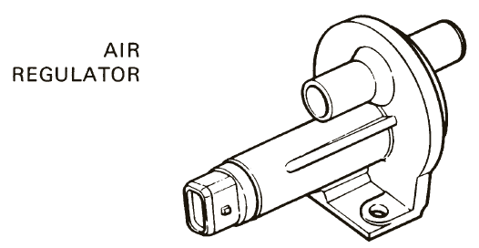
>
> - **Summary:** Isometric view of the auxiliary air regulator assembly showing air bypass tubes, 2-pin electrical connector, and mounting bracket.
> - **Components:** Auxiliary air regulator, Air inlet tube, Air outlet tube, Electrical plug, Mounting flange
> - **Mechanic Notes:** Provides fast idle air during engine warm-up by bypassing throttle valve.
> - **Tags:** `air regulator`, `auxiliary air regulator`, `fast idle`, `exterior`

With fuel injection, this is easy to do. You know that idle speed can be raised by simply bypassing the throttle plate. During warmup, we do exactly that by using an air valve, called an Auxiliary Air Regulator. This valve is similar to the electric automatic choke used on our carbureted engines. That is, it contains a heating element. Let's look at how this valve operates.

> 🖼️ **SECTIONAL VIEW OF AIR REGULATOR**  *(Type: `cutaway_flow`)*
>
> 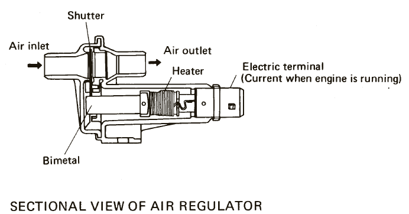
>
> - **Summary:** Cutaway sectional view of the auxiliary air regulator detailing the rotating shutter plate, bimetallic arm, electric heater winding, and air passages.
> - **Components:** Shutter, Air inlet, Air outlet, Heater, Electric terminal, Bimetal
> - **Callouts:** **(Shutter)** Rotary shutter disc that progressively closes air aperture; **(Air inlet)** Bypass air intake from upstream of throttle; **(Air outlet)** Bypass air delivery into intake manifold; **(Heater)** Electrical heating coil powered while engine runs; **(Electric terminal (Current when engine is running))** Connector pins receiving power from fuel pump circuit; **(Bimetal)** Bimetal strip deflecting as heater warms to close shutter
> - **Wiring / Connections:** Electric terminal: current when engine is running
> - **Mechanic Notes:** Not controlled by ECU or cold start valve; heater is powered whenever fuel pump runs, gradually closing shutter to reduce idle speed to normal.
> - **Tags:** `air regulator`, `sectional view`, `cutaway`, `shutter`, `bimetal`, `fast idle`

When the engine is cold, the valve is open; so when the engine starts, air can bypass the throttle plate and go through the valve. Now as long as the engine is running, current is supplied from the battery to the heating element in the valve. As the element heats up, a bimetal causes the valve to close slowly, closing off the air passage. Thus, the engine idle speed is progressively lowered.

Note one important point here: This valve is not controlled electrically by either the Cold Start Valve or to the Control Unit.

---

<!-- Page 24 (19) -->
# FUEL INJECTION ELECTRICAL SYSTEM

---

<!-- Page 25 (20) -->

> 🖼️ **Complete Electrical Circuit Schematic of the 280Z Electronic Fuel Injection System**  *(Type: `electrical_schematic`)*
>
> 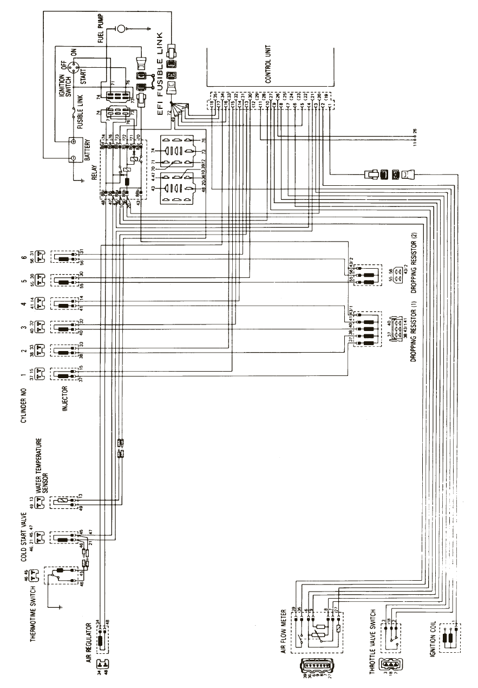
>
> - **Summary:** Comprehensive full-page schematic diagram of the complete 1975-1976 Datsun 280Z EFI electrical system, showing interconnections between battery, fusible links, ignition switch, injection relay, fuel pump, air flow meter contacts, dropping resistors, injectors (cylinders 1 through 6), cold start valve, thermotime switch, air regulator, water temperature sensor, ignition coil, and all 35 terminals of the Electronic Control Unit.
> - **Components:** Battery, Fusible link, Ignition switch, Injection relay, Fuel pump, EFI fusible link, Air flow meter, Throttle valve switch, Ignition coil, Dropping resistor (1), Dropping resistor (2), Injectors (Cylinders 1-6), Cold start valve, Thermotime switch, Water temperature sensor, Air regulator, Control unit
> - **Callouts:** **(CYLINDER NO)** Cylinders 1 to 6 injector connections: 1 (37, 15), 2 (38, 33), 3 (40, 32), 4 (41, 14), 5 (55, 30), 6 (56, 31); **(RELAY)** Injection relay with terminal numbers 86a, 86c, 85, 88a, 88b, 88c, 88d, 88e, 88z; **(DROPPING RESISTOR (1))** Resistor block for injectors 1, 2, 3 (pins 37, 38, 40, 41, 43/1); **(DROPPING RESISTOR (2))** Resistor block for injectors 4, 5, 6 (pins 55, 56, 43/2); **(CONTROL UNIT)** 35-pin connector layout (terminals 1 through 35); **(AIR FLOW METER)** Internal potentiometer, temperature sensor, and pump contacts (pins 39, 36, 6, 8, 9, 7, 27); **(THROTTLE VALVE SWITCH)** Idle, full throttle, and ground terminals (pins 3, 18, 2)
> - **Specs / Measurements:** 35-pin ECU connector; 6 dropping resistors (split into two packs)
> - **Wiring / Connections:** Terminal 1: Ignition coil (-) tach trigger; Terminals 39, 36: Fuel pump interlock contacts in AFM; Terminals 6, 7, 8, 9: AFM potentiometer; Terminal 27: AFM air temperature sensor; Terminals 46, 45: Thermotime switch; Terminals 49, 13: Water temperature sensor; Terminals 34, 48: Air regulator; Terminals 3, 18, 2: Throttle switch; Pins 14, 15, 30, 31, 32, 33: Injector ground triggers from ECU
> - **Mechanic Notes:** Critical reference diagram for tracing wiring faults, checking pin continuity, and testing sensor voltages from the 35-pin ECU disconnect plug.
> - **Tags:** `wiring schematic`, `electrical diagram`, `pinout`, `ECU`, `relay`, `injectors`, `dropping resistor`, `AFM`

---

<!-- Page 26 (21) -->
### Fuel Injection Harness

> 🖼️ **Fuel Injection Harness routing through engine compartment and cabin**  *(Type: `component_location`)*
>
> 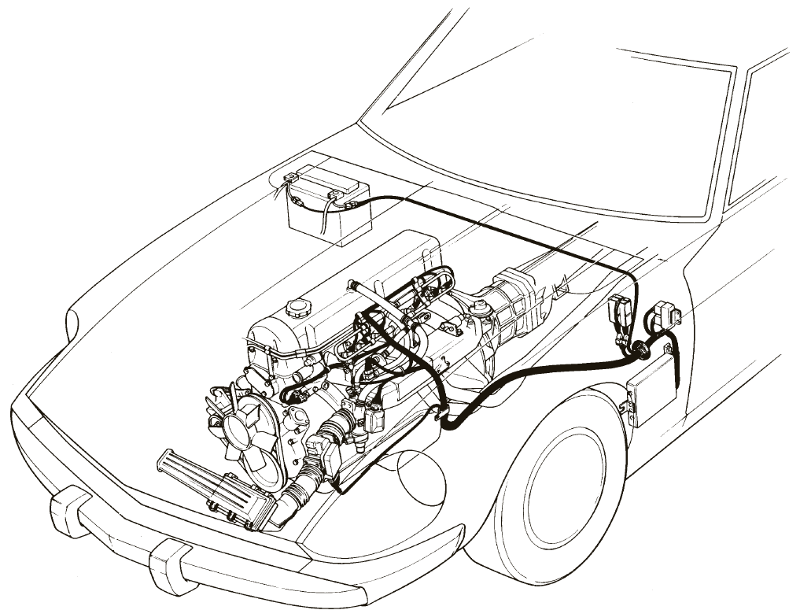
>
> - **Summary:** Vehicle isometric drawing illustrating the dedicated layout and body routing path of the separate EFI wiring harness connecting the battery, engine sensors/actuators, firewall passthrough grommet, and ECU in the driver footwell.
> - **Components:** EFI wiring harness, Battery, Engine assembly, Firewall grommet, ECU, Relay block, Dropping resistor
> - **Specs / Measurements:** 35-pin connector at control unit
> - **Wiring / Connections:** Isolated EFI wiring harness separate from vehicle chassis harness
> - **Mechanic Notes:** The EFI harness is independent of the vehicle's standard chassis wiring, featuring positive-locking connector plugs to prevent intermittent electrical faults. All circuits converge at the 35-pin ECU plug.
> - **Tags:** `harness routing`, `wiring harness`, `component location`, `35-pin connector`, `firewall routing`

On the 280Z, the wiring harness for the fuel injection system is completely separate from the other electrical circuitry in the vehicle. This makes troubleshooting easier. The harness also employs special plugs which lock securely in place, thus minimizing the possibility of poor connections.

All of the circuits in the system can be traced using the large 35-pin connector at the control unit. (See Troubleshooting Section.) <!-- Page 27 (22) --> ## Injection Relay

> 🖼️ **Fuel Injection Relay assembly**  *(Type: `component_location`)*
>
> 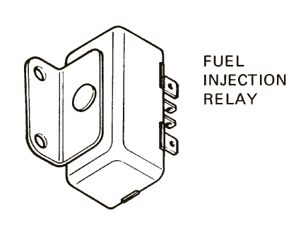
>
> - **Summary:** Perspective view of the fuel injection dual relay assembly showing mounting bracket and terminal spade connectors.
> - **Components:** Fuel injection relay, Mounting bracket, Terminal spade connectors
> - **Callouts:** **(FUEL INJECTION RELAY)** Fuel injection relay
> - **Wiring / Connections:** 6-pin / multiple spade terminals on relay base
> - **Mechanic Notes:** Contains two internal relays: Power Relay and Fuel Pump Relay.
> - **Tags:** `fuel injection relay`, `dual relay`, `kick panel`, `electrical`

The heart of the electrical system is the Fuel Injection Relay, which sends current to everything from the control unit to the fuel pump to the injectors. This is mounted on the left hand kick panel, above the control unit.

> 🖼️ **Fuel injection relay mounting on left hand kick panel above control unit**  *(Type: `component_location`)*
>
> 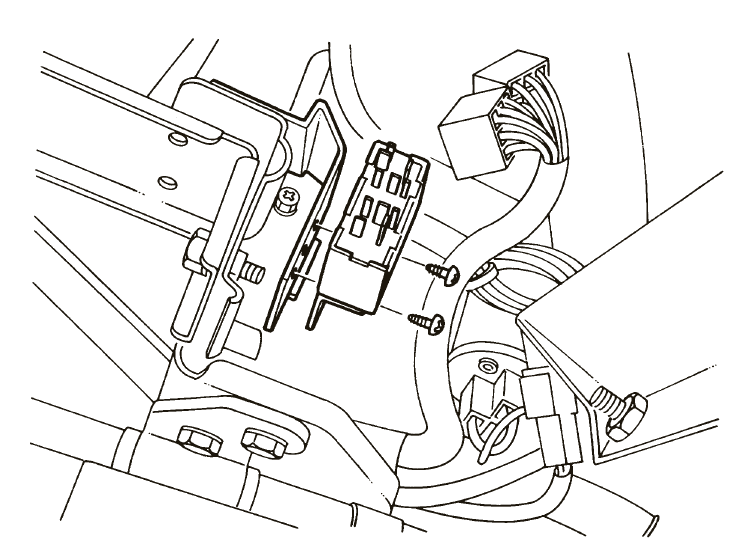
>
> - **Summary:** Illustration of the driver side footwell / left hand kick panel area showing the fuel injection relay mounted with two screws to the bracket above the EFI ECU control unit.
> - **Components:** Fuel injection relay, Relay mounting bracket, Mounting screws, Wire harness connectors, ECU bracket
> - **Wiring / Connections:** Harness connector to fuel injection relay; Main EFI harness routing above kick panel
> - **Mechanic Notes:** Located on the left-hand kick panel directly above the EFI Electronic Control Unit (ECU).
> - **Tags:** `relay location`, `kick panel`, `mounting`, `wiring harness`

The fuel injection relay is really two relays in one. Let's take a look at them and at what they do.

---

<!-- Page 28 (23) -->
## POWER RELAY

> 🖼️ **POWER RELAY schematic diagram**  *(Type: `electrical_schematic`)*
>
> 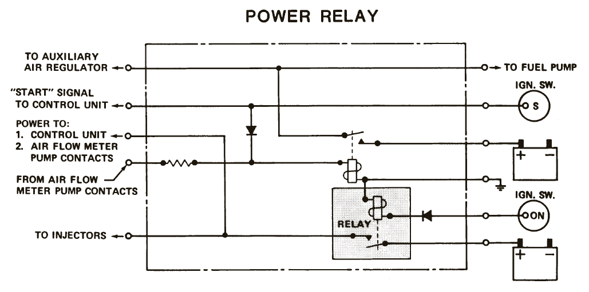
>
> - **Summary:** Internal schematic of the fuel injection relay with the Power Relay section shaded/highlighted, illustrating circuit connections to battery, ignition switch, injectors, ECU, and AFM contacts.
> - **Components:** Power relay coil and contacts, Diode, Resistor, Ignition switch (S, ON), Battery, Auxiliary air regulator feed, Control unit feed, Injectors feed, Air flow meter pump contacts
> - **Callouts:** **(POWER RELAY)** Power Relay section; **(TO AUXILIARY AIR REGULATOR)** To Auxiliary Air Regulator; **("START" SIGNAL TO CONTROL UNIT)** 'Start' Signal To Control Unit; **(POWER TO: 1. CONTROL UNIT 2. AIR FLOW METER PUMP CONTACTS)** Power To: 1. Control Unit, 2. Air Flow Meter Pump Contacts; **(FROM AIR FLOW METER PUMP CONTACTS)** From Air Flow Meter Pump Contacts; **(TO INJECTORS)** To Injectors; **(TO FUEL PUMP)** To Fuel Pump; **(IGN. SW. S)** Ignition Switch Start Terminal; **(IGN. SW. ON)** Ignition Switch ON Terminal
> - **Wiring / Connections:** Battery positive (+); Chassis ground; IGN. SW. (S) terminal; IGN. SW. (ON) terminal
> - **Mechanic Notes:** Main power source for ECU, dropping resistors/injectors, and AFM pump contacts.
> - **Tags:** `power relay`, `schematic`, `fuel injection relay`, `wiring`

The first part of the relay acts as a power relay. This is the main power source for the injection system. It sends current from the battery to the control unit, so that the unit can then operate all of its sensors and its own internal circuits.

This power relay also sends current to the fuel injectors. As you know, the current goes first to the injector resistors, and then to the injectors.

Finally, the power relay also sends current to a special set of contacts in the air flow meter. We'll look more closely at these contacts in a moment.

## FUEL PUMP RELAY

> 🖼️ **FUEL PUMP RELAY schematic diagram**  *(Type: `electrical_schematic`)*
>
> 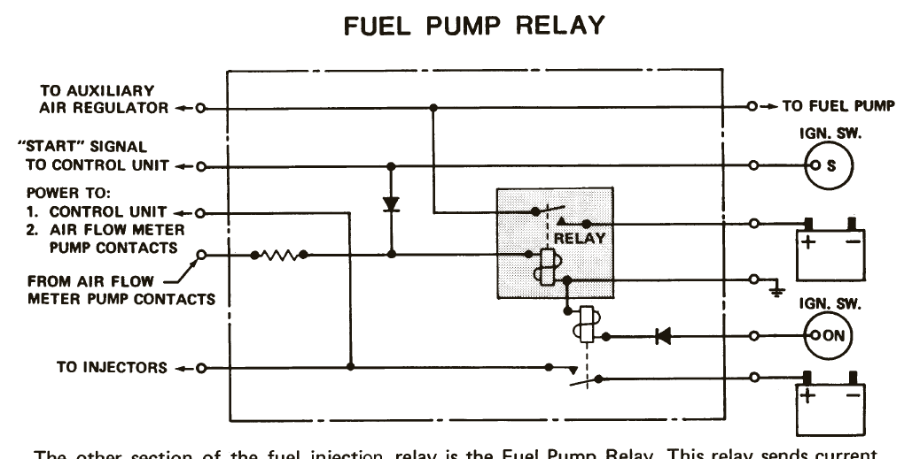
>
> - **Summary:** Internal schematic of the fuel injection relay with the Fuel Pump Relay section shaded/highlighted, controlling battery current to the fuel pump and auxiliary air regulator heater.
> - **Components:** Fuel pump relay coil and contacts, Diode, Resistor, Ignition switch (S, ON), Battery, Auxiliary air regulator, Fuel pump
> - **Callouts:** **(FUEL PUMP RELAY)** Fuel Pump Relay section; **(TO AUXILIARY AIR REGULATOR)** To Auxiliary Air Regulator; **("START" SIGNAL TO CONTROL UNIT)** 'Start' Signal To Control Unit; **(POWER TO: 1. CONTROL UNIT 2. AIR FLOW METER PUMP CONTACTS)** Power To: 1. Control Unit, 2. Air Flow Meter Pump Contacts; **(FROM AIR FLOW METER PUMP CONTACTS)** From Air Flow Meter Pump Contacts; **(TO INJECTORS)** To Injectors; **(TO FUEL PUMP)** To Fuel Pump; **(IGN. SW. S)** Ignition Switch Start Terminal; **(IGN. SW. ON)** Ignition Switch ON Terminal
> - **Wiring / Connections:** Battery (+); Chassis ground; Line to fuel pump positive; Line to auxiliary air regulator heater
> - **Mechanic Notes:** Sends current directly from battery to fuel pump and auxiliary air regulator heater.
> - **Tags:** `fuel pump relay`, `schematic`, `auxiliary air regulator`, `fuel pump`

The other section of the fuel injection relay is the Fuel Pump Relay. This relay sends current from the battery to the fuel pump. At the same time, it energizes the heating element in the Auxiliary Air Regulator.

---

<!-- Page 29 (24) -->
## Relay Operation

Both of these relays are controlled by the ignition switch. Let's take a look at how they work.

### FUEL INJECTION RELAY (START POSITION)

> 🖼️ **FUEL INJECTION RELAY (START POSITION) circuit flow**  *(Type: `electrical_schematic`)*
>
> 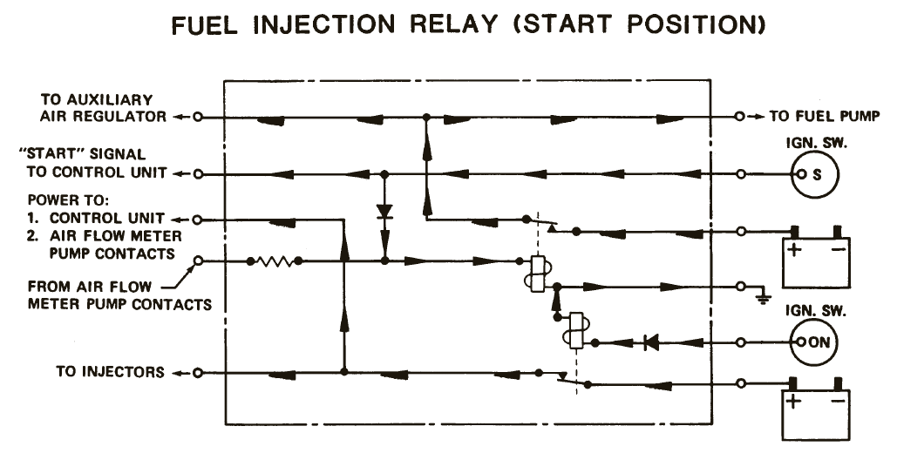
>
> - **Summary:** Schematic diagram showing current paths (indicated by arrows) during cranking: key in START position energizes both the power relay and the fuel pump relay simultaneously.
> - **Components:** Power relay, Fuel pump relay, Ignition switch S terminal, Battery, Control unit, Injectors, Fuel pump, Auxiliary air regulator
> - **Callouts:** **(FUEL INJECTION RELAY (START POSITION))** Fuel Injection Relay (Start Position); **(TO AUXILIARY AIR REGULATOR)** To Auxiliary Air Regulator; **("START" SIGNAL TO CONTROL UNIT)** 'Start' Signal To Control Unit; **(POWER TO: 1. CONTROL UNIT 2. AIR FLOW METER PUMP CONTACTS)** Power To: 1. Control Unit, 2. Air Flow Meter Pump Contacts; **(FROM AIR FLOW METER PUMP CONTACTS)** From Air Flow Meter Pump Contacts; **(TO INJECTORS)** To Injectors; **(TO FUEL PUMP)** To Fuel Pump; **(IGN. SW. S)** Ignition Switch Start Terminal; **(IGN. SW. ON)** Ignition Switch ON Terminal
> - **Wiring / Connections:** Current flows from IGN SW 'S' terminal through diodes to power relay and fuel pump relay coils
> - **Mechanic Notes:** Both relays energize directly from the starter signal to guarantee fuel pressure and ECU power during cranking.
> - **Tags:** `relay operation`, `start position`, `cranking`, `schematic`

When the ignition key is turned to the "start" position, both relays are energized directly. That is, the power relay is energized, and current runs to the control unit, to the injectors, and to the air flow meter contacts. At the same time, current also runs to the fuel pump relay, which in turn sends battery current to the fuel pump and to the Auxiliary Air Regulator.

### POWER RELAY: IGNITION ON

> 🖼️ **POWER RELAY: IGNITION ON circuit flow**  *(Type: `electrical_schematic`)*
>
> 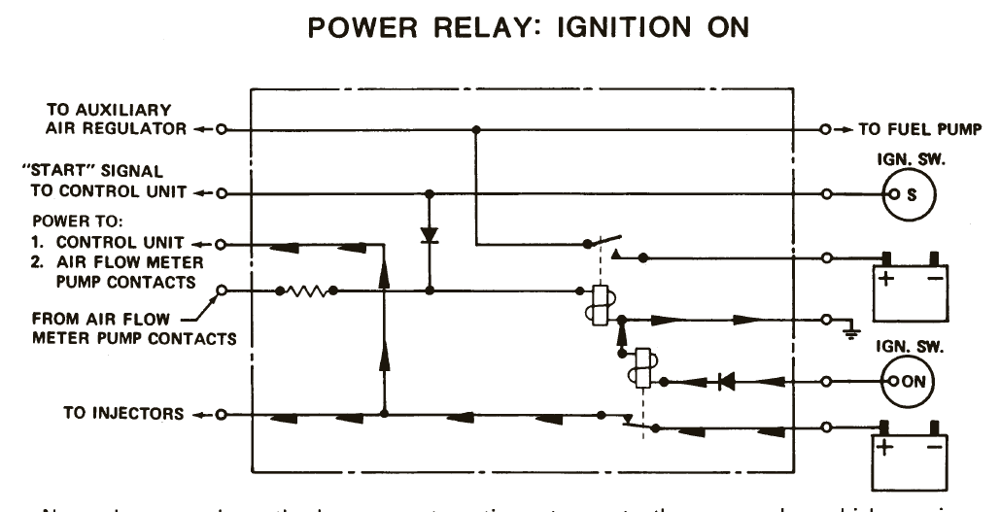
>
> - **Summary:** Schematic diagram showing current flow path with key in ON position: power relay coil remains energized from IGN SW ON terminal, while fuel pump relay contacts remain open until AFM flap moves.
> - **Components:** Power relay, Fuel pump relay, Ignition switch ON terminal, Battery, Control unit, Injectors
> - **Callouts:** **(POWER RELAY: IGNITION ON)** Power Relay: Ignition ON; **(TO AUXILIARY AIR REGULATOR)** To Auxiliary Air Regulator; **("START" SIGNAL TO CONTROL UNIT)** 'Start' Signal To Control Unit; **(POWER TO: 1. CONTROL UNIT 2. AIR FLOW METER PUMP CONTACTS)** Power To: 1. Control Unit, 2. Air Flow Meter Pump Contacts; **(FROM AIR FLOW METER PUMP CONTACTS)** From Air Flow Meter Pump Contacts; **(TO INJECTORS)** To Injectors; **(TO FUEL PUMP)** To Fuel Pump; **(IGN. SW. S)** Ignition Switch Start Terminal; **(IGN. SW. ON)** Ignition Switch ON Terminal
> - **Wiring / Connections:** Current flows from IGN SW 'ON' terminal to power relay coil and ground
> - **Mechanic Notes:** Key ON energizes power relay continuously, supplying power to ECU, injectors, and AFM switch terminals.
> - **Tags:** `power relay`, `ignition on`, `schematic`, `circuit flow`

Now when we release the key, current continues to run to the power relay, which remains energized. So the control unit, injectors, and air flow meter contacts continue to receive current.

---

<!-- Page 30 (25) -->
The fuel pump relay, however, no longer receives current directly from the ignition switch once it reaches the "on" position. That means that the fuel pump and the auxiliary air regulator are not automatically energized when the key is in this position.

There are two reasons for this: (1) Suppose the vehicle is in an accident where the engine is stopped and a fuel line has been damaged? If the fuel pump were allowed to continue running because the key was "on," then fuel might spray all over, creating a fire hazard. Therefore, we must see to it that the fuel pump stops when the engine stops; (2) Suppose you start the car on a cold day, and then go inside the house while the engine warms up — if the engine dies, and the auxiliary air regulator continues to receive current from the ignition switch, then there will no longer be a fast idle. The engine would then be difficult to start. The air regulator must therefore stop working when the engine stops.

Thus the fuel pump relay is energized (in the ignition "on" position) only when the engine is running. How is this managed?

## Air Flow Meter Contacts

> 🖼️ **Air Flow Meter internal mechanism showing flap, potentiometer, and fuel pump contact points**  *(Type: `cutaway_flow`)*
>
> 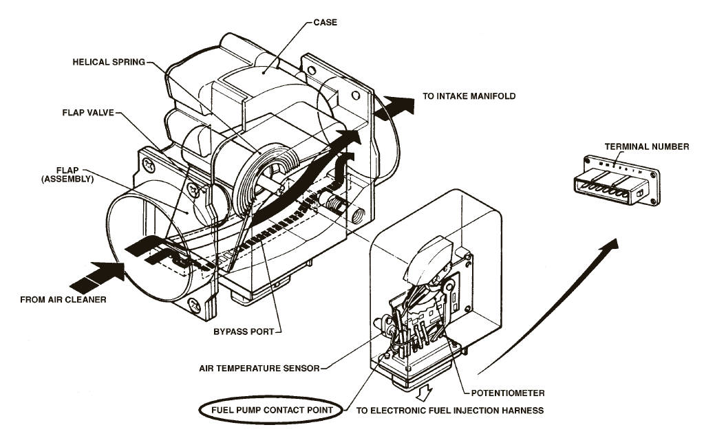
>
> - **Summary:** Cutaway illustration of the air flow meter assembly detailing internal components: air measuring flap valve, return helical spring, idle air bypass channel, intake air temperature thermistor, potentiometer board, and fuel pump switch contact points.
> - **Components:** Air flow meter case, Helical return spring, Flap valve assembly, Bypass port, Air temperature sensor, Fuel pump contact points, Potentiometer, Terminal number connector
> - **Callouts:** **(CASE)** Case; **(HELICAL SPRING)** Helical spring; **(FLAP VALVE)** Flap valve; **(FLAP (ASSEMBLY))** Flap (assembly); **(BYPASS PORT)** Bypass port; **(AIR TEMPERATURE SENSOR)** Air temperature sensor; **(FUEL PUMP CONTACT POINT)** Fuel pump contact point; **(POTENTIOMETER)** Potentiometer; **(TO INTAKE MANIFOLD)** Airflow direction to intake manifold; **(FROM AIR CLEANER)** Airflow direction from air cleaner; **(TO ELECTRONIC FUEL INJECTION HARNESS)** Connector to EFI harness; **(TERMINAL NUMBER)** Terminal connector pinout
> - **Wiring / Connections:** Internal contacts wired to AFM connector terminals for fuel pump relay trigger
> - **Mechanic Notes:** Flap must swing freely. Air flow moves flap against helical spring to mechanically close the fuel pump switch contacts.
> - **Tags:** `air flow meter`, `fuel pump contacts`, `cutaway`, `flap valve`, `safety switch`

---

<!-- Page 31 (26) -->
In order to sense when the engine is running, the engineers have installed a special fuel pump switch in the air flow meter. As soon as the engine starts, the air flow through the meter pushes the flap far enough to close the switch contacts.

## FUEL PUMP RELAY: ENGINE RUNNING

> 🖼️ **FUEL PUMP RELAY: ENGINE RUNNING circuit flow**  *(Type: `electrical_schematic`)*
>
> 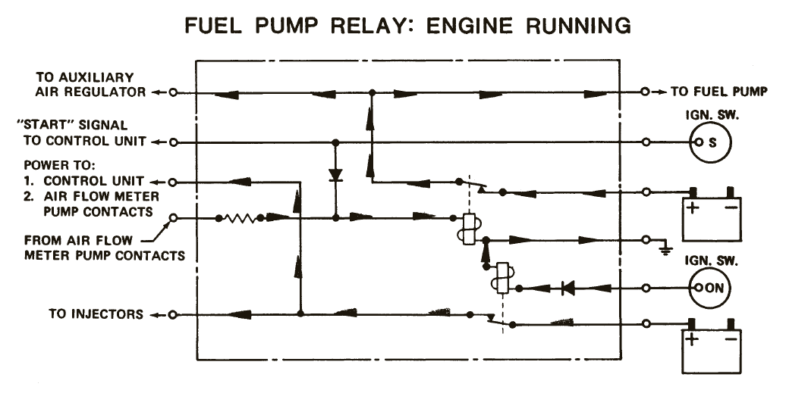
>
> - **Summary:** Schematic diagram showing current paths when engine is running: power flows from power relay through closed AFM contacts into the fuel pump relay coil, energizing fuel pump and air regulator.
> - **Components:** Power relay, Fuel pump relay, Air flow meter pump contacts, Fuel pump, Auxiliary air regulator, Ignition switch ON, Diode
> - **Callouts:** **(FUEL PUMP RELAY: ENGINE RUNNING)** Fuel Pump Relay: Engine Running; **(TO AUXILIARY AIR REGULATOR)** To Auxiliary Air Regulator; **("START" SIGNAL TO CONTROL UNIT)** 'Start' Signal To Control Unit; **(POWER TO: 1. CONTROL UNIT 2. AIR FLOW METER PUMP CONTACTS)** Power To: 1. Control Unit, 2. Air Flow Meter Pump Contacts; **(FROM AIR FLOW METER PUMP CONTACTS)** From Air Flow Meter Pump Contacts; **(TO INJECTORS)** To Injectors; **(TO FUEL PUMP)** To Fuel Pump; **(IGN. SW. S)** Ignition Switch Start Terminal; **(IGN. SW. ON)** Ignition Switch ON Terminal
> - **Wiring / Connections:** Current from power relay passes through AFM switch contacts to fuel pump relay coil and ground
> - **Mechanic Notes:** Diode in fuel pump relay prevents backfeed into starter solenoid line during engine running.
> - **Tags:** `fuel pump relay`, `engine running`, `schematic`, `air flow meter contacts`

Now current flows from the power relay, through the contacts, and back into the fuel pump relay. The fuel pump relay is therefore activated, and sends current to work the fuel pump and the auxiliary air regulator. If the engine stops, then the air flow will stop. The fuel pump contacts in the meter will open, the relay will disengage, and the fuel pump will stop working.

By the way, the diode in the fuel pump relay keeps current from feeding back toward the starter when the relay is working.

A thorough understanding of these basic principles is invaluable to fuel injection troubleshooting. Most important is an understanding of the wiring diagrams which you will find in the 280Z Service Manual, pages EF-25 - EF-50.

So that's all there is to the new Fuel Injection System. What at first might appear to be difficult, is really very simple when it is broken down into its component parts.

The next section of this book describes detailed testing and troubleshooting which can be performed using basic test equipment.

---

<!-- Page 32 (27) -->
# SECTION II

# FUEL INJECTION

# TROUBLESHOOTING

---

<!-- Page 33 (28) -->
## Fuel Injection and Emission Hose Layout

> 🖼️ **Engine compartment fuel injection and emission vacuum routing and component layout (L28 engine)**  *(Type: `vacuum_routing`)*
>
> 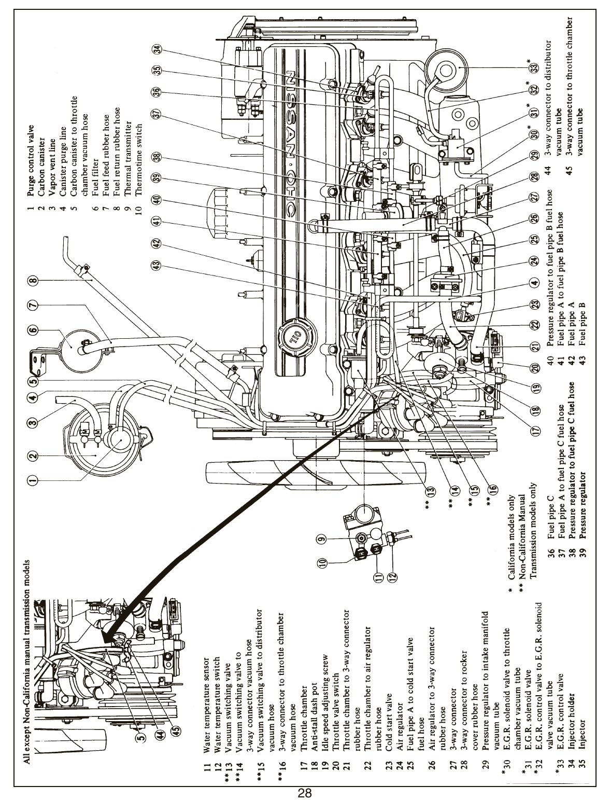
>
> - **Summary:** Comprehensive engine bay diagram showing complete layout and routing of fuel gallery pipes (A, B, C), pressure regulator, cold start valve, auxiliary air regulator, carbon canister hoses, EGR system, and distributor vacuum advance on the L28 engine.
> - **Components:** Purge control valve, Carbon canister, Fuel filter, Thermotime switch, Water temperature sensor, Water temperature switch, Vacuum switching valve, Throttle chamber, Anti-stall dash pot, Idle speed adjusting screw, Throttle valve switch, Cold start valve, Air regulator, E.G.R. solenoid valve, E.G.R. control valve, Injectors, Fuel pipe A, Fuel pipe B, Fuel pipe C, Pressure regulator, Distributor vacuum tube
> - **Callouts:** **(1)** Purge control valve; **(2)** Carbon canister; **(3)** Vapor vent line; **(4)** Canister purge line; **(5)** Carbon canister to throttle chamber vacuum hose; **(6)** Fuel filter; **(7)** Fuel feed rubber hose; **(8)** Fuel return rubber hose; **(9)** Thermal transmitter; **(10)** Thermotime switch; **(11)** Water temperature sensor; **(12)** Water temperature switch; **(13)** Vacuum switching valve (Non-California Manual Transmission); **(14)** Vacuum switching valve to 3-way connector vacuum hose; **(15)** Vacuum switching valve to distributor vacuum hose; **(16)** 3-way connector to throttle chamber vacuum hose; **(17)** Throttle chamber; **(18)** Anti-stall dash pot; **(19)** Idle speed adjusting screw; **(20)** Throttle valve switch; **(21)** Throttle chamber to 3-way connector rubber hose; **(22)** Throttle chamber to air regulator rubber hose; **(23)** Cold start valve; **(24)** Air regulator; **(25)** Fuel pipe A to cold start valve fuel hose; **(26)** Air regulator to 3-way connector rubber hose; **(27)** 3-way connector; **(28)** 3-way connector to rocker cover rubber hose; **(29)** Pressure regulator to intake manifold vacuum tube; **(30)** E.G.R. solenoid valve to throttle chamber vacuum tube (California); **(31)** E.G.R. solenoid valve (California); **(32)** E.G.R. control valve to E.G.R. solenoid valve vacuum tube (California); **(33)** E.G.R. control valve (California); **(34)** Injector holder; **(35)** Injector; **(36)** Fuel pipe C; **(37)** Fuel pipe A to fuel pipe C fuel hose; **(38)** Pressure regulator to fuel pipe C fuel hose; **(39)** Pressure regulator; **(40)** Pressure regulator to fuel pipe B fuel hose; **(41)** Fuel pipe A to fuel pipe B fuel hose; **(42)** Fuel pipe A; **(43)** Fuel pipe B; **(44)** 3-way connector to distributor vacuum tube; **(45)** 3-way connector to throttle chamber vacuum tube
> - **Wiring / Connections:** Vacuum hoses and fuel lines across intake manifold and engine front/side
> - **Mechanic Notes:** California models feature EGR solenoid and tubes. Non-California manual models feature vacuum switching valve for distributor vacuum advance.
> - **Tags:** `vacuum routing`, `fuel routing`, `fuel rails`, `EGR`, `canister`, `air regulator`, `L28`

### Hose and Line Legend

| No. | Component / Line Description |
| :---: | :--- |
| 1 | Purge control valve |
| 2 | Carbon canister |
| 3 | Vapor vent line |
| 4 | Canister purge line |
| 5 | Carbon canister to throttle chamber vacuum hose |
| 6 | Fuel filter |
| 7 | Fuel feed rubber hose |
| 8 | Fuel return rubber hose |
| 9 | Thermal transmitter |
| 10 | Thermotime switch |
| 11 | Water temperature sensor |
| 12 | Water temperature switch |
| **13 | Vacuum switching valve |
| **14 | Vacuum switching valve to 3-way connector vacuum hose |
| **15 | Vacuum switching valve to distributor vacuum hose |
| **16 | 3-way connector to throttle chamber vacuum hose |
| 17 | Throttle chamber |
| 18 | Anti-stall dash pot |
| 19 | Idle speed adjusting screw |
| 20 | Throttle valve switch |
| 21 | Throttle chamber to 3-way connector rubber hose |
| 22 | Throttle chamber to air regulator rubber hose |
| 23 | Cold start valve |
| 24 | Air regulator |
| 25 | Fuel pipe A to cold start valve fuel hose |
| 26 | Air regulator to 3-way connector rubber hose |
| 27 | 3-way connector |
| 28 | 3-way connector to rocker cover rubber hose |
| 29 | Pressure regulator to intake manifold vacuum tube |
| *30 | E.G.R. solenoid valve to throttle chamber vacuum tube |
| *31 | E.G.R. solenoid valve |
| *32 | E.G.R. control valve to E.G.R. solenoid valve vacuum tube |
| *33 | E.G.R. control valve |
| 34 | Injector holder |
| 35 | Injector |
| 36 | Fuel pipe C |
| 37 | Fuel pipe A to fuel pipe C fuel hose |
| 38 | Pressure regulator to fuel pipe C fuel hose |
| 39 | Pressure regulator |
| 40 | Pressure regulator to fuel pipe B fuel hose |
| 41 | Fuel pipe A to fuel pipe B fuel hose |
| 42 | Fuel pipe A |
| 43 | Fuel pipe B |
| 44 | 3-way connector to distributor vacuum tube |
| 45 | 3-way connector to throttle chamber vacuum tube |

\* California models only  
\*\* Non-California Manual Transmission models only

---

<!-- Page 34 (29) -->
# TROUBLESHOOTING FUEL INJECTION

## First Steps:

> 🖼️ **Electronic fuel injection harness, battery, relays, and ECU connector routing**  *(Type: `component_location`)*
>
> 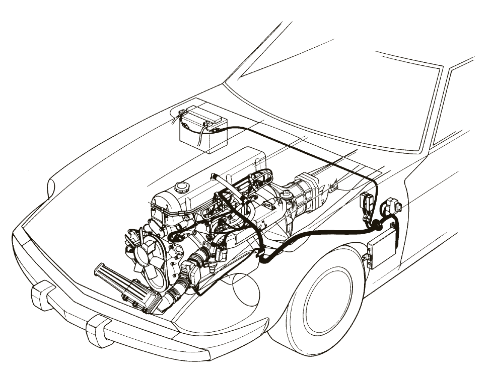
>
> - **Summary:** Ghosted cutaway view of 280Z chassis showing complete EFI wire harness runs between battery, engine sensors/injectors, dropping resistor, relays, and ECU in the driver footwell.
> - **Components:** Battery, EFI main wiring harness, Fuel injectors, Air flow meter, Dropping resistor pack, Fuel injection relay, Electronic Control Unit (ECU)
> - **Wiring / Connections:** Main wiring harness running along inner fender and firewall to driver side kick panel ECU
> - **Mechanic Notes:** Always check all electrical harness connectors for loose fit and terminal corrosion before diagnosing individual components.
> - **Tags:** `wiring harness`, `connectors`, `corrosion`, `troubleshooting`, `ECU location`

1. The greatest problem source with a system of this type lies in the connections between components. Save time by performing a quick check of all connectors for (a) looseness and (b) corrosion. Pull all connectors off and reconnect after inspecting terminals.

---

<!-- Page 35 (30) -->

> 🖼️ **Vacuum hose and intake leakage inspection locations**  *(Type: `component_location`)*
>
> 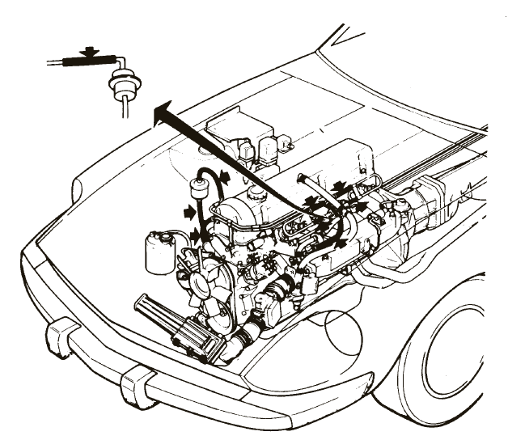
>
> - **Summary:** Isometric cutaway view of engine compartment highlighting vacuum hoses, rubber intake boots, and PCV connections that must be checked for cracks and vacuum leaks.
> - **Components:** Intake air duct boot, Vacuum hoses, PCV valve, Throttle chamber
> - **Callouts:** **(HOSES)** Hoses inspection
> - **Specs / Measurements:** Battery cranking voltage minimum: 9.6 V
> - **Mechanic Notes:** Inspect all rubber hoses for hardening, splitting, or loose clamps. Vacuum leaks cause lean running and erratic idle.
> - **Tags:** `hoses`, `vacuum leaks`, `cranking voltage`, `troubleshooting quick steps`

2. Next, make sure all hoses are in good condition. Check for cracks or vacuum leaks.

3. Finally, make sure the (a) ignition and (b) starting systems are satisfactory. Battery voltage should not drop below 9.6 volts while cranking.

---

## TROUBLESHOOTING — QUICK STEPS

### Starting Problems:
| Symptom | Diagnostic Page |
| :--- | :--- |
| Engine Will Not Start | Page 32 |
| Hard To Start When Cold | Page 34 |
| Hard To Start When Hot | Page 35 |
| Engine Starts, Then Stalls | Page 36 |

### Idling Problems:
| Symptom | Diagnostic Page |
| :--- | :--- |
| Idle Too High Or Too Rough | Page 38 |
| Misfiring - HC Too High | Page 39 |
| Lack Of Power Or Engine Will Not Rev. | Page 40 |
| Hesitation - Stumble | Page 41 |
| Poor Gas Mileage | Page 42 |
| CO Too High | Page 42 |
| Surge | Page 43 |
| Backfire | Page 44 |
| Afterfire | Page 44 |

### General Testing:
| Section | Page |
| :--- | :--- |
| Circuit Tests - Using The Control Unit 35-Pin Connector | Page 45 |
| Component Checks | Page 72 |

---

<!-- Page 36 (31) -->
## Checking air leakage in air intake system

> 🖼️ **Checking air leakage in air intake system**  *(Type: `cutaway_flow`)*
>
> 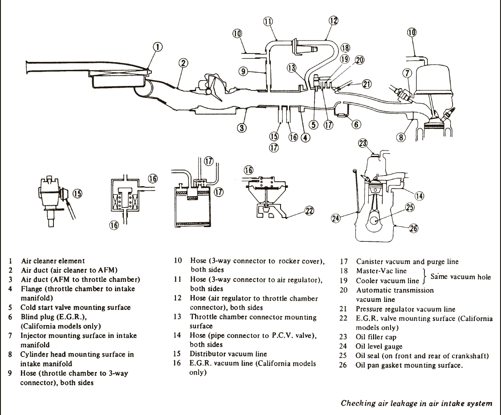
>
> - **Summary:** Comprehensive schematic cross-section of the complete induction and crankcase breathing system illustrating all 26 potential points of unmetered air leakage downstream of the air flow meter.
> - **Components:** Air cleaner element, Air duct, Air flow meter, Throttle chamber, Intake manifold, Cold start valve, Injectors, Auxiliary air regulator, PCV valve, Distributor vacuum advance, EGR valve, Carbon canister purge line, Brake booster Master-Vac line, A/C vacuum line, Automatic transmission vacuum line, Pressure regulator line, Oil filler cap, Oil dipstick, Crankshaft front/rear oil seals, Oil pan gasket
> - **Callouts:** **(1)** Air cleaner element; **(2)** Air duct (air cleaner to AFM); **(3)** Air duct (AFM to throttle chamber); **(4)** Flange (throttle chamber to intake manifold); **(5)** Cold start valve mounting surface; **(6)** Blind plug (E.G.R.), (California models only); **(7)** Injector mounting surface in intake manifold; **(8)** Cylinder head mounting surface in intake manifold; **(9)** Hose (throttle chamber to 3-way connector), both sides; **(10)** Hose (3-way connector to rocker cover), both sides; **(11)** Hose (3-way connector to air regulator), both sides; **(12)** Hose (air regulator to throttle chamber connector), both sides; **(13)** Throttle chamber connector mounting surface; **(14)** Hose (pipe connector to P.C.V. valve), both sides; **(15)** Distributor vacuum line; **(16)** E.G.R. vacuum line (California models only); **(17)** Canister vacuum and purge line; **(18)** Master-Vac line; **(19)** Cooler vacuum line; **(20)** Automatic transmission vacuum line; **(21)** Pressure regulator vacuum line; **(22)** E.G.R. valve mounting surface (California models only); **(23)** Oil filler cap; **(24)** Oil level gauge; **(25)** Oil seal (on front and rear of crankshaft); **(26)** Oil pan gasket mounting surface
> - **Mechanic Notes:** Because the EFI system measures airflow entering the engine, ANY unmetered air entering through vacuum hoses, dipstick O-ring, oil cap seal, or crank seals causes severe lean misfire or rough idle.
> - **Tags:** `air leakage`, `intake system`, `vacuum leaks`, `unmetered air`, `false air`, `PCV`

| Item | Inspection Location |
| :---: | :--- |
| 1 | Air cleaner element |
| 2 | Air duct (air cleaner to AFM) |
| 3 | Air duct (AFM to throttle chamber) |
| 4 | Flange (throttle chamber to intake manifold) |
| 5 | Cold start valve mounting surface |
| 6 | Blind plug (E.G.R.), (California models only) |
| 7 | Injector mounting surface in intake manifold |
| 8 | Cylinder head mounting surface in intake manifold |
| 9 | Hose (throttle chamber to 3-way connector), both sides |
| 10 | Hose (3-way connector to rocker cover), both sides |
| 11 | Hose (3-way connector to air regulator), both sides |
| 12 | Hose (air regulator to throttle chamber connector), both sides |
| 13 | Throttle chamber connector mounting surface |
| 14 | Hose (pipe connector to P.C.V. valve), both sides |
| 15 | Distributor vacuum line |
| 16 | E.G.R. vacuum line (California models only) |
| 17 | Canister vacuum and purge line |
| 18 | Master-Vac line (Same vacuum hole) |
| 19 | Cooler vacuum line (Same vacuum hole) |
| 20 | Automatic transmission vacuum line |
| 21 | Pressure regulator vacuum line |
| 22 | E.G.R. valve mounting surface (California models only) |
| 23 | Oil filler cap |
| 24 | Oil level gauge |
| 25 | Oil seal (on front and rear of crankshaft) |
| 26 | Oil pan gasket mounting surface |

---

<!-- Page 37 (32) -->
# ENGINE WILL NOT START

1. Check The Ignition System:
   - Scope
   - Pull Coil Wire Out Of Distributor And Check For Hot Spark

2. Check For Vacuum Leaks (See Diagram On Previous Page)
   - PCV Valve, Dip Stick Seal, Oil Filler Cap Seal
   - Air Flow Meter Hoses And Clamps
   - Manifold Gaskets

3. Fuel Pump-Pressure Regulator Operation:
   - Pull Solenoid Lead Off Starter
   - Turn Key To "Start" And Listen For Fuel Pump And Pressure Regulator Operation.
   - Results:
     - (a) Fuel Pump Runs And Pressure Regulator Buzzes: Go To Step 4 Below.
     - (b) No Noise: Go To Step 6, Page 33.

4. Ignition Signal Input:

> 🖼️ **Locating ignition lead wire to control unit next to power relay**  *(Type: `procedure_step`)*
>
> 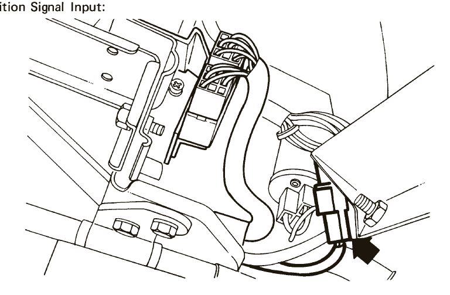
>
> - **Summary:** Drawing showing kick panel area with arrow pointing to the inline bullet connector of the ignition trigger lead wire adjacent to the power relay bracket.
> - **Components:** Ignition lead wire connector, Power relay, Relay bracket, Kick panel harness
> - **Wiring / Connections:** Ignition signal input bullet connector leading to ECU pin 1
> - **Mechanic Notes:** Check for 12V test light illumination with ignition switch in ON position.
> - **Tags:** `ignition signal`, `lead wire`, `engine will not start`, `test light`, `kick panel`

   - Locate Ignition Lead Wire To Control Unit (Next To Power Relay-See Drawing).
   - Key On Check For Current With Test Light.
   - Results:
     - (a) Light On: Go To Step 5, Page 33
     - (b) Light Off: Check Ignition Circuit, 280-Z Service Manual, page EF-39.

---

<!-- Page 38 (33) -->
5. Power Relay - Control Unit - Injector Test:

> 🖼️ **Listening to injector operation with mechanic's stethoscope or screwdriver**  *(Type: `procedure_step`)*
>
> 
>
> - **Summary:** Technician using a screwdriver held against a fuel injector nozzle with ear against handle to listen for audible clicking during simulated ignition triggering.
> - **Components:** Fuel injector, Fuel rail / gallery pipe, Intake manifold, Screwdriver / stethoscope
> - **Specs / Measurements:** Audible click expected every third break of ignition lead wire
> - **Mechanic Notes:** Disconnecting and reconnecting ignition lead wire simulates distributor ignition pulse; ECU should trigger injectors on every 3rd pulse.
> - **Tags:** `injector test`, `injector click`, `screwdriver`, `stethoscope`, `troubleshooting`

   - Key On, Disconnect And Reconnect Ignition Lead Wire Several Times. Have Someone Listen To Each Injector.
   - Results:
     - (a) Injectors Click Every Third Break: Perform The Following Circuit Checks At The 35-Pin Connector In The Order Below:
       - (1) 1 - (6), page 54
       - (2) 1 - (3a - 3c), pages 49 - 51
       - (3) 3 - (3), page 71
       - (4) 1 - (5), page 53
       - (5) 3 - (1), page 69
       - (6) 3 - (2), page 70
       - Then, proceed to "Component Checks", page 72.
     - (b) Injectors Do Not Click: Go To Step 6, Below.

6. Power Relay Check:
   - Locate Power Relay (Upper Left Hand Kick Panel), Place Your Hand Over It.
   - Turn Key First To "On" And Then To "Start".
   - Results:
     - (a) Relay Doesn't Click: Perform The Following Circuit Checks In The Order Below:
       - (1) 3 - (1), page 69
       - (2) 1 - (7), page 55
       - (3) 1 - (8), page 56
     - (b) Relay Clicks: Perform The Following Circuit Checks In The Order Below:
       - (1) 2 - (2), page 62
       - (2) 2 - (1), page 61
       - (3) 1 - (9a - 9d), pages 57 - 60
       - (4) 2 - (3a - 3f), pages 63 - 68
   - If Problem Persists, Reconnect Harness To ECU And Perform Step 5 Again. If Test Still Negative, Try Another Control Unit.

---

<!-- Page 39 (34) -->
# ENGINE HARD TO START ONLY WHEN COLD

1. Battery Cranking Voltage Check:
   - Connect Voltmeter To Battery
   - Pull Coil Wire And Ground It
   - Crank Engine
   - Results:
     - (a) Below 9.6 Volts: Recharge Battery Or Check Ignition Circuit
     - (b) Above 9.6 Volts: Go To Step 2, Below

2. Perform The Following Tests:
   - (1) Circuit Check 3 - (3), page 71

> 🖼️ **Inspecting and disconnecting cold start valve electrical harness connector**  *(Type: `procedure_step`)*
>
> 
>
> - **Summary:** Hand disconnecting electrical quick-disconnect connector from the cold start valve on the intake manifold.
> - **Components:** Cold start valve, Harness connector plug, Intake manifold
> - **Specs / Measurements:** Battery cranking voltage minimum: 9.6 V
> - **Wiring / Connections:** Cold start valve two-terminal harness connector
> - **Mechanic Notes:** Depress wire retaining spring clip when unplugging connector. Cranking voltage must be at least 9.6V to operate cold start enrichment.
> - **Tags:** `cold start valve`, `hard to start cold`, `connector`, `cranking voltage`

   - (2) Component Test: Cold Start Valve (280Z Service Manual, page EF-54)

If Both These Tests Are Satisfactory, Proceed To "Engine Will Not Start" On Page 32.

---

<!-- Page 40 (35) -->
# ENGINE HARD TO START ONLY WHEN HOT (ABOVE 170°F)

1. Check Valve Adjustment, Ignition And Emission Systems

2. Cold Start System Test (a)
   - Disconnect Cold Start Valve
   - Unplug Coil Wire, Ground It
   - Crank Engine A Few Times To Clean Out Excess Fuel
   - Reconnect Coil Wire And Try To Start Engine
   - Results:
     - (a) Engine Starts Easily: Go To Step 3, Below
     - (b) Engine Still Hard To Start: Perform The Following Checks In The Order Below:
       - (1) Circuit Test 1 - (6), Page 54
       - (2) Circuit Tests 1 - (3a - 3c), pages 49 - 51
       - (3) Component Test: Fuel Pressure, 280Z Service Manual, Page EF-56
       - (4) Component Test: Injectors, 280Z Service Manual, Page EF-57
     - If No Problem Is Found, Proceed To "Engine Will Not Start" On Page 32.

3. Cold Start System Test (b)
   - Reconnect Cold Start Valve
   - Disconnect Thermotime Switch

> 🖼️ **Thermotime switch connector location on thermostat housing**  *(Type: `procedure_step`)*
>
> 
>
> - **Summary:** Arrow pointing to the thermotime switch electrical connector located on the thermostat housing alongside the water temperature sensor and thermal transmitter.
> - **Components:** Thermotime switch, Water temperature sensor, Thermostat housing, Harness connector
> - **Specs / Measurements:** Hot engine threshold: above 170°F
> - **Wiring / Connections:** Thermotime switch two-pin electrical connector
> - **Mechanic Notes:** If thermotime switch contacts stick closed when hot, engine floods due to unwanted cold start valve operation.
> - **Tags:** `thermotime switch`, `hard to start hot`, `thermostat housing`, `flooding`, `cold start`

   - Try To Start Engine
   - Results:
     - (a) Engine Hard To Start: Check Cold Start Valve (280-Z Service Manual, Page EF-54) And Replace If Necessary.
     - (b) Engine Starts Easily: Check Thermotime Switch (280Z Service Manual, Page EF-53) And Replace If Necessary

---

<!-- Page 41 (36) -->
# ENGINE STARTS, THEN STALLS

1. Ignition Signal Input:

> 🖼️ **Locating ignition lead wire connector near power relay**  *(Type: `procedure_step`)*
>
> 
>
> - **Summary:** Kick panel area drawing indicating the bullet connector for the ECU ignition trigger input wire next to the relay bracket.
> - **Components:** Ignition lead wire, Power relay, Relay mounting bracket, Harness connector
> - **Wiring / Connections:** Ignition signal lead connector
> - **Mechanic Notes:** Check for 12V current with test light when ignition is ON.
> - **Tags:** `starts then stalls`, `ignition signal`, `test light`, `power relay`

   - Locate Ignition Lead Wire To Control Unit
   - Key On, Check For Current With Test Light
   - Results:
     - (a) Light On: Go To Step 2, Below
     - (b) Light Off: Check Ignition Circuit, 280Z Service Manual, Page EF-39

2. Power Relay - Control Unit - Injector Test:

> 🖼️ **Listening for injector clicking with screwdriver to ear**  *(Type: `procedure_step`)*
>
> 
>
> - **Summary:** Technician with handle of screwdriver pressed to ear and blade against fuel injector to listen for injector solenoid clicking while triggering circuit.
> - **Components:** Fuel injector, Screwdriver, Fuel rail, Intake manifold
> - **Mechanic Notes:** Injectors should click every 3rd pulse.
> - **Tags:** `injector click`, `starts then stalls`, `stethoscope`, `injector test`

   - Key On, Disconnect And Reconnect Ignition Lead Wire Several Times. Have Someone Listen To Each Injector. <!-- Page 42 (37) --> Results:
(a) Injectors Click Every Third Break: Go To Step 4, Below
(b) Injectors Don't Click: Go To Step 3, Below

3. Power Relay Check:
   - Locate Power Relay (Upper Left Hand Kick Panel), Place Your Hand Over It
   - Turn Key First To "On" And Then To "Start"
   - Results:
     - (a) Relay Clicks Twice: Go To Step 4, Below
     - (b) Relay Clicks Only Once Or Not At All: Perform The Following Circuit Tests In The Order Below:
       - (1) 3 - (1), Page 69
       - (2) 1 - (7), Page 55
       - (3) 1 - (8), Page 56

4. Air Flow Meter Pump Contacts:
   - Remove Front Hose To Air Flow Meter
   - Ignition "On"

> 🖼️ **Testing air flow meter fuel pump contacts by manually opening the flap**  *(Type: `procedure_step`)*
>
> 
>
> - **Summary:** Hand reaching into inlet collar of air flow meter and manually pushing the flap valve open to test activation of the internal fuel pump contacts.
> - **Components:** Air flow meter, Flap valve, Inlet duct
> - **Wiring / Connections:** Internal fuel pump switch contacts wired to AFM pins
> - **Mechanic Notes:** With ignition ON, moving flap even slightly should immediately activate the electric fuel pump. If engine starts and immediately dies when key returns to ON, defective AFM contacts are a primary cause.
> - **Tags:** `air flow meter`, `flap test`, `fuel pump contacts`, `starts then stalls`, `safety switch`

   - Using A Finger, Reach In And Push Open The Air Flow Meter Flap
   - Results:
     - (a) Fuel Pump Operates: Go To Step 5, Below
     - (b) Fuel Pump Does Not Operate: Check Circuit Outlined In 280-Z Service Manual Page EF-31

5. Perform Circuit Test 1 - (6), Page 54

6. Check Auxiliary Air Regulator, See 1975 280-Z Service Manual, Page EF-58

If No Problem Found, Proceed To "Engine Will Not Start" On Page 32.

---

<!-- Page 43 (38) -->
# ENGINE IDLES TOO FAST — CANNOT BE ADJUSTED WITH SPEED SCREW OR ENGINE IDLE IS UNSTABLE

1. Unstable Idling: Check Valve Adjustment

2. Check That Throttle Plate Is Closing When Throttle Is Released

3. Check That EGR Valve Is Not Sticking Open (California Only)

4. Check That B.C.D.D. Valve Is Not Open At Idle And That Relief Solenoid Is Connected

5. Auxiliary Air Regulator Check:

> 🖼️ **Checking auxiliary air regulator by pinching off hose with pliers**  *(Type: `procedure_step`)*
>
> 
>
> - **Summary:** View of intake manifold and auxiliary air regulator hoses showing pliers pinching the rubber air hose to test for internal regulator shutter leakage at warm idle.
> - **Components:** Auxiliary air regulator, Air regulator hoses, Pliers, Intake manifold, Throttle chamber
> - **Callouts:** **(AIR REGULATOR HOSES)** Air regulator hoses
> - **Mechanic Notes:** When engine is warmed up, pinching the air regulator hose should NOT cause idle speed to drop. If idle drops, regulator is failing to close completely (heater circuit defect or sticking shutter).
> - **Tags:** `auxiliary air regulator`, `high idle`, `unstable idle`, `pinch test`, `fast idle`

   - Using Pliers, Pinch Off Hose To Auxiliary Air Regulator
   - Results:
     - (a) Idle Drops: Perform Circuit Test 1-(8), Pg.56. If No Fault Found, Replace Regulator.
     - (b) Idle Remains High Or Unstable: Go To Step 6, Below

6. Check For Manifold Vacuum Leaks, Including At PCV Valve, Dip Stick And Oil Filler Cap Seals. (See Diagram Page 31.)
   - If No Problem Found, Perform The Following Circuit Tests In The Order Below:
     - (1) 1 - (1), Page 47
     - (2) 1 - (2), Page 48
     - (3) 1 - (4), Page 52
     - (4) 1 - (6), Page 54
     - (5) 1 - (9a - 9d), Page 57 - 60
     - (6) 1 - (3a - 3c), Page 49 - 51
     - (7) 1 - (5), Page 53
     - (8) 1 - (8), Page 56
     - (9) 3 - (2), Page 70
     - (10) 2 - (1), Page 61
     - (11) 2 - (2), Page 62
     - (12) 2 - (3a - 3f), Page 63 - 68
   - Then proceed to Component Checks, Page 72.

---

<!-- Page 44 (39) -->
# ENGINE MISFIRES — HC READING TOO HIGH

1. Check Ignition Circuit Thoroughly

2. Check Charging System Voltage Regulator Setting

3. Pull All Fuel Injection Connectors Apart And Check For Looseness And Corrosion (Including Ground Circuits). Don't Forget Ignition Input Lead.

4. Check Fuel Circuit For Blockage:
   - Tank Strainer
   - Fuel Filter
   - Injectors
   - Lines

5. Tap Control Unit While Driving To See If This Aggravates Or Alleviates The Problem. If So, Try Another ECU.

6. Perform Fuel Pressure Test. 280Z Service Manual, Page EF-57

7. Perform All Circuit Tests Starting On Page 45

8. Perform Component Tests. See Page 72

---

<!-- Page 45 (40) -->
# ENGINE WILL NOT REV. — LACK OF POWER

1. Check Transistor Ignition Thoroughly, Including Pickup Coil(s) And Ignition Coil (See Engine Performance And Emission Analysis)

2. Make Sure Throttle Plate Is Opening Fully When Accelerator Is Fully Depressed

3. Check Air Flow Meter Mechanical Movement:
   - Remove Front (Intake Hose)

> 🖼️ **Checking air flow meter flap for smooth mechanical movement**  *(Type: `procedure_step`)*
>
> 
>
> - **Summary:** Technician using a finger to push the air flow meter flap through its full travel to confirm completely unrestricted mechanical movement.
> - **Components:** Air flow meter, Flap valve
> - **Mechanic Notes:** Flap must swing freely without sticking, catching, or dragging against the meter housing throughout its entire range of motion.
> - **Tags:** `air flow meter`, `lack of power`, `flap movement`, `will not rev`

   - Using A Finger, Push The Flap Open, Checking That It Opens Smoothly And Fully

4. Check For Blockage In Fuel Circuit:
   - Tank Strainer
   - Fuel Filter
   - Lines

5. Perform Fuel Pressure Test, 280-Z Service Manual, Page EF-57

6. Perform The Following Circuit Tests In The Order Below:
   - (1) 1 - (2), Page 48
   - (2) 2 - (1), Page 61
   - (3) 2 - (2), Page 62
   - (4) 2 - (3a - 3f), Page 63 - 68
   - (5) 1 - (3a - 3c), Page 49 - 51
   - (6) 1 - (1), Page 47
   - (7) 1 - (4), Page 52
   - (8) 1 - (6), Page 54
   - (9) 1 - (8), Page 56

7. Perform Component Tests. See Page 72

---

<!-- Page 46 (41) -->
# HESITATION — STUMBLE ON ACCELERATION

1. Check Ignition System Thoroughly. (See Engine Performance And Emission Analysis.)

2. Air Flow Meter Mechanical Check:
   - Remove Front (Intake) Hose From Air Flow Meter

> 🖼️ **Testing air flow meter flap for resistance points causing hesitation**  *(Type: `procedure_step`)*
>
> 
>
> - **Summary:** Close-up of hand pushing the AFM measuring flap to detect subtle drag or binding points that cause hesitation on throttle tip-in.
> - **Components:** Air flow meter, Flap valve
> - **Mechanic Notes:** If any resistance points or catching is felt, replace the air flow meter.
> - **Tags:** `hesitation`, `stumble`, `air flow meter`, `acceleration`, `binding`

   - Using A Finger, Check For Smooth Flap Movement
   - Results:
     - (a) Resistance Points Felt: Replace Air Flow Meter
     - (b) Movement Is Normal: Go To Step 3, Below

3. Check For Intake Manifold Leaks (See Diagram Page 31).
   - PCV Valve
   - Dip Stick And Oil Filler Cap Seals
   - Manifold Gaskets
   - Air Flow Meter Hoses

4. Perform Fuel Pressure Test, 280-Z Service Manual, Page EF-57

5. Perform Complete Circuit Test, Starting On Page 45

6. Perform Component Checks, See Page 72

---

<!-- Page 47 (42) -->
# POOR GAS MILEAGE, OR CO READING TOO HIGH

1. Check Timing; Check Ignition System For "Hot" Spark (Use Scope If Available).

2. Check Air Cleaner Element

> 🖼️ **Fuel pressure gauge installed in fuel line to cold start valve**  *(Type: `inspection_measurement`)*
>
> 
>
> - **Summary:** Drawing showing dial fuel pressure test gauge tee'd into the fuel delivery hose connected to the cold start valve on the intake manifold.
> - **Components:** Fuel pressure gauge, Cold start valve, Fuel gallery pipe, Fuel hose
> - **Callouts:** **(PRESSURE GAUGE)** Pressure gauge; **(COLD START VALVE)** Cold start valve
> - **Specs / Measurements:** Fuel pressure test: Refer to 280Z Service Manual page EF-57
> - **Mechanic Notes:** Connect pressure gauge between fuel delivery pipe and cold start valve. Excessive pressure causes rich running and high CO emissions.
> - **Tags:** `fuel pressure test`, `pressure gauge`, `cold start valve`, `poor gas mileage`, `high CO`

3. Perform Fuel Pressure Test: See 280Z Service Manual, Page EF-57

4. Perform The Following Circuit Tests In The Order Below:
   - (1) 1 - (6), Page 54
   - (2) 1 - (4), Page 52
   - (3) 1 - (1), Page 47
   - (4) 1 - (2), Page 48
   - (5) 1 - (3a - 3c), Pages 49 - 51
   - (6) 3 - (2), Page 70
   - (7) 1 - (8), Page 56
   - (8) 2 - (3a - 3f), Pages 63 - 68

5. Then Proceed To Component Checks, See Page 72

---

<!-- Page 48 (43) -->
# SURGE

1. Air Flow Meter Mechanical Check:
   - Remove Front (Intake) Air Hose From Air Flow Meter

> 🖼️ **Checking air flow meter flap smoothness for surge conditions**  *(Type: `procedure_step`)*
>
> 
>
> - **Summary:** Technician checking AFM flap deflection for mechanical stiffness or flat spots that induce cruising surge.
> - **Components:** Air flow meter, Flap valve
> - **Mechanic Notes:** Verify flap swings freely with smooth resistance from internal spring.
> - **Tags:** `surge`, `air flow meter`, `flap smoothness`, `troubleshooting`

   - Using A Finger, Check Flap Movement For Smoothness Of Operation. If No Resistance Is Felt, Go To Step 2 Below.

2. Check For Manifold Vacuum Leaks (See Diagram Page 31).
   - PCV Valve
   - Dip Stick And Oil Filler Cap Seals
   - Manifold Gaskets
   - Air Flow Meter Hoses

3. Perform The Following Circuit Tests In The Order Below:
   - (1) 1 - (1), Page 47
   - (2) 1 - (2), Page 48
   - (3) 1 - (3a - 3c), Pages 49 - 51
   - (4) 1 - (5), Page 53
   - (5) 1 - (9a - 9d), Pages 57 - 60
   - (6) 1 - (4), Page 52
   - (7) 1 - (6), Page 54
   - (8) 1 - (8), Page 56
   - (9) 2 - (1), Page 61
   - (10) 2 - (2), Page 62
   - (11) 2 - (3a - 3f), Pages 63 - 68

4. Then Proceed To Component Tests, Page 72

---

<!-- Page 49 (44) -->
# BACKFIRING

1. Check For Manifold Vacuum Leaks. (See Diagram Page 31).
   - PCV Valve
   - Dip Stick And Oil Filler Cap Seals
   - Manifold Gaskets
   - Air Flow Meter Hoses

2. Perform The Following Circuit Tests In The Order Listed:
   - (1) 1 - (1), Page 47
   - (2) 1 - (2), Page 48
   - (3) 1 - (3a - 3c), Pages 49 - 51
   - (4) 1 - (4), Page 52
   - (5) 1 - (6), Page 54
   - (6) 2 - (1), Page 61
   - (7) 2 - (2), Page 62
   - (8) 2 - (3a - 3f), Pages 63 - 68

3. Then Proceed To The Component Tests On Page 72.

---

# AFTERFIRE OR AFTERBURNING

1. Perform The Following Circuit Tests In The Order Listed:
   - (1) 1 - (1), Page 47
   - (2) 1 - (2), Page 48
   - (3) 1 - (3a - 3c), Pages 49 - 51
   - (4) 1 - (4), Page 52
   - (5) 1 - (6), Page 54
   - (6) 2 - (3a - 3f), Pages 63 - 68
   - (7) 3 - (1), Page 69

2. Then Proceed To Component Checks, Page 72

---

<!-- Page 50 (45) -->
# CIRCUIT TESTING

### Using The 35-Pin Control Unit Connector

| Test # | Description | Diagnostic Page |
| :--- | :--- | :--- |
| 1 - (1) | Idle Throttle Switch | Page 47 |
| 1 - (2) | Full Throttle Switch | Page 48 |
| 1 - (3a) | Air Flow Meter - Resistance #1 | Page 49 |
| 1 - (3b) | Air Flow Meter - Resistance #2 | Page 50 |
| 1 - (3c) | Air Flow Meter - Resistance #3 | Page 51 |
| 1 - (4) | Air Temperature Sensor Resistance | Page 52 |
| 1 - (5) | Air Flow Meter Fuel Pump Contacts | Page 53 |
| 1 - (6) | Water Temperature Sensor Resistance | Page 54 |
| 1 - (7) | Fuel Pump Relay Circuit | Page 55 |
| 1 - (8) | Air Regulator And Fuel Pump Circuit | Page 56 |
| 1 - (9a) | Control Unit Ground Circuit #1 | Page 57 |
| 1 - (9b) | Control Unit Ground Circuit #2 | Page 58 |
| 1 - (9c) | Control Unit Ground Circuit #3 | Page 59 |
| 1 - (9d) | Control Unit Ground Circuit #4 | Page 60 |
| 2 - (1) | Ignition Coil Trigger Input Circuit | Page 61 |
| 2 - (2) | Control Unit Power Input Circuit | Page 62 |
| 2 - (3a) | #4 Injector Circuit | Page 63 |
| 2 - (3b) | #1 Injector Circuit | Page 64 |
| 2 - (3c) | #5 Injector Circuit | Page 65 |
| 2 - (3d) | #6 Injector Circuit | Page 66 |
| 2 - (3e) | #3 Injector Circuit | Page 67 |
| 2 - (3f) | #2 Injector Circuit | Page 68 |
| 3 - (1) | "Start" Signal Circuit | Page 69 |
| 3 - (2) | Air Regulator Circuit | Page 70 |
| 3 - (3) | Cold Start System Circuit | Page 71 |
| **Component Checks** | Component Checks Procedure | Page 72 |

---

<!-- Page 51 (46) -->

> 🖼️ **Testing harness circuits with multimeter at 35-pin ECU connector**  *(Type: `procedure_step`)*
>
> 
>
> - **Summary:** Technician using multimeter test probes to probe specific pin sockets on the disconnected 35-pin control unit wiring harness plug in the footwell area.
> - **Components:** 35-pin ECU harness connector block, Multimeter / Ohmmeter, Test probes, Clutch and brake pedals
> - **Callouts:** **(CONNECTOR)** 35-pin control unit connector
> - **Wiring / Connections:** Probing female harness terminals 1 through 35
> - **Mechanic Notes:** Disconnect 35-pin connector only with ignition OFF. Insert probes gently into terminal cavities to avoid damaging spring tension.
> - **Tags:** `35-pin connector`, `circuit testing`, `multimeter`, `ECU connector`, `ohmmeter`

**CONNECTOR**

---

<!-- Page 52 (47) -->
# TEST #1 - (1): IDLE THROTTLE SWITCH

**Note: Turn off ignition before disconnecting control unit.**

> 🖼️ **Complete EFI wiring schematic highlighting Test #1 - (1): Idle Throttle Switch circuit (pins 2 and 18)**  *(Type: `electrical_schematic`)*
>
> 
>
> - **Summary:** System-wide EFI wiring schematic highlighting the idle contact circuit of the throttle valve switch connected between pin 2 and ground return pin 18 at the 35-pin control unit connector.
> - **Components:** Thermotime switch, Cold start valve, Water temp sensor, Injectors (Cyl 1-6), EFI fusible link, Battery, Fusible link, Ignition switch, Fuel pump, Air regulator, Relay assembly, Air flow meter, Dropping resistor pack, Throttle valve switch, Ignition coil, 35-pin connector
> - **Callouts:** **(THROTTLE VALVE SW)** Throttle valve switch (terminals 3, 18, 2); **(DROPPING RESISTOR)** Dropping resistor pack; **(RELAY)** Fuel injection relay; **(AIR FLOW METER)** Air flow meter
> - **Specs / Measurements:** Throttle released: Continuity (0 Ω); Throttle depressed: No continuity (∞ Ω)
> - **Wiring / Connections:** Pin 2: Idle throttle switch input; Pin 18: Throttle switch ground
> - **Mechanic Notes:** Turn off ignition before disconnecting ECU. Check for continuity when throttle is at idle stop; opening throttle slightly must break continuity.
> - **Tags:** `idle throttle switch`, `circuit test`, `schematic`, `pin 2`, `pin 18`, `continuity`

| Tester | Leads To Pins | Notes | Should Read |
| :--- | :--- | :--- | :--- |
| Ohmmeter | 2 - 18 | Throttle Released | Continuity |
| | | Throttle Depressed | No Continuity |

> 🖼️ **35-pin ECU connector pin assignment showing test pins 2 and 18 highlighted**  *(Type: `component_location`)*
>
> 
>
> - **Summary:** Face-view pinout of the 35-pin female control unit harness connector highlighting pin 2 and pin 18.
> - **Components:** 35-pin control unit harness connector
> - **Callouts:** **(2)** Pin 2 (Idle switch); **(18)** Pin 18 (Switch ground)
> - **Specs / Measurements:** Connect ohmmeter leads between pin 2 and pin 18
> - **Wiring / Connections:** Upper row pins 1 through 18, lower row pins 19 through 35
> - **Mechanic Notes:** Pin 2 is on top row near left; pin 18 is far right on top row.
> - **Tags:** `35-pin connector`, `pinout`, `pin 2`, `pin 18`, `test points`

| If test is unsatisfactory, check: | 1975 280Z Service Manual (Page) |
| :--- | :--- |
| 1. Throttle Valve Switch | EF-56* |
| 2. Wiring | EF-25 |

\*Adjustment of Throttle Valve Switch: See Page EF-65.

---

<!-- Page 53 (48) -->
### TEST #1 - (2): FULL THROTTLE SWITCH

**Note:** Turn off ignition before disconnecting control unit.

> 🖼️ **Test #1 - (2): Full Throttle Switch Circuit Schematic**  *(Type: `electrical_schematic`)*
>
> 
>
> - **Summary:** Schematic of the 280Z EFI wiring harness highlighting the throttle valve switch circuit across pins 3 and 18 connected to the 35-pin control unit connector.
> - **Components:** Thermotime S.W., Cold Start Valve, Water Temp Sensor, Injector Cyl 1-6, Air Regulator, Air Flow Meter, Throttle Valve Sw., Ignition Coil, Dropping Resistor, Relay, Battery, Fusible Link, Ignition Sw., Fuel Pump, EFI Fusible Link, 35-Pin Control Unit Connector
> - **Callouts:** **(3)** Throttle valve switch full throttle contact; **(18)** Throttle valve switch common contact
> - **Specs / Measurements:** Part Throttle: No Continuity; Full Throttle: Continuity
> - **Wiring / Connections:** Pin 3 to Throttle Valve Switch terminal 3; Pin 18 to Throttle Valve Switch terminal 18
> - **Mechanic Notes:** Turn off ignition before disconnecting control unit.
> - **Tags:** `full throttle switch`, `throttle valve switch`, `test 1-2`, `continuity check`

| Tester | Leads To Pins | Notes | Should Read |
| :--- | :---: | :--- | :--- |
| Ohmmeter | 3 - 18 | Part Throttle | No Continuity |
| | | Full Throttle | Continuity |

> 🖼️ **Control Unit Connector Pin Test Leads: Pins 3 and 18**  *(Type: `component_location`)*
>
> 
>
> - **Summary:** Illustration of the 35-pin EFI control unit wiring harness connector with test probes pointing to pin 3 and pin 18.
> - **Components:** 35-Pin Control Unit Connector
> - **Callouts:** **(3)** Pin 3 lead; **(18)** Pin 18 lead
> - **Specs / Measurements:** Test leads to pins 3 and 18
> - **Wiring / Connections:** Pins 3 and 18
> - **Mechanic Notes:** Probe harness connector with ohmmeter across pins 3 and 18.
> - **Tags:** `connector pinout`, `pin 3`, `pin 18`, `ohmmeter`

| If test is unsatisfactory, check: | 1975 280Z Service Manual (Page) |
| :--- | :---: |
| 1. Throttle Valve Switch | EF-56 |
| 2. Wiring | EF-26 |

---

<!-- Page 54 (49) -->
### TEST #1 - (3a): AIR FLOW METER - RESISTANCE #1

**Note:** Turn off ignition before disconnecting control unit.

> 🖼️ **Test #1 - (3a): Air Flow Meter - Resistance #1 Schematic**  *(Type: `electrical_schematic`)*
>
> 
>
> - **Summary:** EFI wiring harness schematic highlighting the potentiometer circuit between pins 6 and 8 of the air flow meter.
> - **Components:** Air Flow Meter, 35-Pin Control Unit Connector
> - **Callouts:** **(6)** Air flow meter pin 6; **(8)** Air flow meter pin 8
> - **Specs / Measurements:** Resistance: Approximately 180 Ohms
> - **Wiring / Connections:** Pins 6 and 8 to Air Flow Meter
> - **Mechanic Notes:** Turn off ignition before disconnecting control unit.
> - **Tags:** `air flow meter`, `resistance test`, `pins 6-8`, `potentiometer`

| Tester | Leads To Pins | Should Read |
| :--- | :---: | :--- |
| Ohmmeter | 6 - 8 | Approximately 180 Ohms |

> 🖼️ **Control Unit Connector Pin Test Leads: Pins 6 and 8**  *(Type: `component_location`)*
>
> 
>
> - **Summary:** Illustration of the 35-pin EFI control unit wiring harness connector with test probes pointing to pin 6 and pin 8.
> - **Components:** 35-Pin Control Unit Connector
> - **Callouts:** **(6)** Pin 6 lead; **(8)** Pin 8 lead
> - **Specs / Measurements:** Ohmmeter connected to pins 6 and 8
> - **Wiring / Connections:** Pins 6 and 8
> - **Mechanic Notes:** Verify approximately 180 Ohms across pins 6 and 8.
> - **Tags:** `connector pinout`, `pin 6`, `pin 8`, `ohmmeter`

| If test is unsatisfactory, check: | 1975 280Z Service Manual (Page) |
| :--- | :---: |
| 1. Air Flow Meter | EF-51 |
| 2. Wiring | EF-27 |

---

<!-- Page 55 (50) -->
### TEST #1 - (3b): AIR FLOW METER - RESISTANCE #2

**Note:** Turn off ignition before disconnecting control unit.

> 🖼️ **Test #1 - (3b): Air Flow Meter - Resistance #2 Schematic**  *(Type: `electrical_schematic`)*
>
> 
>
> - **Summary:** EFI wiring schematic highlighting circuit between pins 7 and 8 of the air flow meter.
> - **Components:** Air Flow Meter, 35-Pin Control Unit Connector
> - **Callouts:** **(7)** Air flow meter pin 7; **(8)** Air flow meter pin 8
> - **Specs / Measurements:** Resistance: Continuity (Small Resistance)
> - **Wiring / Connections:** Pins 7 and 8 to Air Flow Meter
> - **Mechanic Notes:** Turn off ignition before disconnecting control unit.
> - **Tags:** `air flow meter`, `resistance test`, `pins 7-8`, `continuity`

| Tester | Leads To Pins | Should Read |
| :--- | :---: | :--- |
| Ohmmeter | 7 - 8 | Continuity (Small Resistance) |

> 🖼️ **Control Unit Connector Pin Test Leads: Pins 7 and 8**  *(Type: `component_location`)*
>
> 
>
> - **Summary:** Illustration of the 35-pin EFI control unit connector with test leads connected to pin 7 and pin 8.
> - **Components:** 35-Pin Control Unit Connector
> - **Callouts:** **(7)** Pin 7 lead; **(8)** Pin 8 lead
> - **Specs / Measurements:** Ohmmeter connected to pins 7 and 8
> - **Wiring / Connections:** Pins 7 and 8
> - **Mechanic Notes:** Small resistance indicates continuity across flap sensor wiper.
> - **Tags:** `connector pinout`, `pin 7`, `pin 8`, `ohmmeter`

| If test is unsatisfactory, check: | 1975 280Z Service Manual (Page) |
| :--- | :---: |
| 1. Air Flow Meter | EF-51 |
| 2. Wiring | EF-28 |

---

<!-- Page 56 (51) -->
### TEST #1 - (3c): AIR FLOW METER - RESISTANCE #3

**Note:** Turn off ignition before disconnecting control unit.

> 🖼️ **Test #1 - (3c): Air Flow Meter - Resistance #3 Schematic**  *(Type: `electrical_schematic`)*
>
> 
>
> - **Summary:** EFI wiring harness schematic highlighting circuit between pins 8 and 9 of the air flow meter.
> - **Components:** Air Flow Meter, 35-Pin Control Unit Connector
> - **Callouts:** **(8)** Air flow meter pin 8; **(9)** Air flow meter pin 9
> - **Specs / Measurements:** Resistance: Approximately 100 Ohms
> - **Wiring / Connections:** Pins 8 and 9 to Air Flow Meter
> - **Mechanic Notes:** Turn off ignition before disconnecting control unit.
> - **Tags:** `air flow meter`, `resistance test`, `pins 8-9`

| Tester | Leads To Pins | Should Read |
| :--- | :---: | :--- |
| Ohmmeter | 8 - 9 | Approximately 100 Ohms |

> 🖼️ **Control Unit Connector Pin Test Leads: Pins 8 and 9**  *(Type: `component_location`)*
>
> 
>
> - **Summary:** Illustration of the 35-pin EFI control unit connector with test leads connected to pin 8 and pin 9.
> - **Components:** 35-Pin Control Unit Connector
> - **Callouts:** **(8)** Pin 8 lead; **(9)** Pin 9 lead
> - **Specs / Measurements:** Ohmmeter connected to pins 8 and 9
> - **Wiring / Connections:** Pins 8 and 9
> - **Mechanic Notes:** Check for approximately 100 Ohms.
> - **Tags:** `connector pinout`, `pin 8`, `pin 9`, `ohmmeter`

| If test is unsatisfactory, check: | 1975 280Z Service Manual (Page) |
| :--- | :---: |
| 1. Air Flow Meter | EF-51 |
| 2. Wiring | EF-29 |

---

<!-- Page 57 (52) -->
### TEST #1 - (4): AIR TEMPERATURE SENSOR RESISTANCE

**Note:** Turn off ignition before disconnecting control unit.

> 🖼️ **Test #1 - (4): Air Temperature Sensor Resistance Schematic**  *(Type: `electrical_schematic`)*
>
> 
>
> - **Summary:** EFI wiring diagram highlighting intake air temperature sensor circuit between pins 6 and 27 on the air flow meter.
> - **Components:** Air Flow Meter Intake Air Temperature Sensor, 35-Pin Control Unit Connector
> - **Callouts:** **(6)** Ground/return pin 6; **(27)** Air temp sensor pin 27
> - **Specs / Measurements:** -14°F: 7600 - 10,800 Ohms; 50°F: 3250 - 4150 Ohms; 68°F: 2250 - 2750 Ohms; 122°F: 740 - 940 Ohms; 176°F: 290 - 360 Ohms
> - **Wiring / Connections:** Pins 6 and 27 to Air Temp Sensor
> - **Mechanic Notes:** Turn off ignition before disconnecting control unit.
> - **Tags:** `air temperature sensor`, `thermistor`, `resistance test`, `pins 6-27`

| Tester | Leads To Pins | Air Intake Temperature | Should Read |
| :--- | :---: | :---: | :--- |
| Ohmmeter | 6 - 27 | -14° | 7600 - 10,800 Ohms |
| | | 50° | 3250 - 4150 Ohms |
| | | 68° | 2250 - 2750 Ohms |
| | | 122° | 740 - 940 Ohms |
| | | 176° | 290 - 360 Ohms |

> 🖼️ **Control Unit Connector Pin Test Leads: Pins 6 and 27**  *(Type: `component_location`)*
>
> 
>
> - **Summary:** Illustration of the 35-pin EFI control unit connector showing test probes pointing to pin 6 and pin 27.
> - **Components:** 35-Pin Control Unit Connector
> - **Callouts:** **(6)** Pin 6 lead; **(27)** Pin 27 lead
> - **Specs / Measurements:** Test leads to pins 6 and 27
> - **Wiring / Connections:** Pins 6 and 27
> - **Mechanic Notes:** Compare measured resistance against intake air temperature values.
> - **Tags:** `connector pinout`, `pin 6`, `pin 27`, `ohmmeter`

| If test is unsatisfactory, check: | 1975 280Z Service Manual (Page) |
| :--- | :---: |
| 1. Air Temperature Sensor | EF-52 |
| 2. Wiring | EF-30 |

---

<!-- Page 58 (53) -->
### TEST #1 - (5): AIR FLOW METER FUEL PUMP CONTACTS

**Note:** Turn off ignition before disconnecting control unit.

> 🖼️ **Test #1 - (5): Air Flow Meter Fuel Pump Contacts Schematic**  *(Type: `electrical_schematic`)*
>
> 
>
> - **Summary:** EFI wiring schematic highlighting the air flow meter fuel pump contact switch circuit between relay terminals and control unit pins 10 and 20.
> - **Components:** Air Flow Meter Fuel Pump Switch, Relay, 35-Pin Control Unit Connector
> - **Callouts:** **(10)** Control unit power pin 10; **(20)** Relay contact pin 20
> - **Specs / Measurements:** Flap at rest: No Continuity; Flap pushed open: Continuity
> - **Wiring / Connections:** Pins 10 and 20 to AFM switch contacts via Relay
> - **Mechanic Notes:** Turn off ignition before disconnecting control unit. Manually push flap open to verify contact closure.
> - **Tags:** `air flow meter`, `fuel pump contacts`, `relay`, `safety switch`, `pins 10-20`

| Tester | Leads To Pins | Notes | Should Read |
| :--- | :---: | :--- | :--- |
| Ohmmeter | 10 - 20 | Air Flow Meter Flap At Rest | No Continuity |
| | | Air Flow Meter Flap Pushed Open | Continuity |

> 🖼️ **Control Unit Connector Pin Test Leads: Pins 10 and 20**  *(Type: `component_location`)*
>
> 
>
> - **Summary:** Illustration of the 35-pin EFI harness connector showing test leads connected to pin 10 and pin 20.
> - **Components:** 35-Pin Control Unit Connector
> - **Callouts:** **(10)** Pin 10 lead; **(20)** Pin 20 lead
> - **Specs / Measurements:** Test leads to pins 10 and 20
> - **Wiring / Connections:** Pins 10 and 20
> - **Mechanic Notes:** Check for continuity change between flap at rest and flap pushed open.
> - **Tags:** `connector pinout`, `pin 10`, `pin 20`, `ohmmeter`

| If test is unsatisfactory, check: | 1975 280Z Service Manual (Page) |
| :--- | :---: |
| 1. Fuel Pump Contact Points | EF-52 |
| 2. Wiring | EF-31 |

---

<!-- Page 59 (54) -->
### TEST #1 - (6): WATER TEMPERATURE SENSOR RESISTANCE

**Note:** Turn off ignition before disconnecting control unit.

> 🖼️ **Test #1 - (6): Water Temperature Sensor Resistance Schematic**  *(Type: `electrical_schematic`)*
>
> 
>
> - **Summary:** EFI wiring harness schematic highlighting the water temperature sensor circuit connecting pin 13 to ground.
> - **Components:** Water Temp Sensor, 35-Pin Control Unit Connector
> - **Callouts:** **(13)** Water temp sensor lead pin 13
> - **Specs / Measurements:** -18°F: 7600 — 10,800 Ohms; 50°F: 3250 — 4150 Ohms; 68°F: 2250 — 2750 Ohms; 122°F: 740 — 940 Ohms; 176°F: 290 — 360 Ohms
> - **Wiring / Connections:** Pin 13 to Water Temperature Sensor, sensor grounded to engine
> - **Mechanic Notes:** Turn off ignition before disconnecting control unit.
> - **Tags:** `water temperature sensor`, `resistance test`, `coolant temperature`, `pin 13`

| Tester | Leads To Pins | Engine Coolant Temperature | Should Read |
| :--- | :---: | :---: | :--- |
| Ohmmeter | 13 - Vehicle Ground | -18° | 7600 — 10,800 Ohms |
| | | 50° | 3250 — 4150 Ohms |
| | | 68° | 2250 — 2750 Ohms |
| | | 122° | 740 — 940 Ohms |
| | | 176° | 290 — 360 Ohms |

> 🖼️ **Control Unit Connector Pin Test Leads: Pin 13 to Vehicle Ground**  *(Type: `component_location`)*
>
> 
>
> - **Summary:** Illustration of the 35-pin EFI connector with test lead pointing to pin 13.
> - **Components:** 35-Pin Control Unit Connector
> - **Callouts:** **(13)** Pin 13 lead
> - **Specs / Measurements:** Connect ohmmeter between pin 13 and vehicle ground
> - **Wiring / Connections:** Pin 13 to Vehicle Ground
> - **Mechanic Notes:** Verify good chassis ground for tester negative lead.
> - **Tags:** `connector pinout`, `pin 13`, `ground`, `ohmmeter`

| If test is unsatisfactory, check: | 1975 280Z Service Manual (Page) |
| :--- | :---: |
| 1. Water Temperature Sensor | EF-52, 53 |
| 2. Wiring | EF-32 |

---

<!-- Page 60 (55) -->
### TEST #1 - (7): FUEL PUMP RELAY CIRCUIT

**Note:** Turn off ignition before disconnecting control unit.

> 🖼️ **Test #1 - (7): Fuel Pump Relay Circuit Schematic**  *(Type: `electrical_schematic`)*
>
> 
>
> - **Summary:** EFI wiring schematic highlighting relay coil ground circuit connecting control unit connector pin 20 to vehicle ground.
> - **Components:** Relay, 35-Pin Control Unit Connector
> - **Callouts:** **(20)** Control unit pin 20
> - **Specs / Measurements:** Resistance: Continuity
> - **Wiring / Connections:** Pin 20 to Relay terminal 86b / ground circuit
> - **Mechanic Notes:** Turn off ignition before disconnecting control unit.
> - **Tags:** `fuel pump relay`, `relay circuit`, `continuity test`, `pin 20`

| Tester | Leads To Pins | Should Read |
| :--- | :---: | :--- |
| Ohmmeter | 20 - Vehicle Ground | Continuity |

> 🖼️ **Control Unit Connector Pin Test Leads: Pin 20 to Vehicle Ground**  *(Type: `component_location`)*
>
> 
>
> - **Summary:** Illustration of the 35-pin harness connector showing test lead on pin 20.
> - **Components:** 35-Pin Control Unit Connector
> - **Callouts:** **(20)** Pin 20 lead
> - **Specs / Measurements:** Connect ohmmeter between pin 20 and vehicle ground
> - **Wiring / Connections:** Pin 20 to Vehicle Ground
> - **Mechanic Notes:** Continuity should be present to vehicle ground.
> - **Tags:** `connector pinout`, `pin 20`, `ground`, `ohmmeter`

| If test is unsatisfactory, check: | 1975 280Z Service Manual (Page) |
| :--- | :---: |
| 1. Fuel Injection Relay | EF-54 |
| 2. Wiring | EF-33 |

---

<!-- Page 61 (56) -->
### TEST #1 - (8): AIR REGULATOR AND FUEL PUMP CIRCUIT

**Note:** Turn off ignition before disconnecting control unit.

> 🖼️ **Test #1 - (8): Air Regulator and Fuel Pump Circuit Schematic**  *(Type: `electrical_schematic`)*
>
> 
>
> - **Summary:** EFI wiring schematic highlighting air regulator and fuel pump circuits connecting pin 34 through relay terminal 88d to ground.
> - **Components:** Air Regulator, Fuel Pump, Relay, 35-Pin Control Unit Connector
> - **Callouts:** **(34)** Control unit pin 34; **(48)** Air regulator connection; **(74)** Relay contact 88d
> - **Specs / Measurements:** Resistance: Continuity
> - **Wiring / Connections:** Pin 34 to Air Regulator and Relay terminal 88d
> - **Mechanic Notes:** Turn off ignition before disconnecting control unit.
> - **Tags:** `air regulator`, `fuel pump`, `circuit continuity`, `pin 34`

| Tester | Leads To Pins | Should Read |
| :--- | :---: | :--- |
| Ohmmeter | 34 - Vehicle Ground | Continuity |

> 🖼️ **Control Unit Connector Pin Test Leads: Pin 34 to Vehicle Ground**  *(Type: `component_location`)*
>
> 
>
> - **Summary:** Illustration of the 35-pin harness connector showing test lead connected to pin 34.
> - **Components:** 35-Pin Control Unit Connector
> - **Callouts:** **(34)** Pin 34 lead
> - **Specs / Measurements:** Connect ohmmeter between pin 34 and vehicle ground
> - **Wiring / Connections:** Pin 34 to Vehicle Ground
> - **Mechanic Notes:** Check for continuity through air regulator heater element.
> - **Tags:** `connector pinout`, `pin 34`, `ground`, `ohmmeter`

| If test is unsatisfactory, check: | 1975 280Z Service Manual (Page) |
| :--- | :---: |
| 1. Air Regulator | EF-58 |
| 2. Fuel Pump | EF-56 |
| 3. Wiring | EF-34 |

---

<!-- Page 62 (57) -->
### TEST #1 - 9(a): CONTROL UNIT GROUND CIRCUIT #1

**Note:** Turn off ignition before disconnecting control unit.

> 🖼️ **Test #1 - 9(a): Control Unit Ground Circuit #1 Schematic**  *(Type: `electrical_schematic`)*
>
> 
>
> - **Summary:** EFI wiring diagram highlighting control unit main ground circuit #1 from connector pin 5 to vehicle ground.
> - **Components:** 35-Pin Control Unit Connector, Harness Ground
> - **Callouts:** **(5)** Control unit ground pin 5
> - **Specs / Measurements:** Resistance: Continuity
> - **Wiring / Connections:** Pin 5 to Vehicle Ground
> - **Mechanic Notes:** Turn off ignition before disconnecting control unit.
> - **Tags:** `ground circuit`, `pin 5`, `control unit ground`, `continuity`

| Tester | Leads To Pins | Should Read |
| :--- | :---: | :--- |
| Ohmmeter | 5 - Vehicle Ground | Continuity |

> 🖼️ **Control Unit Connector Pin Test Leads: Pin 5 to Vehicle Ground**  *(Type: `component_location`)*
>
> 
>
> - **Summary:** Illustration of the 35-pin connector showing test lead on pin 5.
> - **Components:** 35-Pin Control Unit Connector
> - **Callouts:** **(5)** Pin 5 lead
> - **Specs / Measurements:** Connect ohmmeter between pin 5 and vehicle ground
> - **Wiring / Connections:** Pin 5 to Vehicle Ground
> - **Mechanic Notes:** Continuity confirms direct ground connection for control unit pin 5.
> - **Tags:** `connector pinout`, `pin 5`, `ground`, `ohmmeter`

| If test is unsatisfactory, check: | 1975 280Z Service Manual (Page) |
| :--- | :---: |
| 1. Wiring harness | EF-35 |

---

<!-- Page 63 (58) -->
### TEST #1 - 9(b): CONTROL UNIT GROUND CIRCUIT #2

**Note:** Turn off ignition before disconnecting control unit.

> 🖼️ **Test #1 - 9(b): Control Unit Ground Circuit #2 Schematic**  *(Type: `electrical_schematic`)*
>
> 
>
> - **Summary:** EFI wiring schematic highlighting control unit ground circuit #2 from connector pin 16 to vehicle ground.
> - **Components:** 35-Pin Control Unit Connector, Harness Ground
> - **Callouts:** **(16)** Control unit ground pin 16
> - **Specs / Measurements:** Resistance: Continuity
> - **Wiring / Connections:** Pin 16 to Vehicle Ground
> - **Mechanic Notes:** Turn off ignition before disconnecting control unit.
> - **Tags:** `ground circuit`, `pin 16`, `control unit ground`, `continuity`

| Tester | Leads To Pins | Should Read |
| :--- | :---: | :--- |
| Ohmmeter | 16 - Vehicle Ground | Continuity |

> 🖼️ **Control Unit Connector Pin Test Leads: Pin 16 to Vehicle Ground**  *(Type: `component_location`)*
>
> 
>
> - **Summary:** Illustration of the 35-pin connector showing test lead on pin 16.
> - **Components:** 35-Pin Control Unit Connector
> - **Callouts:** **(16)** Pin 16 lead
> - **Specs / Measurements:** Connect ohmmeter between pin 16 and vehicle ground
> - **Wiring / Connections:** Pin 16 to Vehicle Ground
> - **Mechanic Notes:** Check for continuity between harness pin 16 and body/engine ground.
> - **Tags:** `connector pinout`, `pin 16`, `ground`, `ohmmeter`

| If test is unsatisfactory, check: | 1975 280Z Service Manual (Page) |
| :--- | :---: |
| 1. Wiring Harness | EF-36 |

---

<!-- Page 64 (59) -->
### TEST #1 - 9(c): CONTROL UNIT GROUND CIRCUIT #3

**Note:** Turn off ignition before disconnecting control unit.

> 🖼️ **Test #1 - 9(c): Control Unit Ground Circuit #3 Schematic**  *(Type: `electrical_schematic`)*
>
> 
>
> - **Summary:** EFI wiring diagram highlighting control unit ground circuit #3 from connector pin 17 to vehicle ground.
> - **Components:** 35-Pin Control Unit Connector, Harness Ground
> - **Callouts:** **(17)** Control unit ground pin 17
> - **Specs / Measurements:** Resistance: Continuity
> - **Wiring / Connections:** Pin 17 to Vehicle Ground
> - **Mechanic Notes:** Turn off ignition before disconnecting control unit.
> - **Tags:** `ground circuit`, `pin 17`, `control unit ground`, `continuity`

| Tester | Leads To Pins | Should Read |
| :--- | :---: | :--- |
| Ohmmeter | 17 - Vehicle Ground | Continuity |

> 🖼️ **Control Unit Connector Pin Test Leads: Pin 17 to Vehicle Ground**  *(Type: `component_location`)*
>
> 
>
> - **Summary:** Illustration of the 35-pin connector showing test lead on pin 17.
> - **Components:** 35-Pin Control Unit Connector
> - **Callouts:** **(17)** Pin 17 lead
> - **Specs / Measurements:** Connect ohmmeter between pin 17 and vehicle ground
> - **Wiring / Connections:** Pin 17 to Vehicle Ground
> - **Mechanic Notes:** Continuity confirms direct ground connection for control unit pin 17.
> - **Tags:** `connector pinout`, `pin 17`, `ground`, `ohmmeter`

| If test is unsatisfactory, check: | 1975 280Z Service Manual (Page) |
| :--- | :---: |
| 1. Wiring Harness | EF-37 |

---

<!-- Page 65 (60) -->
### TEST #1 - 9(d): CONTROL UNIT GROUND CIRCUIT #4

**Note:** Turn off ignition before disconnecting control unit.

> 🖼️ **Test #1 - 9(d): Control Unit Ground Circuit #4 Schematic**  *(Type: `electrical_schematic`)*
>
> 
>
> - **Summary:** EFI wiring diagram highlighting control unit ground circuit #4 from connector pin 35 to vehicle ground.
> - **Components:** 35-Pin Control Unit Connector, Harness Ground
> - **Callouts:** **(35)** Control unit ground pin 35
> - **Specs / Measurements:** Resistance: Continuity
> - **Wiring / Connections:** Pin 35 to Vehicle Ground
> - **Mechanic Notes:** Turn off ignition before disconnecting control unit.
> - **Tags:** `ground circuit`, `pin 35`, `control unit ground`, `continuity`

| Tester | Leads To Pins | Should Read |
| :--- | :---: | :--- |
| Ohmmeter | 35 - Vehicle Ground | Continuity |

> 🖼️ **Control Unit Connector Pin Test Leads: Pin 35 to Vehicle Ground**  *(Type: `component_location`)*
>
> 
>
> - **Summary:** Illustration of the 35-pin connector showing test lead on pin 35.
> - **Components:** 35-Pin Control Unit Connector
> - **Callouts:** **(35)** Pin 35 lead
> - **Specs / Measurements:** Connect ohmmeter between pin 35 and vehicle ground
> - **Wiring / Connections:** Pin 35 to Vehicle Ground
> - **Mechanic Notes:** Continuity confirms direct ground connection for control unit pin 35.
> - **Tags:** `connector pinout`, `pin 35`, `ground`, `ohmmeter`

| If test is unsatisfactory, check: | 1975 280Z Service Manual (Page) |
| :--- | :---: |
| 1. Wiring Harness | EF-38 |

---

<!-- Page 66 (61) -->
### TEST #2 - (1): IGNITION COIL TRIGGER INPUT CIRCUIT

**Note:** Turn off ignition before disconnecting control unit.

> 🖼️ **Test #2 - (1): Ignition Coil Trigger Input Circuit Schematic**  *(Type: `electrical_schematic`)*
>
> 
>
> - **Summary:** EFI wiring schematic highlighting ignition coil trigger pulse input circuit leading from negative side of ignition coil to pin 1 of the control unit connector.
> - **Components:** Ignition Coil, 35-Pin Control Unit Connector
> - **Callouts:** **(1)** Control unit ignition trigger input pin 1
> - **Specs / Measurements:** Ignition "On": Battery Voltage
> - **Wiring / Connections:** Pin 1 to negative terminal of Ignition Coil
> - **Mechanic Notes:** Turn off ignition before disconnecting control unit. Switch ignition to 'On' during test.
> - **Tags:** `ignition coil`, `trigger input`, `voltage test`, `pin 1`

| Tester | Leads To Pins (+) | Leads To Pins (-) | Notes | Should Read |
| :--- | :---: | :---: | :--- | :--- |
| Voltmeter | 1 | Vehicle Ground | Ignition "On" | Battery Voltage |

> 🖼️ **Control Unit Connector Pin Test Leads: Pin 1 to Vehicle Ground**  *(Type: `component_location`)*
>
> 
>
> - **Summary:** Illustration of the 35-pin connector showing voltmeter positive probe on pin 1.
> - **Components:** 35-Pin Control Unit Connector
> - **Callouts:** **(1)** Pin 1 lead (+)
> - **Specs / Measurements:** Voltmeter (+) to pin 1, (-) to vehicle ground: Battery Voltage
> - **Wiring / Connections:** Pin 1 (+) and Vehicle Ground (-)
> - **Mechanic Notes:** Verify battery voltage with ignition switch turned to ON.
> - **Tags:** `connector pinout`, `pin 1`, `voltmeter`, `battery voltage`

| If test is unsatisfactory, check: | 1975 280Z Service Manual (Page) |
| :--- | :---: |
| 1. Ignition Input Circuit | EF-39 |
| 2. In-Line Harness Connector | EF-40 |

---

<!-- Page 67 (62) -->
### TEST #2 - (2): CONTROL UNIT POWER INPUT CIRCUIT

**Note:** Turn off ignition before disconnecting control unit.

> 🖼️ **Test #2 - (2): Control Unit Power Input Circuit Schematic**  *(Type: `electrical_schematic`)*
>
> 
>
> - **Summary:** EFI wiring diagram highlighting main power feed from EFI power relay terminal 88a to control unit pin 10.
> - **Components:** Relay (Power Relay), Battery, Fusible Link, Ignition Sw., 35-Pin Control Unit Connector
> - **Callouts:** **(10)** Control unit power input pin 10; **(88a)** Power relay main power output
> - **Specs / Measurements:** Ignition "On": Battery Voltage
> - **Wiring / Connections:** Battery -> Fusible Link -> Relay 88a -> Pin 10
> - **Mechanic Notes:** Turn off ignition before disconnecting control unit. Switch ignition to 'On' during test.
> - **Tags:** `control unit power`, `power relay`, `battery voltage`, `pin 10`

| Tester | Leads To Pins (+) | Leads To Pins (-) | Notes | Should Read |
| :--- | :---: | :---: | :--- | :--- |
| Voltmeter | 10 | Vehicle Ground | Ignition "On" | Battery Voltage |

> 🖼️ **Control Unit Connector Pin Test Leads: Pin 10 to Vehicle Ground**  *(Type: `component_location`)*
>
> 
>
> - **Summary:** Illustration of the 35-pin harness connector showing voltmeter probe on pin 10.
> - **Components:** 35-Pin Control Unit Connector
> - **Callouts:** **(10)** Pin 10 lead (+)
> - **Specs / Measurements:** Voltmeter (+) to pin 10, (-) to vehicle ground: Battery Voltage
> - **Wiring / Connections:** Pin 10 (+) and Vehicle Ground (-)
> - **Mechanic Notes:** Verifies main operating voltage supplied to the control unit.
> - **Tags:** `connector pinout`, `pin 10`, `voltmeter`, `battery voltage`

| If test is unsatisfactory, check: | 1975 280Z Service Manual (Page) |
| :--- | :---: |
| 1. Power Relay | EF-54 |
| 2. Wiring | EF-40 |

---

<!-- Page 68 (63) -->
### TEST #2 - 3(a): #4 INJECTOR CIRCUIT

**Note:** Turn off ignition before disconnecting control unit.

> 🖼️ **Test #2 - 3(a): #4 Injector Circuit Schematic**  *(Type: `electrical_schematic`)*
>
> 
>
> - **Summary:** EFI wiring diagram highlighting cylinder #4 injector circuit through dropping resistor 41 to control unit pin 14.
> - **Components:** Injector Cyl. 4, Dropping Resistor, Relay, 35-Pin Control Unit Connector
> - **Callouts:** **(14)** Control unit injector driver pin 14; **(41)** Dropping resistor channel 41
> - **Specs / Measurements:** Ignition "On": Battery Voltage
> - **Wiring / Connections:** Relay -> Dropping Resistor 41 -> Injector Cyl 4 -> Pin 14
> - **Mechanic Notes:** Turn off ignition before disconnecting control unit.
> - **Tags:** `injector circuit`, `cylinder 4`, `dropping resistor`, `pin 14`, `voltage test`

| Tester | Leads To Pins (+) | Leads To Pins (-) | Notes | Should Read |
| :--- | :---: | :---: | :--- | :--- |
| Voltmeter | 14 | Vehicle Ground | Ignition "On" | Battery Voltage |

> 🖼️ **Control Unit Connector Pin Test Leads: Pin 14 to Vehicle Ground**  *(Type: `component_location`)*
>
> 
>
> - **Summary:** Illustration of the 35-pin harness connector showing voltmeter probe on pin 14.
> - **Components:** 35-Pin Control Unit Connector
> - **Callouts:** **(14)** Pin 14 lead (+)
> - **Specs / Measurements:** Voltmeter (+) to pin 14, (-) to vehicle ground: Battery Voltage
> - **Wiring / Connections:** Pin 14 (+) and Vehicle Ground (-)
> - **Mechanic Notes:** Checks power supply continuity through dropping resistor and #4 injector coil.
> - **Tags:** `connector pinout`, `pin 14`, `voltmeter`, `battery voltage`

| If test is unsatisfactory, check: | 1975 280Z Service Manual (Page) |
| :--- | :---: |
| 1. Wiring | EF-41 |
| 2. Resistor | EF-56 |
| 3. Relay | EF-54 |
| 4. Injector | EF-57 |

---

<!-- Page 69 (64) -->
### TEST #2 - 3(b): #1 INJECTOR CIRCUIT

**Note:** Turn off ignition before disconnecting control unit.

> 🖼️ **Test #2 - 3(b): #1 Injector Circuit Schematic**  *(Type: `electrical_schematic`)*
>
> 
>
> - **Summary:** EFI wiring diagram highlighting cylinder #1 injector circuit through dropping resistor 37 to control unit pin 15.
> - **Components:** Injector Cyl. 1, Dropping Resistor, Relay, 35-Pin Control Unit Connector
> - **Callouts:** **(15)** Control unit injector driver pin 15; **(37)** Dropping resistor channel 37
> - **Specs / Measurements:** Ignition "On": Battery Voltage
> - **Wiring / Connections:** Relay -> Dropping Resistor 37 -> Injector Cyl 1 -> Pin 15
> - **Mechanic Notes:** Turn off ignition before disconnecting control unit.
> - **Tags:** `injector circuit`, `cylinder 1`, `dropping resistor`, `pin 15`, `voltage test`

| Tester | Leads To Pins (+) | Leads To Pins (-) | Notes | Should Read |
| :--- | :---: | :---: | :--- | :--- |
| Voltmeter | 15 | Vehicle Ground | Ignition "On" | Battery Voltage |

> 🖼️ **Control Unit Connector Pin Test Leads: Pin 15 to Vehicle Ground**  *(Type: `component_location`)*
>
> 
>
> - **Summary:** Illustration of the 35-pin harness connector showing voltmeter probe on pin 15.
> - **Components:** 35-Pin Control Unit Connector
> - **Callouts:** **(15)** Pin 15 lead (+)
> - **Specs / Measurements:** Voltmeter (+) to pin 15, (-) to vehicle ground: Battery Voltage
> - **Wiring / Connections:** Pin 15 (+) and Vehicle Ground (-)
> - **Mechanic Notes:** Checks power supply continuity through dropping resistor and #1 injector coil.
> - **Tags:** `connector pinout`, `pin 15`, `voltmeter`, `battery voltage`

| If test is unsatisfactory, check: | 1975 280Z Service Manual (Page) |
| :--- | :---: |
| 1. Wiring | EF-42 |
| 2. Resistor | EF-56 |
| 3. Relay | EF-54 |
| 4. Injector | EF-57 |

---

<!-- Page 70 (65) -->
### TEST #2 - 3(c): #5 INJECTOR CIRCUIT

**Note:** Turn off ignition before disconnecting control unit.

> 🖼️ **Test #2 - 3(c): #5 Injector Circuit Schematic**  *(Type: `electrical_schematic`)*
>
> 
>
> - **Summary:** EFI wiring diagram highlighting cylinder #5 injector circuit through dropping resistor 55 to control unit pin 30.
> - **Components:** Injector Cyl. 5, Dropping Resistor, Relay, 35-Pin Control Unit Connector
> - **Callouts:** **(30)** Control unit injector driver pin 30; **(55)** Dropping resistor channel 55
> - **Specs / Measurements:** Ignition "On": Battery Voltage
> - **Wiring / Connections:** Relay -> Dropping Resistor 55 -> Injector Cyl 5 -> Pin 30
> - **Mechanic Notes:** Turn off ignition before disconnecting control unit.
> - **Tags:** `injector circuit`, `cylinder 5`, `dropping resistor`, `pin 30`, `voltage test`

| Tester | Leads To Pins (+) | Leads To Pins (-) | Notes | Should Read |
| :--- | :---: | :---: | :--- | :--- |
| Voltmeter | 30 | Vehicle Ground | Ignition "On" | Battery Voltage |

> 🖼️ **Control Unit Connector Pin Test Leads: Pin 30 to Vehicle Ground**  *(Type: `component_location`)*
>
> 
>
> - **Summary:** Illustration of the 35-pin harness connector showing voltmeter probe on pin 30.
> - **Components:** 35-Pin Control Unit Connector
> - **Callouts:** **(30)** Pin 30 lead (+)
> - **Specs / Measurements:** Voltmeter (+) to pin 30, (-) to vehicle ground: Battery Voltage
> - **Wiring / Connections:** Pin 30 (+) and Vehicle Ground (-)
> - **Mechanic Notes:** Checks power supply continuity through dropping resistor and #5 injector coil.
> - **Tags:** `connector pinout`, `pin 30`, `voltmeter`, `battery voltage`

| If test is unsatisfactory, check: | 1975 280Z Service Manual (Page) |
| :--- | :---: |
| 1. Wiring | EF-43 |
| 2. Resistor | EF-56 |
| 3. Relay | EF-54 |
| 4. Injector | EF-57 |

---

<!-- Page 71 (66) -->
### TEST #2 - 3(d): #6 INJECTOR CIRCUIT

**Note:** Turn off ignition before disconnecting control unit.

> 🖼️ **Test #2 - 3(d): #6 Injector Circuit Schematic**  *(Type: `electrical_schematic`)*
>
> 
>
> - **Summary:** EFI wiring diagram highlighting cylinder #6 injector circuit through dropping resistor 56 to control unit pin 31.
> - **Components:** Injector Cyl. 6, Dropping Resistor, Relay, 35-Pin Control Unit Connector
> - **Callouts:** **(31)** Control unit injector driver pin 31; **(56)** Dropping resistor channel 56
> - **Specs / Measurements:** Ignition "On": Battery Voltage
> - **Wiring / Connections:** Relay -> Dropping Resistor 56 -> Injector Cyl 6 -> Pin 31
> - **Mechanic Notes:** Turn off ignition before disconnecting control unit.
> - **Tags:** `injector circuit`, `cylinder 6`, `dropping resistor`, `pin 31`, `voltage test`

| Tester | Leads To Pins (+) | Leads To Pins (-) | Notes | Should Read |
| :--- | :---: | :---: | :--- | :--- |
| Voltmeter | 31 | Vehicle Ground | Ignition "On" | Battery Voltage |

> 🖼️ **Control Unit Connector Pin Test Leads: Pin 31 to Vehicle Ground**  *(Type: `component_location`)*
>
> 
>
> - **Summary:** Illustration of the 35-pin harness connector showing voltmeter probe on pin 31.
> - **Components:** 35-Pin Control Unit Connector
> - **Callouts:** **(31)** Pin 31 lead (+)
> - **Specs / Measurements:** Voltmeter (+) to pin 31, (-) to vehicle ground: Battery Voltage
> - **Wiring / Connections:** Pin 31 (+) and Vehicle Ground (-)
> - **Mechanic Notes:** Checks power supply continuity through dropping resistor and #6 injector coil.
> - **Tags:** `connector pinout`, `pin 31`, `voltmeter`, `battery voltage`

| If test is unsatisfactory, check: | 1975 280Z Service Manual (Page) |
| :--- | :---: |
| 1. Wiring | EF-44 |
| 2. Resistor | EF-56 |
| 3. Relay | EF-54 |
| 4. Injector | EF-57 |

---

<!-- Page 72 (67) -->
### TEST #2 - 3(e): #3 INJECTOR CIRCUIT

**Note:** Turn off ignition before disconnecting control unit.

> 🖼️ **Test #2 - 3(e): #3 Injector Circuit Schematic**  *(Type: `electrical_schematic`)*
>
> 
>
> - **Summary:** EFI wiring diagram highlighting cylinder #3 injector circuit through dropping resistor 40 to control unit pin 32.
> - **Components:** Injector Cyl. 3, Dropping Resistor, Relay, 35-Pin Control Unit Connector
> - **Callouts:** **(32)** Control unit injector driver pin 32; **(40)** Dropping resistor channel 40
> - **Specs / Measurements:** Ignition "On": Battery Voltage
> - **Wiring / Connections:** Relay -> Dropping Resistor 40 -> Injector Cyl 3 -> Pin 32
> - **Mechanic Notes:** Turn off ignition before disconnecting control unit.
> - **Tags:** `injector circuit`, `cylinder 3`, `dropping resistor`, `pin 32`, `voltage test`

| Tester | Leads To Pins (+) | Leads To Pins (-) | Notes | Should Read |
| :--- | :---: | :---: | :--- | :--- |
| Voltmeter | 32 | Vehicle Ground | Ignition "On" | Battery Voltage |

> 🖼️ **Control Unit Connector Pin Test Leads: Pin 32 to Vehicle Ground**  *(Type: `component_location`)*
>
> 
>
> - **Summary:** Illustration of the 35-pin harness connector showing voltmeter probe on pin 32.
> - **Components:** 35-Pin Control Unit Connector
> - **Callouts:** **(32)** Pin 32 lead (+)
> - **Specs / Measurements:** Voltmeter (+) to pin 32, (-) to vehicle ground: Battery Voltage
> - **Wiring / Connections:** Pin 32 (+) and Vehicle Ground (-)
> - **Mechanic Notes:** Checks power supply continuity through dropping resistor and #3 injector coil.
> - **Tags:** `connector pinout`, `pin 32`, `voltmeter`, `battery voltage`

| If test is unsatisfactory, check: | 1975 280Z Service Manual (Page) |
| :--- | :---: |
| 1. Wiring | EF-45 |
| 2. Resistor | EF-50 |
| 3. Relay | EF-54 |
| 4. Injector | EF-57 |

---

<!-- Page 73 (68) -->
### TEST #2 - 3(f): #2 INJECTOR CIRCUIT

**Note:** Turn off ignition before disconnecting control unit.

> 🖼️ **Test #2 - 3(f): #2 Injector Circuit Schematic**  *(Type: `electrical_schematic`)*
>
> 
>
> - **Summary:** EFI wiring diagram highlighting cylinder #2 injector circuit through dropping resistor 38 to control unit pin 33.
> - **Components:** Injector Cyl. 2, Dropping Resistor, Relay, 35-Pin Control Unit Connector
> - **Callouts:** **(33)** Control unit injector driver pin 33; **(38)** Dropping resistor channel 38
> - **Specs / Measurements:** Ignition "On": Battery Voltage
> - **Wiring / Connections:** Relay -> Dropping Resistor 38 -> Injector Cyl 2 -> Pin 33
> - **Mechanic Notes:** Turn off ignition before disconnecting control unit.
> - **Tags:** `injector circuit`, `cylinder 2`, `dropping resistor`, `pin 33`, `voltage test`

| Tester | Leads To Pins (+) | Leads To Pins (-) | Notes | Should Read |
| :--- | :---: | :---: | :--- | :--- |
| Voltmeter | 33 | Vehicle Ground | Ignition "On" | Battery Voltage |

> 🖼️ **Control Unit Connector Pin Test Leads: Pin 33 to Vehicle Ground**  *(Type: `component_location`)*
>
> 
>
> - **Summary:** Illustration of the 35-pin harness connector showing voltmeter probe on pin 33.
> - **Components:** 35-Pin Control Unit Connector
> - **Callouts:** **(33)** Pin 33 lead (+)
> - **Specs / Measurements:** Voltmeter (+) to pin 33, (-) to vehicle ground: Battery Voltage
> - **Wiring / Connections:** Pin 33 (+) and Vehicle Ground (-)
> - **Mechanic Notes:** Checks power supply continuity through dropping resistor and #2 injector coil.
> - **Tags:** `connector pinout`, `pin 33`, `voltmeter`, `battery voltage`

| If test is unsatisfactory, check: | 1975 280Z Service Manual (Page) |
| :--- | :---: |
| 1. Wiring | EF-46 |
| 2. Resistor | EF-56 |
| 3. Relay | EF-54 |
| 4. Injector | EF-57 |

---

<!-- Page 74 (69) -->
### TEST #3 - (1): "START" SIGNAL CIRCUIT

**Note:** Turn off ignition before disconnecting control unit.

> 🖼️ **Test #3 - (1): "Start" Signal Circuit Schematic**  *(Type: `electrical_schematic`)*
>
> 
>
> - **Summary:** EFI wiring schematic highlighting start signal circuit from ignition switch START terminal through EFI fusible link to control unit pin 4.
> - **Components:** Ignition Switch, EFI Fusible Link, 35-Pin Control Unit Connector
> - **Callouts:** **(4)** Control unit start signal pin 4
> - **Specs / Measurements:** Key in "Start" position: Battery Voltage; Starter solenoid lead disconnected; Cold start valve disconnected
> - **Wiring / Connections:** Ignition Switch START -> Pin 4
> - **Mechanic Notes:** Turn off ignition before disconnecting control unit. Disconnect starter solenoid wire and cold start valve during test to prevent cranking.
> - **Tags:** `start signal`, `ignition switch`, `pin 4`, `voltage test`

| Tester | Leads To Pins (+) | Leads To Pins (-) | Notes | Should Read |
| :--- | :---: | :---: | :--- | :--- |
| Voltmeter | 4 | Vehicle Ground | 1. Starter solenoid lead disconnected 2. Disconnect cold start v. 3. Key in "Start" position | Battery Voltage |

> 🖼️ **Control Unit Connector Pin Test Leads: Pin 4 to Vehicle Ground**  *(Type: `component_location`)*
>
> 
>
> - **Summary:** Illustration of the 35-pin harness connector showing voltmeter probe on pin 4.
> - **Components:** 35-Pin Control Unit Connector
> - **Callouts:** **(4)** Pin 4 lead (+)
> - **Specs / Measurements:** Voltmeter (+) to pin 4, (-) to vehicle ground: Battery Voltage
> - **Wiring / Connections:** Pin 4 (+) and Vehicle Ground (-)
> - **Mechanic Notes:** Check for battery voltage with ignition switch held in START.
> - **Tags:** `connector pinout`, `pin 4`, `voltmeter`, `battery voltage`

| If test is unsatisfactory, check: | 1975 280Z Service Manual (Page) |
| :--- | :---: |
| 1. Wiring | EF-47 |

---

<!-- Page 75 (70) -->
### TEST #3 - (2): AIR REGULATOR CIRCUIT

**Note:** Turn off ignition before disconnecting control unit.

> 🖼️ **Test #3 - (2): Air Regulator Circuit Schematic**  *(Type: `electrical_schematic`)*
>
> 
>
> - **Summary:** EFI wiring schematic highlighting air regulator voltage circuit during cranking via relay terminal 88d to control unit pin 34.
> - **Components:** Air Regulator, Relay, 35-Pin Control Unit Connector
> - **Callouts:** **(34)** Control unit pin 34; **(88d)** Relay contact 88d
> - **Specs / Measurements:** Key in "Start" position: Battery Voltage; Starter solenoid lead wire disconnected; Cold start valve disconnected
> - **Wiring / Connections:** Relay terminal 88d -> Air Regulator -> Pin 34
> - **Mechanic Notes:** Turn off ignition before disconnecting control unit. Disconnect starter solenoid wire and cold start valve.
> - **Tags:** `air regulator`, `cranking voltage`, `pin 34`, `relay 88d`

| Tester | Leads To Pins (+) | Leads To Pins (-) | Notes | Should Read |
| :--- | :---: | :---: | :--- | :--- |
| Voltmeter | 34 | Vehicle Ground | 1. Starter solenoid lead wire disconnected 2. Disconnect cold start valve 3. Key in "Start" position | Battery Voltage |

> 🖼️ **Control Unit Connector Pin Test Leads: Pin 34 to Vehicle Ground**  *(Type: `component_location`)*
>
> 
>
> - **Summary:** Illustration of the 35-pin harness connector showing voltmeter probe on pin 34.
> - **Components:** 35-Pin Control Unit Connector
> - **Callouts:** **(34)** Pin 34 lead (+)
> - **Specs / Measurements:** Voltmeter (+) to pin 34, (-) to vehicle ground: Battery Voltage
> - **Wiring / Connections:** Pin 34 (+) and Vehicle Ground (-)
> - **Mechanic Notes:** Checks power feed to air regulator during engine start.
> - **Tags:** `connector pinout`, `pin 34`, `voltmeter`, `battery voltage`

| If test is unsatisfactory, check: | 1975 280Z Service Manual (Page) |
| :--- | :---: |
| 1. Air Regulator | EF-58 |
| 2. Wiring | EF-48 |

---

<!-- Page 76 (71) -->
### TEST #3 - (3): COLD START SYSTEM CIRCUIT

**Note:** Turn off ignition before disconnecting control unit.

> 🖼️ **Test #3 - (3): Cold Start System Circuit Schematic**  *(Type: `electrical_schematic`)*
>
> 
>
> - **Summary:** EFI wiring diagram highlighting cold start valve and thermotime switch circuit connected to pin 21.
> - **Components:** Thermotime S.W., Cold Start Valve, Relay, 35-Pin Control Unit Connector
> - **Callouts:** **(21)** Control unit pin 21; **(45)** Thermotime switch heater connection; **(46)** Thermotime switch bimetal ground
> - **Specs / Measurements:** Engine cold (<100°F), Key to "start": Little or no voltage at first; then battery voltage after no more than 15 sec.
> - **Wiring / Connections:** Cold Start Valve / Thermotime Switch -> Pin 21
> - **Mechanic Notes:** Turn off ignition before disconnecting control unit. Engine must be cold (water temperature below 100°F).
> - **Tags:** `cold start valve`, `thermotime switch`, `pin 21`, `cold start timing`

| Tester | Leads To Pins (+) | Leads To Pins (-) | Notes | Should Read |
| :--- | :---: | :---: | :--- | :--- |
| Voltmeter | 21 | Vehicle Ground | 1. Engine cold (water temperature below 100 degrees) 2. Starter solenoid lead wire disconnected 3. Key to "start" position | Little or no voltage at first; then battery voltage after no more than 15 sec. |

> 🖼️ **Control Unit Connector Pin Test Leads: Pin 21 to Vehicle Ground**  *(Type: `component_location`)*
>
> 
>
> - **Summary:** Illustration of the 35-pin harness connector showing voltmeter probe on pin 21.
> - **Components:** 35-Pin Control Unit Connector
> - **Callouts:** **(21)** Pin 21 lead (+)
> - **Specs / Measurements:** Voltmeter (+) to pin 21, (-) to vehicle ground
> - **Wiring / Connections:** Pin 21 (+) and Vehicle Ground (-)
> - **Mechanic Notes:** Monitors opening of thermotime switch contacts after heating cycle.
> - **Tags:** `connector pinout`, `pin 21`, `voltmeter`

| If test is unsatisfactory, check: | 1975 280Z Service Manual (Page) |
| :--- | :---: |
| 1. Cold Start Valve | EF-54 |
| 2. Thermotime Switch | EF-53 |
| 3. Relay | EF-54 |
| 4. Wiring | EF-49 |

---

<!-- Page 77 (72) -->
## COMPONENT CHECKS
### (To Be Performed Only After Circuit Tests Are Completed)

*Page References Are To 1975 280Z Service Manual*

| Problem | Injector Sound (Pg. EF-57) | Cold Start Valve (Pg. EF-54) | Auxiliary Air Regulator (Pg. EF-58) | Relay (Pg. EF-54) | Control Unit Replacement (Pg. EF-51) | Air Flow Meter: Flap Operation (Pg. EF-51) | Air Flow Meter: Resistance Voltage Meas. (Pg. EF-52) | Fuel System: Fuel Pressure Test (Pg. EF-56/7) | Fuel System: Injector Leakage (Pg. EF-57) | Fuel System: Cold Start Valve Leakage (Pg. EF-54) | Fuel System: Pressure Regulator (Pg. EF-57) |
| :--- | :---: | :---: | :---: | :---: | :---: | :---: | :---: | :---: | :---: | :---: | :---: |
| **Engine Will Not Start** | X | | | X | X | X | X | X | X | X | X |
| **Idle Too High Or Too Rough** | X | | | | | | | X | X | X | X |
| **Engine Misfires — HC Reading Too High** | X | | X | | X | X | X | X | | | X |
| **Lack Of Power — Engine Will Not Rev.** | X | | | | | X | X | X | X | X | X |
| **Hesitation — Stumble** | | | | | | X | X | X | X | X | X |
| **Poor Gas Mileage, Or CO Too High** | | X | | | X | | X | X | | | X |
| **Engine Surges** | | | X | | X | X | X | X | X | X | X |
| **Backfiring** | | | | | X | X | X | X | | | |
| **Afterburning** | | | | | X | X | X | X | | | |

---

## Segmented Diagrams Index

| Figure | Code | Type | Page | Caption | Key Components / Callouts | File |
| :--- | :--- | :--- | :--- | :--- | :--- | :--- |
| **Cover Illustration** | `-` | `cutaway_flow` | Cover | Cutaway view of cylinder head and fuel injector spraying into intake port | cylinder head, fuel injector, intake valve, combustion chamber, piston | [fig_efi_cover_illustration.png](diagrams/280zfuelinjectionbook/fig_efi_cover_illustration.png) |
| **EFI Component Layout** | `-` | `component_location` | Frontispiece | 280Z Electronic Fuel Injection Component Layout | Fuel filter, Air regulator, Pressure regulator, Injector, E.G.R. control valve (California models) | [fig_efi_component_layout.png](diagrams/280zfuelinjectionbook/fig_efi_component_layout.png) |
| **The Fuel Circuit** | `-` | `cutaway_flow` | 1 | The Fuel Circuit Schematic Diagram | Fuel tank, Fuel damper, Fuel pump, Fuel filter, 3-way connector | [fig_the_fuel_circuit.png](diagrams/280zfuelinjectionbook/fig_the_fuel_circuit.png) |
| **Fuel Pump Exterior** | `-` | `component_location` | 2 | FUEL PUMP | Electric fuel pump, Mounting bracket, Inlet fitting, Outlet fitting, Electrical terminals | [fig_fuel_pump_exterior.png](diagrams/280zfuelinjectionbook/fig_fuel_pump_exterior.png) |
| **Fuel Pump Sectional View** | `-` | `cutaway_flow` | 2 | FUEL PUMP SECTIONAL VIEW | Inlet, Pump (rotary roller), Relief Valve, Motor, Check Valve | [fig_fuel_pump_sectional_view.png](diagrams/280zfuelinjectionbook/fig_fuel_pump_sectional_view.png) |
| **Fuel Damper Exterior** | `-` | `component_location` | 3 | FUEL DAMPER | Fuel damper, Upper adjusting bolt, Inlet tube, Outlet tube | [fig_fuel_damper_exterior.png](diagrams/280zfuelinjectionbook/fig_fuel_damper_exterior.png) |
| **Fuel Damper Sectional View** | `-` | `cutaway_flow` | 3 | FUEL DAMPER SECTIONAL VIEW | Diaphragm, Compression spring, Damper body, Fuel passage | [fig_fuel_damper_sectional_view.png](diagrams/280zfuelinjectionbook/fig_fuel_damper_sectional_view.png) |
| **Fuel Filter Exterior** | `-` | `component_location` | 4 | FUEL FILTER | Fuel filter canister, Top inlet fitting, Bottom outlet fitting | [fig_fuel_filter_exterior.png](diagrams/280zfuelinjectionbook/fig_fuel_filter_exterior.png) |
| **Fuel Filter Installation** | `-` | `component_location` | 4 | Fuel filter mounted on the right hand fender panel next to carbon canister | Fuel filter, Mounting bracket, Carbon canister, Fender panel, Fuel lines | [fig_fuel_filter_installation.png](diagrams/280zfuelinjectionbook/fig_fuel_filter_installation.png) |
| **Injector Exterior** | `-` | `component_location` | 5 | INJECTOR | Fuel injector, Electrical connector, Fuel inlet hose collar, Nozzle | [fig_injector_exterior.png](diagrams/280zfuelinjectionbook/fig_injector_exterior.png) |
| **Injector Manifold Mounting** | `-` | `component_location` | 5 | Injectors mounted on the intake manifold | Injectors, Intake manifold, Cylinder head, Fuel rail, Harness connectors | [fig_injector_manifold_mounting.png](diagrams/280zfuelinjectionbook/fig_injector_manifold_mounting.png) |
| **Injector Cross Section** | `-` | `cutaway_flow` | 5 | Injector cross-sectional internal view | Nozzle, Needle Valve, Core, Magnet Windings, Return Spring | [fig_injector_cross_section.png](diagrams/280zfuelinjectionbook/fig_injector_cross_section.png) |
| **Dropping Resistor Exterior** | `-` | `component_location` | 6 | DROPPING RESISTOR | Dropping resistor assembly, Housing brackets, Dual harness connector plugs | [fig_dropping_resistor_exterior.png](diagrams/280zfuelinjectionbook/fig_dropping_resistor_exterior.png) |
| **Dropping Resistor Location** | `-` | `component_location` | 6 | Dropping resistor location in engine compartment | Dropping resistor, Left inner fender, Brake master cylinder reservoir, Strut tower | [fig_dropping_resistor_location.png](diagrams/280zfuelinjectionbook/fig_dropping_resistor_location.png) |
| **Control Unit Exterior** | `-` | `component_location` | 7 | Electronic Control Unit (ECU) | Electronic Control Unit (ECU), 35-pin connector receptacle, Mounting flanges | [fig_control_unit_ecu_exterior.png](diagrams/280zfuelinjectionbook/fig_control_unit_ecu_exterior.png) |
| **ECU Connector Testing** | `-` | `procedure_step` | 7 | Testing the fuel injection system at the ECU harness connector with a multimeter | 35-pin harness connector, Multimeter (VOM), Clutch/brake pedals, Steering column area | [fig_ecu_connector_testing.png](diagrams/280zfuelinjectionbook/fig_ecu_connector_testing.png) |
| **Pressure Regulator Exterior** | `-` | `component_location` | 8 | PRESSURE REGULATOR | Pressure regulator, Manifold vacuum port, Fuel rail inlet pipes, Fuel return pipe | [fig_pressure_regulator_exterior.png](diagrams/280zfuelinjectionbook/fig_pressure_regulator_exterior.png) |
| **Pressure Regulator Sectional View** | `-` | `cutaway_flow` | 8 | Sectional view of pressure regulator showing spring chamber, diaphragm, and fuel chamber | Spring chamber, Diaphragm, Fuel chamber, Valve, Vacuum port | [fig_pressure_regulator_sectional_view.png](diagrams/280zfuelinjectionbook/fig_pressure_regulator_sectional_view.png) |
| **Air Flow Meter Installation** | `-` | `component_location` | 9 | AIR FLOW METER | Air flow meter, Mounting bracket, Intake duct, Throttle body, Radiator support area | [fig_air_flow_meter_installation.png](diagrams/280zfuelinjectionbook/fig_air_flow_meter_installation.png) |
| **Throttle Valve Operation** | `-` | `procedure_step` | 9 | Throttle Valve operation by throttle linkage | Throttle chamber, Throttle valve (butterfly plate), Throttle lever/linkage, Return spring, Throttle switch | [fig_throttle_valve_operation.png](diagrams/280zfuelinjectionbook/fig_throttle_valve_operation.png) |
| **Air Flow Meter Cutaway and Potentiometer** | `-` | `cutaway_flow` | 10 | Air Flow Meter cutaway view and potentiometer electrical chamber | Case, Helical Spring, Flap Valve, Flap (Assembly), Bypass Port | [fig_air_flow_meter_cutaway_and_potentiometer.png](diagrams/280zfuelinjectionbook/fig_air_flow_meter_cutaway_and_potentiometer.png) |
| **Air Flow Meter Schematic** | `-` | `electrical_schematic` | 10 | Air Flow Meter internal electrical circuit schematic | Potentiometer resistor chain, Wiper arm contact, Air temperature sensor, Fuel pump contact points | [fig_air_flow_meter_schematic.png](diagrams/280zfuelinjectionbook/fig_air_flow_meter_schematic.png) |
| **Idle Speed Screw** | `-` | `procedure_step` | 11 | IDLE SPEED SCREW | Idle speed adjusting screw, Throttle chamber, Intake manifold, Screwdriver, Spark plug wires | [fig_idle_speed_adjusting_screw.png](diagrams/280zfuelinjectionbook/fig_idle_speed_adjusting_screw.png) |
| **Electronic Fuel Injection System (Electronic Signal)** | `-` | `electrical_schematic` | 12 | ELECTRONIC FUEL INJECTION SYSTEM (ELECTRONIC SIGNAL) | Ignition coil, Throttle valve switch, Water temperature sensor, Control unit, Air flow meter | [fig_efi_system_electronic_signals.png](diagrams/280zfuelinjectionbook/fig_efi_system_electronic_signals.png) |
| **Throttle Switch Installation** | `-` | `component_location` | 13 | Throttle Switch mounted on throttle chamber | Throttle switch, Throttle chamber, Throttle linkage, Harness connector | [fig_throttle_switch_installation.png](diagrams/280zfuelinjectionbook/fig_throttle_switch_installation.png) |
| **Throttle Switch Internal Contacts** | `-` | `cutaway_flow` | 13 | Throttle switch internal contact points: Full Throttle Contact Points and Idle Contact Points | Idle Contact Points, Full Throttle Contact Points, Operating cam, Connector terminals | [fig_throttle_switch_internal_contacts.png](diagrams/280zfuelinjectionbook/fig_throttle_switch_internal_contacts.png) |
| **Fuel Cut Deceleration Chart** | `-` | `graph_chart` | 14 | Engine RPM thresholds for fuel cut during deceleration: 3200 rpm fuel injection stops, 2800 rpm fuel injection begins, 800 rpm idling | Deceleration fuel cut threshold, Fuel recovery threshold, Base idle speed | [fig_fuel_cut_deceleration_chart.png](diagrams/280zfuelinjectionbook/fig_fuel_cut_deceleration_chart.png) |
| **Water Temperature Sensor Location** | `-` | `component_location` | 14 | Water Temperature Sensor and its location in the thermostat housing | Water Temperature Sensor, Thermostat housing, Electrical harness lead, Spark plug wires | [fig_water_temperature_sensor_location.png](diagrams/280zfuelinjectionbook/fig_water_temperature_sensor_location.png) |
| **Air Temperature Sensor Location** | `-` | `component_location` | 15 | AIR TEMPERATURE SENSOR in the air flow meter inlet | Air Temperature Sensor (thermistor), Air flow meter intake horn, Protective grid | [fig_air_temperature_sensor_location.png](diagrams/280zfuelinjectionbook/fig_air_temperature_sensor_location.png) |
| **Cold Start Valve Exterior** | `-` | `component_location` | 16 | COLD START VALVE | Cold start valve, Mounting flange, Electrical connector, Fuel inlet fitting | [fig_cold_start_valve_exterior.png](diagrams/280zfuelinjectionbook/fig_cold_start_valve_exterior.png) |
| **Cold Start Valve Sectional View** | `-` | `cutaway_flow` | 16 | SECTIONAL VIEW OF COLD START VALVE | Electric Terminal, Fuel inlet, Valve, Magnet coil, Swirl type nozzle | [fig_cold_start_valve_sectional_view.png](diagrams/280zfuelinjectionbook/fig_cold_start_valve_sectional_view.png) |
| **Cold Start Valve - Thermotime Switch Schematic** | `-` | `electrical_schematic` | 17 | COLD START VALVE — THERMOTIME SWITCH SCHEMATIC | Contacts, Bimetal, Heater, Cold Start Valve, Ignition switch (Start) | [fig_cold_start_valve_thermotime_switch_schematic.png](diagrams/280zfuelinjectionbook/fig_cold_start_valve_thermotime_switch_schematic.png) |
| **Thermotime Switch Location** | `-` | `component_location` | 17 | THERMOTIME SWITCH in thermostat housing | Thermotime switch, Thermostat housing, Water temperature sensor, Harness pigtails, Ground lug | [fig_thermotime_switch_location.png](diagrams/280zfuelinjectionbook/fig_thermotime_switch_location.png) |
| **Air Regulator Exterior** | `-` | `component_location` | 18 | AIR REGULATOR | Auxiliary air regulator, Air inlet tube, Air outlet tube, Electrical plug, Mounting flange | [fig_air_regulator_exterior.png](diagrams/280zfuelinjectionbook/fig_air_regulator_exterior.png) |
| **Air Regulator Sectional View** | `-` | `cutaway_flow` | 18 | SECTIONAL VIEW OF AIR REGULATOR | Shutter, Air inlet, Air outlet, Heater, Electric terminal | [fig_air_regulator_sectional_view.png](diagrams/280zfuelinjectionbook/fig_air_regulator_sectional_view.png) |
| **EFI Complete Wiring Schematic** | `-` | `electrical_schematic` | 20 | Complete Electrical Circuit Schematic of the 280Z Electronic Fuel Injection System | Battery, Fusible link, Ignition switch, Injection relay, Fuel pump | [fig_efi_complete_wiring_schematic.png](diagrams/280zfuelinjectionbook/fig_efi_complete_wiring_schematic.png) |
| **Fuel Injection Harness Routing** | `-` | `component_location` | 21 | Fuel Injection Harness routing through engine compartment and cabin | EFI wiring harness, Battery, Engine assembly, Firewall grommet, ECU | [fig_efi_wiring_harness_routing.png](diagrams/280zfuelinjectionbook/fig_efi_wiring_harness_routing.png) |
| **fig_fuel_injection_relay_unit** | `-` | `component_location` | 22 | Fuel Injection Relay assembly | Fuel injection relay, Mounting bracket, Terminal spade connectors | [fig_fuel_injection_relay_unit.png](diagrams/280zfuelinjectionbook/fig_fuel_injection_relay_unit.png) |
| **fig_fuel_injection_relay_mounting_location** | `-` | `component_location` | 22 | Fuel injection relay mounting on left hand kick panel above control unit | Fuel injection relay, Relay mounting bracket, Mounting screws, Wire harness connectors, ECU bracket | [fig_fuel_injection_relay_mounting_location.png](diagrams/280zfuelinjectionbook/fig_fuel_injection_relay_mounting_location.png) |
| **fig_power_relay_schematic** | `-` | `electrical_schematic` | 23 | POWER RELAY schematic diagram | Power relay coil and contacts, Diode, Resistor, Ignition switch (S, ON), Battery | [fig_power_relay_schematic.png](diagrams/280zfuelinjectionbook/fig_power_relay_schematic.png) |
| **fig_fuel_pump_relay_schematic** | `-` | `electrical_schematic` | 23 | FUEL PUMP RELAY schematic diagram | Fuel pump relay coil and contacts, Diode, Resistor, Ignition switch (S, ON), Battery | [fig_fuel_pump_relay_schematic.png](diagrams/280zfuelinjectionbook/fig_fuel_pump_relay_schematic.png) |
| **fig_fuel_injection_relay_start_position** | `-` | `electrical_schematic` | 24 | FUEL INJECTION RELAY (START POSITION) circuit flow | Power relay, Fuel pump relay, Ignition switch S terminal, Battery, Control unit | [fig_fuel_injection_relay_start_position.png](diagrams/280zfuelinjectionbook/fig_fuel_injection_relay_start_position.png) |
| **fig_power_relay_ignition_on** | `-` | `electrical_schematic` | 24 | POWER RELAY: IGNITION ON circuit flow | Power relay, Fuel pump relay, Ignition switch ON terminal, Battery, Control unit | [fig_power_relay_ignition_on.png](diagrams/280zfuelinjectionbook/fig_power_relay_ignition_on.png) |
| **fig_air_flow_meter_contacts_cutaway** | `-` | `cutaway_flow` | 25 | Air Flow Meter internal mechanism showing flap, potentiometer, and fuel pump contact points | Air flow meter case, Helical return spring, Flap valve assembly, Bypass port, Air temperature sensor | [fig_air_flow_meter_contacts_cutaway.png](diagrams/280zfuelinjectionbook/fig_air_flow_meter_contacts_cutaway.png) |
| **fig_fuel_pump_relay_engine_running** | `-` | `electrical_schematic` | 26 | FUEL PUMP RELAY: ENGINE RUNNING circuit flow | Power relay, Fuel pump relay, Air flow meter pump contacts, Fuel pump, Auxiliary air regulator | [fig_fuel_pump_relay_engine_running.png](diagrams/280zfuelinjectionbook/fig_fuel_pump_relay_engine_running.png) |
| **fig_fuel_and_vacuum_hoses_layout** | `-` | `vacuum_routing` | 28 | Engine compartment fuel injection and emission vacuum routing and component layout (L28 engine) | Purge control valve, Carbon canister, Fuel filter, Thermotime switch, Water temperature sensor | [fig_fuel_and_vacuum_hoses_layout.png](diagrams/280zfuelinjectionbook/fig_fuel_and_vacuum_hoses_layout.png) |
| **fig_first_steps_connectors** | `-` | `component_location` | 29 | Electronic fuel injection harness, battery, relays, and ECU connector routing | Battery, EFI main wiring harness, Fuel injectors, Air flow meter, Dropping resistor pack | [fig_first_steps_connectors.png](diagrams/280zfuelinjectionbook/fig_first_steps_connectors.png) |
| **fig_vacuum_hoses_check** | `-` | `component_location` | 30 | Vacuum hose and intake leakage inspection locations | Intake air duct boot, Vacuum hoses, PCV valve, Throttle chamber | [fig_vacuum_hoses_check.png](diagrams/280zfuelinjectionbook/fig_vacuum_hoses_check.png) |
| **fig_checking_air_leakage_air_intake_system** | `-` | `cutaway_flow` | 31 | Checking air leakage in air intake system | Air cleaner element, Air duct, Air flow meter, Throttle chamber, Intake manifold | [fig_checking_air_leakage_air_intake_system.png](diagrams/280zfuelinjectionbook/fig_checking_air_leakage_air_intake_system.png) |
| **fig_ignition_lead_wire_test_point** | `-` | `procedure_step` | 32 | Locating ignition lead wire to control unit next to power relay | Ignition lead wire connector, Power relay, Relay bracket, Kick panel harness | [fig_ignition_lead_wire_test_point.png](diagrams/280zfuelinjectionbook/fig_ignition_lead_wire_test_point.png) |
| **fig_listening_to_injector_click_with_stethoscope** | `-` | `procedure_step` | 33 | Listening to injector operation with mechanic's stethoscope or screwdriver | Fuel injector, Fuel rail / gallery pipe, Intake manifold, Screwdriver / stethoscope | [fig_listening_to_injector_click_with_stethoscope.png](diagrams/280zfuelinjectionbook/fig_listening_to_injector_click_with_stethoscope.png) |
| **fig_disconnecting_cold_start_valve_connector** | `-` | `procedure_step` | 34 | Inspecting and disconnecting cold start valve electrical harness connector | Cold start valve, Harness connector plug, Intake manifold | [fig_disconnecting_cold_start_valve_connector.png](diagrams/280zfuelinjectionbook/fig_disconnecting_cold_start_valve_connector.png) |
| **fig_disconnecting_thermotime_switch_connector** | `-` | `procedure_step` | 35 | Thermotime switch connector location on thermostat housing | Thermotime switch, Water temperature sensor, Thermostat housing, Harness connector | [fig_disconnecting_thermotime_switch_connector.png](diagrams/280zfuelinjectionbook/fig_disconnecting_thermotime_switch_connector.png) |
| **fig_starts_stalls_ignition_signal_lead** | `-` | `procedure_step` | 36 | Locating ignition lead wire connector near power relay | Ignition lead wire, Power relay, Relay mounting bracket, Harness connector | [fig_starts_stalls_ignition_signal_lead.png](diagrams/280zfuelinjectionbook/fig_starts_stalls_ignition_signal_lead.png) |
| **fig_starts_stalls_injector_test** | `-` | `procedure_step` | 36 | Listening for injector clicking with screwdriver to ear | Fuel injector, Screwdriver, Fuel rail, Intake manifold | [fig_starts_stalls_injector_test.png](diagrams/280zfuelinjectionbook/fig_starts_stalls_injector_test.png) |
| **fig_pushing_afm_flap_open_with_finger** | `-` | `procedure_step` | 37 | Testing air flow meter fuel pump contacts by manually opening the flap | Air flow meter, Flap valve, Inlet duct | [fig_pushing_afm_flap_open_with_finger.png](diagrams/280zfuelinjectionbook/fig_pushing_afm_flap_open_with_finger.png) |
| **fig_pinching_auxiliary_air_regulator_hose** | `-` | `procedure_step` | 38 | Checking auxiliary air regulator by pinching off hose with pliers | Auxiliary air regulator, Air regulator hoses, Pliers, Intake manifold, Throttle chamber | [fig_pinching_auxiliary_air_regulator_hose.png](diagrams/280zfuelinjectionbook/fig_pinching_auxiliary_air_regulator_hose.png) |
| **fig_afm_mechanical_movement_check** | `-` | `procedure_step` | 40 | Checking air flow meter flap for smooth mechanical movement | Air flow meter, Flap valve | [fig_afm_mechanical_movement_check.png](diagrams/280zfuelinjectionbook/fig_afm_mechanical_movement_check.png) |
| **fig_afm_flap_hesitation_check** | `-` | `procedure_step` | 41 | Testing air flow meter flap for resistance points causing hesitation | Air flow meter, Flap valve | [fig_afm_flap_hesitation_check.png](diagrams/280zfuelinjectionbook/fig_afm_flap_hesitation_check.png) |
| **fig_fuel_pressure_gauge_installation** | `-` | `inspection_measurement` | 42 | Fuel pressure gauge installed in fuel line to cold start valve | Fuel pressure gauge, Cold start valve, Fuel gallery pipe, Fuel hose | [fig_fuel_pressure_gauge_installation.png](diagrams/280zfuelinjectionbook/fig_fuel_pressure_gauge_installation.png) |
| **fig_afm_surge_check** | `-` | `procedure_step` | 43 | Checking air flow meter flap smoothness for surge conditions | Air flow meter, Flap valve | [fig_afm_surge_check.png](diagrams/280zfuelinjectionbook/fig_afm_surge_check.png) |
| **fig_testing_at_35pin_connector** | `-` | `procedure_step` | 46 | Testing harness circuits with multimeter at 35-pin ECU connector | 35-pin ECU harness connector block, Multimeter / Ohmmeter, Test probes, Clutch and brake pedals | [fig_testing_at_35pin_connector.png](diagrams/280zfuelinjectionbook/fig_testing_at_35pin_connector.png) |
| **fig_circuit_test_idle_throttle_switch_schematic** | `-` | `electrical_schematic` | 47 | Complete EFI wiring schematic highlighting Test #1 - (1): Idle Throttle Switch circuit (pins 2 and 18) | Thermotime switch, Cold start valve, Water temp sensor, Injectors (Cyl 1-6), EFI fusible link | [fig_circuit_test_idle_throttle_switch_schematic.png](diagrams/280zfuelinjectionbook/fig_circuit_test_idle_throttle_switch_schematic.png) |
| **fig_35pin_connector_pinout_test_1_1** | `-` | `component_location` | 47 | 35-pin ECU connector pin assignment showing test pins 2 and 18 highlighted | 35-pin control unit harness connector | [fig_35pin_connector_pinout_test_1_1.png](diagrams/280zfuelinjectionbook/fig_35pin_connector_pinout_test_1_1.png) |
| **test_1_2_full_throttle_switch_schematic** | `-` | `electrical_schematic` | 48 | Test #1 - (2): Full Throttle Switch Circuit Schematic | Thermotime S.W., Cold Start Valve, Water Temp Sensor, Injector Cyl 1-6, Air Regulator | [test_1_2_full_throttle_switch_schematic.png](diagrams/280zfuelinjectionbook/test_1_2_full_throttle_switch_schematic.png) |
| **test_1_2_full_throttle_switch_connector_probe** | `-` | `component_location` | 48 | Control Unit Connector Pin Test Leads: Pins 3 and 18 | 35-Pin Control Unit Connector | [test_1_2_full_throttle_switch_connector_probe.png](diagrams/280zfuelinjectionbook/test_1_2_full_throttle_switch_connector_probe.png) |
| **test_1_3a_air_flow_meter_resistance_1_schematic** | `-` | `electrical_schematic` | 49 | Test #1 - (3a): Air Flow Meter - Resistance #1 Schematic | Air Flow Meter, 35-Pin Control Unit Connector | [test_1_3a_air_flow_meter_resistance_1_schematic.png](diagrams/280zfuelinjectionbook/test_1_3a_air_flow_meter_resistance_1_schematic.png) |
| **test_1_3a_air_flow_meter_connector_probe** | `-` | `component_location` | 49 | Control Unit Connector Pin Test Leads: Pins 6 and 8 | 35-Pin Control Unit Connector | [test_1_3a_air_flow_meter_connector_probe.png](diagrams/280zfuelinjectionbook/test_1_3a_air_flow_meter_connector_probe.png) |
| **test_1_3b_air_flow_meter_resistance_2_schematic** | `-` | `electrical_schematic` | 50 | Test #1 - (3b): Air Flow Meter - Resistance #2 Schematic | Air Flow Meter, 35-Pin Control Unit Connector | [test_1_3b_air_flow_meter_resistance_2_schematic.png](diagrams/280zfuelinjectionbook/test_1_3b_air_flow_meter_resistance_2_schematic.png) |
| **test_1_3b_air_flow_meter_connector_probe** | `-` | `component_location` | 50 | Control Unit Connector Pin Test Leads: Pins 7 and 8 | 35-Pin Control Unit Connector | [test_1_3b_air_flow_meter_connector_probe.png](diagrams/280zfuelinjectionbook/test_1_3b_air_flow_meter_connector_probe.png) |
| **test_1_3c_air_flow_meter_resistance_3_schematic** | `-` | `electrical_schematic` | 51 | Test #1 - (3c): Air Flow Meter - Resistance #3 Schematic | Air Flow Meter, 35-Pin Control Unit Connector | [test_1_3c_air_flow_meter_resistance_3_schematic.png](diagrams/280zfuelinjectionbook/test_1_3c_air_flow_meter_resistance_3_schematic.png) |
| **test_1_3c_air_flow_meter_connector_probe** | `-` | `component_location` | 51 | Control Unit Connector Pin Test Leads: Pins 8 and 9 | 35-Pin Control Unit Connector | [test_1_3c_air_flow_meter_connector_probe.png](diagrams/280zfuelinjectionbook/test_1_3c_air_flow_meter_connector_probe.png) |
| **test_1_4_air_temp_sensor_resistance_schematic** | `-` | `electrical_schematic` | 52 | Test #1 - (4): Air Temperature Sensor Resistance Schematic | Air Flow Meter Intake Air Temperature Sensor, 35-Pin Control Unit Connector | [test_1_4_air_temp_sensor_resistance_schematic.png](diagrams/280zfuelinjectionbook/test_1_4_air_temp_sensor_resistance_schematic.png) |
| **test_1_4_air_temp_sensor_connector_probe** | `-` | `component_location` | 52 | Control Unit Connector Pin Test Leads: Pins 6 and 27 | 35-Pin Control Unit Connector | [test_1_4_air_temp_sensor_connector_probe.png](diagrams/280zfuelinjectionbook/test_1_4_air_temp_sensor_connector_probe.png) |
| **test_1_5_afm_fuel_pump_contacts_schematic** | `-` | `electrical_schematic` | 53 | Test #1 - (5): Air Flow Meter Fuel Pump Contacts Schematic | Air Flow Meter Fuel Pump Switch, Relay, 35-Pin Control Unit Connector | [test_1_5_afm_fuel_pump_contacts_schematic.png](diagrams/280zfuelinjectionbook/test_1_5_afm_fuel_pump_contacts_schematic.png) |
| **test_1_5_afm_fuel_pump_contacts_connector_probe** | `-` | `component_location` | 53 | Control Unit Connector Pin Test Leads: Pins 10 and 20 | 35-Pin Control Unit Connector | [test_1_5_afm_fuel_pump_contacts_connector_probe.png](diagrams/280zfuelinjectionbook/test_1_5_afm_fuel_pump_contacts_connector_probe.png) |
| **test_1_6_water_temp_sensor_resistance_schematic** | `-` | `electrical_schematic` | 54 | Test #1 - (6): Water Temperature Sensor Resistance Schematic | Water Temp Sensor, 35-Pin Control Unit Connector | [test_1_6_water_temp_sensor_resistance_schematic.png](diagrams/280zfuelinjectionbook/test_1_6_water_temp_sensor_resistance_schematic.png) |
| **test_1_6_water_temp_sensor_connector_probe** | `-` | `component_location` | 54 | Control Unit Connector Pin Test Leads: Pin 13 to Vehicle Ground | 35-Pin Control Unit Connector | [test_1_6_water_temp_sensor_connector_probe.png](diagrams/280zfuelinjectionbook/test_1_6_water_temp_sensor_connector_probe.png) |
| **test_1_7_fuel_pump_relay_circuit_schematic** | `-` | `electrical_schematic` | 55 | Test #1 - (7): Fuel Pump Relay Circuit Schematic | Relay, 35-Pin Control Unit Connector | [test_1_7_fuel_pump_relay_circuit_schematic.png](diagrams/280zfuelinjectionbook/test_1_7_fuel_pump_relay_circuit_schematic.png) |
| **test_1_7_fuel_pump_relay_connector_probe** | `-` | `component_location` | 55 | Control Unit Connector Pin Test Leads: Pin 20 to Vehicle Ground | 35-Pin Control Unit Connector | [test_1_7_fuel_pump_relay_connector_probe.png](diagrams/280zfuelinjectionbook/test_1_7_fuel_pump_relay_connector_probe.png) |
| **test_1_8_air_regulator_fuel_pump_circuit_schematic** | `-` | `electrical_schematic` | 56 | Test #1 - (8): Air Regulator and Fuel Pump Circuit Schematic | Air Regulator, Fuel Pump, Relay, 35-Pin Control Unit Connector | [test_1_8_air_regulator_fuel_pump_circuit_schematic.png](diagrams/280zfuelinjectionbook/test_1_8_air_regulator_fuel_pump_circuit_schematic.png) |
| **test_1_8_air_regulator_fuel_pump_connector_probe** | `-` | `component_location` | 56 | Control Unit Connector Pin Test Leads: Pin 34 to Vehicle Ground | 35-Pin Control Unit Connector | [test_1_8_air_regulator_fuel_pump_connector_probe.png](diagrams/280zfuelinjectionbook/test_1_8_air_regulator_fuel_pump_connector_probe.png) |
| **test_1_9a_control_unit_ground_circuit_1_schematic** | `-` | `electrical_schematic` | 57 | Test #1 - 9(a): Control Unit Ground Circuit #1 Schematic | 35-Pin Control Unit Connector, Harness Ground | [test_1_9a_control_unit_ground_circuit_1_schematic.png](diagrams/280zfuelinjectionbook/test_1_9a_control_unit_ground_circuit_1_schematic.png) |
| **test_1_9a_control_unit_ground_connector_probe** | `-` | `component_location` | 57 | Control Unit Connector Pin Test Leads: Pin 5 to Vehicle Ground | 35-Pin Control Unit Connector | [test_1_9a_control_unit_ground_connector_probe.png](diagrams/280zfuelinjectionbook/test_1_9a_control_unit_ground_connector_probe.png) |
| **test_1_9b_control_unit_ground_circuit_2_schematic** | `-` | `electrical_schematic` | 58 | Test #1 - 9(b): Control Unit Ground Circuit #2 Schematic | 35-Pin Control Unit Connector, Harness Ground | [test_1_9b_control_unit_ground_circuit_2_schematic.png](diagrams/280zfuelinjectionbook/test_1_9b_control_unit_ground_circuit_2_schematic.png) |
| **test_1_9b_control_unit_ground_connector_probe** | `-` | `component_location` | 58 | Control Unit Connector Pin Test Leads: Pin 16 to Vehicle Ground | 35-Pin Control Unit Connector | [test_1_9b_control_unit_ground_connector_probe.png](diagrams/280zfuelinjectionbook/test_1_9b_control_unit_ground_connector_probe.png) |
| **test_1_9c_control_unit_ground_circuit_3_schematic** | `-` | `electrical_schematic` | 59 | Test #1 - 9(c): Control Unit Ground Circuit #3 Schematic | 35-Pin Control Unit Connector, Harness Ground | [test_1_9c_control_unit_ground_circuit_3_schematic.png](diagrams/280zfuelinjectionbook/test_1_9c_control_unit_ground_circuit_3_schematic.png) |
| **test_1_9c_control_unit_ground_connector_probe** | `-` | `component_location` | 59 | Control Unit Connector Pin Test Leads: Pin 17 to Vehicle Ground | 35-Pin Control Unit Connector | [test_1_9c_control_unit_ground_connector_probe.png](diagrams/280zfuelinjectionbook/test_1_9c_control_unit_ground_connector_probe.png) |
| **test_1_9d_control_unit_ground_circuit_4_schematic** | `-` | `electrical_schematic` | 60 | Test #1 - 9(d): Control Unit Ground Circuit #4 Schematic | 35-Pin Control Unit Connector, Harness Ground | [test_1_9d_control_unit_ground_circuit_4_schematic.png](diagrams/280zfuelinjectionbook/test_1_9d_control_unit_ground_circuit_4_schematic.png) |
| **test_1_9d_control_unit_ground_connector_probe** | `-` | `component_location` | 60 | Control Unit Connector Pin Test Leads: Pin 35 to Vehicle Ground | 35-Pin Control Unit Connector | [test_1_9d_control_unit_ground_connector_probe.png](diagrams/280zfuelinjectionbook/test_1_9d_control_unit_ground_connector_probe.png) |
| **test_2_1_ignition_coil_trigger_schematic** | `-` | `electrical_schematic` | 61 | Test #2 - (1): Ignition Coil Trigger Input Circuit Schematic | Ignition Coil, 35-Pin Control Unit Connector | [test_2_1_ignition_coil_trigger_schematic.png](diagrams/280zfuelinjectionbook/test_2_1_ignition_coil_trigger_schematic.png) |
| **test_2_1_ignition_coil_trigger_connector_probe** | `-` | `component_location` | 61 | Control Unit Connector Pin Test Leads: Pin 1 to Vehicle Ground | 35-Pin Control Unit Connector | [test_2_1_ignition_coil_trigger_connector_probe.png](diagrams/280zfuelinjectionbook/test_2_1_ignition_coil_trigger_connector_probe.png) |
| **test_2_2_control_unit_power_input_schematic** | `-` | `electrical_schematic` | 62 | Test #2 - (2): Control Unit Power Input Circuit Schematic | Relay (Power Relay), Battery, Fusible Link, Ignition Sw., 35-Pin Control Unit Connector | [test_2_2_control_unit_power_input_schematic.png](diagrams/280zfuelinjectionbook/test_2_2_control_unit_power_input_schematic.png) |
| **test_2_2_control_unit_power_input_connector_probe** | `-` | `component_location` | 62 | Control Unit Connector Pin Test Leads: Pin 10 to Vehicle Ground | 35-Pin Control Unit Connector | [test_2_2_control_unit_power_input_connector_probe.png](diagrams/280zfuelinjectionbook/test_2_2_control_unit_power_input_connector_probe.png) |
| **test_2_3a_no_4_injector_circuit_schematic** | `-` | `electrical_schematic` | 63 | Test #2 - 3(a): #4 Injector Circuit Schematic | Injector Cyl. 4, Dropping Resistor, Relay, 35-Pin Control Unit Connector | [test_2_3a_no_4_injector_circuit_schematic.png](diagrams/280zfuelinjectionbook/test_2_3a_no_4_injector_circuit_schematic.png) |
| **test_2_3a_no_4_injector_connector_probe** | `-` | `component_location` | 63 | Control Unit Connector Pin Test Leads: Pin 14 to Vehicle Ground | 35-Pin Control Unit Connector | [test_2_3a_no_4_injector_connector_probe.png](diagrams/280zfuelinjectionbook/test_2_3a_no_4_injector_connector_probe.png) |
| **test_2_3b_no_1_injector_circuit_schematic** | `-` | `electrical_schematic` | 64 | Test #2 - 3(b): #1 Injector Circuit Schematic | Injector Cyl. 1, Dropping Resistor, Relay, 35-Pin Control Unit Connector | [test_2_3b_no_1_injector_circuit_schematic.png](diagrams/280zfuelinjectionbook/test_2_3b_no_1_injector_circuit_schematic.png) |
| **test_2_3b_no_1_injector_connector_probe** | `-` | `component_location` | 64 | Control Unit Connector Pin Test Leads: Pin 15 to Vehicle Ground | 35-Pin Control Unit Connector | [test_2_3b_no_1_injector_connector_probe.png](diagrams/280zfuelinjectionbook/test_2_3b_no_1_injector_connector_probe.png) |
| **test_2_3c_no_5_injector_circuit_schematic** | `-` | `electrical_schematic` | 65 | Test #2 - 3(c): #5 Injector Circuit Schematic | Injector Cyl. 5, Dropping Resistor, Relay, 35-Pin Control Unit Connector | [test_2_3c_no_5_injector_circuit_schematic.png](diagrams/280zfuelinjectionbook/test_2_3c_no_5_injector_circuit_schematic.png) |
| **test_2_3c_no_5_injector_connector_probe** | `-` | `component_location` | 65 | Control Unit Connector Pin Test Leads: Pin 30 to Vehicle Ground | 35-Pin Control Unit Connector | [test_2_3c_no_5_injector_connector_probe.png](diagrams/280zfuelinjectionbook/test_2_3c_no_5_injector_connector_probe.png) |
| **test_2_3d_no_6_injector_circuit_schematic** | `-` | `electrical_schematic` | 66 | Test #2 - 3(d): #6 Injector Circuit Schematic | Injector Cyl. 6, Dropping Resistor, Relay, 35-Pin Control Unit Connector | [test_2_3d_no_6_injector_circuit_schematic.png](diagrams/280zfuelinjectionbook/test_2_3d_no_6_injector_circuit_schematic.png) |
| **test_2_3d_no_6_injector_connector_probe** | `-` | `component_location` | 66 | Control Unit Connector Pin Test Leads: Pin 31 to Vehicle Ground | 35-Pin Control Unit Connector | [test_2_3d_no_6_injector_connector_probe.png](diagrams/280zfuelinjectionbook/test_2_3d_no_6_injector_connector_probe.png) |
| **test_2_3e_no_3_injector_circuit_schematic** | `-` | `electrical_schematic` | 67 | Test #2 - 3(e): #3 Injector Circuit Schematic | Injector Cyl. 3, Dropping Resistor, Relay, 35-Pin Control Unit Connector | [test_2_3e_no_3_injector_circuit_schematic.png](diagrams/280zfuelinjectionbook/test_2_3e_no_3_injector_circuit_schematic.png) |
| **test_2_3e_no_3_injector_connector_probe** | `-` | `component_location` | 67 | Control Unit Connector Pin Test Leads: Pin 32 to Vehicle Ground | 35-Pin Control Unit Connector | [test_2_3e_no_3_injector_connector_probe.png](diagrams/280zfuelinjectionbook/test_2_3e_no_3_injector_connector_probe.png) |
| **test_2_3f_no_2_injector_circuit_schematic** | `-` | `electrical_schematic` | 68 | Test #2 - 3(f): #2 Injector Circuit Schematic | Injector Cyl. 2, Dropping Resistor, Relay, 35-Pin Control Unit Connector | [test_2_3f_no_2_injector_circuit_schematic.png](diagrams/280zfuelinjectionbook/test_2_3f_no_2_injector_circuit_schematic.png) |
| **test_2_3f_no_2_injector_connector_probe** | `-` | `component_location` | 68 | Control Unit Connector Pin Test Leads: Pin 33 to Vehicle Ground | 35-Pin Control Unit Connector | [test_2_3f_no_2_injector_connector_probe.png](diagrams/280zfuelinjectionbook/test_2_3f_no_2_injector_connector_probe.png) |
| **test_3_1_start_signal_circuit_schematic** | `-` | `electrical_schematic` | 69 | Test #3 - (1): "Start" Signal Circuit Schematic | Ignition Switch, EFI Fusible Link, 35-Pin Control Unit Connector | [test_3_1_start_signal_circuit_schematic.png](diagrams/280zfuelinjectionbook/test_3_1_start_signal_circuit_schematic.png) |
| **test_3_1_start_signal_connector_probe** | `-` | `component_location` | 69 | Control Unit Connector Pin Test Leads: Pin 4 to Vehicle Ground | 35-Pin Control Unit Connector | [test_3_1_start_signal_connector_probe.png](diagrams/280zfuelinjectionbook/test_3_1_start_signal_connector_probe.png) |
| **test_3_2_air_regulator_circuit_schematic** | `-` | `electrical_schematic` | 70 | Test #3 - (2): Air Regulator Circuit Schematic | Air Regulator, Relay, 35-Pin Control Unit Connector | [test_3_2_air_regulator_circuit_schematic.png](diagrams/280zfuelinjectionbook/test_3_2_air_regulator_circuit_schematic.png) |
| **test_3_2_air_regulator_connector_probe** | `-` | `component_location` | 70 | Control Unit Connector Pin Test Leads: Pin 34 to Vehicle Ground | 35-Pin Control Unit Connector | [test_3_2_air_regulator_connector_probe.png](diagrams/280zfuelinjectionbook/test_3_2_air_regulator_connector_probe.png) |
| **test_3_3_cold_start_system_schematic** | `-` | `electrical_schematic` | 71 | Test #3 - (3): Cold Start System Circuit Schematic | Thermotime S.W., Cold Start Valve, Relay, 35-Pin Control Unit Connector | [test_3_3_cold_start_system_schematic.png](diagrams/280zfuelinjectionbook/test_3_3_cold_start_system_schematic.png) |
| **test_3_3_cold_start_system_connector_probe** | `-` | `component_location` | 71 | Control Unit Connector Pin Test Leads: Pin 21 to Vehicle Ground | 35-Pin Control Unit Connector | [test_3_3_cold_start_system_connector_probe.png](diagrams/280zfuelinjectionbook/test_3_3_cold_start_system_connector_probe.png) |
