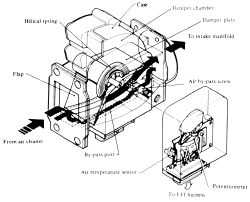
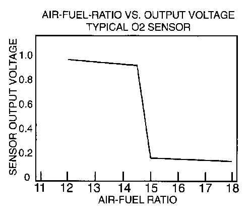
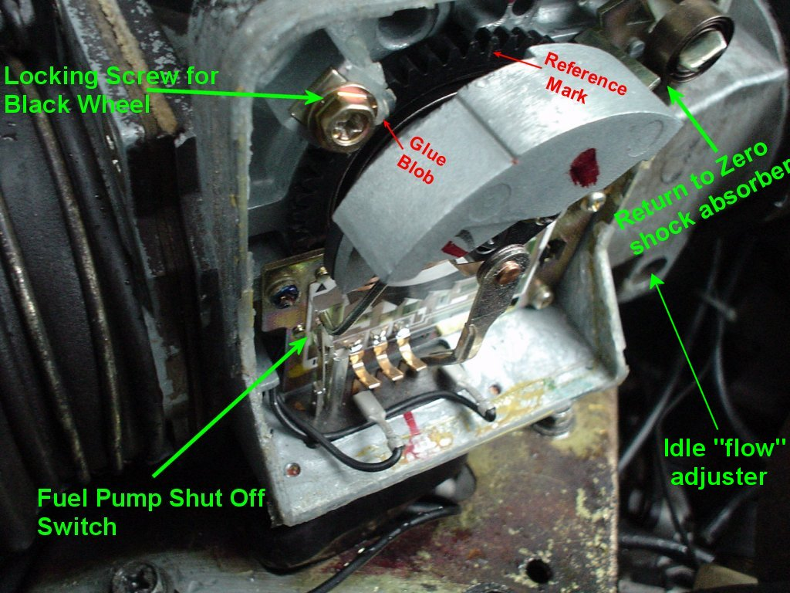
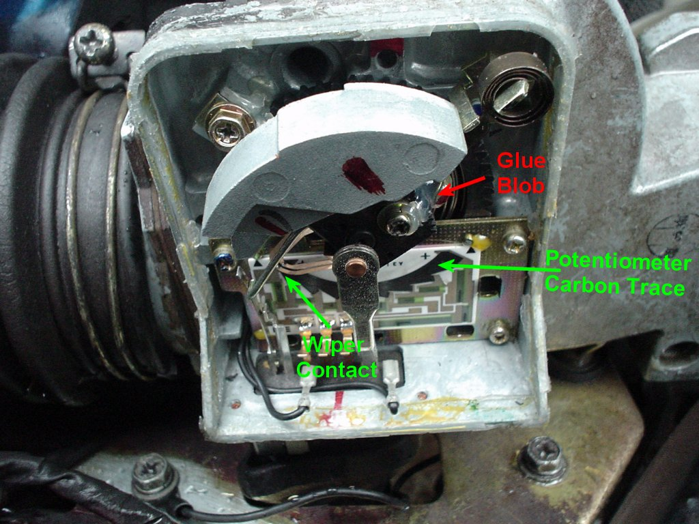
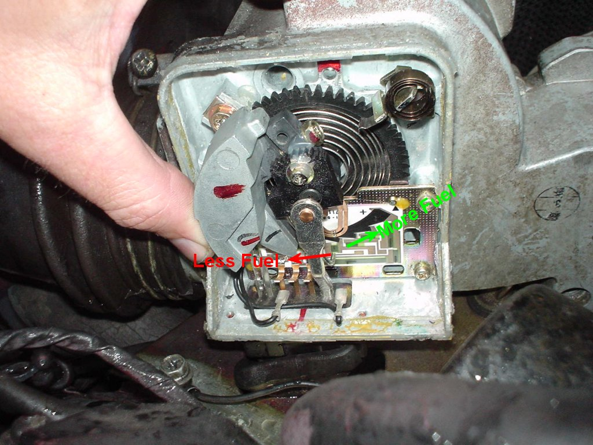
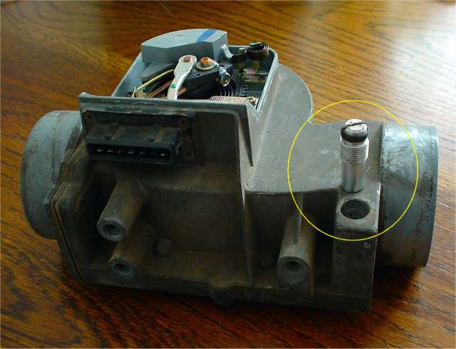

# AFM TUNING AND REBUILD GUIDE (1975-1978 280Z)

<!-- Page 1 (AFM-1) -->
# AFM Tuning and Rebuild Guide (1975–1978 Datsun 280Z)

## The AFM is Your Friend ('75–'78 280Z)

> 🖼️ **Cutaway schematic of Bosch L-Jetronic Air Flow Meter (AFM) showing internal air bypass, damper chamber, flap, helical spring, and potentiometer housing** `[afm[1].gif]` *(Type: `cutaway_flow`)*
>
> 
>
> - **Summary:** Schematic isometric cutaway diagram illustrating the complete internal air path and electro-mechanical mechanisms of the 280Z AFM. Incoming air from the air cleaner pushes against the pivoted measuring flap, which is counter-balanced by a damper plate moving within a closed damper chamber. An idle air bypass passage runs underneath the main measuring bore, regulated by an adjustable idle bypass needle screw. The intake air temperature sensor probe extends directly into the incoming airstream. The flap pivot shaft connects to the external electrical housing containing the helical return spring and potentiometer.
> - **Components:** Measuring flap, Helical return spring, Damper chamber, Damper plate (counterweight vane), Main air passage, By-pass port, Air by-pass screw, Air temperature sensor (thermistor), Potentiometer assembly, Cast aluminum case, To intake manifold duct, From air cleaner duct, EFI harness connector
> - **Callouts:** **(Helical spring)** Helical return spring controlling flap resistance; **(Case)** Cast aluminum main housing; **(Damper chamber)** Sealed chamber damping intake air pulses; **(Damper plate)** Vane counteracting intake air pulsations; **(Flap)** Main airflow measuring flap; **(From air cleaner)** Air inlet from air filter; **(By-pass port)** Idle air bypass channel beneath main air passage; **(Air by-pass screw)** Idle air bypass adjustment screw; **(To intake manifold)** Air outlet to throttle body and intake manifold; **(Air temperature sensor)** Intake air temperature thermistor probe; **(Potentiometer)** Potentiometer resistive board and wiper assembly; **(To EFI harness)** Electrical connector socket to engine wiring harness
> - **Specs / Measurements:** Air-fuel ratio nominal target: 12:1 to 15:1; Air temperature sensor enrichment threshold: ≤ 20°C (70°F)
> - **Wiring / Connections:** To EFI harness connector (7-pin terminal block)
> - **Mechanic Notes:** Bypass channel allows idle airflow to bypass the measuring flap. If the bypass screw is closed completely, backfire ('front fire') shock waves cannot vent through the passage and will bend or destroy the measuring flap.
> - **Tags:** `AFM`, `air flow meter`, `cutaway`, `damper chamber`, `bypass screw`, `flap`, `potentiometer`, `intake air temperature sensor`, `Bosch L-Jetronic`

### What an AFM Does
The Air Flow Meter (AFM) measures air velocity into the throttle body and sends a corresponding analog voltage signal to the Engine Control Unit (ECU). The ECU then calculates the exact volume of fuel to mix with the measured volume of air. If the AFM falsely reports too much or too little air, the ECU meters the incorrect volume of fuel, causing the engine to run excessively rich or dangerously lean.

### What an AFM Does When Set Up Incorrectly

* **Too Much Fuel (Rich Mixture):**
  * Results in degraded fuel economy (poor MPG), heavy carbon/sooty spark plug fouling, sooty tailpipe deposits, visible black exhaust smoke, and exhaust backfiring.
  * Over time, persistent rich combustion can overheat and permanently damage cylinder heads, exhaust valves, catalytic converters, and the exhaust system.

* **Too Little Fuel (Lean Mixture):**
  * Produces deceptive initial fuel mileage gains, but causes elevated combustion temperatures, engine overheating, and severe pre-ignition in the intake tract known as an intake "front fire" or intake pop.
  * Intake front fires generate violent pressure spikes and high heat that can bend or shatter the delicate aluminum AFM measuring flap, damage the throttle body, and crack intake ducting.
  * White, blistered spark plug insulators accompanied by spattered electrode erosion or melting are definitive signs of a dangerously lean air-fuel mixture.

---

### How It Works
The AFM is essentially an air-actuated potentiometer (similar to a stereo volume potentiometer) operated by a wind vane measuring flap positioned in the intake air path between the air cleaner filter and the throttle body.

1. **Airflow Deflection:** As intake air is drawn into the engine, the incoming air velocity pushes against the spring-loaded AFM flap.
2. **Potentiometer Wiper Rotation:** The pivoting flap shaft rotates a dual-finger potentiometer wiper across a precision carbon resistive trace.
3. **Analog Voltage Signal to ECU:** The wiper picks up a divided voltage signal (ranging from approximately 2.0 V to 7.0 V) and sends it directly to the ECU. The ECU meters fuel delivery directly proportional to this signal:
   * **At Idle:** Airflow velocity is low; the flap is cracked only slightly open (~1 cm wiper displacement from rest), generating low voltage (~2 V) so the ECU delivers minimal fuel.
   * **Under Acceleration / WOT:** Airflow velocity is high; the flap is pushed wide open, generating high voltage (~7 V) so the ECU injects maximum fuel volume.

#### Intake Air Temperature Sensor & Density Compensation
The AFM casting incorporates an integrated intake air temperature sensor (thermistor probe) extending directly into the incoming airstream. Because air density (and oxygen content per unit volume) varies inversely with temperature, the ECU continuously reads thermistor resistance to correct the base air-fuel ratio:
* Cold, dense air contains more oxygen molecules per unit volume, requiring additional fuel enrichment to maintain the desired air-fuel ratio (commonly calibrated between **12:1 and 15:1 AFR**).
* **ECU Cold-Air Threshold:** The ECU injects extra cold-air enrichment only when incoming intake air temperature is **20°C (70°F) or less**. Above 20°C, temperature enrichment tapers off.

> 🖼️ **Characteristic curve of Air-Fuel Ratio (AFR) vs. Zirconia Oxygen Sensor output voltage showing steep transition at stoichiometric (14.7:1)** `[hal1.jpg]` *(Type: `graph_chart`)*
>
> 
>
> - **Summary:** Graph plotting narrow-band zirconia O2 sensor output voltage (0 to 1.0 V) as a function of air-fuel ratio (11:1 to 18:1). Rich mixtures (12:1 - 14.5:1) produce a high sensor output of 0.90 - 0.95 V. At the stoichiometric ratio (~14.7:1), the voltage drops sharply from 0.9 V to ~0.15 V. Lean mixtures (15:1 - 18:1) produce a low output of 0.12 - 0.15 V.
> - **Components:** Sensor Output Voltage (Y-axis, 0 - 1.0 V), Air-Fuel Ratio (X-axis, 11:1 - 18:1), Stoichiometric transition cliff (14.7:1), Rich zone (12 - 14.5:1), Lean zone (15 - 18:1)
> - **Callouts:** **(Sensor Output Voltage)** Y-axis spanning 0.0 to 1.0 Volts; **(Air-Fuel Ratio)** X-axis spanning 11:1 to 18:1 AFR; **(Rich Mixture Region)** 12:1 to 14.5:1 AFR corresponds to 0.90 - 0.95 V; **(Stoichiometric Transition)** Steep voltage cliff at ~14.7:1 AFR; **(Lean Mixture Region)** 15:1 to 18:1 AFR corresponds to 0.12 - 0.15 V
> - **Specs / Measurements:** Nominal rich voltage: ~0.9 V (AFR 12:1 - 14.5:1); Stoichiometric switch: 14.7:1 AFR; Nominal lean voltage: ~0.15 V (AFR 15:1 - 18:1)
> - **Mechanic Notes:** Narrow-band O2 sensors exhibit extreme sensitivity right at 14.7:1 AFR but provide little resolution deep in rich or lean zones. Tuning the AFM without a wideband AFR meter relies on spark plug color reading, fingering responsiveness, and fuel economy measurement.
> - **Tags:** `O2 sensor`, `air fuel ratio`, `AFR`, `voltage curve`, `stoichiometric`, `rich mixture`, `lean mixture`

---

### Fuel Pump Safety Shut-Off Switch
A critical mechanical safety switch is integrated inside the AFM electrical chamber on 1975 to early 1977 280Z models:

* **Safety Function:** When the engine stops running, intake airflow ceases and the spring-loaded flap snaps completely shut. A mechanical actuator arm attached to the flap pivot releases a dual-leaf contact switch inside the chamber, breaking the electrical ground circuit to the fuel pump relay and immediately halting the electric fuel pump.
* **Collision Hazard Prevention:** In a vehicle collision where fuel lines may sever, engine stoppage immediately terminates fuel pumping to prevent catastrophic fires.
* **Note on Later Models:** Some late 1977 and 1978 280Z models utilize an oil pressure sensor switch (or dual-circuit oil pressure sender) to govern fuel pump shut-off in place of or in conjunction with the AFM mechanical switch.

---

### Mechanical Features & Adjustment Mechanisms (Picture 1)

> 🖼️ **Picture 1: AFM mechanical chamber showing locking screw for black wheel, factory glue blob, reference mark, counterweight, return-to-zero shock absorber, and fuel pump shut-off switch** `[afm1.jpg]` *(Type: `component_location`)*
>
> 
>
> - **Summary:** Top view of the AFM mechanical and electrical compartment with black plastic dust cover removed. Shows the black notched adjustment wheel under tension of the clock spring, the upper-left locking screw with clamp washer, the factory glue blob, user-scribed reference marks on the gear teeth and aluminum casting, the cast zinc counterweight, the return-to-zero spring steel shock absorber, the fuel pump safety shut-off switch contacts, and the internal idle flow bypass adjuster passage.
> - **Components:** Black toothed adjustment wheel, Locking screw with clamp tab for black wheel, Coil spring (clock spring), Zinc counterweight, Return to zero shock absorber spring, Fuel pump shut-off switch leaf contacts, Factory glue blob, Scribed reference mark, Idle 'flow' adjuster bore, Wiring leads to connector pins
> - **Callouts:** **(Locking Screw for Black Wheel)** Upper left screw securing the toothed black spring tension wheel; **(Reference Mark)** Red paint / scribe line marking original factory tooth position against casting; **(Glue Blob)** Original factory silicone / glue seal locking black wheel; broken blob indicates prior tampering; **(Return to Zero shock absorber)** Curved spring steel strip absorbing rotational inertia when flap snaps shut; **(Fuel Pump Shut Off Switch)** Dual contact leaf switch actuated by wiper arm to cut fuel pump when engine stalls; **(Idle "flow" adjuster)** Access port for internal idle bypass needle valve
> - **Specs / Measurements:** Return-to-zero shock absorber clearance: contacts ~5 mm (1/2 cm) before physical stop; Pin 36-39 fuel pump switch: Flap closed = infinite Ω (open), Flap cracked = 0 Ω (closed)
> - **Wiring / Connections:** Black wire leads from fuel pump safety switch to connector terminals (Pins 36 and 39)
> - **Mechanic Notes:** WARNING: The black toothed wheel is under spring tension! Loosening the locking screw without holding firm finger pressure on the wheel will cause it to violently recoil ('sprong') and lose all factory calibration. ALWAYS scribe a reference mark on the tooth and case before loosening!
> - **Tags:** `AFM`, `Picture 1`, `black wheel`, `locking screw`, `counterweight`, `shock absorber`, `fuel pump switch`, `glue blob`, `reference mark`

#### Key Features in Picture 1:
* **Counterbalance Weight:** The large semi-circular grey zinc/alloy casting counterbalances the physical weight of the aluminum wind vane flap inside the air tunnel, allowing smooth, instantaneous rotation even under minute idle airflow.
* **Return-to-Zero Shock Absorber:** A curved strip of spring steel that cushions the rotational momentum of the counterweight and flap as they snap shut when airflow ceases. This prevents the AFM mechanism from hammering itself to death against the mechanical stop each time the engine shuts down.
* **Black Toothed Wheel & Clock Spring:** The heart of the AFM metering calibration. A coiled spiral clock spring opposes flap opening.
  * **Spring Wound Too Tight:** Flap cannot open sufficiently for a given volume of airflow; signal voltage stays artificially low; ECU severely under-fuels the engine resulting in a **lean mixture**.
  * **Spring Wound Too Loose:** Flap swings open excessively; signal voltage spikes too high; ECU over-fuels resulting in a **rich mixture**.

> [!WARNING]
> **HIGH SPRING TENSION HAZARD!**
> The black notched gear wheel is preloaded under significant clock-spring tension. If you remove or loosen the retaining locking screw without maintaining firm finger pressure against the black wheel, it will violently recoil ("SPRONG!") and completely lose factory calibration.
> **ALWAYS SCRIBE A REFERENCE LINE ON A TOOTH AND ON THE CASTING BEFORE TOUCHING OR LOOSENING THE LOCKING SCREW!**

* **Factory Glue / Silicone Blob:** A blob of factory locking sealant secures the black wheel to the casting. If this seal is cracked, separated, or missing, the AFM has been previously tampered with. (For example, inspection of a tampered 1977 280Z revealed the previous owner had rotated the wheel ~10 teeth lean, evidenced by separated glue residue 10 teeth away).
* **Reference Marks:** Scribe a clear alignment scratch across a specific gear tooth and continue the scribe mark directly onto the aluminum housing rim (preferably centered on a tooth). This provides an absolute return-to-base zero point.
* **Idle Flow Adjuster:** An internal bypass needle valve that regulates the volume of idle air channeled through a secondary bypass passage cast directly underneath the main flap bore. Adjusting this screw trims idle mixture without changing flap spring preload.

---

### Potentiometer Board, Wiper, & Circuit Details (Picture 2)

> 🖼️ **Picture 2: AFM potentiometer board, wiper contacts, second glue blob locking screw, and carbon resistance trace** `[afm2.jpg]` *(Type: `component_location`)*
>
> 
>
> - **Summary:** Detailed close-up of the ceramic potentiometer printed circuit board, dual-finger beryllium copper wiper arm, center pivot locking screw with glue blob #2, fuel pump switch actuator arm (silver nail-like pin), and curved carbon resistor trace. The wiper picks up an analog voltage signal ranging from approximately 2V (idle/closed) to 7V (wide-open throttle) and routes it to the ECU.
> - **Components:** Ceramic potentiometer circuit board, Dual beryllium copper wiper contacts, Curved carbon resistance trace, Wiper center pivot locking screw, Glue blob #2, Silver nail-like actuator pin for fuel switch, Gold-plated PCB terminal pads, Return-to-zero shock absorber leaf, Lead wires with spade push-on terminals
> - **Callouts:** **(Potentiometer Carbon Trace)** Curved resistive carbon track dividing voltage from ~2.0V to 7.0V; **(Wiper Contact)** Dual flexible copper wiper fingers sweeping along the carbon track; **(Glue Blob)** Glue blob #2 securing the center wiper pivot locking screw (adjusts 0V rest position and fuel pump switch arm)
> - **Specs / Measurements:** Potentiometer total resistance (Pins 8 & 6): ~180 Ω; Reference resistor (Pins 8 & 9): 100 Ω; Wiper sweep voltage range: ~2.0 V to ~7.0 V; Wiper rest limit: Stops 2 to 4 mm before the end of the carbon trace (must not fall off trace)
> - **Wiring / Connections:** Pin 6: Low side of potentiometer; Pin 7: Wiper pickup arm; Pin 8: High side of potentiometer; Pin 9: Reference/control resistor; Spade terminals connected to internal base pins
> - **Mechanic Notes:** Ensure the wiper does not overshoot the clockwise end of the carbon trace when the flap is closed; it must stop 2-4 mm before the edge. If the wiper shoots off the trace, it registers an open circuit (infinite resistance) and causes severe lean stumble or engine stall. Loosen the center pivot screw to recalibrate wiper rest position.
> - **Tags:** `AFM`, `Picture 2`, `potentiometer`, `carbon trace`, `wiper contact`, `resistance`, `pins 6 7 8 9`, `DeoxIT`

#### Additional Components in Picture 2:
* **Potentiometer Wiper:** Flexible dual beryllium-copper wiper fingers that sweep across the arc of the carbon track as the flap rotates, picking up and transmitting divided signal voltage (~2.0 V to 7.0 V) to the ECU.
* **Carbon Resistive Trace:** High-precision printed resistive element dividing voltage along the wiper sweep path.
* **Internal Reference Resistor:** The ceramic board contains an internal reference resistor measured by the ECU across Pins 8 and 9 (nominally 100 Ω). Because carbon track resistance fluctuates with ambient under-hood temperature, the ECU measures the reference resistor to calculate and compensate for thermal drift across the main track.
* **Glue Blob #2 & Wiper Pivot Locking Screw:** Secures the center wiper pivot arm to the flap shaft. Loosening this screw allows calibrating the wiper rest position (0 V / idle position) and adjusting the silver nail-like actuator pin that triggers the fuel pump shut-off switch.
* **Return-to-Zero Shock Absorber Adjustment:** At rest, the curved shock absorber leaf spring should contact the rotating counterweight assembly approximately **5 mm (~1/2 cm)** before the assembly hits the solid metal stop. If bent backward (commonly caused by age or violent intake "front fire" backfire pressure waves), gently bend the spring steel forward so it properly cushions closing impact.

---

### Step-by-Step Bench Inspection Procedure

1. **AFM Removal:**
   * Disconnect the negative (–) battery cable.
   * Unplug the 7-pin wiring harness connector from the AFM.
   * Loosen hose clamps and carefully disconnect the two rubber intake duct hoses (do not tear or stress aged rubber).
   * Remove the 4 mounting bolts securing the AFM bottom support bracket to the chassis. Note the ground strap terminal.
2. **Shock Absorber Check:** Inspect the return-to-zero spring. Verify that it contacts the counterweight ~5 mm before mechanical stop impact.
3. **Flap Freedom of Movement:** Manually push the flap through its full swing. It must pivot silky-smooth with zero binding, roughness, flat spots, or axial play.
4. **Fuel Pump Switch Contact Verification:** Observe the leaf switch contacts while opening and closing the flap. Contacts must firmly touch when open and cleanly separate with infinite resistance when the flap rests against the closed stop.
5. **Wiper Rest Margin Verification:** At the fully closed rest position, inspect where the wiper fingers contact the carbon trace. The wiper must rest on the trace, stopping approximately **2 to 4 mm** before the clockwise (CW) edge. It must **never run off the end of the carbon trace**. If the wiper runs off the track, it registers an open circuit (infinite resistance) and starves the engine. Loosen the center pivot screw ("Glue Blob #2") to realign the wiper and fuel switch actuator pin if necessary.
6. **Wiper Sweep Inspection:** Slowly sweep the flap to wide-open throttle while observing contact finger pressure along the entire carbon track.

---

### Electrical Contact Cleaning Procedure

Use a high-quality electrical contact cleaner and enhancer (such as **Caig DeoxIT D5**):
* Clean the dual silver contacts of the fuel pump shut-off switch.
* Gently clean the copper wiper fingers and ceramic carbon trace using a lint-free swab saturated with DeoxIT (do not use abrasives or scrape the carbon film).
* Clean the 7 external multi-pin harness connector male terminals. If oxidized green or tarnished, clean with isopropyl alcohol and a small precision brass file or burnishing tool.

---

### Connector Pin Resistance Specifications

Connect a calibrated digital multimeter directly to the male connector pins on the AFM body:

| Test Circuit | Pin Terminals | Flap / Operating Condition | Factory Standard Specification | Technical Purpose |
| :--- | :--- | :--- | :--- | :--- |
| **Fuel Pump Shut-Off Switch** | **Pins 39 & 36** | Flap Fully Closed (Rest) | **$\infty$ (Infinite Resistance / Open)** | Ensures fuel pump is disabled when engine is stopped |
| **Fuel Pump Shut-Off Switch** | **Pins 39 & 36** | Flap Cracked Open (Run) | **$0\ \Omega$ (Continuity / Closed)** | Energizes fuel pump relay as soon as intake air flows |
| **Potentiometer Total Resistance** | **Pins 8 & 6** | Flap Any Position | **$\sim 180\ \Omega$** | High-to-low total resistance across full carbon/copper trace |
| **Reference / Control Resistor** | **Pins 8 & 9** | Any Condition | **$100\ \Omega$** | Thermal compensation reference circuit for ECU |
| **Potentiometer Wiper Output (High)** | **Pins 7 & 8** | Flap Sweeping from Closed to WOT | **Smoothly Varying Resistance** | Wiper output to high reference |
| **Potentiometer Wiper Output (Low)** | **Pins 6 & 7** | Flap Sweeping from Closed to WOT | **Smoothly Varying Resistance** | Wiper output to low reference |
| **Intake Air Temperature Sensor** | **Thermal Pins** | Ambient at $20^\circ\text{C}\ (68^\circ\text{F})$ | **$2,500\ \Omega \pm 250\ \Omega$** | NTC thermistor cold-air density fuel compensation |

---

### Pre-Adjustment Checklist (Crucial Prerequisites)

> 🖼️ **Picture 3: Fingering check technique demonstrating manual deflection of the wiper counterweight towards 'More Fuel' (CCW) and 'Less Fuel' (CW)** `[afm3.jpg]` *(Type: `procedure_step`)*
>
> 
>
> - **Summary:** Illustration of the live engine 'fingering' diagnostic check. With the AFM cover removed and engine running, a finger gently rotates the counterweight/wiper assembly clockwise (CW, toward 'Less Fuel' / lean) or counter-clockwise (CCW, toward 'More Fuel' / rich). Listening to engine RPM and smoothness at idle and at 3,000 RPM reveals whether the engine is starved for fuel (lean) or drowning in fuel (rich) before altering the black gear setting.
> - **Components:** Technician finger applying manual deflection, Counterweight and wiper carrier, Direction arrow: More Fuel (CCW), Direction arrow: Less Fuel (CW), Black toothed adjustment wheel, Clock spring, Circuit board and wiper arm
> - **Callouts:** **(More Fuel)** Counter-clockwise (CCW) rotation opens flap further, increasing output voltage and enriching mixture; **(Less Fuel)** Clockwise (CW) rotation moves flap towards closed position, lowering output voltage and leaning mixture
> - **Specs / Measurements:** Idle wiper displacement: ~10 mm (1 cm) from rest; Stock calibrated AFM optimal fingering deflection: ~4 mm to rich (CCW) for maximum RPM; Test RPM levels: Idle (~750-800 RPM) and steady 3,000 RPM; Adjustment step increment: ~4 teeth per adjustment
> - **Mechanic Notes:** Always verify ignition timing, mechanical cam timing, valve lash, vacuum leaks, and EFI coolant temperature sensor integrity BEFORE modifying AFM spring tension. False lean symptoms caused by vacuum leaks or over-advanced timing will lead to improper over-enrichment of the AFM.
> - **Tags:** `AFM`, `Picture 3`, `fingering`, `more fuel`, `less fuel`, `tuning`, `CCW rich`, `CW lean`, `mixture adjustment`

> [!IMPORTANT]
> **NEVER ADJUST THE AFM TO COMPENSATE FOR UNRESOLVED FAULTS IN OTHER ENGINE SYSTEMS!**
> Altering AFM spring tension to mask a vacuum leak or ignition defect results in two improperly configured systems. Perform the following checks first:

1. **Ignition Timing:** Check and set base ignition timing strictly to factory specifications printed on the under-hood vehicle emission label. Over-advanced timing mimics a lean hesitation, leading mechanics to mistakenly enrich the AFM.
2. **Mechanical Timing & Valvetrain:** Confirm timing chain synchronization between camshaft and crankshaft. Check and adjust valve clearances (lash) to factory hot/cold specifications.
3. **Spark Plug Inspection:** Remove and inspect all 6 spark plugs. Ensure all cylinders exhibit identical coloration. A single fouled or white plug indicates an isolated injector, valve, or ignition lead failure rather than an AFM fault.
4. **EFI Component Verification:**
   * Leaking Cold Start Valve: Enriches entire fuel curve; do not lean out AFM to compensate.
   * Thermotime Switch / Air Regulator: Verify proper warm-up timing.
   * Fuel Pressure: Measure fuel rail pressure (must be ~30 psi at idle with vacuum connected, ~36.3 psi with vacuum disconnected). Low fuel pressure mimics lean AFM calibration; high pressure causes rich fouling.
   * Leaking or Clogged Fuel Injectors.
   * Coolant Temperature Sensor (CHT / Water Temp Sensor): Located in the thermostat housing / cylinder head. Corroded or broken wiring harness connections at this sensor fool the ECU into reading extreme cold, commanding a massive rich fuel flood. Clean terminals thoroughly.
5. **Vacuum & Unmetered Air Leaks:** Air entering through torn rubber intake boots, cracked vacuum lines, leaking valve cover gaskets, warped intake manifold gaskets, or faulty PCV/EGR valves completely bypasses the AFM flap. The ECU never meters this false air, creating a severe lean misfire. Repair all unmetered intake leaks before proceeding!

---

### The "Fingering" Diagnostic Check

The fingering technique allows a technician to dynamically simulate AFM fuel adjustments on a live running engine without unlocking the black wheel:

1. Pry off the black plastic AFM dust cover.
2. Start engine in neutral with hood secured and allow it to reach full operating temperature.
3. At idle, observe that the flap cracks open slightly and the wiper rests approximately 1 cm from its fully closed stop.
4. **Test Rich Direction (CCW):** Gently and slowly deflect the wiper arm counter-clockwise (toward "MORE FUEL"). Listen to engine RPM and idle note. If RPM rises and idle smooths out, the engine was running lean.
5. **Test Lean Direction (CW):** Gently and slowly deflect the wiper arm clockwise (toward "LESS FUEL"). Listen to engine response. If RPM rises, the engine was running rich.
6. **Evaluate Cruise / High RPM Response:** Manually open the throttle linkage to hold engine speed steady at approximately **3,000 RPM**.
7. Deflect wiper CCW (rich) and CW (lean) at 3,000 RPM.
8. **Consistency Check:** Verify that the direction of required deflection (rich or lean) is consistent at both idle and 3,000 RPM.
9. **Calibration Baseline:** On a perfectly calibrated stock factory AFM, manual fingering requires approximately **4 mm deflection toward rich (CCW)** to achieve maximum engine RPM during the check.

---

### Tuning Procedure for Maximum Power

1. **Index Alignment:** Scribe a sharp reference mark across a tooth of the black wheel and directly onto the aluminum casting rim.
2. Perform the live fingering check at idle, mid-range, and near WOT.
   * If fingering **CW** improves performance: Spring is too loose (running too rich) $\rightarrow$ Proceed to Step 3.
   * If fingering **CCW** improves performance: Spring is too tight (running too lean) $\rightarrow$ Proceed to Step 4.
3. **To Lean Mixture (Less Fuel):**
   * Rotate counterweight to expose black wheel locking screw.
   * Press thumb firmly against the black wheel to prevent recoil.
   * Loosen locking screw.
   * Carefully rotate the black wheel **Clockwise (CW) ~4 teeth** while maintaining firm finger pressure.
   * Retighten locking screw securely.
4. **To Enrich Mixture (More Fuel):**
   * Rotate counterweight, hold black wheel firmly, and loosen locking screw.
   * Carefully rotate black wheel **Counter-Clockwise (CCW) ~4 teeth**.
   * Retighten locking screw securely.
5. Run engine, repeat fingering verification, and adjust in finer 1-to-2 tooth increments until maximum power and crisp throttle response are achieved. Final tooth setting should remain within reasonable proximity of factory reference mark.
6. Clean spark plugs, drive a minimum of 10 miles under varying loads, and inspect plug insulators to ensure mixture is not overly rich (carbon fouled) or lean (chalky white).

---

### Tuning Procedure for Fuel Efficiency (Economy)

1. Scribe reference index marks on tooth and casting.
2. Establish a baseline MPG average over a full 300-mile tank of fuel (filling to 3 inches below filler neck vent).
3. Follow the Maximum Power procedure above to determine the engine's peak power tooth setting. Mark this tooth with an **"X"**.
4. To tune for fuel economy, loosen the locking screw and advance the black wheel **4 to 6 teeth Clockwise (CW)** from the "X" power setting.
5. Refill tank and record MPG over the next 300 miles. Target economy is **23 to 26 MPG (US)**.
6. Inspect spark plugs immediately to ensure insulators maintain a safe light-tan coloration without white blistering or electrode erosion.
7. **Empirical Benchmarks:**
   * Lean / Factory-Equivalent Setting: Produced **23 MPG** in real-world testing (~2.5 to 3 teeth leaner than optimum power).
   * Rich Power Setting: Produced **19 MPG** with significantly enhanced throttle responsiveness and pull.

---

### Idle Bypass Screw Adjustment & Intake Backfire Protection

> 🖼️ **AFM idle air bypass adjustment screw removed from housing, showing adjustment slot, O-ring seal, and bypass port** `[idleadjust.jpg]` *(Type: `component_location`)*
>
> 
>
> - **Summary:** View of the complete AFM cast aluminum body with the idle air bypass adjustment screw backed out of its threaded bore in the casting (highlighted with yellow circle). The screw features a slotted drive head, threaded shank, and rubber O-ring seal. Turning this screw CW restricts unmetered bypass airflow beneath the flap, enriching idle mixture; turning CCW increases bypass airflow, leaning idle mixture.
> - **Components:** Idle air bypass needle screw, Rubber sealing O-ring, Threaded bypass adjustment bore in AFM body, 7-pin electrical harness receptacle, Main air measuring duct (outlet side), Mechanical / electrical upper housing casting
> - **Callouts:** **(Yellow circle)** Slotted idle air bypass needle adjustment screw and threaded passage bore
> - **Specs / Measurements:** Turn Clockwise (CW): Restricts bypass passage -> Forces more air past flap -> Enriches idle mixture; Turn Counter-Clockwise (CCW): Opens bypass passage -> Bypasses more air around flap -> Leans idle mixture
> - **Wiring / Connections:** 7-pin female electrical socket integrated into side casting
> - **Mechanic Notes:** CAUTION: Do not bottom out or completely seal the idle bypass screw. When an intake backfire ('front fire') occurs due to lean mixture, explosive pressure waves vent harmlessly through the bypass passage. If the screw is closed shut, the pressure wave has nowhere to go and will bend or fracture the delicate aluminum measuring flap.
> - **Tags:** `AFM`, `idle adjust`, `bypass screw`, `idle mixture`, `O-ring`, `front fire protection`, `idle air bleed`

The idle bypass needle screw located on the exterior casting controls air routed through the secondary passage directly beneath the main measuring bore:
* **Function:** Fine-tunes idle air-fuel ratio independently of the spring-loaded flap.
* **To Enrich Idle:** Turn screw **Clockwise (CW)** into the housing. This restricts the bypass channel, forcing more air past the measuring flap, raising wiper voltage, and enriching idle mixture.
* **To Lean Idle:** Turn screw **Counter-Clockwise (CCW)** out of the housing. This opens the bypass channel, allowing more air to circumvent the flap, lowering wiper voltage, and leaning idle mixture.

> [!CAUTION]
> **PREVENT CATASTROPHIC FLAP DAMAGE FROM INTAKE "FRONT FIRES"**
> Never turn the idle air bypass screw fully bottomed out (closed)! When an engine backfires into the intake manifold due to lean misfire or valve overlap, violent shock waves travel back toward the air cleaner. The idle bypass passage serves as an essential pressure relief corridor. If the screw is sealed shut, the full blast wave slams into the closed measuring flap, instantly bending the aluminum vane or shattering internal stops.

---

### Advanced Calibration References
For laboratory-precision AFM air-curve tuning using water manometer vacuum measurement, refer to the AtlanticZ AFM Water Calibration technical bulletin.

---

## Segmented Diagrams Index

| Figure | Code | Type | Page | Caption | Key Components / Callouts | File |
| :--- | :--- | :--- | :--- | :--- | :--- | :--- |
| **Fig. AFM-1** | `afm[1].gif` | `cutaway_flow` | AFM-1 | Cutaway schematic of Bosch L-Jetronic Air Flow Meter (AFM) showing internal air bypass, damper chamber, flap, helical spring, and potentiometer housing | Measuring flap, Helical return spring, Damper chamber, Damper plate (counterweight vane), Main air passage | [fig_afm_internal_construction_cutaway.png](diagrams/afm tuning and rebuild/fig_afm_internal_construction_cutaway.png) |
| **Fig. AFM-2** | `hal1.jpg` | `graph_chart` | AFM-1 | Characteristic curve of Air-Fuel Ratio (AFR) vs. Zirconia Oxygen Sensor output voltage showing steep transition at stoichiometric (14.7:1) | Sensor Output Voltage (Y-axis, 0 - 1.0 V), Air-Fuel Ratio (X-axis, 11:1 - 18:1), Stoichiometric transition cliff (14.7:1), Rich zone (12 - 14.5:1), Lean zone (15 - 18:1) | [chart_afr_vs_o2_sensor_voltage.png](diagrams/afm tuning and rebuild/chart_afr_vs_o2_sensor_voltage.png) |
| **Fig. AFM-3** | `afm1.jpg` | `component_location` | AFM-1 | Picture 1: AFM mechanical chamber showing locking screw for black wheel, factory glue blob, reference mark, counterweight, return-to-zero shock absorber, and fuel pump shut-off switch | Black toothed adjustment wheel, Locking screw with clamp tab for black wheel, Coil spring (clock spring), Zinc counterweight, Return to zero shock absorber spring | [fig_afm_internal_features_picture_1.png](diagrams/afm tuning and rebuild/fig_afm_internal_features_picture_1.png) |
| **Fig. AFM-4** | `afm2.jpg` | `component_location` | AFM-1 | Picture 2: AFM potentiometer board, wiper contacts, second glue blob locking screw, and carbon resistance trace | Ceramic potentiometer circuit board, Dual beryllium copper wiper contacts, Curved carbon resistance trace, Wiper center pivot locking screw, Glue blob #2 | [fig_afm_wiper_and_carbon_trace_picture_2.png](diagrams/afm tuning and rebuild/fig_afm_wiper_and_carbon_trace_picture_2.png) |
| **Fig. AFM-5** | `afm3.jpg` | `procedure_step` | AFM-1 | Picture 3: Fingering check technique demonstrating manual deflection of the wiper counterweight towards 'More Fuel' (CCW) and 'Less Fuel' (CW) | Technician finger applying manual deflection, Counterweight and wiper carrier, Direction arrow: More Fuel (CCW), Direction arrow: Less Fuel (CW), Black toothed adjustment wheel | [fig_afm_fingering_and_mixture_direction_picture_3.png](diagrams/afm tuning and rebuild/fig_afm_fingering_and_mixture_direction_picture_3.png) |
| **Fig. AFM-6** | `idleadjust.jpg` | `component_location` | AFM-1 | AFM idle air bypass adjustment screw removed from housing, showing adjustment slot, O-ring seal, and bypass port | Idle air bypass needle screw, Rubber sealing O-ring, Threaded bypass adjustment bore in AFM body, 7-pin electrical harness receptacle, Main air measuring duct (outlet side) | [fig_afm_idle_bypass_adjustment_screw.png](diagrams/afm tuning and rebuild/fig_afm_idle_bypass_adjustment_screw.png) |
